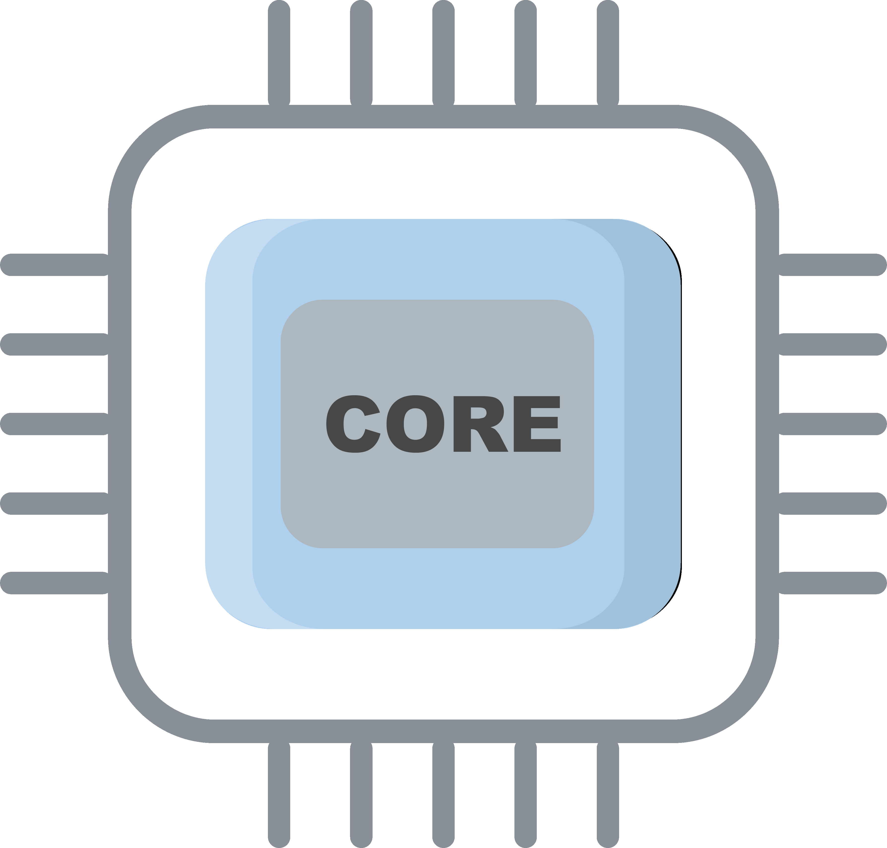

# 024 - Bộ Đếm Phân Mảnh (Sharded Counters)

[← Bài trước](023-dieu-phoi-tac-vu-task-scheduler.md) | [Mục lục](README.md) | [Bài tiếp theo →](025-tong-ket-building-blocks.md)

---


# Thiết Kế Hệ Thống: Bộ Đếm Phân Mảnh (The Sharded Counters)

Giới thiệu tổng quan về bộ đếm phân mảnh (*sharded counters*).

Chúng ta sẽ tìm hiểu các nội dung sau:
* Phát biểu bài toán (*Problem statement*)
* Chúng ta sẽ thiết kế bộ đếm phân mảnh như thế nào?

---

## 1. Phát biểu bài toán (Problem Statement)

Các ứng dụng thời gian thực (*real-time applications*) như Facebook, Twitter và YouTube có lưu lượng truy cập của người dùng rất lớn (*high user traffic*). Người dùng tương tác với các ứng dụng và thực hiện nhiều thao tác khác nhau (xem - *view*, thích - *like*, bình luận - *comment*, v.v.) tùy thuộc vào cấu trúc của từng ứng dụng. 

Ví dụ, một hình ảnh được đăng trên một trang Facebook có hàng triệu người theo dõi, và số lượt thích (*likes*) của bài đăng đó tăng lên nhanh chóng sau mỗi mili-giây. Ở trường hợp này, việc đếm số lượt thích cho một hình ảnh đơn lẻ có thể dễ dàng, nhưng chúng ta sẽ phải làm gì khi hàng ngàn hình ảnh hoặc video như vậy được tải lên đồng thời bởi nhiều người nổi tiếng, mỗi người đều sở hữu hàng triệu người theo dõi? Bài toán này được gọi là **bài toán phần tử vượt trội (heavy hitters problem)**.

Kịch bản trên cho thấy một thao tác đếm đơn giản lại trở nên đầy thách thức như thế nào khi phải quản lý đồng thời cả độ chính xác lẫn hiệu năng (*precision and performance*). Hình dưới đây minh họa các video trên YouTube được hàng triệu người dùng xem trong khoảng thời gian 24 giờ vào tháng 8 năm 2021:


### Lượt xem video YouTube trong 24 giờ (YouTube videos' views in 24 hours)


Trung bình, có sáu nghìn bài đăng (*tweets*) được gửi trên Twitter trong vòng một giây, tương đương với 360.000 tweets mỗi phút và khoảng 500 triệu tweets mỗi ngày. Một tác vụ đầy thách thức là phải xử lý hàng tỷ lượt thích (*likes*) trên 500 triệu tweets mỗi ngày này.

Bảng dưới đây hiển thị các tweet được thích nhiều nhất trong một ngày tính đến năm 2022:

**Các tweet được thích nhiều nhất trong một ngày (*Most liked tweets in a single day*)**

| Tài khoản / Chủ đề | Nội dung / Mô tả |
| :--- | :--- |
| Gia đình Chadwick Boseman (*Family of Chadwick Boseman*) | Thông báo về sự ra đi của nam diễn viên Chadwick Boseman |


Làm thế nào để chúng ta xử lý hàng triệu yêu cầu ghi (*write requests*) dồn dập vào lượt thích của hàng nghìn tweets mỗi phút? 

Thách thức nằm ở chỗ thao tác ghi (*writing*) luôn tốn nhiều thời gian hơn thao tác đọc (*reading*), và hoạt động đồng thời (*concurrent activity*) càng làm cho vấn đề này trở nên phức tạp hơn. Khi số lượng ghi đồng thời (*concurrent writes*) vào cùng một bộ đếm (vốn có thể chỉ là một biến nằm trong bộ nhớ của một nút mạng - *node’s memory*) tăng lên, mức độ tranh chấp khóa (**lock contention**) sẽ tăng phi tuyến tính. Vượt qua một ngưỡng nhất định, chúng ta có thể phải dành phần lớn thời gian chỉ để tranh giành và lấy khóa (*acquiring the lock*) nhằm cập nhật bộ đếm một cách an toàn.

---

## 2. Chúng ta sẽ thiết kế bộ đếm phân mảnh như thế nào? (How Will We Design Sharded Counters?)

Chúng ta đã chia thiết kế của bộ đếm phân mảnh thành ba bài học:

1. **Thiết kế mức cao (High-level Design):** Chúng ta sẽ thảo luận về thiết kế tổng quan mức cao của bộ đếm phân mảnh trong bài học này. Ngoài ra, chúng ta cũng sẽ giải thích ngắn gọn về thiết kế giao diện lập trình ứng dụng (*API design*).
2. **Thiết kế chi tiết (Detailed Design):** Bài học này sẽ đi sâu vào chi tiết thiết kế của bộ đếm phân mảnh. Hơn nữa, chúng ta cũng sẽ đánh giá thiết kế được đề xuất.
3. **Câu hỏi ôn tập (Quiz):** Chúng ta sẽ xem lại các khái niệm chính trong thiết kế bộ đếm phân mảnh thông qua một bài trắc nghiệm.

Hãy bắt đầu với phác thảo giải pháp mức cao cho bộ đếm phân mảnh.

---

## 3. Thiết Kế Mức Cao Của Bộ Đếm Phân Mảnh (High-level Design of Sharded Counters)

Hãy cùng tìm hiểu và thiết kế các bộ đếm phân mảnh (*sharded counters*).

Chúng ta sẽ bao gồm các nội dung sau:
* Phác thảo giải pháp mức cao (*High-level solution sketch*)
* Thiết kế API cho bộ đếm phân mảnh (*API design for sharded counters*)
  * Tạo bộ đếm (*Create counter*)
  * Ghi vào bộ đếm (*Write counter*)
  * Đọc bộ đếm (*Read counter*)

---

### Phác thảo giải pháp mức cao (High-level solution sketch)

Việc quản lý hàng triệu lượt thích trên tweet đòi hỏi nhiều bộ đếm hoạt động trên nhiều nút (*nodes*). Để quản lý các bộ đếm này, chúng ta cần một hệ thống hiệu quả có thể mang lại hiệu năng cao (*high performance*) và khả năng mở rộng quy mô (*scalability*) khi số lượng người dùng tăng lên.

Điều gì sẽ xảy ra khi một tweet đơn lẻ trên Twitter nhận được một triệu lượt thích, và máy chủ ứng dụng (*application server*) nhận được một yêu cầu ghi cho mỗi lượt thích để tăng bộ đếm tương ứng? Hàng triệu yêu cầu này cuối cùng sẽ bị tuần tự hóa (*serialized*) trong một hàng đợi (*queue*) nhằm đảm bảo tính nhất quán dữ liệu (**data consistency**). 

Việc tuần tự hóa như vậy là một giải pháp để xử lý hoạt động đồng thời (*concurrent activity*), tuy nhiên nó phải đánh đổi bằng việc gia tăng độ trễ. Các ứng dụng thời gian thực (*real-time applications*) luôn muốn duy trì chất lượng trải nghiệm của người dùng ở mức cao bằng cách cung cấp độ trễ (**latency**) thấp nhất có thể cho người dùng cuối.

Hãy xem hình minh họa dưới đây để hiểu rõ vấn đề này:


#### So sánh Tweet của Người nổi tiếng và Người bình thường (Celebrity vs. common people tweet)

```
[Hàng triệu người dùng]           [Một người dùng]
   (Millions of users)              (Single user)
          │                               │
   Bùng nổ lượt thích               Một lượt thích
   (Burst of likes)                  (Single like)
          ▼                               ▼
 [Celebrity_tweet]                     [Tweet]
          │                               │
   Yêu cầu ghi User_1               Yêu cầu ghi User
 (User_1 write request)           (User write request)
          ▼                               ▼
       [Queue]                            │
   User_2, User_3, ...                    ▼
          ▼                          [Counter 2]
     [Counter 1]
```

Một bộ đếm đơn lẻ cho mỗi tweet được đăng bởi người nổi tiếng là không đủ để đáp ứng hàng triệu người dùng. 

Giải pháp cho vấn đề này là một **bộ đếm phân mảnh (sharded counter)**, hay còn được gọi là **bộ đếm phân tán (distributed counter)**, trong đó mỗi bộ đếm sẽ có một số lượng mảnh (*shards*) được chỉ định tùy theo nhu cầu. Các mảnh (*shards*) này chạy song song trên các đơn vị tính toán (*computational units*) khác nhau. Chúng ta có thể cải thiện hiệu năng và giảm thiểu tranh chấp khóa (*contention*) bằng cách cân bằng hàng triệu yêu cầu ghi trải đều trên các mảnh.

Đầu tiên, một yêu cầu ghi sẽ được chuyển tiếp đến bộ đếm tweet tương ứng khi người dùng thích tweet đó. Sau đó, hệ thống chọn một mảnh khả dụng (*available shard*) của bộ đếm tweet đó để tăng số lượt thích. 

Hãy quan sát hình minh họa dưới đây để hiểu về bộ đếm phân mảnh với các mảnh được chỉ định:


### Các bộ đếm và các mảnh của chúng hoạt động trên các đơn vị tính toán khác nhau (Counters and their shards working on different computational units)


```
                        [ Bộ đếm phân mảnh (Sharded counters) ]
                                          │
    ┌─────────────────────────────────────┼─────────────────────────────────────┐
    ▼                                     ▼                                     ▼
[Counter_0]                          [Counter_1]                          [Counter_M]
  ├── Shard_0                          ├── Shard_0                          ├── Shard_0
  └── Shard_N                          └── Shard_N                          └── Shard_N
```

Trong hình minh họa ở trên, tổng số mảnh (*shards*) trên mỗi bộ đếm là:
$$(N + 1)$$

Chúng ta sẽ sử dụng một giá trị phù hợp cho $N$ tùy theo nhu cầu thực tế. 

Hãy cùng thảo luận một ví dụ để hiểu cách bộ đếm phân mảnh xử lý hàng triệu yêu cầu ghi và đọc cho một bài đăng duy nhất:

Giả sử rằng một kênh YouTube nổi tiếng với hàng triệu người đăng ký tải lên một video mới. Máy chủ nhận được một đợt bùng nổ các yêu cầu ghi (*burst of write requests*) cho lượt xem video từ người dùng trên toàn thế giới. 
1. Đầu tiên, một bộ đếm mới được khởi tạo cho video vừa được tải lên. 
2. Máy chủ chuyển tiếp yêu cầu đến bộ đếm tương ứng, và hệ thống của chúng ta chọn ngẫu nhiên một mảnh (*shard*) rồi cập nhật giá trị của mảnh đó (giá trị ban đầu là 0). 
3. Ngược lại, khi máy chủ nhận được các yêu cầu đọc (*read requests*), nó sẽ cộng tổng giá trị của tất cả các mảnh thuộc về bộ đếm đó để có được tổng số hiện tại.

> [!NOTE]
> Chúng ta có thể sử dụng bộ đếm phân mảnh (*sharded counter*) cho mọi kịch bản đòi hỏi khả năng đếm có thể mở rộng quy mô lớn (**scalable counting**), chẳng hạn như các bài đăng trên Facebook và video trên YouTube.

---

## 4. Thiết Kế API Cho Bộ Đếm Phân Mảnh (API Design for Sharded Counters)

Phần này thảo luận về các giao diện lập trình ứng dụng (APIs) sẽ được gọi cho các bộ đếm phân mảnh. Thiết kế API sẽ giúp chúng ta hiểu rõ các tương tác giữa các bộ đếm phân mảnh và các thành phần gọi chúng (*callers*). 

Để cuộc thảo luận mang tính cụ thể, chúng ta sẽ phân tích từng hàm API trong ngữ cảnh của Twitter. Chúng ta sẽ phát triển các API cho từng chức năng dưới đây:

---

# Thiết Kế Hệ Thống: Bộ Đếm Phân Mảnh (Sharded Counter)

## Các API Cốt Lõi (Core APIs)

* **Tạo bộ đếm (`Create counter`)**
* **Ghi vào bộ đếm (`Write counter`)**
* **Đọc bộ đếm (`Read counter`)**

Mặc dù danh sách các hàm API trên chưa phải là toàn diện (exhaustive), nhưng chúng đại diện cho những hàm quan trọng nhất.

---

### 1. Tạo Bộ Đếm (`Create counter`)

API `\createCounter` dùng để khởi tạo một bộ đếm phân tán (distributed counter) sẵn sàng cho việc sử dụng.

**Chữ ký hàm (Signature):**
```text
createCounter(counter_id, number_of_shards)
```

| Tham số (`Parameter`) | Mô tả (`Description`) |
| :--- | :--- |
| `counter_id` | Đại diện cho định danh duy nhất (unique ID) của bộ đếm. Bên gọi (caller) của API này có thể sử dụng một bộ tạo chuỗi định danh (sequencer) để lấy một ID duy nhất. Xem bài học về các thành phần khối dựng sequencer (sequencer building blocks) để biết thêm chi tiết. |
| `number_of_shards` | Chỉ định số lượng phân mảnh (number of shards) cho bộ đếm. |

Chúng ta có thể sử dụng một kho lưu trữ dữ liệu (data store) phù hợp để lưu giữ siêu dữ liệu (metadata), bao gồm:
* Các định danh bộ đếm (`counter identifiers`).
* Số lượng phân mảnh (`number of shards`) của chúng.
* Ánh xạ giữa các phân mảnh tới các máy chủ vật lý (mapping of shards to physical machines).

Hãy lấy ví dụ về Twitter để hiểu cách một ứng dụng sử dụng API trên. API `\createCounter` được gọi khi một người dùng đăng tải nội dung nào đó lên mạng xã hội. Ví dụ, nếu một người dùng đăng một bài tweet trên Twitter, máy chủ ứng dụng (application server) sẽ gọi API `\createCounter`. Tham số `content_type` là loại bài viết (post type) mà hệ thống dùng để quyết định số lượng bộ đếm cần được tạo ra. Ví dụ: hệ thống chỉ cần một bộ đếm lượt xem (view counter) nếu tweet đó có chứa một đoạn video.

Để tìm một giá trị phù hợp cho `number_of_shards`, chúng ta có thể áp dụng các phương pháp phỏng đoán/kinh nghiệm thực nghiệm (heuristics) sau:
* **Tham số `followers_count`**: Thể hiện số lượng người theo dõi của người dùng đăng tweet.
* **Tham số `post_type`**: Xác định bài viết là công khai (public) hay được bảo vệ/riêng tư (protected). Các tweet được bảo vệ chỉ dành cho người theo dõi, và trong trường hợp này, chúng ta có một cơ sở dự đoán tốt hơn về số lượng phân mảnh (shards).

---

### 2. Ghi Vào Bộ Đếm (`Write counter`)

API `\writeCounter` được sử dụng khi chúng ta muốn tăng (increment) hoặc giảm (decrement) một bộ đếm. Trên thực tế, một phân mảnh cụ thể (specific shard) của bộ đếm sẽ được tăng hoặc giảm, và dịch vụ của chúng ta sẽ đưa ra quyết định đó dựa trên nhiều yếu tố mà chúng ta sẽ thảo luận sau.

**Chữ ký hàm (Signature):**
```text
writeCounter(counter_id, action_type)
```

| Tham số (`Parameter`) | Mô tả (`Description`) |
| :--- | :--- |
| `counter_id` | Là định danh duy nhất (được cung cấp tại thời điểm tạo bộ đếm). |
| `action_type` | Chỉ định hành động dự định thực hiện (tăng giá trị - increment hoặc giảm giá trị - decrement của bộ đếm). Chúng ta trích xuất thông tin cần thiết về bộ đếm từ kho lưu trữ dữ liệu (data store). |

Trong ví dụ Twitter của chúng ta, API `\writeCounter` được sử dụng khi người dùng tương tác (bằng cách thích - liking, trả lời - replying, v.v.) vào bài đăng của người khác hoặc bài đăng của chính họ.

---

### 3. Đọc Bộ Đếm (`Read counter`)

API `\readCounter` được sử dụng khi chúng ta muốn biết giá trị hiện tại của bộ đếm. Hệ thống của chúng ta sẽ lấy thông tin thích hợp từ kho lưu trữ dữ liệu (datastore) để tổng hợp giá trị từ tất cả các phân mảnh.

**Chữ ký hàm (Signature):**
```text
readCounter(counter_id)
```

| Tham số (`Parameter`) | Mô tả (`Description`) |
| :--- | :--- |
| `counter_id` | Là định danh duy nhất (được cung cấp tại thời điểm tạo bộ đếm). |

Đối với Twitter, `counter_id` sẽ được quyết định dựa trên các chỉ số/thước đo sau:
* **`tweet_id`**: Xác định ID duy nhất của tweet mà yêu cầu được tạo ra. Chúng ta có thể sử dụng `tweet_id` để lấy `counter_id` cho tất cả các bộ đếm của các tính năng (lượt thích - likes, lượt tweet lại - retweets, v.v.).

API `\readCounter` được gọi khi người dùng muốn xem số lượt thích hoặc số lượt xem trên một tweet cụ thể. Thông thường, API này được kích hoạt bởi một API khác khi người dùng muốn xem dòng thời gian trang chủ (home timeline) hoặc dòng thời gian người dùng (user timeline) của họ.

Phần tiếp theo sẽ thảo luận về những gì xảy ra trong hệ thống back-end khi tất cả các API trên được gọi.

---

# Thiết Kế Chi Tiết Của Các Bộ Đếm Phân Mảnh (Detailed Design of Sharded Counters)

Tìm hiểu chi tiết về thiết kế của các bộ đếm phân mảnh (sharded counters).

### Chúng ta sẽ bao quát các nội dung sau:
* Thiết kế chi tiết (`Detailed design`)
* Khởi tạo bộ đếm phân mảnh (`Sharded counter creation`)
* Bùng nổ các yêu cầu ghi (`Burst of writes requests`)
* Lựa chọn vòng tròn (`Round-robin selection`)
* Lựa chọn ngẫu nhiên (`Random selection`)
* Lựa chọn dựa trên chỉ số (`Metrics-based selection`)
* Quản lý các yêu cầu đọc (`Manage read requests`)
* Sử dụng bộ đếm phân mảnh cho bài toán Top K (`Using sharded counters for the Top K problem`)
* Bố trí/Sắp đặt các bộ đếm phân mảnh (`Placement of sharded counters`)
* Đánh giá bộ đếm phân mảnh (`Evaluation of the sharded counters`)
  * Độ khả dụng (`Availability`)
  * Khả năng mở rộng (`Scalability`)
  * Độ tin cậy (`Reliability`)
* Kết luận (`Conclusion`)

---

## Thiết Kế Chi Tiết (`Detailed design`)

Bây giờ chúng ta sẽ thảo luận chi tiết về ba chức năng chính của bộ đếm phân mảnh: **Tạo (creation)**, **Ghi (write)**, và **Đọc (read)**. Chúng ta sẽ trả lời nhiều câu hỏi quan trọng bằng cách lấy Twitter làm ví dụ. Các câu hỏi này bao gồm:
1. Có bao nhiêu phân mảnh (shards) nên được tạo cho mỗi tweet mới?
2. Giá trị của phân mảnh sẽ được tăng lên như thế nào cho một tweet cụ thể?
3. Điều gì sẽ xảy ra trong hệ thống khi các yêu cầu đọc (read requests) đến từ người dùng cuối (end users)?

---

## Khởi Tạo Bộ Đếm Phân Mảnh (`Sharded counter creation`)

Như chúng ta đã thảo luận trước đó, khi một người dùng đăng một bài tweet trên Twitter, API `\createCounter` sẽ được gọi. Hệ thống sẽ tạo nhiều bộ đếm cho mỗi bài đăng mới được tạo bởi người dùng. Dưới đây là danh sách các bộ đếm chính được tạo cho mỗi tweet mới:
* Bộ đếm lượt thích tweet (`Tweet like counter`)
* Bộ đếm lượt phản hồi tweet (`Tweet reply counter`)
* Bộ đếm lượt retweet (`Tweet retweet counter`)
* Bộ đếm lượt xem tweet trong trường hợp tweet có chứa video (`Tweet view counter in case a tweet contains video`)

Bây giờ, câu hỏi đặt ra là: **Làm thế nào để hệ thống quyết định số lượng phân mảnh (number of shards) trong mỗi bộ đếm?**

> [!IMPORTANT]
> Số lượng phân mảnh đóng vai trò then chốt cho hiệu năng tối ưu (performance):
> * **Nếu số lượng phân mảnh quá nhỏ** so với một khối lượng tải ghi (write workload) cụ thể, chúng ta sẽ đối mặt với tình trạng **tranh chấp ghi cao (high write contention)**, dẫn đến tốc độ ghi chậm (`slow writes`).
> * **Nếu số lượng phân mảnh quá cao** so với một mô hình ghi (write profile) cụ thể, chúng ta sẽ gặp phải **chi phí tổng thể (overhead) lớn hơn nhiều trên thao tác đọc (`read operation`)**.

Nguyên nhân của việc đọc chậm hơn là do phải tập hợp giá trị (collection of values) từ các phân mảnh khác nhau có thể đang cư trú trên các nút (nodes) phân bố rải rác bên trong các trung tâm dữ liệu phân tán theo địa lý (geographically distributed data centers). Chi phí đọc một giá trị bộ đếm **tăng tuyến tính (rises linearly)** theo số lượng phân mảnh vì giá trị của tất cả các phân mảnh của bộ đếm tương ứng phải được cộng lại với nhau. Thao tác ghi mở rộng tuyến tính (scale linearly) khi chúng ta thêm các phân mảnh mới do nhu cầu tăng yêu cầu (increasing requests). Do đó, tồn tại một sự **đánh đổi (trade-off)** giữa việc thực hiện ghi nhanh và hiệu năng đọc. Chúng ta sẽ thảo luận về cách cải thiện hiệu năng đọc ở phần sau.

Quyết định về số lượng phân mảnh phụ thuộc vào nhiều yếu tố mà về mặt tổng thể là nhằm dự đoán tải ghi (write load) trên một bộ đếm cụ thể trong ngắn hạn. Đối với tweet, các yếu tố này bao gồm **số lượng người theo dõi (`follower count`)**. Tweet của một người dùng có hàng triệu người theo dõi sẽ nhận được nhiều phân mảnh hơn so với người dùng có ít người theo dõi trên Twitter, bởi vì có khả năng tweet của họ sẽ nhận được rất nhiều lượt thích, thường lên đến hàng triệu. Đôi khi, một tweet của người nổi tiếng (celebrity) có kèm theo một hoặc nhiều thẻ hashtag. Hệ thống cũng sẽ tạo bộ đếm phân mảnh cho hashtag này vì nó có khả năng cao được xếp vào danh sách thịnh hành (trend).

Nhiều hoạt động lấy con người làm trung tâm (human-centered activities) thường có mô hình hoạt động đuôi dài (**long-tailed activity pattern**), nơi phần lớn mọi người tập trung vào một nhóm tương đối nhỏ các hoạt động. Có lẽ khoảng chú ý bị rút ngắn (shortened attention spans) có thể đóng một vai trò ở đây. Điều này có nghĩa là sau một khoảng thời gian, làn sóng bùng nổ lượt thích (flurry of likes) sẽ lắng xuống, và hiện tại chúng ta có thể không cần nhiều phân mảnh cho một bộ đếm như lúc ban đầu nữa. Tương tự, dự đoán ban đầu của chúng ta cho các lượt ghi trong tương lai có thể sai, và chúng ta có thể cần nhiều phân mảnh hơn để xử lý các yêu cầu ghi. 

> [!TIP]
> **Yêu cầu đối với hệ thống:** Hệ thống cần có khả năng **mở rộng linh hoạt (dynamically expand)** hoặc **thu hẹp (shrink)** số lượng phân mảnh dựa trên nhu cầu thực tế tại thời điểm hiện tại.

Chúng ta cần giám sát tải ghi (write load) cho tất cả các phân mảnh để điều hướng yêu cầu (route requests) một cách phù hợp đến các phân mảnh cụ thể, có thể sử dụng các bộ cân bằng tải (load balancers). Một cơ chế phản hồi (feedback mechanism) như vậy cũng có thể giúp chúng ta quyết định khi nào nên đóng bớt một số phân mảnh của một bộ đếm và khi nào nên bổ sung thêm các phân mảnh. Quá trình này không chỉ mang lại hiệu năng tốt cho người dùng cuối mà còn tối ưu hóa việc tận dụng tài nguyên ở mức gần như tối ưu (near-optimal levels).

---

### Điểm Cần Suy Ngẫm (`Point to Ponder`)

> **Câu hỏi:**
> *Điều gì sẽ xảy ra khi một người dùng chỉ có một vài người theo dõi nhưng lại có một bài đăng lan truyền nhanh chóng (viral) trên Twitter?*
>
> **Câu trả lời:**
> Hệ thống cần phát hiện các trường hợp như vậy khi một bộ đếm bất ngờ bắt đầu nhận được lưu lượng ghi rất cao (very high write traffic). Chúng ta sẽ **tăng động số lượng phân mảnh (dynamically increase the number of shards)** của bộ đếm bị ảnh hưởng để giảm thiểu và xử lý tình huống này.

---

## Bùng Nổ Các Yêu Cầu Ghi (`Burst of writes requests`)

Như chúng ta đã đề cập trước đó, hàng triệu người dùng tương tác với tweet của người nổi tiếng trong ví dụ của chúng ta, điều này rốt cuộc sẽ gửi một đợt bùng nổ các yêu cầu ghi (burst of write requests) đến hệ thống. Hệ thống sẽ gán mỗi yêu cầu ghi vào các phân mảnh khả dụng của bộ đếm được chỉ định...

---

# Thiết Kế Bộ Đếm Phân Mảnh (Sharded Counters) — Cơ Chế Phân Phối Yêu Cầu Ghi

...của bài đăng (tweet) cụ thể đó. Làm thế nào hệ thống có thể lựa chọn các phân mảnh (shards) đang hoạt động trên các đơn vị tính toán (nodes) khác nhau để gán các yêu cầu ghi (write requests)? Chúng ta có thể sử dụng **ba phương pháp tiếp cận** để thực hiện điều này:

---

## 1. Lựa Chọn Theo Vòng Tròn (Round-Robin Selection)

Một cách để giải quyết bài toán trên là sử dụng cơ chế chọn phân mảnh theo vòng tròn (**Round-robin selection**). 

Ví dụ, giả sử số lượng phân mảnh (shards) là 100. Hệ thống bắt đầu phân phối với `shard_1`, sau đó đến `shard_2`, và tiếp tục tuần tự cho đến khi chạm tới `shard_100`. Thông thường, việc phân bổ công việc theo cơ chế round-robin sẽ dẫn đến tình trạng **quá tải (overload)** hoặc **chưa tận dụng hết tài nguyên (underutilize resources)**, bởi vì việc lập lịch (scheduling) được thực hiện mà không hề xem xét đến các điều kiện tải hiện thời (**current load conditions**). 

Tuy nhiên, nếu mọi yêu cầu (request) đều tương tự nhau (và cần xấp xỉ cùng một khoảng thời gian xử lý phục vụ), phương pháp tiếp cận round-robin hoàn toàn có thể được sử dụng và trở nên hấp dẫn nhờ tính đơn giản của nó.

Chuỗi trình chiếu slide dưới đây minh họa quá trình lựa chọn shard bằng kỹ thuật Round-robin:

> [!NOTE]  
> Chúng ta giả định rằng các yêu cầu từ người dùng trước tiên được bộ cân bằng tải (**Load Balancer**) phân phối đến một máy chủ ứng dụng (**Server**) thích hợp. Sau đó, mỗi máy chủ như vậy lại tự sử dụng bộ lập lịch Round-robin nội bộ của riêng mình để chọn một shard. Chúng tôi chỉ minh họa một máy chủ duy nhất nhằm mục đích đơn giản hóa mô hình; tuy nhiên trong thực tế, một máy chủ chứa shard (**shard server**) có thể nhận các yêu cầu từ nhiều máy chủ ứng dụng cùng một thời điểm và có thể bị quá tải, gây ra hiện tượng trễ (**delays / latency**) cho yêu cầu của một máy chủ cụ thể, điều này sẽ được thể hiện rõ trong các slide tiếp theo.

---

### Slide 1 / 5: Gán Yêu Cầu Cho Shard Đầu Tiên

Máy chủ gán một yêu cầu ghi vào phân mảnh đang rảnh đầu tiên: `shard_1` (với giá trị bộ đếm hiện tại là 12), nhưng `shard_1` vẫn chưa hoàn thành việc xử lý yêu cầu và chưa kịp tăng bộ đếm của nó.


* **Hàng triệu người dùng (Millions of users)** gửi các **yêu cầu ghi (Write requests)** tới **Máy chủ (Server)**.
* Máy chủ tiến hành **Gán tác vụ vào shard (Assigning task to shard)**: Yêu cầu tăng giá trị của `Shard_1` (**Increment Shard_1 value**).
* Trạng thái các Shard:
  * `Shard_1`: Giá trị = 12 (Trạng thái: Shard đang rảnh - **Shard is free**)
  * `Shard_2`: Giá trị = 66
  * `Shard_3`: Giá trị = 31
  * `Shard_4`: Giá trị = 65

---

### Slide 2 / 5: Gán Tuần Tự Sang Shard Kế Tiếp (Shard_2)

Máy chủ gán một yêu cầu ghi tiếp theo cho phân mảnh rảnh kế tiếp: `shard_2` (với giá trị bộ đếm hiện tại là 66), nhưng `shard_2` vẫn chưa hoàn thành việc xử lý yêu cầu và chưa tăng bộ đếm của nó.


* **Gán tác vụ vào shard (Assigning task to shard)**: Yêu cầu tăng giá trị của `Shard_2` (**Increment Shard_2 value**).
* Trạng thái các Shard:
  * `Shard_1`: Đang thực hiện tác vụ tăng/giảm (**Shard is performing increment/decrement**)
  * `Shard_2`: Giá trị = 66 (Được chọn tiếp theo theo vòng lặp Round-robin)
  * `Shard_3`: Giá trị = 31 (Trạng thái: Đang rảnh - **Shard is free**)
  * `Shard_4`: Giá trị = 65 (Trạng thái: Đang rảnh - **Shard is free**)

---

### Slide 3 / 5: Gán Tuần Tự Sang Shard_3

Máy chủ gán một yêu cầu ghi tiếp theo cho phân mảnh rảnh kế tiếp: `shard_3` (với giá trị bộ đếm hiện tại là 31), nhưng `shard_3` vẫn chưa hoàn thành việc xử lý yêu cầu và chưa tăng bộ đếm của nó.


* **Gán tác vụ vào shard (Assigning task to shard)**: Yêu cầu tăng giá trị của `Shard_3` (**Increment Shard_3 value**).
* Trạng thái các Shard:
  * `Shard_1`: Đang thực hiện tác vụ tăng/giảm (**Shard is performing increment/decrement**)
  * `Shard_2`: Đang thực hiện tác vụ tăng/giảm (**Shard is performing increment/decrement**)
  * `Shard_3`: Giá trị = 31 (Được chọn tiếp theo)
  * `Shard_4`: Giá trị = 65 (Trạng thái: Đang rảnh - **Shard is free**)

---

### Slide 4 / 5: Gán Tuần Tự Sang Shard_4

Máy chủ gán một yêu cầu ghi tiếp theo cho phân mảnh rảnh kế tiếp: `shard_4` (với giá trị bộ đếm hiện tại là 65), nhưng `shard_4` vẫn chưa hoàn thành việc xử lý yêu cầu và chưa tăng bộ đếm của nó.


* **Gán tác vụ vào shard (Assigning task to shard)**: Yêu cầu tăng giá trị của `Shard_4` (**Increment Shard_4 value**).
* Trạng thái các Shard:
  * `Shard_1`: Đang thực hiện tác vụ tăng/giảm (**Shard is performing increment/decrement**)
  * `Shard_2`: Đang thực hiện tác vụ tăng/giảm (**Shard is performing increment/decrement**)
  * `Shard_3`: Đang thực hiện tác vụ tăng/giảm (**Shard is performing increment/decrement**)
  * `Shard_4`: Giá trị = 65 (Được chọn tiếp theo)

---

### Slide 5 / 5: Hiện Tượng Nghẽn Tắc Do Cơ Chế Round-Robin Bị Khóa Chặt (HOL Blocking)

Máy chủ **không thể thực hiện yêu cầu ghi tiếp theo** cho đến khi `shard_1` (phân mảnh kế tiếp sau `shard_4` theo chu kỳ vòng tròn) ở trạng thái rảnh rỗi. Mặc dù `Shard_3` đã xử lý xong việc tăng bộ đếm của mình lên giá trị **32** và hiện tại đang hoàn toàn rảnh rỗi, chúng ta **vẫn không thể tận dụng được nó** bởi vì mô hình tuần tự Round-robin cố định mà chúng ta đang áp dụng ở đây.


* Yêu cầu tiếp theo muốn tăng giá trị `Shard_1` (**Increment Shard_1 value**).
* Trạng thái các Shard:
  * `Shard_1`: Vẫn đang bận thực hiện tác vụ tăng/giảm (**Shard is performing increment/decrement**) $\rightarrow$ **Gây nghẽn hệ thống (Block)**.
  * `Shard_2`: Đang thực hiện tác vụ tăng/giảm (**Shard is performing increment/decrement**).
  * `Shard_3`: Đã hoàn tất, giá trị tăng lên 32, hiện đang rảnh (**Shard is free**) nhưng bị bỏ phí.
  * `Shard_4`: Đang thực hiện tác vụ tăng/giảm (**Shard is performing increment/decrement**).

---

## 2. Lựa Chọn Ngẫu Nhiên (Random Selection)

Một phương pháp tiếp cận đơn giản khác là lựa chọn phân mảnh (shard) để ghi một cách ngẫu nhiên và đồng đều (**uniformly and randomly select a shard for writing**). 

> [!WARNING]  
> Thách thức chung đối với cả cơ chế **Lựa chọn theo vòng tròn (Round-robin selection)** và **Lựa chọn ngẫu nhiên (Random selection)** nằm ở **sự biến động tải (variable load changes)** trên các nút máy chủ vật lý/ảo hóa (nơi các phân mảnh được lưu trữ/host). 
> Rất khó để phân phối tải một cách thích hợp và tối ưu đến các shard khả dụng. Hiện tượng biến thiên tải (**Load variability**) trên các nút tính toán là điều rất phổ biến trong môi trường phân tán, bởi vì một nút vật lý thường được dùng chung cho nhiều mục đích và tiến trình khác nhau cùng lúc.

---

## 3. Lựa Chọn Dựa Trên Số Liệu Đo Lường (Metrics-Based Selection)

Phương pháp tiếp cận thứ ba là lựa chọn phân mảnh dựa trên các số liệu đo lường cụ thể (**specific metrics**). Ví dụ, một...

---

# Thiết Kế Hệ Thống: Bộ Đếm Phân Mảnh (Sharded Counters) & Bài Toán Top K

Một node chuyên dụng (bộ cân bằng tải - Load Balancer) quản lý việc lựa chọn các phân mảnh (shards) bằng cách đọc trạng thái của các shard. Các slide dưới đây trình bày chi tiết quy trình khởi tạo bộ đếm phân mảnh (*sharded counters*):


* **Người dùng (User)**: Tạo Tweet (`create Tweet`).
* **Máy chủ ứng dụng (Application server)**.
* **Máy chủ Hoa Kỳ (United States server)**, **Máy chủ Canada (Canada server)**, **Máy chủ Trung Quốc (China server)**.
* *Bước 1/4: Người dùng tạo một tweet.*

---


* Người dùng gửi yêu cầu khởi tạo bộ đếm thông qua API tạo mới (`create API`) tới máy chủ ứng dụng.
* *Bước 2/4: Người dùng yêu cầu một bộ đếm bằng cách sử dụng create API.*

---


* Máy chủ ứng dụng thực hiện tính toán số lượng shard (`Calculate number of shards`) dựa trên một số chỉ số định lượng (*metrics*).
* *Bước 3/4: Máy chủ ứng dụng tính toán số lượng phân mảnh (shards) dựa trên các chỉ số nhất định.*

---




* Các yêu cầu tạo shard cho một bộ đếm được chỉ định thông qua API `createCounter` được phân phối tới các máy chủ phân tán theo vị trí địa lý (*geographically dispersed servers*):
  * `createCounter API` tới **United States server**.
  * `createCounter API` tới **Canada server**.
  * `createCounter API` tới **China server**.
* *Bước 4/4: Các yêu cầu tạo shard cho một bộ đếm được chỉ định bằng createCounter API được điều phối tới các máy chủ phân tán theo vị trí địa lý.*

---

## Quản Lý Các Yêu Cầu Đọc (Manage Read Requests)

Khi người dùng gửi yêu cầu đọc (*read request*), hệ thống sẽ tổng hợp giá trị của tất cả các shard thuộc bộ đếm được chỉ định để trả về tổng số lượng của tính năng đó (chẳng hạn như lượt thích - *like* hoặc lượt phản hồi - *reply*). Việc tích lũy/tổng hợp giá trị từ tất cả các shard trên mỗi yêu cầu đọc sẽ dẫn đến **thông lượng đọc thấp (low read throughput)** và **độ trễ đọc cao (high read latency)**.

Quyết định về thời điểm hệ thống sẽ tính tổng giá trị của tất cả các shard cũng mang tính sống còn. Nếu có lưu lượng ghi cao (*high write traffic*) diễn ra đồng thời với các lượt đọc, việc lấy được một giá trị thực sự tại thời điểm hiện tại gần như là bất khả thi, bởi vì ngay tại thời điểm chúng ta trả giá trị đọc về cho client, giá trị đó đã bị thay đổi mất rồi. Do đó, việc định kỳ đọc tất cả các shard của một bộ đếm và lưu vào bộ nhớ đệm (**caching**) sẽ đáp ứng được hầu hết các trường hợp sử dụng (*use cases*). Bằng cách giảm chu kỳ tổng hợp, chúng ta có thể tăng độ chính xác của các giá trị đọc.

---

> [!NOTE]
> ### Điểm Cần Suy Ngẫm (Point to Ponder)
> **Câu hỏi:** Bạn có thể nghĩ ra một trường hợp sử dụng (use case) nào mà bộ đếm phân mảnh (*sharded counters*) với mô hình nhất quán (*consistency model*) nêu trên có thể không phù hợp hay không?
> 
> **Ẩn / Hiện câu trả lời:**
> Chúng ta có thể không sử dụng các bộ đếm phân mảnh với mô hình nhất quán nới lỏng (*relaxed consistency model*) ở những nơi yêu cầu **tính nhất quán mạnh (Strong Consistency)**. Một ví dụ điển hình là các kịch bản đọc-sau-đó-ghi (**read-then-write**), nơi trước tiên chúng ta cần lấy giá trị chính xác tuyệt đối của một đối tượng trước khi quyết định sửa đổi nó (trên thực tế, một kịch bản như vậy sẽ cần sự hỗ trợ của giao dịch - **transaction support**).

---

## Ứng Dụng Bộ Đếm Phân Mảnh Cho Bài Toán Top K (Using Sharded Counters for the Top K Problem)

Phần này sẽ thảo luận về cách chúng ta có thể sử dụng bộ đếm phân mảnh để giải quyết một bài toán trong thế giới thực được gọi là **Bài toán Top K (Top K problem)**. Chúng ta sẽ tiếp tục lấy ứng dụng thời gian thực Twitter làm ví dụ, trong đó việc tính toán các xu hướng (*trends*) là một trong những bài toán Top K của Twitter. Ở đây, $K$ đại diện cho số lượng xu hướng hàng đầu. Rất nhiều người dùng sử dụng các thẻ hashtag khác nhau trong các tweet của họ. Quản lý số lượt đếm của hàng triệu hashtag để hiển thị chúng trên dòng thời gian xu hướng (*trends timeline*) của từng người dùng dựa trên vị trí địa phương (*locality*) của họ là một thách thức vô cùng lớn.

Bộ đếm phân mảnh chính là chìa khóa cho bài toán trên. Như đã thảo luận trước đó, trên Twitter, hệ thống tạo các bộ đếm cho từng hashtag và quyết định số lượng shard căn cứ theo số người theo dõi (*followers*) của người dùng đã gắn hashtag đó trong tweet. Khi người dùng trên Twitter sử dụng lại cùng một hashtag đó trong tweet của họ, lượt đếm vẫn sẽ được duy trì trên cùng một bộ đếm đã được tạo ban đầu ở lần sử dụng đầu tiên của hashtag đó.

Twitter hiển thị các xu hướng chủ yếu dựa trên mức độ phổ biến của hashtag cụ thể tại khu vực của người dùng. Twitter sẽ duy trì một bộ đếm riêng cho từng chỉ số được đề cập cùng với một bộ đếm hashtag toàn cục (**global hashtag counter**). Hãy cùng thảo luận về từng chỉ số định lượng dưới đây:

* **Lượt đếm hashtag theo khu vực (Region-wise hashtag count):** Cho biết số lượng tweet có cùng hashtag được sử dụng trong một khu vực địa lý cụ thể. Ví dụ: hàng nghìn tweet có cùng thẻ từ Thành phố New York cho thấy người dùng ở khu vực New York có thể thấy hashtag này trong dòng thời gian xu hướng của họ.
* **Khung thời gian (A time window):** Cho biết khoảng thời gian mà các tweet có thẻ cụ thể được đăng tải.
* **$K$**: Số lượng xu hướng hàng đầu cần truy xuất.

---


*Hệ thống tính toán số lượng trong 24 giờ của hashtag được chỉ định:*
* **Các bộ đếm dựa trên vị trí (Location-based counters)**
* **Các phân mảnh (Shards):** `5K`, `3K`, `156K`, `130K`, `760K`, v.v.
* **Bộ đếm hashtag toàn cục (Global hashtag counter):** `120M`

Dưới đây là chi tiết cụ thể hơn về minh họa trên:

* **Bộ đếm hashtag toàn cục (Global hashtag counter)** đại diện cho tổng của tất cả các bộ đếm dựa trên vị trí.
* **Các bộ đếm dựa trên vị trí (Location-based counters)** biểu thị số lượng hiện tại của chúng khi hệ thống đạt ngưỡng đã đặt (*set threshold*) trong một khoảng thời gian xác định và hashtag trở thành xu hướng đối với một số người dùng. Ví dụ: Twitter đặt ngưỡng là 10.000. Khi số lượng hashtag theo vị trí đạt 10.000, Twitter sẽ hiển thị các hashtag này trong dòng thời gian xu hướng của người dùng tại quốc gia tương ứng nơi hashtag đó đang được sử dụng. Hashtag được chỉ định có thể được hiển thị trên toàn thế giới (*worldwide*) nếu số lượng tăng lên ở tất cả các quốc gia.

Tiếp theo, chúng ta sẽ thảo luận về **Top K tweets** trên dòng thời gian trang chủ (*homepage timeline*) của người dùng. Các tweet Top K bao gồm các tài khoản mà người dùng đang theo dõi, các tweet mà người dùng đã thích và các lượt tweet lại (*retweets*) từ các tài khoản mà người dùng theo dõi. Các tweet nhận được mức độ ưu tiên trong bài toán Top K dựa trên **số lượng người theo dõi (follower count)** và **thời gian (time)**. Twitter cũng hiển thị các tweet được quảng bá (*promoted tweets*) và một số tweet của các tài khoản mà người dùng không theo dõi trên dòng thời gian trang chủ, tùy thuộc vào mức độ phổ biến và vị trí của tweet đó.

---

> [!NOTE]
> **Lưu ý:** Twitter cũng sử dụng các chỉ số khác để tối ưu hóa việc lựa chọn Top K, nhưng ở đây chúng ta đã thảo luận về các chỉ số hàng đầu.

## Vị Trí Đặt Bộ Đếm Phân Mảnh (Placement of Sharded Counters)

Một mối quan tâm quan trọng là chúng ta nên đặt các bộ đếm phân mảnh ở đâu:
* Chúng nên nằm trên cùng các node với các máy chủ ứng dụng (*application servers*)?
* Nằm trong các node riêng biệt trong trung tâm dữ liệu (*data center*)?
* Hay nằm trong các node của mạng phân phối nội dung (**CDN - Content Delivery Network**) tại biên của mạng (*edge of network*) gần với người dùng cuối?

Câu trả lời chính xác cho câu hỏi này phụ thuộc vào trường hợp sử dụng cụ thể của chúng ta. Đối với Twitter, chúng ta có thể tính toán số lượng bằng cách đặt các bộ đếm phân mảnh gần người dùng, điều này cũng giúp xử lý hiệu quả bài toán phần tử tần suất cao (**heavy hitter**) và bài toán **Top K**.

---

> [!IMPORTANT]
> ### Câu Hỏi Trắc Nghiệm / Ôn Tập (Quiz)
> **Câu hỏi:** Chúng ta có nên khóa (lock) tất cả các shard của một bộ đếm trước khi tích lũy / tính tổng giá trị của chúng hay không?
> 
> **Ẩn / Hiện câu trả lời:**
> **Không.** Các thao tác đọc có thể diễn ra đồng thời với các thao tác ghi mà không cần khóa liên shard (*across-shards lock*). Khóa này sẽ làm suy giảm nghiêm trọng hiệu năng ghi (**decimate write performance**) — vốn là lý do cốt lõi ban đầu khiến chúng ta phải sử dụng bộ đếm phân mảnh. 
> 
> Dưới một mô hình nhất quán nới lỏng (*relaxed consistency model*), nơi giá trị của bộ đếm có thể không phản ánh chính xác 100% giá trị tại thời điểm hiện tại, thì hoàn toàn không có nhu cầu khóa đọc đồng thời trên tất cả các shard (*simultaneous read locks across all shards*). Tuy nhiên, tùy thuộc vào trường hợp sử dụng cụ thể, cơ chế khóa như vậy có thể được sử dụng khi tần suất đọc là rất thấp (*reads frequency is very low*).

---

## Kiến Trúc Lưu Trữ & Xử Lý Đọc (Reads Architecture)

Các thao tác đọc (Reads) có thể lưu trữ giá trị bộ đếm trong các kho dữ liệu (data stores) phù hợp và dựa vào các kho dữ liệu tương ứng này để đạt được khả năng mở rộng quy mô đọc (**Read Scalability**). Kho lưu trữ **Cassandra** có thể được sử dụng để duy trì số lượt xem (views), lượt thích (likes), bình luận (comments), và nhiều số đếm khác của người dùng trong một khu vực địa lý xác định (region). Các số đếm này đại diện cho tổng được tính toán gần nhất (**last computed sum**) của tất cả các phân mảnh (**shards**) thuộc về một bộ đếm cụ thể.

Khi người dùng tạo dòng thời gian (timeline), các yêu cầu đọc (**read requests**) được chuyển tiếp đến các máy chủ gần nhất, và sau đó các giá trị đã được lưu trữ bền vững (**persisted values**) trong kho dữ liệu có thể được sử dụng để phản hồi. Tầng lưu trữ này cũng hỗ trợ việc hiển thị các xu hướng hàng đầu theo từng khu vực (**region-wise Top K trends**). Danh sách các xu hướng Top K cục bộ được gửi tới máy chủ ứng dụng (**Application Server**), sau đó máy chủ ứng dụng sẽ sắp xếp toàn bộ các danh sách để tạo thành danh sách xu hướng Top K toàn cầu (**global Top K trends**). Cuối cùng, máy chủ ứng dụng sẽ gửi toàn bộ thông tin chi tiết của các bộ đếm vào bộ nhớ đệm (**Cache**).

Chúng ta cũng cần kho lưu trữ cho các bộ đếm phân mảnh (**Sharded Counters**), nơi lưu trữ toàn bộ thông tin về chúng cùng với siêu dữ liệu (**metadata**) đi kèm. Các máy chủ **Redis** hoặc **Memcached** có thể đóng vai trò then chốt tại đây. 

* Ví dụ: ID duy nhất của mỗi tweet có thể trở thành **Key**, và **Value** của khóa này có thể là một ID bộ đếm (**counter ID**), hoặc một danh sách các ID bộ đếm (như bộ đếm like, bộ đếm reply, v.v.). 
* Hơn nữa, mỗi ID bộ đếm lại có kho lưu trữ key-value riêng, trong đó ID bộ đếm (ví dụ: ID của bộ đếm lượt thích) là **Key** và **Value** là một danh sách các phân mảnh (**assigned shards**) được gán cho nó.

Công việc xác định bộ đếm liên quan và ánh xạ (**mapping**) toàn bộ các yêu cầu ghi (**write requests**) tới bộ đếm thích hợp trong các bộ đếm phân mảnh có thể được thực hiện song song (**in parallel**). Chúng ta ánh xạ tất cả các yêu cầu ghi tới bộ đếm phù hợp, và sau đó mỗi bộ đếm sẽ chọn ngẫu nhiên một phân mảnh (shard) dựa trên một số chỉ số đo lường (**metrics**) để thực hiện các thao tác tăng (**increments**) và giảm (**decrements**). Ngược lại, chúng ta định kỳ thực hiện thu gom/rút gọn (**reduce periodically**) để tổng hợp giá trị (**aggregate value**) của toàn bộ các phân mảnh thuộc về bộ đếm cụ thể đó. Sau đó, các giá trị bộ đếm này có thể được lưu trữ vào kho dữ liệu Cassandra.

Các slide dưới đây minh họa cho các luận điểm này:

---

### Quy Trình Xử Lý Ghi & Ánh Xạ Phân Mảnh (Write & Mapping Process)


#### Slide 1 / 6: Người dùng gửi yêu cầu ghi tới máy chủ ứng dụng
* **User 1**: Gửi yêu cầu *like on tweet 1*
* **User 2**: Gửi yêu cầu *like on tweet 2*
* **User 3**: Gửi yêu cầu *like on tweet 3*
* **Application server**: Tiếp nhận các yêu cầu ghi từ người dùng.
* **Redis key-value store** (Bảng ánh xạ Tweet -> Counter IDs):
  * `tweet 1` $\rightarrow$ `C11, C12, ...`
  * `tweet 2` $\rightarrow$ `C21, C22, ...`
  * `tweet 3` $\rightarrow$ `C31, C32, ...`
* **Cassandra store**: Tầng lưu trữ bền vững.
* *Mô tả: Người dùng gửi các yêu cầu ghi tới máy chủ ứng dụng (The users send write requests to the application server - 1 of 6).*

---

#### Slide 2 / 6: Xác định bộ đếm tương ứng trong Redis
* **Mapping counters to shards (Ánh xạ bộ đếm sang phân mảnh)**:
  * Máy chủ ứng dụng xác định các bộ đếm thích hợp tương ứng với các tweet trong kho lưu trữ key-value Redis.
  * `C11` $\rightarrow$ `Random(Shard)`
  * `C21` $\rightarrow$ `Random(Shard)`
  * `C31` $\rightarrow$ `Random(Shard)`
* *Mô tả: Máy chủ ứng dụng xác định các bộ đếm thích hợp đối ứng với các tweet trong kho lưu trữ key-value Redis (The application server identifies the appropriate counters against tweets in the Redis key-value store - 2 of 6).*

---


#### Slide 3 / 6: Lựa chọn phân mảnh ngẫu nhiên
* **Mapping counters to shards**:
  * Đối với `C11`: Tập hợp phân mảnh từ `Shard_0` đến `Shard_10`.
  * Đối với `C21`: Tập hợp phân mảnh từ `Shard_0` đến `Shard_10`.
  * Đối với `C31`: Tập hợp phân mảnh từ `Shard_0` đến `Shard_10`.
* *Mô tả: Máy chủ ứng dụng chọn ngẫu nhiên các phân mảnh đối ứng với các bộ đếm trong kho lưu trữ key-value Redis (The application server randomly chooses the shards against counters in the Redis key-value store - 3 of 6).*

---

#### Slide 4 / 6: Cập nhật giá trị vào phân mảnh được chọn
* **Mapping counters to shards**:
  * Các phân mảnh được chọn được làm nổi bật (**highlighted**):
    * Với `C11`: Chọn `Shard_5`, tăng thêm `2` (`Shard_5, 2`).
    * Với `C21`: Chọn `Shard_6`, tăng thêm `2` (`Shard_6, 2`).
    * Với `C31`: Chọn `Shard_3`, tăng thêm `13` (`Shard_3, 13`).
* *Mô tả: Các phân mảnh được lựa chọn được làm nổi bật (The selected shards are highlighted - 4 of 6).*

---


#### Slide 5 / 6: Tổng hợp giá trị các phân mảnh (Aggregation)
* **Shards accumulation (Tích lũy / Thu gom phân mảnh)**:
  * Thực hiện tính toán hàm tổng (**Sum**) trên toàn bộ các phân mảnh của từng bộ đếm:
    * `Sum` trên toàn bộ phân mảnh của `C11`.
    * `Sum` trên toàn bộ phân mảnh của `C21`.
    * `Sum` trên toàn bộ phân mảnh của `C31`.
* *Mô tả: Tổng các giá trị của toàn bộ các phân mảnh được tính toán (The sum of the values of all shards is computed - 5 of 6).*

---

#### Slide 6 / 6: Lưu trữ tổng giá trị vào Cassandra
* **Cassandra store**: Nhận các giá trị tổng đã được tính toán từ Application Server để lưu trữ bền vững.
* *Mô tả: Toàn bộ các giá trị tổng đã tính toán được lưu trữ vào kho dữ liệu Cassandra (All the computed sums are stored in the Cassandra store - 6 of 6).*

---

## Đánh Giá Bộ Đếm Phân Mảnh (Evaluation of the Sharded Counters)

Phần này sẽ đánh giá các bộ đếm phân mảnh (**Sharded Counters**) và giải thích cách thức bộ đếm phân mảnh gia tăng hiệu năng bằng cách cung cấp tính sẵn sàng cao (**High Availability**) và khả năng mở rộng (**Scalability**).

### 1. Tính Sẵn Sàng (Availability)
Một bộ đếm đơn lẻ (**single counter**) cho bất kỳ tính năng nào (chẳng hạn như like, view, hoặc reply) đều tiềm ẩn nguy cơ cao trở thành điểm lỗi đơn lẻ (**Single Point of Failure - SPOF**). Bộ đếm phân mảnh loại bỏ điểm lỗi đơn lẻ bằng cách chạy nhiều phân mảnh (**shards**) cho một bộ đếm cụ thể. Hệ thống vẫn duy trì tính sẵn sàng ngay cả khi một số phân mảnh bị sập (**go down**) hoặc gặp lỗi (**suffer a fault**). Bằng cách này, các bộ đếm phân mảnh cung cấp tính sẵn sàng cao (**High Availability**).

> [!NOTE]
> Việc phân tán trạng thái đếm trên nhiều shard độc lập đảm bảo rằng sự cố cục bộ tại một shard không làm tê liệt toàn bộ luồng ghi/đọc của thực thể đó.

### 2. Khả Năng Mở Rộng (Scalability)
Các bộ đếm phân mảnh cho phép mở rộng quy mô theo chiều ngang ở mức độ cao (**High Horizontal Scaling**) khi cần thiết. Các phân mảnh chạy trên các nút bổ sung (**additional nodes**) có thể dễ dàng được thêm vào hệ thống để mở rộng năng lực vận hành (**operation capacity**). Cuối cùng, các phân mảnh bổ sung này cũng giúp gia tăng hiệu năng của toàn bộ hệ thống.

### 3. Độ Tin Cậy (Reliability)
Một mục tiêu chính yếu khác của bộ đếm phân mảnh là giảm thiểu áp lực từ lượng yêu cầu ghi khổng lồ (**massive write requests**) bằng cách ánh xạ mỗi yêu cầu ghi tới một phân mảnh cụ thể. Mỗi yêu cầu ghi được xử lý ngay khi nó đến và không có yêu cầu nào phải chờ đợi trong hàng đợi (**queue**). Nhờ đó, tỷ lệ trúng đích (**Hit Ratio**) gia tăng, và độ tin cậy (**Reliability**) của hệ thống cũng tăng lên. Hơn nữa, hệ thống định kỳ lưu các số đếm đã tính toán vào bộ lưu trữ ổn định (**stable storage**) — trong trường hợp này chính là **Cassandra**.

> [!IMPORTANT]
> Cơ chế ghi phân tán triệt tiêu hiện tượng tranh chấp khóa (**Lock Contention**) và loại bỏ nút thắt cổ chai tại hàng đợi, trực tiếp tối ưu hóa độ trễ (**Latency**) và thông lượng ghi (**Write Throughput**).

---

## Kết Luận (Conclusion)

Ngày nay, các bộ đếm phân mảnh (**Sharded Counters**) đóng vai trò chủ chốt trong việc cải thiện hiệu năng tổng thể của các dịch vụ quy mô khổng lồ. Chúng mang lại khả năng mở rộng cao (**High Scalability**), tính sẵn sàng cao (**High Availability**) và độ tin cậy cao (**Reliability**). Bộ đếm phân mảnh đã giải quyết các vấn đề nghiêm trọng, bao gồm bài toán phần tử tần suất cao (**Heavy Hitters**) và bài toán xu hướng dẫn đầu (**Top K Problems**) — những thách thức rất phổ biến trong các ứng dụng quy mô lớn (**large-scale applications**).

---

### Điều Hướng (Navigation)
* **Quay lại (Back)**: Thiết Kế Mức Cao Của Bộ Đếm Phân Mảnh… (*High-level Design of Sharded Count…*)
* **Đánh Dấu Đã Hoàn Thành (Mark As Completed)**
* **Tiếp Theo (Next)**: Bài Kiểm Tra Về Thiết Kế Của Bộ Đếm Phân Mảnh (*Quiz on the Sharded Counters' Design*)


---

[← Bài trước](023-dieu-phoi-tac-vu-task-scheduler.md) | [Mục lục](README.md) | [Bài tiếp theo →](025-tong-ket-building-blocks.md)
