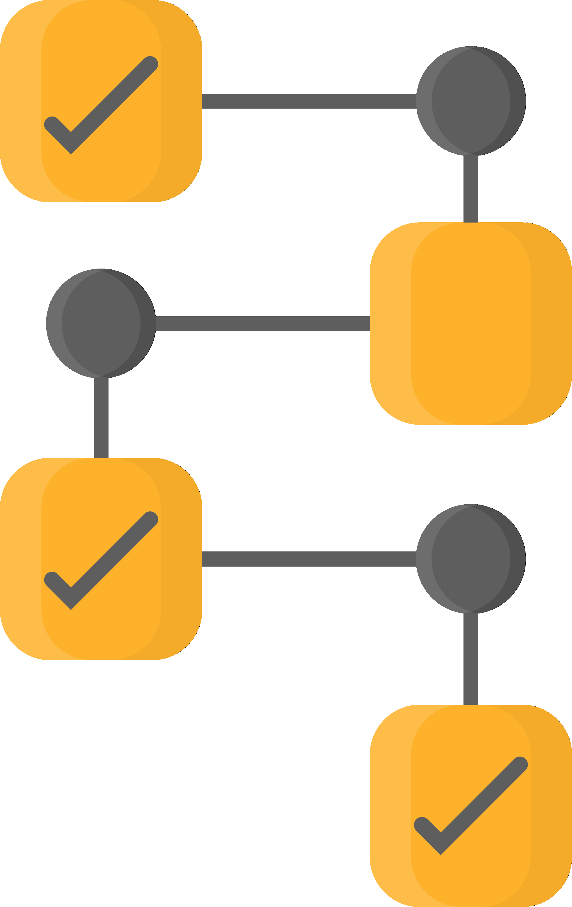
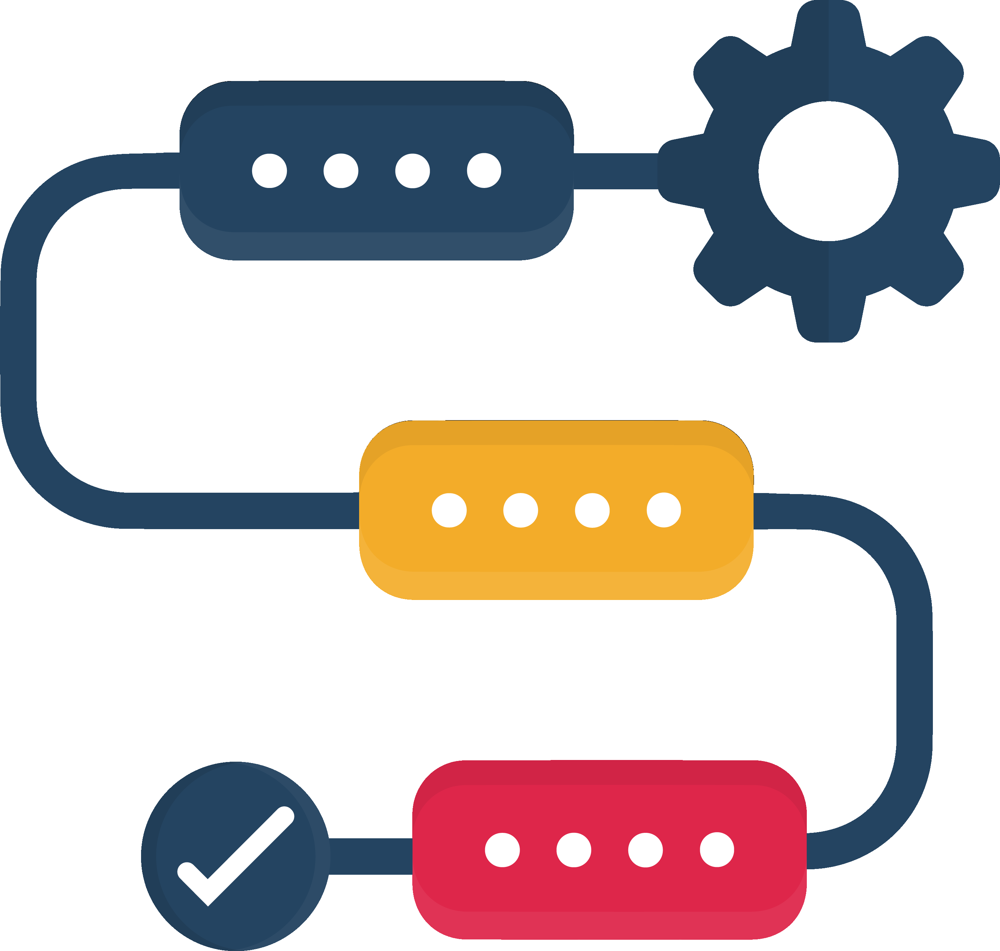

# 025 - Tổng Kết Các Khối Xây Dựng Hệ Thống

[← Bài trước](024-bo-dem-phan-manh-sharded-counters.md) | [Mục lục](README.md) | [Bài tiếp theo →](026-thiet-ke-youtube.md)

---

# Tổng Kết Các Khối Xây Dựng Hệ Thống (Wrapping Up the Building Blocks)

## Thảo luận (Discussion)

Nắm bắt bức tranh tổng quan về những gì chúng ta đã học và những nội dung chuẩn bị được thảo luận.

**Chúng ta sẽ đề cập đến các nội dung sau:**
* Bước tiếp theo là gì? (What’s next?)

Chúng ta đã đi qua một số lượng lớn các khối xây dựng nền tảng (*building blocks*) – những thành phần sẽ trang bị cho chúng ta khả năng giải quyết các bài toán thiết kế hệ thống lớn hơn. Trong các chương sắp tới, chúng ta sẽ giải quyết đa dạng các bài toán thực tế sử dụng nhiều khối xây dựng khác nhau.

Vì chúng ta đã nắm vững các khối xây dựng cốt lõi, giờ đây chúng ta có thể tập trung hoàn toàn vào việc giải quyết các bài toán thiết kế quy mô lớn. Kể từ thời điểm này trở đi, chúng tôi mặc định rằng bạn đã hiểu rõ và thuần thục tất cả các khối xây dựng đã được thảo luận khi chúng ta áp dụng chúng vào các bài toán thiết kế sắp tới.

---

### Bước tiếp theo là gì? (What’s next?)

Chúng ta sẽ tìm hiểu và khám phá 13 bài toán thiết kế hệ thống chuyên sâu trong các chương tiếp theo. Chúng ta sẽ nghiên cứu các thiết kế hệ thống sau:

| STT | Tên bài toán thiết kế hệ thống (System Design) |
| :---: | :--- |
| **1** | **YouTube** |
| **2** | **Quora** |
| **3** | **Google Maps** |
| **4** | **Yelp** |
| **5** | **Uber** |
| **6** | **Twitter** |
| **7** | **Newsfeed** |
| **8** | **Instagram** |
| **9** | **TinyURL** |
| **10** | **Web Crawler** |
| **11** | **WhatsApp** |
| **12** | **Typeahead** |
| **13** | **Google Docs** |

Mỗi thiết kế này là một chương độc lập, tuy nhiên chúng tôi khuyến nghị bạn nên đi qua các chương theo đúng thứ tự đã sắp xếp. Một số bài toán chứa đựng kiến thức nền tảng rất hữu ích cho các bài toán thiết kế khác. Ví dụ: việc nghiên cứu kỹ bài toán **Google Maps** trước tiên sẽ rất hữu ích cho người đọc quan tâm đến việc tìm hiểu bài toán thiết kế **Uber**.

Ở phần cuối của khóa học, chúng ta sẽ khép lại toàn bộ chương trình với chương **"Những Thất Bại Kinh Điển" (Spectacular Failures)**, nơi chúng ta sẽ mổ xẻ cách một lỗi nhỏ (*minor bug*) hoặc một sai sót có thể dẫn đến sự cố sập hệ thống diện rộng (*significant outage*) hoặc sự cố nghiêm trọng (*failure*) ở một số hệ thống thành công nhất từng được thiết kế.

---

# Phương Pháp Tiếp Cận RESHADED Cho Thiết Kế Hệ Thống (The RESHADED Approach for System Design)

Hãy sử dụng phương pháp **RESHADED** để bóc tách và phân rã một bài toán thiết kế hệ thống.

**Chúng ta sẽ đề cập đến các nội dung sau:**
* Giới thiệu (Introduction)
* Ưu điểm của RESHADED (Advantages of RESHADED)
* Khám phá chi tiết RESHADED (Exploring RESHADED)

---

## Giới thiệu (Introduction)

Các bài toán thiết kế hệ thống (*system design problems*) không hề đơn giản hay mang tính rập khuôn. Chúng ta không có một công thức vạn năng duy nhất nào có thể áp dụng cho mọi bài toán thiết kế. Tuy nhiên, chúng ta có thể sử dụng một chiến lược chung ở mức tổng quan (*high-level common strategy*) để tạo tiền đề cho một giải pháp tốt đối với bất kỳ bài toán nào.

Chúng tôi gọi đây là phương pháp tiếp cận **RESHADED**. Về mặt tổng thể, tất cả các bài toán thiết kế của chúng ta đều được giải quyết dựa trên tư duy của chiến lược này. **RESHADED** là bộ khung chỉ dẫn (*guideline*) mà chúng ta sẽ sử dụng để tháo gỡ các bài toán thiết kế khác nhau. Mặc dù không tồn tại giải pháp "một kích cỡ phù hợp cho tất cả" (*one-size-fits-all*), việc áp dụng phương pháp này mang lại những lợi thế rất lớn như chúng ta sẽ thấy dưới đây.

### Phân rã từng chữ cái trong phương pháp tiếp cận RESHADED:

* **R** – **Requirements** (Yêu cầu hệ thống)
* **E** – **Estimation** (Ước tính tài nguyên)
* **S** – **Storage schema (optional)** (Lược đồ lưu trữ dữ liệu - Tùy chọn)
* **H** – **High-level design** (Thiết kế kiến trúc mức cao)
* **A** – **API design** (Thiết kế giao diện lập trình ứng dụng)
* **D** – **Detailed design** (Thiết kế kiến trúc chi tiết)
* **E** – **Evaluation** (Đánh giá và đo lường giải pháp)
* **D** – **Distinctive component/feature** (Thành phần / Tính năng đặc thù)

---

## Ưu điểm của RESHADED (Advantages of RESHADED)

Trước khi đi sâu vào từng từ trong **RESHADED**, hãy cùng điểm qua các lợi ích của toàn bộ phương pháp tiếp cận này. Một số ưu điểm then chốt bao gồm:

1. Phương pháp **RESHADED** giúp chúng ta ghi nhớ các bước cốt lõi để giải quyết mọi bài toán thiết kế. Điều này đồng nghĩa với việc, tại bất kỳ thời điểm nào, chúng ta cũng luôn có một bước tiếp theo được vạch ra rõ ràng phía trước.
2. Giải pháp mà chúng ta đưa ra sẽ có đầy đủ tất cả các thành phần cơ bản cần thiết để giải quyết bất kỳ bài toán thiết kế nào. Không chỉ vậy, giải pháp được xây dựng thông qua phương pháp tiếp cận **RESHADED** sẽ luôn có tính hệ thống và được cân nhắc kỹ lưỡng (*thoughtful*).

---

## Khám phá chi tiết RESHADED (Exploring RESHADED)

Dưới đây mô tả các bước cụ thể chúng ta thực hiện dưới từng chữ cái của **RESHADED**:

### 1. Requirements (Yêu cầu hệ thống)

Trong bước này, chúng ta thu thập tất cả các yêu cầu của bài toán thiết kế và xác định phạm vi (*scope*) của nó. Các yêu cầu bao gồm việc hiểu rõ dịch vụ là gì, phương thức hoạt động ra sao và các tính năng chính của nó là gì. Mục tiêu của chúng ta trong bước này là thu thập đầy đủ:
* **Yêu cầu chức năng (Functional Requirements)**.
* **Yêu cầu phi chức năng (Non-Functional Requirements)** (ví dụ: Độ sẵn sàng cao - *High Availability*, Khả năng mở rộng - *Scalability*, Khả năng chịu lỗi - *Fault Tolerance*, Độ trễ - *Latency*, Thông lượng - *Throughput*, v.v.) của dịch vụ mà chúng ta chuẩn bị thiết kế.

---

### 2. Estimation (Ước tính tài nguyên)

Đúng như tên gọi, bước này ước tính các tài nguyên cần thiết để cung cấp dịch vụ cho một số lượng người dùng xác định. Khi nói đến tài nguyên, chúng ta đề cập đến phần cứng (*hardware*) hoặc tài nguyên cơ sở hạ tầng (*infrastructural resources*).

Một số câu hỏi ước tính mẫu bao gồm:
1. Chúng ta sẽ cần bao nhiêu máy chủ (*servers*) để cung cấp dịch vụ vận hành mượt mà cho 500 triệu người dùng hoạt động hàng ngày (**DAU** - *Daily Active Users*)?
2. Chúng ta cần bao nhiêu dung lượng lưu trữ (*storage*) nếu phải lưu trữ 125 triệu tweet mỗi ngày và 20% số tweet đó có chứa tệp đa phương tiện (*media*)?

> [!IMPORTANT]
> Các ước tính (*estimations*) đóng vai trò cực kỳ quan trọng vì chúng giúp chúng ta hiểu được quy mô (*scale*) của hệ thống mà chúng ta sẽ thiết kế. Chúng ta sẽ đưa ra các quyết định kiến trúc then chốt dựa trên các ước tính này. Ví dụ: chúng ta sẽ quyết định loại cơ sở dữ liệu (*database*) nào sẽ được sử dụng để lưu trữ dữ liệu, cấu trúc dữ liệu (*data structure*) nào sẽ mang lại hiệu năng tối ưu, và nhiều quyết định kỹ thuật khác.

---

### 3. Storage schema (optional) (Lược đồ lưu trữ - Tùy chọn)

Bước này liên quan đến việc định hình rõ ràng mô hình dữ liệu (*data model*) của chúng ta—nghĩa là chúng ta xác định những bảng (*tables*) nào là cần thiết và những trường dữ liệu (*fields*) nào thuộc về mỗi bảng. 

> [!NOTE]
> Tuy nhiên, đây là một bước tùy chọn (*optional*), và chúng ta có thể không cần thực hiện bước này trong mọi bài toán thiết kế.

---

### 4. High-level design (Thiết kế kiến trúc mức cao)

Bước này bao gồm việc xác định các thành phần chính (*main components*) và các khối xây dựng (*building blocks*) mà chúng ta sẽ sử dụng để thiết kế hệ thống mong muốn. Chúng ta thực hiện điều này bằng cách lấy cảm hứng từ các yêu cầu chức năng và phi chức năng đã xác định.

Đây được coi là bước đầu tiên hướng tới bản thiết kế hoàn chỉnh của hệ thống, và do đó đòi hỏi phải tiếp tục lặp lại (*iteration*) và cải tiến liên tục. Về cơ bản, phần này sẽ tập trung chủ yếu vào việc đáp ứng các **yêu cầu chức năng (Functional Requirements)**.

---

### 5. API design (Thiết kế giao diện lập trình ứng dụng)

Mục tiêu trong giai đoạn này là xây dựng các giao diện (*interfaces*) cho dịch vụ của chúng ta. Thông qua các giao diện này, người dùng hoặc client có thể gọi đến các dịch vụ khác nhau bên trong hệ thống. 

Các giao diện này tồn tại dưới dạng các lời gọi API (*API calls*) và thường là sự chuyển dịch trực tiếp từ các yêu cầu chức năng của chúng ta sang giao thức kỹ thuật.

---

### 6. Detailed design (Thiết kế kiến trúc chi tiết)

Thiết kế chi tiết bắt đầu bằng việc nhìn nhận rõ các hạn chế (*limitations*) của bản thiết kế mức cao (*high-level design*). Chúng ta sẽ tận dụng những hạn chế này làm đòn bẩy để phát triển và hoàn thiện thiết kế. 

Trong bước này, chúng ta sẽ hoàn thiện bản thiết kế bằng cách chỉ rõ tất cả các thành phần và khối xây dựng mà chúng ta sẽ sử dụng. Chúng ta cũng định nghĩa luồng công việc (*workflow*) của bản thiết kế cùng với việc sử dụng các công nghệ khác nhau. Thiết kế chi tiết nhằm mục đích đáp ứng trọn vẹn cả **yêu cầu chức năng** lẫn **yêu cầu phi chức năng** của bài toán.

---

### 7. Evaluation (Đánh giá và đo lường giải pháp)

Bước này sẽ đo lường tính hiệu quả của giải pháp mà chúng ta đưa ra. Nói cách khác, chúng ta chứng minh và bảo vệ quan điểm (*justify*) về cách mà thiết kế của chúng ta đáp ứng các yêu cầu chức năng và phi chức năng đã đề ra.

Chúng ta thảo luận về các sự đánh đổi (*trade-offs*) khác nhau đã thực hiện trong giải pháp của mình, đồng thời xác định các điểm còn có thể cải tiến (*room for improvement*).

---

### 8. Distinctive component/feature (Thành phần / Tính năng đặc thù)

Ở phần đầu của bài học này, chúng ta đã thảo luận rằng không có giải pháp nào là "một kích cỡ phù hợp cho tất cả". Bước này nhằm xác định khía cạnh độc nhất (*unique aspect*) cho từng bài toán thiết kế cụ thể và đưa ra thảo luận sâu.

> [!TIP]
> **Ví dụ điển hình:**
> * Bài toán thiết kế **Uber** có dịch vụ thanh toán (*payment service*) và phát hiện gian lận (*fraud detection*) là tính năng đặc thù độc nhất.
> * Ngược lại, bài toán **Google Docs** lại có kiểm soát đồng thời (*concurrency control*), thành phần bắt buộc phải có khi nhiều người dùng khác nhau muốn chỉnh sửa cùng một đoạn trong tài liệu tại cùng một thời điểm.

---

Tiếp theo, chúng ta sẽ áp dụng bộ khung chỉ dẫn **RESHADED** này vào rất nhiều bài toán thiết kế thực tế phía trước!

---

[← Bài trước](024-bo-dem-phan-manh-sharded-counters.md) | [Mục lục](README.md) | [Bài tiếp theo →](026-thiet-ke-youtube.md)
