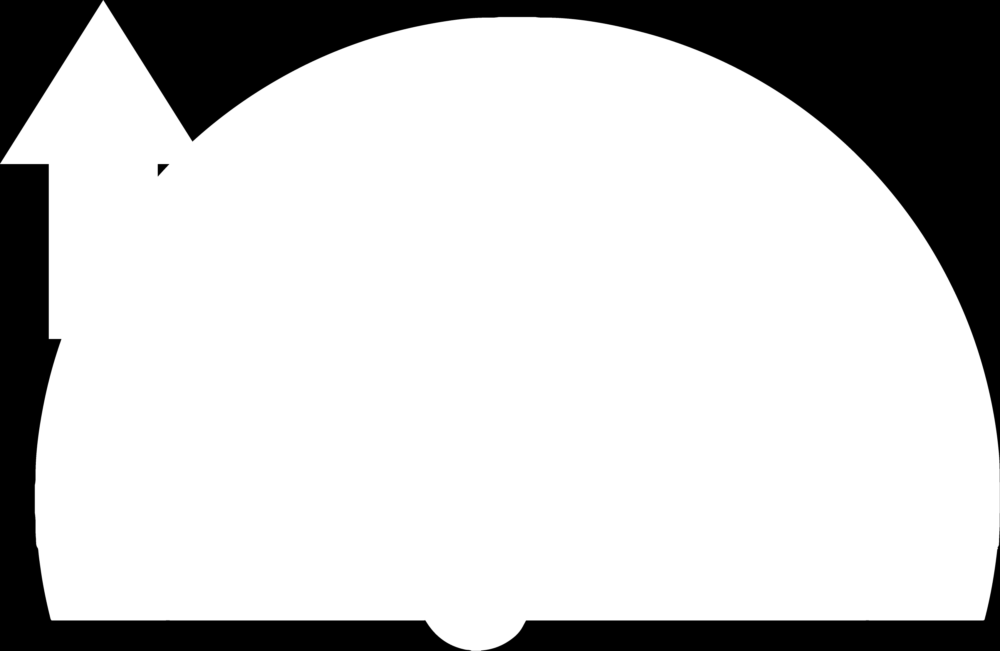
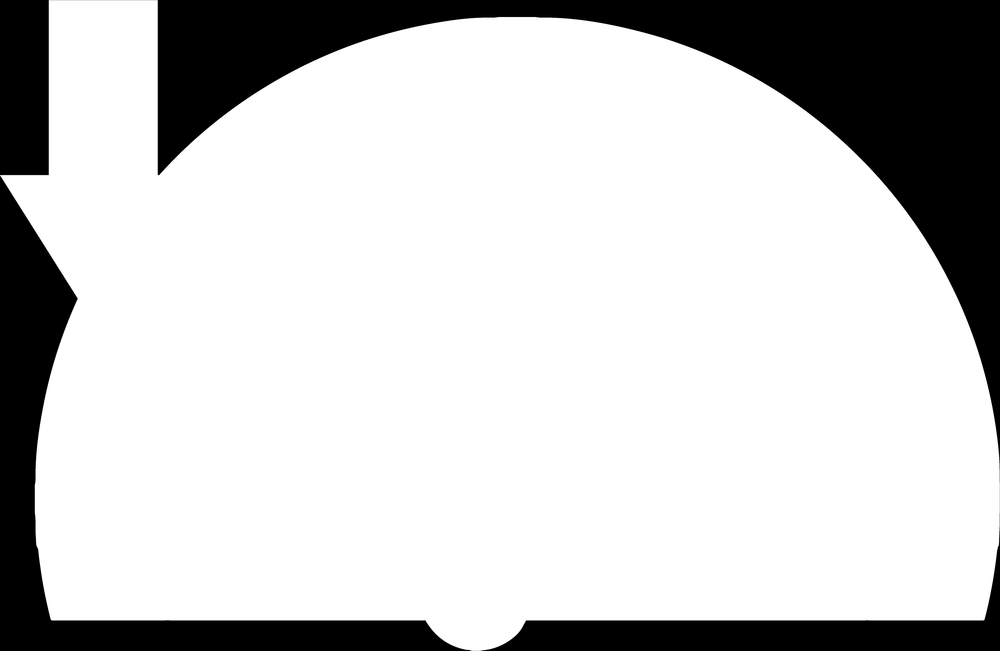

# 026 - Thiết Kế YouTube (Video Streaming Platform)

[← Bài trước](025-tong-ket-building-blocks.md) | [Mục lục](README.md) | [Bài tiếp theo →](027-thiet-ke-quora.md)

---


# Thiết Kế Hệ Thống: YouTube (System Design: YouTube)

Hãy cùng tìm hiểu các chi tiết cơ bản để thiết kế dịch vụ YouTube.

Chúng ta sẽ bao quát các nội dung sau:
* **YouTube là gì? (What is YouTube?)**
* **Mức độ phổ biến của YouTube (YouTube’s popularity)**
* **Sự phát triển của YouTube (YouTube’s growth)**
* **Chúng ta sẽ thiết kế YouTube như thế nào? (How will we design YouTube?)**

---

## YouTube là gì? (What is YouTube?)

YouTube là một dịch vụ phát video trực tuyến (video streaming service) phổ biến, nơi người dùng có thể tải lên (upload), phát trực tuyến (stream), tìm kiếm (search), bình luận (comment), chia sẻ (share), và thích hoặc không thích (like/dislike) video. Các doanh nghiệp lớn cũng như các cá nhân đều duy trì các kênh (channels) nơi họ lưu trữ video của mình. YouTube cho phép lưu trữ nội dung video miễn phí để chia sẻ với người dùng trên toàn cầu. YouTube được coi là một nguồn giải trí chính, đặc biệt là trong giới trẻ, và tính đến năm 2022, nền tảng này được Wikipedia xếp hạng là trang web có lượng người xem nhiều thứ hai sau Google.


*Hình minh họa: Nhà sáng tạo nội dung (Content creator) tải video lên YouTube và video đó được phát trực tuyến tới nhiều người xem (Content viewers).*

```
+------------------+       Upload       +-----------+        View        +------------------+
| Content creator  | -----------------> |  YouTube  | -----------------> | Content viewers  |
| (Nhà sáng tạo)   |                    +-----------+                    | (Người xem)      |
+------------------+                                                     +------------------+
```

---

## Mức độ phổ biến của YouTube (YouTube’s popularity)

Một số lý do giúp YouTube ngày càng trở nên phổ biến trong những năm qua bao gồm:

* **Sự đơn giản (Simplicity):** YouTube sở hữu một giao diện đơn giản nhưng vô cùng mạnh mẽ.
* **Nội dung phong phú (Rich content):** Giao diện đơn giản cùng cơ chế lưu trữ (hosting) miễn phí đã thu hút một lượng lớn các nhà sáng tạo nội dung.
* **Cải tiến liên tục (Continuous improvement):** Đội ngũ phát triển của YouTube đã làm việc không ngừng nghỉ để đáp ứng các yêu cầu về khả năng mở rộng (Scalability) theo thời gian. Ngoài ra, việc Google mua lại YouTube vào năm 2007 đã gia tăng thêm mức độ uy tín của nền tảng này.
* **Nguồn thu nhập (Source of income):** YouTube đã khởi xướng chương trình đối tác (partnership program), cho phép các nhà sáng tạo nội dung kiếm tiền từ những nội dung lan truyền (viral content) của họ.

Bên cạnh những lý do trên, YouTube cũng hợp tác với các tập đoàn truyền thông khổng lồ đã có chỗ đứng vững chắc trên thị trường như CNN và NBC để tạo dựng một vị thế vững chắc hơn.

---

## Sự phát triển của YouTube (YouTube’s growth)

Hãy cùng xem xét một số số liệu thống kê thú vị về YouTube và mức độ phổ biến của nền tảng này.

Kể từ khi thành lập vào tháng 2 năm 2005, số lượng người dùng YouTube đã tăng lên gấp nhiều lần. Tính đến hiện tại, có hơn **2,5 tỷ người dùng hoạt động hàng tháng (Monthly Active Users - MAU)** trên YouTube. Hãy xem biểu đồ dưới đây để thấy số lượng người dùng YouTube đã tăng lên như thế nào trong thập kỷ qua.


*Biểu đồ: Sự gia tăng số lượng người dùng hoạt động hàng tháng (Monthly Active Users) của YouTube qua từng năm.*

YouTube là trang web được phát video trực tuyến (streamed) nhiều thứ hai sau Netflix. Tổng cộng có tới **694.000 giờ nội dung video** được phát trực tuyến trên YouTube mỗi phút!

Khi đã nhận thấy mức độ thành công vượt bậc của YouTube, chúng ta hãy cùng tìm hiểu cách thiết kế hệ thống này.

---

## Chúng ta sẽ thiết kế YouTube như thế nào? (How will we design YouTube?)

Chúng ta đã chia bài toán thiết kế YouTube thành năm bài học:

1. **Yêu cầu (Requirements):** Đây là nơi chúng ta xác định các yêu cầu chức năng (functional requirements) và yêu cầu phi chức năng (non-functional requirements). Chúng ta cũng ước tính tài nguyên (resource estimation) cần thiết để phục vụ hàng triệu người dùng mỗi ngày. Bài học này trả lời các câu hỏi như YouTube sẽ cần bao nhiêu dung lượng lưu trữ (storage space) để lưu trữ 500 giờ nội dung video được tải lên YouTube mỗi ngày.
2. **Thiết kế (Design):** Trong bài học này, chúng tôi giải thích cách thiết kế dịch vụ YouTube. Chúng tôi cũng giải thích ngắn gọn về thiết kế API (API design) và lược đồ cơ sở dữ liệu (database schemas). Cuối cùng, chúng ta cũng sẽ điểm qua cơ chế hoạt động của tính năng tìm kiếm (Search) trên YouTube.
3. **Đánh giá (Evaluation):** Bài học này giải thích cách YouTube có thể đáp ứng tất cả các yêu cầu thông qua kiến trúc đề xuất. Bài học cũng xem xét việc mở rộng quy mô (scaling) trong tương lai có thể ảnh hưởng đến hệ thống như thế nào và những giải pháp nào là cần thiết để giải quyết các vấn đề về quy mô.
4. **Thực tế phức tạp hơn nhiều (Reality is more complicated):** Trong bài học này, chúng ta sẽ khám phá các kỹ thuật khác nhau mà YouTube sử dụng để phân phối nội dung hiệu quả tới máy khách (client) và tránh tắc nghẽn mạng (network congestion).
5. **Câu hỏi củng cố (Quiz):** Chúng ta củng cố các khái niệm chính đã học khi thiết kế YouTube bằng cách xem xét cách chúng ta có thể thiết kế hệ thống của Netflix.

> [!NOTE]
> Phần thảo luận của chúng ta về việc sử dụng các khối xây dựng hệ thống (building blocks) khác nhau trong thiết kế sẽ có giới hạn, vì chúng ta đã khám phá chi tiết về chúng trong chương các khối xây dựng nền tảng.

---

## Yêu cầu thiết kế của YouTube (Requirements of YouTube's Design)

Nắm bắt các yêu cầu và bài toán ước lượng tài nguyên cho thiết kế của YouTube.

Chúng ta sẽ bao quát các nội dung sau:
* **Yêu cầu (Requirements)**
  * Yêu cầu chức năng (Functional requirements)
  * Yêu cầu phi chức năng (Non-functional requirements)
* **Ước lượng tài nguyên (Resource estimation)**
  * Ước lượng lưu trữ (Storage estimation)
  * Ước lượng băng thông (Bandwidth estimation)
  * Ước lượng số lượng máy chủ (Number of servers estimation)
* **Các khối xây dựng hệ thống sẽ sử dụng (Building blocks we will use)**

---

### Yêu cầu (Requirements)

Hãy bắt đầu với các yêu cầu để thiết kế một hệ thống tương tự như YouTube.

#### Yêu cầu chức năng (Functional requirements)
Hệ thống của chúng ta bắt buộc phải có khả năng thực hiện các chức năng sau:
1. **Phát trực tuyến video (Stream videos)**
2. **Tải lên video (Upload videos)**
3. **Tìm kiếm video theo tiêu đề (Search videos according to titles)**
4. **Thích và không thích video (Like and dislike videos)**
5. **Thêm bình luận vào video (Add comments to videos)**
6. **Xem hình thu nhỏ (View thumbnails)**

#### Yêu cầu phi chức năng (Non-functional requirements)
Điều quan trọng là hệ thống của chúng ta cũng phải đáp ứng các yêu cầu sau:

* **Tính sẵn sàng cao (High Availability):** Hệ thống phải có tính sẵn sàng cao. High Availability đòi hỏi tỷ lệ thời gian hoạt động (uptime) tốt. Thông thường, thời gian uptime từ **99% trở lên** được coi là tốt.
* **Khả năng mở rộng (Scalability):** Khi số lượng người dùng tăng lên, các yếu tố sau không được phép trở thành điểm nghẽn cổ chai (bottlenecks): dung lượng lưu trữ (storage) để tải lên nội dung, băng thông (bandwidth) cần thiết cho việc xem đồng thời, và số lượng yêu cầu người dùng đồng thời (concurrent user requests) không được làm quá tải máy chủ ứng dụng/máy chủ web (application/web server) của chúng ta.
* **Hiệu năng tốt (Good Performance):** Trải nghiệm phát trực tuyến mượt mà (không giật lag/buffering) sẽ mang lại hiệu năng tổng thể tốt hơn.
* **Độ tin cậy (Reliability):** Nội dung được tải lên hệ thống không được bị mất mát hoặc hư hỏng.


*Hình minh họa: Biểu diễn các yêu cầu chức năng (Functional) và phi chức năng (Non-functional).*

| Nhóm yêu cầu | Danh sách chi tiết |
| :--- | :--- |
| **Yêu cầu chức năng (Functional)** | Stream, Upload, Search, Like/dislike, Comment, View thumbnails |
| **Yêu cầu phi chức năng (Non-functional)** | Available (Sẵn sàng cao), Scalable (Khả năng mở rộng), No lag/buffering (Không trễ/bộ đệm), Reliable (Tin cậy) |

> [!IMPORTANT]
> Chúng ta **không yêu cầu tính nhất quán mạnh (Strong Consistency)** cho thiết kế của YouTube. Hãy xem xét ví dụ khi một nhà sáng tạo tải video lên: không nhất thiết tất cả người dùng đã đăng ký kênh của người sáng tạo đó phải nhận được thông báo về nội dung vừa tải lên ngay lập tức. Tính nhất quán cuối cùng (Eventual Consistency) là hoàn toàn chấp nhận được.

**Tóm lại:** Các yêu cầu chức năng là các tính năng và chức năng mà người dùng sẽ nhận được, trong khi các yêu cầu phi chức năng là các kỳ vọng về mặt hiệu năng từ hệ thống.

Dựa trên các yêu cầu này, chúng ta sẽ ước tính tài nguyên cần thiết và thiết kế hệ thống của mình.

---

### Ước lượng tài nguyên (Resource estimation)

Quá trình ước tính đòi hỏi việc xác định các tài nguyên quan trọng mà chúng ta sẽ cần trong hệ thống.

Hàng trăm phút nội dung video được tải lên YouTube mỗi phút.

---

# Ước Tính Tài Nguyên và Các Khối Xây Dựng Hệ Thống (Resource Estimation & System Building Blocks)

Đồng thời, một lượng khổng lồ người dùng sẽ phát trực tuyến (streaming) nội dung cùng một lúc, điều này đồng nghĩa với việc các tài nguyên sau đây sẽ được yêu cầu:

* **Tài nguyên lưu trữ (Storage resources):** Cần thiết để lưu trữ nội dung đã tải lên (uploaded) và nội dung đã qua xử lý (processed content).
* **Xử lý đồng thời (Concurrent processing):** Một lượng lớn yêu cầu (requests) có thể được xử lý bằng cách thực hiện xử lý đồng thời. Điều này có nghĩa là các máy chủ web/ứng dụng (web/application servers) phải sẵn sàng hoạt động để phục vụ những người dùng này.
* **Băng thông tải lên và tải xuống (Upload & Download Bandwidth):** Cả hai chiều băng thông đều bắt buộc phải có để phục vụ hàng triệu người dùng.

Để quy đổi các tài nguyên nêu trên thành các số liệu cụ thể, chúng ta đưa ra các giả định sau:

* **Tổng số lượng người dùng YouTube:** 1,5 tỷ người.
* **Số người dùng hoạt động hàng ngày (Daily Active Users - DAU)** (những người xem hoặc tải video lên): 500 triệu người.
* **Thời lượng trung bình của một video:** 5 phút.
* **Dung lượng trung bình của một video (dài 5 phút) trước khi xử lý/mã hóa (processing/encoding)** (nén, chuyển đổi định dạng, v.v.): 600 MB.
* **Dung lượng trung bình của một video sau khi mã hóa (encoding)** (sử dụng các thuật toán khác nhau cho các độ phân giải khác nhau như MPEG-4 và VP9): 30 MB.

---

## 1. Ước Tính Khả Năng Lưu Trữ (Storage Estimation)

Để tìm ra nhu cầu lưu trữ của YouTube, chúng ta phải ước tính tổng số lượng video và thời lượng của mỗi video được tải lên YouTube trong mỗi phút. Giả sử rằng có **500 giờ** nội dung video được tải lên YouTube trong vòng một phút.

Vì mỗi video dung lượng 30 MB có thời lượng 5 phút, chúng ta cần:

$$\frac{30\text{ MB}}{5\text{ phút}} = 6\text{ MB}$$

để lưu trữ 1 phút video.

Hãy đưa điều này vào công thức bằng cách giả định các biến số sau:
* $\text{Total}_{\text{storage}}$: Tổng nhu cầu lưu trữ (Total storage requirement).
* $\text{Total}_{\text{upload/min}}$: Tổng nội dung tải lên (tính theo phút) mỗi phút (Total content uploaded in minutes per minute).  
  *Ví dụ: 500 giờ video được tải lên trong một phút.*
* $\text{Storage}_{\text{min}}$: Dung lượng lưu trữ yêu cầu cho mỗi phút nội dung (Storage required for each minute of content).

Khi đó, công thức sau được sử dụng để tính toán dung lượng lưu trữ:

$$\text{Total}_{\text{storage}} = \text{Total}_{\text{upload/min}} \times \text{Storage}_{\text{min}}$$

---

Dưới đây là bảng tính toán hỗ trợ ước tính các tài nguyên cần thiết. Đầu tiên, chúng ta xem xét dung lượng lưu trữ cần thiết để lưu trữ bền vững (persist) 500 giờ nội dung được tải lên mỗi phút, trong đó mỗi phút video tiêu tốn 6 MB dung lượng lưu trữ:

$$\text{Total}_{\text{storage}} = \text{Total}_{\text{upload/min}} \times \text{Storage}_{\text{min}}$$

### Dung Lượng Lưu Trữ Cần Thiết Để Lưu Trữ Nội Dung Mỗi Phút Trên YouTube

| Số giờ video mỗi phút (No. of video hours per minute) | Số phút mỗi giờ (Minutes per hour) | MB mỗi phút (MB per minute) | Dung lượng lưu trữ mỗi phút (Storage per minute - GB) |
| :---: | :---: | :---: | :---: |
| 500 | 60 | 6 | **180** |


> [!TIP]
> **Mẹo kỹ thuật (Tip):**  
> Các con số được đề cập ở trên tương ứng với phiên bản video đã nén (compressed version). Tuy nhiên, trên thực tế chúng ta cần phải chuyển mã (transcode) video sang nhiều định dạng khác nhau vì các lý do sẽ được tìm hiểu trong các bài học tiếp theo. Do đó, hệ thống sẽ yêu cầu không gian lưu trữ lớn hơn nhiều so với mức ước tính ở trên.

### Tổng Dung Lượng Lưu Trữ YouTube Cần Trong Một Năm (Total storage required by YouTube in a year)

$$\begin{aligned}
\text{Dung lượng lưu trữ / năm (Storage/year)} &= \text{Lưu trữ/phút (180 GB)} \times \text{Phút/giờ (60)} \times \text{Giờ/ngày (24)} \times \text{Ngày/năm (365)} \\
&= \mathbf{94.6\text{ PB}}
\end{aligned}$$


---

### Câu Hỏi Trắc Nghiệm (Quiz)

> **Câu hỏi (Question):**  
> Giả sử YouTube lưu trữ video ở năm (5) mức chất lượng (qualities) khác nhau và kích thước trung bình của một phút video là 6 MB, thì nhu cầu lưu trữ ước tính mỗi phút sẽ là bao nhiêu?

<details>
<summary><strong>Ẩn/Hiện Đáp án (Hide Answer)</strong></summary>

Vì chúng ta cần 6 MB cho mỗi phút và cần lưu trữ các tệp ở 5 định dạng chất lượng khác nhau, nên tổng yêu cầu cho mỗi phút nội dung là:

$$5 \times 6\text{ MB} = 30\text{ MB}$$

Tiếp theo, chúng ta tính toán giá trị bên dưới:

$$\begin{aligned}
\text{Nhu cầu lưu trữ mỗi phút} &= \text{Số giờ tải lên YouTube/phút} \times \text{Số phút mỗi giờ} \times \text{Nhu cầu lưu trữ mỗi phút} \\
&= 500\text{ giờ/phút} \times 60\text{ phút/giờ} \times 30\text{ MB/phút} \\
&= \mathbf{900\text{ GB/phút}}
\end{aligned}$$

</details>

---

## 2. Ước Tính Băng Thông (Bandwidth Estimation)

Một khối lượng truyền dữ liệu (data transfer) cực lớn sẽ diễn ra liên tục cho cả việc phát trực tuyến (streaming) và tải lên (uploading) video trên YouTube. Đây là lý do tại sao chúng ta cũng cần tính toán ước lượng băng thông cho hệ thống.

Giả sử tỷ lệ tải lên : lượt xem (**Upload:View ratio**) là **1:300** — nghĩa là cứ mỗi video được tải lên, hệ thống sẽ có 300 lượt xem video mỗi giây. Chúng ta cũng phải lưu ý rằng khi một video được tải lên, nó chưa ở định dạng nén (uncompressed format), trong khi các video được xem có thể ở nhiều mức chất lượng khác nhau. 

Hãy bắt đầu bằng việc ước tính băng thông cần thiết cho việc tải video lên (**Uploading Bandwidth**).

Chúng ta giả định:
* $\text{Total}_{\text{bandwidth}}$: Tổng băng thông yêu cầu (Total bandwidth required).
* $\text{Total}_{\text{content}}$: Tổng nội dung (tính theo phút) được tải lên mỗi phút (Total content in minutes uploaded per minute).
* $\text{Size}_{\text{minute}}$: Dung lượng truyền tải yêu cầu (tính bằng MB) cho mỗi phút nội dung (Transmission required in MBs for each minute of content).

Khi đó, công thức sau được sử dụng để thực hiện phép tính:

$$\text{Total}_{\text{bandwidth}} = \text{Total}_{\text{content\_transferred}} \times \text{Size}_{\text{minute}}$$

---

### Băng Thông Cần Thiết Để Tải Video Lên YouTube (The Bandwidth Required for Uploading Videos to YouTube)

| Số giờ video mỗi phút (No. of video hours per minute) | Số phút mỗi giờ (Minutes per hour) | MB mỗi phút (MB per minute) | Băng thông yêu cầu (Bandwidth required - Gbps) |
| :---: | :---: | :---: | :---: |
| 500 | 60 | 50 | **200** |


<details>
<summary><strong>Ẩn/Hiện Phép Tính Chi Tiết (Hide Calculations)</strong></summary>

Chúng ta tính toán băng thông theo đơn vị bit trên giây (**bps - bits per second**), như trình bày ở trên. Do đó, phép tính chi tiết của con số trên (200 Gbps) được thực hiện như sau:

Hệ số 8 bit được sử dụng để chuyển đổi từ Byte sang bit ($1\text{ Byte} = 8\text{ bits}$). Theo quy ước đo lường chuẩn kỹ thuật mạng, đơn vị của băng thông luôn được tính bằng bit trên giây (bps):

$$\text{Băng thông Upload} = \frac{500\text{ giờ/phút} \times 60\text{ phút/giờ} \times 50\text{ MB/phút} \times 8\text{ bits}}{60\text{ giây}} = \mathbf{200\text{ Gbps}}$$

</details>

---

### Câu Hỏi Trắc Nghiệm (Quiz)

> **Câu hỏi (Question):**  
> Nếu cần 200 Gbps băng thông để đáp ứng nhu cầu tải lên (uploading), thì cần bao nhiêu băng thông để phát trực tuyến (streaming) video? Giả sử mỗi phút video tiêu tốn trung bình 10 MB băng thông.  
> *Gợi ý (Hint):* Tỷ lệ tải lên:lượt xem (upload:view ratio) đã được cung cấp ở phần trước.

<details>
<summary><strong>Ẩn/Hiện Đáp án (Hide Answer)</strong></summary>

Cứ mỗi video được tải lên, có 300 video được xem. Do đó, phương trình tính toán trở thành:

$$\begin{aligned}
\text{Băng thông Streaming} &= \text{Tổng số giờ xem mỗi phút} \times \text{Dung lượng MB mỗi phút} \times \text{Tỷ lệ xem (View ratio)} \\
&= 500\text{ giờ/phút} \times 60\text{ phút/giờ} \times 10\text{ MB/phút} \times 300 \\
&= 90\text{ TB/phút} \times 8\text{ bits} \\
&= 720\text{ Tb/phút} \\
&= \mathbf{12\text{ Tbps}}
\end{aligned}$$

</details>

---

### Tổng Băng Thông Yêu Cầu Cho YouTube (Total bandwidth required by YouTube)

$$\begin{aligned}
\text{Băng thông Tải lên (Upload bandwidth)} &= 0.2\text{ Tbps} \\
\text{Băng thông Phát trực tuyến (Streaming bandwidth)} &= 12\text{ Tbps} \\
\hline
\mathbf{\text{Tổng băng thông (Total)}} &= \mathbf{12.2\text{ Tbps}}
\end{aligned}$$


---

## 3. Ước Tính Số Lượng Máy Chủ (Number of Servers Estimation)

Hệ thống cần xử lý các yêu cầu đồng thời (**concurrent requests**) đến từ 500 triệu người dùng hoạt động hàng ngày (Daily Active Users - DAU). Giả sử rằng một máy chủ YouTube điển hình có khả năng xử lý **8.000 yêu cầu trên mỗi giây (Requests Per Second - RPS)**.

$$\text{Số lượng máy chủ yêu cầu} = \frac{\text{Số lượng người dùng hoạt động (Number of active users)}}{\text{Số truy vấn xử lý trên mỗi máy chủ (Queries handled per server)}} = \mathbf{62.500\text{ máy chủ (servers)}}$$


### Số Lượng Máy Chủ Yêu Cầu Cho YouTube (Number of servers required for YouTube)
* **62.500 máy chủ (servers)**

> [!NOTE]
> **Ghi chú (Note):**  
> Trong kịch bản thực tế, thiết kế của YouTube còn đòi hỏi tài nguyên lưu trữ cho hình thu nhỏ (thumbnails), dữ liệu người dùng (users' data), siêu dữ liệu video (video metadata), thông tin kênh của người dùng (users' channel information), v.v. Tuy nhiên, vì nhu cầu lưu trữ cho các tập dữ liệu này không đáng kể khi so sánh với dung lượng khổng lồ của các tệp video, chúng ta tạm thời bỏ qua chúng để đơn giản hóa bài toán.

---

## 4. Các Khối Xây Dựng Hệ Thống Sẽ Sử Dụng (Building Blocks We Will Use)

Sau khi hoàn thành việc ước tính tài nguyên, chúng ta hãy xác định các khối xây dựng nền tảng (**Building Blocks**) sẽ đóng vai trò cấu thành cốt lõi trong thiết kế kiến trúc hệ thống YouTube. 

Các khối xây dựng chính được liệt kê dưới đây:

### Các Khối Xây Dựng Trong Thiết Kế Mức Cao (Building blocks in a high-level design)

  
*Cơ sở dữ liệu (Database)*

  
*Mạng phân phối nội dung (CDN - Content Delivery Network)*

  
*Kho lưu trữ đối tượng nhị phân (Blob Storage)*

  
*Bộ cân bằng tải (Load Balancer)*

* **Cơ sở dữ liệu (Databases):** Cần thiết để lưu trữ siêu dữ liệu (metadata) của video, hình thu nhỏ (thumbnails), bình luận (comments) và thông tin liên quan đến người dùng.
* **Kho lưu trữ Blob (Blob storage):** Đóng vai trò then chốt để lưu trữ toàn bộ các tệp video nhị phân trên nền tảng.
* **Mạng phân phối nội dung (CDN - Content Delivery Network):** Được sử dụng để phân phối nội dung hiệu quả và tức thì đến người dùng cuối, giảm thiểu độ trễ mạng (latency delay) và giảm tải áp lực cho các máy chủ gốc (origin/end-servers).
* **Bộ cân bằng tải (Load Balancers):** Là thành phần bắt buộc để phân phối hàng triệu yêu cầu từ máy khách (client requests) gửi đến giữa một cụm (pool) các máy chủ sẵn sàng phục vụ.

Ngoài các khối xây dựng nền tảng cơ bản nêu trên, chúng ta dự kiến sẽ tích hợp các thành phần chuyên biệt sau trong thiết kế mức cao (high-level design):


---

# Thiết Kế Hệ Thống: YouTube (System Design: YouTube)

## Thiết Kế YouTube (Design of YouTube)

Các máy chủ (**Servers**) là yêu cầu cơ bản để vận hành logic ứng dụng và tiếp nhận, xử lý các yêu cầu từ phía người dùng.

Bộ mã hóa (**Encoders**) và bộ chuyển mã (**Transcoders**) thực hiện nén các video và chuyển đổi chúng sang các định dạng cùng chất lượng khác nhau nhằm hỗ trợ số lượng thiết bị đa dạng tùy theo độ phân giải màn hình (**screen resolution**) và băng thông (**bandwidth**) mạng của chúng.

### Các thành phần trong thiết kế mức cao của YouTube (Components in YouTube's high-level design)
- **Bộ mã hóa (Encoder)**
- **Máy chủ (Server)**

---

## Đi Sâu Vào Thiết Kế Của YouTube (Take a deep dive into YouTube’s design)

**Chúng ta sẽ bao quát các nội dung sau:**
- Thiết kế mức cao (**High-level design**)
- Thiết kế API (**API design**)
  - Tải lên video (**Upload video**)
  - Truyền phát video (**Stream video**)
  - Tìm kiếm video (**Search videos**)
  - Xem hình thu nhỏ (**View thumbnails**)
  - Thích và không thích video (**Like and dislike a video**)
  - Bình luận video (**Comment video**)
- Lược đồ lưu trữ (**Storage schema**)
- Thiết kế chi tiết (**Detailed design**)
  - Các thành phần trong thiết kế chi tiết (**Detailed design components**)
  - Luồng thiết kế và việc sử dụng công nghệ (**Design flow and technology usage**)
  - Tìm kiếm trên YouTube (**YouTube search**)

---

## Thiết Kế Mức Cao (High-level design)

Thiết kế mức cao thể hiện cách thức chúng ta kết nối liên thông các thành phần khác nhau đã được xác định trong bài học trước. Chúng ta bắt đầu phát triển một giải pháp nhằm đáp ứng cả các yêu cầu chức năng (**functional requirements**) lẫn yêu cầu phi chức năng (**non-functional requirements**) thông qua thiết kế này.

### Thiết kế mức cao của YouTube (The high-level design of YouTube)


**Quy trình hoạt động (Workflow) cho thiết kế trừu tượng được mô tả bên dưới:**

1. Người dùng tải một video lên máy chủ (**Server**).
2. Máy chủ lưu trữ siêu dữ liệu (**Metadata**) cùng dữ liệu người dùng đi kèm vào cơ sở dữ liệu (**Database**), đồng thời bàn giao video cho bộ mã hóa (**Encoder**) để thực hiện mã hóa (xem bước **2.1** và **2.2** trong hình minh họa ở trên).
3. Bộ mã hóa (**Encoder**), cùng với bộ chuyển mã (**Transcoder**), thực hiện nén video và chuyển đổi thành nhiều độ phân giải khác nhau (chẳng hạn như 2160p, 1440p, 1080p, v.v.). Các video này được lưu trữ trên hệ thống lưu trữ đối tượng lớn (**Blob storage** - tương tự như GFS hoặc AWS S3).
4. Một số video phổ biến (nhiều lượt xem) có thể được chuyển tiếp đến mạng phân phối nội dung (**CDN - Content Delivery Network**), đóng vai trò như một bộ nhớ đệm (**Cache**).
5. Do nằm ở vị trí địa lý gần với người dùng cuối, **CDN** cho phép người dùng truyền phát (**Stream**) video với độ trễ thấp (**Low Latency**). Tuy nhiên, CDN không phải là cơ sở hạ tầng duy nhất để phục vụ phát video cho người dùng cuối — điều mà chúng ta sẽ tìm hiểu chi tiết trong phần thiết kế chuyên sâu.

---

### Câu Hỏi Trắc Nghiệm (Quiz)

> [!IMPORTANT]
> **Câu hỏi:** Tại sao chúng ta không tải video trực tiếp lên bộ mã hóa (**Encoder**) thay vì tải lên máy chủ (**Server**)? Liệu chiến lược hiện tại có làm phát sinh thêm độ trễ (**additional delay**) không?

> [!NOTE]
> **Câu trả lời:**
> Có một số lý do khiến việc đưa một máy chủ (**Server**) đứng trung gian giữa bộ mã hóa (**Encoder**) và máy khách (**Client**) là một giải pháp đúng đắn:
> - Phía máy khách (**Client**) có thể có ý đồ xấu và lạm dụng, tấn công từ chối dịch vụ bộ mã hóa.
> - Nếu video tải lên bị trùng lặp, máy chủ có thể lọc bỏ ngay từ đầu.
> - Các bộ mã hóa (**Encoders**) sẽ được gán địa chỉ IP nội bộ (**Private IP**) bên trong mạng riêng của YouTube và không mở quyền truy cập công khai (**Public Access**) ra ngoài Internet.

---

## Thiết Kế API (API design)

Hãy cùng tìm hiểu thiết kế các API theo khía cạnh các chức năng mà chúng ta cung cấp. Chúng ta sẽ thiết kế các API nhằm chuyển đổi bộ tính năng thành các đặc tả kỹ thuật cụ thể. Trong trường hợp này, các **REST API** có thể được sử dụng vì mục đích đơn giản và tốc độ. 

Phần thiết kế API này sẽ giúp chúng ta hiểu cách thức máy khách (**Client**) yêu cầu các dịch vụ từ ứng dụng tầng phụ trợ (**Backend application**) của YouTube. Hãy cùng xây dựng API cho từng tính năng sau:
- Tải lên video (**Upload videos**)
- Truyền phát video (**Stream videos**)
- Tìm kiếm video (**Search videos**)
- Xem hình thu nhỏ (**View thumbnails**)
- Thích hoặc không thích video (**Like or dislike videos**)
- Bình luận về video (**Comment on videos**)

### Tổng quan thiết kế API (API design overview)


---

### 1. Tải Lên Video (Upload video)

Phương thức **POST** có thể được dùng để tải video lên thông qua API `/uploadVideo`:

```text
uploadVideo(user_id, video_file, category_id, title, description, tags, default_language, privacy_settings)
```

Dưới đây là bảng mô tả chi tiết các tham số:

| Tham số (`Parameter`) | Mô tả (`Description`) |
| :--- | :--- |
| `user_id` | Định danh người dùng đang tải video lên hệ thống. |
| `video_file` | Tệp video thực tế mà người dùng muốn tải lên. |
| `category_id` | Thể loại mà video thuộc về. Các thể loại điển hình có thể là "Giải trí" (*Entertainment*), "Kỹ thuật" (*Engineering*), "Khoa học" (*Science*), v.v. |
| `title` | Tiêu đề của video. |
| `description` | Mô tả chi tiết của video. |
| `tags` | Các chủ đề cụ thể mà nội dung video đề cập đến. Các thẻ này giúp cải thiện kết quả tìm kiếm. |
| `default_language` | Ngôn ngữ mặc định mà trang sẽ hiển thị cho người dùng khi video được phát trực tuyến. |
| `privacy_settings` | Thiết lập quyền riêng tư của video. Nhìn chung, video có thể ở chế độ công khai (*Public*) hoặc riêng tư (*Private*) đối với người tải lên. |

> [!TIP]
> Tệp video được chia nhỏ thành các gói dữ liệu (**Packets**) nhỏ hơn và được tải tuần tự lên máy chủ theo thứ tự. Trong trường hợp xảy ra sự cố gián đoạn mạng, YouTube có thể lưu trữ tạm dữ liệu trong một khoảng thời gian giới hạn và cho phép tiếp tục quá trình tải lên (**Resume upload**) nếu người dùng thử lại. Để hiểu chi tiết khái niệm này, hãy tìm hiểu thêm về các **API bất đồng bộ (Asynchronous APIs)**.

---

### 2. Truyền Phát Video (Stream video)

Phương thức **GET** là phù hợp nhất cho API `/streamVideo`:

```text
streamVideo(user_id, video_id, screen_resolution, user_bitrate, device_chipset)
```

Một số thông tin mới được đưa vào trong trường hợp này bao gồm các tham số sau:

---

# Thiết Kế YouTube (Video Streaming Platform) — Thiết Kế Chi Tiết & Lược Đồ Lưu Trữ

### Tham số Truyền phát Video (tiếp theo)

| Tham số (`Parameter`) | Mô tả (`Description`) |
| :--- | :--- |
| `screen_resolution` | Máy chủ (server) có thể tối ưu hóa video tốt nhất nếu biết độ phân giải màn hình của người dùng. |
| `user_bitrate` | Băng thông truyền dẫn (transmission capacity) của người dùng là thông tin bắt buộc để xác định kích thước/chất lượng của các phân đoạn video (`video chunks`) nào sẽ được truyền tải tới client hoặc người dùng. |
| `device_chipset` | Rất nhiều người dùng YouTube xem nội dung trên các thiết bị cầm tay di động (handheld devices), điều này khiến việc nắm bắt năng lực xử lý (handling capabilities) của các thiết bị này trở nên quan trọng nhằm phục vụ người dùng tốt hơn. |

Máy chủ sẽ lưu trữ nhiều mức chất lượng khác nhau của cùng một video trong hệ thống lưu trữ (storage) và phân phối tới người dùng dựa trên tốc độ truyền dẫn (transmission rate) thực tế của họ.

---

### Tìm kiếm Video (`Search videos`)

API `/searchVideo` sử dụng phương thức HTTP GET:

```http
GET /searchVideo(user_id, search_string, length, quality, upload_date)
```

| Tham số (`Parameter`) | Mô tả (`Description`) |
| :--- | :--- |
| `search_string` | Chuỗi ký tự được sử dụng để tìm kiếm video theo tiêu đề. |
| `length` *(tùy chọn / optional)* | Dùng để lọc video dựa trên độ dài theo thời lượng. |
| `quality` *(tùy chọn / optional)* | Dùng để lọc video dựa trên độ phân giải (resolution), ví dụ: 2048p, 1440p, 1080p, v.v. |
| `upload_date` *(tùy chọn / optional)* | Dùng để lọc video dựa trên ngày được tải lên YouTube. |

---

### Xem Ảnh Thu Nhỏ (`View thumbnails`)

Chúng ta có thể sử dụng phương thức GET để truy cập API `/viewThumbnails`:

```http
GET /viewThumbnails(user_id, video_id)
```

| Tham số (`Parameter`) | Mô tả (`Description`) |
| :--- | :--- |
| `video_id` | Xác định ID duy nhất (unique ID) của video gắn liền với các ảnh thu nhỏ (thumbnails). |

API này sẽ trả về danh sách các ảnh thu nhỏ (`thumbnails`) của một video theo một trình tự xác định.

---

### Thích và Không Thích Video (`Like and dislike a video`)

API like và dislike sử dụng phương thức POST để ghi nhận một lượt thích/không thích. Như minh họa bên dưới, cấu trúc này khá đơn giản:

```http
POST /likeDislike(user_id, video_id, like)
```

Chúng ta có thể dùng chung một API cho cả hai chức năng like và dislike. Tùy thuộc vào giá trị được truyền vào tham số trong trường `like`, chúng ta có thể cập nhật cơ sở dữ liệu tương ứng — cụ thể là: `0` đại diện cho like và `1` đại diện cho dislike.

Trường `like` cũng có thể chấp nhận một giá trị đầu vào khác, ví dụ như `none`, để hủy bỏ lượt like/dislike đã được người dùng ghi nhận trước đó.

---

### Bình Luận Video (`Comment video`)

Tương tự như API like và dislike, chúng ta chỉ cần cung cấp chuỗi nội dung bình luận cho API. API này cũng sẽ sử dụng phương thức POST:

```http
POST /commentVideo(user_id, video_id, comment_text)
```

| Tham số (`Parameter`) | Mô tả (`Description`) |
| :--- | :--- |
| `comment_text` | Đề cập đến văn bản nội dung được nhập bởi người dùng cho video cụ thể đó. |

---

## Lược Đồ Lưu Trữ (`Storage schema`)

Mỗi tính năng nêu trên trong phần thiết kế API đều đòi hỏi sự hỗ trợ từ cơ sở dữ liệu — chúng ta sẽ cần lưu trữ các chi tiết kỹ thuật trên vào lược đồ lưu trữ (`storage schema`) để cung cấp dịch vụ cho API Gateway.

```sql
Table Video {
    id:              INT
    title:           VARCHAR(256)
    desc:            VARCHAR
    upload_date:     DATE
    channel_id:      INT
    likes_count:     INT
    dislikes_count:  INT
    views_count:     INT
}

Table User {
    id:              INT
    user_email:      VARCHAR
    username:        VARCHAR
    password:        VARCHAR
    DOB:             DATE
    video_URI:       VARCHAR
}

Table Channel {
    id:              INT
    channel_name:    VARCHAR
    user_id:         INT
    subscribers:     INT
    description:     VARCHAR
    category_id:     INT
}

Table Comments {
    id:              INT
    video_id:        INT
    user_id:         INT
    date_posted:     DATE
    comment_text:    VARCHAR(2048)
    likes_count:     INT
    dislikes_count:  INT
    privacy_level:   SMALLINT
    default_lang:    VARCHAR
}
```

> [!NOTE]
> Nhiều chi tiết tầng dưới (underlying details) liên quan đến các bảng cơ sở dữ liệu vốn có thể ánh xạ trực tiếp đến các dịch vụ do YouTube cung cấp đã được lược giản hóa nhằm đảm bảo tính trực quan. Ví dụ: một video có thể có nhiều mức chất lượng phân giải khác nhau và điều này hiện chưa được liệt kê trong bảng `Video`.

---

## Thiết Kế Chi Tiết (`Detailed design`)

Bây giờ, hãy quay trở lại với thiết kế tổng quan cấp cao (high-level design) để xem liệu chúng ta có thể đào sâu hơn vào các thành phần của thiết kế hay không. Cụ thể, các khía cạnh sau đây cần được thảo luận kỹ lưỡng hơn:

- **Tích hợp thành phần (`Component integration`):** Chúng ta sẽ đề cập đến các mối liên kết (interconnections) giữa các máy chủ (servers) và các thành phần lưu trữ (storage components) để hiểu rõ hơn cách thức hệ thống vận hành.
- **Ảnh thu nhỏ (`Thumbnails`):** Việc cho phép người dùng xem trước một số phân đoạn của video thông qua ảnh thu nhỏ là rất quan trọng. Do đó, chúng ta sẽ bổ sung quy trình tạo và lưu trữ ảnh thu nhỏ vào bản thiết kế chi tiết.
- **Cấu trúc cơ sở dữ liệu (`Database structure`):** Ước tính trước đó đã chỉ ra rằng chúng ta đòi hỏi một không gian lưu trữ khổng lồ. Chúng ta cũng cần lưu trữ các định dạng dữ liệu biến thiên khác nhau như video gốc, siêu dữ liệu video (`video metadata`) và ảnh thu nhỏ (`thumbnails`), mỗi loại dữ liệu này đòi hỏi hệ thống lưu trữ chuyên biệt (specialized data storage) vì lý do hiệu năng (performance). Việc nắm bắt chi tiết cơ sở dữ liệu sẽ cho phép chúng ta thiết kế một hệ thống với độ trễ tối thiểu (`least possible lag`).

Hãy xem sơ đồ kiến trúc bên dưới. Chúng ta sẽ giải thích bản thiết kế qua hai giai đoạn: giai đoạn đầu tiên xem xét các thành phần mới được bổ sung là gì, và giai đoạn thứ hai phân tích cách thức chúng phối hợp nhịp nhàng để xây dựng nên toàn bộ hệ thống YouTube.

---

### Các Thành Phần Trong Thiết Kế Chi Tiết (`Detailed design components`)

Do chúng ta đã nhấn mạnh các yêu cầu về truyền phát mượt mà (smooth streaming), chi tiết cấp độ máy chủ (server-level details) và các tính năng ảnh thu nhỏ (thumbnails), thiết kế sau đây sẽ đáp ứng đầy đủ các kỳ vọng đó. Hãy cùng làm rõ mục đích của từng thành phần được bổ sung:

- **Bộ cân bằng tải (`Load balancers`):** Để phân chia một lượng lớn các yêu cầu từ người dùng (`user requests`) đến các máy chủ web (`web servers`), chúng ta cần có các bộ cân bằng tải.
- **Máy chủ Web (`Web servers`):** Web servers tiếp nhận các yêu cầu từ người dùng và phản hồi lại cho họ. Các máy chủ này có thể được xem như giao diện kết nối (interface) đến các API servers để tiếp nhận và xử lý yêu cầu của người dùng.
- **Máy chủ Ứng dụng (`Application server`):** Logic ứng dụng và logic nghiệp vụ (business logic) nằm tại các máy chủ ứng dụng. Chúng đảm nhiệm việc chuẩn bị dữ liệu cần thiết cho các máy chủ web để phản hồi các truy vấn của người dùng cuối.
- **Hệ thống lưu trữ Dữ liệu Người dùng và Siêu dữ liệu (`User and metadata storage`):** Vì chúng ta có một số lượng cực lớn người dùng và video, dung lượng lưu trữ cần thiết để chứa siêu dữ liệu của video và các nội dung liên quan đến người dùng phải được phân tách vào các cụm lưu trữ (storage clusters) khác nhau. Lý do là vì một khối lượng lớn dữ liệu ít có mối quan hệ trực tiếp với nhau nên được tách rời (decoupled) nhằm phục vụ mục tiêu mở rộng quy mô (`Scalability`).
- **Bigtable:** Đối với mỗi video, chúng ta sẽ cần nhiều ảnh thu nhỏ (`thumbnails`). Bigtable là một sự lựa chọn tuyệt vời để lưu trữ thumbnails nhờ vào thông lượng cao (`High Throughput`) và khả năng mở rộng mạnh mẽ (`Scalability`) đối với dữ liệu dạng Khóa - Giá trị (`Key-Value`). Bigtable đạt hiệu năng tối ưu nhất khi lưu trữ một lượng lớn các đối tượng dữ liệu có kích thước dưới 10 MB. Do đó, đây là lựa chọn lý tưởng cho các ảnh thu nhỏ của YouTube.
- **Hệ thống lưu trữ Video Tải lên (`Upload storage`):** Hệ thống lưu trữ tải lên là vùng lưu trữ tạm thời (temporary storage) dùng để lưu giữ các video do người dùng tải lên ban đầu.
- **Bộ mã hóa / chuyển mã (`Encoders`):** Mỗi video được tải lên đều đòi hỏi quá trình nén (compression) và chuyển mã (transcoding) sang nhiều định dạng phân giải khác nhau. Dịch vụ tạo ảnh thu nhỏ (thumbnail generation service) cũng được xử lý từ các bộ chuyển mã này.
- **Mạng phân phối nội dung (CDN) và Các điểm đặt trạm dữ liệu liên kết (`CDN and colocation sites`):** CDN và các trung tâm colocation lưu trữ các nội dung phổ biến (`popular`) và nội dung có độ phổ biến vừa phải (`moderately popular`) tại các vị trí gần người dùng hơn về mặt địa lý để dễ dàng truy cập với độ trễ thấp. Các trung tâm Colocation được tận dụng tại những khu vực mà vì lý do chiến lược kinh doanh không thể đầu tư trực tiếp một cơ sở trung tâm dữ liệu (data center) hoàn chỉnh.

---

### Sơ Đồ Thiết Kế Chi Tiết Các Thành Phần Của YouTube


*Sơ đồ kiến trúc bao gồm: `Application servers`, `User data`, `Video metadata`, `Upload storage`, `Sharding and replication`, `Load balancer`, `CDN`, `Colocation sites`, `Web servers`, `Encoders`, `Blob storage`, `User`, `Bigtable`, `Stream`.*

---

### Luồng Thiết Kế và Ứng Dụng Công Nghệ (`Design flow and technology usage`)

Bây giờ khi đã nắm vững mục đích của từng thành phần, chúng ta hãy thảo luận chi tiết về luồng dữ liệu (flow) và công nghệ được áp dụng tại các thành phần khác nhau qua các bước sau:

1. **Người dùng tải lên video:** Người dùng có thể tải lên một video bằng cách kết nối tới các máy chủ web (`web servers`). Máy chủ web có thể vận hành Apache hoặc Lighttpd. Lighttpd là lựa chọn ưu tiên hơn nhờ khả năng phân phối các trang tĩnh và video với tốc độ cực nhanh.
2. **Xử lý tại máy chủ ứng dụng:** Các yêu cầu từ máy chủ web được chuyển tiếp đến các máy chủ ứng dụng (`application servers`). Tại đây, chúng có thể kết nối với nhiều kho lưu trữ dữ liệu khác nhau để đọc hoặc ghi thông tin người dùng, video, hoặc siêu dữ liệu của video. Việc tách biệt giữa máy chủ web và máy chủ ứng dụng xuất phát từ mục tiêu phân tách độc lập (decouple) các dịch vụ dành cho client khỏi logic ứng dụng và nghiệp vụ lõi. Các ngôn ngữ lập trình khác nhau có thể được triển khai tại tầng này để thực thi tối ưu các tác vụ đặc thù (ví dụ: ngôn ngữ C có thể được sử dụng để tối ưu hóa mã hóa - encryption). Hơn nữa, kiến trúc này cung cấp cho chúng ta một lớp bộ nhớ đệm bổ sung (`additional layer of caching`), trong đó các đối tượng được yêu cầu nhiều nhất sẽ được lưu trữ (cache) tại application server, trong khi các trang web được yêu cầu thường xuyên nhất sẽ được lưu trữ trực tiếp trên web servers.
3. **Phân tầng lưu trữ đa dạng:** Nhiều đơn vị lưu trữ chuyên biệt được sử dụng. Hãy cùng điểm qua từng đơn vị:
   - **I. Upload storage (Lưu trữ tải lên):** Được sử dụng để lưu trữ tạm thời các video do người dùng tải lên trước khi chúng được đưa vào hệ thống mã hóa/chuyển mã.
   - **II. User account data & Video metadata (Dữ liệu tài khoản & Siêu dữ liệu video):** Dữ liệu tài khoản người dùng được lưu trữ trong một cơ sở dữ liệu độc lập, trong khi siêu dữ liệu video được lưu trữ tách biệt. Mục đích cốt lõi là phân tách các cụm lưu trữ có tần suất truy cập cao (`more frequently accessed`) khỏi các cụm có tần suất truy cập thấp hơn (`less frequently accessed`) nhằm tối ưu hóa thời gian phản hồi truy xuất. Chúng ta có thể dùng MySQL nếu số lượng các thao tác đọc và ghi đồng thời (`concurrent reads and writes`) ở mức giới hạn. Tuy nhiên, khi lượng người dùng tăng vọt — đồng nghĩa với việc các truy vấn đọc/ghi đồng thời tăng cao — chúng ta có thể chuyển dịch sang các hệ thống quản trị dữ liệu dạng NoSQL.
   - **III. Bigtable:** Vì Bigtable được xây dựng dựa trên nền tảng Google File System (GFS), nó được thiết kế chuyên dụng để lưu trữ một số lượng khổng lồ các tệp tin kích thước nhỏ với độ trễ truy xuất cực thấp (`low retrieval latency`). Đây là giải pháp hợp lý và tối ưu nhất để lưu trữ toàn bộ các ảnh thu nhỏ (`thumbnails`).
4. **Mã hóa và trích xuất dữ liệu:** Các bộ chuyển mã (`encoders`) chịu trách nhiệm tạo ra các ảnh thu nhỏ (thumbnails) và lưu trữ các siêu dữ liệu bổ sung liên quan đến video vào cơ sở dữ liệu metadata. Đồng thời, bộ mã hóa cũng sẽ phân phối các nội dung phổ biến (`popular content`) đến CDN và các nội dung có độ phổ biến vừa phải (`moderately popular content`) đến các máy chủ colocation tương ứng.
5. **Truyền phát Video:** Người dùng cuối có thể tiến hành xem phát luồng video (`stream videos`) mượt mà từ bất kỳ trạm dữ liệu khả dụng nào gần nhất.

> [!NOTE]
> Do YouTube là một hệ thống đòi hỏi tài nguyên lưu trữ cực kỳ nặng nề (`storage intensive`), kỹ thuật phân mảnh (`sharding`) trên các dịch vụ lưu trữ khác nhau sẽ phát huy hiệu quả tối đa khi hệ thống mở rộng quy mô (`scale`) và thực hiện các tác vụ ghi thường xuyên vào cơ sở dữ liệu. Đồng thời, Bigtable cũng sở hữu sẵn nhiều tầng bộ nhớ đệm (multiple cache layers)...

---

# Thiết Kế YouTube (Video Streaming Platform)

...phân cấp lưu trữ (hierarchies). Nếu kết hợp điều đó với GFS (Google File System), cơ chế bộ nhớ đệm ở tầng web và ứng dụng (web- and application-level caching) sẽ giúp giảm thiểu hơn nữa độ trễ xử lý yêu cầu (request processing latency).

---

## Tìm Kiếm Trên YouTube (YouTube Search)

Do YouTube là một trong những website có lưu lượng truy cập lớn nhất thế giới, một lượng khổng lồ người dùng sẽ liên tục sử dụng tính năng tìm kiếm (search feature). Mặc dù chúng ta đã đề cập đến khối thành phần cơ bản (building block) về tìm kiếm phân tán (distributed search), chúng tôi sẽ cung cấp một bức tranh tổng quan cơ bản về cách tính năng tìm kiếm vận hành bên trong hệ thống YouTube.

Mỗi video mới được tải lên (uploaded) YouTube sẽ được đưa qua quy trình trích xuất dữ liệu (data extraction). Chúng ta có thể sử dụng một tệp JSON để lưu trữ dữ liệu đã trích xuất, bao gồm các thông tin sau:
- **Tiêu đề video (Title of the video)**.
- **Tên kênh (Channel name)**.
- **Mô tả video (Description of the video)**.
- **Nội dung video (The content of the video)**, có thể được trích xuất từ bản phụ đề/lời thoại (transcripts).
- **Thời lượng video (Video length)**.
- **Danh mục (Categories)**.

Mỗi tệp JSON như vậy có thể được coi là một **tài liệu (document)**. Tiếp theo, các từ khóa (keywords) sẽ được trích xuất từ các document này và lưu vào một kho lưu trữ dạng khóa - giá trị (**Key-Value Store**). 

- **Key (Khóa)** trong key-value store sẽ lưu trữ toàn bộ các từ khóa được tìm kiếm bởi người dùng.
- **Value (Giá trị)** trong key-value store sẽ chứa thông tin về sự xuất hiện của từng key, tần suất xuất hiện (frequency), và vị trí xuất hiện của chúng trong các document khác nhau (tương tự như mô hình chỉ mục đảo - inverted index).

Khi người dùng tìm kiếm một từ khóa, các video chứa các từ khóa phù hợp nhất (most relevant keywords) sẽ được trả về.


*Sơ đồ trừu tượng về cách YouTube search trích xuất dữ liệu và đưa vào Key-Value Store*


*Sơ đồ luồng xử lý tìm kiếm và xếp hạng gợi ý của YouTube*

> [!NOTE]  
> **Cơ chế trừu tượng về cách tính năng tìm kiếm của YouTube vận hành:**  
> Cách tiếp cận trên đây chỉ là mô hình giản lược. Mức độ liên quan của từ khóa (relevance of keywords) không phải là yếu tố duy nhất ảnh hưởng đến kết quả tìm kiếm trên YouTube. Trên thực tế, có rất nhiều yếu tố khác tham gia vào quá trình này. Công cụ xử lý (Processing Engine) sẽ cải thiện kết quả tìm kiếm thông qua các bước lọc (filtering) và xếp hạng (ranking) video. Nó sẽ tận dụng thêm các yếu tố khác như **lượt xem (view count)**, **thời gian xem video (watch time)**, **ngữ cảnh (context)**, cùng với **lịch sử xem của người dùng (user history)** để tối ưu hóa kết quả tìm kiếm cuối cùng.

---

## Đánh Giá Thiết Kế Của YouTube (Evaluation of YouTube's Design)

Hãy cùng phân tích cách các quyết định thiết kế (design decisions) của chúng ta đáp ứng trọn vẹn các yêu cầu hệ thống.

Chúng ta sẽ bao quát các nội dung sau:
- Đáp ứng các yêu cầu hệ thống (Fulfilling requirements)
- Các đánh đổi trong thiết kế (Trade-offs)
- Tính nhất quán (Consistency)
- Bộ nhớ đệm phân tán (Distributed cache)
- So sánh Bigtable với MySQL (Bigtable versus MySQL)
- So sánh CDN công cộng với CDN riêng (Public versus private CDN)
- Video trùng lặp (Duplicate videos)
- Khả năng mở rộng trong tương lai (Future scaling)
- Máy chủ web (Web server)


*Tổng quan các khía cạnh đánh giá thiết kế hệ thống YouTube*

---

### Đáp Ứng Các Yêu Cầu (Fulfilling Requirements)

Thiết kế đề xuất của chúng ta cần phải đáp ứng các yêu cầu đã được thiết lập trong các bài học trước. Các yêu cầu cốt lõi nhất bao gồm: **phát video mượt mà (smooth streaming / low latency)**, **tính sẵn sàng cao (High Availability)**, và **độ tin cậy (Reliability)**. Hãy cùng phân tích chi tiết từng mục:

#### 1. Độ trễ thấp / Phát video mượt mà (Low Latency / Smooth Streaming)
Có thể đạt được thông qua các chiến lược sau:
- **Các máy chủ đệm phân tán theo vị trí địa lý (Geographically distributed cache servers)** đặt tại cấp độ ISP (Internet Service Provider) để lưu trữ các nội dung được xem nhiều nhất.
- **Lựa chọn các hệ thống lưu trữ phù hợp cho từng loại dữ liệu chuyên biệt**. Ví dụ: chúng ta có thể sử dụng Bigtable cho ảnh thu nhỏ (thumbnails), hệ thống lưu trữ đối tượng nhị phân lớn (blob storage) cho các tệp video, v.v.
- **Sử dụng cơ chế bộ nhớ đệm đa tầng (caching at various layers)** thông qua một hệ thống quản lý bộ nhớ đệm phân tán (distributed cache management system).
- **Tận dụng các mạng phân phối nội dung (CDNs - Content Delivery Networks)**: Các hệ thống này khai thác triệt để bộ nhớ đệm (caching) và hầu hết phục vụ trực tiếp video từ bộ nhớ RAM (in-memory). CDN triển khai các dịch vụ của mình ở vị trí địa lý gần sát với người dùng cuối (close vicinity to end users) để đảm bảo dịch vụ có độ trễ cực thấp (low-latency services).

#### 2. Khả năng mở rộng (Scalability)
Chúng ta đã thực hiện nhiều giải pháp kỹ thuật để đảm bảo khả năng mở rộng trong thiết kế, như được mô tả trong bảng tổng kết bên dưới. Khả năng mở rộng theo chiều ngang (**Horizontal Scalability**) của các máy chủ web (web servers) và máy chủ ứng dụng (application servers) sẽ không gặp trở ngại khi lượng người dùng tăng trưởng. 

Tuy nhiên, hệ thống lưu trữ **MySQL** không thể mở rộng vô hạn vượt qua một ngưỡng nhất định. Như chúng ta sẽ thấy trong các phần tiếp theo, điều này có thể đòi hỏi một số cấu trúc lại kiến trúc (restructuring).

#### 3. Tính sẵn sàng cao (High Availability)
Hệ thống có thể đạt được tính sẵn sàng cao thông qua cơ chế dư thừa dữ liệu (**Redundancy**) bằng cách sao chép dữ liệu (**Replication**) đến càng nhiều máy chủ càng tốt để loại bỏ điểm lỗi đơn lẻ (**Single Point of Failure - SPOF**). 

Việc sao chép dữ liệu xuyên suốt các trung tâm dữ liệu khác nhau (cross-datacenter replication) sẽ đảm bảo tính sẵn sàng cao ngay cả khi toàn bộ một trung tâm dữ liệu gặp sự cố ngừng hoạt động do mất điện hoặc đứt gãy mạng. Hơn nữa, các bộ cân bằng tải cục bộ (**Local Load Balancers**) có thể tự động loại trừ các máy chủ bị sự cố (dead servers), và các bộ cân bằng tải toàn cầu (**Global Load Balancers**) có thể điều hướng lưu lượng truy cập (steer traffic) sang một khu vực địa lý khác nếu cần thiết.

#### 4. Độ tin cậy (Reliability)
Hệ thống YouTube có thể đạt được độ tin cậy thông qua các kỹ thuật phân vùng dữ liệu (**Data Partitioning**) và chịu lỗi (**Fault Tolerance**):
- Thông qua **phân vùng dữ liệu**, việc mất tính sẵn sàng của một loại dữ liệu sẽ không làm ảnh hưởng hay tê liệt các loại dữ liệu khác.
- Chúng ta có thể sử dụng các thành phần phần cứng và phần mềm dự phòng (redundant hardware and software components) để đảm bảo khả năng chịu lỗi.
- Chúng ta có thể sử dụng giao thức nhịp tim (**Heartbeat Protocol**) để giám sát trạng thái hoạt động (health check) của các máy chủ, từ đó tự động loại bỏ các máy chủ bị lỗi hoặc hoạt động sai lệch.
- Chúng ta có thể sử dụng một biến thể của băm nhất quán (**Consistent Hashing**) để bổ sung hoặc gỡ bỏ các máy chủ một cách liền mạch (seamlessly) và giảm tải áp lực lên các máy chủ cụ thể khi gặp tình trạng tải không đồng đều (non-uniform load).

---

> [!TIP]  
> ### Câu Hỏi Trắc Nghiệm / Tình Huống (Quiz)
> **Câu hỏi:** Bản thân bộ cân bằng tải (Load Balancer) có phải là một điểm lỗi đơn lẻ (SPOF - Single Point of Failure) không?  
> 
> **Đáp án:** Tương tự như với các máy chủ, chúng ta có thể triển khai nhiều bộ cân bằng tải (multiple load balancers). Người dùng có thể được điều hướng ngẫu nhiên hoặc tuần hoàn (round-robin) đến các load balancer khác nhau thông qua Hệ thống Phân giải Tên miền (**DNS - Domain Name System**).

---

### Bảng Tổng Hợp: Cách YouTube Đạt Được Scalability, Availability Và Hiệu Năng Vượt Trội

| Yêu Cầu (Requirements) | Kỹ Thuật Thực Thi (Techniques) |
| :--- | :--- |
| **Khả năng mở rộng (Scalability)** | • Bộ cân bằng tải (Load Balancers) để dồn kênh/phân phối (multiplex) giữa các máy chủ.<br>• Khả năng bổ sung (hoặc gỡ bỏ) các web server theo chiều ngang (horizontally) tùy theo nhu cầu thực tế.<br>• Bổ sung nhiều đơn vị lưu trữ chuyên biệt phù hợp với từng loại dữ liệu yêu cầu.<br>• Phục vụ nội dung từ nhiều địa điểm đặt máy chủ (colocation sites) và mạng CDN khác nhau.<br>• Tách biệt các thao tác đọc và ghi (Separating read/write operations) trên các cụm máy chủ khác nhau. |
| **Tính sẵn sàng (Availability)** | • Sao chép nhân bản nội dung (Replication of content) trên nhiều địa điểm khác nhau.<br>• Dữ liệu quan trọng được duy trì bền vững (persisted) trên các kho dữ liệu có cơ chế sao chép (replicated data stores) để có thể khởi động lại dịch vụ nhanh chóng trong trường hợp gián đoạn hoặc thảm họa lớn.<br>• Sử dụng kết hợp các bộ cân bằng tải cục bộ (Local Load Balancers) và toàn cầu (Global Load Balancers). |
| **Hiệu năng (Performance)** | • Sử dụng **Lighttpd** để phục vụ video và nội dung tĩnh (static content).<br>• Bộ nhớ đệm (Caching) ở mọi tầng kiến trúc (File System, Database, Cluster, Application Server, Web Server).<br>• Bổ sung nhiều đơn vị lưu trữ chuyên biệt phù hợp với từng loại dữ liệu yêu cầu.<br>• Ứng dụng mạng phân phối nội dung (CDNs).<br>• Sử dụng ngôn ngữ lập trình tối ưu cho từng tác vụ cụ thể — ví dụ: sử dụng **C** cho các tác vụ mã hóa/mã hóa số (encryption) và **Python** cho các tầng xử lý khác. |


*Chiến lược kiến trúc đáp ứng các yêu cầu Scalability, Availability và Performance của YouTube*

---

### Các Đánh Đổi Trong Thiết Kế (Trade-Offs)

Hãy cùng thảo luận về một số đánh đổi kỹ thuật (trade-offs) trong giải pháp đề xuất của chúng ta:

#### Tính Nhất Quán (Consistency)
Giải pháp thiết kế của chúng ta ưu tiên cao độ cho **Tính sẵn sàng cao (High Availability)** và **Độ trễ thấp (Low Latency)**. Tuy nhiên, theo định lý CAP (CAP Theorem), tính nhất quán mạnh (**Strong Consistency**) có thể bị ảnh hưởng/hy sinh khi ưu tiên tính sẵn sàng cao. 

Dẫu vậy, đối với một hệ thống như YouTube, chúng ta hoàn toàn có thể chấp nhận từ bỏ tính nhất quán mạnh. Lý do là vì chúng ta không bắt buộc phải hiển thị một bảng tin/luồng dữ liệu (feed) đồng nhất tức thì đến mọi người dùng tại cùng một thời điểm. Ví dụ: những người dùng khác nhau đăng ký cùng một kênh có thể không thấy video mới tải lên vào đúng cùng một giây. 

> [!IMPORTANT]
> Cần nhấn mạnh rằng chúng ta **bắt buộc phải duy trì tính nhất quán mạnh đối với dữ liệu người dùng (user data)** (như tài khoản, quyền truy cập, thanh toán). Đây chính là một lý do then chốt khác khiến chúng ta **tách rời hoàn toàn (decoupled)** dữ liệu người dùng khỏi dữ liệu siêu dữ liệu của video (video metadata).

---

#### Bộ Nhớ Đệm Phân Tán (Distributed Cache)
Chúng ta ưu tiên sử dụng bộ nhớ đệm phân tán (**Distributed Cache**) thay vì bộ nhớ đệm tập trung (Centralized Cache) trong thiết kế YouTube. 

Điều này là do các yếu tố về khả năng mở rộng (Scalability), tính sẵn sàng (Availability), và khả năng chịu lỗi (Fault-Tolerance) cần thiết để vận hành YouTube đòi hỏi một hệ thống cache **không được phép là một điểm lỗi đơn lẻ (SPOF)**. Đây là lý do cốt lõi để sử dụng bộ nhớ đệm phân tán. 

Do YouTube chủ yếu phục vụ nội dung tĩnh (ảnh thu nhỏ và video), **Memcached** là một lựa chọn tuyệt vời vì nó là mã nguồn mở và sử dụng thuật toán thay thế bộ nhớ đệm phổ biến: Ít Được Sử Dụng Gần Đây Nhất (**LRU - Least Recently Used**). Do các mô hình truy cập video (access patterns) của YouTube có đặc tính **phân phối đuôi dài (long-tailed distribution)**, các thuật toán dạng LRU đặc biệt phù hợp và hiệu quả cho các tập dữ liệu như vậy.


*Mô hình bộ nhớ đệm phân tán nhiều tầng và thuật toán LRU cho nội dung đuôi dài*

---

#### So Sánh Bigtable Và MySQL (Bigtable versus MySQL)
Một khía cạnh kiến trúc thú vị khác trong thiết kế của chúng ta là việc ứng dụng các công nghệ lưu trữ khác nhau cho các tập dữ liệu khác nhau. Tại sao chúng ta lại chọn kết hợp cả **MySQL** và **Bigtable**?

Lý do chủ yếu cho sự lựa chọn này nằm ở **hiệu năng (performance)** và **tính linh hoạt (flexibility)**:
- Số lượng tài khoản người dùng trên YouTube có tốc độ tăng trưởng và quy mô không thể lớn bằng số lượng video và các ảnh thu nhỏ (thumbnails). Ngoài ra, chúng ta có yêu cầu lưu trữ người dùng và siêu dữ liệu (metadata) dưới dạng có cấu trúc chặt chẽ (structured form) để hỗ trợ tìm kiếm và truy vấn quan hệ thuận tiện. Do đó, **MySQL** là lựa chọn vô cùng thích hợp cho các trường hợp này.
- Ngược lại, số lượng video được tải lên và các ảnh thu nhỏ cho từng video là một con số khổng lồ. Yêu cầu mở rộng quy mô khắt khe buộc chúng ta phải sử dụng thiết kế tùy chỉnh (custom) hoặc hệ thống lưu trữ kiểu **NoSQL** cho nhu cầu lưu trữ đó. Các kỹ sư có thể cân nhắc các giải pháp thay thế tương đương cho GFS và Bigtable, chẳng hạn như **HDFS** và **Apache Cassandra**.

---

#### So Sánh CDN Công Cộng Và CDN Riêng (Public versus Private CDN)
Thiết kế của chúng ta phụ thuộc vào các mạng CDN để phục vụ nội dung với độ trễ thấp (low latency). Tuy nhiên, CDN có thể được triển khai dưới dạng **CDN riêng (Private CDN)** hoặc **CDN công cộng (Public CDN)**. YouTube có thể lựa chọn linh hoạt một trong hai phương án hoặc kết hợp cả hai.

Sự lựa chọn này thiên về **bài toán chi phí (cost issue)** nhiều hơn là một bài toán thuần thiết kế kiến trúc. Tuy nhiên, đối với các khu vực địa lý có lưu lượng truy cập thấp (little traffic), YouTube có thể tận dụng mạng **CDN công cộng** dựa trên các lý do sau:
1. Việc tự thiết lập và vận hành một CDN riêng (Private CDN) tại các khu vực đó sẽ đòi hỏi chi phí đầu tư vốn ban đầu (**CAPEX - Capital Expenditure**) cực kỳ tốn kém.


*Mô hình kết hợp Private CDN và Public CDN để tối ưu chi phí hạ tầng (CAPEX/OPEX)*

---

### 2. Hạn chế về thời gian triển khai
Đối với lưu lượng truy cập lan truyền bất ngờ (viral traffic) ở mức tương đối nhỏ tại một số khu vực nhất định, chúng ta sẽ không có đủ thời gian để thiết lập một CDN mới.

### 3. Quy mô người dùng không đủ để duy trì hiệu quả kinh tế
Có thể sẽ không có đủ lượng người dùng tại khu vực đó để duy trì tính bền vững về mặt kinh doanh (sustain the business).

Tuy nhiên, YouTube hoàn toàn có thể cân nhắc việc tự xây dựng mạng lưới CDN riêng của mình (Private CDN) nếu số lượng người dùng quá lớn; bởi lẽ các dịch vụ CDN công cộng (Public CDN) có thể trở nên cực kỳ đắt đỏ khi lưu lượng truy cập (traffic) tăng vọt. Mạng CDN nội bộ cũng có thể được tối ưu hóa chuyên sâu cho các mục đích sử dụng đặc thù của hệ thống nhằm phục vụ người dùng cuối tốt hơn.

---

## Xử Lý Video Trùng Lặp (Duplicate Videos)

Thiết kế hiện tại của YouTube chưa xử lý triệt để các video bị trùng lặp do người dùng thông thường hoặc các đối tượng phát tán thư rác (spammers) tải lên. Các video trùng lặp chiếm dụng thêm dung lượng lưu trữ, dẫn đến một bài toán đánh đổi (trade-off) trong thiết kế hệ thống. Kết quả là chúng ta hoặc phải lãng phí không gian lưu trữ (storage space), hoặc phải đối mặt với độ phức tạp gia tăng trong quy trình tải lên (upload process) nhằm phát hiện và loại bỏ các video trùng lặp.

Hãy cùng thực hiện một vài phép tính ước lượng để làm rõ vấn đề này:
* Giả định rằng trong mỗi **500 giờ video** được tải lên YouTube thì có **50 giờ** là nội dung trùng lặp.
* Xét trung bình một phút video đòi hỏi **6 MB** không gian lưu trữ.

Khi đó, lượng nội dung trùng lặp được tải lên mỗi phút sẽ chiếm dụng dung lượng lưu trữ như sau:

$$\text{Dung lượng trùng lặp} = (50 \times 60)\text{ phút} \times 6\text{ MB/phút} = 18\text{ GB}$$

Nếu chúng ta ngăn chặn được việc trùng lặp video, chúng ta có thể tiết kiệm tới **9.5 Petabytes (PB)** không gian lưu trữ trong vòng một năm. Phép tính cụ thể như sau:

$$\text{Tổng dung lượng tiết kiệm} = 18\text{ GB/phút} \times (60 \times 24 \times 365)\text{ phút/năm} = 9.5\text{ Petabytes}$$

> [!WARNING]
> Không gian lưu trữ bị lãng phí và các chi phí tài nguyên tính toán (computational costs) khác không phải là những vấn đề duy nhất phát sinh từ video trùng lặp. Một khía cạnh sống còn khác chính là **vấn đề bản quyền (copyright issue)**. Không một nhà sáng tạo nội dung nào chấp nhận tác phẩm của mình bị đạo nhái hoặc sao chép trái phép. Do đó, việc chấp nhận đánh đổi để bổ sung độ phức tạp cho việc xử lý video trùng lặp vào thiết kế kiến trúc của YouTube là hoàn toàn hợp lý và cần thiết.

Tình trạng trùng lặp có thể được giải quyết bằng các kỹ thuật đơn giản như **Băm cục bộ (Locality-Sensitive Hashing - LSH)**. Tuy nhiên, đối với video, hệ thống có thể cần áp dụng các kỹ thuật phức tạp hơn như **Thuật toán so khớp khối (Block Matching Algorithms - BMAs)** và **Tương quan pha (Phase Correlation)** để tìm kiếm sự tương đồng. Việc triển khai giải pháp này trên một cơ sở dữ liệu video khổng lồ là vô cùng phức tạp, đòi hỏi chúng ta phải áp dụng các công nghệ tiên tiến như **Trí tuệ nhân tạo (Artificial Intelligence - AI)**.

---

## Mở Rộng Hệ Thống Trong Tương Lai (Future Scaling)

Cho đến thời điểm hiện tại, chúng ta đã tập trung phân tích và phác thảo thiết kế kiến trúc đề xuất cho YouTube. Tuy nhiên trên thực tế, kiến trúc thực tế của YouTube phức tạp hơn rất nhiều và đòi hỏi các hệ thống cấp cao chuyên biệt. Trong phần này, chúng ta sẽ tập trung vào cấu trúc thực dụng (pragmatic structure) của các tầng lưu trữ dữ liệu (datastores) và máy chủ web (web server).

Chúng ta sẽ bắt đầu thảo luận từ những giới hạn khi mở rộng quy mô (scaling) của YouTube. Cụ thể, chúng ta sẽ xem xét cần phải thay đổi thiết kế kiến trúc như thế nào nếu tải lưu lượng truy cập (traffic load) vào dịch vụ tăng lên gấp nhiều lần.

Như chúng ta đã biết, hệ thống sẽ cần phải mở rộng quy mô toàn bộ hạ tầng hiện có, bao gồm các thành phần cốt lõi sau:
* Máy chủ Web (Web servers)
* Máy chủ Ứng dụng (Application servers)
* Cơ sở dữ liệu và Hệ thống lưu trữ (Datastores)
* Bố trí các bộ cân bằng tải (Load Balancers) xen kẽ giữa từng tầng kiến trúc kể trên
* Triển khai hệ thống bộ nhớ đệm phân tán (Distributed Caches)

Bất kỳ thành phần hạ tầng nào được liệt kê ở trên đều đòi hỏi những tinh chỉnh và sự thích ứng nhất định từ phía logic tầng ứng dụng (application-level logic). Ví dụ: nếu chúng ta liên tục tăng dung lượng dữ liệu trên các máy chủ **MySQL**, cơ sở dữ liệu này sẽ nhanh chóng trở thành điểm nghẽn cổ chai (choke point). Để khai thác hiệu quả cơ sở dữ liệu phân mảnh (**Sharded Database**), chúng ta có thể phải can thiệp sửa đổi mã nguồn ở tầng database client nhằm đạt được hiệu năng cao đồng thời bảo toàn các đặc tính **ACID** (*Atomicity, Consistency, Isolation, Durability*). 

Tuy nhiên, nếu tiếp tục đẩy độ phức tạp vào database client theo đà mở rộng quy mô, hệ thống sẽ chạm đến ngưỡng không thể kiểm soát hay bảo trì được nữa. Ngoài ra, chúng ta cũng chưa tích hợp cơ chế khắc phục thảm họa (**Disaster Recovery**) vào thiết kế này.

Để giải quyết triệt để các vấn đề nêu trên, YouTube đã tự phát triển một giải pháp phân tán đột phá mang tên **Vitess**.

---

### Hệ Thống Vitess Cho Bài Toán Khả Năng Mở Rộng (Vitess System for Scalability)


Ý tưởng cốt lõi của **Vitess** là thiết lập một tầng trừu tượng hóa (abstraction layer) đặt lên trên tất cả các tầng cơ sở dữ liệu, mang lại cho database client ảo giác rằng nó chỉ đang giao tiếp với một máy chủ cơ sở dữ liệu đơn lẻ duy nhất. Cơ sở dữ liệu đơn lẻ trong trường hợp này chính là hệ thống Vitess. 

Nhờ đó, toàn bộ độ phức tạp ở tầng database client được chuyển giao hoàn toàn cho Vitess xử lý. Giải pháp này vẫn bảo toàn nguyên vẹn các thuộc tính **ACID** vì công nghệ cơ sở dữ liệu lõi bên dưới vẫn là **MySQL**. Đồng thời, chúng ta có thể mở rộng quy mô hệ thống thông qua kỹ thuật phân vùng dữ liệu (**Partitioning / Sharding**). 

Hệ quả là chúng ta sở hữu một hệ thống cơ sở dữ liệu có cấu trúc chuẩn MySQL nhưng lại cung cấp hiệu năng và khả năng mở rộng ngang tầm với một hệ thống lưu trữ **NoSQL**. Đồng thời, chúng ta loại bỏ được gánh nặng phải duy trì một "rich database client" phức tạp trong mã nguồn ứng dụng.

---

### Vị Trí Của Vitess Trên Phổ "Khả Năng Mở Rộng So Với Cấu Trúc Dữ Liệu" (Scalability vs. Structure Spectrum)


Người ta có thể nghĩ đến việc áp dụng các kỹ thuật như **phi chuẩn hóa dữ liệu (Data Denormalization)** thay vì phải triển khai hệ thống phức tạp như Vitess. Tuy nhiên, kỹ thuật phi chuẩn hóa sẽ không thể đáp ứng được yêu cầu vì nó phải trả giá bằng việc **suy giảm nghiêm trọng hiệu năng ghi (reduced writing performance)**. Ngay cả khi khối lượng công việc của YouTube chủ yếu thiên về đọc (**Read-Intensive**), thì khi hệ thống mở rộng đến quy mô cực lớn, hiệu năng ghi vẫn sẽ bị suy thoái đến mức hệ thống không thể chấp nhận được.

---

## Máy Chủ Web (Web Server)

Máy chủ web (Web server) là một thành phần tối quan trọng. Khi đạt đến quy mô siêu lớn, việc tự phát triển một máy chủ web tùy biến riêng (**Custom Web Server**) trở thành một giải pháp khả thi và cần thiết. Lý do là bởi hầu hết các giải pháp thương mại hoặc mã nguồn mở sẵn có đều là các giải pháp đa mục đích (general-purpose), được thiết kế để phục vụ cho số đông người dùng thông thường. Vì vậy, một giải pháp tùy biến sâu được "đo ni đóng giày" cho một dịch vụ quy mô toàn cầu như YouTube là điều bắt buộc.

Hãy thử một bài thực hành thú vị để kiểm tra xem YouTube hiện đang sử dụng máy chủ web nào. Hãy mở terminal và thực thi câu lệnh sau:

```bash
lynx -head -dump http://www.youtube.com | grep ^Server
```

> [!NOTE]
> **ESF (Edge Server Frontend)** là một máy chủ web tùy biến chuyên biệt do chính Google phát triển. Tính đến đầu năm 2022, ESF được sử dụng cực kỳ rộng rãi trong toàn bộ hệ sinh thái của Google bởi vì các giải pháp đóng gói sẵn trên thị trường (out-of-the-box solutions) hoàn toàn không thể đáp ứng được các yêu cầu khắt khe của YouTube.

---

# Thực Tế Phức Tạp Hơn Rất Nhiều (The Reality Is More Complicated)

*Tìm hiểu cách thức YouTube ứng dụng các kỹ thuật chuyên sâu khác nhau để truyền tải nội dung đến người dùng cuối một cách hiệu quả nhất.*

### Nội dung bao gồm:
* Giới thiệu (Introduction)
* Mã hóa (Encode)
* Triển khai (Deploy)
* Hệ thống gợi ý (Recommendations)
* Phân phối nội dung (Deliver)
* Truyền phát thích ứng (Adaptive Streaming)
* Các câu hỏi phỏng vấn mở rộng tiềm năng (Potential follow-up questions)

---

### Giới Thiệu (Introduction)

Sau khi đã nắm vững kiến trúc thiết kế tổng thể, hãy cùng phân tích cách YouTube tối ưu hóa việc sử dụng tài nguyên lưu trữ và giảm áp lực lên băng thông mạng, trong khi vẫn duy trì **Chất lượng trải nghiệm người dùng (Quality of Experience - QoE)** ở mức xuất sắc.

Khi đề cập đến việc cung cấp dịch vụ phân phối video hiệu quả cho người dùng cuối, **ba giai đoạn then chốt** sau đóng vai trò quyết định:

#### 1. Mã Hóa (Encode)
Các tệp video thô (raw video files) khi người dùng tải lên YouTube đòi hỏi dung lượng lưu trữ cực kỳ lớn. Do đó, hệ thống bắt buộc phải áp dụng các cơ chế mã hóa (encoding schemes) đa dạng để nén giảm kích thước của các tệp video thô này. 

Bên cạnh mục tiêu nén dữ liệu, việc lựa chọn cơ chế mã hóa còn phụ thuộc mật thiết vào chủng loại thiết bị đầu cuối được người dùng sử dụng để phát video (streaming). Do có vô số loại thiết bị khác nhau cùng phát một video, chúng ta có thể phải mã hóa cùng một video gốc thành nhiều định dạng bằng các cơ chế mã hóa khác nhau. Kết quả là từ một tệp video thô ban đầu, hệ thống sẽ chuyển đổi thành nhiều tệp phiên bản khác nhau, mỗi tệp được mã hóa theo một tiêu chuẩn riêng biệt. 

Chiến lược này mang lại trải nghiệm cảm nhận người dùng (user-perceived experience) vượt trội nhờ hai lý do cốt lõi:
1. Giúp người dùng tiết kiệm băng thông mạng và dữ liệu di động.
2. Đảm bảo tính tương thích phần cứng tối đa trên mọi nền tảng thiết bị phát.

---

băng thông (bandwidth) bởi vì tệp video sẽ được mã hóa (encoded) và nén (compressed) đến một giới hạn nhất định, đồng thời tệp video đã mã hóa sẽ phù hợp với phía máy khách (client) để mang lại trải nghiệm phát mượt mà (smooth playback experience).

* **Triển khai (Deploy):** Để đạt độ trễ thấp (low latency), nội dung phải được triển khai một cách thông minh sao cho nằm gần một lượng lớn người dùng cuối (end users). Việc này không chỉ giảm độ trễ (latency) mà còn giảm tải gánh nặng lên hạ tầng mạng cũng như các máy chủ gốc lõi (core servers) của YouTube.
* **Phân phối (Deliver):** Việc phân phối tới client đòi hỏi sự hiểu biết về thiết bị hoặc ứng dụng phía máy khách được sử dụng để phát video. Sự hiểu biết này sẽ giúp hệ thống thích ứng với điều kiện mạng và năng lực xử lý của client. Do đó, chúng ta có thể phục vụ nội dung một cách tối ưu và hiệu quả nhất.

Bây giờ, hãy cùng tìm hiểu chi tiết từng giai đoạn.

---

### Giai đoạn 1: Mã hóa (Encode)

Cho đến thời điểm hiện tại, chúng ta đã xem xét việc mã hóa một video bằng các lược đồ mã hóa (encoding schemes) khác nhau. Tuy nhiên, nếu thực hiện mã hóa video theo từng cảnh quay (per-shot basis), chúng ta sẽ chia video thành các khung thời gian nhỏ hơn và mã hóa chúng một cách độc lập. Chúng ta có thể chia video thành các khoảng thời gian ngắn hơn và gọi chúng là các **phân đoạn (segments)**. 

Mỗi segment sẽ được mã hóa bằng nhiều encoding scheme khác nhau để tạo ra các tệp riêng biệt được gọi là **chunks** (các khối dữ liệu video nhỏ). Việc lựa chọn encoding scheme cho một segment sẽ dựa trên mức độ chi tiết bên trong chính phân đoạn đó nhằm đạt được chất lượng tối ưu với yêu cầu dung lượng lưu trữ thấp hơn. Cuối cùng, mỗi cảnh quay sẽ được mã hóa thành nhiều kích cỡ chunk khác nhau tùy thuộc vào nội dung của segment và encoding scheme được áp dụng. Khi phân chia video thô (raw video) thành các segment, chúng ta sẽ thấy rõ các lợi thế kỹ thuật của nó trong giai đoạn triển khai (deployment) và phân phối (delivery).

Hãy cùng tìm hiểu cách thức hoạt động của cơ chế mã hóa theo từng phân đoạn (per-segment encoding). Đối với bất kỳ video nào có màu sắc động và độ sâu hình ảnh cao (dynamic colors and high depth), chúng ta sẽ mã hóa nó khác với một video có ít biến đổi màu sắc. Điều này đồng nghĩa với việc một phân đoạn ít biến đổi (not-so-dynamic) sẽ được mã hóa với tỷ lệ nén cao hơn để tiết kiệm thêm không gian lưu trữ. Kết quả là, chúng ta sẽ truyền tải các tệp có kích thước nhỏ hơn, tiết kiệm đáng kể băng thông mạng trong các giai đoạn triển khai (deployment) và phát luồng (streaming).


*Chất lượng cao hơn đòi hỏi bitrate cao hơn từ trái sang phải (Higher quality requiring higher bitrate from left to right)*


*Tăng dần bitrate (Increasing bitrate)*


*Kích thước chunk nhỏ (Small chunk size)*


*Kích thước chunk trung bình (Medium chunk size)*


*Kích thước chunk lớn (Large chunk size)*


Bằng cách áp dụng chiến lược trên, chúng ta sẽ phải mã hóa từng cảnh quay đơn lẻ của một video sang nhiều định dạng khác nhau. Phương án thay thế cho cách này sẽ là lưu trữ toàn bộ video nguyên khối (không chia nhỏ phân đoạn - no segmenting) sau khi đã mã hóa nó sang các định dạng. Nếu mã hóa trên cơ sở từng cảnh (per-shot basis), chúng ta có thể giảm kích thước của toàn bộ video một cách tối ưu nhờ việc can thiệp mã hóa ở cấp độ chi tiết (granular level). 

Chúng ta cũng có thể mã hóa âm thanh (audio) sang nhiều định dạng khác nhau nhằm tối ưu hóa khả năng streaming cho đa dạng thiết bị client như TV, điện thoại di động và máy tính để bàn (desktop machines). Đặc biệt, đối với các dịch vụ như Netflix, việc mã hóa âm thanh càng hữu ích hơn vì các luồng âm thanh được cung cấp dưới nhiều ngôn ngữ khác nhau.


*Một tệp video thô được mã hóa thành các định dạng khác nhau bao gồm cả âm thanh và phụ đề (A raw video file being encoded into different formats including its audio and subtitles)*

* **Video:** HDR, VP9, H264 (5800 kbps, 560 kbps, 175 kbps)
* **Audio:** ACC 5.1, 2.0, 5.1 (64 kbps, 96 kbps)
* **Subtitles:** Tiếng Anh (English), Tiếng Tây Ban Nha (Spanish), Tiếng Ả Rập (Arabic)
* **Nguồn đầu vào:** Raw video

---

### Giai đoạn 2: Triển khai (Deploy)

Như đã thảo luận trong các phần thiết kế và đánh giá kiến trúc, chúng ta bắt buộc phải đưa nội dung tới gần người dùng hơn. Cách tiếp cận này mang lại ba lợi ích cốt lõi:
1. Người dùng có thể phát luồng video nhanh chóng với độ trễ tối thiểu.
2. Giảm tải áp lực truy vấn trực tiếp lên các cụm máy chủ gốc (origin servers).
3. Các nhà cung cấp dịch vụ Internet (ISPs - Internet Service Providers) tiết kiệm được dung lượng băng thông dự phòng.

Do đó, thay vì phát luồng trực tiếp từ các trung tâm dữ liệu (data centers) tập trung, chúng ta có thể triển khai các chunk của các video phổ biến (popular videos) lên các mạng phân phối nội dung (CDNs - Content Delivery Networks) và các điểm hiện diện (PoPs - Points of Presence) của các ISP. Tại những khu vực không thể thiết lập hợp tác trực tiếp với các ISP, nội dung của chúng ta có thể được đặt tại các điểm trung chuyển Internet (IXPs - Internet Exchange Points). Việc lưu trữ nội dung tại các IXP không chỉ đưa dữ liệu đến gần người dùng hơn mà còn đóng vai trò hỗ trợ đắc lực trong việc nạp dữ liệu vào bộ nhớ đệm (cache filling) của các ISP PoP.


*Phát luồng từ data center đến người dùng thông qua IXP và các ISP (Streaming from data center to users through IXP and ISPs)*


*Máy chủ cache tại ISP (Cache servers at ISP)*


*Phát luồng từ IXP (Streaming from IXP)*


*Origin servers -> IXP -> ISP -> User 1, User 2, User N*

Cần lưu ý rằng việc lưu trữ tạm thời (caching) tại ISP hoặc IXP chỉ được thực hiện cho các nội dung phổ biến (popular content) hoặc nội dung có mức độ phổ biến trung bình (moderately popular content) do giới hạn về dung lượng lưu trữ vật lý. Nhờ vào cơ chế per-shot encoding giúp tiết kiệm không gian đĩa, chúng ta sẽ có khả năng phục vụ được nhiều nội dung hơn thông qua hạ tầng cache đặt gần người dùng cuối.

---

Ngoài ra, chúng ta có thể triển khai hai loại tầng lưu trữ tại các cụm origin servers:
1. **Máy chủ Flash (Flash servers):** Các máy chủ này lưu trữ nội dung phổ biến và nội dung có độ phổ biến vừa phải. Chúng được tối ưu hóa phần cứng/phần mềm chuyên biệt để phục vụ việc phân phối với độ trễ cực thấp (low-latency delivery).
2. **Máy chủ lưu trữ dung lượng (Storage servers):** Loại máy chủ này lưu giữ phần lớn các video ít phổ biến hoặc nội dung "đuôi dài" (long-tail videos). Các máy chủ này được tối ưu hóa về mặt chi phí và mật độ lưu trữ dung lượng lớn (large storage capacity).

> [!NOTE]
> Khi chúng ta truyền tải dữ liệu đa phương tiện trực tuyến (streaming content), lưu lượng khổng lồ có thể dẫn đến hiện tượng tắc nghẽn mạng (network congestion). Đó là lý do tại sao chúng ta phải chủ động đồng bộ và chuyển nội dung tới các ISP trong các khung giờ thấp điểm (off-peak hours).

---

### Hệ thống gợi ý nội dung (Recommendations)

YouTube đề xuất video cho người dùng dựa trên hồ sơ cá nhân (user profile) của họ, tính toán đến nhiều yếu tố tổng hợp như: sở thích, lịch sử xem và tìm kiếm, danh sách kênh đã đăng ký theo dõi (subscribed channels), các chủ đề liên quan đến nội dung đã xem trước đó, cùng các tương tác trực tiếp trên nội dung như bình luận (comments) và lượt thích (likes).

Dưới đây là mô hình xấp xỉ của bộ máy gợi ý (recommendation engine) tại YouTube. Hệ thống lọc và đề xuất video qua hai giai đoạn liên tiếp:

1. **Khởi tạo danh sách ứng viên (Candidate generation):** Trong giai đoạn này, hàng triệu video trên YouTube được lọc tinh gọn xuống còn vài trăm video dựa trên lịch sử hoạt động và ngữ cảnh hiện tại (current context) của người dùng.
2. **Xếp hạng (Ranking):** Giai đoạn xếp hạng sẽ đánh giá và chấm điểm các video dựa trên các vector đặc trưng (features) của chúng, đối chiếu chuẩn xác với sở thích và lịch sử của người dùng. Hàng trăm video ứng viên sẽ tiếp tục được chấm điểm, lọc và sắp xếp thứ tự để chọn ra vài chục video xuất sắc nhất.

YouTube ứng dụng sâu rộng công nghệ học máy (Machine Learning) cùng các mạng nơ-ron (neural networks) ở cả hai giai đoạn nhằm đưa ra các gợi ý có độ chính xác cao nhất cho người dùng.


*Bộ máy gợi ý của YouTube sử dụng hai mạng nơ-ron để lọc video từ hàng triệu xuống hàng chục (YouTube's recommendation engine using two neural networks to filter videos from millions to dozens)*

* **Danh mục video (Videos catalogue)** -> Mạng nơ-ron Khởi tạo ứng viên (Candidate generation) kết hợp Lịch sử & Ngữ cảnh người dùng (User history and context) -> **Hàng trăm (Hundreds)**
* **Hàng trăm (Hundreds)** -> Mạng nơ-ron Xếp hạng (Ranking) kết hợp Đặc trưng video (Video features) -> **Hàng chục (Dozens)**

---

### Điểm Cần Suy Ngẫm (Points to Ponder)

> [!IMPORTANT]
> **Câu hỏi 1:** Trước đó, chúng ta đã nêu rằng nội dung phổ biến (popular content) sẽ được đồng bộ và lưu tại các ISP, IXP và CDN. Tiếp đó, chúng ta vừa thảo luận về tính năng gợi ý nội dung (recommendation) của YouTube. Vậy sự khác biệt căn bản giữa **Nội dung phổ biến (Popular Content)** và **Nội dung được gợi ý (Recommended Content)** trên YouTube là gì?

> [!TIP]
> **Lời giải:**
> * **Nội dung được gợi ý (Recommendations):** Mang tính cá nhân hóa sâu sắc, gắn liền với từng hồ sơ người dùng (user profiles) và sở thích hành vi riêng biệt.
> * **Nội dung phổ biến (Popular content):** Được xác định và tổng hợp dựa trên quy mô khu vực (regional) hoặc toàn cầu (global). Do đó, nội dung phổ biến hoàn toàn có thể trình chiếu và phân phối đại trà tới toàn bộ đối tượng khán giả đại chúng.

*(1 of 3)*

---

### Giai đoạn 3: Phân phối (Deliver)

Hãy cùng phân tích cách người dùng cuối nhận và phát nội dung trên thiết bị của họ. Do các chunk của video đã được triển khai sẵn tại các vị trí gần người dùng, chúng ta sẽ điều hướng người dùng tới các chunk gần nhất và khả dụng nhất. 

Bất cứ khi nào người dùng gửi yêu cầu lấy nội dung mà YouTube đã nhận diện là nội dung phổ biến (popular content), hệ thống điều khiển sẽ chuyển hướng (redirect) người dùng tới nút CDN gần nhất.

Tuy nhiên, trong trường hợp nội dung không phổ biến (non-popular content), người dùng sẽ được phục vụ trực tiếp từ các trung tâm dữ liệu đặt chung (colocation sites) hoặc từ chính data center trung tâm của YouTube - nơi nội dung được lưu trữ ban đầu. Chúng ta đã nắm được cách YouTube giảm thiểu thời gian trễ (latency times) thông qua việc phân tầng các bộ nhớ đệm phân tán (distributed caches) xuyên suốt các lớp kiến trúc hệ thống.

* **Luồng xử lý yêu cầu Chunk (Chunk request):**
  1. Người dùng gửi yêu cầu lấy chunk video thông qua ISP (*The user requests for chunk using the ISP*).
  2. Mặt phẳng điều khiển (Control plane) nhận diện nội dung phổ biến (*Recognize popular content*).
  3. Cơ chế phân phối chuyển nội dung phổ biến tới các CDN (*Transfer popular content*).

*(1 of 4)*

---

# Thiết Kế Hệ Thống YouTube (Phần Tiếp Theo: Phân Phối Video & Câu Hỏi Mở Rộng)

---

### Phân Phối Nội Dung Video (Tiếp Theo)

#### Bước 2: ISP chuyển tiếp yêu cầu đến Control Plane
Nhà cung cấp dịch vụ Internet (ISP - Internet Service Provider) nhận yêu cầu phân đoạn video (Chunk request) từ người dùng (User) và chuyển tiếp đến tầng điều khiển (Control Plane) của YouTube.


> **Mô tả luồng tương tác (2 trên 4):**
> 1. Người dùng gửi `Chunk request` tới ISP.
> 2. ISP chuyển tiếp yêu cầu (`Request forwarded`) đến Control plane.
> 
> *Nhà cung cấp dịch vụ Internet (ISP) chuyển tiếp yêu cầu đến Control plane của YouTube (Bước 2/4).*

---

#### Bước 3: Điều hướng người dùng đến CDN gần nhất
Control plane nhận diện nội dung phổ biến (`Recognize popular content`), điều phối truyền tải nội dung phổ biến (`Transfer popular content`) đến CDN, đồng thời điều hướng người dùng tới máy chủ CDN gần nhất (`Redirect user to nearest CDN`).


> **Mô tả luồng tương tác (3 trên 4):**
> 1. Người dùng gửi `Chunk request` tới ISP.
> 2. ISP chuyển tiếp yêu cầu đến Control plane.
> 3. Control plane điều hướng người dùng đến CDN gần nhất (`Redirect user to nearest CDN`).
> 
> *Tầng điều khiển (Control plane) điều hướng người dùng tới CDN gần nhất (Bước 3/4).*

---

#### Bước 4: Bắt đầu truyền phát trực tuyến từ CDN
Người dùng thiết lập kết nối và bắt đầu phát trực tuyến (streaming) video trực tiếp từ máy chủ biên CDN gần nhất.


> **Mô tả luồng tương tác (4 trên 4):**
> 1. Người dùng gửi `Chunk request` tới ISP.
> 2. Yêu cầu được chuyển tiếp đến Control plane.
> 3. Điều hướng người dùng đến CDN gần nhất.
> 4. Người dùng bắt đầu stream dữ liệu từ CDN gần nhất (`The user starts streaming from the nearest CDN`).

---

### Truyền Phát Thích Ứng (Adaptive Streaming)

Trong suốt quá trình phân phối nội dung (content delivery), băng thông mạng (bandwidth) của người dùng liên tục được giám sát theo thời gian thực (monitored at all times). Vì video gốc đã được chia thành các phân đoạn (chunks) ở nhiều mức chất lượng (qualities) khác nhau nhưng có cùng một khung thời lượng (time frame), các phân đoạn này sẽ được phân phối đến phía máy khách (clients) một cách linh hoạt dựa trên điều kiện mạng biến thiên liên tục.

Như minh họa dưới đây: khi băng thông cao, một phân đoạn có chất lượng cao hơn sẽ được gửi đến client, và ngược lại.


#### Kích Thước Phân Đoạn Theo Băng Thông
Kích thước phân đoạn (Chunk size) trong mỗi khung thời gian cung cấp cho client thay đổi tương ứng theo băng thông:

| Mốc thời gian | Mức băng thông (Bandwidth) | Kích thước phân đoạn (Chunk size) |
| :--- | :--- | :--- |
| **$t_0$** | Trung bình (Medium) | Phân đoạn vừa (**Medium chunk**) |
| **$t_1$** | Cao (High) | Phân đoạn lớn (**Large chunk**) |
| **$t_2$** | Cao (High) | Phân đoạn lớn (**Large chunk**) |
| **$t_3$** | Thấp (Low) | Phân đoạn nhỏ (**Small chunk**) |
| **$t_4$** | Biến thiên | Thay đổi động theo băng thông đo được |

Thuật toán thích ứng tốc độ bit (**Adaptive Bitrate Algorithm - ABR**) phụ thuộc chặt chẽ vào **4 tham số cốt lõi** sau:
1. **Băng thông khả dụng đầu-cuối (End-to-end available bandwidth):** Đo lường trực tiếp từ CDN/máy chủ phân phối đến một client cụ thể.
2. **Năng lực phần cứng thiết bị của người dùng (Device capabilities):** Khả năng xử lý của CPU/GPU, độ phân giải màn hình, dung lượng bộ nhớ.
3. **Kỹ thuật mã hóa được sử dụng (Encoding techniques used):** Các codec nén video/audio (H.264, VP9, AV1, v.v.).
4. **Không gian bộ đệm tại máy khách (Buffer space at the client):** Dung lượng bộ nhớ đệm (buffer) hiện có tại thiết bị nhận.

---

### Các Tham Số Ảnh Hưởng Đến Thuật Toán Adaptive Bitrate


Thuật toán Adaptive Bitrate tổng hợp 4 nhóm tham số đầu vào để tối ưu hóa trải nghiệm chất lượng của người dùng cuối (**End user QoE - Quality of Experience**):
- **Cơ chế mã hóa (Encoding scheme)**
- **Khả năng phần cứng của máy khách (Client type capability)**
- **Bộ đệm tại đầu thu (Buffer at receiver end)**
- **Các tham số mạng viễn thông (Network parameters)**

---

### Các Câu Hỏi Mở Rộng Tiềm Năng (Potential Follow-up Questions)

Do quy mô và độ sâu kỹ thuật của hệ thống YouTube là rất lớn, người phỏng vấn có thể mở rộng thêm nhiều khía cạnh thiết kế hệ thống khác nhau. Dưới đây là các câu hỏi thường gặp và định hướng trả lời chuẩn kiến trúc sư:

#### Câu hỏi 1: Có thể định lượng tính sẵn sàng (High Availability) bằng các con số cụ thể như 99.99% (four nines) hoặc 99.999% (five nines) hay không? Khi đó, kiến trúc hệ thống cần những thay đổi thiết kế nào?
> [!NOTE]
> **Định hướng trả lời:**
> Đây là một câu hỏi khó. Trong thực tế, các chỉ số phần trăm này cấu thành nên cam kết dịch vụ (**SLA - Service Level Agreement**), và chúng được thiết lập từ các mô hình tính toán độ tin cậy hoặc thông qua nghiên cứu thực nghiệm dài hạn. 
> 
> Mặc dù việc nắm rõ cách các chỉ số trên được tính toán và cách tổ chức áp dụng hệ thống giám sát (monitoring) để duy trì tính khả dụng là cần thiết, chiến lược thảo luận hiệu quả hơn là tập trung vào **khả năng chịu lỗi (Fault Tolerance)** của hệ thống: điều gì sẽ xảy ra khi gặp lỗi phần mềm (software faults), sự cố sập máy chủ (server failures), hoặc sập toàn bộ trung tâm dữ liệu (full data center failures)? Một khi hệ thống có tính bền bỉ và phục hồi cao trước các sự cố (**resilient against faults**), điều đó đồng nghĩa với việc hệ thống sẽ đạt được mức độ sẵn sàng (Availability) rất cao.

---

#### Câu hỏi 2: Chúng ta đã giả định một số số liệu hợp lý để ước tính tài nguyên tổng thể (ví dụ: thời lượng trung bình của một video là 5 phút). Như vậy có phải chúng ta đang thiết kế hệ thống chỉ cho hành vi trung bình? Điều gì sẽ xảy ra với những người dùng không nằm trong hồ sơ trung bình này?
> [!IMPORTANT]
> **Định hướng trả lời:**
> Con số trung bình nêu trên chắc chắn sẽ thay đổi theo thời gian. Thiết kế hệ thống bắt buộc phải hỗ trợ **mở rộng theo chiều ngang (Horizontal Scalability)** để khi lượng người dùng tăng lên, hệ thống vẫn duy trì vận hành ổn định.
> 
> Tuy nhiên, trên thực tế, hệ thống có thể không thể tiếp tục scale nếu một số khía cạnh tăng vọt theo **cấp số nhân (an order of magnitude)**. Khi một khía cạnh của hệ thống tăng gấp 10 lần (10x), chúng ta thường phải thay đổi toàn diện bằng một thiết kế kiến trúc hoàn toàn mới. Chi phí và điểm nghẽn kỹ thuật khi thiết kế cho quy mô 10x và quy mô 100x là hoàn toàn khác biệt nhau.

---

#### Câu hỏi 3: Tại sao chúng ta chưa thảo luận và ước tính tài nguyên dành cho tính năng bình luận (comments) và lượt thích (likes) của video?
> [!NOTE]
> **Định hướng trả lời:**
> Xử lý bình luận đồng thời của người dùng trên các video có độ phức tạp kỹ thuật tương đương với việc thiết kế một **hệ thống nhắn tin thời gian thực (Messaging System)** (với các bài toán về Concurrency, Pub/Sub, Fan-out, Ordering, và Database Sharding). Vấn đề này sẽ được phân tích và thiết kế chuyên sâu trong một bài học riêng biệt.

---

#### Câu hỏi 4: Làm thế nào để quản lý các đợt tải tăng đột biến bất ngờ (unexpected load spikes)?
> [!TIP]
> **Định hướng trả lời:**
> Vì thiết kế của chúng ta có khả năng mở rộng theo chiều ngang (horizontally scalable), hệ thống có thể thực hiện xả tải (**shed load**) sang các nền tảng đám mây công cộng (**Public Cloud**) nhờ vào đặc tính co giãn linh hoạt (elasticity).
> 
> Tuy nhiên, Public Cloud không phải là tài nguyên vô hạn. Doanh nghiệp thường phải thiết lập các hợp đồng kinh doanh định trước (**a priori business contracts**), trong đó quy định mức giới hạn trần tài nguyên tối đa được phép sử dụng đồng thời trên các trung tâm dữ liệu khác nhau.

---

#### Câu hỏi 5: Làm thế nào để triển khai một mạng lưới toàn cầu nhằm kết nối các trung tâm dữ liệu (Data Centers) và các điểm CDN?
> [!NOTE]
> **Định hướng trả lời:**
> Trong thực tế, YouTube trực tiếp sử dụng mạng đường trục toàn cầu riêng của Google (Google Global Backbone Network). Mạng lưới này được xây dựng chuyên dụng cho mục đích này và thiết lập kết nối ngang hàng (**peering**) trực tiếp với hầu hết các nhà mạng ISP lớn trên thế giới (thông qua BGP, Anycast routing). Đây là một lĩnh vực nghiên cứu hạ tầng mạng chuyên sâu nằm ngoài phạm vi cốt lõi của bài học này.

---

#### Câu hỏi 6: Tại sao tài liệu không đi sâu vào chi tiết các thuật toán mã hóa âm thanh/hình ảnh (Audio/Video Encoding)?
> [!NOTE]
> **Định hướng trả lời:**
> Hiện có rất nhiều lựa chọn mã hóa âm thanh/hình ảnh khác nhau, bao gồm các chuẩn mã hóa mở công khai lẫn các chuẩn độc quyền. Do dữ liệu đa phương tiện (multimedia) có độ dư thừa thông tin (redundancy) cực kỳ lớn, các thuật toán mã hóa hiện đại có thể nén dữ liệu thô khổng lồ xuống dung lượng nhỏ hơn rất nhiều lần (ví dụ: nén từ 600 MB xuống chỉ còn 30 MB mà chất lượng suy giảm không đáng kể). Chi tiết cụ thể của các thuật toán nén và mã hóa này được dành cho việc nghiên cứu chuyên sâu riêng.

---

#### Câu hỏi 7: Liệu chúng ta có thể sử dụng phần cứng chuyên dụng (hoặc các bộ tăng tốc như GPU) để tăng tốc một số tác vụ tính toán của YouTube không?
> [!TIP]
> **Định hướng trả lời:**
> Khi tính toán ước lượng số lượng máy chủ ban đầu, chúng ta đưa ra giả định đơn giản hóa rằng mọi máy chủ đa năng (commodity servers) đều có thể đảm nhận bất kỳ chức năng nào. 
> 
> Trong thực tế, trước sự suy giảm của định luật Moore (Moore's law), ngành công nghiệp đã chuyển dịch mạnh sang sử dụng **phần cứng chuyên dụng (special-purpose hardware)** (ví dụ: chip phần cứng giải mã/mã hóa chuyên dụng Hardware Encoders/Decoders như Google VCU, bộ tăng tốc học máy Tensor Processing Units - TPU, GPUs, v.v.). Các nền tảng tăng tốc phần cứng này đòi hỏi kiến thức chuyên sâu riêng biệt nên đã được lược giản trong bài toán thiết kế tổng thể này.

---

#### Câu hỏi 8: Việc nén dữ liệu nên được thực hiện ở phía máy khách (Client-side) hay phía máy chủ (Server-side) trong giai đoạn tải nội dung lên (Content Uploading)?
> [!IMPORTANT]
> **Định hướng trả lời:**
> Chúng ta có thể áp dụng các giải pháp nén không tổn hao nhưng có tốc độ siêu nhanh (lossless & fast compression, ví dụ: **Google Snappy**) ngay tại phía Client nhằm cắt giảm lưu lượng dữ liệu cần tải lên qua mạng.
> 
> Tuy nhiên, phương án này đòi hỏi phải xây dựng một ứng dụng máy khách phức tạp và nặng nề (**Rich Client**), đồng thời hệ thống phải thiết kế cơ chế dự phòng quay lui (**fallback**) truyền dữ liệu thô nếu mô-đun nén tại máy khách gặp sự cố hoặc không khả dụng. Cả hai yếu tố này đều làm tăng đáng kể độ phức tạp kiến trúc của hệ thống.

---

#### Câu hỏi 9: Ngoài việc phục vụ thích ứng tốc độ bit (Adaptive Bitrate), việc chia nhỏ tệp thành các phân đoạn (Chunks) còn mang lại lợi ích nào khác không?
> [!TIP]
> **Định hướng trả lời:**
> Trong bài toán trên, chúng ta thảo luận về các phân đoạn video chủ yếu trong ngữ cảnh của Adaptive Bitrate. Tuy nhiên, việc chia nhỏ file thành các chunks còn mang lại lợi ích cốt lõi là cho phép **xử lý tiền kỳ song song (Parallel Preprocessing)**. 
> 
> Khả năng xử lý song song này mang tính sống còn để đáp ứng các yêu cầu khắt khe về thời gian thực (**Real-time Requirements**), đặc biệt là trong các luồng phát sóng trực tiếp (**Live Streams** - xử lý song song việc transcode, đóng gói manifest HLS/DASH và đẩy ra CDN).


---

[← Bài trước](025-tong-ket-building-blocks.md) | [Mục lục](README.md) | [Bài tiếp theo →](027-thiet-ke-quora.md)
