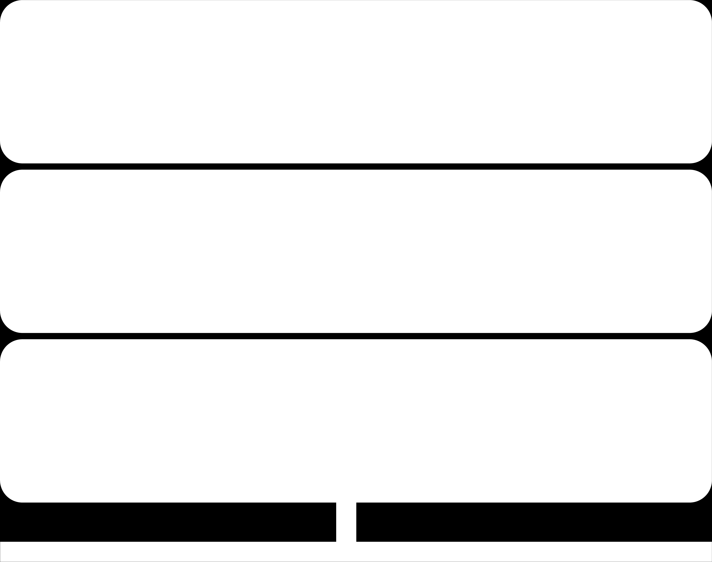
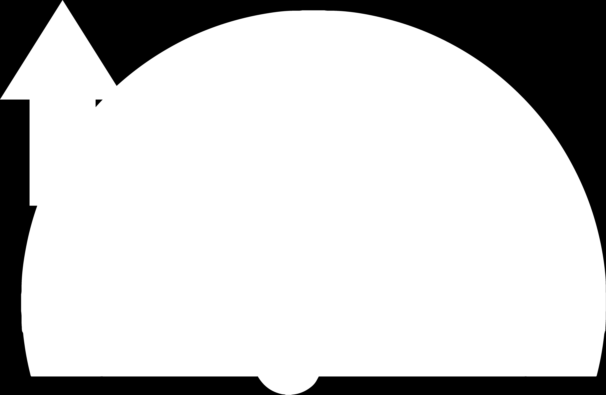
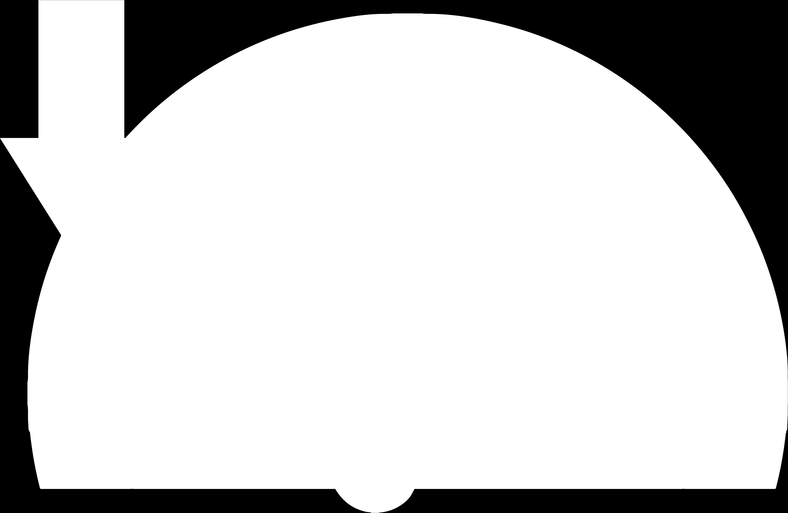
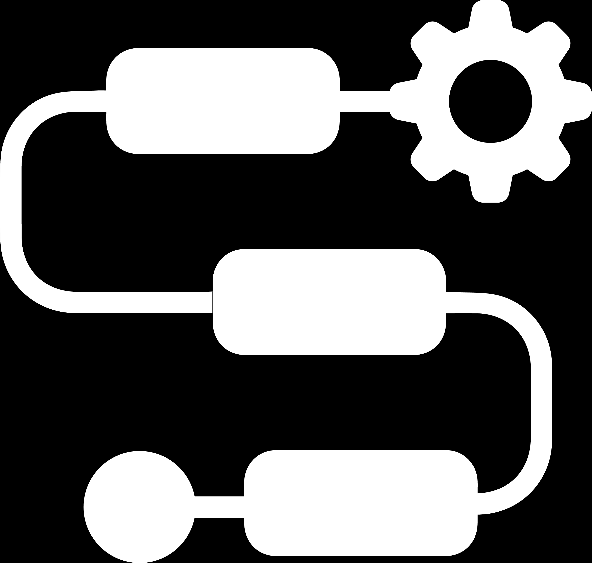
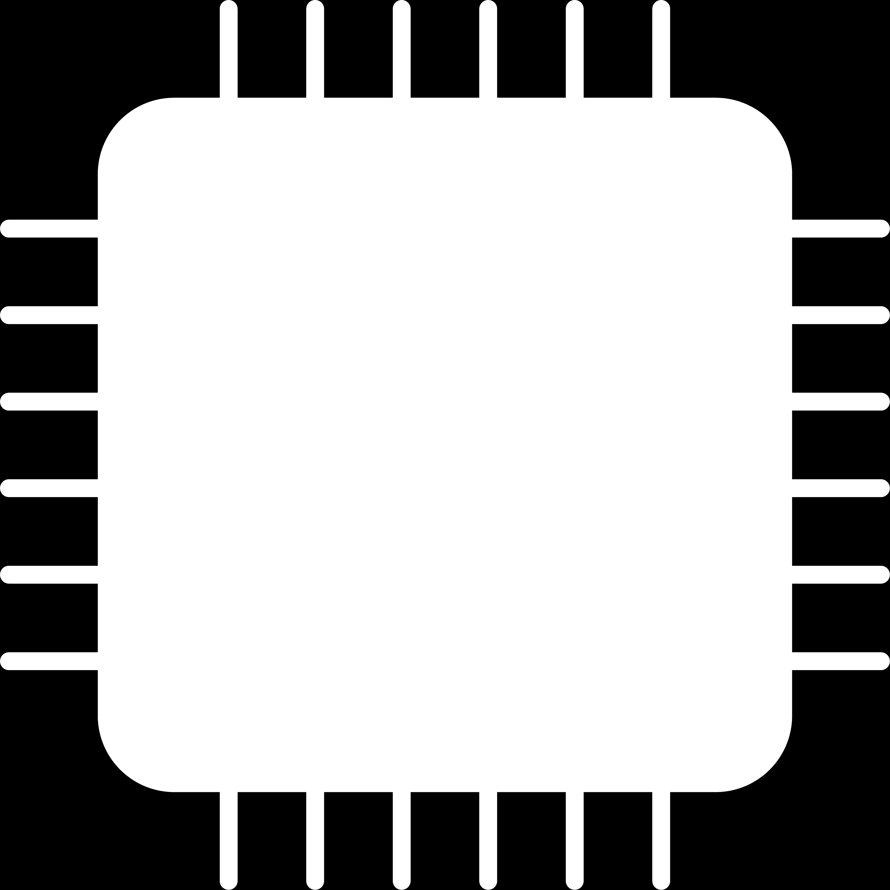
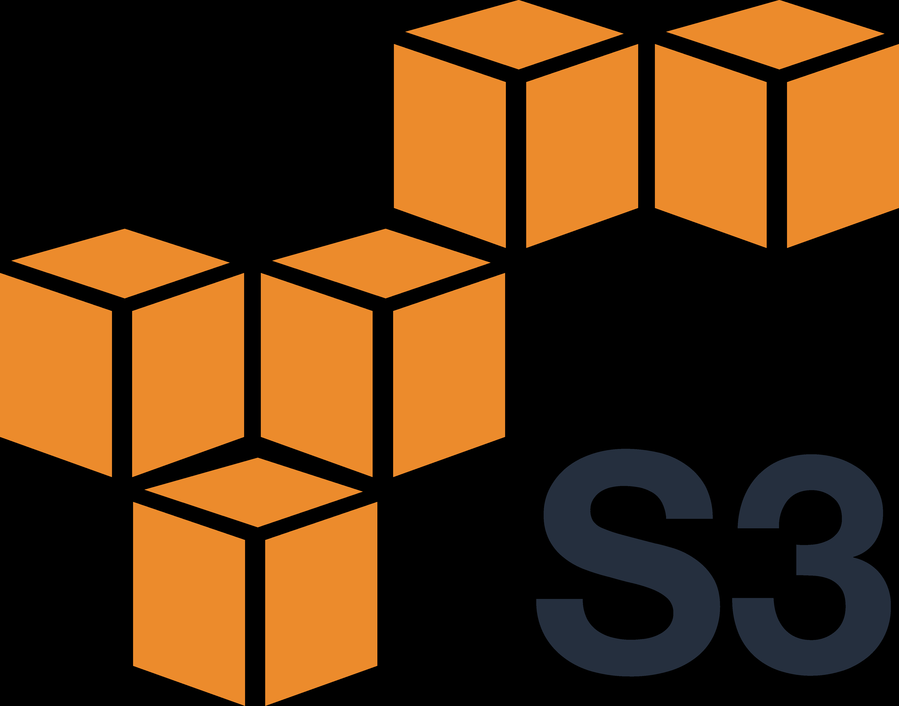
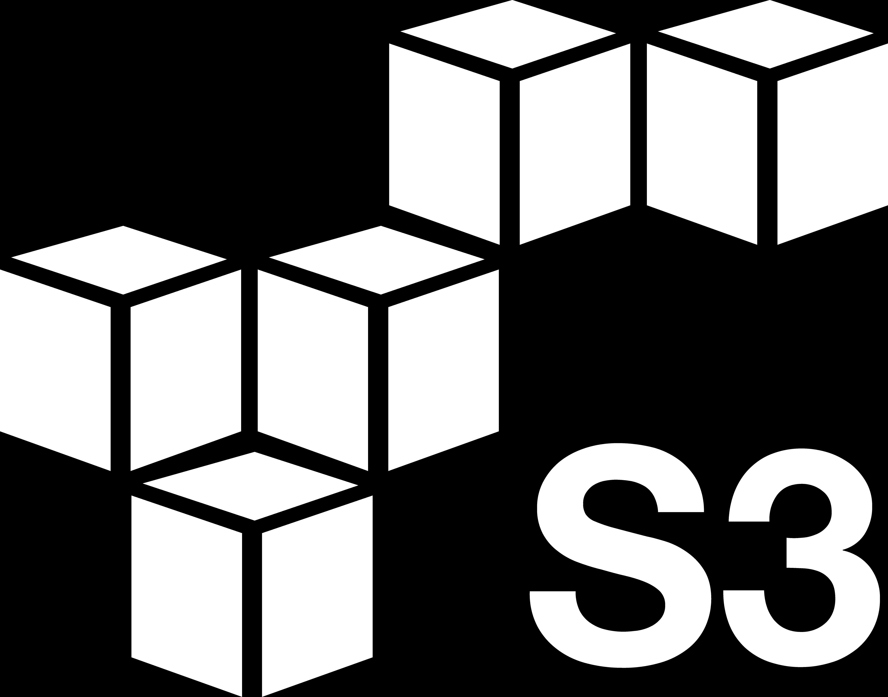

# 027 - Thiết Kế Quora (Hỏi Đáp Quy Mô Lớn)

[← Bài trước](026-thiet-ke-youtube.md) | [Mục lục](README.md) | [Bài tiếp theo →](028-thiet-ke-google-maps.md)

---


# Thiết Kế Hệ Thống: Quora (System Design: Quora)

Tìm hiểu các nguyên lý cơ bản trong việc thiết kế hệ thống Quora.

**Nội dung sẽ bao gồm:**
* Giới thiệu (Introduction)
* Quora là gì? (What is Quora?)
* Chúng ta sẽ thiết kế Quora như thế nào? (How will we design Quora?)

---

## Giới thiệu (Introduction)

Với lượng thông tin khổng lồ hiện có trên mạng Internet, việc tìm kiếm câu trả lời cho các câu hỏi có thể là một thử thách khó khăn. Đó là lý do tại sao việc chia sẻ thông tin trực tuyến lại trở nên phổ biến rộng rãi đến vậy.

Các công cụ tìm kiếm (Search engines) giúp chúng ta đào sâu tìm kiếm thông tin trên khắp không gian mạng. Ví dụ, công cụ tìm kiếm của Google đủ thông minh để trả lời các câu hỏi bằng cách trích xuất thông tin từ các trang web. Mặc dù các công cụ tìm kiếm có những ưu điểm riêng, nhưng đôi khi việc tìm kiếm thông tin chúng ta mong muốn không phải là một quy trình đơn giản. Hãy cùng xem hình minh họa dưới đây để hiểu cách thức tìm kiếm thông tin qua công cụ tìm kiếm khác biệt như thế nào so với tìm kiếm từ con người.


### So sánh tìm kiếm thông tin qua công cụ tìm kiếm với con người (Comparing information seeking through search engines vs. humans)


| Tiêu chí | Công cụ tìm kiếm (Search engine) | Con người (People) |
| :--- | :--- | :--- |
| **Tốc độ (Speed)** | Nhanh (*Fast*) | Chậm (*Slow*) |
| **Độ sâu thông tin (Depth)** | Nông / Khái quát (*Shallow*) | Sâu sắc / Chi tiết (*Deep*) |
| **Tính tương tác (Interaction)** | Chỉ đọc (*Read-only*) | Có tính đối thoại / Trao đổi (*Conversational*) |

Hình minh họa trên cho thấy việc tìm kiếm thông tin thông qua người khác có thể mang tính chỉ dẫn và hữu ích hơn, ngay cả khi phải đánh đổi bằng việc tiêu tốn thêm thời gian. Tìm kiếm thông tin qua các công cụ tìm kiếm có thể dẫn đến ngõ cụt do chủ đề đó chưa có nội dung sẵn trên mạng. Thay vào đó, chúng ta có thể đặt câu hỏi trực tiếp cho người khác.

---

## Quora là gì? (What is Quora?)

Quora là một dịch vụ hỏi đáp xã hội (social question-and-answer service) cho phép người dùng đặt câu hỏi tới những người dùng khác. Quora được tạo ra để giải quyết vấn đề: việc đặt câu hỏi trên công cụ tìm kiếm mang lại câu trả lời nhanh chóng nhưng thông tin lại nông cạn. Thay vào đó, chúng ta có thể hỏi cộng đồng đại chúng, mang lại cảm giác đối thoại nhiều hơn và có thể dẫn đến sự hiểu biết sâu sắc hơn, dù tốc độ phản hồi có thể chậm hơn. Quora cho phép bất kỳ ai cũng có thể đặt câu hỏi, và bất kỳ ai cũng có thể trả lời. Hơn nữa, trên nền tảng còn có các chuyên gia đầu ngành sở hữu kiến thức chuyên sâu về một chủ đề cụ thể, những người thỉnh thoảng sẽ chia sẻ chuyên môn của họ bằng cách trả lời các câu hỏi.

Biểu đồ sau đây thể hiện xu hướng tìm kiếm toàn cầu của người dùng đối với từ khóa “Quora” thông qua Google:


### Mức độ phổ biến của Quora theo Google qua các năm (Popularity of Quora according to Google by year)


Hơn 300 triệu người dùng hoạt động hàng tháng (Monthly Active Users - MAU) đăng tải hàng ngàn câu hỏi mỗi ngày liên quan đến hơn 400.000 chủ đề khác nhau trên Quora.

Trong chương này, chúng ta sẽ thiết kế Quora và đánh giá cách hệ thống đáp ứng các yêu cầu chức năng (functional requirements) cũng như các yêu cầu phi chức năng (non-functional requirements).

---

## Chúng ta sẽ thiết kế Quora như thế nào? (How will we design Quora?)

Chúng ta sẽ thiết kế Quora bằng cách chia bài toán thiết kế thành bốn bài học sau đây:

1. **Yêu cầu (Requirements):** Bài học này sẽ tập trung vào các yêu cầu chức năng (functional requirements) và yêu cầu phi chức năng (non-functional requirements) khi thiết kế Quora. Chúng ta cũng sẽ ước lượng tài nguyên (resource estimation) cần thiết để xây dựng hệ thống.
2. **Thiết kế ban đầu (Initial design):** Chúng ta sẽ tạo một thiết kế ban đầu đáp ứng tất cả các yêu cầu chức năng cho Quora và đồng thời xây dựng thiết kế API trong bài học này. Trọng tâm là thảo luận về các khối thành phần cốt lõi của hệ thống (building blocks), các thành phần khác tham gia hoàn thiện thiết kế, quá trình tích hợp và luồng công việc (workflow) của chúng.
3. **Thiết kế hoàn thiện (Final design):** Trong bài học này, chúng ta sẽ bắt đầu bằng việc xác định những hạn chế của thiết kế ban đầu. Sau đó, chúng ta sẽ cập nhật thiết kế cuối cùng để đáp ứng toàn bộ các yêu cầu chức năng và phi chức năng, đồng thời giải quyết triệt để các hạn chế đó. Chúng ta cũng sẽ tập trung vào một số khía cạnh chuyên sâu thú vị trong thiết kế, chẳng hạn như phân mảnh cơ sở dữ liệu theo chiều dọc (vertical sharding of the database).
4. **Đánh giá (Evaluation):** Chúng ta sẽ đánh giá thiết kế của mình dựa trên các yêu cầu phi chức năng cụ thể và thảo luận về một số sự đánh đổi kỹ thuật (trade-offs). Chúng ta cũng sẽ thảo luận về một số ý tưởng nhằm cải thiện tính sẵn sàng (Availability) cho thiết kế trong bài học này.

> [!NOTE]
> Thông tin được cung cấp trong chương này được lấy cảm hứng và tham khảo từ blog kỹ thuật chính thức của Quora (Quora Engineering Blog).

---

## Các Yêu Cầu Thiết Kế Quora (Requirements of Quora's Design)

Tìm hiểu chi tiết về các yêu cầu khi thiết kế Quora.

**Nội dung sẽ bao gồm:**
* Các yêu cầu (Requirements)
  * Yêu cầu chức năng (Functional requirements)
  * Yêu cầu phi chức năng (Non-functional requirements)
* Ước lượng tài nguyên (Resource estimation)
  * Ước lượng số lượng máy chủ (Number of servers estimation)
  * Ước lượng lưu trữ (Storage estimation)
  * Ước lượng băng thông (Bandwidth estimation)
* Các khối thành phần hệ thống sẽ sử dụng (Building blocks we will use)

---

## Các yêu cầu (Requirements)

Hãy cùng tìm hiểu các yêu cầu chức năng và phi chức năng dưới đây:

### Yêu cầu chức năng (Functional requirements)

Người dùng phải có khả năng thực hiện các chức năng sau:

* **Câu hỏi và câu trả lời (Questions and answers):** Người dùng có thể đặt câu hỏi và đưa ra câu trả lời. Câu hỏi và câu trả lời có thể đính kèm hình ảnh và video.
* **Bình chọn thuận/nghịch và bình luận (Upvote/downvote and comment):** Người dùng có thể bình chọn thuận (*upvote*), bình chọn nghịch (*downvote*) và bình luận (*comment*) vào các câu trả lời.
* **Tìm kiếm (Search):** Người dùng cần có tính năng tìm kiếm để tra cứu các câu hỏi đã được người dùng khác đặt trước đó trên nền tảng.
* **Hệ thống gợi ý (Recommendation system):** Người dùng có thể xem bảng tin (*feed*) cá nhân hóa của mình, bao gồm các chủ đề mà họ quan tâm. Bảng tin cũng có thể bao gồm các câu hỏi đang cần câu trả lời hoặc các câu trả lời mà người đọc có thể thích thú. Hệ thống phải hỗ trợ người dùng khám phá nội dung mới thông qua hệ thống gợi ý (recommender system).
* **Xếp hạng câu trả lời (Ranking answers):** Chúng ta nâng cao trải nghiệm người dùng bằng cách xếp hạng câu trả lời theo mức độ hữu ích của chúng. Câu trả lời hữu ích nhất sẽ được xếp hạng cao nhất và hiển thị ở vị trí đầu tiên trên cùng.

---

### Yêu cầu phi chức năng (Non-functional requirements)

* **Khả năng mở rộng (Scalability):** Hệ thống phải có khả năng mở rộng tốt khi số lượng tính năng và người dùng tăng dần theo thời gian. Điều này đồng nghĩa với việc hiệu năng (Performance) và khả năng sử dụng (Usability) không bị suy giảm khi số lượng người dùng tăng lên.
* **Tính nhất quán (Consistency):** Thiết kế phải đảm bảo rằng góc nhìn của các người dùng khác nhau về cùng một nội dung phải nhất quán. Cụ thể, các nội dung quan trọng như câu hỏi và câu trả lời phải giống nhau đối với bất kỳ nhóm người xem nào. Tuy nhiên, hệ thống không bắt buộc tất cả người dùng Quora phải thấy ngay lập tức một câu hỏi, câu trả lời hoặc bình luận vừa mới được đăng tải (chấp nhận mô hình *Eventual Consistency*).
* **Tính sẵn sàng (Availability):** Hệ thống phải đảm bảo tính sẵn sàng cao (*High Availability*). Yêu cầu này đặc biệt áp dụng cho các trường hợp cụm máy chủ tiếp nhận một lượng lớn các yêu cầu đồng thời (*concurrent requests*).
* **Hiệu năng (Performance):** Hệ thống phải mang lại trải nghiệm mượt mà cho người dùng mà không có độ trễ đáng chú ý (*noticeable delay*).


#### Tóm tắt các yêu cầu chức năng và phi chức năng của Quora

```
                       ┌────────────────────────┐
                       │   Quora Requirements   │
                       └───────────┬────────────┘
                                   │
         ┌─────────────────────────┴─────────────────────────┐
         ▼                                                   ▼
┌─────────────────────────────────┐       ┌─────────────────────────────────┐
│     Non-functional Requirements │       │     Functional Requirements     │
├─────────────────────────────────┤       ├─────────────────────────────────┤
│ • Availability (Tính sẵn sàng)  │       │ • Questions and answers (Hỏi-đáp)│
│ • Consistency (Tính nhất quán)  │       │ • Upvoting/downvoting (Bình chọn)│
│ • Performance (Hiệu năng)       │       │ • Search (Tìm kiếm)             │
│ • Scalability (Khả năng mở rộng)│       │ • Recommendations (Gợi ý feed)  │
│                                 │       │ • Ranking (Xếp hạng câu trả lời)│
└─────────────────────────────────┘       └─────────────────────────────────┘
```

---

## Ước lượng tài nguyên (Resource estimation)

Trong phần này, chúng ta sẽ thực hiện ước lượng các yêu cầu về tài nguyên cho dịch vụ Quora. Chúng ta sẽ đưa ra các giả định hợp lý nhằm đạt được một phép ước lượng mang tính thực tế và khả thi. 

Chúng ta sẽ ước lượng:
* Số lượng máy chủ (Number of servers)
* Dung lượng lưu trữ (Storage)
* Băng thông (Bandwidth) cần thiết để phục vụ một lượng lớn người dùng.

---

### Giả định thiết kế (Assumptions)
Điều quan trọng là phải đặt các ước tính (estimations) của chúng ta dựa trên một số giả định cơ sở. Do đó, chúng ta đưa ra các giả định sau:
* Tổng cộng có **1 tỷ người dùng (1 billion users)**, trong đó có **300 triệu người dùng hoạt động hàng ngày (300 million daily active users - DAU)**.
* Giả định **15%** số câu hỏi có đính kèm hình ảnh và **5%** số câu hỏi có nhúng video. Một câu hỏi không thể chứa cả hình ảnh và video cùng một lúc.
* Chúng ta ước tính dung lượng trung bình của một hình ảnh là **250 KB**, và một video là **5 MB**.

---

### Ước tính số lượng máy chủ (Number of Servers Estimation)

Hãy cùng ước tính số lượng yêu cầu mỗi giây (**Requests Per Second - RPS**) cho thiết kế của chúng ta. Nếu trung bình có 300 triệu người dùng hoạt động hàng ngày (DAU) và mỗi người dùng tạo ra 20 yêu cầu mỗi ngày (requests per day), thì tổng số yêu cầu trong một ngày sẽ là:

$$300 \times 10^6 \times 20 = 6 \times 10^9 \text{ yêu cầu/ngày}$$

Do đó:

$$\text{RPS} = \frac{6 \times 10^9}{86400} \approx 69.500 \text{ yêu cầu mỗi giây (requests per second)}$$


> **Ước tính RPS (Estimating RPS)**
>
> | Đại lượng | Giá trị | Đơn vị |
> | :--- | :--- | :--- |
> | Người dùng hoạt động hàng ngày (Daily active users) | 300 | triệu (million) |
> | Số yêu cầu mỗi ngày trên mỗi người dùng (Requests per day per user) | 20 | |
> | **Số yêu cầu mỗi giây (Requests Per Second - RPS)** | **69.444** | $f$ |

Chúng ta đã thiết lập trong chương tính toán sơ bộ (back-of-the-envelope calculations) rằng chúng ta sẽ sử dụng công thức sau để ước tính số lượng máy chủ thực tế cần thiết:

$$\text{Số lượng máy chủ} = \frac{\text{Số người dùng hoạt động hàng ngày (Daily Active Users)}}{\text{RPS của một máy chủ (RPS of a server)}} = \frac{300 \times 10^6}{8.000} = 37.500$$



> **Ước tính số lượng máy chủ cần thiết cho Quora:**
> **37.500 máy chủ (servers)**

Do đó, tổng số lượng máy chủ cần thiết để đáp ứng cho 300 triệu người dùng tạo ra trung bình 69.500 yêu cầu mỗi giây sẽ là **37.500 máy chủ**.

---

### Ước tính dung lượng lưu trữ (Storage Estimation)

Hãy ghi nhớ giả định rằng 15% câu hỏi có chứa hình ảnh và 5% chứa video. Vì vậy, chúng ta sẽ đưa ra các giả định sau để ước tính yêu cầu lưu trữ cho thiết kế của mình:
* Mỗi người trong số 300 triệu người dùng hoạt động đăng **1 câu hỏi mỗi ngày**, và mỗi câu hỏi trung bình có **2 câu trả lời**, **10 lượt upvote**, và tổng cộng **5 bình luận (comments)**.
* Tổng dung lượng lưu trữ cần thiết cho phần nội dung văn bản (textual content - bao gồm văn bản câu hỏi, (các) câu trả lời và (các) bình luận) của một câu hỏi là **100 KB**.


> **Công cụ tính toán ước tính nhu cầu lưu trữ (Storage Requirements Estimation Calculator)**
>
> | Thông số | Giá trị | Đơn vị |
> | :--- | :--- | :--- |
> | Số câu hỏi trên mỗi người dùng (Questions per user) | 1 | mỗi ngày (per day) |
> | Tổng số câu hỏi mỗi ngày (Total questions per day) | 300 | triệu ($f$) |
> | Kích thước nội dung văn bản mỗi câu hỏi (Size of textual content per question) | 100 | KB |
> | Kích thước hình ảnh (Image size) | 250 | KB |
> | Kích thước video (Video size) | 5 | MB |
> | Tỷ lệ câu hỏi chứa hình ảnh (Questions containing images) | 15 | % |
> | Tỷ lệ câu hỏi chứa video (Questions containing videos) | 5 | % |
> | Dung lượng lưu trữ nội dung văn bản (Storage for textual content) | 30 | TB ($f$) |
> | Dung lượng lưu trữ nội dung hình ảnh (Storage for image content) | 11.25 | TB ($f$) |
> | Dung lượng lưu trữ nội dung video (Storage for video content) | 75 | TB ($f$) |

#### Chi tiết các phép tính (Hide Calculations)
Dưới đây là các phép tính mặc định chi tiết:

1. **Tổng số câu hỏi (Total questions):**
   $$300\text{M} \times 1 = 300 \times 10^6 \text{ câu hỏi mỗi ngày.}$$

2. **Dung lượng lưu trữ yêu cầu cho nội dung văn bản của tất cả các câu hỏi trong một ngày:**
   $$300\text{M} \times 1 \times 100\text{ KB} = 300 \times 10^6 \times 100\text{ KB} = 30\text{ TB}$$
   *(Ghi chú gốc: $300 \times \text{M} \times 1 \times \text{KB} \times 100 = 300\text{GB} \rightarrow 30\text{ TB}$)*

3. **Dung lượng lưu trữ yêu cầu cho hình ảnh trong một ngày:**
   $$\frac{300 \times 10^6 \times 15}{100} \times 250 \times 10^3\text{ B} = 11.25\text{ TB}$$

4. **Dung lượng lưu trữ yêu cầu cho nội dung video trong một ngày:**
   $$\frac{300 \times 10^6 \times 5}{100} \times 5 \times 10^6\text{ B} = 75\text{ TB}$$


> **Tổng kết nhu cầu lưu trữ của Quora (Summarizing storage requirements of Quora)**
>
> * Nội dung văn bản/ngày (Textual content/day): **30 TB**
> * $+$ Nội dung hình ảnh/ngày (Images/day): **11.25 TB**
> * $+$ Nội dung video/ngày (Video content/day): **75 TB**
> * $=$ **Tổng dung lượng lưu trữ cần thiết cho một ngày = $30\text{ TB} + 11.25\text{ TB} + 75\text{ TB} = 116.25\text{ TB}$ mỗi ngày.**

> [!NOTE]
> Yêu cầu lưu trữ hàng ngày của Quora thoạt nhìn có vẻ rất cao. Nhưng đối với một dịch vụ có 300 triệu DAU, nhu cầu lưu trữ hàng năm là **$116.25\text{ TB} \times 365 = 42.43\text{ PB}$** là hoàn toàn khả thi. Yêu cầu trong thực tế sẽ cao hơn nhiều vì chúng ta chưa tính đến dung lượng lưu trữ cần thiết cho một loạt các thành phần khác. Ví dụ: dữ liệu của những người dùng không hoạt động (trong tổng số 1 tỷ người dùng - 1 B) cũng sẽ đòi hỏi không gian lưu trữ.

---

### Ước tính băng thông (Bandwidth Estimation)

Ước tính băng thông yêu cầu tính toán lượng dữ liệu đi vào (incoming/ingress) và đi ra (outgoing/egress) qua hệ thống mạng.

* **Lưu lượng đi vào (Incoming traffic):** Băng thông lưu lượng đi vào yêu cầu mỗi ngày sẽ bằng:
  $$\frac{116.25\text{ TB}}{86400} \times 8 = 10.9\text{ Gbps} \approx 11\text{ Gbps}$$

* **Lưu lượng đi ra (Outgoing traffic):** Chúng ta đã giả định rằng 300 triệu người dùng hoạt động xem 20 câu hỏi mỗi ngày, do đó tổng yêu cầu băng thông có thể được tìm thấy trong bảng tính toán dưới đây:


> **Công cụ tính toán ước tính nhu cầu băng thông (Bandwidth Requirements Estimation Calculator)**
>
> | Thông số | Giá trị | Đơn vị |
> | :--- | :--- | :--- |
> | Tổng dung lượng lưu trữ cần thiết mỗi ngày (Total storage required per day) | 116.25 | TB |
> | Băng thông lưu lượng đi vào (Incoming traffic bandwidth) | 11 | Gbps ($f$) |
> | Số câu hỏi được xem trên mỗi người dùng (Questions viewed per user) | 20 | mỗi ngày (per day) |
> | Tổng số câu hỏi được xem (Total questions viewed) | 69.444 | mỗi giây ($f$) |
> | Băng thông cho văn bản của tất cả các câu hỏi (Bandwidth for text of all questions) | 55.56 | Gbps ($f$) |
> | Băng thông cho 15% nội dung hình ảnh (Bandwidth for 15% of image content) | 20.83 | Gbps ($f$) |
> | Băng thông cho 5% nội dung video (Bandwidth for 5% of video content) | 138.89 | Gbps ($f$) |
> | **Băng thông lưu lượng đi ra (Outgoing traffic bandwidth)** | **215.3** | **Gbps ($f$)** |

#### Chi tiết các phép tính (Hide Calculations)
* **Số câu hỏi được xem mỗi ngày:**
  $$300\text{M} \times 20\text{ câu hỏi} = 6 \text{ tỷ câu hỏi được xem mỗi ngày (6 billion questions).}$$
* **Số câu hỏi được xem mỗi giây (Questions viewed per second):**
  $$\frac{6 \times 10^9}{86400} = 69.4 \times 10^3 \text{ câu hỏi được xem mỗi giây.}$$
* **Băng thông cho nội dung văn bản của tất cả các câu hỏi và câu trả lời của chúng:**
  $$69.4 \times 10^3 \times 100 \times 10^3 \times 8\text{ bits} = 55.56\text{ Gbps}$$
* **Băng thông mỗi giây cho 15% nội dung có chứa hình ảnh:**
  $$69.4 \times 10^3 \times \frac{15}{100} \times 250 \times 10^3 \times 8\text{ bits} = 20.83\text{ Gbps}$$
* **Băng thông mỗi giây cho 5% nội dung có chứa video:**
  $$69.4 \times 10^3 \times \frac{5}{100} \times 5 \times 10^6 \times 8\text{ bits} = 138.9\text{ Gbps}$$
* **Tổng băng thông lưu lượng đi ra (Total outgoing traffic bandwidth):**
  $$55.56\text{ Gbps} + 20.82\text{ Gbps} + 138.9\text{ Gbps} = 215.3\text{ Gbps}$$

> [!NOTE]
> Chúng tôi sử dụng quy tắc làm tròn ở từng bước trong phần giải thích này. Kết quả trong bảng tính phía trên có sự chênh lệch nhỏ do việc làm tròn số.



> **Tổng kết các yêu cầu băng thông của Quora (Summarizing the bandwidth requirements of Quora)**
>
> * Băng thông lưu lượng đi vào (Incoming traffic bandwidth) = **11 Gbps**
> * $+$ Băng thông lưu lượng đi ra (Outgoing traffic bandwidth) = **215.3 Gbps**
> * $=$ **226.3 Gbps**
>
> **Tổng nhu cầu băng thông của Quora bằng:**
> Băng thông lưu lượng đi vào $+$ Băng thông lưu lượng đi ra (Incoming + outgoing traffic bandwidth)
> $$= 11\text{ Gbps} + 215.3\text{ Gbps} = 226.3\text{ Gbps}$$




---

### Các khối kiến trúc nền tảng chúng ta sẽ sử dụng (Building blocks we will use)
Chúng ta sẽ sử dụng các khối kiến trúc nền tảng (building blocks) sau đây cho thiết kế ban đầu của Quora:

---

# Thiết Kế Hệ Thống: Quora (System Design: Quora)

Quay lại | Đánh dấu hoàn thành | Tiếp theo

## Thiết Kế Ban Đầu Của Quora (Initial Design of Quora)

### Các Khối Xây Dựng (Building Blocks) Cần Thiết Cho Thiết Kế Của Chúng Ta

- **Cơ sở dữ liệu (Database)**
- **Lưu trữ Blob (Blob storage)**
- **Bộ cân bằng tải (Load balancer)**
- **Bộ nhớ đệm (Cache)**

  
  
  
  
  
  
  
  

- **Bộ cân bằng tải (Load balancers)** sẽ được sử dụng để phân chia tải lưu lượng (traffic load) giữa các máy chủ dịch vụ (service hosts).
- **Cơ sở dữ liệu (Databases)** là thiết yếu để lưu trữ tất cả các loại dữ liệu, chẳng hạn như câu hỏi và câu trả lời của người dùng, bình luận (comments), lượt thích và không thích (likes và dislikes). Ngoài ra, dữ liệu người dùng cũng sẽ được lưu trữ trong các cơ sở dữ liệu. Chúng ta có thể sử dụng các loại cơ sở dữ liệu khác nhau để lưu trữ các loại dữ liệu khác nhau.
- **Hệ thống bộ nhớ đệm phân tán (Distributed caching system)** sẽ được sử dụng để lưu trữ dữ liệu được truy cập thường xuyên (frequently accessed data). Chúng ta cũng có thể sử dụng bộ nhớ đệm (caching) để lưu trữ bộ đếm lượt xem (view counters) cho các câu hỏi khác nhau.
- **Kho lưu trữ nhị phân lớn (Blob store)** sẽ lưu giữ các tệp hình ảnh và video.

---

## Thiết Kế Ban Đầu Của Quora (Initial Design of Quora)

> **Chuyển đổi các yêu cầu của Quora thành một thiết kế mức cao (High-Level Design).**

Chúng ta sẽ bao quát các nội dung sau:
- Thiết kế ban đầu (Initial design)
- Luồng công việc (Workflow)
- Thiết kế API (API design)
  - Đăng câu hỏi (Post a question)
  - Đăng câu trả lời (Post an answer)
  - Bầu chọn tích cực cho câu trả lời (Upvote an answer)
  - Bình luận về câu trả lời (Comment on an answer)
  - Tìm kiếm (Search)

### Thiết Kế Ban Đầu (Initial Design)

Thiết kế ban đầu của Quora sẽ được cấu thành từ các khối xây dựng (building blocks) và thành phần (components) sau:

#### Máy Chủ Web Và Máy Chủ Ứng Dụng (Web and Application Servers)
Một trang Quora điển hình được tạo ra bởi nhiều dịch vụ khác nhau. Các máy chủ web và máy chủ ứng dụng duy trì các tiến trình (processes) khác nhau để sinh một trang web. 

- Các **máy chủ web (web servers)** có các **tiến trình quản lý (manager processes)**.
- Các **máy chủ ứng dụng (application servers)** có các **tiến trình công nhân (worker processes)** để xử lý các yêu cầu khác nhau. 

Các tiến trình quản lý phân phối công việc giữa các tiến trình công nhân bằng cách sử dụng một thư viện định tuyến (router library). Thư viện định tuyến được đưa các tác vụ vào hàng đợi (enqueued) bởi các tiến trình quản lý và được các tiến trình công nhân lấy ra khỏi hàng đợi (dequeued). Mỗi máy chủ ứng dụng duy trì nhiều hàng đợi trong bộ nhớ (in-memory queues) để xử lý các yêu cầu khác nhau của người dùng. 

Hình minh họa dưới đây cung cấp góc nhìn trừu tượng về các máy chủ web và máy chủ ứng dụng:

  
  
  
  
  
  

```
[Load balancer]
      │
      ▼
[Web servers (Manager processes)]
      │
      ├── Fast router ──► [Worker processes (Application server 1)]
      │
      └── Fast router ──► [Worker processes (Application server N)]
```

#### Kho Lưu Trữ Dữ Liệu (Data Stores)
Các loại dữ liệu khác nhau đòi hỏi phải lưu trữ trong các kho dữ liệu (data stores) khác nhau:
- Chúng ta có thể lưu trữ dữ liệu quan trọng mang tính sống còn (critical data) như câu hỏi, câu trả lời, bình luận và lượt upvote/downvote trong một **cơ sở dữ liệu quan hệ (relational database)** như **MySQL** vì nó cung cấp mức độ nhất quán cao hơn (**Higher Degree of Consistency**).
- Các **cơ sở dữ liệu NoSQL** như **HBase** có thể được sử dụng để lưu trữ số lượt xem của một trang, điểm số dùng để xếp hạng các câu trả lời, và các đặc trưng được trích xuất từ dữ liệu (extracted features) để phục vụ cho các đề xuất (recommendations) sau này.
- Vì việc tính toán lại các đặc trưng (recomputing features) là một tác vụ tốn kém tài nguyên (expensive operation), **HBase** có thể là một lựa chọn tốt để lưu trữ và truy xuất dữ liệu ở băng thông cao (high bandwidth).
- Chúng ta yêu cầu **thông lượng đọc/ghi cao (High Read/Write Throughput)** bởi vì các hệ thống xử lý dữ liệu lớn (big data processing systems) sử dụng tính song song cao (high parallelism) để thu thập các số liệu thống kê cần thiết một cách hiệu quả.
- Ngoài ra, **kho lưu trữ nhị phân lớn (Blob storage)** là bắt buộc để lưu trữ các video và hình ảnh được đăng tải trong các câu hỏi và câu trả lời.

---

> [!NOTE]
> **Ẩn gợi ý (Hide Hint)**  
> Quora được thành lập vào năm 2009, trong khi HBase được phát triển vào năm 2008 bởi Apache. Bởi vì nó là mã nguồn mở và được mô hình hóa theo BigTable của Google, nó rất phù hợp để lưu trữ một lượng lớn dữ liệu kích thước nhỏ. Hơn nữa, nó sở hữu thông lượng đọc/ghi cao (**High Read/Write Throughput**). Do đó, đây là một lựa chọn tự nhiên cho Quora sử dụng trong giai đoạn khởi đầu của mình.

#### Bộ Nhớ Đệm Phân Tán (Distributed Cache)
Để cải thiện hiệu năng (**Performance Improvement**), hai hệ thống bộ nhớ đệm phân tán được sử dụng: **Memcached** và **Redis**.
- **Memcached** chủ yếu được sử dụng để lưu trữ dữ liệu quan trọng thường xuyên được truy cập vốn được lưu trữ trong MySQL.
- Mặt khác, **Redis** chủ yếu được sử dụng để lưu trữ bộ đếm lượt xem trực tuyến (online view counter) của các câu trả lời vì nó cho phép các thao tác tăng giá trị trực tiếp tại chỗ trong kho lưu trữ (**in-store increments**). 

Do đó, hai hệ thống bộ nhớ đệm được triển khai tùy theo từng trường hợp sử dụng (use case) cụ thể của chúng. Ngoài hai hệ thống này, các mạng phân phối nội dung (**CDN - Content Delivery Networks**) sẽ phân phối các video và hình ảnh được truy cập thường xuyên.

#### Máy Chủ Tính Toán (Compute Servers)
Một tập hợp các máy chủ tính toán là cần thiết để hỗ trợ các tính năng như đề xuất (recommendations) và xếp hạng (ranking) dựa trên một tập hợp các thuộc tính. Các tính năng này có thể được tính toán ở chế độ trực tuyến (**online mode**) hoặc ngoại tuyến (**offline mode**). Các máy chủ tính toán sử dụng công nghệ Học máy (**ML - Machine Learning**) để đưa ra các đề xuất hiệu quả. Một cách tự nhiên, các máy chủ tính toán này sở hữu dung lượng RAM và sức mạnh xử lý (processing power) rất lớn.

Dĩ nhiên, các khối xây dựng cơ bản khác như bộ cân bằng tải (**Load Balancers**), dịch vụ giám sát (**Monitoring Services**), và bộ giới hạn tốc độ (**Rate Limiters**) cũng sẽ là một phần của thiết kế. 

Thiết kế mức cao (**High-Level Design**) được cung cấp dưới đây:


**Sơ đồ kiến trúc mức cao của Quora (The high-level design of Quora):**
- **Client** gửi yêu cầu qua **Load balancer** đến cụm **Web servers**.
- **Web servers** giao tiếp với **Application servers**.
- **Application servers** tương tác với các tầng dữ liệu: **Redis server** (bộ đếm), **Memcached** (cache dữ liệu nóng), **MySQL database** (dữ liệu quan hệ nhất quán), **HBase database** (lưu trữ đặc trưng, view, điểm số), và **Blob storage** (hình ảnh, video).
- **Trích xuất đặc trưng (Feature extraction)** lấy dữ liệu từ HBase/MySQL đưa vào **ML Engine** để huấn luyện mô hình và tính toán xếp hạng/đề xuất.

---

### Luồng Công Việc (Workflow)

Thiết kế của Quora phức tạp bởi vì chúng ta có một số lượng lớn các yêu cầu chức năng (**Functional Requirements**) và phi chức năng (**Non-Functional Requirements**). Do đó, chúng ta sẽ giải thích luồng công việc dựa trên cơ sở từng tính năng:

#### Đăng Câu Hỏi, Câu Trả Lời, Bình Luận (Posting Question, Answers, Comments)
- Các máy chủ web nhận các yêu cầu từ người dùng thông qua bộ cân bằng tải và chuyển hướng chúng đến các máy chủ ứng dụng.
- Trong khi đó, các máy chủ web tạo ra một phần của trang web và để tiến trình công nhân (**worker process**) trong các máy chủ ứng dụng thực hiện phần tạo trang còn lại.
- Dữ liệu câu hỏi và câu trả lời được lưu trữ trong một cơ sở dữ liệu **MySQL**, trong khi bất kỳ video và hình ảnh nào đều được lưu trữ trong **Blob storage**.
- Một cách tiếp cận tương tự cũng được sử dụng để đăng bình luận và bầu chọn tích cực/tiêu cực (**upvote/downvote**) cho các câu trả lời.
- Việc ưu tiên hóa tác vụ (**Task prioritization**) được thực hiện bằng cách áp dụng các hàng đợi khác nhau cho các tác vụ khác nhau. Chúng ta thực hiện ưu tiên hóa bởi vì một số tác vụ nhất định đòi hỏi sự phản hồi ngay lập tức—ví dụ: truy xuất dữ liệu từ cơ sở dữ liệu cho một yêu cầu của người dùng—trong khi những tác vụ khác lại không quá khẩn cấp—ví dụ: gửi email tổng hợp hàng tuần (**weekly email digest**). Các tiến trình công nhân sẽ thực thi các tác vụ bằng cách lấy việc từ các hàng đợi này.

---

### Các Điểm Cần Suy Ngẫm (Points to Ponder)

#### Câu hỏi 1:
> **Khi nào một dịch vụ như Quora sẽ cần đến tính năng thông báo (Notifications feature)?**

**Ẩn câu trả lời (Hide Answer):**  
Quora sẽ cần một dịch vụ thông báo (**Notification Service**) trong các kịch bản sau:
1. Người dùng đăng một câu hỏi về một chủ đề mà một người có khả năng trả lời đã đăng ký theo dõi (subscribed).
2. Người dùng đăng một câu trả lời cho một câu hỏi được hỏi bởi một người dùng khác.
3. Một bài đăng mà người dùng quan tâm hoặc do chính họ viết nhận được các bình luận mới, hoặc lượt upvotes/downvotes mới, v.v.

*(1 trên 2)*

#### Hệ Thống Xếp Hạng Câu Trả Lời (Answer Ranking System)
- Các câu trả lời cho các câu hỏi có thể được sắp xếp dựa trên ngày tháng. Mặc dù việc phát triển một hệ thống xếp hạng trên cơ sở ngày tháng (sử dụng dấu thời gian - timestamps) là rất thuận tiện, người dùng lại thích nhìn thấy câu trả lời thích hợp nhất ở trên cùng.
- Do đó, Quora sử dụng Học máy (**Machine Learning - ML**) để xếp hạng các câu trả lời. Các đặc trưng khác nhau được trích xuất theo thời gian và được lưu trữ trong **HBase** cho từng loại câu hỏi.
- Các đặc trưng này được chuyển tiếp đến **ML engine** để xếp hạng câu trả lời hữu ích nhất lên vị trí trên cùng.
- Chúng ta không thể sử dụng số lượng upvotes làm chỉ số duy nhất để xếp hạng câu trả lời, bởi vì một lượng lớn câu trả lời có thể chỉ là trò đùa (jokes)—và những câu trả lời như vậy cũng nhận được rất nhiều lượt upvote.
- Việc triển khai hệ thống xếp hạng ở chế độ ngoại tuyến (**offline mode**) là một giải pháp tốt vì các câu trả lời hay sẽ nhận được upvotes và lượt xem theo thời gian. Ngoài ra, chế độ ngoại tuyến gây ra ít gánh nặng hơn cho hạ tầng hệ thống (**infrastructure**).
- Việc triển khai hệ thống xếp hạng ngoại tuyến kết hợp với nhu cầu về phần cứng ML chuyên dụng khiến cho việc sử dụng một số dịch vụ đàn hồi trên đám mây công cộng (**public cloud elastic services**) trở nên rất phù hợp.

---

### Hệ thống gợi ý (Recommendation system)
Hệ thống gợi ý chịu trách nhiệm cho nhiều tính năng khác nhau. Ví dụ: chúng ta có thể cần xây dựng bảng tin người dùng (user feed), tìm kiếm các câu hỏi và quảng cáo liên quan, gợi ý câu hỏi cho những người có khả năng trả lời (potential respondents), và thậm chí làm nổi bật nội dung trùng lặp cũng như nội dung vi phạm điều khoản sử dụng dịch vụ. Khác với hệ thống xếp hạng câu trả lời (answer ranking system), hệ thống gợi ý phải cung cấp cả dịch vụ trực tuyến (online) và ngoại tuyến (offline). Hệ thống này tiếp nhận các yêu cầu từ máy chủ ứng dụng (application server) và chuyển tiếp các đặc trưng đã chọn (selected features) đến engine học máy (ML engine).

### Tính năng tìm kiếm (Search feature)
Theo thời gian, khi các câu hỏi và câu trả lời được nạp vào hệ thống Quora, việc xây dựng chỉ mục (index) trong HBase là điều hoàn toàn khả thi. Các truy vấn tìm kiếm của người dùng sẽ được khớp với chỉ mục này, và nội dung liên quan sẽ được gợi ý tới người dùng. Các chỉ mục được truy cập thường xuyên có thể được phục vụ từ bộ nhớ đệm (cache) để đạt độ trễ thấp (low latency). Chỉ mục có thể được xây dựng từ câu hỏi, câu trả lời, nhãn chủ đề (topic labels) và tên người dùng (usernames). Việc tách từ (tokenization) của chỉ mục tìm kiếm cũng sẽ trả về cùng một kết quả ngay cả khi thứ tự các từ bị thay đổi (xem chi tiết tại chương *Scaling Search and Indexing in Distributed Search*).

> [!NOTE]
> **Các sự thật bên lề (Hide Facts):**
> * Quora chủ yếu được xây dựng trên nền tảng Amazon Web Services (AWS).
> * Ban đầu, Quora sử dụng các phiên bản EC2 của Amazon làm máy chủ ứng dụng với cấu hình 8 lõi (eight cores) và 8 MB cache.
> * Quora từng sử dụng máy chủ tìm kiếm có tên là Sphinx. Về sau, do hiệu năng chậm, Quora đã tự phát triển công cụ tìm kiếm tùy chỉnh (custom-built search engine) chỉ bằng Thrift và các thư viện Python Unicode.
> * Tính năng tìm kiếm toàn văn (full-text search) được Quora ra mắt vào năm 2013. Trước thời điểm đó, hệ thống chỉ hỗ trợ trả về kết quả cho từng từ đơn lẻ.

---

## Thiết kế API (API design)

Trong phần này, chúng ta sẽ thiết kế các lời gọi API cho Quora. Chúng ta sẽ chỉ định nghĩa API cho các tính năng sau:
* Đăng câu hỏi (Post a question)
* Đăng câu trả lời (Post an answer)
* Bầu chọn ủng hộ hoặc phản đối (Upvote / Downvote) một câu hỏi hoặc câu trả lời
* Bình luận vào một câu trả lời (Comment on an answer)
* Tìm kiếm (Search)

> [!IMPORTANT]
> **Lưu ý (Note):** Chúng ta không xét đến các API cho hệ thống gợi ý hoặc xếp hạng vì chúng không được đưa ra dưới dạng một yêu cầu tường minh (explicit request) từ phía người dùng. Thay vào đó, máy chủ web (web server) sẽ điều phối với các thành phần khác để bảo đảm dịch vụ.

---

### 1. Đăng câu hỏi (Post a question)

Phương thức HTTP POST được sử dụng để gọi API `/postQuestion`:

```http
postQuestion(user_id, question, description, topic_label, video, image)
```

Hãy cùng tìm hiểu từng tham số của lời gọi API:

| Tham số (Parameter) | Mô tả (Description) |
| :--- | :--- |
| `user_id` | Mã định danh duy nhất (unique identification) của người dùng đăng câu hỏi. |
| `question` | Nội dung văn bản của câu hỏi do người dùng đặt ra. |
| `description` | Phần mô tả chi tiết của câu hỏi. Đây là trường tùy chọn (optional field). |
| `topic_label` | Đại diện cho danh sách các lĩnh vực/chủ đề mà câu hỏi của người dùng có liên quan tới. |
| `video` | Tệp video được nhúng trong câu hỏi của người dùng. |
| `image` | Hình ảnh là một phần trong câu hỏi của người dùng. |

Các tham số `video` và `image` có thể nhận giá trị `NULL` nếu không có hình ảnh hoặc video nào được nhúng bên trong câu hỏi. Ngược lại, chúng sẽ được tải lên như một phần của câu hỏi.

---

### 2. Đăng câu trả lời (Post an answer)

Đối với thao tác đăng câu trả lời, phương thức POST là lựa chọn phù hợp cho API `/postAnswer`:

```http
postAnswer(user_id, question_id, answer_text, video, image)
```

| Tham số (Parameter) | Mô tả (Description) |
| :--- | :--- |
| `question_id` | Tham chiếu tới câu hỏi mà câu trả lời này được đăng vào. |
| `answer_text` | Nội dung văn bản câu trả lời do người phản hồi đăng. |

*Các tham số còn lại có ý nghĩa tương tự như đã giải thích ở trên.*

---

### 3. Bầu chọn ủng hộ câu trả lời (Upvote an answer)

Cấu trúc API `/upvote` như sau:

```http
upvote(user_id, question_id, answer_id)
```

| Tham số (Parameter) | Mô tả (Description) |
| :--- | :--- |
| `user_id` | Đại diện cho người dùng thực hiện bầu chọn ủng hộ (upvote) câu trả lời. |
| `answer_id` | Đại diện cho định danh của câu trả lời được upvote cho một câu hỏi cụ thể, câu hỏi đó được xác định bởi `question_id`. |

> [!NOTE]
> **Lưu ý (Note):** API bầu chọn phản đối (downvote) có cấu trúc tương tự như API upvote vì cả hai đều là các chức năng tương đồng nhau.

---

### 4. Bình luận vào câu trả lời (Comment on an answer)

API `/comment` có cấu trúc như sau:

```http
comment(user_id, answer_id, comment_text)
```

| Tham số (Parameter) | Mô tả (Description) |
| :--- | :--- |
| `user_id` | Đại diện cho người dùng bình luận vào câu trả lời. |
| `comment_text` | Đại diện cho nội dung văn bản mà người dùng đăng vào câu trả lời được định danh bởi `answer_id`. |

---

### 5. Tìm kiếm (Search)

API `/search` có các thông tin chi tiết như sau:

```http
search(user_id, search_text)
```

| Tham số (Parameter) | Mô tả (Description) |
| :--- | :--- |
| `user_id` | Đây là `user_id` của người thực hiện truy vấn tìm kiếm. Trong trường hợp này, nó là tùy chọn (optional) vì người dùng chưa đăng ký tài khoản vẫn có thể tìm kiếm câu hỏi. |
| `search_text` | Truy vấn tìm kiếm do người dùng nhập vào. |

> [!TIP]
> Chúng ta sử dụng một bộ tạo chuỗi định danh (sequencer) để sinh ra các ID khác nhau được đề cập trong các lời gọi API.

---

## Điểm cần suy ngẫm (Point to Ponder)

**Câu hỏi:**
Tại sao lại có một tầng định tuyến tùy chỉnh (custom routing layer) nằm giữa máy chủ web (web server) và máy chủ ứng dụng (application server) thay vì sử dụng một tầng cân bằng tải (load-balancing layer) thông thường?

> [!NOTE]
> **Ẩn câu trả lời (Hide Answer):**
> Lý do chính là **hiệu năng (performance)**. Một tầng cân bằng tải thông thường (generic load-balancing layer) sẽ có rất ít khả năng hiểu sâu về tầng ứng dụng (application understandability) và gây ra độ trễ cao hơn (higher latency).
> 
> Như đã đề cập, các tiến trình quản lý (manager processes) tạo ra bộ khung (skeleton) của trang web và giao phần lớn khối lượng công việc còn lại cho các tiến trình công nhân (worker processes). Theo nghĩa đó, một tiến trình quản lý có thể tạo ra nhiều tác vụ (worker tasks). Thư viện định tuyến tùy chỉnh đóng vai trò như một hàng đợi (queue) giữa manager và worker, nơi bất kỳ tiến trình worker nào cũng có thể tiêu thụ tác vụ do tiến trình manager tạo ra. Thiết kế này giúp cải thiện hiệu năng tổng thể và hỗ trợ khả năng mở rộng (scalability).

---

# Thiết kế cuối cùng của Quora (Final Design of Quora)

Tìm hiểu về các hạn chế trong thiết kế của Quora và cải tiến thiết kế.

Chúng ta sẽ bao quát các nội dung sau:
* Các hạn chế của thiết kế được đề xuất (Limitations of the proposed design)
* Thiết kế chi tiết của Quora (Detailed design of Quora)
* Các máy chủ dịch vụ (Service hosts)
* Phân mảnh dọc MySQL (Vertical sharding of MySQL)
* MyRocks
* Kafka
* Sử dụng công nghệ (Technology usage)

---

### Hạn chế của thiết kế được đề xuất (Limitations of the proposed design)

Thiết kế được đề xuất đáp ứng được tất cả các yêu cầu chức năng (functional requirements). Tuy nhiên, nó bộc lộ một số nhược điểm nghiêm trọng phát sinh khi chúng ta mở rộng quy mô (scale). Điều này đồng nghĩa với việc chúng ta không thể đáp ứng được các yêu cầu phi chức năng (non-functional requirements). Hãy cùng khám phá những thiếu sót chính dưới đây:

* **Hạn chế của máy chủ web và máy chủ ứng dụng (Limitations of web and application servers):** Để xử lý yêu cầu của người dùng, dữ liệu payload phải truyền qua lại giữa máy chủ web và máy chủ ứng dụng, làm gia tăng độ trễ (latency) do chi phí I/O mạng (network I/O) giữa hai loại máy chủ này. Ngay cả khi chúng ta đạt được tính toán song song (parallel computation) bằng cách tách biệt máy chủ web khỏi máy chủ ứng dụng (nghĩa là tách tiến trình manager và worker), thì độ trễ tăng thêm do liên kết mạng phụ (additional network link) này vẫn làm suy giảm trải nghiệm người dùng. Bên cạnh việc truyền tải dữ liệu, việc giao tiếp điều khiển (control communication) giữa thư viện định tuyến (router library) với các tiến trình manager và worker cũng gây thêm tổn thất về hiệu năng.
* **Lỗi hàng đợi trong bộ nhớ (In-memory queue failure):** Kiến trúc nội bộ của các máy chủ ứng dụng ghi log các tác vụ và chuyển tiếp chúng đến các hàng đợi trong bộ nhớ (in-memory queues) để phục vụ cho...

---

# Thiết Kế Chi Tiết Quora (Detailed Design of Quora)

---

## 1. Những Vấn Đề Cần Giải Quyết Ở Thiết Kế Ban Đầu

... các tiến trình worker. Những hàng đợi trong bộ nhớ (**in-memory queues**) với các mức độ ưu tiên khác nhau này rất dễ gặp sự cố hỏng hóc (**failures**). Chẳng hạn, nếu một hàng đợi bị mất, toàn bộ các tác vụ (**tasks**) nằm trong hàng đợi đó cũng sẽ bị mất hoàn toàn, đòi hỏi các kỹ sư phải can thiệp thủ công bằng tay để khôi phục lại các tác vụ đó. Điều này làm suy giảm nghiêm trọng hiệu năng (**performance**) của toàn hệ thống. 

Mặt khác, việc sao chép nhân bản (**replicating**) các hàng đợi này đòi hỏi phải tăng dung lượng bộ nhớ RAM. Đồng thời, với số lượng tính năng rất lớn (các yêu cầu chức năng - **functional requirements**) mà hệ thống cung cấp, rất nhiều tác vụ có thể bị dồn ứ lại, dẫn đến tình trạng cạn kiệt bộ nhớ (**insufficient memory**). 

Cùng lúc đó, việc làm nghẽn các máy chủ ứng dụng (**application servers**) bởi những tác vụ không quá khẩn cấp là điều không hề mong muốn. Ví dụ, máy chủ ứng dụng không nên bị gánh nặng bởi các tác vụ như lưu số lượt xem (**view counts**) cho các câu trả lời, bổ sung dữ liệu thống kê vào cơ sở dữ liệu để phân tích sau này, v.v.

### Tăng Trưởng Chỉ Số QPS Trên MySQL (Increasing QPS on MySQL)
Do số lượng tính năng được cung cấp bởi hệ thống tăng lên, một vài bảng (**tables**) trong MySQL phải tiếp nhận một lượng truy vấn người dùng khổng lồ. Điều này dẫn đến chỉ số **QPS (Queries Per Second)** tăng vọt trên một số máy chủ MySQL nhất định, gây ra độ trễ cao hơn (**higher latency**). Hơn nữa, trong thiết kế ban đầu chưa hề có cơ chế nào được định nghĩa cho việc quản lý khắc phục thảm họa (**disaster recovery management**).

### Độ Trễ Của HBase (Latency of HBase)
Mặc dù HBase cho phép đạt thông lượng thời gian thực cao (**high real-time throughput**), độ trễ P99 (**P99 latency**) của nó lại không thuộc nhóm tối ưu nhất. Rất nhiều tính năng của Quora đòi hỏi bộ máy máy học (**ML engine - Machine Learning engine**) mà bản thân bộ máy này đã có độ trễ riêng. Do cộng dồn thêm độ trễ tương đối cao của HBase, hiệu năng tổng thể của hệ thống sẽ bị suy giảm dần theo thời gian.

> [!IMPORTANT]
> Các vấn đề nêu trên đòi hỏi chúng ta phải thay đổi thiết kế đã đề xuất trước đó. Vì vậy, chúng ta sẽ thực hiện các điều chỉnh và cập nhật thiết kế hệ thống như dưới đây.

---

## 2. Thiết Kế Chi Tiết Của Quora (Detailed Design of Quora)


Hãy cùng phân tích chi tiết các cải tiến trong thiết kế của chúng ta:

### Máy Chủ Dịch Vụ Hợp Nhất (Service Hosts)
Chúng ta kết hợp **Web Server** và **Application Server** vào chung bên trong một máy chủ vật lý mạnh mẽ duy nhất (**single powerful machine**) có thể xử lý đồng thời tất cả các tiến trình. Kỹ thuật này triệt tiêu hoàn toàn độ trễ I/O mạng (**network I/O**) và độ trễ phát sinh do các chặng nhảy mạng (**network hops**) giữa tiến trình quản trị (**manager process**), tiến trình worker (**worker process**) và thư viện định tuyến (**routing library process**).

Hình minh họa dưới đây cung cấp góc nhìn trừu tượng về kiến trúc máy chủ web đã được cập nhật:


---

## 3. Phân Mảnh Dọc MySQL (Vertical Sharding of MySQL)

Các bảng trong máy chủ MySQL được chuyển đổi thành các phân mảnh (**shards**) riêng biệt mà chúng ta gọi là các phân vùng (**partitions**). Mỗi phân vùng sẽ có một máy chủ sơ cấp (**single primary server**) và nhiều máy chủ bản sao (**multiple replica servers**). 

Mục tiêu là cải thiện hiệu năng và giảm tải do lượng truy vấn ngày càng tăng lên một bảng cơ sở dữ liệu đơn lẻ. Để đạt được điều đó, chúng ta thực hiện phân mảnh dọc (**Vertical Sharding**) theo hai cách:

1. **Tách các bảng của một cơ sở dữ liệu đơn lẻ thành nhiều phân vùng:** Khái niệm này được minh họa tại **Partition 2** và **Partition 3**, lần lượt chứa riêng **Table 4** và **Table 3**.
2. **Gộp nhiều bảng vào một phân vùng duy nhất** khi dự kiến trước sẽ có các thao tác kết hợp dữ liệu (**join operations**): Khái niệm này được mô tả tại **Partition 1**, nơi tích hợp cả **Table 1** và **Table 2**.

Nhờ đó, chúng ta có thể đặt các dữ liệu có liên quan nằm cạnh nhau (**co-locate related data**) trên cùng ổ đĩa/máy chủ và giảm lưu lượng truy cập dồn vào các điểm dữ liệu nóng (**hot data**). Hình minh họa bên dưới thể hiện kiến trúc phân mảnh dọc tại Quora.


Sau khi hoàn tất quá trình phân vùng, chúng ta cần hai loại ánh xạ (**mappings**) hay dữ liệu đặc tả (**metadata**) để hoàn thiện tiến trình mở rộng quy mô (**scaling process**):
1. **Phân vùng nào chứa những bảng và cột nào?**
2. **Những máy chủ nào đóng vai trò Primary (sơ cấp) và Replica (bản sao) của một phân vùng cụ thể?**

Cả hai dạng ánh xạ này đều được lưu trữ và duy trì bởi một dịch vụ quản lý cấu hình đồng thuận phân tán như **ZooKeeper**.

Kiến trúc phân mảnh ở trên đảm bảo khả năng mở rộng quy mô (**Scalability**) vì chúng ta có thể định vị dữ liệu liên quan trong một phân vùng duy nhất, do đó loại bỏ hoàn toàn nhu cầu truy vấn dữ liệu chéo giữa nhiều phân mảnh (**cross-shard queries**). Ngoài ra, số lượng máy chủ bản sao đọc (**read-replicas**) có thể được tăng lên cho các phân mảnh nóng (**hot shards**), hoặc có thể thực hiện chia nhỏ phân mảnh sâu hơn nữa. Đối với các trường hợp ngoại lệ mang tính biên lề (**edge cases**) cần thực hiện phép nối (**join**), chúng ta có thể xử lý việc ghép nối này ngay tại tầng ứng dụng (**application level**).

> [!NOTE]
> Phân mảnh dọc (**Vertical Sharding**) là điểm nhấn đặc biệt đáng chú ý trong thiết kế của Quora, bởi vì phân mảnh ngang (**Horizontal Sharding**) thường phổ biến hơn trong cộng đồng cơ sở dữ liệu. Ý tưởng cốt lõi của phân mảnh dọc là đạt được khả năng mở rộng (**Scalability**) bằng cách phân chia hoặc tái định vị các bảng một cách cẩn trọng, từ đó triệt tiêu các thao tác kết hợp dữ liệu (**join operations**) xuyên qua các phân mảnh khác nhau. 
> 
> Tuy nhiên, một phân vùng hoặc bảng đã phân mảnh dọc vẫn có thể tiếp tục phình to về mặt kích thước hàng dữ liệu đến mức mà việc áp dụng phân mảnh ngang (**Horizontal Sharding**) tiếp theo sẽ trở thành bắt buộc để duy trì mức hiệu năng có thể chấp nhận được.

---

## 4. Kho Khóa - Giá Trị MyRocks (MyRocks Key-Value Store)

Thiết kế mới tích hợp **MyRocks** làm kho lưu trữ khóa - giá trị (**Key-Value Store**) thay cho HBase. Chúng ta sử dụng phiên bản MyRocks của RocksDB vì hai lý do chính:
1. **Độ trễ P99 thấp hơn đáng kể so với HBase:** Quora công bố họ đã giảm độ trễ P99 từ **80 ms** xuống chỉ còn **4 ms** sau khi chuyển sang sử dụng MyRocks.
2. **Công cụ vận hành sẵn có:** Đã có sẵn các công cụ vận hành hỗ trợ luân chuyển và sao chép dữ liệu trơn tru qua lại giữa MyRocks và MySQL.

> [!TIP]
> Quora phục vụ bộ máy tính toán máy học (**ML compute engine**) bằng cách trích xuất các thuộc tính/đặc trưng (**feature extraction**) từ các câu hỏi và câu trả lời được lưu trữ trong MySQL. Trong trường hợp này, các công cụ vận hành nói trên trở nên vô cùng hữu ích để đồng bộ truyền tải dữ liệu giữa MyRocks và MySQL.

---

## 5. Hàng Đợi Thông Điệp Phân Tán Kafka (Kafka Distributed Messaging)

Thiết kế cập nhật giúp giảm tải lưu lượng yêu cầu (**request load**) lên các máy chủ dịch vụ (**service hosts**) bằng cách tách biệt triệt để các tác vụ không quá khẩn cấp ra khỏi các lệnh gọi API thông thường. 

Đối với mục đích này, chúng ta sử dụng **Kafka** - hệ thống có khả năng phân phối công việc vào các hàng đợi khác nhau cho những tác vụ như:
- Bộ đếm lượt xem (**view counter** - xem thêm phần Phân mảnh bộ đếm / *Sharded Counters*).
- Hệ thống gửi thông báo (**notification system**).
- Hệ thống phân tích số liệu (**analytics**).
- Đánh dấu và làm nổi bật các chủ đề phù hợp cho người dùng (**highlight topics**).

Mỗi tác vụ này sau đó đều được thực thi định kỳ thông qua các tiến trình lập lịch chạy nền (**cron jobs**).





---

## 6. Lựa Chọn Ngôn Ngữ Và Công Nghệ Kỹ Thuật (Technology Usage)

Các dịch vụ tăng trưởng quy mô nhanh chóng thường có rất ít thời gian để vừa phát triển tính năng mới vừa phải xử lý lượng yêu cầu người dùng tăng theo cấp số nhân. Những hệ thống như vậy cần tận dụng hạ tầng điện toán đám mây (**cloud infrastructure**) để giải quyết các đợt tăng đột biến về lưu lượng truy cập (**traffic spikes**).

Bên cạnh đó, việc lựa chọn ngôn ngữ lập trình đóng vai trò rất then chốt:
- Tương tự như việc YouTube chọn **Python** để tăng tốc độ lập trình và phát triển tính năng, chúng ta cũng áp dụng tư duy tương tự cho Quora. Trên thực tế, Quora sử dụng web framework **Python Paste**.
- Tuy nhiên, việc sử dụng một ngôn ngữ lập trình có hiệu năng thực thi cao hơn như **C++** là vô cùng cần thiết để phát triển dịch vụ trích xuất đặc trưng (**feature extraction service**). Đối với các dịch vụ gợi ý trực tuyến (**online recommendation services**) thông qua bộ máy máy học (**ML engine**), dịch vụ trích xuất đặc trưng phải phản hồi cực kỳ nhanh nhằm giúp ML engine đưa ra các đề xuất chuẩn xác theo thời gian thực.
- Không chỉ dừng lại ở đó, việc giảm gánh nặng độ trễ (**latency burden**) lên ML engine cho phép nó mở rộng cung cấp thêm nhiều tập hợp dịch vụ đa dạng hơn. Chúng ta có thể ứng dụng dịch vụ **Apache Thrift** để hỗ trợ khả năng tương tác liên ngôn ngữ (**interoperability between programming languages**) giữa các thành phần khác nhau trong hệ thống.

### Kỹ Thuật Cập Nhật Phía Client: Long Polling
Các tính năng tương tác như bình luận (**comments**), bình chọn đồng tình (**upvotes**) và phản đối (**downvotes**) đòi hỏi giao diện phía máy khách (**client side**) phải cập nhật nội dung liên tục.
- **Thăm dò tuần tự (Polling):** Là kỹ thuật mà trình duyệt của client liên tục gửi yêu cầu hỏi máy chủ xem có dữ liệu mới hay không. Máy chủ dù có hay không có bản cập nhật mới thì vẫn phải xử lý và trả về phản hồi cho client, khiến máy chủ dễ dàng bị quá tải một cách vô ích (**uselessly overburdened**).
- **Thăm dò kéo dài (Long Polling):** Để khắc phục triệt để nhược điểm này, Quora sử dụng kỹ thuật **Long Polling**. Khi client gửi một yêu cầu cập nhật, máy chủ sẽ giữ kết nối và có thể trì hoãn phản hồi lên tới **60 giây** nếu chưa xuất hiện bất kỳ cập nhật nào mới. Tuy nhiên, ngay khi có một cập nhật phát sinh, máy chủ sẽ lập tức gửi trả phản hồi ngay về cho client và cho phép client khởi tạo chu kỳ yêu cầu mới.

---

# Đánh Giá Thiết Kế Hệ Thống Quora (Evaluation of Quora's Design)

## Cơ Chế Giao Tiếp Thời Gian Thực: Polling So Với Long Polling (Polling vs. Long Polling)


```
[Polling thông thường]
Client                Server
  |                      |
  |--- Request --------->| (Chưa có dữ liệu)
  |<-- Response {} ------|
  |                      |
  |--- Request --------->| (Chưa có dữ liệu)
  |<-- Response {} ------|
  |                      |
  |--- Request --------->| (= Dữ liệu đã sẵn sàng / Content available)
  |<-- Response{content}-|

[Long Polling]
Client                Server
  |                      |
  |--- Request --------->| 
  |                      | Server giữ kết nối, bắt Client chờ
  |                      | cho đến khi có dữ liệu khả dụng.
  |                      | (= Dữ liệu đã sẵn sàng / Content available)
  |<-- Response{content}-| 
  |                      |
  |--- Request --------->| 
  |                      | Chờ đến khi Timeout...
  |<-- Response {} ------| 
```

- **Polling thông thường (Regular Polling):** Client liên tục gửi các yêu cầu (`Request`) định kỳ tới Server. Nếu chưa có nội dung mới, Server lập tức trả về phản hồi rỗng (`Response {}`). Client tiếp tục gửi yêu cầu cho đến khi có dữ liệu sẵn sàng (`Response {content}`).
- **Long Polling:** Client gửi một `Request`, Server sẽ **giữ kết nối và bắt Client chờ (The server makes the client wait until content is available)** cho đến khi có nội dung mới hoặc hết thời gian chờ (`Timeout`). Khi có nội dung sẵn sàng, Server trả về `Response {content}` ngay lập tức; nếu timeout, Server trả về phản hồi rỗng `Response {}`.

Cuối cùng, **Memcached** có thể áp dụng cơ chế `multiget()` để lấy đồng thời nhiều khóa (multiple keys) từ các phân mảnh bộ nhớ đệm (cache shards), giúp giảm đáng kể độ trễ truy xuất (retrieval latency) khi cần đọc nhiều khóa cùng lúc.

> [!NOTE]
> **Ghi chú về hạ tầng AWS:** Quora đã sử dụng **Amazon Web Services (AWS)** để thiết lập một số lượng lớn các thành phần trong hạ tầng của mình, bao gồm **Amazon S3** (tham khảo chương *Blob Storage*) và kho lưu trữ phân tích **Amazon Redshift**.

---

## Câu Hỏi Ôn Tập (Quiz)

### Câu hỏi 1 (Question 1)

> **Phương pháp nào được coi là tối ưu cho việc giao tiếp giữa các tiến trình quản lý (manager processes) và tiến trình thực thi (worker processes) bên trong cùng các máy chủ dịch vụ (service hosts)?**

#### Đáp án:
Có hai cách tiếp cận khả thi cho việc giao tiếp liên tiến trình (IPC - Inter-Process Communication):
1. **UNIX domain sockets**
2. **Kết nối mạng TCP (TCP connections)**

**Phân tích kỹ thuật:**
* Các loại Socket (Unix socket hoặc TCP socket) cho phép truyền luồng dữ liệu (data streaming) giữa bên gửi (sender) và bên nhận (receiver) đi kèm các cơ chế điều khiển luồng (flow control) phù hợp (và cơ chế kiểm soát tắc nghẽn - congestion control đối với giao thức TCP). Điều này đồng nghĩa với việc bên gửi và bên nhận có thể truyền tải dữ liệu có kích thước biến thiên một cách độc lập, tách rời (decoupled).
* Các kỹ thuật giao tiếp liên tiến trình khác như **Bộ nhớ chia sẻ (Shared Memory)** có thể không khả thi vì chúng đòi hỏi phải ước tính trước kích thước của phân vùng bộ nhớ cần thiết, làm tăng tính phụ thuộc chặt chẽ (tight coupling) giữa các tiến trình. Ngoài ra, bộ nhớ chia sẻ không thể hoạt động xuyên suốt giữa các máy chủ vật lý khác nhau (across physical servers).
* Do đó, chúng tôi ưu tiên lựa chọn **Sockets** nhờ vào tính tách rời cao (high decoupling), tích hợp sẵn cơ chế kiểm soát luồng (flow control), cùng khả năng hoạt động linh hoạt trên cả một máy chủ đơn lẻ lẫn môi trường phân tán qua mạng (over the network).

*(1 trên 3)*

---

## Đánh Giá Thiết Kế Của Quora (Evaluation of Quora's Design)

Nội dung phần này sẽ bao gồm:
* **Đáp ứng các yêu cầu phi chức năng (Fulfilling requirements)**
* **Khôi phục sau thảm họa (Disaster recovery)**
* **Kết luận (Conclusion)**

### Đáp Ứng Các Yêu Cầu (Fulfilling Requirements)

Chúng ta đã áp dụng nhiều kỹ thuật khác nhau để đáp ứng toàn bộ các yêu cầu chức năng (functional requirements). Tuy nhiên, chúng ta cần đánh giá xem hệ thống đã đáp ứng đầy đủ các yêu cầu phi chức năng (non-functional requirements) hay chưa. Dưới đây là những cơ chế kỹ thuật cốt lõi được sử dụng để giải quyết các yêu cầu phi chức năng:

#### 1. Khả Năng Mở Rộng (Scalability)
Hệ thống của chúng ta đạt được tính mở rộng quy mô rất cao nhờ các lý do sau:
* **Máy chủ dịch vụ đồng nhất và mạnh mẽ (Homogeneous & Powerful Service Hosts):** Thiết kế nâng cấp sử dụng các service host có cấu hình phần cứng mạnh. Quora lựa chọn máy chủ mạnh mẽ vì service host phải vận hành bộ nhớ đệm nội bộ (in-memory cache), duy trì một mức hàng đợi (queueing) nhất định, chạy tiến trình quản lý (manager), tiến trình thực thi (worker) và thư viện định tuyến (routing library). Việc mở rộng theo chiều ngang (horizontal scaling) của các máy chủ dịch vụ này rất thuận tiện và dễ dàng do chúng hoàn toàn đồng nhất về cấu hình.
* **Phân mảnh cơ sở dữ liệu (Database Sharding):** Ở tầng lưu trữ dữ liệu, thiết kế thực hiện phân mảnh cơ sở dữ liệu MySQL theo chiều dọc (vertical sharding), giúp tránh tình trạng nghẽn cổ chai về khả năng mở rộng do máy chủ MySQL bị quá tải. Để hạn chế các truy vấn kết hợp bảng phức tạp (join queries), các bảng thường xuyên có thao tác join cùng nhau sẽ được đặt trong cùng một phân mảnh (shard) hoặc cùng một phân vùng (partition).

> [!NOTE]
> Như đã đề cập trước đó, phân mảnh theo chiều dọc (vertical sharding) có thể là chưa đủ khi từng phân mảnh tiếp tục phình to theo chiều ngang. Đối với các bảng MySQL có dung lượng quá lớn, thao tác ghi (write operations) sẽ trở thành điểm nghẽn hiệu năng (bottleneck). Do đó, thiết kế của chúng ta có thể phải áp dụng thêm **phân mảnh theo chiều ngang (horizontal sharding)** — một giải pháp thực hành chuẩn mực trong việc mở rộng cơ sở dữ liệu.

#### 2. Tính Nhất Quán (Consistency)
Do tính đa dạng của các tính năng mà Quora cung cấp, các mô hình nhất quán dữ liệu khác nhau (consistency schemes) có thể được áp dụng tùy theo từng loại dữ liệu cụ thể:
* **Dữ liệu trọng yếu (Critical Data):** Các dữ liệu cốt lõi như câu hỏi và câu trả lời phải được lưu trữ đồng bộ (synchronously). Trong trường hợp này, hiệu năng có thể giảm nhẹ đôi chút, nhưng hoàn toàn chấp nhận được vì người dùng không kỳ vọng nhận được câu trả lời tức thì ngay khi vừa đặt câu hỏi. Một người dùng có thể nhận được câu trả lời sau năm phút, một giờ, một ngày, hoặc thậm chí không có phản hồi nào, tùy thuộc vào tính chất câu hỏi và tính sẵn sàng của cộng đồng người trả lời.
* **Dữ liệu phi trọng yếu (Non-critical Data):** Các loại dữ liệu như số lượt xem (view counts) không nhất thiết phải lưu trữ đồng bộ, vì mục tiêu của dịch vụ Quora không bắt buộc mọi người dùng phải thấy chính xác cùng một con số lượt xem ngay khi câu hỏi vừa được đăng tải. Đối với các trường hợp này, mô hình **nhất quán cuối cùng (eventual consistency)** được ưu tiên lựa chọn để tối ưu hóa hiệu năng tổng thể.

> [!NOTE]
> Nhìn chung, kiến trúc của chúng ta được trang bị các kỹ thuật tối ưu hóa mạnh mẽ nhằm giảm thiểu tối đa độ trễ cảm nhận bởi người dùng (user-perceived latency) trên toàn hệ thống.

#### 3. Tính Sẵn Sàng (Availability)
Các nguyên lý chính được áp dụng để nâng cao tính sẵn sàng bao gồm:
* **Cách ly giữa các thành phần (Isolation):** Việc phân tách, tách rời các dịch vụ (decoupling services) giúp đơn giản hóa việc bảo trì, nâng cấp và khôi phục khi có sự cố xảy ra ở từng dịch vụ hoặc từng máy chủ riêng lẻ. Nếu nhiều dịch vụ bị đặt chung (collocated) trên cùng một nút (node) hoặc cùng một host, sự cố sập một nút duy nhất sẽ dẫn đến việc mất mát hàng loạt dịch vụ cùng lúc.
* **Dự phòng (Redundancy):** Duy trì các phiên bản bản sao (redundant instances) trên mọi tầng kiến trúc.
* **Mạng phân phối nội dung (CDN):** Sử dụng CDN để giảm tải và duy trì phục vụ nội dung ngay cả khi hệ thống gốc gặp trục trặc.
* **Dịch vụ đồng thuận cấu hình (Configuration Services):** Ứng dụng ZooKeeper để quản lý trạng thái cụm và thông tin cấu hình.
* **Bộ cân bằng tải (Load Balancers):** Sử dụng cân bằng tải để điều hướng lưu lượng và che giấu hoàn toàn các lỗi máy chủ cục bộ đối với người dùng cuối.

*(Tuy nhiên, thiết kế hiện tại của chúng ta còn thiếu cơ chế quản lý khắc phục thảm họa - disaster recovery management, vấn đề này sẽ được giải quyết chi tiết ở phần tiếp theo).*

#### 4. Hiệu Năng (Performance)
Kiến trúc này đạt được hiệu năng rất cao nhờ vào nguyên tắc **"sử dụng đúng công nghệ cho đúng tính năng" (the right technology for the right feature)**:
* **Đa dạng hóa kho lưu trữ (Polyglot Persistence):** Sử dụng nhiều loại datastore chuyên biệt cho từng mục đích nghiệp vụ khác nhau.
* **Bộ nhớ đệm phân tán đa tầng (Distributed Caches):** Tích hợp các hệ thống cache phân tán khác nhau tùy thuộc vào ca sử dụng (use case) và tần suất truy cập dữ liệu.
* **Xử lý hàng đợi bất đồng bộ (Asynchronous Queueing with Kafka):** Sử dụng Apache Kafka để gom cụm các tác vụ tương tự vào hàng đợi và phân phối cho các tiến trình chạy định kỳ (cron jobs), thay vì thực thi trực tiếp qua các lệnh gọi API đồng bộ vốn tốn rất nhiều thời gian xử lý.

> [!NOTE]
> Quora khẳng định rằng với giải pháp hàng đợi tùy biến (custom queuing solution) tự phát triển, hệ thống của họ có thể xử lý khoảng **15.000 tác vụ mỗi giây (15,000 tasks per second)**.

> [!TIP]
> **Các thông tin công nghệ thực tế từ Quora (Facts):**
> 1. Quora đã tự nghiên cứu và phát triển một hệ thống in-memory cache riêng có tên là **Pycache**, có khả năng lưu trữ hàng chục GB cache ngay trên bộ nhớ của máy cục bộ. API của Pycache cung cấp các hàm đơn giản nhưng hiệu quả cao như:
>    * `pycache.get(key)`
>    * `pycache.set(key, value)`
>    * `pycache.delete(key)`
>    * `pycache.iteritems()`
>    * `pycache.update()`
>    *(Cả hai hàm `set` và `delete` đều có các biến thể hỗ trợ xử lý hàng loạt nhiều mục nhập cùng một lúc).*
> 2. Quora đã phát triển và mở mã nguồn một thư viện có tên là **Asynq**, giúp đơn giản hóa việc gom cụm (batching) các yêu cầu cache gửi tới Memcached. Nhờ đó, các kỹ sư phát triển có thể viết mã nhanh hơn — đồng thời giảm thiểu đáng kể độ trễ truyền thông khứ hồi (network round-trip latency) tới dịch vụ caching.

---

## Bảng Tổng Kết Đáp Ứng Các Yêu Cầu Phi Chức Năng (Meeting Non-functional Requirements)


| Yêu Cầu (Requirements) | Kỹ Thuật Áp Dụng (Techniques) |
| :--- | :--- |
| **Khả năng mở rộng<br>(Scalability)** | • Xây dựng trên nền tảng **AWS**, hỗ trợ cơ chế tự động mở rộng (auto-scaling).<br>• Sử dụng các máy chủ đồng nhất (homogeneous servers) để giảm độ phức tạp khi mở rộng theo chiều ngang (horizontal scaling).<br>• Áp dụng kỹ thuật **phân mảnh (sharding)** cơ sở dữ liệu MySQL.<br>• Ứng dụng đa dạng các hệ lưu trữ dữ liệu (polyglot data stores) cho từng mục đích cụ thể.<br>• Thư viện **Asynq** hỗ trợ lập trình viên viết mã nhanh chóng thông qua việc gom cụm (batching) các yêu cầu cache.<br>• Tách biệt module tính toán (compute) và module trích xuất đặc trưng (feature extraction), cung cấp hạ tầng vững chắc cho việc mở rộng quy mô của các hệ thống gợi ý (recommendation systems) khác nhau. |
| **Tính nhất quán<br>(Consistency)** | • Sử dụng **MySQL** cùng cơ chế sao chép đồng bộ (synchronous replication) trong cùng một trung tâm dữ liệu (data center) cho các dữ liệu quan trọng.<br>• Cung cấp mô hình **nhất quán cuối cùng (eventual consistency)** cho các dữ liệu không mang tính sống còn như số lượt xem (view counts). |
| **Tính sẵn sàng<br>(Availability)** | • Sử dụng các kho lưu trữ dữ liệu chuyên biệt giúp cô lập, ngăn chặn việc một lỗi đơn lẻ làm sập nhiều dịch vụ cùng lúc.<br>• Sử dụng cơ chế phân mảnh (database sharding) kết hợp các bản sao dữ liệu (replicas).<br>• Sử dụng **CDN** như một giải pháp dự phòng (backup) để phục vụ dữ liệu tĩnh/động khi hệ thống nội bộ gặp sự cố.<br>• **ZooKeeper** giúp các máy chủ dịch vụ (service hosts) nhận cập nhật tức thời về thông tin các phân mảnh MySQL (MySQL shards).<br>• **Bộ cân bằng tải (Load Balancers)** che giấu hoàn toàn các lỗi sập máy chủ trước người dùng cuối.<br>• Hạ tầng **AWS** đảm bảo tính sẵn sàng ở mức trên 99%.<br>• Giao thức **Thrift** phân tách và cô lập các dịch vụ, từ đó cô lập phạm vi ảnh hưởng của lỗi (fault isolation). |
| **Hiệu năng<br>(Performance)** | • Sử dụng **MyRocks** mang lại độ trễ P99 (P99 latency) thấp hơn đáng kể.<br>• Sử dụng ngôn ngữ lập trình phù hợp để thực thi nhanh tác vụ, kết hợp tối ưu thư viện.<br>• Sử dụng lệnh `multiget()` để truy xuất đồng thời nhiều mục nhập từ Memcached.<br>• Triệt tiêu thời gian trễ mạng khứ hồi (network round trip time - RTT) thông qua thư viện **Asynq**.<br>• **Apache Kafka** cải thiện hiệu năng và giảm tải xử lý cho các máy chủ dịch vụ.<br>• Phân mảnh dữ liệu (Sharding) cải thiện đáng kể chỉ số truy vấn mỗi giây (QPS - Queries Per Second) của MySQL.<br>• Hệ thống in-memory cache tự phát triển (Pycache) giúp giảm triệt để độ trễ của các dữ liệu được truy cập thường xuyên. |

---

## Khôi Phục Sau Thảm Họa (Disaster Recovery)

Thiết kế chi tiết được đề xuất ở các phần trước hiện vẫn chưa tính đến kịch bản xảy ra các thảm họa tự nhiên (natural disasters). Mặc dù chúng ta đã thỏa mãn hầu hết các yêu cầu phi chức năng khác, các thuộc tính về **độ bền bỉ của dữ liệu (durability)**, **khả năng chịu lỗi (fault-tolerance)**, và **tính sẵn sàng (availability)** sẽ chưa thể hoàn thiện nếu thiếu đi một kế hoạch quản lý khắc phục thảm họa (disaster recovery management plan). Phần này sẽ đi sâu vào các cơ chế mang lại khả năng chống chịu và phục hồi mạnh mẽ trước thảm họa.

Phương pháp đầu tiên và tối quan trọng để xử lý thảm họa là **sao lưu dữ liệu thường xuyên (frequent backups)**. Tần suất sao lưu sẽ phụ thuộc vào kích thước và tốc độ biến thiên của dữ liệu. Phương án sao lưu hàng ngày (daily backups) là phù hợp...

---

# Thiết Kế Hệ Thống Quora (Hỏi Đáp Quy Mô Lớn) — Khắc Phục Thảm Họa & Tổng Kết

---

### Trang 37

...cho thiết kế của chúng ta vì chúng ta có thể sao lưu (backup) từng kho dữ liệu (data store) và từng phân mảnh (shard) riêng lẻ mà không gặp bất kỳ trở ngại nào. Tất nhiên, các bản sao lưu sẽ được lưu trữ tại các địa điểm từ xa (remote destinations) bởi vì thảm họa tự nhiên (natural disasters) có thể quét sạch toàn bộ cơ sở hạ tầng tại một khu vực địa lý cụ thể.

> [!NOTE]  
> **Lưu ý:** Việc thực hiện sao lưu định kỳ tại các địa điểm từ xa là chưa đủ. Khả năng khôi phục nhanh chóng dữ liệu đã sao lưu một cách kịp thời mới tạo nên một kế hoạch khắc phục thảm họa (Disaster Recovery Plan) hoàn chỉnh.

Dưới đây là các câu hỏi quan trọng cần trả lời khi thiết kế một kế hoạch khắc phục thảm họa:
- **Dữ liệu và hệ thống nào được coi là tối quan trọng (critical) cần phải khôi phục sau thảm họa?**
- **Tốc độ khôi phục từ cơ sở sao lưu (backup facility) nhanh đến mức nào?**
- **Liệu tất cả các hệ thống có thể được khôi phục thông qua các bản sao lưu hay không?**
- **Làm thế nào chúng ta có thể xử lý việc mất mát dữ liệu tiềm ẩn mà chúng ta chưa kịp sao chép (replicate) trước khi thảm họa ập đến?**

Sơ đồ minh họa dưới đây mô tả kiến trúc đơn giản về cách thức một cơ chế khắc phục thảm họa (disaster recovery scheme) vận hành:

---

### Trang 38

#### Sơ Đồ Kiến Trúc Khắc Phục Thảm Họa (Disaster Recovery Architecture)


*Sơ đồ luồng sao lưu và khôi phục thảm họa liên vùng (Cross-Region/Zone Disaster Recovery).*






---

#### Chi Tiết Cơ Chế Hoạt Động

Phương pháp tiếp cận tương đối trực diện và rõ ràng:
1. **Sao lưu tại vùng nội bộ (Zone-level Backup):** Dữ liệu, các máy chủ ứng dụng (application servers) và cấu hình hệ thống (configurations) được sao lưu vào dịch vụ lưu trữ **Amazon S3** trong cùng phân vùng khả dụng (**Zone 1**).
2. **Sao chép liên vùng (S3 Cross-region/Cross-zone Replication):** Cơ chế sao chép phân vùng giữa các bộ lưu trữ S3 hỗ trợ việc truyền tải dữ liệu sang phân vùng khác (**Zone 2**).
3. **Khôi phục hệ thống (System Restoration):** Về sau, khi có sự cố, các máy chủ ứng dụng và máy chủ cơ sở dữ liệu có thể được khôi phục (restore) từ bộ lưu trữ S3 đặt tại phân vùng **Zone 2**.

---

#### Đánh Giá Ưu Nhược Điểm Của Chiến Lược Khôi Phục

Chiến lược khôi phục này đơn giản và hiệu quả, tuy nhiên nó tồn tại một vài nhược điểm kỹ thuật:
- **Nguy cơ mất mát dữ liệu (Data Loss Window):** Chúng ta có thể mất một phần dữ liệu chưa được sao lưu do hệ thống thực hiện sao lưu theo chu kỳ hàng ngày (daily basis). Tuy nhiên, vấn đề này có thể được giảm thiểu đáng kể nếu chúng ta triển khai cơ chế **sao chép đồng bộ xuyên vùng (synchronous replication across regions)**.
- **Thời gian khôi phục kéo dài (Recovery Time Objective - RTO cao):** Quá trình khôi phục có thể mất nhiều thời gian (vài giờ đồng hồ), và hầu hết các cơ sở dữ liệu **không thể phục vụ các truy vấn (do not serve queries)** trong suốt thời gian dữ liệu đang được tái thiết lập/khôi phục.

> [!IMPORTANT]  
> **Lưu ý:** Nhìn chung, Amazon cung cấp dịch vụ với độ tin cậy cao (high reliability) và...

---

### Trang 39

...tính sẵn sàng cao (High Availability). Ví dụ, dịch vụ S3 công bố độ bền vững dữ liệu (durability) đạt **99.999999999% (11 số 9)** và độ sẵn sàng (availability) đạt **99.9%** trong khoảng thời gian một năm.

---

### Tổng Kết (Conclusion)

Xuyên suốt thiết kế này, chúng ta đã tìm hiểu cách thức Quora có khả năng mở rộng quy mô (scale) các dịch vụ của mình khi lượng người dùng gia tăng mạnh mẽ. 

- Một trong những khía cạnh kiến trúc thú vị nhất của thiết kế bao gồm kỹ thuật **phân mảnh theo chiều dọc (vertical sharding)** đối với cơ sở dữ liệu **MySQL**.
- Bên cạnh đó, thiết kế Quora đã thảo luận về một loạt các kỹ thuật để đáp ứng toàn diện cả các **yêu cầu chức năng (functional requirements)** lẫn **yêu cầu phi chức năng (non-functional requirements)**.
- Tuy nhiên, phạm vi của bài toán này chưa bao gồm việc ứng dụng các kỹ thuật như **Xử lý ngôn ngữ tự nhiên (NLP - Natural Language Processing)** để tự động loại bỏ lỗi chính tả trong câu hỏi của người dùng, hoặc các dịch vụ gợi ý tìm kiếm theo thời gian thực (**typeahead services / autocomplete**) trong quá trình tìm kiếm.

---

### Điểm Cần Suy Ngẫm (Point to Ponder)

> [!TIP]  
> **Câu hỏi (Question):**  
> Việc sử dụng các kho dữ liệu khác nhau (heterogeneous data stores) cho từng loại dữ liệu chuyên biệt mang lại lợi ích gì trong bài toán khắc phục thảm họa (Disaster Recovery)?

<details>
<summary><b>Ẩn / Hiện Câu Trả Lời (Hide / Show Answer)</b></summary>

Khi chúng ta sử dụng các kho dữ liệu khác nhau, điều đó đồng nghĩa với việc chúng ta có thể **khôi phục đồng thời (concurrently / simultaneously recover)** các dạng dữ liệu khác nhau thay vì phải xử lý nguyên một khối dữ liệu khổng lồ duy nhất (one large blob of data). 

Vì chúng ta khôi phục song song các kho dữ liệu có thời gian khôi phục biến thiên khác nhau, nên **tổng thời gian khôi phục cuối cùng (final recovery time) sẽ bằng thời gian khôi phục lớn nhất (maximum recovery time)** trong số tất cả các kho dữ liệu đó:
$$\text{Total Recovery Time} = \max(\text{Recovery Time}_1, \text{Recovery Time}_2, \dots, \text{Recovery Time}_n)$$

Tuy nhiên, việc vận hành nhiều hệ thống cơ sở dữ liệu khác nhau cũng đặt ra thách thức: các kỹ sư quản trị hệ thống (System Administrators / SREs) cần phải nắm vững các chi tiết kỹ thuật chuyên sâu về cơ chế **tạo điểm kiểm tra (checkpointing)** cũng như quy trình **khôi phục (restoring)** đặc thù của từng loại cơ sở dữ liệu đó.
</details>

---

### Trang 40

```text
[Quay lại (Back)]
Thiết Kế Hoàn Chỉnh Của Quora (Final Design of Quora)
[Đánh dấu Đã hoàn thành (Mark As Completed)]
[Tiếp theo (Next)]
T.steF
GIJN OQR
S U UOVe PaX
J
```


---

[← Bài trước](026-thiet-ke-youtube.md) | [Mục lục](README.md) | [Bài tiếp theo →](028-thiet-ke-google-maps.md)
