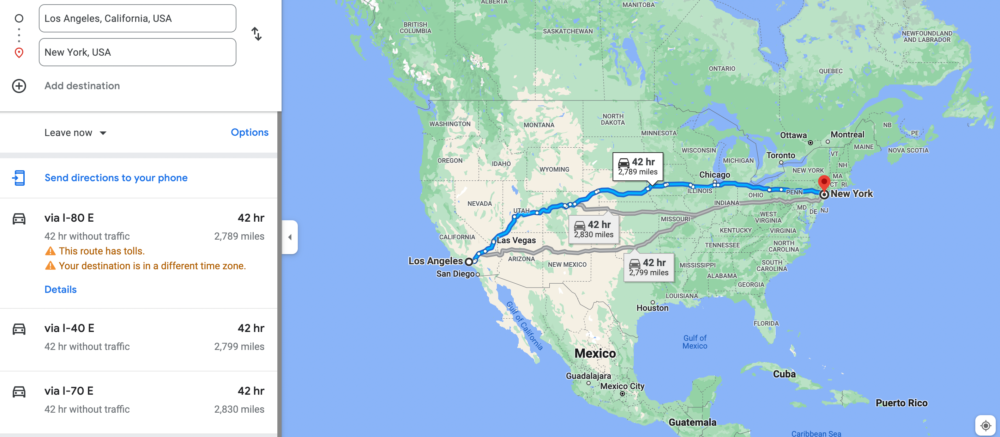

# 028 - Thiết Kế Google Maps (Bản Đồ & Dẫn Đường Toàn Cầu)

[← Bài trước](027-thiet-ke-quora.md) | [Mục lục](README.md) | [Bài tiếp theo →](029-thiet-ke-dich-vu-lan-can-yelp.md)

---


# Thiết Kế Hệ Thống: Google Maps (System Design: Google Maps)

Thấu hiểu các nguyên lý cốt lõi và nền tảng của một hệ thống như Google Maps.

---

### Nội dung bao gồm:
* **Google Maps là gì? (What is Google Maps?)**
* **Khi nào chúng ta sử dụng dịch vụ bản đồ? (When do we use a maps service?)**
* **Chúng ta sẽ thiết kế Google Maps như thế nào? (How will we design Google Maps?)**

---

## 1. Google Maps Là Gì? (What is Google Maps?)

Hãy tiếp cận bài toán bằng giả định rằng chúng ta muốn di chuyển từ địa điểm này đến địa điểm khác. Dưới đây là những thông tin khả dĩ mà chúng ta cần biết:

* Những lộ trình khả thi và tối ưu nhất để đưa chúng ta đến đích là gì, tùy thuộc vào loại phương tiện giao thông mà chúng ta đang sử dụng?
* Mỗi lộ trình dài bao nhiêu dặm (hoặc km)?
* Mỗi lộ trình sẽ mất bao nhiêu thời gian để đưa chúng ta đến điểm đích?

Một ứng dụng bản đồ (chẳng hạn như Google Maps hoặc Apple Maps) cho phép người dùng giải đáp tất cả các câu hỏi trên một cách dễ dàng. Hình minh họa sau đây thể hiện các lộ trình được Google Maps tính toán từ "Los Angeles, USA" đến "New York City, USA".


*Ba lộ trình được Google Maps đề xuất để di chuyển từ Los Angeles đến New York.*

---

## 2. Khi Nào Chúng Ta Sử Dụng Dịch Vụ Bản Đồ? (When do we use a maps service?)

Các cá nhân và tổ chức đều phụ thuộc vào dữ liệu vị trí (location data) để định vị và điều hướng trên toàn thế giới. Bản đồ trợ giúp đắc lực trong các trường hợp sau:

* **Người dùng cá nhân:** Có thể tìm kiếm vị trí và chỉ đường đến các địa điểm mới một cách nhanh chóng, thay vì lãng phí thời gian và các chi phí di chuyển như xăng xe.
* **Thời gian đến dự kiến (ETA - Estimated Time of Arrival):** Người dùng sử dụng bản đồ để theo dõi thời gian đến dự kiến và lộ trình ngắn nhất dựa trên dữ liệu giao thông theo thời gian thực (real-time traffic data).
* **Ứng dụng hiện đại phụ thuộc lớn vào bản đồ:** Các dịch vụ gọi xe (ride-hailing), xe tự hành (autonomous vehicles), và bản đồ đi bộ đường dài (hiking maps). Ví dụ:
  * Hệ thống xe tự lái của **Waymo** sử dụng Google Maps để điều hướng hiệu quả, nhanh chóng và an toàn.
  * **Uber** tích hợp Google Maps vào ứng dụng để hỗ trợ tài xế và cung cấp cho hành khách giao diện trực quan theo dõi hành trình di chuyển.
* **Các công ty vận tải và logistics (Routing and logistics-based companies):** Giúp cắt giảm thời gian giao hàng. Bằng việc tận dụng dữ liệu giao thông lịch sử (historical traffic data) kết hợp dữ liệu thời gian thực độc nhất của bản đồ, hệ thống giúp tối thiểu hóa tổng chi phí vận chuyển nhờ giảm tiêu hao nhiên liệu và tránh lãng phí thời gian kẹt xe.

> [!NOTE]
> Vào năm 2022, đã có hơn 5 triệu doanh nghiệp sử dụng Google Maps. Nền tảng này cung cấp các API công khai cho phép các doanh nghiệp tích hợp hệ thống bản đồ trực tiếp vào ứng dụng của họ.

---

## 3. Chúng Ta Sẽ Thiết Kế Google Maps Như Thế Nào? (How will we design Google Maps?)

Chúng ta chia thiết kế của Google Maps thành 5 bài học/giai đoạn chính:

1. **Yêu cầu (Requirements):** Trong phần này, chúng ta sẽ liệt kê các yêu cầu chức năng (functional requirements) và yêu cầu phi chức năng (non-functional requirements) của hệ thống Google Maps. Chúng ta cũng sẽ xác định các thách thức cốt lõi gặp phải khi thiết kế một hệ thống tầm cỡ như vậy. Cuối cùng, chúng ta sẽ ước tính tài nguyên (resource estimation) như số lượng máy chủ (servers) và băng thông (bandwidth) cần thiết để phục vụ hàng triệu truy vấn người dùng.
2. **Thiết kế tổng quan (Design):** Phần này bao gồm thiết kế kiến trúc mức cao (high-level design) và thiết kế API của một hệ thống như Google Maps. Chúng ta sẽ mô tả các dịch vụ (services) và luồng hoạt động (workflow) của toàn bộ hệ thống.
3. **Giải quyết thách thức (Meeting the challenges):** Chúng ta sẽ thảo luận phương án vượt qua các thách thức kỹ thuật đã được chỉ ra trong phần yêu cầu.
4. **Thiết kế chi tiết (Detailed design):** Dựa trên các giải pháp cho thách thức, chúng ta sẽ cải tiến thiết kế ban đầu và đi sâu vào các khía cạnh chi tiết. Chúng ta sẽ mô tả thiết kế chuyên sâu bao gồm cả lược đồ lưu trữ dữ liệu (storage schema).
5. **Đánh giá hệ thống (Evaluation):** Phần này giải thích cách hệ thống Google Maps vừa thiết kế đáp ứng đầy đủ tất cả các yêu cầu đã đề ra ban đầu.

Hãy bắt đầu bằng việc tìm hiểu các yêu cầu khi thiết kế một hệ thống tương tự Google Maps.

---

## 4. Yêu Cầu Thiết Kế Của Google Maps (Requirements of Google Maps' Design)

Thấu hiểu các yêu cầu để thiết kế một ứng dụng bản đồ như Google Maps.

### Nội dung bao gồm:
* **Yêu cầu (Requirements)**
  * Yêu cầu chức năng (Functional requirements)
  * Yêu cầu phi chức năng (Non-functional requirements)
* **Thách thức (Challenges)**
* **Ước tính tài nguyên (Resource estimation)**
  * Ước tính số lượng máy chủ (Number of servers estimation)
  * Ước tính dung lượng lưu trữ (Storage estimation)
  * Ước tính băng thông (Bandwidth estimation)
* **Các khối kiến trúc cơ bản sẽ sử dụng (Building blocks we will use)**

---

### Yêu Cầu (Requirements)

Trước khi xác định các yêu cầu, cần làm rõ rằng chúng ta sẽ thiết kế một hệ thống tương tự Google Maps bằng cách chọn lọc một vài tính năng trọng tâm cốt lõi, bởi vì Google Maps thực tế sở hữu lượng tính năng cực kỳ phong phú và phức tạp.

Dưới đây là danh sách các yêu cầu chức năng và phi chức năng của hệ thống đang thiết kế:

#### Yêu Cầu Chức Năng (Functional Requirements)

Các yêu cầu chức năng của hệ thống bao gồm:

* **Xác định vị trí hiện tại (Identify the current location):** Người dùng có thể ước lượng/xác định vị trí hiện tại của họ (kinh độ - longitude và vĩ độ - latitude dưới dạng giá trị thập phân) trên bản đồ thế giới.
* **Đề xuất lộ trình nhanh nhất (Recommend the fastest route):** Cho trước điểm xuất phát (source) và điểm đến (destination) (tên địa điểm dạng văn bản), hệ thống phải đề xuất lộ trình tối ưu nhất về mặt khoảng cách và thời gian, tùy thuộc vào loại phương tiện giao thông.
* **Chỉ đường (Give directions):** Sau khi người dùng đã chọn lộ trình, hệ thống phải liệt kê các chỉ dẫn bằng văn bản (text format), trong đó mỗi mục trong danh sách sẽ điều hướng người dùng rẽ hoặc tiếp tục đi thẳng theo một hướng cụ thể để đến đích.


*Các yêu cầu chức năng của Google Maps (Google Maps functional requirements).*

---

#### Yêu Cầu Phi Chức Năng (Non-functional Requirements)

Các yêu cầu phi chức năng của hệ thống bao gồm:

* **Tính sẵn sàng cao (High Availability):** Hệ thống phải đạt tính sẵn sàng cao (highly available).
* **Khả năng mở rộng (Scalability):** Hệ thống phải có khả năng mở rộng mạnh mẽ vì cả người dùng cá nhân lẫn các ứng dụng quy mô doanh nghiệp khác như Uber và Lyft đều sử dụng Google Maps để tìm các tuyến đường phù hợp.
* **Độ trễ thấp / Thời gian phản hồi ngắn (Low Latency / Less response time):** Quá trình tính toán thời gian đến dự kiến (ETA) và lộ trình không được vượt quá 2 đến 3 giây khi nhận được điểm xuất phát và điểm đích.
* **Độ chính xác (Accuracy):** Thời gian ETA dự đoán không được sai lệch quá nhiều so với thời gian di chuyển thực tế.


*Các yêu cầu phi chức năng của Google Maps (Non-functional requirements of Google maps).*

> [!NOTE]
> **Lưu ý:** Chúng ta sẽ không đi sâu vào chi tiết cách thức thu thập dữ liệu về các tuyến đường và quy hoạch mạng lưới giao thông. Các cơ quan chính phủ cung cấp bản đồ số, và ở một số khu vực, Google tự triển khai các phương tiện chuyên dụng gắn thiết bị ghi hình/cảm biến để khảo sát đường sá và các điểm giao nhau (intersection points).
> 
> Mạng lưới đường giao thông được mô hình hóa dưới dạng cấu trúc dữ liệu **Đồ thị (Graph)**, trong đó:
> * Các **giao lộ (intersection points)** đóng vai trò là các **đỉnh (vertices / nodes)**.
> * Các **đoạn đường nối giữa các giao lộ** đóng vai trò là các **cạnh có trọng số (weighted edges)**.

---

### Thách Thức (Challenges)

Một số thách thức trọng tâm mà chúng ta cần giải quyết khi thiết kế một hệ thống như Google Maps bao gồm:

---

# Thiết Kế Hệ Thống: Google Maps (Phần 2)

## 1. Khả Năng Mở Rộng (Scalability)

Việc phục vụ hàng triệu truy vấn (queries) tìm các tuyến đường khác nhau trong một giây, trên một đồ thị (graph) với hàng tỷ nút (nodes) và cạnh (edges) trải dài trên hơn 194 quốc gia, đòi hỏi các giải pháp mở rộng quy mô (scalability measures) cực kỳ mạnh mẽ. 

Một cách tiếp cận đơn giản: khi có vĩ độ (latitude) và kinh độ (longitude) của điểm xuất phát (source) và điểm đích (destination), ta có thể áp dụng thuật ngữ tìm đường ngắn nhất kinh điển như thuật toán Dijkstra để tìm lộ trình giữa hai điểm.

Tuy nhiên, cách tiếp cận này sẽ **không thể mở rộng (scale)** hiệu quả cho hàng tỷ người dùng gửi hàng triệu truy vấn mỗi giây ($QPS$). Lý do là việc chạy bất kỳ thuật toán tìm đường (path-finding algorithm) nào trên một đồ thị chứa hàng tỷ node với tần suất một triệu lần mỗi giây là cực kỳ kém hiệu quả xét về mặt thời gian xử lý (latency/compute time) và chi phí tài nguyên (compute cost), cuối cùng sẽ dẫn đến trải nghiệm người dùng tồi tệ (bad user experience). Do đó, giải pháp của chúng ta cần phải tìm ra các kỹ thuật thay thế tối ưu hơn để có thể scale tốt.


*Hình: Một đồ thị bao phủ toàn bộ mạng lưới đường bộ toàn cầu (A graph spanning the whole world network)*

---

## 2. Tính Toán Thời Gian Đến Dự Kiến (ETA Computation)

Trong một tình huống lý tưởng với đường sá hoàn toàn thông thoáng, việc tính toán thời gian đến dự kiến (**ETA - Estimated Time of Arrival**) rất đơn giản: chỉ cần dựa vào khoảng cách (distance) và vận tốc (speed) của phương tiện di chuyển. 

Tuy nhiên, chúng ta không thể bỏ qua các yếu tố thực tế như mật độ giao thông trên đường (traffic volume) và điều kiện mặt đường, những yếu tố tác động trực tiếp đến ETA. Ví dụ:
- Đoạn đường đang thi công sửa chữa
- Tai nạn, va chạm giao thông (collisions)
- Giờ cao điểm (rush hours)

Tất cả các yếu tố trên đều có thể làm chậm lưu lượng phương tiện. Việc định lượng (quantifying) các yếu tố này để thiết kế hệ thống là một bài toán không hề tầm thường (non-trivial). Vì vậy, chúng ta sẽ phân loại các yếu tố nêu trên theo **mức tải giao thông (traffic load)** để hoàn thiện bản thiết kế của mình.


*Hình: Các yếu tố ảnh hưởng đến quá trình tính toán ETA (Factors affecting the ETA computation: Blocked road, Traffic jam, Accident, Heavy rain)*

---

## 3. Ước Tính Tài Nguyên (Resource Estimation)

Hãy cùng ước tính tổng số lượng máy chủ (servers), dung lượng lưu trữ (storage) và băng thông mạng (bandwidth) mà hệ thống yêu cầu.

### 3.1. Ước tính số lượng máy chủ (Number of Servers Estimation)

Để ước tính số lượng server, chúng ta cần biết số lượng người dùng hoạt động hàng ngày (**DAU - Daily Active Users**) sử dụng Google Maps và số lượng yêu cầu mỗi giây (**RPS - Requests Per Second**) mà một máy chủ Google Maps đơn lẻ có thể xử lý được. 

Chúng ta giả định các thông số sau:
- **Số người dùng hoạt động hàng ngày (DAU):** 32 triệu (tương đương khoảng 1 tỷ người dùng hàng tháng - MAU).
- **Số lượng request mà một máy chủ có thể xử lý mỗi giây:** 8.000 RPS.

Số lượng máy chủ cần thiết được tính toán theo công thức dưới đây:

$$\text{Số lượng máy chủ} = \frac{\text{Số lượng người dùng hoạt động (Active Users)}}{\text{Số request xử lý trên mỗi server}} = \frac{32.000.000}{8.000} = 4.000 \text{ máy chủ (servers)}$$


*Hình: Số lượng máy chủ ước tính cần thiết cho Google Maps là 4.000 servers.*

---

### 3.2. Ước tính dung lượng lưu trữ (Storage Estimation)

Về bản chất, Google Maps là một hệ thống có yêu cầu lưu trữ theo dạng **ghi một lần (one-time storage requirement)** là chủ yếu. 

Dữ liệu đường bộ từ rất nhiều quốc gia đã được nạp sẵn vào hệ thống từ trước, ước tính đạt hơn **20 Petabytes (PB)** tính đến năm 2022. Do mạng lưới giao thông đường bộ trên thực tế có tần suất thay đổi vật lý rất thấp, nên dung lượng lưu trữ bổ sung hàng ngày đối với Google Maps là không đáng kể (negligible). 

Bên cạnh đó, các thay đổi ngắn hạn trên mạng lưới đường bộ (ví dụ: công trường tạm thời, phân luồng cục bộ) chỉ chiếm một lượng dữ liệu rất nhỏ so với toàn bộ dữ liệu đồ thị mạng lưới khổng lồ ban đầu. Do đó, nhu cầu lưu trữ (storage needs) của hệ thống sẽ không tăng đột biến theo thời gian.

---

### 3.3. Ước tính băng thông (Bandwidth Estimation)

Theo thông lệ thiết kế hệ thống tiêu chuẩn, chúng ta cần ước tính băng thông cần thiết cho cả lưu lượng truy cập đi vào (**Incoming Traffic / Ingress**) và lưu lượng đi ra (**Outgoing Traffic / Egress**) của hệ thống. 

Phần lớn nhu cầu băng thông của Google Maps phát sinh từ các request do người dùng gửi lên. Do đó, chúng ta xây dựng công thức tính toán băng thông như sau:

$$\text{Total bandwidth} = \text{Total requests\_second} \times \text{Total query\_size}$$

*Trong đó:*
- $\text{Total requests\_second}$: Tổng số lượng request mỗi giây (RPS).
- $\text{Total query\_size}$: Kích thước dữ liệu trung bình của mỗi request.

---

#### Lưu lượng truy cập đi vào (Incoming Traffic)

Để ước tính băng thông cho lưu lượng truy vấn gửi đến (Incoming query traffic), chúng ta giả định các thông số sau:
- **Số lượng request tối đa của một người dùng mỗi ngày:** 50 requests.
- **Kích thước một request (gồm tọa độ điểm đi và điểm đến):** 200 Bytes.

Dựa trên các giả định trên, chúng ta ước tính tổng số request mỗi giây gửi đến Google Maps theo công thức:

$$\text{Total requests\_second} = \frac{\text{Daily active users} \times \text{Requests per user}}{24 \times 60 \times 60} = \frac{32.000.000 \times 50}{86.400} \approx 18.518 \text{ requests/giây}$$

Chúng ta có thể tính toán băng thông yêu cầu cho lưu lượng truy vấn gửi đến bằng cách thay giá trị số request mỗi giây và kích thước mỗi request vào công thức băng thông:

$$\text{Băng thông Ingress} = 18.518 \times 200 \text{ Bytes} \times 8 \text{ bits} \approx 29.628.800 \text{ bps} \approx 29,63 \text{ Mb/s}$$

| Số request mỗi giây (Requests/sec) | Kích thước request (Bytes) | Băng thông yêu cầu (Mb/s) |
| :--- | :--- | :--- |
| **18.518** | **200** | **29,63** |

---

#### Lưu lượng truy cập đi ra (Outgoing Traffic)

Lưu lượng ứng dụng gửi ra ngoài (Outgoing application traffic) bao gồm phản hồi (response) mà server tạo ra và gửi về cho người dùng khi họ thực hiện yêu cầu dẫn đường (navigation request). 

Dữ liệu phản hồi bao gồm cả nội dung hình ảnh (visuals) và nội dung văn bản (textual content), thông thường gồm có:
- Tuyến đường hiển thị trực quan trên bản đồ (route visual on map)
- Thời gian dự kiến (estimated time)
- Khoảng cách (distance)
- Chi tiết hướng dẫn từng bước trên lộ trình (turn-by-turn navigation steps)

Chúng ta giả định các con số sau để ước tính băng thông chiều ra:
- **Tổng số request mỗi giây (đã tính ở trên):** 18.518 requests/sec.
- **Kích thước dữ liệu hình ảnh trung bình:** 2 MB.
- **Kích thước dữ liệu văn bản trung bình:** 5 KB.
- **Tổng kích thước phản hồi (Response size):** $2 \text{ MB} + 5 \text{ KB} = 2.005 \text{ KB}$.

Áp dụng cùng công thức để tính toán băng thông chiều ra:

$$\text{Total bandwidth} = \text{Total requests\_second} \times \text{Total query\_size}$$

$$\text{Băng thông Egress} = 18.518 \times 2.005 \text{ KB} \times 8 \text{ bits} \approx 297,03 \text{ Gbps}$$

| Số request mỗi giây (Requests/sec) | Kích thước response (KB) | Băng thông yêu cầu (Gb/s) |
| :--- | :--- | :--- |
| **18.518** | **2.005** | **297,03** |

---

#### Tổng kết yêu cầu băng thông cho Google Maps

$$\text{Tổng băng thông} = \text{Incoming traffic bandwidth } (29,63 \text{ Mbps}) + \text{Outgoing traffic bandwidth } (297,03 \text{ Gbps}) \approx 297,06 \text{ Gbps}$$


---

## 4. Các Khối Xây Dựng Cốt Lõi Được Sử Dụng (Building Blocks We Will Use)

Sau khi hoàn tất việc ước tính tài nguyên, chúng ta xác định các khối kiến trúc nền tảng (building blocks) đóng vai trò then chốt trong thiết kế hệ thống Google Maps:

- **Bộ cân bằng tải (Load Balancer)**
- **Cơ sở dữ liệu (Database)**
- **Hệ thống tìm kiếm phân tán (Distributed Search)**
- **Hệ thống Publish-Subscribe (Pub-Sub System)**
- **Kho lưu trữ Key-Value (Key-Value Store)**


*Database*


*Pub-sub system*


*Distributed search*


*Load balancer*


*Key-value store*

---

## 5. Thiết Kế Google Maps (Design of Google Maps)

### Vai trò của các Building Blocks trong thiết kế tổng quan và chi tiết:

> [!NOTE]
> - **Load Balancers (Bộ cân bằng tải):** Cực kỳ cần thiết để phân phối đồng đều các request của người dùng đến các máy chủ và dịch vụ khác nhau trong cụm backend, đảm bảo tính sẵn sàng cao (High Availability) và khả năng chịu lỗi (Fault Tolerance).
> - **Databases (Cơ sở dữ liệu):** Cần thiết để lưu trữ dữ liệu bản đồ dưới dạng cấu trúc đồ thị (graph format) cùng với các thông tin siêu dữ liệu (metadata information).
> - **Distributed Search (Tìm kiếm phân tán):** Cần thiết để hỗ trợ tìm kiếm nhanh chóng các địa điểm, địa chỉ và điểm ưa thích (POI - Points of Interest) trên bản đồ với độ trễ thấp (low latency).
> - **Pub-Sub System (Hệ thống Publish-Subscribe):** Đóng vai trò tạo và phản hồi các sự kiện trọng yếu (critical events) diễn ra trong suốt quá trình dẫn đường (navigation) và phát thông báo bất đồng bộ (asynchronous notifications) đến các service liên quan.
> - **Key-Value Store:** Được sử dụng để lưu trữ và truy xuất nhanh chóng các thông tin siêu dữ liệu (metadata) cũng như dữ liệu phiên làm việc với tốc độ cao.

Bên cạnh các khối nền tảng kể trên, nhiều thành phần chuyên biệt khác cũng sẽ được yêu cầu để hoàn thiện thiết kế hệ thống bản đồ quy mô toàn cầu. Các thành phần này sẽ được phân tích kỹ lưỡng trong các bài học thiết kế tiếp theo. Bây giờ, chúng ta đã sẵn sàng đi sâu vào khám phá chi tiết kiến trúc hệ thống và thiết kế API cho Google Maps.

---

# Thiết Kế Google Maps (Design of Google Maps)

Hãy cùng xây dựng một thiết kế mức cao (**High-Level Design**) cho một dịch vụ bản đồ.

Chúng ta sẽ bao gồm các nội dung sau:
* Thiết kế mức cao (**High-level design**)
* Các thành phần (**Components**)
* Luồng công việc (**Workflow**)
* Thiết kế API (**API design**)

---

## Thiết Kế Mức Cao (High-Level Design)

Hãy bắt đầu với thiết kế mức cao của một hệ thống bản đồ. Chúng ta chia phần thảo luận thành hai phần:
1. Các thành phần (**Components**) chúng ta sẽ cần trong thiết kế của mình.
2. Luồng công việc (**Workflow**) kết nối các thành phần này với nhau.

---

## Các Thành Phần (Components)

Chúng ta sẽ sử dụng các thành phần sau trong thiết kế của mình:

* **Bộ định vị vị trí (Location finder):** Bộ định vị vị trí là một dịch vụ được sử dụng để tìm vị trí hiện tại của người dùng và hiển thị vị trí đó trên bản đồ, vì về mặt cá nhân chúng ta không thể nào nhớ được vĩ độ (latitude) và kinh độ (longitude) cho mọi địa điểm trên thế giới.
* **Bộ tìm đường (Route finder):** Đối với những người mới đến một địa điểm, việc di chuyển rất khó khăn vì họ không biết các lộ trình chính xác. Bộ tìm đường là một dịch vụ được sử dụng để tìm các đường đi giữa hai vị trí, hoặc hai điểm.
* **Bộ dẫn đường (Navigator):** Việc gợi ý một lộ trình thông qua bộ tìm đường là chưa đủ. Người dùng có thể đi lệch khỏi đường đi tối ưu. Trong trường hợp đó, một dịch vụ dẫn đường (**navigator service**) được sử dụng. Dịch vụ này theo dõi hành trình của người dùng và gửi các chỉ dẫn cùng thông báo được cập nhật tới người dùng ngay khi họ đi lệch khỏi lộ trình được gợi ý.
* **Công nghệ GPS / Wi-Fi / Mạng di động (GPS/Wi-Fi/Cellular technology):** Đây là các công nghệ mà chúng ta sử dụng để tìm vị trí mặt đất của người dùng.
* **Tìm kiếm phân tán (Distributed search):** Để chuyển đổi tên địa điểm sang các giá trị vĩ độ/kinh độ, chúng ta cần một hệ thống chuyển đổi đằng sau các trường điểm xuất phát (**source**) và điểm đến (**destination**). Một hệ thống tìm kiếm phân tán (**distributed search**) duy trì một chỉ mục (**index**) bao gồm tên các địa điểm và ánh xạ của chúng sang vĩ độ và kinh độ. Các từ khóa do người dùng nhập vào sẽ được tìm kiếm bằng dịch vụ này để xác định một vị trí trên bản đồ.
* **Dịch vụ tìm kiếm khu vực (Area search service):** Dịch vụ tìm kiếm khu vực điều phối giữa tìm kiếm phân tán (**distributed search**) và dịch vụ xử lý đồ thị (**graph processing service**) để thu được đường đi ngắn nhất cho một truy vấn của người dùng. Dịch vụ tìm kiếm khu vực sẽ yêu cầu tìm kiếm phân tán lấy vị trí của điểm xuất phát và điểm đến trên bản đồ. Sau đó, nó sẽ sử dụng dịch vụ xử lý đồ thị để tìm đường đi tối ưu từ điểm xuất phát đến điểm đến.
* **Dịch vụ xử lý đồ thị (Graph processing service):** Có thể có nhiều đường đi từ nơi này đến nơi khác. Dịch vụ xử lý đồ thị chạy thuật toán tìm đường đi ngắn nhất (**shortest path algorithm**) trên một đồ thị nhỏ hơn dựa trên khu vực bao trùm điểm xuất phát và điểm đến, giúp chúng ta xác định nên đi theo lộ trình nào.
* **Cơ sở dữ liệu (Database):** Như đã thảo luận trong bài học trước, chúng ta có dữ liệu đường sá từ nhiều nguồn khác nhau được lưu trữ dưới dạng một đồ thị. Chúng ta sẽ ánh xạ dữ liệu này vào một cơ sở dữ liệu để phát triển đồ thị mạng lưới đường sá. Chúng ta đang sử dụng một cơ sở dữ liệu đồ thị (**graph database**) như **DataStax Graph** để lưu trữ đồ thị cho thiết kế của mình.
* **Hệ thống Pub-sub (Pub-sub system):** Người dùng có thể đi chệch khỏi đường đi được gợi ý ban đầu. Trong trường hợp đó, họ sẽ cần thông tin về một lộ trình mới tới điểm đến. Pub-sub là một hệ thống lắng nghe các sự kiện khác nhau từ một dịch vụ và kích hoạt một dịch vụ khác một cách tương ứng. Ví dụ: khi người dùng đi lệch khỏi lộ trình gợi ý, nó sẽ ping đến dịch vụ tìm kiếm khu vực để tìm một lộ trình mới từ vị trí hiện tại của người dùng đến điểm đến của họ. Nó cũng thu thập các luồng dữ liệu vị trí (**streams of location data**) cho các người dùng khác nhau từ bộ dẫn đường (**navigator**). Dữ liệu này có thể được xử lý sau để tìm ra các mô hình giao thông (**traffic patterns**) trên các cung đường khác nhau vào các thời điểm khác nhau. Chúng ta sẽ sử dụng **Kafka** làm hệ thống pub-sub trong thiết kế của mình.
* **Dữ liệu đường sá bên thứ ba (Third-party road data):** Làm thế nào chúng ta có thể xây dựng một hệ thống bản đồ nếu không có dữ liệu mạng lưới đường sá? Chúng ta cần thu thập dữ liệu đường sá từ các tài nguyên bên thứ ba và tiền xử lý dữ liệu thu thập được để đưa nó về một định dạng duy nhất có thể sử dụng để xây dựng đồ thị.
* **Xây dựng đồ thị (Graph building):** Chúng ta sẽ sử dụng một dịch vụ để xây dựng đồ thị từ dữ liệu được cung cấp, dù được thu thập từ các tài nguyên bên thứ ba hay từ người dùng.
* **Người dùng (User):** Điều này đề cập đến một người hoặc một chương trình sử dụng các dịch vụ của hệ thống bản đồ.
* **Bộ cân bằng tải (Load balancer):** Đây là một hệ thống được sử dụng để phân phối các yêu cầu của người dùng giữa các máy chủ và dịch vụ khác nhau.

---

Hình minh họa dưới đây cho thấy cách các thành phần trên được kết nối với nhau:


*Hình: Thiết kế mức cao của một hệ thống bản đồ (A high-level design of a map system).*

---

## Luồng Công Việc (Workflow)

Chúng ta giải thích luồng công việc bằng cách giả định rằng một người dùng phải di chuyển giữa hai điểm nhưng không biết vị trí hiện tại của họ hoặc cách đi đến điểm đến. Vì vậy, hãy xem hệ thống bản đồ trợ giúp như thế nào.

> [!NOTE]
> Đối với bài tập này, chúng ta giả định rằng dữ liệu về mạng lưới đường sá và bản đồ đã được thu thập từ các bên thứ ba, và đồ thị đã được xây dựng cũng như lưu trữ trong **Graph DB**.

1. Trong một hệ thống bản đồ, người dùng phải nhập điểm xuất phát và điểm đến của họ để tạo một lộ trình giữa hai điểm. Đối với điểm xuất phát (**starting source point**), người dùng sử dụng dịch vụ vị trí hiện tại (**current location service**).
2. Bộ định vị vị trí (**location finder**) xác định vị trí hiện tại bằng cách duy trì một kết nối liên tục (**persistent connection**) với người dùng. Người dùng sẽ cung cấp vị trí được cập nhật thông qua GPS, Wi-Fi và công nghệ di động (**cellular technology**). Đây sẽ là điểm xuất phát của người dùng.
3. Đối với điểm đến (**destination point**), người dùng nhập một địa chỉ ở định dạng văn bản. Việc sử dụng dịch vụ gợi ý tìm kiếm (**Typeahead service**) của chúng ta ở đây là một ý tưởng hay để đưa ra các gợi ý hữu ích và tránh lỗi chính tả.
4. Sau khi nhập điểm xuất phát và điểm đến, người dùng yêu cầu đường đi tối ưu (**optimal path**).
5. Yêu cầu đường đi của người dùng được chuyển tiếp tới dịch vụ tìm đường (**route-finder service**).
6. Bộ tìm đường (**route finder**) chuyển tiếp các yêu cầu tới dịch vụ tìm kiếm khu vực (**area search service**) cùng với điểm xuất phát và điểm đến.
7. Dịch vụ tìm kiếm khu vực sử dụng tìm kiếm phân tán (**distributed search**) để tìm vĩ độ/kinh độ cho điểm xuất phát và điểm đến. Sau đó, nó tính toán khu vực trên bản đồ bao trùm hai điểm vĩ độ/kinh độ đó (của điểm xuất phát và điểm đến).
8. Sau khi tìm được khu vực, dịch vụ tìm kiếm khu vực yêu cầu dịch vụ xử lý đồ thị (**graph processing service**) xử lý một phần của đồ thị tùy thuộc vào khu vực đó để tìm đường đi tối ưu.
9. Dịch vụ xử lý đồ thị lấy các cạnh (**edges**) và đỉnh/nút (**nodes**) bên trong khu vực được chỉ định đó từ cơ sở dữ liệu, tìm đường đi ngắn nhất (**shortest path**), và trả kết quả về cho dịch vụ tìm đường (**route-finder service**) – nơi trực quan hóa đường đi tối ưu cùng với khoảng cách và thời gian cần thiết để hoàn thành lộ trình. Nó cũng hiển thị các bước mà người dùng nên làm theo để dẫn đường.

> [!IMPORTANT]
> Bây giờ khi người dùng đã có thể trực quan hóa đường đi ngắn nhất trên bản đồ, họ cũng muốn nhận được các chỉ dẫn đi về phía điểm đến. Yêu cầu chỉ dẫn hướng đi được xử lý bởi bộ dẫn đường (**navigator**).

10. Bộ dẫn đường (**navigator**) theo dõi xem người dùng có đang đi đúng theo lộ trình chính xác mà nó nhận được từ dịch vụ tìm đường hay không. Nó cập nhật vị trí của người dùng trên bản đồ trong khi người dùng đang di chuyển, và hiển thị vị trí cần rẽ cùng khoảng cách tương ứng.
11. Nếu một người dùng đi lệch khỏi lộ trình, nó sẽ tạo ra một sự kiện (**event**) được đẩy vào **Kafka**.
12. Khi nhận được sự kiện từ bộ dẫn đường, Kafka sẽ cập nhật topic đã đăng ký của dịch vụ tìm kiếm khu vực (**area search service**), dịch vụ này sẽ tính toán lại đường đi tối ưu và gợi ý lại cho người dùng.
13. Bộ dẫn đường cũng cung cấp một luồng dữ liệu vị trí trực tiếp (**stream of live location data**) cho dịch vụ xây dựng đồ thị (**graph building**) thông qua hệ thống pub-sub. Về sau, dữ liệu này có thể được sử dụng để cải thiện các gợi ý lộ trình cung cấp cho người dùng.

---

## Thiết Kế API (API Design)

Hãy xem xét các API khác nhau cho dịch vụ bản đồ.

### 1. Hiển thị vị trí hiện tại của người dùng trên bản đồ (Show the user’s current location on the map)

Hàm `currLocation` hiển thị vị trí của người dùng trên bản đồ.

```
currLocation(location)
```

| Tham số (Parameter) | Mô tả (Description) |
| :--- | :--- |
| `location` | Tham số này thể hiện liệu vị trí của người dùng đang bật (**on**) hay tắt (**off**). Lời gọi này sẽ thiết lập một kết nối liên tục giữa máy khách (client) và máy chủ (server), nơi client sẽ định kỳ cập nhật vị trí hiện tại của mình. Nếu `location` là `false`, dịch vụ sẽ yêu cầu người dùng bật vị trí. |

---

### 2. Tìm lộ trình tối ưu (Find the optimal route)

Hàm `findRoute` giúp tìm lộ trình tối ưu giữa hai điểm.

```
findRoute(source, destination, transport_type)
```

| Tham số (Parameter) | Mô tả (Description) |
| :--- | :--- |
| `source` | Đây là địa điểm (ở định dạng văn bản) nơi người dùng muốn bắt đầu hành trình của mình. |
| `destination` | Đây là địa điểm (ở định dạng văn bản) nơi người dùng muốn kết thúc hành trình của mình. |
| `transport_type` *(tùy chọn / optional)* | Đây có thể là xe đạp, ô tô, máy bay, v.v. Phương tiện mặc định là ô tô nếu người dùng không cung cấp tham số này. |

---

### 3. Lấy chỉ dẫn đường đi (Get directions)

Hàm `directions` giúp chúng ta nhận được các cảnh báo dưới dạng văn bản hoặc âm thanh để chỉ rõ thời điểm và vị trí cần rẽ tiếp theo.

```
directions(curr_location, steps)
```

| Tham số (Parameter) | Mô tả (Description) |
| :--- | :--- |
| `curr_location` | Đây là giá trị vĩ độ/kinh độ của vị trí hiện tại của người dùng trên bản đồ. |
| `steps` | Đây là các bước mà người dùng cần làm theo để đến được điểm đến của mình. |

---

> [!TIP]
> **Tóm tắt chặng đường thiết kế:** Chúng ta đã mô tả thiết kế mức cao bằng cách giải thích các dịch vụ chúng ta sẽ cần. Chúng ta cũng đã thảo luận về thiết kế API. Tiếp theo, chúng ta sẽ thảo luận về cách đáp ứng thách thức về khả năng mở rộng quy mô (**Scalability challenge**) thông qua các phân đoạn (**segments**).

---

# Các thách thức trong Thiết kế Google Maps (Challenges of Google Maps' Design)

Hãy cùng tìm hiểu và giải quyết các thách thức cốt lõi khi thiết kế một hệ thống như **Google Maps**.

Chúng ta sẽ bao gồm các nội dung sau:
*   Giải quyết các thách thức (**Meeting the challenges**)
*   Khả năng mở rộng (**Scalability**)
*   Phân đoạn (**Segment**)
*   Kết nối hai phân đoạn (**Connect two segments**)
*   Tính toán thời gian đến dự kiến (**ETA computation**)

---

## Giải quyết các thách thức (Meeting the challenges)

Chúng ta đã liệt kê hai thách thức lớn trong bài học Giới thiệu: **Scalability** (khả năng mở rộng) và **ETA computation** (tính toán thời gian dự kiến đến nơi). Hãy xem cách chúng ta giải quyết các thách thức này như thế nào.

---

## Khả năng mở rộng (Scalability)

**Scalability** đề cập đến khả năng xử lý hiệu quả một đồ thị mạng lưới đường bộ (road network graph) khổng lồ. 

Chúng ta có một đồ thị với hàng tỷ đỉnh (**vertices**) và cạnh (**edges**), và các thách thức cốt lõi nằm ở việc nạp dữ liệu (**loading**), cập nhật (**updating**) và thực thi tính toán (**performing computations**) kém hiệu quả. Ví dụ: chúng ta phải duyệt toàn bộ đồ thị (traverse the whole graph) để tìm đường đi ngắn nhất (**shortest path**). Điều này dẫn đến độ trễ truy vấn (**query time / latency**) cho người dùng bị tăng cao. Vậy giải pháp cho bài toán này là gì?

Ý tưởng ở đây là chia nhỏ một đồ thị lớn thành các đồ thị con nhỏ hơn (**subgraphs**), hay các phân vùng (**partitions**). Các đồ thị con này có thể được xử lý và truy vấn song song (**queried in parallel**). Nhờ đó, thời gian xây dựng đồ thị (graph construction) và thời gian xử lý truy vấn (query processing time) sẽ giảm đi đáng kể. Do đó, chúng ta chia toàn cầu thành các phần nhỏ gọi là các **phân đoạn (segments)**. Mỗi segment tương ứng với một đồ thị con (subgraph).

---

## Phân đoạn (Segment)

Một **segment** là một khu vực nhỏ mà chúng ta có thể thao tác xử lý một cách dễ dàng. Việc tìm đường đi bên trong các segment này hoạt động hiệu quả vì đồ thị mạng lưới đường bộ của segment đó rất nhỏ, có thể dễ dàng nạp trực tiếp vào bộ nhớ chính (**main memory / RAM**), cập nhật và duyệt qua. Lấy ví dụ, một thành phố có thể được chia thành hàng trăm segment, mỗi segment có kích thước $5 \times 5\text{ dặm (miles)}$.

> [!NOTE]  
> Một segment không nhất thiết phải là hình vuông. Nó cũng có thể là một đa giác (**polygon**). Tuy nhiên, chúng ta giả định các segment có hình vuông để thuận tiện cho việc giải thích.

Mỗi segment có bốn tọa độ giúp xác định người dùng đang nằm trong segment nào. Mỗi tọa độ bao gồm hai giá trị: vĩ độ (**latitude**) và kinh độ (**longitude**).

```
+-------------------------------------------------------------------------+
| Partitioning the globe into small segments, and each segment has        |
| four coordinates with latitude and longitude values                     |
|                                                                         |
|                              Globe                                      |
|            (lat, long) -------------------- (lat, long)                 |
|                 |                                |                      |
|                 |            Segment             |                      |
|                 |                                |                      |
|            (lat, long) -------------------- (lat, long)                 |
+-------------------------------------------------------------------------+
```

Hãy thảo luận về việc tìm đường đi giữa hai vị trí bên trong cùng một segment. Chúng ta có một đồ thị biểu diễn mạng lưới đường bộ trong segment đó. Mỗi giao lộ/ngã rẽ (**intersection/junction**) đóng vai trò là một đỉnh (**vertex**) và mỗi đoạn đường đóng vai trò là một cạnh (**edge**). Đồ thị này là đồ thị có trọng số (**weighted graph**), và có thể có nhiều trọng số khác nhau trên mỗi cạnh—chẳng hạn như khoảng cách (**distance**), thời gian (**time**), và lưu lượng giao thông (**traffic**)—để tìm ra đường đi tối ưu (**optimal path**). 

Đối với một điểm xuất phát (**source**) và điểm đích (**destination**) cho trước, có thể tồn tại nhiều tuyến đường khác nhau. Chúng ta có thể sử dụng bất kỳ thuật toán đồ thị nào trên đồ thị của segment đó để tìm các đường đi ngắn nhất. Thuật toán tìm đường đi ngắn nhất phổ biến nhất là **thuật toán Dijkstra (Dijkstra’s algorithm)**.

> [!TIP] **Mẹo ẩn (Hide Tip)**  
> Thuật toán Dijkstra truyền thống thực hiện tìm kiếm có định hướng để tìm ra đường đi ngắn nhất. Tuy nhiên, nó phải đánh đổi bằng việc gia tăng thời gian truy vấn (**increased query time**). Chúng ta buộc phải đặt ra một giới hạn về thời gian truy vấn vì không thể để người dùng phải chờ đợi quá lâu mới nhận được kết quả. Do đó, chúng ta sẽ chọn giải pháp tìm đường đi tối ưu trong phạm vi chi phí thời gian cho phép.
>
> Thuật toán **A\*** là một phiên bản mở rộng của thuật toán Dijkstra có sử dụng hàm phỏng đoán (**heuristics**) để định hướng tìm kiếm. Thay vì chỉ tìm đường đi ngắn nhất tuyệt đối, A* tìm đường đi tối ưu được tính toán bằng cách cực tiểu hóa hàm số sau:
>
> $$f(n) = g(n) + h(n)$$
>
> Trong đó:
> *   $n$: Là nút (node) tiếp theo trên đường đi.
> *   $g(n)$: Là chi phí của đường đi từ nút bắt đầu (start node) đến nút $n$.
> *   $h(n)$: Là một hàm heuristic ước tính chi phí của đường đi rẻ nhất từ $n$ đến đích (goal).

> [!NOTE]  
> Có một số thuật toán được thiết kế đặc thù cho mạng lưới đường bộ nhằm mục đích tối ưu hóa để đạt được thời gian truy vấn ngắn hơn. Các thuật toán này bao gồm: **A\***, **Arc flags**, **Contraction hierarchies**, **Transit node routing**, **Reach-based routing**, và **Hub labeling**.

Sau khi chạy thuật toán tìm đường đi ngắn nhất trên đồ thị của segment, chúng ta lưu kết quả đầu ra của thuật toán vào hệ thống lưu trữ phân tán (**distributed storage**) để tránh việc phải tính toán lại, đồng thời lưu vào bộ nhớ đệm (**cache**) các tuyến đường được yêu cầu nhiều nhất. 

Kết quả đầu ra của thuật toán bao gồm:
*   Khoảng cách ngắn nhất tính bằng mét hoặc dặm giữa mỗi cặp hai đỉnh trong đồ thị.
*   Thời gian cần thiết để di chuyển qua đường đi ngắn nhất đó.
*   Danh sách các đỉnh nằm trên mỗi đường đi ngắn nhất.

Toàn bộ quá trình xử lý nói trên (chạy thuật toán tìm đường đi ngắn nhất trên đồ thị segment) đều được thực hiện ngoại tuyến (**offline processing**, không nằm trên luồng xử lý thời gian thực quan trọng của người dùng - **critical path**).

---

### Tìm đường đi giữa các đỉnh bên trong một phân đoạn (Finding a path between vertices within a segment)

```
        A ----(4)----> C ----(7)----> D
        |              ^              ^
       (1)            (3)            (6)
        v              |              |
        F ----(5)----> B ----(1)----> E
        ^                             |
        |------------(G)--------------|
```

| Source (Điểm đi) | Destination (Điểm đến) | Distance (Khoảng cách - m) | ETA (Thời gian dự kiến - phút) | Path (Lộ trình) |
| :---: | :---: | :---: | :---: | :---: |
| **A** | **D** | 11 | 15 | `A -> C -> D` |
| **G** | **D** | 12 | 16.5 | `G -> C -> D` |

> *Dữ liệu lưu trong Cache (Cached Information): Đầu ra của thuật toán tìm đường đi ngắn nhất.*

Hình minh họa ở trên biểu diễn cách chúng ta tìm khoảng cách ngắn nhất tính theo dặm giữa hai điểm. Ví dụ: khoảng cách tối thiểu ($m$) giữa hai điểm **A** và **D** là 11 dặm khi đi theo tuyến đường `A -> C -> D`, với **ETA** là 15 phút.

Chúng ta đã giải quyết được việc tìm đường đi ngắn nhất giữa hai đỉnh. Nhưng điều gì sẽ xảy ra nếu chúng ta phải tìm đường đi giữa hai điểm nằm trực tiếp trên các cạnh (**points lie on the edges**)? 

Những gì chúng ta thực hiện là:
1. Xác định các đỉnh của cạnh mà các điểm đó đang nằm trên.
2. Tính toán khoảng cách từ điểm đó tới các đỉnh đã xác định.
3. Lựa chọn các đỉnh tạo ra tổng khoảng cách ngắn hơn giữa điểm xuất phát (**source**) và điểm đích (**destination**).

Khoảng cách từ điểm xuất phát (và điểm đích) tới các đỉnh gần nhất được ước tính xấp xỉ bằng cách sử dụng các giá trị vĩ độ/kinh độ (**latitude/longitude values**).

---

### Lựa chọn đường đi giữa các điểm nằm trên cạnh (Choosing a path between points that lie on the edge)

```
         [Source]
          /    \
       (2)      (8)
        /        \
       v          v
      D            E
      |            |
     (9)          (7)
      v            v
      B -------> [Destination]
           (3)
```

*   Vì **14 nhỏ hơn 15**, chúng ta chọn tuyến đường: `(source -> D -> B -> destination)`.

| Tuyến đường khả thi (Possible paths) | Khoảng cách (Distance) |
| :--- | :--- |
| `source -> E -> Destination` | $8 + 7 = 15$ |
| `source -> D -> B -> Destination` | $2 + 9 + 3 = 14$ |

Chúng ta đã có thể tìm được các đường đi ngắn nhất bên trong cùng một phân đoạn. Bây giờ, hãy xem điều gì xảy ra khi điểm xuất phát và điểm đích thuộc về hai phân đoạn khác nhau, và cách chúng ta kết nối các phân đoạn lại với nhau.

---

## Kết nối hai phân đoạn (Connect two segments)

Mỗi segment đều có một tên định danh duy nhất (**unique name**) và các tọa độ biên (**boundary coordinates**). Chúng ta có thể dễ dàng xác định một vị trí bất kỳ (vĩ độ, kinh độ) đang nằm trong segment nào. Với điểm xuất phát và điểm đích cho trước, chúng ta có thể tìm ra các segment chứa chúng. 

Đối với mỗi segment, có một số cạnh biên được gọi là **các điểm thoát (exit points)**. Trong hình minh họa dưới đây, chúng ta có 4 điểm thoát: `S4E1`, `S4E2`, `S4E3`, và `S4E4`.

> [!NOTE]  
> Bên cạnh các đỉnh nằm bên trong segment, chúng ta cũng coi các điểm thoát (**exit points**) của một segment như là các đỉnh (**vertices**) và tính toán đường đi ngắn nhất cho các điểm thoát này. 
> 
> Do đó, đối với mỗi segment, chúng ta tính toán đường đi ngắn nhất giữa các điểm thoát với nhau, bổ sung vào phép tính đường đi ngắn nhất từ các điểm thoát đến các đỉnh nằm bên trong segment. Thông tin đường đi ngắn nhất của mỗi đỉnh xuất phát từ các điểm thoát của segment đều được lưu vào **Cache**.

---

### Kết nối các phân đoạn bằng cách coi các điểm thoát của một phân đoạn như là các đỉnh
*(Connecting the segments by considering exit points of a segment as vertices)*

```
+--------------------+--------------------+
|                    |                    |
|        S1          |        S2          |
|                    |                    |
+-------[S4E1]-------+-------[S4E2]-------+
|         |                     |         |
|         v                     v         |
|         C                     G         |
|          \                   /          |
|           +-----> D <-------+           |
|                   |                     |
|                   v                     |
|        S4         |                     |
+-------[S4E3]------+--------[S4E4]-------+
|                   |                     |
|        S3         |         S5          |
|                   |                     |
+-------------------+---------------------+
```

Một điểm thoát (**exit point**) đóng vai trò kết nối các segment lân cận và được dùng chung giữa chúng. Trong hình minh họa trên, mỗi điểm thoát đang kết nối hai segment và được chia sẻ giữa hai segment đó. Ví dụ: điểm thoát `S4E1` đồng thời cũng là một điểm thoát của segment `S1`. 

Khi đã có tất cả các điểm thoát cho từng segment, chúng ta có thể kết nối các segment lại với nhau và tìm ra khoảng cách ngắn nhất giữa hai điểm nằm ở các segment khác nhau. Trong quá trình kết nối các segment, chúng ta hoàn toàn không cần bận tâm đến cấu trúc đồ thị bên trong từng segment (**inside segment graph**). Chúng ta chỉ cần các điểm thoát và các thông tin đã được lưu trong **cache** về các điểm thoát đó. 

Chúng ta có thể trực quan hóa nó như một đồ thị được tạo thành từ các đỉnh thoát (**exiting vertices**), như thể hiện trong hình minh họa tiếp theo:

---

### Đồ thị tạo thành từ các điểm thoát
*(A graph made up of exit points, where the lines connecting the exit points are not actually straight. There could be many vertices in between the two exit points)*

```
       [S1 Exit] <===================> [S2 Exit]
           ^                               ^
           |                               |
           |   (Nhiều đỉnh trung gian)     |
           v                               v
       [S4 Exit] <===================> [S5 Exit]
```
*(Lưu ý: Các đường nối giữa các điểm thoát trên thực tế không phải là đường thẳng. Có thể có rất nhiều đỉnh trung gian nằm giữa hai điểm thoát).*

Vì chúng ta không thể chạy thuật toán tìm đường đi ngắn nhất cho toàn bộ các segment trên toàn cầu, việc xác định xem cần phải đưa bao nhiêu segment vào thuật toán tính toán liên phân đoạn (**inter-segment routing**) là cực kỳ quan trọng. 

**Khoảng cách đường chim bay (aerial distance)** giữa hai địa điểm được sử dụng để giới hạn số lượng segment cần xem xét. Từ điểm xuất phát và điểm đích, chúng ta có thể tính toán khoảng cách đường chim bay giữa chúng bằng cách sử dụng **công thức haversine (haversine formula)**.

Giả sử khoảng cách đường chim bay giữa điểm xuất phát và điểm đích là $10\text{ km}$. Trong trường hợp đó, chúng ta có thể gộp các segment nằm trong phạm vi khoảng cách $10\text{ km}$ tính từ điểm xuất phát và điểm đích theo mỗi hướng. Đây là một sự cải tiến vượt bậc so với việc phải xử lý toàn bộ một đồ thị khổng lồ.

---

# Tài Liệu Kỹ Thuật: Thiết Kế Hệ Thống Điều Hướng & Tìm Đường Phân Tán (Distributed Navigation & Routing System)

---

### Trang 25

Một khi số lượng phân đoạn (**segments**) đã được giới hạn, chúng ta có thể thu hẹp/ràng buộc đồ thị (**graph**) của mình sao cho các đỉnh (**vertices**) của đồ thị chính là các điểm lối ra (**exit points**) của từng phân đoạn, và các đường đi đã được tính toán từ trước giữa các điểm lối ra này sẽ đóng vai trò là các cạnh (**edges**) của đồ thị. 

Tất cả những gì chúng ta cần làm lúc này là thực thi thuật toán tìm đường đi ngắn nhất (**shortest path algorithm**) trên đồ thị này để tìm ra tuyến đường (**route**). Minh họa dưới đây trình bày cách chúng ta tìm đường đi giữa hai điểm nằm ở hai phân đoạn khác nhau.

```
D
10
7
1
6
8
9
4
7
8
5
9
8
15
13
10
5 Miles
5 Miles
S
D
S
3
```

> **Hình 1 trên 10 (1 of 10):** Điểm xuất phát **S** (**Source**) và Điểm đích **D** (**Destination**) nằm ở hai phân đoạn khác nhau, và chúng ta phải tìm tuyến đường ngắn nhất giữa chúng.

---

### Trang 26

```
S
D
10
7
1
6
8
9
4
3
7
8
5
9
8
15
13
10
Aerial distance = 5 Miles
5 Miles
5 Miles
D
S
```

> **Hình 2 trên 10 (2 of 10):** Chúng ta giả định rằng khoảng cách đường chim bay (**aerial distance**) giữa **S** và **D** là 5 dặm (5 miles), được tính toán bằng cách sử dụng công thức Haversine (**haversine formula**).

---

```
S
D
10
7
1
6
8
9
4
3
7
8
5
9
8
15
13
10
Aerial distance = 5 Miles
D
S
```

> **Hình 3 trên 10 (3 of 10):** Vì khoảng cách đường chim bay là 5 dặm, chúng ta đưa vào các phân đoạn nằm trong phạm vi khoảng cách 5 dặm tính từ **S** và **D** theo tất cả các hướng.

---

### Trang 27

```
S
D
10
7
1
6
8
9
4
3
7
8
5
9
8
15
13
10
Aerial distance = 5 Miles
9
2
7
5
5
15
6
8
7
7
9
D
S
```

> **Hình 4 trên 10 (4 of 10):** Hãy đưa các điểm lối ra (**exit points**) của các phân đoạn mới vào đồ thị.

---

```
S
D
10
7
1
6
8
9
4
3
7
8
5
9
8
15
13
10
9
2
7
5
5
15
6
8
7
7
9
3
2
5
2
3
3
4
D
S
```

> **Hình 5 trên 10 (5 of 10):** Tìm các lối ra khả dĩ cho **S** và **D** từ các phân đoạn tương ứng của chúng cùng với đường đi ngắn nhất (đã được tính toán trước) tới tất cả các điểm lối ra.

---

### Trang 28

```
S
D
10
7
1
6
8
9
4
3
7
8
5
9
8
15
13
10
9
2
7
5
5
15
6
8
7
7
9
3
2
5
2
3
3
4
Path 1 (distance) = 22 Miles
D
S
Path 1 (distance) = 22 Miles
```

> **Hình 6 trên 10 (6 of 10):** Chúng ta sẽ bắt đầu tìm tất cả các đường đi khả dĩ từ **S** đến **D**. Một trong các đường đi được làm nổi bật (in đậm). Khoảng cách được tính toán là 22 dặm.

---

```
S
D
10
7
1
6
8
9
4
3
7
8
5
9
8
15
13
10
9
2
7
5
5
15
6
8
7
7
9
3
2
5
2
3
3
4
Path 1 (distance) = 22 Miles
Path 2 (distance) = 30 Miles
D
S
Path 1 (distance) = 22 Miles
Path 2 (distance) = 30 Miles
```

> **Hình 7 trên 10 (7 of 10):** Một đường đi khác được tìm thấy có chiều dài 30 dặm.

---

### Trang 29

```
S
D
10
7
1
6
8
9
4
3
7
8
5
9
8
15
13
10
9
2
7
5
5
15
6
8
7
7
9
3
2
5
2
3
3
4
Path 1 (distance) = 22 Miles
Path 2 (distance) = 30 Miles
Path 3 (distance) = 36 Miles
D
S
Path 1 (distance) = 22 Miles
Path 2 (distance) = 30 Miles
Path 3 (distance) = 36 Miles
```

> **Hình 8 trên 10 (8 of 10):** Một đường đi khác được tìm thấy có chiều dài 36 dặm.

---

```
S
D
10
7
1
6
8
9
4
3
7
8
5
9
8
15
13
10
9
2
7
5
5
15
6
8
7
7
9
3
2
5
2
3
3
4
Path 1 (distance) = 22 Miles
Path 2 (distance) = 30 Miles
Path 3 (distance) = 36 Miles
Path 4 (distance) = 37 Miles
D
S
Path 1 (distance) = 22 Miles
Path 2 (distance) = 30 Miles
Path 3 (distance) = 36 Miles
Path 4 (distance) = 37 Miles
```

> **Hình 9 trên 10 (9 of 10):** Một đường đi khác được tìm thấy có chiều dài 37 dặm.

---

### Trang 30

```
S
D
10
7
1
6
8
9
4
3
7
8
5
9
8
15
13
10
9
2
7
5
5
15
6
8
7
7
9
3
2
5
2
3
3
4
Path 1 (distance) = 22 Miles
Path 2 (distance) = 30 Miles
Path 3 (distance) = 36 Miles
Path 4 (distance) = 37 Miles
D
S
Path 1 (distance) = 22 Miles
Path 2 (distance) = 30 Miles
Path 3 (distance) = 36 Miles
Path 4 (distance) = 37 Miles
```

> **Hình 10 trên 10 (10 of 10):** Chúng ta sẽ tiếp tục tìm kiếm các đường đi khả dĩ và trả về đường đi ngắn nhất (**shortest path**) cho người dùng.

---

#### Tóm tắt giải pháp mở rộng quy mô (Scalability)

Hãy cùng tóm tắt cách chúng ta giải quyết thách thức về **khả năng mở rộng (Scalability)**:

Chúng ta đã chia nhỏ bài toán của mình để thay vì phải xử lý trên toàn bộ một mạng lưới giao thông đường bộ khổng lồ (**large road network**), chúng ta chỉ làm việc trên từng phần riêng lẻ (**phân đoạn / segments**) của nó.

- Các truy vấn (**queries**) dành cho một phần cụ thể của mạng lưới giao thông sẽ **chỉ được xử lý trên phần đó**.
- Đối với các truy vấn đòi hỏi phải xử lý **nhiều hơn một phần** của mạng lưới, chúng ta sẽ **kết nối các phần đó lại với nhau**, như đã minh họa ở trên.

---

### Tính toán thời gian đến dự kiến (ETA Computation)

Để tính toán **thời gian đến dự kiến (ETA - Estimated Time of Arrival)** với độ chính xác hợp lý, chúng ta thu thập dữ liệu vị trí trực tiếp (**live location data**) theo định dạng:

$$\text{(userID, timestamp, (latitude, longitude))}$$

Dữ liệu này được thu thập từ dịch vụ điều hướng (**navigation service**) thông qua một hệ thống Publish-Subscribe (**Pub-Sub system**). 

Với các luồng dữ liệu vị trí (**location data streams**), chúng ta có thể tính toán và dự đoán các mô hình lưu thông giao thông (**traffic patterns**) trên các cung đường khác nhau.

Một số chỉ số mà chúng ta có thể tính toán bao gồm:
* **Mức độ tắc nghẽn giao thông (Traffic)**: Mức độ cao / trung bình / thấp (**high / medium / low**) trên các tuyến đường hoặc cung đường khác nhau.
* **Tốc độ trung bình (Average speed)** của phương tiện giao thông trên các cung đường khác nhau.

---

# Thiết Kế Chi Tiết Google Maps (Detailed Design of Google Maps)

Khoảng thời gian (time intervals) mà một mô hình lưu thông tương tự lặp lại trên một tuyến đường hoặc đoạn đường. Ví dụ: Đường cao tốc X sẽ có mật độ giao thông cao trong khoảng từ 8 giờ đến 10 giờ sáng.

Thông tin trên giúp chúng ta đưa ra thời gian ước tính đến nơi (ETA - Estimated Time of Arrival) chính xác hơn. Ví dụ, nếu biết rằng lưu lượng giao thông sẽ tăng cao vào một khung giờ cụ thể trên một cung đường nhất định, ETA ước tính cũng phải kéo dài hơn bình thường.

Trong bài học trước, chúng ta đã tìm hiểu cách giải quyết thách thức về **khả năng mở rộng (Scalability)** thông qua kỹ thuật phân đoạn bản đồ thành các phân vùng (**segments**) và tính toán ETA bằng dữ liệu thời gian thực (**live data**). Trong bài học này, chúng ta sẽ đi sâu vào chi tiết thiết kế hệ thống.

---

## Chi Tiết Thiết Kế Google Maps (Detailed Design of Google Maps)

Hãy cùng đi sâu vào thiết kế chi tiết của hệ thống bản đồ.

Chúng ta sẽ bao quát các nội dung sau:
* Thiết lập phân đoạn (Segment setup) và xử lý yêu cầu (Request handling)
* Lược đồ lưu trữ (Storage schema)
* Thiết kế kiến trúc (Design)
* Cải thiện độ chính xác ước tính bằng dữ liệu thời gian thực (Improve estimations using live data)

Trong bài học này, chúng ta sẽ thảo luận về thiết kế chi tiết bằng cách trả lời các câu hỏi sau:
1. Các yêu cầu từ người dùng (user requests) hưởng lợi từ các phân đoạn (segments) như thế nào?
2. Làm thế nào để chúng ta nâng cao trải nghiệm người dùng bằng cách tăng độ chính xác của ETA?

---

### Thiết Lập Phân Đoạn và Xử Lý Yêu Cầu (Segment Setup and Request Handling)

Phần này sẽ mô tả cách dữ liệu phân đoạn (segment data) được lưu trữ trong cơ sở dữ liệu và cách các yêu cầu của người dùng được xử lý dựa trên dữ liệu đã lưu trữ sẵn.

Bắt đầu với lược đồ lưu trữ (storage schema), chúng ta sẽ thảo luận về cách các phân đoạn được thêm vào, được lưu trữ/lưu trữ phân tán (hosted) trên các máy chủ (servers), cũng như cách xử lý các yêu cầu từ phía người dùng.

#### Lược Đồ Lưu Trữ (Storage Schema)

Chúng ta lưu trữ các thông tin sau cho từng phân đoạn (segment):

**Kho lưu trữ Khóa - Giá trị (Key-Value Store):**
* `segID`: Mã định danh duy nhất của phân đoạn (The segment’s ID).
* `serverID`: Mã định danh máy chủ lưu trữ phân đoạn đó (The serverID on which the segment is hosted).
* Về mặt thực tế, mỗi phân đoạn là một đa giác (polygon), vì vậy chúng ta lưu trữ các tọa độ ranh giới (boundary coordinates bao gồm vĩ độ/kinh độ - latitude/longitude), thường dưới dạng một danh sách (`List[]`).
* Danh sách mã định danh của các phân đoạn láng giềng (`neighbors`: A list of segment IDs of the neighbors segments).

**Cơ sở Dữ liệu Đồ thị (Graph Database):**
* Mạng lưới đường bộ bên trong phân đoạn dưới dạng đồ thị (The road network inside the segment in the form of a graph).


##### Chi tiết các bảng và cấu trúc dữ liệu:

* **Key-Value Store:**
  * **Segment to server:**
    * `segID`: `INT`
    * `serverID`: `INT`
  * **Belongs to segment:**
    * `segID`: `INT`
    * `coordinates`: `List[]`
  * **Neighbors:**
    * `segID`: `INT`
    * `neighbors`: `List[]`

* **Graph DB:**
  * **Graph data:**
    * `segID`: `INT`
    * `roadNetwork`: `GRAPH`

* **Relational DB (Cơ sở dữ liệu quan hệ - RDB):**
  * **Rush hour:**
    * `segID`: `INT`
    * `edgeID`: `INT`
    * `hourRange`: `Tuple`
    * `rush`: `BOOL`

Chúng ta lưu trữ thông tin để xác định xem vào một khung giờ cụ thể trong ngày, các cung đường có bị tắc nghẽn hay không. Điều này sau đó giúp hệ thống quyết định có cập nhật đồ thị (trọng số - weights) dựa trên dữ liệu thời gian thực (live data) hay không.
* `edgeID`: Định danh cạnh (đoạn đường) trong đồ thị.
* `hourRange`: Cho biết khung giờ trong ngày tương ứng với điều kiện đường sá thông thường (ngoài giờ cao điểm - non-rush hour).
* `rush`: Giá trị kiểu Boolean mô tả tình trạng có xảy ra tắc nghẽn giao thông (congestion) hay không trên một tuyến đường cụ thể vào một thời điểm nhất định.

> [!NOTE]  
> `segID`, `serverID`, và `edgeID` là các mã định danh duy nhất (unique IDs) được sinh ra bởi một hệ thống sinh ID duy nhất (**Unique ID Generator** / **Sequencer**).

---

### Thiết Kế Kiến Trúc (Design)

Sơ đồ minh họa dưới đây bao gồm hai luồng công việc (workflows):
1. **Luồng công việc 1 (Màu vàng):** Thêm các phân đoạn (segments) vào bản đồ và phân bổ chúng lên các máy chủ (servers).
2. **Luồng công việc 2 (Màu xanh dương):** Xử lý yêu cầu tìm tuyến đường giữa hai điểm từ phía người dùng.


#### 1. Quy Trình Thêm Phân Đoạn (Add Segment - Workflow 1)
1. Mỗi phân đoạn sở hữu tọa độ ranh giới vĩ độ/kinh độ (latitude/longitude boundary coordinates) và đồ thị mạng lưới đường bộ của chính nó (graph: vertices, edges).
2. Bộ bổ sung phân đoạn (**Segment Adder**) tiếp nhận và xử lý yêu cầu thêm phân đoạn cùng các thông tin chi tiết đi kèm. Segment Adder gán một ID duy nhất (`segID`) cho từng phân đoạn bằng cách sử dụng hệ thống sinh định danh duy nhất (**Unique ID Generator**).
3. Sau khi gán ID cho phân đoạn, Segment Adder chuyển tiếp thông tin phân đoạn tới bộ phân bổ máy chủ (**Server Allocator**).
4. Server Allocator chỉ định một máy chủ cho phân đoạn đó, nạp/lưu trữ đồ thị phân đoạn trên máy chủ được chỉ định, và trả về mã máy chủ (`serverID`) cho Segment Adder.
5. Sau khi phân đoạn được gán cho máy chủ, Segment Adder lưu bản ánh xạ phân đoạn - máy chủ (`segID`, `serverID`) vào kho lưu trữ Khóa - Giá trị (**Key-Value Store**). Dữ liệu này giúp định tuyến nhanh chóng đến máy chủ phù hợp khi xử lý yêu cầu từ người dùng. Đồng thời, hệ thống cũng lưu tọa độ ranh giới vĩ độ/kinh độ của từng phân đoạn (`segID`, `lat/long coordinates`) thành một đối tượng khóa - giá trị riêng biệt, và lưu cấu trúc đồ thị vào **Graph DB**.

#### 2. Quy Trình Xử Lý Yêu Cầu Người Dùng (Handle the User’s Request - Workflow 2)
1. Người dùng cung cấp điểm xuất phát (source) và điểm đến (destination) để dịch vụ tìm đường giữa hai điểm này.
2. Vĩ độ và kinh độ của điểm xuất phát và điểm đến được xác định thông qua hệ thống tìm kiếm phân tán (**Distributed Search**).
3. Tọa độ vĩ độ/kinh độ của điểm xuất phát và điểm đến được chuyển tới dịch vụ xử lý đồ thị (**Graph Processing Service**) để xác định các phân đoạn chứa hai tọa độ này.
4. Sau khi tìm được mã định danh phân đoạn (`segID`), Graph Processing Service truy vấn Key-Value Store để tìm các máy chủ đang lưu trữ các phân đoạn tương ứng (`serverIDs`).
5. Graph Processing Service kết nối tới các máy chủ liên quan để tìm đường đi ngắn nhất giữa điểm xuất phát và điểm đến. Nếu điểm xuất phát và điểm đến cùng nằm trong một phân đoạn, Graph Processing Service sẽ trả về đường đi ngắn nhất bằng cách thực thi truy vấn duy nhất trên một phân đoạn đó. Ngược lại, nếu khác phân đoạn, hệ thống sẽ liên kết và ghép nối các phân đoạn từ các máy chủ khác nhau như đã phân tích trong bài học trước.

---

### Cải Thiện Độ Chính Xác Ước Tính Bằng Dữ Liệu Thời Gian Thực (Improve Estimations Using Live Data)

Phần này mô tả cách nâng cao độ chính xác của ước tính ETA bằng dữ liệu trực tiếp (live data). Nếu sở hữu một chuỗi dữ liệu vị trí theo thời gian từ nhiều thiết bị khác nhau, chúng ta có thể phân tích quy luật di chuyển và thực hiện phân tích dữ liệu nâng cao (**analytics**) để dự đoán các yếu tố tác động đến chuyến đi của người dùng. 

Google Maps kết hợp tín hiệu từ GPS, Wi-Fi và các trạm thu phát sóng di động (Cell Towers) để định vị người dùng. Để thu thập dữ liệu này, các máy chủ của hệ thống bản đồ cần duy trì một kết nối liên tục (**persistent connection**) với toàn bộ các thiết bị đang bật định vị. Dưới đây là các công cụ, kỹ thuật và thành phần tham gia vào quy trình cải thiện ước tính bằng dữ liệu trực tiếp:

* **WebSocket:** Là giao thức truyền thông cho phép thiết bị người dùng và máy chủ duy trì phiên tương tác hai chiều (**full-duplex / two-way interactive communication session**). Giao thức này hỗ trợ truyền tải dữ liệu thời gian thực giữa máy khách và máy chủ với độ trễ tối thiểu.
* **Bộ cân bằng tải (Load Balancer):** Đảm nhiệm phân phối tải kết nối giữa các máy chủ khác nhau nhằm tránh quá tải, do mỗi máy chủ đều có giới hạn chịu tải về số lượng kết nối WebSocket đồng thời. Load Balancer sẽ phân bổ luồng kết nối: một số thiết bị kết nối tới Server 1, một số tới Server 2, và tiếp tục đến Server N.


* **Hệ thống Đăng ký/Xuất bản (Pub-Sub System):** Thu thập các luồng dữ liệu vị trí streaming (bao gồm: thiết bị - `device`, thời gian - `time`, vị trí - `location`) từ tất cả các máy chủ điều hướng (**Navigation Servers**).
* **Công cụ phân tích dữ liệu (Data Analytics Engine):** Dữ liệu vị trí từ hệ thống Pub-Sub được nạp và xử lý bởi một công cụ phân tích dữ liệu lớn phân tán như **Apache Spark**. Data Analytics Engine áp dụng các kỹ thuật khoa học dữ liệu (Data Science) — như học máy (**Machine Learning**), phân cụm dữ liệu (**Clustering**), v.v. — nhằm:
  1. Đếm số lượng phương tiện và đo lường tốc độ di chuyển (phân cấp giao thông: thấp / trung bình / cao - low/med/high traffic).
  2. Nhận diện các điểm nóng tập trung đông người (**Hotspot identification**), sự kiện, lễ hội.
  3. Phát hiện các tuyến đường mới được hình thành (**New roads identification**).
  
  Những kết quả phân tích này là cơ sở quan trọng giúp hệ thống tinh chỉnh và tăng độ chính xác của ETA.

> [!NOTE]  
> Lưu lượng giao thông, điều kiện mặt đường và các điểm nóng tập trung ảnh hưởng trực tiếp đến tốc độ di chuyển trung bình (**Average Travel Speed**), từ đó tác động trực tiếp đến thời gian ước tính đến nơi (ETA) của người dùng.

* **Xuất bản kết quả phân tích:** Công cụ phân tích dữ liệu (Data Analytics Engine) sau khi xử lý sẽ xuất bản dữ liệu phân tích sang một chủ đề mới (**Pub-Sub Topic**) trong hệ thống Pub-Sub.
* **Dịch vụ cập nhật bản đồ (Map Update Service):** Lắng nghe các cập nhật từ Pub-Sub Topic chứa kết quả phân tích. Dịch vụ này sẽ tiến hành cập nhật lại đồ thị phân đoạn nếu phát hiện có tuyến đường mới, hoặc điều chỉnh lại trọng số đồ thị (thay đổi vận tốc trung bình dựa trên lưu lượng giao thông thực tế).

---

tình trạng mặt đường)) trên các cạnh (*edges*) của đồ thị (*graph*). Dựa vào vị trí tọa độ, chúng ta xác định được bản cập nhật này thuộc về phân đoạn (*segment*) nào. Tiếp theo, hệ thống truy vấn kho lưu trữ khóa - giá trị (*key-value store*) để tìm máy chủ định tuyến (*routing server*) đang lưu trữ phân đoạn đó và cập nhật đồ thị trực tiếp trên máy chủ tương ứng.

> [!TIP]
> ### Điểm Cần Suy Ngẫm (*Point to Ponder*)
> **Câu hỏi:**  
> Rất nhiều điều kiện giao thông chỉ mang tính nhất thời (*transitory*, ví dụ như dừng đèn đỏ), do đó việc cập nhật đồ thị quá thường xuyên sẽ không thể mở rộng quy mô tốt (*scale well*) vì đòi hỏi khối lượng xử lý tính toán quá lớn. Giải pháp cho vấn đề này là gì?
> 
> **Lời giải:**  
> Để phân biệt và phát hiện giữa điều kiện nhất thời (*transitory conditions*) và điều kiện bình thường (*normal conditions*), chúng ta duy trì **hai bản sao dữ liệu trọng số liên quan (*weights*)**: một bản sao cho điều kiện bình thường và một bản sao cho điều kiện nhất thời. Bằng phương pháp này, hệ thống sẽ tránh được việc phải xử lý tính toán dư thừa không cần thiết.

Dịch vụ tiền xử lý đồ thị (*graph preprocessing service*) sẽ tính toán lại các tuyến đường mới trên đồ thị phân đoạn đã được cập nhật. Chúng ta đã thấy cách các lộ trình được cập nhật liên tục ngầm dưới nền (*background*) dựa trên dữ liệu vị trí trực tiếp (*live data*).

Chúng ta đã tìm hiểu cách thức hoạt động của các phân đoạn (*segments*), cách người dùng tìm kiếm vị trí giữa hai điểm, và cách độ chính xác của thời gian ước tính đến nơi (**ETA** - *Estimated Time of Arrival*) được cải thiện đáng kể bằng cách tận dụng dữ liệu vị trí theo thời gian thực.

---

*Quay lại: Các thách thức trong thiết kế Google Maps (Challenges of Google Maps' Design)*  
*Đánh dấu hoàn thành*  
*Tiếp theo: Đánh giá thiết kế Google Maps (Evaluation of Google Maps' Design)*  

---

# Đánh Giá Thiết Kế Google Maps (*Evaluation of Google Maps' Design*)

Hãy cùng phân tích cách thiết kế hệ thống bản đồ của chúng ta đáp ứng các yêu cầu kỹ thuật đã đặt ra.

Chúng ta sẽ bao quát các nội dung sau:
* **Tính sẵn sàng cao (*Availability*)**
* **Khả năng mở rộng (*Scalability*)**
* **Thời gian phản hồi ngắn hơn (*Smaller response times*)**
* **Độ chính xác (*Accuracy*)**
* **Kết luận (*Conclusion*)**

Hãy cùng xem cách hệ thống vừa thiết kế xử lý hàng triệu truy vấn mỗi giây (**QPS** - *Queries Per Second*), đồng thời vẫn đảm bảo thời gian phản hồi (*response time*) cực nhanh.

---

## 1. Tính Sẵn Sàng Cao (*Availability*)

Khi toàn bộ đồ thị mạng lưới đường sá khổng lồ được lưu trữ tập trung trên một máy chủ đơn lẻ (*single server*), chúng ta đã gặp phải các vấn đề nghiêm trọng sau:
* **Không thể xử lý truy vấn của người dùng**, bởi vì không thể nạp (*load*) một đồ thị khổng lồ như vậy vào bộ nhớ chính (*memory / RAM*), dẫn đến việc hệ thống hoàn toàn mất tính sẵn sàng (*unavailable*) đối với người dùng.
* **Không thể duy trì kết nối hai chiều liên tục (*persistent two-way connection*)** (dành cho tính năng dẫn đường - *navigation*) giữa máy chủ và hàng triệu người dùng mỗi giây.
* Hệ thống tồn tại **điểm lỗi đơn lẻ (*Single Point of Failure - SPOF*)**.

Chúng ta đã giải quyết triệt để các vấn đề trên bằng cách chia nhỏ thế giới thành các phân đoạn nhỏ (*small segments*). Mỗi phân đoạn nhỏ bao gồm một đồ thị có kích thước vừa vặn, có thể dễ dàng nạp vào bộ nhớ RAM của một máy chủ. Nhờ kiến trúc phân đoạn (*segments*), chúng ta đã hoàn thành các mục tiêu sau:
* Chúng ta lưu trữ mỗi phân đoạn trên một máy chủ riêng biệt, loại bỏ hoàn toàn vấn đề nạp một đồ thị toàn cầu (*global graph*) khổng lồ.
* Bộ cân bằng tải (**Load Balancer**) phân phối lưu lượng yêu cầu (*request load*) đồng đều qua các máy chủ phân đoạn (*segment servers*) khác nhau tùy thuộc vào khu vực tìm kiếm của người dùng. Điều này giảm thiểu triệt để việc dồn tải lên một máy chủ duy nhất — nguyên nhân vốn làm suy giảm tính sẵn sàng của hệ thống.
* Mặc dù chưa đi sâu vào cơ chế sao chép (*replication*), chúng ta hoàn toàn có thể sao chép dự phòng (*replicate*) từng phân đoạn. Cơ chế này giúp loại bỏ nguy cơ máy chủ phân đoạn trở thành điểm lỗi đơn lẻ (*single point of failure*), đồng thời phân tán tải truy vấn của một phân đoạn sang các bản sao dự phòng (*replicas*).

> [!NOTE]
> **Ghi chú:** Google Maps áp dụng kỹ thuật tải lười (**Lazy Loading**) dữ liệu, giúp giảm bớt gánh nặng tài nguyên cho hệ thống, từ đó nâng cao tính sẵn sàng (*Availability*).
> 
> *Lazy loading* rút ngắn thời gian tải ban đầu bằng cách giảm lượng nội dung cần nạp, tiết kiệm băng thông (*bandwidth*) bằng cách chỉ phân phối dữ liệu cho người dùng khi thực sự cần thiết, và tối ưu hóa tài nguyên máy chủ cũng như máy khách (*client*) nhờ việc chỉ kết xuất (*render*) một phần nội dung.


---

## 2. Khả Năng Mở Rộng (*Scalability*)

Hệ thống của chúng ta đã được mở rộng quy mô thành công để xử lý các mạng lưới đường sá rộng lớn. Khả năng mở rộng (*Scalability*) được thể hiện qua hai khía cạnh:
1. **Khả năng của hệ thống trong việc xử lý lượng yêu cầu từ người dùng ngày càng gia tăng.**
2. **Khả năng của hệ thống trong việc xử lý khối lượng dữ liệu lớn hơn (nhiều phân đoạn - *segments* hơn).**

Chúng ta đã chia thế giới thành các phân đoạn nhỏ. Mỗi phân đoạn được lưu trữ trên một máy chủ khác nhau bên trong hệ thống phân tán (*distributed system*). Các yêu cầu tìm tuyến đường khác nhau của người dùng sẽ được phục vụ song song từ các máy chủ phân đoạn tương ứng. Bằng phương pháp phân tán này, chúng ta có thể phục vụ mượt mà hàng triệu yêu cầu từ người dùng cùng lúc.

> [!IMPORTANT]
> **Lưu ý:** Sẽ là bất khả thi để phục vụ hàng triệu yêu cầu của người dùng nếu chúng ta chỉ sử dụng một đồ thị đơn lẻ khổng lồ bao trùm toàn bộ mạng lưới giao thông. Chắc chắn sẽ xảy ra tình trạng cạn kiệt bộ nhớ (*memory exhaustion*) khi cố gắng nạp và xử lý tính toán một đồ thị đồ sộ như vậy.

Chúng ta cũng có thể bổ sung thêm các phân đoạn mới một cách dễ dàng mà không cần phải thay đổi toàn bộ cấu trúc đồ thị hiện có. Hơn thế nữa, khả năng mở rộng có thể được tối ưu hóa sâu hơn bằng cách **phân chia kích thước phân đoạn không đồng nhất (*non-uniformly selecting segment size*)**: chọn kích thước phân đoạn nhỏ hơn ở những khu vực đô thị có mật độ giao thông dày đặc (*densely connected areas*) và chọn kích thước phân đoạn lớn hơn ở các vùng ngoại ô thưa thớt (*outskirts*).

---

## 3. Thời Gian Phản Hồi Ngắn Hơn (*Smaller Response Times*)

Chúng ta thực thi các yêu cầu của người dùng trên các đồ thị con (*subgraphs*) kích thước nhỏ. Việc tính toán trên một đồ thị con chỉ gồm vài trăm đỉnh (*vertices*) nhanh hơn vượt trội so với việc phải duyệt một đồ thị chứa hàng triệu đỉnh. 

Hệ thống có thể lưu bộ nhớ đệm (**Cache**) các đồ thị con đã được xử lý ngay trong bộ nhớ chính (*main memory / RAM*) để phản hồi tức thì các yêu cầu của người dùng. Đây chính là yếu tố then chốt giúp hệ thống đạt độ trễ cực thấp (*low latency*).

Bên cạnh đó, một thành phần kiến trúc khác giúp hệ thống phản hồi nhanh chóng là việc lưu trữ thông tin chỉ mục phân đoạn trong **kho lưu trữ khóa - giá trị (*key-value store*)**. Kho lưu trữ khóa - giá trị giúp các dịch vụ nội bộ truy xuất thông tin cần thiết với độ trễ tối thiểu:
* Dịch vụ xử lý đồ thị (*graph processing service*) kiểm tra các phân đoạn liên quan chứa tọa độ vĩ độ/kinh độ nguồn và đích bằng cách truy vấn `segmentID` từ kho lưu trữ khóa - giá trị.
* Nhằm mục đích cân bằng tải (*load-balancing*) các yêu cầu của người dùng giữa các máy chủ phân đoạn khác nhau, hệ thống truy vấn kho lưu trữ khóa - giá trị để lấy `serverID` tương ứng với phân đoạn mà tác vụ xử lý đồ thị cần phải chạy cho yêu cầu cụ thể đó.

---

## 4. Độ Chính Xác (*Accuracy*)

Bên cạnh dữ liệu đường bộ tĩnh thu thập ban đầu, hệ thống còn liên tục thu thập **dữ liệu vị trí theo thời gian thực (*live location data*)** từ người dùng và áp dụng các kỹ thuật phân tích dữ liệu chuyên sâu (*data science analytics*). 

Hệ thống liên tục cải thiện độ chính xác của kết quả đầu ra (lộ trình di chuyển, thời gian ước tính **ETA**) dựa trên các kết quả phân tích này. Nhờ phân tích mô hình lưu lượng giao thông (*traffic patterns*), bản đồ được cập nhật liên tục, giúp tối ưu hóa thuật toán tìm đường và nâng cao độ chuẩn xác khi dự đoán ETA.

---

## Bảng Tổng Kết Đáp Ứng Yêu Cầu Phi Chức Năng (*Meeting Non-functional Requirements*)

| Yêu Cầu Kỹ Thuật (*Requirements*) | Kỹ Thuật Áp Dụng (*Techniques*) |
| :--- | :--- |
| **Tính Sẵn Sàng Cao (*Availability*)** | • Xử lý truy vấn của người dùng trên các đồ thị nhỏ (phân đoạn - *segments*).<br>• Cân bằng tải (*Load balance*) các yêu cầu qua các máy chủ phân đoạn khác nhau.<br>• Sao chép dự phòng (*Replicate*) các máy chủ phân đoạn. |
| **Khả Năng Mở Rộng (*Scalability*)** | • Phân vùng (*Partition/Shard*) đồ thị lớn thành các đồ thị nhỏ để dễ dàng mở rộng.<br>• Lưu trữ các phân đoạn trên các máy chủ phân tán khác nhau nhằm phục vụ hàng triệu yêu cầu mỗi giây (*QPS*). |
| **Thời Gian Phản Hồi Ngắn (*Less Response Time*)** | • Lưu bộ nhớ đệm (*Cache*) các đồ thị đã tiền xử lý vào RAM.<br>• Sử dụng kho lưu trữ khóa - giá trị (*Key-value store*) để truy xuất thông tin cần thiết với tốc độ cao. |
| **Độ Chính Xác Cao (*Accuracy*)** | • Thu thập dữ liệu vị trí trực tiếp theo thời gian thực (*Live data*).<br>• Thực hiện phân tích dữ liệu chuyên sâu (*Data analytics*). |

---

## Kết Luận (*Conclusion*)

Google Maps là một trong những ứng dụng phân tán được sử dụng rộng rãi nhất trên thế giới, hỗ trợ người dùng tìm kiếm tuyến đường ngắn nhất giữa hai vị trí. Hệ thống bản đồ mô hình hóa toàn bộ mạng lưới đường bộ dưới dạng cấu trúc dữ liệu đồ thị (*graph data structure*). Để tìm tuyến đường di chuyển, thuật toán tìm đường đi ngắn nhất (*shortest path algorithm*) sẽ được thực thi trên đồ thị này. 

Chúng ta đã phân tích các rào cản về khả năng mở rộng (*scalability issues*) khi phải xử lý một đồ thị mạng lưới đường bộ khổng lồ trên một máy chủ đơn lẻ. Chúng ta đã giải quyết triệt để bài toán này bằng cách chia thế giới thành các **phân đoạn nhỏ (*segments*)**. Mỗi phân đoạn cấu thành một đồ thị kích thước nhỏ có thể dễ dàng nạp vào bộ nhớ RAM để tính toán tìm đường cực kỳ nhanh chóng. Cuối cùng, chúng ta cũng đã chứng minh rằng thời gian đến nơi ước tính (**ETA**) có thể được tinh chỉnh và nâng cao độ chính xác vượt trội thông qua việc phân tích dữ liệu vị trí theo thời gian thực từ người dùng.

---

Dường như nội dung văn bản kỹ thuật của **Trang 43** chưa được đính kèm sau dòng `--- Trang 43 ---`.

Bạn vui lòng dán nội dung văn bản (hoặc cung cấp đường dẫn tới file/tài liệu chứa trang 43) để mình thực hiện bản dịch kỹ thuật chuẩn xác 100%, đầy đủ nguyên văn và đúng theo toàn bộ các tiêu chí bạn yêu cầu nhé!


---

[← Bài trước](027-thiet-ke-quora.md) | [Mục lục](README.md) | [Bài tiếp theo →](029-thiet-ke-dich-vu-lan-can-yelp.md)
