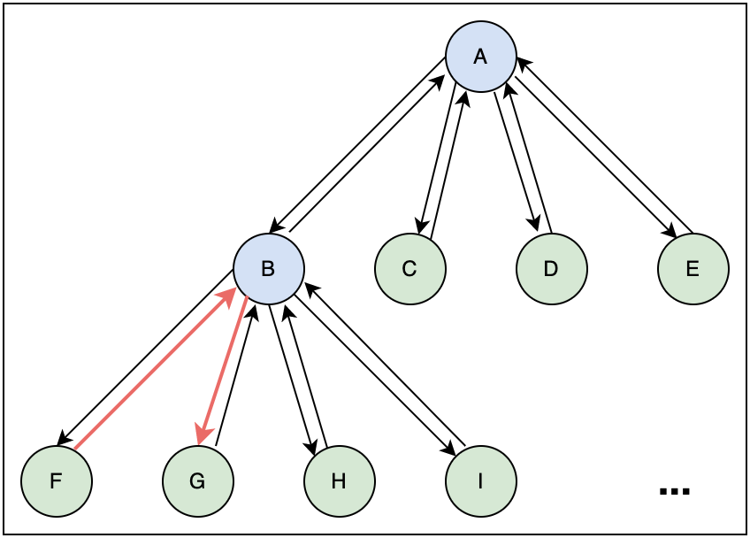

# 029 - Thiết Kế Dịch Vụ Tìm Kiếm Địa Điểm Lân Cận (Proximity Service - Yelp)

[← Bài trước](028-thiet-ke-google-maps.md) | [Mục lục](README.md) | [Bài tiếp theo →](030-thiet-ke-uber.md)

---


# Thiết Kế Hệ Thống: Yelp (System Design: Yelp)

Tìm hiểu về các yêu cầu kỹ thuật của một dịch vụ tìm kiếm lân cận (Proximity Service) tương tự như Yelp.

Chúng ta sẽ bao quát các nội dung sau:
- **Yelp là gì? (What is Yelp?)**
- **Chúng ta sẽ thiết kế Yelp như thế nào? (How will we design Yelp?)**

---

### Yelp là gì? (What is Yelp?)

**Yelp** là một nền tảng trọn gói (one-stop platform) dành cho người tiêu dùng để khám phá, kết nối và thực hiện giao dịch với các doanh nghiệp địa phương (local businesses). Thông qua nền tảng này, người dùng có thể dễ dàng tham gia danh sách chờ (waitlist), đặt chỗ trước (reservation), lên lịch hẹn (appointment) hoặc mua sắm hàng hóa. Yelp cũng cung cấp thông tin chi tiết, hình ảnh và các bài đánh giá (reviews) về các cơ sở kinh doanh tại địa phương.

Người dùng cung cấp tên của một địa điểm hoặc vị trí GPS của họ, và hệ thống sẽ tìm kiếm các địa điểm lân cận. Người dùng cũng có thể đăng tải ý kiến cá nhân trên nền tảng dưới dạng văn bản (text), hình ảnh (pictures) hoặc xếp hạng đánh giá (ratings) cho một địa điểm họ từng ghé thăm. Các dịch vụ dựa trên vị trí (Location-Based Services - LBS) tương tự khác bao gồm Foursquare và Google Nearby.

Các dịch vụ dựa trên máy chủ tìm kiếm lân cận (proximity servers) rất hữu ích trong việc tìm kiếm các điểm tham quan lân cận như nhà hàng, rạp chiếu phim hoặc khu vui chơi giải trí. Thiết kế một hệ thống như vậy là một bài toán đầy thách thức vì chúng ta phải tìm kiếm hiệu quả tất cả các địa điểm khả dĩ trong một bán kính nhất định với độ trễ tối thiểu (**minimum latency**). Điều này đồng nghĩa với việc chúng ta phải thu hẹp phạm vi tìm kiếm từ hàng tỷ vị trí trên toàn thế giới để chỉ xác định chính xác những địa điểm thực sự liên quan.

---

### Quy Trình Tìm Kiếm Địa Điểm Lân Cận (Proximity Search Flow)

  
*Người dùng có thể tìm kiếm một địa điểm cụ thể ở gần họ (1 of 6)*

  
*Người dùng nhập từ khóa "cafe" vào ô tìm kiếm (2 of 6)*

  
*Người dùng muốn tìm kiếm các quán cà phê xung quanh khu vực Seattle (3 of 6)*

  
*Máy chủ tìm kiếm lân cận (proximity server) sẽ quét các địa điểm trong một bán kính nhất định, lấy vị trí của người dùng làm tâm điểm (4 of 6)*

  
*Máy chủ tìm kiếm lân cận (proximity server) sẽ xác định các địa điểm tiềm năng phù hợp với dữ liệu đầu vào của người dùng (5 of 6)*

  
*Máy chủ tìm kiếm lân cận (proximity server) sẽ trả về cho người dùng danh sách các địa điểm liên quan xung quanh Seattle (6 of 6)*

---

### Chúng ta sẽ thiết kế Yelp như thế nào? (How will we design Yelp?)

Dưới đây là các phần phân rã chi tiết trong thiết kế của Yelp:

1. **Yêu cầu (Requirements):** Trong bài học này, chúng ta xác định các yêu cầu và ước tính số lượng máy chủ (servers), dung lượng lưu trữ (**storage**), và băng thông (**bandwidth**) cần thiết cho hệ thống.
2. **Thiết kế (Design):** Trong bài học này, chúng ta định nghĩa thiết kế API, lược đồ cơ sở dữ liệu (**database schema**), các thành phần cốt lõi của hệ thống và luồng công việc (**workflow**) tổng thể của Yelp.
3. **Các cân nhắc thiết kế chuyên sâu (Design considerations):** Trong bài học này, chúng ta đi sâu vào chi tiết kỹ thuật của hệ thống Yelp (các kỹ thuật lập chỉ mục không gian - spatial indexing, phân mảnh dữ liệu - **sharding**, bộ nhớ đệm - **caching**, v.v.).
4. **Trắc nghiệm (Quiz):** Trong bài học này, chúng ta thực hiện bài kiểm tra để củng cố kiến thức về thiết kế hệ thống Yelp.

Hãy bắt đầu thiết kế bằng việc định nghĩa các yêu cầu của hệ thống.

---

# Các Yêu Cầu Của Thiết Kế Yelp (Requirements of Yelp’s Design)

Tìm hiểu chi tiết về các yêu cầu kỹ thuật cho một dịch vụ lân cận (Proximity Service) như Yelp.

Chúng ta sẽ bao quát các nội dung sau:
- **Yêu cầu (Requirements)**
  - Yêu cầu chức năng (**Functional requirements**)
  - Yêu cầu phi chức năng (**Non-functional requirements**)
- **Ước tính tài nguyên (Resource estimation)**
  - Ước tính số lượng máy chủ (**Number of servers estimation**)
  - Ước tính dung lượng lưu trữ (**Storage estimation**)
  - Ước tính băng thông (**Bandwidth estimation**)
- **Các khối kiến trúc xây dựng nền tảng sẽ sử dụng (Building blocks we will use)**

---

### Yêu Cầu (Requirements)

Hãy cùng xác định các yêu cầu của hệ thống chúng ta.

#### Yêu Cầu Chức Năng (Functional Requirements)

Các yêu cầu chức năng của hệ thống gồm có:

- **Tài khoản người dùng (User accounts):** Người dùng sẽ có tài khoản để thực hiện các chức năng khác nhau như đăng nhập (log in), đăng xuất (log out), thêm (add), xóa (delete), và cập nhật thông tin địa điểm (update places' information).

> [!NOTE]
> Có thể có hai nhóm người dùng: **chủ doanh nghiệp** (business owners) có quyền thêm địa điểm kinh doanh của họ lên nền tảng, và **người dùng thông thường** (other users) có thể tìm kiếm, xem chi tiết và chấm điểm đánh giá (give a rating) cho một địa điểm.

- **Tìm kiếm (Search):** Người dùng có thể tìm kiếm các địa điểm lân cận (nearby places) hoặc các địa điểm thuộc... *(nội dung gốc kết thúc tại đây)*

---

# 029 - Thiết Kế Dịch Vụ Tìm Kiếm Địa Điểm Lân Cận (Proximity Service - Yelp)

...địa điểm quan tâm dựa trên vị trí GPS (kinh độ - longitude, vĩ độ - latitude) và/hoặc tên của một địa điểm.
* **Phản hồi (Feedback):** Người dùng có thể thêm đánh giá (review) về một địa điểm. Đánh giá có thể bao gồm hình ảnh, văn bản (text) và điểm xếp hạng (rating).

### Yêu cầu chức năng (Functional Requirements)
* Thêm đánh giá/phản hồi (Add review/feedback)
* Tìm kiếm một địa điểm (Search a place)
* Thêm địa điểm (Add place)


### Yêu cầu phi chức năng (Non-functional Requirements)
Các yêu cầu phi chức năng của hệ thống chúng ta bao gồm:
* **Tính sẵn sàng cao (High Availability):** Hệ thống phải luôn sẵn sàng phục vụ người dùng ở mức độ cao.
* **Khả năng mở rộng (Scalability):** Hệ thống phải có khả năng co giãn linh hoạt (scale up và scale down) tùy thuộc vào số lượng yêu cầu (requests). Lượng request có thể biến động tùy theo thời gian trong ngày và các ngày trong tuần/năm. Ví dụ, số lượng tìm kiếm vào giờ ăn trưa thường nhiều hơn lúc nửa đêm. Tương tự, vào mùa du lịch, hệ thống sẽ tiếp nhận lượng request lớn hơn nhiều so với các tháng khác trong năm.
* **Tính nhất quán (Consistency):** Hệ thống cần đảm bảo tính nhất quán cho người dùng. Tất cả người dùng phải có một góc nhìn dữ liệu nhất quán (consistent view) về các địa điểm, đánh giá và hình ảnh.
* **Hiệu năng (Performance):** Khi thực hiện tìm kiếm, hệ thống phải phản hồi các gợi ý với độ trễ tối thiểu (minimal latency).

---

## Ước tính tài nguyên (Resource Estimation)

Giả định chúng ta có:
* Tổng cộng **178 triệu** người dùng duy nhất (unique users).
* **60 triệu** người dùng hoạt động hàng ngày (DAU - Daily Active Users).
* **500 triệu** địa điểm (places).

---

### Ước tính số lượng máy chủ (Number of Servers Estimation)

Chúng ta cần xử lý các request đồng thời (concurrent requests) đến từ 60 triệu người dùng hoạt động hàng ngày. Như đã thảo luận trong các bài học về tính toán sơ bộ (back-of-the-envelope calculations), chúng ta giả định mỗi máy chủ có năng lực xử lý RPS là **8.000**:

$$\text{Số lượng máy chủ yêu cầu} = \frac{\text{Số lượng người dùng hoạt động hàng ngày}}{\text{RPS của một máy chủ}} = \frac{60\text{ triệu}}{8.000} = 7.500\text{ máy chủ}$$


#### Bảng ước tính số lượng máy chủ (Estimating the Number of Servers)

| Tham số | Giá trị |
| :--- | :--- |
| Số lượng người dùng hoạt động hàng ngày (triệu) - Daily Active Users (in Millions) | 60 |
| RPS của một máy chủ - RPS of a Server | 8000 |
| **Số lượng máy chủ yêu cầu - Number of Servers Required** | **7500** |


> **Số lượng máy chủ cần thiết cho Yelp:** **7.500 máy chủ (servers)**.

---

### Ước tính dung lượng lưu trữ (Storage Estimation)

Hãy tính toán dung lượng lưu trữ cần thiết cho dữ liệu của chúng ta dựa trên các giả định sau:
* Tổng cộng có **500 triệu** địa điểm.
* Mỗi địa điểm cần **1.296 Bytes** dung lượng lưu trữ.
* Mỗi địa điểm có đính kèm **một bức ảnh**, tương đương **500 triệu bức ảnh**.
* Mỗi bức ảnh cần **280 Bytes** dung lượng lưu trữ. Ở đây, chúng ta tính kích thước của một hàng (row size) của thực thể ảnh trong bảng cơ sở dữ liệu, chứa đường dẫn liên kết (link) đến bức ảnh thực tế được lưu trữ trong blob store.
* Có ít nhất **1 triệu đánh giá (reviews)** về các địa điểm khác nhau được thêm vào mỗi ngày.
* Mỗi đánh giá cần **537 Bytes** dung lượng lưu trữ.
* Tổng cộng có **178 triệu** người dùng.
* Mỗi người dùng cần **264 Bytes** dung lượng lưu trữ.

> [!NOTE]
> Kích thước số Bytes sử dụng cho mỗi địa điểm, bức ảnh, đánh giá và người dùng được căn cứ dựa trên lược đồ cơ sở dữ liệu (database schema) mà chúng ta sẽ thảo luận chi tiết trong bài học tiếp theo.

Công cụ tính toán dưới đây tổng hợp tổng dung lượng lưu trữ cần thiết:

#### Bảng ước tính nhu cầu lưu trữ (Estimating Storage Requirements)

| Loại thông tin (Type of information) | Kích thước yêu cầu bởi một thực thể (Bytes) | Số lượng (Triệu) | Tổng dung lượng (GB) |
| :--- | :--- | :--- | :--- |
| **Địa điểm (Place)** | 1296 | 500 | 648 |
| **Ảnh (Photo)** | 280 | 500 | 140 |
| **Đánh giá (Review)** | 537 | 1 | 0.54 |
| **Người dùng (User)** | 264 | 178 | 46.99 |
| **Tổng dung lượng lưu trữ yêu cầu (Total Storage Required)** | | | **835.53** |


$$\begin{aligned}
\text{Tổng dung lượng lưu trữ} &= \text{Địa điểm (648 GB)} + \text{Ảnh (140 GB)} + \text{Đánh giá (0.54 GB)} + \text{Người dùng (46.99 GB)} \\
&= \mathbf{835.53\text{ GB}}
\end{aligned}$$


> **Tổng dung lượng lưu trữ yêu cầu bởi Yelp:** **835.53 GB**.

---

### Ước tính băng thông (Bandwidth Estimation)

Để ước tính nhu cầu băng thông cho Yelp, chúng ta phân loại tính toán thành lưu lượng truy cập vào (incoming traffic - ingress) và lưu lượng truy cập ra (outgoing traffic - egress).

#### 1. Lưu lượng truy cập vào (Incoming Traffic)
Giả định các thông số sau:
* Trung bình mỗi ngày có **5 địa điểm mới** được thêm vào.
* Mỗi địa điểm chiếm **1.296 Bytes**.
* Một bức ảnh kích thước **3 MB** cũng được đính kèm với mỗi địa điểm. Đây là dung lượng thực tế của ảnh được lưu trữ trong blob store.
* **1 triệu đánh giá** về các địa điểm khác nhau được thêm vào mỗi ngày.
* Mỗi đánh giá chiếm **537 Bytes**.

Chúng ta chia tổng kích thước dữ liệu mỗi ngày cho **86.400** (số giây trong một ngày) để chuyển đổi sang băng thông yêu cầu trên mỗi giây.


##### Bảng ước tính băng thông vào (Estimating Incoming Bandwidth Requirements)

| Tham số | Giá trị |
| :--- | :--- |
| Số địa điểm trung bình thêm mới hàng ngày (Average Number of Places Added Daily) | 5 |
| Dung lượng lưu trữ cần cho mỗi địa điểm (Bytes) - Storage Needed for Each Place | 1296 |
| Kích thước của ảnh (MB) - Size of Photo | 3 |
| Tổng kích thước thông tin địa điểm (Bytes) - Total Size of Place Information | 15006480 |
| Số đánh giá trung bình thêm mới hàng ngày (Triệu) - Average Number of Reviews Added Daily | 1 |
| Dung lượng lưu trữ cần cho mỗi đánh giá (Bytes) - Storage Needed for Each Review | 537 |
| Tổng kích thước các đánh giá (Bytes) - Total Size of Reviews | 537000000 |
| **Tổng băng thông vào (Total Incoming Bandwidth - KBps)** | **6.39** |
| **Tổng băng thông vào (Total Incoming Bandwidth - Kbps)** | **51.12** |

---

#### 2. Lưu lượng truy cập ra (Outgoing Traffic)
Giả định các thông số sau:
* Một lần tìm kiếm trung bình trả về **20 địa điểm**.
* Mỗi địa điểm có đính kèm **một bức ảnh** với kích thước trung bình là **3 MB**.
* Mỗi mục dữ liệu trả về đều chứa cả thông tin địa điểm và thông tin hình ảnh.

Xét việc hệ thống phục vụ **60 triệu người dùng hoạt động hàng ngày (DAU)**, chúng ta có các ước tính sau:


##### Bảng ước tính băng thông ra (Estimating Outgoing Bandwidth Requirements)

| Tham số | Giá trị |
| :--- | :--- |
| Số địa điểm trung bình trả về trên mỗi request tìm kiếm (Average Number of Places Returned on Each Search Request) | 20 |
| Kích thước của địa điểm (Bytes) - Size of Place | 1296 |
| Kích thước của ảnh (MB) - Size of Photo | 3 |
| Tổng kích thước thông tin địa điểm trả về (Bytes) - Total Size of Place Information | 60025920 |
| Băng thông ra yêu cầu cho một request đơn lẻ (Kbps) - Outgoing Bandwidth Required for a Single Request | 0.69 |
| Băng thông ra yêu cầu cho một request đơn lẻ (KBps) - Outgoing Bandwidth Required for a Single Request | 5.52 |
| Số người dùng hoạt động hàng ngày (Triệu) - Daily Active Users | 60 |
| **Tổng băng thông ra yêu cầu (Total Outgoing Bandwidth Required - Kbps)** | **331200000** |
| **Tổng băng thông ra yêu cầu (Total Outgoing Bandwidth Required - Gbps)** | **331.2** |


---

### Tổng kết nhu cầu băng thông (Total Bandwidth Requirements)

Hệ thống cần tổng cộng khoảng **51 Kbps** cho lưu lượng truy cập vào (incoming traffic) và xấp xỉ **331 Gbps** cho lưu lượng truy cập ra (outgoing traffic), với giả định nội dung tải lên không bị nén:

$$\text{Tổng nhu cầu băng thông} = 51\text{ Kbps} + 331\text{ Gbps} \approx \mathbf{331\text{ Gbps}}$$

---

# Thiết Kế Hệ Thống: Yelp (System Design: Yelp)

---

## 1. Thiết Kế Yelp (Design of Yelp)

### 1.1 Tổng Băng Thông Yêu Cầu Cho Yelp (Total Bandwidth Required)

* **Băng thông chiều ra (Outgoing bandwidth):** $331\text{ Gbps}$
* **Băng thông chiều vào (Incoming bandwidth):** $51\text{ Kbps}$

$$\text{Tổng băng thông (Total Bandwidth)} = 331\text{ Gbps} + 51\text{ Kbps} \approx 331\text{ Gbps}$$

---

### 1.2 Các Khối Xây Dựng Hệ Thống Sẽ Sử Dụng (Building Blocks)

Quá trình thiết kế Yelp tận dụng nhiều khối thành phần kiến trúc (building blocks) nền tảng trong hệ thống phân tán:


Các khối thành phần trong thiết kế cấp cao (High-Level Design) của Yelp bao gồm:
* **Bộ nhớ đệm (Cache):** Chúng ta sử dụng cache để lưu trữ thông tin về các địa điểm phổ biến/truy cập thường xuyên (popular places).
* **Bộ cân bằng tải (Load Balancer):** Sử dụng load balancer để quản lý và phân phối lượng lưu lượng yêu cầu (request volume) khổng lồ đến hệ thống.
* **Lưu trữ đối tượng nhị phân (Blob Storage):** Dùng để lưu trữ hình ảnh (photos/images).
* **Cơ sở dữ liệu (Database):** Lưu trữ thông tin chi tiết về các địa điểm (places) và người dùng (users).

Chúng ta cũng sẽ tích hợp và dựa vào nền tảng **Google Maps** để hiện thực hóa tính năng tìm kiếm các địa điểm nằm trong một bán kính cụ thể (within a particular radius).

---

## 2. Chi Tiết Thiết Kế Hệ Thống Yelp (Deep Dive Design)

Học cách đáp ứng toàn diện các yêu cầu thiết kế của hệ thống Yelp.

### Nội Dung Bao Gồm:
* **Thiết kế API (API design)**
  * Tìm kiếm (Search)
  * Thêm địa điểm (Add a place)
  * Thêm đánh giá (Add a review)
* **Lược đồ lưu trữ (Storage schema)**
* **Thiết kế chi tiết (Design)**
* **Các thành phần (Components)**
* **Luồng hoạt động (Workflow)**

> [!NOTE]  
> Chúng ta đã xác định các yêu cầu chức năng/phi chức năng cũng như hoàn thành việc tính toán ước lượng tài nguyên (estimations) cho hệ thống Yelp trong bài học trước. Trong bài học này, chúng ta sẽ tập trung vào thiết kế API (API design), đi sâu vào lược đồ lưu trữ dữ liệu (storage schema), sau đó phân tích chi tiết các khối kiến trúc nền tảng và các thành phần bổ trợ của hệ thống.

---

### 2.1 Thiết Kế API (API Design)

Hãy cùng thảo luận về đặc tả API cho Yelp.

#### A. Tìm Kiếm (Search)
Chúng ta cần triển khai hàm tìm kiếm. Lời gọi API để tìm kiếm dựa trên danh mục (categories - ví dụ như "quán cà phê / cafes") có chữ ký như sau:

```text
search(category, user_location, radius)
```

| Tham Số (Parameter) | Mô Tả (Description) |
| :--- | :--- |
| `category` | Loại hình tìm kiếm mà người dùng thực hiện — ví dụ: nhà hàng (restaurants), rạp chiếu phim (cinemas), quán cà phê (cafes), v.v. |
| `user_location` | Chứa tọa độ vị trí hiện tại của người dùng đang thực hiện tìm kiếm. |
| `radius` | Bán kính chỉ định mà người dùng muốn tìm kiếm danh mục tương ứng xung quanh vị trí của mình. |

> [!TIP]  
> Tiến trình này trả về một đối tượng **JSON** chứa danh sách tất cả các mục phù hợp thuộc danh mục được yêu cầu và nằm trong bán kính đã định. Mỗi bản ghi (entry) sẽ bao gồm: **tên địa điểm (place name), địa chỉ (address), danh mục (category), điểm đánh giá (rating), và ảnh thu nhỏ (thumbnail)**.

Lời gọi API để tìm kiếm theo tên cụ thể của một địa điểm (ví dụ: "Burger Hut") có dạng:

```text
search(name_of_place, user_location, radius)
```

| Tham Số (Parameter) | Mô Tả (Description) |
| :--- | :--- |
| `name_of_place` | Chứa tên của địa điểm cụ thể mà người dùng muốn tìm kiếm. |

Tiến trình này trả về một đối tượng **JSON** chứa thông tin chi tiết của địa điểm được chỉ định.

---

#### B. Thêm Địa Điểm (Add a place)
Lời gọi API để tạo mới/thêm một địa điểm vào hệ thống:

```text
add_place(name_of_place, description_of_place, category, latitude, longitude, photo)
```

| Tham Số (Parameter) | Mô Tả (Description) |
| :--- | :--- |
| `name_of_place` | Chứa tên địa điểm, ví dụ: "Burger Hut". |
| `description_of_place` | Chứa phần mô tả chi tiết của địa điểm. Ví dụ: "Địa điểm phục vụ những món burger thơm ngon nhất". |
| `category` | Chỉ định danh mục phân loại của địa điểm — ví dụ: nhà hàng, cà phê, quán ăn. |
| `latitude` | Vĩ độ địa lý (latitude) của địa điểm. |
| `longitude` | Kinh độ địa lý (longitude) của địa điểm. |
| `photo` | Chứa dữ liệu/liên kết ảnh của địa điểm. Có thể là một ảnh đơn lẻ hoặc danh sách nhiều ảnh. |

Tiến trình này trả về phản hồi xác nhận địa điểm đã được thêm thành công, hoặc trả về mã lỗi thích hợp nếu thao tác thêm địa điểm thất bại.

---

#### C. Thêm Đánh Giá (Add a review)
Lời gọi API để đăng tải đánh giá cho một địa điểm:

```text
add_review(place_ID, user_ID, review_description, rating)
```

| Tham Số (Parameter) | Mô Tả (Description) |
| :--- | :--- |
| `place_ID` | Mã định danh duy nhất (ID) của địa điểm được đánh giá. |
| `user_ID` | Mã định danh duy nhất (ID) của người dùng thực hiện đánh giá. |
| `review_description` | Nội dung nhận xét/đánh giá về địa điểm — ví dụ: "Burger ở đây rất tuyệt vời". |
| `rating` | Điểm xếp hạng cho địa điểm — ví dụ: 4 trên 5 sao. |

Tiến trình này trả về phản hồi thông báo đánh giá đã được ghi nhận thành công, hoặc trả về thông báo lỗi tương ứng nếu quá trình gửi đánh giá thất bại.

---

### 2.2 Lược Đồ Lưu Trữ (Storage Schema)

Chúng ta hãy tiến hành định nghĩa lược đồ lưu trữ (Storage Schema) cho hệ thống. Một số bảng cơ sở dữ liệu cốt lõi cần thiết bao gồm: **“Place” (Địa điểm)**, **“Photos” (Hình ảnh)**, **“Reviews” (Đánh giá)**, và **“Users” (Người dùng)**.

#### Định nghĩa các cột cho bảng “Place”:
* **`Place_ID`**: Sử dụng bộ sinh chuỗi thứ tự (sequencer / unique ID generator) để tạo ra mã định danh duy nhất có kích thước **8 Bytes (64 bits)** cho mỗi địa điểm.
  > [!NOTE]  
  > Các ID được sinh ra thông qua hệ thống máy tạo ID duy nhất (Unique ID Generator).
* **`Name_of_Place`**: Kiểu chuỗi ký tự (string) lưu tên địa điểm. Chiếm **256 Bytes**.
* **`Description_of_Place`**: Kiểu chuỗi ký tự lưu phần mô tả chi tiết địa điểm. Chiếm **1.000 Bytes**.
* **`Category`**: Chỉ định loại hình địa điểm như nhà hàng, rạp chiếu phim, hiệu sách, v.v. Chiếm **8 Bytes**.
* **`Latitude`**: Lưu trữ vĩ độ của địa điểm. Chiếm **8 Bytes**.
* **`Longitude`**: Lưu trữ kinh độ của địa điểm. Chiếm **8 Bytes**.
* **`Photos`**: Khóa ngoại (Foreign Key - **8 Bytes**) tham chiếu sang bảng “Photos” – nơi chứa toàn bộ ảnh liên kết với địa điểm cụ thể này.
* **`Rating`**: Lưu trữ điểm đánh giá tổng hợp của địa điểm (hiển thị số sao địa điểm đạt được trên thang điểm 5). Điểm số này được tính toán tổng hợp dựa trên các lượt đánh giá từ người dùng.

> [!IMPORTANT]  
> Các cột được liệt kê ở trên là những trường dữ liệu quan trọng và thiết yếu nhất trong bảng. Chúng ta hoàn toàn có thể mở rộng thêm các cột khác như: `menu` (thực đơn), `address` (địa chỉ chi tiết), `opening and closing hours` (giờ mở cửa và đóng cửa), v.v.

Dựa trên các trường cốt lõi, dung lượng của một hàng (row size) trong bảng **“Place”** được tính toán như sau:

$$\text{Dung lượng mỗi hàng (Size)} = 8 + 256 + 1000 + 8 + 8 + 8 + 8 = 1.296\text{ Bytes}$$

---

# Thiết Kế Dịch Vụ Tìm Kiếm Địa Điểm Lân Cận (Proximity Service - Yelp)

---

### Định nghĩa Schema bảng "Photos" (Ảnh)

Bây giờ, hãy cùng định nghĩa bảng **“Photos”**:
* **`Photo_ID`**: Chúng ta sử dụng bộ tạo chuỗi tuần tự (Sequencer / Unique ID Generator) để tạo một định danh duy nhất (Unique ID) cho mỗi bức ảnh (8 Bytes hoặc 64 bits).
* **`Place_ID`**: Chúng ta sử dụng khóa ngoại (Foreign Key - 8 Bytes) tham chiếu từ bảng **“Place”** để xác định bức ảnh này thuộc về địa điểm nào.
* **`Photo_path`**: Chúng ta lưu trữ các tệp ảnh thực tế trong kho lưu trữ đối tượng nhị phân lớn (Blob Storage) và lưu đường dẫn tệp ảnh (Photo's path - 256 Bytes) vào cột này.

$$\text{Kích thước bản ghi (Size)} = 8 + 8 + 8 + 256 = 280\text{ bytes}$$

---

### Định nghĩa Schema bảng "Reviews" (Đánh giá)

Chúng ta cần một bảng khác có tên là **“Reviews”** để lưu trữ các bài đánh giá, điểm xếp hạng (Ratings) và ảnh của một địa điểm.
* **`Review_ID`**: Chúng ta sử dụng Sequencer để tạo một Unique ID kích thước 8 Bytes (64 bits) cho mỗi bài đánh giá.
* **`Place_ID`**: Khóa ngoại (Foreign Key - 8 Bytes) từ bảng **“Place”** để xác định đánh giá này thuộc về địa điểm nào.
* **`User_ID`**: Khóa ngoại (Foreign Key - 8 Bytes) từ bảng **“Users”** để xác định đánh giá này do người dùng nào tạo.
* **`Review_description`**: Cột này chứa nội dung chi tiết của bài đánh giá. Chúng ta cấp phát 512 Bytes cho trường này.
* **`Rating`**: Lưu trữ số lượng sao đánh giá mà địa điểm nhận được trên thang điểm 5 (1 Byte).

$$\text{Kích thước bản ghi (Size)} = 8 + 8 + 8 + 512 + 1 = 537\text{ bytes}$$

---

### Định nghĩa Schema bảng "Users" (Người dùng)

Chúng ta sử dụng bảng **“Users”** để lưu trữ thông tin người dùng.
* **`User_ID`**: Chúng ta sử dụng Sequencer để tạo một Unique ID cho người dùng (8 Bytes).
* **`User_name`**: Chuỗi ký tự (String) chứa tên của người dùng. Chúng ta cấp phát 256 Bytes cho trường này.

$$\text{Kích thước bản ghi (Size)} = 8 + 256 = 264\text{ bytes}$$

> [!NOTE]
> Kiểu dữ liệu `INT` trong lược đồ lưu trữ (Storage Schema) dưới đây đại diện cho định danh 8-Byte (64-bit ID) được tạo ra thông qua bộ tạo mã định danh duy nhất (Unique ID Generator).

---

### Lược đồ lưu trữ (Storage Schema)

#### Bảng `Photo`
| Tên cột (Column) | Kiểu dữ liệu (Data Type) | Mô tả |
| :--- | :--- | :--- |
| `Photo_ID` | `INT` (8 Bytes) | Khóa chính (Primary Key) |
| `Place_ID` | `INT` (8 Bytes) | Khóa ngoại tham chiếu `Place` |
| `Photo_path` | `VARCHAR(256)` | Đường dẫn ảnh trong Blob Storage |

#### Bảng `Place`
| Tên cột (Column) | Kiểu dữ liệu (Data Type) | Mô tả |
| :--- | :--- | :--- |
| `Place_ID` | `INT` (8 Bytes) | Khóa chính (Primary Key) |
| `Name_of_place` | `VARCHAR(256)` | Tên địa điểm |
| `Description_of_place` | `VARCHAR(1000)` | Mô tả địa điểm |
| `Category` | `VARCHAR` | Danh mục địa điểm |
| `Latitude` | `DECIMAL` | Vĩ độ |
| `Longitude` | `DECIMAL` | Kinh độ |
| `Photo_ID` | `INT` | Mã định danh ảnh đại diện |
| `Rating` | `DECIMAL` | Điểm đánh giá trung bình |

#### Bảng `Users`
| Tên cột (Column) | Kiểu dữ liệu (Data Type) | Mô tả |
| :--- | :--- | :--- |
| `User_ID` | `INT` (8 Bytes) | Khóa chính (Primary Key) |
| `User_name` | `VARCHAR` | Tên người dùng |

#### Bảng `Reviews`
| Tên cột (Column) | Kiểu dữ liệu (Data Type) | Mô tả |
| :--- | :--- | :--- |
| `Review_ID` | `INT` (8 Bytes) | Khóa chính (Primary Key) |
| `Place_ID` | `INT` (8 Bytes) | Khóa ngoại tham chiếu `Place` |
| `User_ID` | `INT` (8 Bytes) | Khóa ngoại tham chiếu `Users` |
| `Review_description` | `VARCHAR` | Nội dung bài đánh giá |
| `Rating` | `INT` | Điểm xếp hạng (1-5 sao) |

---

## Thiết Kế Hệ Thống (Design)

Bây giờ chúng ta sẽ thảo luận về các khối xây dựng riêng lẻ (Building Blocks) và các thành phần (Components) được sử dụng trong thiết kế của Yelp, cũng như cách chúng phối hợp cùng nhau để đáp ứng toàn bộ các yêu cầu chức năng (Functional Requirements).

### Các thành phần của hệ thống (Components)

Dưới đây là các thành phần chính trong hệ thống của chúng ta:

* **Segments Producer (Bộ tạo phân vùng không gian):** Thành phần này chịu trách nhiệm giao tiếp với các dịch vụ dữ liệu bản đồ thế giới của bên thứ ba (Third-party World Map Data Services - ví dụ: Google Maps). Nó tiếp nhận dữ liệu đó và chia thế giới thành các khu vực địa lý nhỏ hơn gọi là **phân vùng (Segments)**. Segments Producer giúp chúng ta thu hẹp phạm vi số lượng địa điểm cần tìm kiếm.
* **QuadTree Servers (Máy chủ cây tứ phân):** Đây là một cụm máy chủ chứa các cấu trúc cây (QuadTree) lưu trữ danh sách các địa điểm nằm trong từng phân vùng (Segments). Một QuadTree Server sẽ tìm kiếm danh sách các địa điểm dựa trên bán kính (Radius) được chỉ định cùng với vị trí hiện tại của người dùng (User's location), sau đó trả danh sách kết quả về cho người dùng. Thành phần này đóng vai trò cốt lõi phục vụ tính năng tìm kiếm (Search Functionality).
* **Aggregators (Máy chủ tổng hợp kết quả):** Các máy chủ QuadTree thu thập tất cả các địa điểm tiềm năng và chuyển tiếp chúng đến các máy chủ Aggregator. Sau đó, Aggregators sẽ tổng hợp, chuẩn hóa kết quả và trả kết quả tìm kiếm cuối cùng về cho người dùng.
* **Read Servers (Máy chủ đọc):** Chúng ta sử dụng một cụm máy chủ đọc chuyên dụng để xử lý toàn bộ các yêu cầu đọc (Read Requests). Vì hệ thống có tỷ lệ yêu cầu đọc áp đảo so với ghi (Read-heavy System), việc tách biệt luồng xử lý đọc và ghi (Read/Write Separation) mang lại hiệu năng và tính ổn định vượt trội. Mỗi Read Server sẽ điều phối các yêu cầu tìm kiếm đến các QuadTree Servers và trả kết quả về cho người dùng.
* **Write Servers (Máy chủ ghi):** Chúng ta sử dụng một cụm máy chủ ghi riêng biệt để xử lý toàn bộ các yêu cầu ghi (Write Requests). Mỗi Write Server xử lý các tác vụ ghi của người dùng và cập nhật tương ứng vào hạ tầng lưu trữ. Các ví dụ về yêu cầu ghi bao gồm: thêm một địa điểm mới, viết bình luận, đánh giá một địa điểm, v.v.
* **Hạ tầng lưu trữ (Storage):** Chúng ta sử dụng hai loại hình lưu trữ khác nhau nhằm đáp ứng các nhu cầu dữ liệu đa dạng:
  * **Cơ sở dữ liệu quan hệ (SQL Database / Relational Database):** Hệ thống sẽ có nhiều bảng dữ liệu khác nhau như `Users`, `Place`, `Reviews`, `Photos`, v.v. Dữ liệu trong các bảng này vốn dĩ có tính quan hệ chặt chẽ và có cấu trúc (Structured Data). Chúng ta cần thực thi các truy vấn phức tạp như: những địa điểm người dùng đã ghé thăm, các bài đánh giá họ đã đăng, hoặc xem toàn bộ đánh giá của một địa điểm cụ thể. Các truy vấn này được thực hiện rất dễ dàng và hiệu quả trên cơ sở dữ liệu quan hệ (SQL-based Database). Đồng thời, chúng ta cũng cần tất cả người dùng đều có một góc nhìn dữ liệu nhất quán (Consistent View of Data), điều mà các hệ thống SQL đáp ứng rất tốt. Chúng ta sẽ sử dụng các cơ sở dữ liệu có độ tin cậy và khả năng mở rộng cao (Reliable and Scalable Databases) như đã thảo luận trong khối xây dựng Database.
  * **Kho lưu trữ khóa - giá trị (Key-Value Stores):** Chúng ta cần truy xuất danh sách các địa điểm trong một phân vùng (Segment) với độ trễ cực thấp (Low Latency). Để làm được điều đó, chúng ta lưu danh sách các địa điểm gắn với `Segment_ID` vào Key-Value Store nhằm tối thiểu hóa thời gian tìm kiếm. Chúng ta cũng lưu toàn bộ thông tin cấu trúc QuadTree vào Key-Value Store bằng cách ánh xạ dữ liệu QuadTree theo một ID duy nhất.
* **Bộ cân bằng tải (Load Balancer):** Load Balancer phân phối đồng đều các yêu cầu đến (Incoming Requests) từ phía người dùng đến toàn bộ các máy chủ trong cụm.

---

### Kiến Trúc Tổng Thể Hệ Thống Yelp (Yelp Architecture Design)


---

### Quy Trình Xử Lý Dữ Liệu (Workflow)

Người dùng gửi lên một yêu cầu tìm kiếm (Search Request). Chúng ta cần tìm kiếm tất cả các địa điểm phù hợp trong phạm vi bán kính (Radius) đã cho, dựa trên vị trí hiện tại của người dùng (Kinh độ - Longitude, Vĩ độ - Latitude).

Dưới đây là chi tiết quy trình làm việc (Workflow) của hệ thống theo từng yêu cầu chức năng cụ thể:

1. **Tìm kiếm một địa điểm (Searching a place):**
   * Khi tiếp nhận yêu cầu đọc (Read Request), Load Balancers sẽ định tuyến yêu cầu đó đến cụm **Read Servers**.
   * Các Read Servers chuyển tiếp yêu cầu đến cụm **QuadTree Servers** để tìm kiếm toàn bộ các địa điểm nằm trong bán kính đã cung cấp.
   * Các QuadTree Servers sau đó chuyển danh sách kết quả đến cụm máy chủ tổng hợp (**Aggregators**) để tinh lọc, xếp hạng và trả kết quả về cho người dùng.

2. **Thêm một địa điểm mới hoặc gửi phản hồi (Adding a place or feedback):**
   * Khi tiếp nhận yêu cầu ghi (Write Request), Load Balancers sẽ định tuyến yêu cầu đến cụm **Write Servers**.
   * Tùy thuộc vào nội dung được gửi lên (thông tin địa điểm mới hoặc bài đánh giá/bình luận), các Write Servers sẽ thực hiện ghi thêm một bản ghi vào **Cơ sở dữ liệu quan hệ (Relational Database)** và tải toàn bộ các tệp hình ảnh đính kèm lên **Blob Storage**.

3. **Tạo và phân chia các phân vùng (Making segments):**
   * Thành phần **Segment Producer** chia nhỏ bản đồ thế giới thu thập từ dịch vụ bản đồ bên thứ ba thành các phân vùng (Segments) có diện tích nhỏ hơn.
   * Danh sách các địa điểm nằm bên trong mỗi phân vùng sẽ được lưu trữ vào **Key-Value Store**.
   * Mặc dù đây là một tác vụ chạy nền định kỳ (Batch Job), quy trình này vẫn được lặp lại thường xuyên để cập nhật các phân vùng mới và các địa điểm mới phát sinh. Do xác suất thêm địa điểm mới ở mức tương đối thấp, chúng ta sẽ cập nhật các phân vùng theo chu kỳ **hàng tháng (Every month)**.

> [!NOTE]
> Chúng ta đã tìm hiểu xong thiết kế tổng quan của Yelp, thiết kế API, cũng như lược đồ lưu trữ liên quan. Trong bài học tiếp theo, chúng ta sẽ đi sâu vào các cân nhắc thiết kế chi tiết (Design Considerations).

---

## Các Cân Nhắc Thiết Kế Chi Tiết của Yelp (Design Considerations of Yelp)

> **Tìm hiểu các khía cạnh thiết kế khác nhau của hệ thống Yelp**

### Nội dung sẽ bao gồm:
* Giới thiệu (Introduction)
* Tìm kiếm (Searching)
* Cải thiện hiệu năng truy xuất dữ liệu (Improve data fetching)
* Tìm kiếm bằng phương pháp phân vùng (Search using segments)
* Phân vùng động (Dynamic segments)
* Tìm kiếm sử dụng cấu trúc cây tứ phân (Search using a QuadTree)
* Ước tính dung lượng lưu trữ cho QuadTree (Storage space estimation for QuadTrees)
* Phân mảnh dữ liệu (Data partitioning / Sharding)
* Đảm bảo tính sẵn sàng cao (Ensure availability)
* Chèn một địa điểm mới (Insert a new place)
* Xếp hạng các địa điểm phổ biến (Rank popular places)
* Thiết kế hoàn thiện (Finalized design)
* Đánh giá hệ thống (Evaluation)
* Tóm tắt (Summary)

---

### Giới thiệu (Introduction)

Trong bài học trước, chúng ta đã thảo luận về thiết kế tổng quan, các khối xây dựng kiến trúc, các thành phần và toàn bộ quy trình làm việc của hệ thống. Quá trình đó đã đặt ra một loạt câu hỏi kỹ thuật quan trọng cần được giải quyết:
* Chúng ta sử dụng phương pháp / thuật toán nào để định vị và tìm kiếm các địa điểm tối ưu nhất?
* Làm thế nào để xếp hạng các địa điểm dựa trên mức độ phổ biến (Popularity Ranking) của chúng?

Bài học này sẽ giải quyết tường tận các vấn đề cốt lõi trong thiết kế hệ thống như vừa nêu trên. Bảng dưới đây sẽ tóm tắt các mục tiêu chính của bài học này.

---

# Thiết Kế Hệ Thống: Dịch Vụ Tìm Kiếm Địa Điểm (Proximity Service / Search By Location)

--- Trang 25 ---

| Phần / Phần mục (Section/Sub-section) | Mục đích (Purpose) |
| :--- | :--- |
| **Tìm kiếm (Searching)** | Quá trình này chia thế giới thành các phân đoạn (*segments*) nhằm tối ưu hóa việc xác định các địa điểm lân cận trong một vị trí và bán kính cho trước. |
| **Lưu trữ chỉ mục (Storing Indexes)** | Chúng ta lập chỉ mục (*index*) các địa điểm để cải thiện hiệu năng truy vấn và ước tính dung lượng lưu trữ cần thiết cho toàn bộ các chỉ mục này. |
| **Tìm kiếm sử dụng phân đoạn (Searching Using Segments)** | Chúng ta tìm kiếm tất cả các địa điểm mong muốn bằng cách kết hợp các phân đoạn (*segments*). |
| **Phân đoạn động (Dynamic Segments)** | Chúng ta giải quyết các hạn chế của phân đoạn tĩnh bằng cách sử dụng các phân đoạn động (*dynamic segments*). |
| **Tìm kiếm bằng cây tứ phân (Searching Using a QuadTree)** | Chúng ta khám phá chức năng tìm kiếm sử dụng cấu trúc cây tứ phân (*QuadTree*). |
| **Ước tính không gian lưu trữ cho QuadTree (Space Estimations for a QuadTree)** | Chúng ta ước tính dung lượng lưu trữ cần thiết cho một QuadTree. |
| **Phân vùng dữ liệu (Data Partitioning / Sharding)** | Chúng ta xem xét các tùy chọn có thể áp dụng để phân vùng dữ liệu (*partition data*). |
| **Đảm bảo tính sẵn sàng (Ensuring Availability)** | Chúng ta nghiên cứu cách thức đảm bảo tính sẵn sàng cao (*High Availability*) của hệ thống. |
| **Chèn một địa điểm mới (Inserting a New Place)** | Chúng ta xem xét cách thức chèn một địa điểm mới vào bên trong QuadTree. |
| **Xếp hạng các địa điểm phổ biến (Ranking Popular Places)** | Chúng ta thực hiện xếp hạng mức độ phổ biến của các địa điểm trong hệ thống. |
| **Đánh giá (Evaluation)** | Chúng ta đánh giá mức độ đáp ứng các yêu cầu phi chức năng (*non-functional requirements*) của hệ thống. |

---

### Tìm kiếm (Searching)

Từ bài học của Google Maps, chúng ta có thể kết nối các phân đoạn (*segments*) và giải quyết bài toán thách thức về khả năng mở rộng (**Scalability**) nhằm xử lý một đồ thị (**Graph**) quy mô lớn một cách hiệu quả. Đồ thị toàn thế giới bao gồm vô số nút (*nodes*) và đỉnh/cạnh (*vertices/edges*), và việc duyệt qua toàn bộ chúng là cực kỳ tốn thời gian (độ trễ cao - **High Latency**). 

Vì vậy, chúng ta chia toàn bộ thế giới thành các phân đoạn/đồ thị con (*segments/subgraphs*) nhỏ hơn để có thể xử lý và thực hiện truy vấn đồng thời (**Concurrently**). Kỹ thuật phân đoạn (*segmentation*) này giúp cải thiện đáng kể khả năng mở rộng (**Scalability**) của hệ thống.

Mỗi phân đoạn (*segment*) sẽ có kích thước là **$5 \times 5 \text{ dặm (miles)}$** và chứa danh sách các địa điểm tồn tại bên trong nó.

--- Trang 26 ---

Chúng ta chỉ cần tìm kiếm một số lượng nhỏ các phân đoạn để định vị các điểm đến ở gần. Chúng ta có thể sử dụng một vị trí cho trước và bán kính được xác định để tìm tất cả các phân đoạn lân cận, từ đó xác định các địa điểm ở gần đó.

> [!NOTE]  
> **Phân vùng địa cầu thành các phân đoạn nhỏ (Partitioning the globe into small segments):**  
> Mỗi phân đoạn được xác định thông qua tọa độ `(vĩ độ, kinh độ)` / `(lat, long)` của các điểm đầu mút phân đoạn và tọa độ của các địa điểm khác nhau nằm bên trong phân đoạn đó:
> - **Địa cầu (Globe)** $\rightarrow$ **Phân đoạn (Segment)**
> - Điểm đầu mút của phân đoạn: `(lat, long)`
> - Địa điểm trong một phân đoạn: `(lat, long)`

---

#### Các điểm cần suy ngẫm (Points to Ponder)

**Câu hỏi 1 (Question 1):**  
*Làm thế nào để chúng ta tìm các địa điểm lân cận nếu chúng ta tạo một bảng để lưu trữ toàn bộ các địa điểm?*

--- Trang 27 ---

**Câu trả lời (Answer):**  
Chúng ta có thể tạo một bảng lưu trữ các địa điểm với `Place_ID` làm khóa chính định danh duy nhất (Unique ID) và lưu từng địa điểm vào đó. Các cột kinh độ (*longitude*) và vĩ độ (*latitude*) giúp xác định vị trí chính xác. Việc đánh chỉ mục (**Indexing**) trên cả hai cột này sẽ hỗ trợ truy xuất dữ liệu một cách hiệu quả. 

Chúng ta có thể biểu diễn mỗi vị trí dưới dạng một cặp tọa độ vĩ độ ($M$) và kinh độ ($N$). Chúng ta cũng có thể tìm kiếm một địa điểm trong phạm vi bán kính $R$ cho trước bằng cách tìm tất cả các địa điểm có vĩ độ nằm trong khoảng $[M-R, M+R]$ và kinh độ nằm trong khoảng $[N-R, N+R]$. Ngoài ra, chúng ta có thể áp dụng thuật toán Dijkstra để tính toán khoảng cách chính xác giữa hai điểm.

*(1/2)*

Chúng ta có thể lưu toàn bộ các địa điểm vào một bảng và định danh duy nhất mỗi phân đoạn bằng `segment_ID`. Chúng ta đánh chỉ mục (**Index**) từng phân đoạn trong cơ sở dữ liệu (**Database**). Khi đó, chúng ta đã giới hạn được số lượng phân đoạn cần tìm kiếm, giúp câu truy vấn được tối ưu hóa và trả về kết quả nhanh chóng (độ trễ thấp - **Low Latency**).

---

### Cải thiện hiệu năng truy xuất dữ liệu (Improve Data Fetching)

Chúng ta sử dụng một kho lưu trữ dạng khóa-giá trị (**Key-Value Store**) để truy cập nhanh chóng tới các địa điểm nằm trong các phân đoạn. 
- **Khóa (Key):** `segment_ID`
- **Giá trị (Value):** Chứa danh sách các địa điểm trong phân đoạn đó.

Hãy cùng ước tính dung lượng bộ nhớ cần thiết để lưu trữ các chỉ mục này.

Thông thường, chúng ta có thể lưu trữ một vài megabyte (MB) trong trường giá trị (*value*) của Key-Value Store. Nếu giả định mỗi phân đoạn chứa $500$ địa điểm, nó sẽ chiếm:
$$500 \times 1296 \text{ Bytes} = 0.648\text{ MB}$$
Và chúng ta có thể dễ dàng lưu trữ dung lượng này dưới dạng một giá trị (*value*).

Tổng diện tích bề mặt Trái Đất vào khoảng $200$ triệu dặm vuông, trong đó diện tích đất liền chiếm khoảng $60$ triệu dặm vuông. Nếu xét bán kính tìm kiếm là $10$ dặm, chúng ta sẽ có khoảng $6$ triệu phân đoạn. Mỗi phân đoạn sẽ được định danh bằng một mã định danh có độ lớn $8\text{-Byte}$.

--- Trang 28 ---

Hãy tính toán dung lượng bộ nhớ (**RAM / Memory**) cần thiết:

| Thông số | Giá trị |
| :--- | :--- |
| **Tổng diện tích đất liền của Trái Đất (Triệu dặm vuông)** | 60 |
| **Bán kính tìm kiếm (Dặm / Miles)** | 10 |
| **Số lượng phân đoạn (Triệu)** | 6 |
| **Kích thước Segment_ID (Bytes)** | 8 |
| **Kích thước Place_ID (Bytes)** | 8 |
| **Số lượng địa điểm (Triệu)** | 500 |
| **Tổng dung lượng lưu trữ cần thiết (TB)** | **4.048 TB** |

---

### Tìm kiếm sử dụng phân đoạn (Searching Using Segments)

Người dùng có thể chọn một bán kính tìm kiếm các địa điểm mà phạm vi đó không nằm trọn vẹn bên trong một phân đoạn đơn lẻ. Do đó, chúng ta cần gộp nhiều phân đoạn bằng cách liên kết các phân đoạn lân cận với nhau để tìm các vị trí nằm trong bán kính xác định—chẳng hạn như bán kính $5$ dặm.

1. **Bước 1:** Đầu tiên, chúng ta giới hạn số lượng phân đoạn cần xử lý. Thao tác này giúp giảm kích thước đồ thị (*graph size*) và làm cho quá trình tìm kiếm có thể tối ưu hóa được.
2. **Bước 2:** Sau đó, chúng ta xác định toàn bộ các vị trí phù hợp, tính toán khoảng cách từ điểm tìm kiếm đến các vị trí đó, và hiển thị kết quả cho người dùng.

--- Trang 29 ---

> [!NOTE]  
> **Tìm kiếm các vị trí lân cận thông qua việc gộp các phân đoạn (Searching for locations by combining segments):**  
> Điểm tìm kiếm $M(X,Y)$ nằm tại trung tâm với bán kính quét $5\text{ dặm}$ theo các trục. Phạm vi này giao cắt qua nhiều phân đoạn lân cận (ví dụ các phân đoạn: $1, 2, 3, 4, 5, 6, 7, 8, 9, 10, 11, 12$). Hệ thống sẽ gom các phân đoạn này để truy vấn.

---

#### Các điểm cần suy ngẫm (Points to Ponder)

**Câu hỏi (Question):**  
*Bạn có nhận diện được vấn đề / hạn chế tồn tại trong phương pháp tiếp cận hiện tại không?*

--- Trang 30 ---

**Câu trả lời (Answer):**  
Các địa điểm trong thực tế **không phân bổ đồng đều** giữa các phân đoạn, và phương pháp này có thể mất rất nhiều thời gian xử lý khi chạy trên các phân đoạn có mật độ địa điểm quá dày đặc. 

*Ví dụ:* Tại một đô thị như New York, chúng ta có thể có lượng địa điểm khổng lồ ngay cả trong một bán kính rất nhỏ do mật độ dân cư tập trung cao. Ngược lại, đối với các khu vực thưa dân, cùng một bán kính đó lại có thể không có đủ địa điểm, buộc hệ thống phải mở rộng bán kính tìm kiếm để tìm thêm kết quả.

---

### Phân đoạn động (Dynamic Segments)

Chúng ta giải quyết bài toán phân bổ không đồng đều các địa điểm trong một phân đoạn bằng cách áp dụng **kích thước phân đoạn động (Dynamically sizing segments)**. 

Chúng ta thực hiện điều này bằng cách tập trung vào **số lượng địa điểm**:
- Chúng ta sẽ chia một phân đoạn thành **$4$ phân đoạn con** nhỏ hơn nếu số lượng địa điểm đạt tới một ngưỡng giới hạn nhất định.
- Chúng ta giả định ngưỡng giới hạn này là **$500$ địa điểm**.

Khi sử dụng phương pháp tiếp cận này, chúng ta cần giải quyết hai câu hỏi then chốt sau:
1. *Làm thế nào để ánh xạ (map) các phân đoạn?*
2. *Làm thế nào để kết nối tới các phân đoạn khác?*

Chúng ta sử dụng cấu trúc dữ liệu **Cây tứ phân (QuadTree)** để quản lý các phân đoạn. Mỗi nút (*node*) chứa thông tin của một phân đoạn. Nếu số lượng địa điểm vượt quá $500$, chúng ta sẽ tách nút phân đoạn đó thành $4$ nút con (*child nodes*) và phân chia các địa điểm cho chúng. 

Bằng cách này:
- Các **nút lá (Leaf Nodes)** sẽ là những phân đoạn không thể chia nhỏ thêm được nữa.
- Mỗi nút lá cũng sẽ lưu giữ danh sách các địa điểm nằm bên trong nó.

---

### Tìm kiếm sử dụng cây tứ phân (Searching Using a QuadTree)

Chúng ta bắt đầu tìm kiếm từ nút gốc (**Root Node**) và tiếp tục duyệt xuống các nút con để tìm phân đoạn mong muốn. 

- Chúng ta kiểm tra từng nút xem nó có nút con hay không.
- Nếu một nút **không còn nút con nào khác** (tức là nút lá), chúng ta dừng tìm kiếm vì nút đó chính là phân đoạn cần tìm.

Đồng thời, chúng ta liên kết mỗi nút con với các nút láng giềng xung quanh nó thông qua một **danh sách liên kết đôi (Doubly-Linked List)**. Tất cả các nút con của tất cả các nút cha đều được kết nối thông qua danh sách liên kết đôi này. Danh sách này cho phép chúng ta nhanh chóng xác định các phân đoạn lân cận bằng cách di chuyển tới hoặc lùi (*forward and backward*) tùy theo yêu cầu tìm kiếm. Sau khi xác định được... *(còn tiếp)*

---

### Phân đoạn dữ liệu và Tìm kiếm lân cận

... các phân đoạn (segments), chúng ta đã có các giá trị `PlaceID` cần thiết của những địa điểm và có thể truy vấn cơ sở dữ liệu để tìm thêm thông tin chi tiết về chúng.

> [!NOTE]
> **Điểm Cần Suy Ngẫm (Point to Ponder)**  
> **Câu hỏi:** Liệu có phương pháp thay thế nào khác để tìm các phân đoạn lân cận (neighboring segments) không?

---

### Giải pháp duyệt phân đoạn lân cận qua con trỏ nút cha (Parent Node Pointers)

**Trả lời:**  
Chúng ta có thể sử dụng các con trỏ trỏ về nút cha (parent node pointers) để tìm các phân đoạn lân cận. Trong mỗi nút (node), chúng ta có thể lưu giữ một con trỏ trỏ ngược về nút cha của nó. Mỗi nút cha lại nắm giữ các con trỏ trỏ đến tất cả các nút con (children nodes) của nó, do đó chúng ta có thể tận dụng cấu trúc này để tìm kiếm các nút lá liền kề (adjacent leaf nodes). Chúng ta có thể mở rộng phạm vi tìm kiếm bằng cách duyệt ngược lên trên thông qua các con trỏ cha.

Trong hình minh họa dưới đây, nút **F** có thể tìm nút lân cận của nó là **G** bằng cách:
1. Đi ngược lên nút cha **B**.
2. Từ nút cha **B**, trỏ xuống nút con lân cận là **G**.

Các bước mô phỏng (slides) dưới đây trình bày quy trình tìm kiếm một địa điểm hoạt động như thế nào:
- Nếu một nút chứa đủ các địa điểm mà chúng ta cần, hệ thống sẽ dừng tìm kiếm tại đó.
- Ngược lại, nếu chưa đủ, chúng ta sẽ tiếp tục khám phá thêm các nút lân cận cho đến khi đạt tới bán kính tìm kiếm (search radius) mong muốn.
- Sau khi xác định được nút mục tiêu, chúng ta truy vấn cơ sở dữ liệu để lấy thông tin chi tiết liên quan đến các địa điểm đó và trả kết quả về cho người dùng.

---

### Sơ đồ quy trình tìm kiếm trên cây QuadTree



#### Diễn giải các bước duyệt cây QuadTree:

1. **Bước 1 (1 of 4):**
   - Cấu trúc cây: Các nút lá (leaf nodes) trong cây QuadTree được liên kết với nhau tương tự như một danh sách liên kết đôi (doubly linked list).
   - Nút gốc $A \rightarrow$ các nút con trung gian $B, C, D, E \rightarrow \dots$
   - Các nút lá bao gồm: $G, H, F, I, J, M, L, K$.

2. **Bước 2 (2 of 4):**
   - Chúng ta tìm kiếm một quán cà phê (cafe) và tìm thấy đúng số lượng quán mong muốn (ví dụ: tìm thấy tại nút lá $E$).
   - Vì nút lá này đã thỏa mãn điều kiện kết quả, hệ thống **không cần lặp/duyệt qua các nút khác** nữa.

3. **Bước 3 (3 of 4):**
   - Chúng ta tìm kiếm một quán cà phê, nhưng chỉ tìm thấy một số lượng rất ít (ví dụ: $J$ quán) tại nút lá hiện tại, chưa đạt đủ số lượng kết quả yêu cầu theo bán kính tìm kiếm.

4. **Bước 4 (4 of 4):**
   - Nút lá hiện tại không đủ số lượng quán yêu cầu, do đó hệ thống mở rộng phạm vi và **khám phá các nút lân cận** (neighboring nodes) xung quanh (như nút $L, K, \dots$) để tìm thêm các quán cà phê khác.

---

### Ước tính dung lượng lưu trữ cho QuadTree (Storage Space Estimation)

Hãy cùng tính toán dung lượng bộ nhớ cần thiết để lưu trữ các cây QuadTree:

1. **Dung lượng lưu trữ các địa điểm (Places):**
   - Với mỗi địa điểm trong nút, chúng ta lưu trữ bộ ba thông tin: `PlaceID`, `Latitude` (Vĩ độ), và `Longitude` (Kinh độ).
   - Mỗi trường dữ liệu này có kích thước **8 Bytes**.
   - Với tổng số **500 triệu (500 Million) địa điểm**, tổng dung lượng lưu trữ cần thiết cho toàn bộ các địa điểm là:
     $$(8\text{ Bytes} + 8\text{ Bytes} + 8\text{ Bytes}) \times 500 \times 10^6 = 12\text{ GB}$$

2. **Số lượng nút lá (Leaf Nodes):**
   - Mỗi nút lá chứa tối đa **500 địa điểm**.
   - Do đó, đối với 500 triệu địa điểm, số lượng nút lá cần thiết là:
     $$\frac{500\text{ M}}{500} = 1\text{ M (1 triệu nút lá)}$$

3. **Dung lượng lưu trữ các nút nội bộ (Internal Nodes):**
   - Một cây QuadTree có 1 triệu nút lá sẽ có số lượng nút nội bộ (tất cả các nút từ gốc xuống đến trước tầng lá) xấp xỉ bằng **$\frac{1}{3}$ số lượng nút lá**.
   - Mỗi nút nội bộ có **4 con trỏ** trỏ đến 4 nút con của nó.
   - Giả sử mỗi con trỏ chiếm **8 Bytes**, dung lượng cần thiết để lưu trữ các con trỏ của nút nội bộ là:
     $$1\text{ M} \times \frac{1}{3} \times 4 \times 8\text{ Bytes} \approx 10.67\text{ MB}$$

4. **Tổng dung lượng bộ nhớ cho QuadTree:**
   - Tổng dung lượng lưu trữ cần thiết bao gồm dữ liệu địa điểm và các nút nội bộ:
     $$12\text{ GB} + 10.67\text{ MB} \approx 12.01\text{ GB}$$

> [!TIP]
> Với dung lượng xấp xỉ **$12.01\text{ GB}$**, chúng ta hoàn toàn có thể dễ dàng lưu trữ toàn bộ cấu trúc cây QuadTree trực tiếp trên bộ nhớ trong (In-Memory/RAM) của một máy chủ duy nhất.

#### Bảng tổng hợp thông số ước tính lưu trữ (QuadTree Storage Calculator)

| Thông số (Parameters) | Giá trị (Values) | Đơn vị (Units) |
| :--- | :--- | :--- |
| Kích thước `PlaceID`, `Latitude`, và `Longitude` | $24$ ($8 + 8 + 8$) | Bytes |
| Tổng số lượng địa điểm (Total Number of Places) | $500$ | Triệu (Millions) |
| **Tổng dung lượng lưu trữ toàn bộ địa điểm** | **$12$** | **GB** |
| Giới hạn số địa điểm trên mỗi phân đoạn (Segment Limit) | $500$ | Địa điểm / Nút |
| Tổng số phân đoạn / nút lá (Number of Segments) | $1$ | Triệu (Millions) |
| Số con trỏ trỏ đến các nút con (Child Pointers per Node) | $4$ | Con trỏ |
| Kích thước mỗi con trỏ (Pointer Size) | $8$ | Bytes |
| **Tổng dung lượng lưu trữ tất cả các nút nội bộ** | **$10.67$** | **MB** |
| **Tổng dung lượng lưu trữ QuadTree** | **$12.01$** | **GB** |

---

### Phân vùng dữ liệu (Data Partitioning / Sharding)

Xét tốc độ tăng trưởng dự kiến **20% mỗi năm**, số lượng địa điểm sẽ ngày càng gia tăng. Chúng ta có thể phân vùng dữ liệu dựa trên các chiến lược sau:

#### 1. Phân vùng theo Khu vực địa lý (Regions)
Chúng ta có thể chia nhỏ các địa điểm thành các vùng dựa trên mã bưu chính (Zip Codes). Bằng cách này, tất cả các địa điểm thuộc về một vùng cụ thể sẽ được lưu trữ tập trung trên cùng một nút/máy chủ. Chúng ta lưu trữ thông tin khu vực đi kèm với địa điểm để có thể thực hiện truy vấn theo khu vực. Hệ thống có thể dùng vùng địa lý của người dùng để tìm kiếm các địa điểm trong phạm vi vùng đó.

> [!WARNING]
> **Thách thức:**  
> Chiến lược phân vùng theo khu vực địa lý tồn tại vấn đề về **Hotspot / Query Overload**. Ví dụ, nếu một khu vực trở nên nổi tiếng đột ngột vào mùa du lịch, lưu lượng truy cập dồn vào máy chủ quản lý khu vực đó sẽ tăng vọt, gây nghẽn hiệu năng, dẫn đến độ trễ phản hồi (latency) cao hoặc làm giảm tính khả dụng của hệ thống đối với các truy vấn của người dùng.

#### 2. Phân vùng theo Mã định danh địa điểm (PlaceID)
Để giải quyết bài toán nghẽn tải truy vấn vào mùa cao điểm hoặc giờ cao điểm, chúng ta có thể phân vùng dữ liệu dựa trên mã bưu định danh `PlaceID` thay vì theo khu vực địa lý.
- Chúng ta có thể sử dụng một cơ sở dữ liệu **Key-Value Store** để lưu trữ các địa điểm.
- Trong mô hình này:
  - **Key (Khóa):** Là `PlaceID`.
  - **Value (Giá trị):** Chứa thông tin về máy chủ lưu trữ địa điểm đó.
- Cách tiếp cận này giúp việc phân bổ tải và tìm nạp địa điểm trở nên đồng đều và hiệu quả hơn.

Do đó, chúng ta sẽ ưu tiên lựa chọn chiến lược **phân vùng theo PlaceID**. Ngoài ra, chúng ta cũng sẽ áp dụng thêm các tầng **Bộ nhớ đệm (Cache)** cho các địa điểm phổ biến (popular places) để lưu trữ sẵn thông tin của địa điểm đó nhằm giảm tải cho cơ sở dữ liệu.

---

### Nâng cao Độ sẵn sàng của Nút (Node Availability)

Hãy xem xét tình huống có nhiều người dùng trong cùng một bán kính cùng lúc gửi yêu cầu tìm kiếm. Nếu hệ thống chỉ duy trì một cây QuadTree duy nhất, khi máy chủ chứa cây đó gặp sự cố hoặc quá tải, tính khả dụng (Availability) của toàn bộ người dùng sẽ bị ảnh hưởng nghiêm trọng. Do đó, chúng ta không thể phụ thuộc vào một cây QuadTree đơn lẻ.

Để khắc phục vấn đề này:
1. **Replication (Sao chép dự phòng):** Chúng ta sao chép (replicate) các cây QuadTree sang **nhiều máy chủ khác nhau** để bảo đảm tính sẵn sàng cao (High Availability - HA). Việc này đồng thời giúp phân phối đều lưu lượng đọc (read traffic distribution) và giảm đáng kể thời gian phản hồi (Latency).
2. **Key-Value Mapping để xây dựng lại cây:** Các cây QuadTree được dựng trên máy chủ, vì vậy chúng ta có thể dùng `Server ID` làm Khóa (Key) để định danh máy chủ chứa cây QuadTree đó. Giá trị (Value) tương ứng là danh sách tất cả các địa điểm mà QuadTree đó đang nắm giữ. Cấu trúc lưu trữ Key-Value này giúp việc tái thiết lập (rebuild) lại cây QuadTree diễn ra cực kỳ nhanh chóng và dễ dàng trong trường hợp máy chủ gặp sự cố sập nguồn hoặc mất dữ liệu bộ nhớ.

> [!NOTE]
> **Điểm Cần Suy Ngẫm (Point to Ponder)**  
> **Câu hỏi:** Mô hình phân cấp **Leader-Follower (Master-Slave)** sẽ giúp ích như thế nào trong bài toán sao chép dự phòng (Replication) này?

---

# Thiết Kế Dịch Vụ Tìm Kiếm Địa Điểm Lân Cận (Proximity Service - Yelp)


Chúng ta sẽ áp dụng mô hình gồm một Leader duy nhất và hai Follower (Single Leader - Multiple Followers). Máy chủ Leader sẽ lưu giữ cấu trúc cây tứ phân (QuadTree) và chịu trách nhiệm xử lý toàn bộ các yêu cầu ghi (Write Requests). Leader sẽ cập nhật đồng bộ (Synchronously) cho các Follower về bất kỳ thay đổi nào diễn ra trên QuadTree, do đó có thể xuất hiện độ trễ nhất định. Các máy chủ Follower sẽ đảm nhận toàn bộ các yêu cầu đọc (Read Requests). 

Trong trường hợp một Follower bị sự cố (Die/Fail), chúng ta sẽ chọn một Follower khác thay thế và sao chép dữ liệu (Replicate Data) sang nó. Nếu Leader gặp sự cố ngừng hoạt động (Down), chúng ta sẽ bầu chọn bất kỳ Follower nào lên đảm nhận vai trò Leader mới. Bằng cơ chế này, chúng ta có thể sao chép và đồng bộ QuadTree trên ba máy chủ độc lập nhằm đảm bảo tính sẵn sàng cao (High Availability).


---

### Chèn Một Địa Điểm Mới (Insert a New Place)

Chúng ta thực hiện chèn một địa điểm mới đồng thời vào cả cơ sở dữ liệu (Database) lẫn cấu trúc QuadTree:
1. Trường hợp QuadTree được phân tán trên nhiều máy chủ khác nhau, trước tiên hệ thống cần xác định phân đoạn (Segment) chứa địa điểm mới này.
2. Tiếp theo, thêm địa điểm đó vào phân đoạn tương ứng.
3. Nếu số lượng địa điểm vượt ngưỡng quy định, chúng ta sẽ thực hiện phân tách phân đoạn (Split the Segment) và tái cấu trúc lại QuadTree cho phù hợp.


---

### Xếp Hạng Các Địa Điểm Phổ Biến (Rank Popular Places)

Chúng ta cần một dịch vụ chuyên biệt gọi là **Rating Calculator (Bộ tính toán xếp hạng)** nhằm tính toán điểm số tổng thể của từng dịch vụ/địa điểm. Điểm đánh giá (Rating) của một địa điểm có thể được lưu trữ trong cơ sở dữ liệu và đồng thời lưu trong các nút lá của QuadTree cùng với Mã định danh (`Place ID`), Vĩ độ (`Latitude`) và Kinh độ (`Longitude`).

- Cấu trúc QuadTree sẽ truy vấn và trả về top 50 hoặc 100 địa điểm phổ biến nhất nằm trong bán kính tìm kiếm được chỉ định.
- Dịch vụ tổng hợp (**Aggregator Service**) sẽ xử lý, xác định danh sách các địa điểm hàng đầu thực tế và phản hồi kết quả cuối cùng về cho người dùng.

> [!NOTE]
> Chúng ta không kỳ vọng điểm đánh giá (Rating) phải được cập nhật liên tục theo từng giờ, bởi việc ghi nhận thay đổi quá thường xuyên vào QuadTree hoặc cơ sở dữ liệu sẽ tiêu tốn tài nguyên xử lý rất lớn (Expensive Operations). Thay vào đó, hệ thống sẽ cập nhật điểm xếp hạng định kỳ mỗi ngày một lần (Daily Batch Update) vào thời điểm lưu lượng truy cập hệ thống ở mức thấp nhất.


---

## Thiết Kế Hoàn Thiện (Finalized Design)

Chúng ta đã bổ sung thêm một số thành phần mới vào kiến trúc hệ thống:
- **Hệ thống bộ nhớ đệm (Caches):** Dùng để lưu trữ các địa điểm phổ biến, cho phép hệ thống truy xuất thông tin địa điểm với tốc độ nhanh hơn đáng kể.
- **Bộ tính toán xếp hạng (Rating Calculator):** Sắp xếp các địa điểm dựa trên điểm số đánh giá. Việc này giúp cải thiện trải nghiệm người dùng (UX), vì các địa điểm có chất lượng và xếp hạng tốt sẽ luôn được ưu tiên hiển thị trước.


Kiến trúc cập nhật toàn diện của hệ thống được minh họa dưới đây:


### Sơ Đồ Kiến Trúc Hệ Thống (Detailed System Architecture)

```
                            +--------------------------+
                            | Thông tin bản đồ bên     |
                            | thứ ba (Third-party Map) |
                            +------------+-------------+
                                         |
                                         v
                            +--------------------------+
                            | Bộ tạo phân đoạn         |
                            | (Segment Producer)       |
                            +------------+-------------+
                                         | Gán địa điểm theo SegmentID
                                         v
                            +--------------------------+
                            | Key-Value Store          |
                            +--------------------------+

[Người dùng (User)]
       |
       v
+--------------------------+
| Bộ cân bằng tải          |
| (Load Balancer)          |
+------------+-------------+
             |
             +---> [Đường dẫn Đọc (Read Path)]
             |          |
             |          v
             |     +--------------------+       +----------------------+
             |     | Máy chủ Đọc        | ----> | Bộ nhớ đệm (Cache)   |
             |     | (Read Servers)     |       +----------------------+
             |     +---------+----------+
             |               |
             |               v
             |     +--------------------+       +----------------------+
             |     | Máy chủ tổng hợp   | <---> | Bộ tính toán xếp hạng|
             |     | (Aggregator)       |       | (Rating Calculator)  |
             |     +---------+----------+       +----------------------+
             |               |
             |               v
             |     +--------------------+
             |     | Máy chủ QuadTree   |
             |     | (QuadTree Servers) |
             |     +--------------------+
             |
             +---> [Đường dẫn Ghi (Write Path)]
                        |
                        v
                   +--------------------+       +----------------------+
                   | Máy chủ Ghi        | ----> | Blob Storage         |
                   | (Write Servers)    |       | (Tải ảnh lên)        |
                   +---------+----------+       +----------------------+
                             |
                             | Nhận thông tin địa điểm
                             v
                   +--------------------+
                   | RDBMS / KV Store   |
                   +--------------------+
```


---

## Đánh Giá Hệ Thống (Evaluation)

Hãy cùng phân tích cách thiết kế hệ thống đáp ứng đầy đủ các yêu cầu phi chức năng đã đề ra:


### 1. Tính Sẵn Sàng (High Availability)
- Thay vì phải xử lý trực tiếp trên một tập dữ liệu khổng lồ bao gồm tất cả các địa điểm trên bản đồ thế giới, chúng ta đã phân vùng dữ liệu (**Data Partitioning**) thành các phân đoạn nhỏ hơn. Điều này giúp hệ thống đạt tính sẵn sàng rất cao.
- Chúng ta cũng thực hiện sao chép dữ liệu của QuadTree (Replication) thông qua các kho lưu trữ khóa-giá trị (**Key-Value Stores**) nhằm đảm bảo tính sẵn sàng tối đa khi có sự cố phần cứng.


### 2. Khả Năng Mở Rộng (Scalability)
- Chúng ta chia toàn bộ thế giới thành các phân đoạn động (Dynamic Segments) nhỏ hơn. Kỹ thuật này cho phép hệ thống tìm kiếm địa điểm trong một bán kính cụ thể và thu hẹp đáng kể phạm vi không gian tìm kiếm.
- Chúng ta sử dụng cấu trúc QuadTree trong đó mỗi nút con nắm giữ một phân đoạn duy nhất. Khi thêm mới hoặc gỡ bỏ một địa điểm, chúng ta có thể tái cấu trúc (Restructure) cây QuadTree linh hoạt. Nhờ đó, hệ thống hoàn toàn đảm bảo khả năng mở rộng quy mô.


### 3. Hiệu Năng & Độ Trễ (Performance & Latency)
- Chúng ta giảm thiểu độ trễ truy vấn (Latency) bằng cách tích hợp các tầng bộ nhớ đệm (**Caches**).
- Toàn bộ các địa điểm nổi tiếng và phổ biến đều được đưa vào bộ nhớ đệm, nhờ đó thời gian xử lý yêu cầu (Request Time) được tối ưu hóa ở mức thấp nhất.


### 4. Tính Nhất Quán (Data Consistency)
- Người dùng luôn có được góc nhìn dữ liệu nhất quán (**Consistent View**) liên quan đến các địa điểm, bài đánh giá (Reviews) và hình ảnh đính kèm. 
- Điều này đạt được nhờ việc sử dụng các hệ thống cơ sở dữ liệu tin cậy và có khả năng chịu lỗi cao (**Fault-tolerant Databases**) như kho lưu trữ khóa-giá trị (Key-Value Stores) và cơ sở dữ liệu quan hệ (Relational Databases - RDBMS).


---

## Tóm Tắt (Summary)

Các máy chủ dịch vụ tìm kiếm vị trí lân cận (**Proximity-based Servers**) cho phép người dùng tìm kiếm một địa điểm cụ thể hoặc các địa điểm lân cận vị trí hiện tại. Dữ liệu bản đồ toàn cầu là vô cùng lớn, việc chia dữ liệu thành các phân đoạn cũng như định vị chính xác phân đoạn cần tìm là một thách thức kỹ thuật lớn trong kiến trúc phân tán. Do đó, chúng ta đã ứng dụng cấu trúc cây tứ phân (**QuadTrees**) để tối ưu hóa việc tìm kiếm theo không gian và cung cấp cho người dùng danh sách địa điểm chính xác với độ trễ tối thiểu (Minimum Latency).


---

[← Bài trước](028-thiet-ke-google-maps.md) | [Mục lục](README.md) | [Bài tiếp theo →](030-thiet-ke-uber.md)
