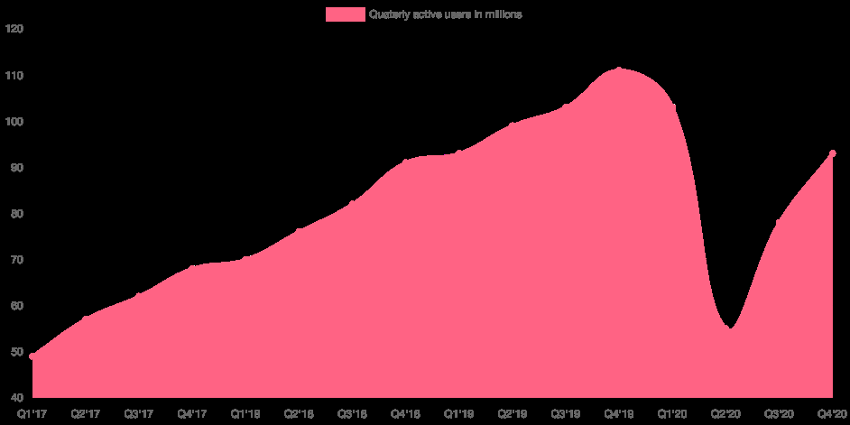
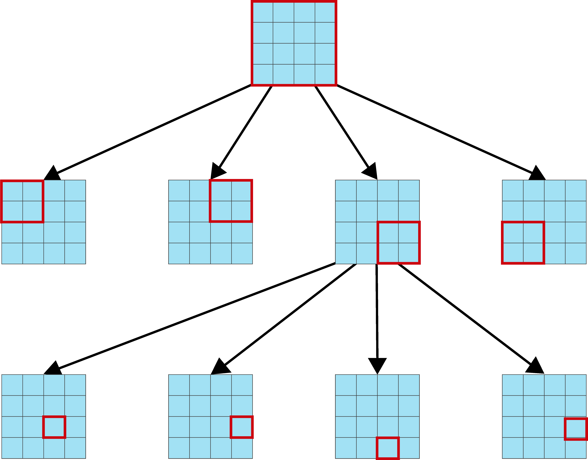
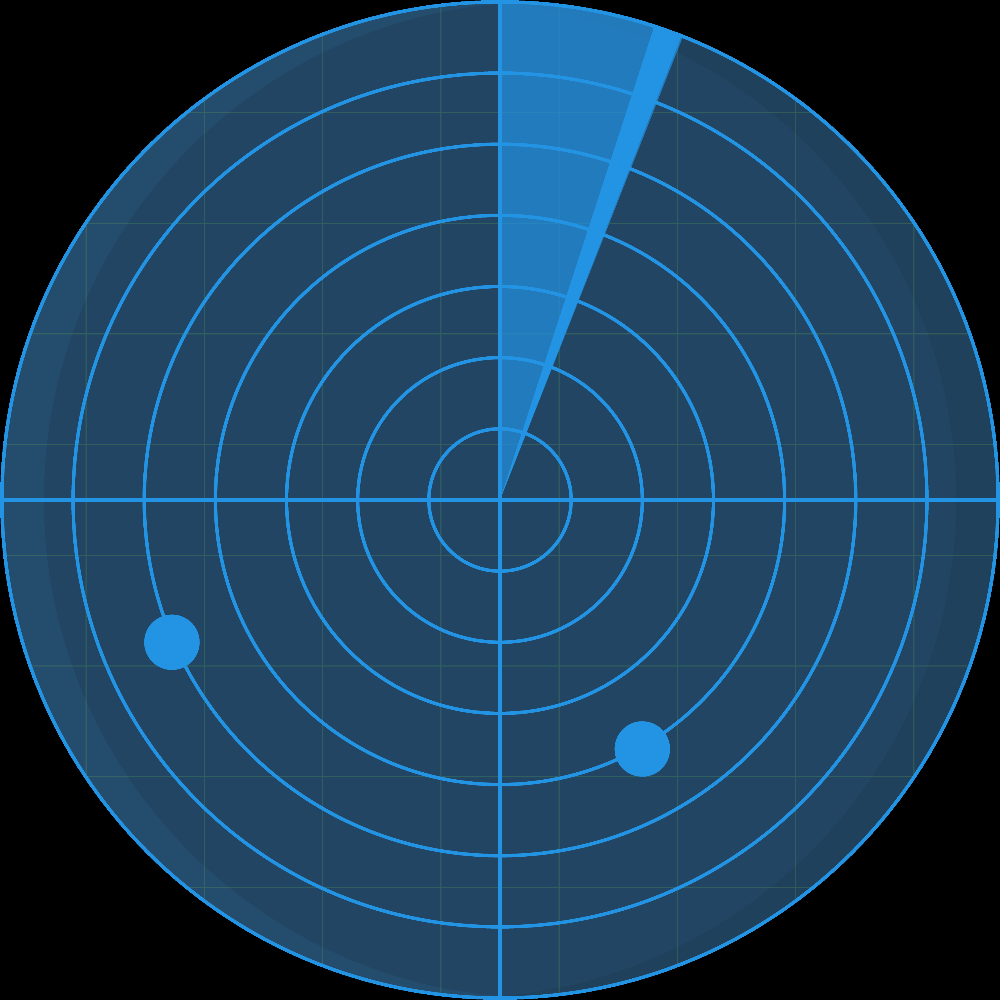

# 030 - Thiết Kế Uber (Dịch Vụ Gọi Xe Trực Tuyến Theo Thời Gian Thực)

[← Bài trước](029-thiet-ke-dich-vu-lan-can-yelp.md) | [Mục lục](README.md) | [Bài tiếp theo →](031-thiet-ke-twitter.md)

---


# Thiết Kế Hệ Thống: Uber (System Design: Uber)

Tìm hiểu các nguyên lý cơ bản trong thiết kế một dịch vụ gọi xe trực tuyến như Uber.

Chúng ta sẽ bao quát các nội dung sau:
- **Uber là gì? (What is Uber?)**
- **Chúng ta sẽ thiết kế Uber như thế nào? (How will we design Uber?)**

---

## Uber là gì? (What is Uber?)

Uber là một ứng dụng cung cấp dịch vụ gọi xe trực tuyến (ride-hailing services) cho người dùng. Bất kỳ ai có nhu cầu di chuyển đều có thể đăng ký tài khoản và đặt phương tiện để đi từ điểm xuất phát (source) đến điểm đến (destination). Bất kỳ ai sở hữu phương tiện đều có thể đăng ký làm tài xế (driver) và chở hành khách (rider) đến đích. Tài xế và hành khách có thể liên lạc, tương tác với nhau thông qua ứng dụng Uber trên điện thoại thông minh (smartphones).

---


---

### Xe đang trên đường đón hành khách (Car en route to get a rider)


*1 trên 7 (1 of 7)*


*2 trên 7 (2 of 7)*

---


*3 trên 7 (3 of 7)*


*Xe đang trên đường đón hành khách (Car en route to get a rider)*

---


*4 trên 7 (4 of 7)*


*5 trên 7 (5 of 7)*

---


*6 trên 7 (6 of 7)*


*Xe đang trên đường đón hành khách (Car en route to get a rider)*

---


*7 trên 7 (7 of 7)*

Biểu đồ minh họa dưới đây thể hiện số lượng người dùng hoạt động (active users) của Uber từ đầu năm 2017 đến năm 2020 (nguồn: Statista):

**Số lượng người dùng hoạt động hàng tháng của Uber trên toàn thế giới từ 2017 đến 2020 (theo từng quý) - Monthly number of Uber's active users worldwide from 2017 to 2020 (by quarter)**



---

## Chúng ta sẽ thiết kế Uber như thế nào? (How will we design Uber?)

Có rất nhiều câu hỏi chưa được giải đáp xoay quanh Uber: 
- Hệ thống hoạt động như thế nào? 
- Làm thế nào các tài xế có thể kết nối với hành khách? 

Đây chỉ là hai trong số rất nhiều vấn đề kỹ thuật cần xử lý. Chương này sẽ thiết kế một hệ thống tương tự như Uber và tìm ra câu trả lời cho những câu hỏi đó.

> [!NOTE]
> Chúng tôi chia quy trình thiết kế Uber thành **sáu phần (six sections)** chính để phân tích chi tiết từng khía cạnh kiến trúc: từ thu thập yêu cầu, ước tính tài nguyên, thiết kế API, mô hình dữ liệu cho đến kiến trúc hệ thống tổng thể với khả năng chịu lỗi (Fault Tolerance) và độ mở rộng (Scalability) cao.

---

# Thiết Kế Hệ Thống Tương Tự Uber (Dịch Vụ Gọi Xe Trực Tuyến Theo Thời Gian Thực)

---

### [Trang 7]

**Quay lại (Back)**  
**Trắc nghiệm về Thiết kế của Yelp (Quiz on Yelp's Design)**  
**Đánh dấu đã hoàn thành (Mark As Completed)**  
**Tiếp theo (Next)**  

## Yêu Cầu Thiết Kế Hệ Thống Uber (Requirements of Uber’s Design)

1. **Yêu cầu (Requirements):** Bài học này sẽ mô tả các yêu cầu chức năng (functional requirements) và yêu cầu phi chức năng (non-functional requirements) của một hệ thống tương tự như Uber. Chúng ta cũng sẽ ước lượng các yêu cầu trên nhiều khía cạnh khác nhau của Uber, chẳng hạn như dung lượng lưu trữ (storage), băng thông (bandwidth), và tài nguyên tính toán (computation resources).
2. **Thiết kế tổng quan (High-level Design):** Chúng ta sẽ thảo luận về thiết kế kiến trúc mức cao (high-level design) của Uber trong bài học này. Ngoài ra, chúng ta cũng sẽ giải thích ngắn gọn về thiết kế API (API design) của dịch vụ Uber.
3. **Thiết kế chi tiết (Detailed Design):** Chúng ta sẽ đi sâu khám phá thiết kế chi tiết (detailed design) của Uber trong bài học này. Hơn nữa, chúng ta cũng sẽ thảo luận về nguyên lý hoạt động của các thành phần (components) khác nhau được sử dụng trong việc thiết kế Uber.
4. **Dịch vụ thanh toán và Phát hiện gian lận (Payment Service and Fraud Detection):** Chúng ta sẽ tìm hiểu cách thức hệ thống thanh toán (payment system) vận hành trong thiết kế Uber. Hơn nữa, chúng ta cũng sẽ thảo luận về cách phát hiện và ngăn chặn các hành vi gian lận (frauds) khác nhau liên quan đến thanh toán trong các hệ thống tương tự Uber.
5. **Đánh giá hệ thống (Evaluation):** Bài học này sẽ giải thích cách Uber có thể đáp ứng tất cả các yêu cầu phi chức năng (non-functional requirements) thông qua bản thiết kế kiến trúc được đề xuất.
6. **Câu hỏi trắc nghiệm (Quiz):** Chúng ta sẽ củng cố lại các khái niệm trọng tâm của thiết kế Uber thông qua một bài trắc nghiệm.

Hãy cùng xem qua các yêu cầu đối với việc thiết kế một hệ thống tương tự Uber trong bài học tiếp theo.

---

### [Trang 8]

## Yêu Cầu Thiết Kế Hệ Thống Uber (Requirements of Uber’s Design)

Tìm hiểu về các yêu cầu để thiết kế một dịch vụ tương tự Uber.

**Nội dung bao gồm:**
* Các yêu cầu (Requirements)
  * Yêu cầu chức năng (Functional requirements)
  * Yêu cầu phi chức năng (Non-functional requirements)
* Ước lượng tài nguyên (Resource estimation)
  * Ước lượng lưu trữ (Storage estimation)
    * Dữ liệu mô tả của hành khách (Rider’s metadata)
    * Dữ liệu mô tả của tài xế (Driver’s metadata)
    * Dữ liệu mô tả vị trí tài xế (Driver location metadata)
    * Dữ liệu mô tả chuyến đi (Trip metadata)
  * Ước lượng băng thông (Bandwidth estimation)
  * Ước lượng số lượng máy chủ (Number of servers estimation)
* Các khối xây dựng hệ thống sẽ sử dụng (Building blocks we will use)

---

### Các Yêu Cầu (Requirements)

Hãy bắt đầu với các yêu cầu để thiết kế một hệ thống tương tự Uber.

#### Yêu Cầu Chức Năng (Functional Requirements)
Các yêu cầu chức năng của hệ thống chúng ta như sau:

* **Cập nhật vị trí tài xế (Update driver location):** Tài xế là một thực thể di động liên tục, do đó vị trí của tài xế phải được tự động cập nhật theo các khoảng thời gian định kỳ đều đặn.
* **Tìm kiếm tài xế lân cận (Find nearby drivers):** Hệ thống phải tìm và hiển thị các tài xế khả dụng ở gần cho hành khách.
* **Yêu cầu chuyến đi (Request a ride):** Hành khách có thể gửi yêu cầu đặt xe, sau đó tài xế gần nhất sẽ được thông báo về yêu cầu của hành khách.

---

### [Trang 9]

* **Quản lý thanh toán (Manage payments):** Khi bắt đầu chuyến đi, hệ thống phải khởi tạo tiến trình thanh toán và quản lý các giao dịch thanh toán.
* **Hiển thị thời gian đến dự kiến của tài xế (Show driver estimated time of arrival - ETA):** Hành khách có thể xem thời gian đến dự kiến (ETA) của tài xế.
* **Xác nhận đón khách (Confirm pickup):** Tài xế có thể xác nhận rằng họ đã đón được hành khách.
* **Hiển thị cập nhật chuyến đi (Show trip updates):** Khi tài xế và hành khách đã chấp nhận chuyến xe, họ có thể liên tục theo dõi các cập nhật chuyến đi như thời gian dự kiến đến nơi (ETA) và vị trí hiện tại theo thời gian thực cho đến khi chuyến đi kết thúc.
* **Kết thúc chuyến đi (End the trip):** Tài xế đánh dấu chuyến hành trình hoàn tất khi đến điểm đến, sau đó họ sẽ trở về trạng thái khả dụng cho chuyến đi tiếp theo.

> [!NOTE]
> **Điểm Cần Suy Ngẫm (Point to Ponder)**
> 
> **Câu hỏi:**
> Điều gì sẽ xảy ra nếu hai tài xế ở cùng một khoảng cách đối với hành khách? Chúng ta sẽ chọn tài xế nào để gửi yêu cầu chuyến đi?
> 
> **Ẩn câu trả lời (Hide Answer):**
> Quyết định này sẽ dựa trên nhiều yếu tố khác nhau, chẳng hạn như khoảng cách, loại phương tiện, thứ hạng/đánh giá (rank) của tài xế, v.v. Tuy nhiên, nếu hai tài xế hoàn toàn tương đồng về mọi mặt, chúng ta có thể chọn ngẫu nhiên một người và gửi yêu cầu đến tài xế đó. Nếu tài xế này không chấp nhận chuyến xe trong vòng vài giây, chúng ta sẽ thu hồi lời đề nghị chuyến đi (retract ride offer) từ tài xế này và chuyển tiếp nó đến một tài xế mới khác.

#### Yêu Cầu Phi Chức Năng (Non-functional Requirements)

---

### [Trang 10]

Các yêu cầu phi chức năng của hệ thống chúng ta như sau:

* **Tính sẵn sàng cao (High Availability):** Hệ thống phải có độ sẵn sàng cực cao. Thời gian ngừng hoạt động (downtime) dù chỉ một phần nhỏ của giây cũng có thể dẫn đến thất bại của chuyến đi, tài xế không thể xác định vị trí của hành khách, hoặc hành khách không thể liên lạc với tài xế.
* **Khả năng mở rộng (Scalability):** Hệ thống phải có khả năng mở rộng quy mô linh hoạt để xử lý số lượng tài xế và hành khách ngày càng tăng theo thời gian.
* **Độ tin cậy (Reliability):** Hệ thống phải cung cấp dịch vụ nhanh chóng và không có lỗi (error-free). Các yêu cầu gọi xe và cập nhật vị trí phải diễn ra mượt mà.
* **Tính nhất quán (Consistency):** Hệ thống phải đảm bảo tính nhất quán mạnh (Strong Consistency). Các tài xế và hành khách trong cùng một khu vực địa lý phải có góc nhìn nhất quán về trạng thái hệ thống.
* **Phát hiện gian lận (Fraud Detection):** Hệ thống phải có khả năng phát hiện mọi hành vi gian lận liên quan đến thanh toán.

---

### Ước Lượng Tài Nguyên (Resource Estimation)

Bây giờ, hãy cùng ước tính tài nguyên cần thiết cho thiết kế hệ thống. Giả sử hệ thống có khoảng 500 triệu hành khách và khoảng 5 triệu tài xế. Chúng ta sẽ sử dụng các số liệu sau để tính toán ước lượng:

* Chúng ta có **20 triệu hành khách hoạt động hàng ngày (Daily Active Users/Riders - DAU)** và **3 triệu tài xế hoạt động hàng ngày (Daily Active Drivers)**.
* Chúng ta có **20 triệu chuyến đi mỗi ngày (Daily Trips)**.
* Tất cả tài xế đang hoạt động đều gửi thông báo về vị trí hiện tại của họ sau mỗi **4 giây**.

---

### Ước Lượng Lưu Trữ (Storage Estimation)

Hãy cùng ước lượng dung lượng lưu trữ cần thiết cho hệ thống của chúng ta:

#### Dữ liệu mô tả của hành khách (Rider’s metadata)
Giả sử chúng ta cần khoảng **1.000 Bytes** để lưu trữ thông tin của mỗi hành khách, bao gồm ID, tên (name), email, v.v., khi hành khách đăng ký vào ứng dụng.  
Để lưu trữ **500 triệu hành khách**, chúng ta cần **500 GB** dung lượng lưu trữ:

$$500 \times 10^6 \times 1000 \text{ Bytes} = 500\text{ GB}$$

---

### [Trang 11]

Ngoài ra, nếu chúng ta có khoảng **500.000 hành khách mới** đăng ký mỗi ngày, chúng ta sẽ cần thêm **500 MB** mỗi ngày để lưu trữ thông tin của họ.

#### Dữ liệu mô tả của tài xế (Driver’s metadata)
Giả sử chúng ta cần khoảng **1.000 Bytes** để lưu trữ thông tin của mỗi tài xế, bao gồm ID, tên (name), email, loại phương tiện (vehicle type), v.v., khi tài xế đăng ký vào ứng dụng.  
Để lưu trữ **5 triệu tài xế**, chúng ta cần **5 GB** dung lượng lưu trữ:

$$5 \times 10^6 \times 1000 \text{ Bytes} = 5\text{ GB}$$

Ngoài ra, nếu chúng ta có khoảng **100.000 tài xế mới** đăng ký mỗi ngày, chúng ta sẽ cần khoảng **100 MB** mỗi ngày để lưu trữ thông tin của họ.

#### Dữ liệu mô tả vị trí tài xế (Driver location metadata)
Giả sử chúng ta cần khoảng **36 Bytes** để lưu trữ mỗi bản tin cập nhật vị trí của tài xế. Nếu chúng ta có **5 triệu tài xế**, chúng ta cần khoảng **180 MB** dung lượng lưu trữ chỉ riêng cho vị trí của các tài xế:

$$5 \times 10^6 \times 36 \text{ Bytes} = 180\text{ MB}$$

#### Dữ liệu mô tả chuyến đi (Trip metadata)
Giả sử chúng ta cần khoảng **100 Bytes** để lưu trữ thông tin của một chuyến đi đơn lẻ, bao gồm trip ID, rider ID, driver ID, v.v. Nếu chúng ta có **20 triệu chuyến đi mỗi ngày**, chúng ta cần khoảng **2 GB** dung lượng lưu trữ cho dữ liệu chuyến đi mỗi ngày:

$$20 \times 10^6 \times 100 \text{ Bytes} = 2\text{ GB}$$

Hãy tính toán tổng dung lượng lưu trữ cần thiết cho Uber trong một ngày:

---

### [Trang 12]


### Bảng Ước Tính Dung Lượng Lưu Trữ (Storage Capacity Estimation)

| Thông số / Hạng mục | Giá trị |
| :--- | :--- |
| **Số lượng tài xế (triệu người)** | 5 |
| **Dung lượng lưu trữ vị trí một tài xế (Bytes)** | 36 |
| **Tổng dung lượng lưu trữ vị trí tài xế (MB/ngày)** | 180 |
| **Số lượng chuyến đi (triệu chuyến)** | 20 |
| **Dung lượng lưu trữ một chuyến đi (Bytes)** | 100 |
| **Tổng dung lượng lưu trữ chuyến đi (GB/ngày)** | 2 |
| **Dung lượng lưu trữ hành khách mới hàng ngày (MB/ngày)** | 500 |
| **Dung lượng lưu trữ tài xế mới hàng ngày (MB/ngày)** | 100 |
| **Tổng dung lượng lưu trữ mỗi ngày (GB/ngày)** | **2,78** |

$$\text{Tổng dung lượng lưu trữ/ngày} = 0,18\text{ GB} + 2\text{ GB} + 0,5\text{ GB} + 0,1\text{ GB} = 2,78\text{ GB/ngày}$$

---

### Tổng Dung Lượng Lưu Trữ Cần Thiết Cho Uber Trong Một Năm

$$\text{Dung lượng lưu trữ / ngày} \times \text{Số ngày / năm} = \text{Dung lượng lưu trữ / năm}$$

$$2,78\text{ GB/ngày} \times 365\text{ ngày} = 1,01\text{ TB/năm}$$

---

> [!NOTE]
> **Lưu ý:** Chúng ta có thể điều chỉnh các giá trị trong bảng để quan sát sự thay đổi của các kết quả ước tính.

### Ước tính Băng thông (Bandwidth Estimation)

Chúng ta sẽ chỉ xem xét việc cập nhật vị trí của tài xế (*drivers' location updates*) và dữ liệu chuyến đi (*trip data*) cho việc tính toán băng thông (*bandwidth calculation*), vì các yếu tố khác không đòi hỏi băng thông đáng kể. 

Hệ thống có **20 triệu chuyến đi mỗi ngày** (*daily rides*), tương đương với xấp xỉ **232 chuyến đi mỗi giây** (*trips per second*):

$$\approx \frac{20.000.000}{86.400} \approx 232 \text{ trips per second (chuyến đi mỗi giây)}$$

Hiện tại, mỗi chuyến đi chiếm khoảng **100 Bytes**. Do đó, lưu lượng băng thông cần cho các chuyến đi là khoảng **23 KB mỗi giây**:

$$232 \times 100\text{ Bytes} = 23.200\text{ Bytes/s} \approx 23\text{ KB/s} \times 8 = 185,6\text{ kbps}$$

Như đã đề cập trước đó, vị trí của tài xế được cập nhật định kỳ mỗi **4 giây**. Nếu chúng ta nhận ID của tài xế (**3 Bytes**) và tọa độ vị trí (**16 Bytes**), ứng dụng của chúng ta sẽ tiêu tốn mức băng thông như sau:

$$\frac{3\text{M active drivers} \times (3 + 16)\text{ Bytes}}{4\text{s}} = \frac{57\text{ MB}}{4\text{s}} = 14,25\text{ MB/s} \times 8 = \frac{456\text{ Mb}}{4\text{s}} = 114\text{ Mbps}$$

Những yêu cầu về băng thông này là tương đối khiêm tốn vì chúng ta chưa tính đến nhu cầu băng thông dành cho bản đồ (*maps*) và các thành phần khác vốn có trong dịch vụ Uber thực tế.

---

### Yêu cầu Băng thông (Bandwidth Requirements)

| Chỉ số (Metrics) | Giá trị |
| :--- | :--- |
| Số chuyến đi mỗi giây (*Trips per second*) | **232** |
| Băng thông cho mỗi chuyến đi (*Bandwidth for each trip*) | **100 Bytes** |
| Tổng băng thông cho các chuyến đi (*Total bandwidth for trips*) | **185.6 kbps** |
| Tài xế đang hoạt động (*Active drivers*) | **3 triệu (millions)** |
| Băng thông cho mỗi tài xế (*Bandwidth for each driver*) | **19 Bytes** |
| Băng thông cho các tài xế (*Bandwidth for drivers*) | **114 Mbps** |
| **Tổng băng thông yêu cầu (*Total bandwidth*)** | **114.19 Mbps** |

#### Tổng băng thông hệ thống Uber yêu cầu (*Total bandwidth required by Uber*):
$$\text{Băng thông cho các chuyến đi (185 kbps)} + \text{Băng thông cho tài xế (114 Mbps)} = \mathbf{114,19\text{ \textbf{Mbps}}}$$

> [!NOTE]
> **Lưu ý:** Chúng ta có thể điều chỉnh các giá trị trong bảng để quan sát sự thay đổi của các yêu cầu tài nguyên.
> 
> Chúng ta đã bỏ qua băng thông từ dịch vụ Uber gửi về phía người dùng (*users*) vì dung lượng này rất nhỏ. Lượng băng thông lớn hơn sẽ cần thiết cho việc truyền tải dữ liệu bản đồ từ dịch vụ Uber tới người dùng, phần này đã được chúng tôi thảo luận chi tiết trong chương Google Maps.

---

### Ước tính Số lượng Máy chủ (Number of Servers Estimation)

Chúng ta cần xử lý các yêu cầu đồng thời (*concurrent requests*) đến từ **20 triệu người dùng hoạt động hàng ngày** (*Daily Active Users - DAU*). Chúng ta sẽ sử dụng công thức sau đây để ước tính số lượng máy chủ thực tế cần thiết. Công thức này đã được chúng tôi thiết lập trong chương *Tính toán sơ bộ (Back-of-the-envelope Calculations)*:

$$\text{Số lượng máy chủ yêu cầu} = \frac{\text{Số lượng người dùng hoạt động hàng ngày (Daily Active Users)}}{\text{RPS của một máy chủ (RPS of a server)}} = \frac{20 \times 10^6}{8.000} = \mathbf{2.500\text{ máy chủ (servers)}}$$

#### Bảng ước tính số lượng máy chủ (*Estimating the Number of Servers*):
| Chỉ số | Giá trị |
| :--- | :--- |
| Người dùng hoạt động hàng ngày (*Daily active users*) | **20 triệu (millions)** |
| RPS của một máy chủ (*RPS of a server*) | **8.000** |
| **Số lượng máy chủ cần thiết (*Number of servers required*)** | **2.500** |

> [!NOTE]
> **Lưu ý:** Chúng ta có thể điều chỉnh các giá trị trong bảng để xem ước tính thay đổi tương ứng.

---

### Các Khối Xây dựng Hệ thống Sẽ Sử Dụng (Building Blocks We Will Use)

Thiết kế của Uber tận dụng các khối kiến trúc nền tảng (*building blocks*) sau:

#### Các khối kiến trúc trong Thiết kế Tổng quan cấp cao (High-Level Design) của Uber:
- **Cơ sở dữ liệu (Database)**
- **Mạng phân phối nội dung (CDN - Content Delivery Network)**
- **Bộ nhớ đệm (Cache)**
- **Bộ cân bằng tải (Load Balancer)**

---

### Thiết Kế Tổng Quan Cấp Cao Của Uber (High-level Design of Uber)

- **Cơ sở dữ liệu (Databases):** Lưu trữ siêu dữ liệu (*metadata*) của hành khách (*riders*), tài xế (*drivers*) và các chuyến đi (*trips*).
- **Bộ nhớ đệm (Cache):** Lưu trữ các dữ liệu được yêu cầu thường xuyên nhất để phản hồi nhanh chóng với độ trễ thấp (*low latency*).
- **Mạng phân phối nội dung (CDNs):** Được sử dụng để phân phối nội dung đến người dùng cuối một cách hiệu quả, giảm thiểu độ trễ (*latency/delay*) và giảm tải gánh nặng cho các máy chủ gốc (*end-servers*).
- **Bộ cân bằng tải (Load Balancer):** Phân phối đồng đều các yêu cầu đọc/ghi (*read/write requests*) đến các dịch vụ (*services*) tương ứng.
- **Thiết bị của hành khách và tài xế:** Cần có đủ băng thông (*bandwidth*) và thiết bị định vị GPS để điều hướng mượt mà với bản đồ.

> [!NOTE]
> **Lưu ý:** Các thông tin được cung cấp trong chương này được lấy cảm hứng từ blog kỹ thuật chính thức (*engineering blog*) của Uber.

---

### Chi Tiết Thiết Kế Cấp Cao Của Uber (High-level Design of Uber)

Tìm hiểu cách thiết kế hệ thống Uber. Nội dung sẽ bao gồm:
- Luồng hoạt động của ứng dụng (*Workflow of our application*)
- Thiết kế tổng quan cấp cao của Uber (*High-level design of Uber*)
- Thiết kế API (*API design*):
  - Cập nhật vị trí tài xế (*Update driver location*)
  - Tìm tài xế xung quanh (*Find nearby drivers*)
  - Yêu cầu chuyến đi (*Request a ride*)
  - Hiển thị thời gian đón dự kiến (*Show driver ETA*)
  - Xác nhận điểm đón (*Confirm pickup*)
  - Cập nhật trạng thái chuyến đi (*Show trip updates*)
  - Kết thúc chuyến đi (*End the trip*)

---

### Luồng Hoạt Động Của Ứng Dụng (Workflow of Our Application)

Trước khi đi sâu vào chi tiết thiết kế kỹ thuật, hãy cùng tìm hiểu cách thức vận hành của ứng dụng.

Các bước sau đây mô tả luồng công việc (*workflow*) của ứng dụng:

1. **Hiển thị tài xế khả dụng:** Tất cả các tài xế ở gần ngoại trừ những người đang thực hiện chuyến đi đều có thể được nhìn thấy ngay khi hành khách khởi động ứng dụng.
2. **Yêu cầu chuyến đi:** Hành khách nhập điểm đến (*drop-off location*) và gửi yêu cầu đặt xe (*request a ride*).
3. **Tiếp nhận và khớp xe:** Ứng dụng tiếp nhận yêu cầu và tìm kiếm tài xế phù hợp.
4. **Chờ phản hồi:** Cho đến khi tìm thấy tài xế khớp yêu cầu, trạng thái hệ thống sẽ là: *"Đang chờ tài xế phản hồi" (Waiting for the driver to respond)*.
5. **Cập nhật vị trí và thông tin chuyến đi:** Các tài xế định kỳ báo cáo vị trí của họ mỗi **4 giây**. Ứng dụng tìm kiếm thông tin chuyến đi và gửi trả về cho tài xế.
6. **Tài xế chấp nhận hoặc từ chối yêu cầu:**
   - **Trường hợp tài xế chấp nhận yêu cầu (*Driver accepts the request*):** Thông tin trạng thái được cập nhật đồng bộ trên cả ứng dụng của hành khách lẫn tài xế. Hành khách nhận được thông báo đã ghép chuyến thành công và nhận được toàn bộ thông tin của tài xế.
   - **Trường hợp tài xế từ chối yêu cầu (*Driver refuses the ride request*):** Hành khách sẽ quay trở lại từ Bước 2 để hệ thống tiến hành tìm kiếm và ghép nối với một tài xế khác.

---


> **Mô tả sơ đồ luồng (1 of 7):**
> - **Thành phần:** Hành khách (*Rider*), Bộ quản lý vị trí (*Location manager*), Bộ ghép nối tài xế (*Driver matching*), Tài xế (*Driver*).
> - **Hành động ban đầu:** *Hành khách chưa mở ứng dụng. Tài xế liên tục gửi cập nhật vị trí của mình (Send location).*

---

# Thiết Kế Hệ Thống Uber (Dịch Vụ Gọi Xe Trực Tuyến Theo Thời Gian Thực)

---

### Quy Trình Luồng Hoạt Động (Workflow Steps)

#### Bước 2 / 7: Hiển thị tài xế ở gần (Show nearby drivers)


* **Bắt đầu (Start)**
* **Hành khách (Rider)**
* **Tài xế (Driver)**
* **Gửi vị trí (Send location)**
* **Trình quản lý vị trí (Location manager)**
* **Khớp nối tài xế (Driver matching)**
* **Hiển thị tài xế ở gần (Show nearby drivers)**

> **Mô tả bước 2:** Hành khách có thể nhìn thấy các tài xế ở gần xung quanh khi họ mở ứng dụng (*The rider can see the nearby drivers when they open the application*).

---

#### Bước 3 / 7: Nhập điểm đến (Enter dropoff)


* **Bắt đầu (Start)**
* **Hành khách (Rider)**
* **Tài xế (Driver)**
* **Gửi vị trí (Send location)**
* **Trình quản lý vị trí (Location manager)**
* **Khớp nối tài xế (Driver matching)**
* **Hiển thị tài xế ở gần (Show nearby drivers)**
* **Nhập điểm đến (Enter dropoff)**

> **Mô tả bước 3:** Hành khách nhập vị trí điểm đến/điểm trả khách (*The rider enters the drop-off location*).

---

#### Bước 4 / 7: Yêu cầu chuyến xe (Request ride)


* **Bắt đầu (Start)**
* **Hành khách (Rider)**
* **Tài xế (Driver)**
* **Gửi vị trí (Send location)**
* **Trình quản lý vị trí (Location manager)**
* **Khớp nối tài xế (Driver matching)**
* **Hiển thị tài xế ở gần (Show nearby drivers)**
* **Nhập điểm đến (Enter dropoff)**
* **Yêu cầu chuyến xe (Request ride)**

> **Mô tả bước 4:** Hành khách gửi yêu cầu đặt chuyến xe (*The rider requests the ride*).

---

#### Bước 5 / 7: Tiếp nhận yêu cầu & Huỷ chuyến (Request received & Cancellation)


* **Bắt đầu (Start)**
* **Hành khách (Rider)**
* **Tài xế (Driver)**
* **Gửi vị trí (Send location)**
* **Trình quản lý vị trí (Location manager)**
* **Khớp nối tài xế (Driver matching)**
* **Hiển thị tài xế ở gần (Show nearby drivers)**
* **Nhập điểm đến (Enter dropoff)**
* **Yêu cầu chuyến xe (Request ride)**
* **Hành khách/Tài xế đã huỷ (Rider/Driver cancelled)**

> **Mô tả bước 5:** Tài xế nhận được yêu cầu chuyến xe. Hành khách hoặc tài xế có thể huỷ yêu cầu tại thời điểm này (*The driver receives the request. The rider or driver can cancel the request here*).

---

#### Bước 6 / 7: Chấp nhận yêu cầu & Bắt đầu chuyến đi (Trip started)


* **Bắt đầu (Start)**
* **Hành khách (Rider)**
* **Tài xế (Driver)**
* **Gửi vị trí (Send location)**
* **Trình quản lý vị trí (Location manager)**
* **Khớp nối tài xế (Driver matching)**
* **Hiển thị tài xế ở gần (Show nearby drivers)**
* **Nhập điểm đến (Enter dropoff)**
* **Yêu cầu chuyến xe (Request ride)**
* **Hành khách/Tài xế đã huỷ (Rider/Driver cancelled)**
* **Chuyến đi đã bắt đầu (Trip started)**

> **Mô tả bước 6:** Tài xế chấp nhận yêu cầu và bắt đầu chuyến đi (*The driver accepts the request and starts the trip*).

---

#### Bước 7 / 7: Hoàn thành chuyến đi (Trip completed)


* **Bắt đầu (Start)**
* **Hành khách (Rider)**
* **Tài xế (Driver)**
* **Gửi vị trí (Send location)**
* **Trình quản lý vị trí (Location manager)**
* **Khớp nối tài xế (Driver matching)**
* **Hiển thị tài xế ở gần (Show nearby drivers)**
* **Nhập điểm đến (Enter dropoff)**
* **Yêu cầu chuyến xe (Request ride)**
* **Hành khách/Tài xế đã huỷ (Rider/Driver cancelled)**
* **Chuyến đi đã bắt đầu (Trip started)**
* **Đã hoàn thành (Completed)**

> **Mô tả bước 7:** Chuyến đi được hoàn thành (*The trip is completed*).

---

## Thiết Kế Mức Cao Của Uber (High-level design of Uber)

Ở mức tổng quan kiến trúc (**High-level design**), hệ thống của chúng ta phải có khả năng tiếp nhận các yêu cầu đặt chuyến xe từ hành khách (**Rider**), sau đó trả về thông tin tài xế đã được ghép nối (**Matched driver information**) cùng thông tin chuyến đi (**Trip information**) cho hành khách. Hệ thống cũng liên tục tiếp nhận định kỳ tọa độ vị trí của tài xế. Ngoài ra, hệ thống sẽ trả về thông tin chuyến đi và thông tin hành khách cho tài xế khi tài xế được ghép nối thành công với hành khách đó.

### Sơ Đồ Thiết Kế Tổng Quan (High-level design)


* **Hành khách (Rider):**
  * Gửi yêu cầu đặt xe (**Request ride**).
  * Nhận thông tin tài xế được ghép nối và thông tin chuyến đi (**Send matched drivers info and trip info**).
* **Tài xế (Driver):**
  * Gửi tọa độ vị trí (**Sends location**).
  * Nhận thông tin chuyến đi (**Send trip info**).
* **Tầng ứng dụng (Application):** Xử lý nghiệp vụ trung gian giữa người dùng và tầng lưu trữ.
* **Cơ sở dữ liệu (Database):**
  * Lưu trữ dữ liệu (**Storing**).
  * Truy xuất dữ liệu (**Fetching**).

---

## Thiết Kế Giao Diện Lập Trình Ứng Dụng (API Design)

Hãy cùng thảo luận về thiết kế các API tương ứng với những chức năng mà chúng ta cung cấp. Chúng ta sẽ thiết kế các API nhằm chuyển đổi tập tính năng (**Feature set**) thành các đặc tả kỹ thuật chi tiết (**Technical specifications**).

> [!NOTE]  
> Chúng tôi sẽ không lặp lại phần mô tả cho các tham số đã xuất hiện nhiều lần ở các API phía sau.

---

### 1. Cập Nhật Vị Trí Tài Xế (Update driver location)


```http
updateDriverLocation(driverID, oldlat, oldlong, newlat, newlong)
```

| Tham số (Parameter) | Mô tả (Description) |
| :--- | :--- |
| `driverID` | Định danh duy nhất (ID) của tài xế |
| `oldlat` | Vĩ độ trước đó của tài xế (*The previous latitude of the driver*) |
| `oldlong` | Kinh độ trước đó của tài xế (*The previous longitude of the driver*) |
| `newlat` | Vĩ độ mới của tài xế (*The new latitude of the driver*) |
| `newlong` | Kinh độ mới của tài xế (*The new longitude of the driver*) |

API `updateDriverLocation` được sử dụng để gửi tọa độ của tài xế tới các máy chủ quản lý vị trí tài xế (**Driver location servers**). Đây là nơi vị trí của tài xế được cập nhật liên tục và truyền thông báo đến các hành khách.

---

### 2. Tìm Tài Xế Ở Gần (Find nearby drivers)


```http
findNearbyDrivers(riderID, lat, long)
```

| Tham số (Parameter) | Mô tả (Description) |
| :--- | :--- |
| `riderID` | Định danh duy nhất (ID) của hành khách |
| `lat` | Vĩ độ hiện tại của hành khách (*The latitude of the rider*) |
| `long` | Kinh độ hiện tại của hành khách (*The longitude of the rider*) |

API `findNearbyDrivers` được sử dụng để gửi vị trí hiện tại của hành khách mà chúng ta muốn tìm kiếm các tài xế ở khu vực lân cận xung quanh.

---

### 3. Yêu Cầu Chuyến Xe (Request a ride)

```http
requestRide(riderID, lat, long, dropOfflat, dropOfflong, typeOfVehicle)
```

| Tham số (Parameter) | Mô tả (Description) |
| :--- | :--- |
| `lat` | Vĩ độ hiện tại của hành khách (*The current latitude of the rider*) |
| `long` | Kinh độ hiện tại của hành khách (*The current longitude of the rider*) |
| `dropOfflat` | Vĩ độ của vị trí trả khách (*The latitude of the rider’s drop-off location*) |
| `dropOfflong` | Kinh độ của vị trí trả khách (*The longitude of the rider’s drop-off location*) |
| `typeOfVehicle` | Loại phương tiện mà hành khách yêu cầu — ví dụ: xe 4 chỗ, xe cao cấp, v.v. (*The type of vehicle required by the rider—for example and so on.*) |

API `requestRide` được sử dụng để gửi tọa độ vị trí của hành khách cùng loại phương tiện mà hành khách cần đặt.

---

### 4. Hiển Thị Thời Gian Dự Kiến Đến Nơi Của Tài Xế (Show driver ETA)

```http
showETA(driverID, eta)
```

| Tham số (Parameter) | Mô tả (Description) |
| :--- | :--- |
| `eta` | Thời gian dự kiến đến nơi của tài xế (**Estimated Time of Arrival** - ETA) |

API `showETA` được sử dụng để hiển thị thời gian dự kiến tài xế sẽ đến điểm đón cho hành khách được biết.

---

### 5. Xác Nhận Điểm Đón (Confirm pickup)

```http
confirmPickup(driverID, riderID, timestamp)
```

> [!IMPORTANT]  
> API `confirmPickup` xác nhận thời điểm thực tế tài xế đã đón hành khách thành công tại điểm hẹn thông qua cặp định danh `driverID`, `riderID` và mốc thời gian `timestamp`.

---

# Thiết Kế Chi Tiết Hệ Thống Uber (Detailed Design of Uber)

### Tiếp tục các API từ phần trước

#### Bảng tham số API `confirmPickup`

| Tham số (Parameter) | Mô tả (Description) |
| :--- | :--- |
| `timestamp` | Thời điểm tài xế đón hành khách (The time at which the driver picked up the rider) |

API `confirmPickup` được sử dụng để xác định thời điểm tài xế đã đón hành khách.

---

### Hiển thị cập nhật chuyến đi (Show trip updates)

```http
showTripUpdates(tripID, riderID, driverID, driverlat, driverlong, time_elapsed, time_remaining)
```

| Tham số (Parameter) | Mô tả (Description) |
| :--- | :--- |
| `tripID` | Mã định danh chuyến đi (The ID of the trip) |
| `driverlat` | Vĩ độ của tài xế (The latitude of the driver) |
| `driverlong` | Kinh độ của tài xế (The longitude of the driver) |
| `time_elapsed` | Tổng thời gian đã trôi qua của chuyến đi (The total time of the trip) |
| `time_remaining` | Thời gian còn lại (trích xuất thời gian hiện tại từ điểm đến - The time remaining: extract the current time from the destination) |

API `showTripUpdates` được sử dụng để hiển thị các cập nhật của chuyến đi, bao gồm vị trí hiện tại của tài xế và thời gian còn lại dự kiến để đến điểm đích.

---

### Kết thúc chuyến đi (End the trip)

```http
endTrip(tripID, riderID, driverID, time_elapsed, lat, long)
```

API `endTrip` được sử dụng để kết thúc chuyến đi.

---

> [!NOTE]
> **Điều hướng tài liệu:**
> * Quay lại (Back): Yêu Cầu Thiết Kế Của Uber (Requirements of Uber’s Design)
> * Đánh dấu hoàn thành (Mark As Completed)
> * Tiếp theo (Next): Thiết Kế Chi Tiết Của Uber (Detailed Design of Uber)

---

## Thiết Kế Chi Tiết Của Uber (Detailed Design of Uber)

Tìm hiểu chi tiết về kiến trúc hệ thống Uber. Chúng ta sẽ cùng phân tích các nội dung sau:
* **Các thành phần hệ thống (Components)**
* **Bộ quản lý vị trí (Location manager)**
* **Dịch vụ bản đồ QuadTree (QuadTree map service)**
* **Dịch vụ yêu cầu xe (Request vehicle)**
* **Dịch vụ tìm tài xế (Find driver)**
* **Bộ quản lý chuyến đi (Trip manager)**
* **Dịch vụ dự đoán thời gian đến (ETA service)**
* **DeepETA**
* **Cơ sở dữ liệu (Database)**
* **Lược đồ lưu trữ (Storage schema)**
* **Khả năng chịu lỗi (Fault tolerance)**
* **Bộ cân bằng tải (Load balancers)**
* **Bộ nhớ đệm (Cache)**

Hãy cùng xem xét thiết kế chi tiết của hệ thống Uber và tìm hiểu cách các thành phần khác nhau phối hợp hoạt động để mang lại một dịch vụ hoàn chỉnh:





> **Luồng luân chuyển dữ liệu tổng quan:**
> * Hành khách (Rider) ➔ Bộ cân bằng tải (Load balancer) ➔ WebSocket ➔ Dịch vụ yêu cầu xe (Request vehicle) / Bộ quản lý vị trí (Location manager).
> * Dịch vụ yêu cầu xe (Request vehicle) ➔ Dịch vụ tìm tài xế (Find driver) ➔ Dịch vụ dự đoán thời gian đến (ETA) / Bộ quản lý chuyến đi (Trip manager) / Dịch vụ thanh toán (Payment service).
> * Cơ sở dữ liệu (Databases), Mạng phân phối nội dung (CDN), Bộ cân bằng tải (Load balancer), WebSocket.
> * Tài xế (Driver) ➔ Bộ cân bằng tải (Load balancer) ➔ WebSocket ➔ Bộ quản lý vị trí (Location manager).

---


*Sơ đồ thiết kế chi tiết của Uber bao gồm Dịch vụ bản đồ QuadTree (QuadTree map service) và bộ nhớ đệm Redis.*

---

## Các thành phần hệ thống (Components)

Hãy thảo luận chi tiết từng thành phần trong thiết kế hệ thống Uber.

### 1. Bộ quản lý vị trí (Location manager)
Cả hành khách (riders) và tài xế (drivers) đều kết nối trực tiếp đến dịch vụ **Bộ quản lý vị trí (Location manager)**.
* Dịch vụ này hiển thị các tài xế ở gần cho hành khách khi họ mở ứng dụng.
* Dịch vụ này cũng tiếp nhận các bản tin cập nhật vị trí từ tài xế theo chu kỳ **4 giây một lần**.
* Vị trí của các tài xế sau đó được truyền tới **Dịch vụ bản đồ QuadTree (QuadTree map service)** để xác định tài xế thuộc phân vùng (segment) nào trên bản đồ.
* Bộ quản lý vị trí lưu trữ vị trí mới nhất của tất cả tài xế vào cơ sở dữ liệu, đồng thời ghi nhận tuyến đường di chuyển của tài xế trong suốt hành trình chuyến đi.

---

### 2. Dịch vụ bản đồ QuadTree (QuadTree map service)
Dịch vụ bản đồ QuadTree chịu trách nhiệm cập nhật vị trí của các tài xế. Thách thức cốt lõi là làm thế nào để tìm kiếm các tài xế ở gần một cách hiệu quả nhất (**finding nearby drivers efficiently**).

Chúng ta sẽ tùy biến giải pháp đã thảo luận ở chương Yelp cho phù hợp với yêu cầu bài toán này:
* Chúng ta từng dùng cây tứ phân (**QuadTrees**) trên Yelp để định vị. QuadTree giúp phân chia bản đồ thành các phân vùng không gian (segments).
* Nếu số lượng tài xế vượt quá một ngưỡng nhất định (ví dụ: 500 tài xế), phân vùng đó sẽ được tách tiếp thành 4 nút con (**child nodes**) và các tài xế được phân bổ đều vào 4 nút này.
* Mỗi nút lá (**leaf node**) trong QuadTree chứa các phân vùng không thể phân chia thêm được nữa.

Chúng ta có thể tái sử dụng cấu trúc QuadTree tương tự để tìm kiếm tài xế. Tuy nhiên, điểm khác biệt mang tính cốt lõi ở đây là: **Cấu trúc QuadTree nguyên bản không được thiết kế để xử lý việc cập nhật liên tục với tần suất cao (regular upgrades).**

Vì vậy, chúng ta gặp phải các vấn đề sau với giải pháp phân vùng động:
1. Hệ thống phải cập nhật cấu trúc dữ liệu liên tục vì tất cả các tài xế đang hoạt động đều gửi cập nhật vị trí định kỳ 4 giây một lần.
2. Chi phí thời gian và tài nguyên để tái cấu trúc cây QuadTree mỗi khi vị trí của một tài xế thay đổi là rất lớn.
3. Để xác định vị trí mới của tài xế, trước tiên ta phải tìm đúng lưới không gian (grid) tương ứng dựa trên vị trí trước đó của tài xế. Nếu vị trí mới không còn nằm trong lưới hiện tại, ta phải xóa tài xế khỏi lưới hiện tại và chuyển họ sang lưới mới phù hợp.
4. Chúng ta buộc phải phân vùng lại (**repartition**) lưới mới nếu số lượng tài xế trong đó vượt quá ngưỡng giới hạn đã cấu hình ban đầu.
5. Hơn nữa, nền tảng còn phải thông báo vị trí tức thời của phương tiện cho cả tài xế và hành khách theo thời gian thực xuyên suốt quá trình chuyến đi diễn ra.

#### Giải pháp tối ưu hóa bộ đệm (Optimization Solution)
Để giải quyết triệt để vấn đề trên, chúng ta có thể kết hợp sử dụng một **bảng băm (Hash table)** để lưu trữ vị trí mới nhất của tài xế, đồng thời giãn tần suất cập nhật vào QuadTree (chẳng hạn sau mỗi 10–15 giây):
* Cập nhật vị trí tài xế vào cấu trúc QuadTree định kỳ khoảng **15 giây một lần** thay vì 4 giây.
* Sử dụng một **Hash table** cập nhật liên tục **4 giây một lần** để phản ánh vị trí mới nhất tức thời của tài xế.

> [!TIP]
> Việc tách tầng lưu trữ (Hash Table tần suất cao 4s + QuadTree tần suất thấp 15s) giúp hệ thống tiết kiệm tài nguyên tính toán đáng kể và giảm thiểu độ trễ xử lý (Latency).


*Cơ chế cập nhật vị trí của tài xế:*
* **Tài xế (Driver):** Gửi cập nhật vị trí định kỳ mỗi 4 giây (Sending updates every 4 seconds).
* **Bảng băm (Hash table):** Chứa các bản cập nhật vị trí tức thời của tài xế.
* **QuadTree:** Chứa thông tin vị trí tài xế phục vụ tìm kiếm không gian, nhận cập nhật định kỳ mỗi 15 giây (Sending updates every 15 seconds) từ Dịch vụ bản đồ QuadTree (QuadTree Map Service).

---

### 3. Dịch vụ yêu cầu xe (Request vehicle)
Hành khách kết nối với **Dịch vụ yêu cầu xe (Request vehicle service)** để đặt xe.
* Hành khách điền điểm đến (drop-off location) tại đây.
* Dịch vụ yêu cầu xe sẽ giao tiếp với **Dịch vụ tìm tài xế (Find driver service)** để đặt xe và lấy thông tin chi tiết về phương tiện thông qua **Bộ quản lý vị trí (Location manager service)**.

---

### 4. Dịch vụ tìm tài xế (Find driver)
Dịch vụ tìm tài xế chịu trách nhiệm tìm ra tài xế thích hợp nhất có thể hoàn thành chuyến đi.
* Dịch vụ này gửi thông tin của tài xế được chọn cùng thông tin chuyến đi ngược về cho Dịch vụ yêu cầu xe để phản hồi chi tiết tới hành khách.
* Dịch vụ tìm tài xế cũng liên hệ với **Bộ quản lý chuyến đi (Trip manager)** để khởi tạo và quản lý dữ liệu chuyến đi.

---

### 5. Bộ quản lý chuyến đi (Trip manager)
Dịch vụ **Bộ quản lý chuyến đi (Trip manager service)** quản lý tất cả các tác vụ liên quan đến chuyến đi:
* Tạo bản ghi chuyến đi trong cơ sở dữ liệu.
* Lưu trữ và đồng bộ toàn bộ dữ liệu trạng thái của chuyến đi vào cơ sở dữ liệu.

---

### 6. Dịch vụ dự đoán thời gian đến (ETA service)
Dịch vụ ETA xử lý việc ước tính thời gian đến (Estimated Time of Arrival).
* Hiển thị cho hành khách thời gian đón dự kiến (Pickup ETA) ngay khi chuyến đi của họ được xếp lịch.
* Dịch vụ này tính toán dựa trên các yếu tố ngoại cảnh như lộ trình đường đi và tình trạng giao thông thực tế.

Hai thành phần cơ bản để dự đoán một chỉ số ETA khi biết điểm xuất phát (origin) và điểm đích (destination) trên mạng lưới giao thông đường bộ bao gồm:
1. **Tính toán tuyến đường ngắn nhất (shortest route)** từ điểm xuất phát đến điểm đích.
2. **Tính toán thời gian cần thiết (time required)** để di chuyển hết tuyến đường đó.

#### Biểu diễn mạng lưới đường bộ dưới dạng đồ thị (Graph representation)
Toàn bộ mạng lưới đường bộ được mô hình hóa dưới dạng một đồ thị (Graph):
* **Các nút (Nodes / Intersections):** Biểu diễn các ngã tư / điểm giao nhau.
* **Các cạnh (Edges / Road segments):** Biểu diễn các đoạn đường nối giữa các điểm giao cắt.
* Đồ thị cũng mô tả chi tiết các tuyến đường một chiều, các hạn chế khi rẽ (turn limitations) và giới hạn tốc độ tối đa cho phép.

```
Mô hình hóa đồ thị (Graph representation):
[Điểm giao nhau (Intersection - Nodes)] <====== Đường đi (Roads - Edges) ======> [Điểm giao nhau (Intersection - Nodes)]
```

Để tìm đường đi ngắn nhất giữa điểm xuất phát và điểm đích, chúng ta có thể áp dụng các thuật toán định tuyến như **thuật toán Dijkstra**. Tuy nhiên, thuật toán Dijkstra (hoặc bất kỳ thuật toán nào chạy trực tiếp trên một đồ thị thô chưa qua tiền xử lý) đều có tốc độ xử lý rất chậm đối với một quy mô mạng lưới dữ liệu khổng lồ như vậy...

---

# Thiết Kế Chi Tiết Hệ Thống Uber (Detailed Design of Uber)

---

### Phân vùng Đồ thị (Partitioning the Graph)

Hệ thống (system). Do đó, phương pháp này là phi thực tế ở quy mô vận hành khổng lồ của các nền tảng gọi xe trực tuyến (ride-hailing platforms) này.

Để giải quyết các vấn đề trên, chúng ta có thể chia toàn bộ đồ thị mạng lưới đường sá thành các phân vùng riêng biệt (**partitions**). Chúng ta tiền xử lý (**preprocess**) đường đi tối ưu bên trong từng phân vùng bằng kỹ thuật phân tầng co rút đồ thị (**Contraction Hierarchies - CH**) và chỉ cần xử lý tính toán tại ranh giới giữa các phân vùng (**partition boundaries**). Chiến lược này giúp giảm đáng kể độ phức tạp về thời gian (**Time Complexity**) nhờ chia đồ thị thành các lớp ô nhỏ (cells) gần như độc lập với nhau. 

Giai đoạn tiền xử lý được thực thi song song (**executed in parallel**) trên các phân vùng khi cần thiết để gia tăng tốc độ tính toán. Trong hình minh họa dưới đây, tất cả các phân vùng xử lý tìm tuyến đường tối ưu nhất theo thời gian thực một cách song song. Ví dụ: nếu mỗi phân vùng mất một giây để tìm đường đi nội bộ, chúng ta có thể thu được toàn bộ lộ trình hoàn chỉnh chỉ trong đúng một giây vì tất cả các phân vùng đều hoạt động song song.


*Hình: Phân vùng đồ thị (Partitioning the graph)*

Một khi chúng ta đã xác định được tuyến đường tối ưu nhất, chúng ta sẽ tính toán thời gian di chuyển dự kiến (**expected travel time**) qua từng phân đoạn đường (**road segment**) có tính đến tình trạng giao thông thực tế. Dữ liệu giao thông sẽ đóng vai trò là trọng số cạnh (**edge weights**) giữa các nút (**nodes**) trong đồ thị.

---

### DeepETA

Chúng ta sử dụng một thành phần Học máy (Machine Learning) mang tên **DeepETA** để mang lại sự cải thiện tức thì cho các chỉ số hoạt động trên môi trường production. Thành phần này thiết lập một nền tảng mô hình (**model foundation**) có thể tái sử dụng cho nhiều trường hợp sử dụng (use cases) khác nhau của khách hàng.

Chúng ta cũng sử dụng một công cụ điều hướng (**Routing Engine**) sử dụng thông tin giao thông theo thời gian thực (**real-time traffic information**) và dữ liệu bản đồ (**map data**) để dự đoán thời gian đến dự kiến (**Estimated Time of Arrival - ETA**) khi di chuyển trên tuyến đường tối ưu nhất giữa điểm đón (source) và điểm đến (destination). 

Chúng ta sử dụng một mô hình ML hậu xử lý (**post-processing ML model**) có tính đến các tham số không gian và thời gian (**spatial and temporal parameters**) — chẳng hạn như điểm đón, điểm đến, thời điểm gửi yêu cầu và dữ liệu giao thông theo thời gian thực — để dự báo phần dư sai số ETA (**ETA residual**).


*Hình: Kiến trúc DeepETA và quy trình định tuyến (Routing Engine, Traffic Data, Map Data, ML Model, Routing APIs)*

---

### Cơ Sở Dữ Liệu (Database)

Hãy cùng lựa chọn cơ sở dữ liệu dựa trên các yêu cầu kỹ thuật của chúng ta:

* **Khả năng mở rộng theo chiều ngang (Horizontal Scalability):** Cơ sở dữ liệu phải có khả năng mở rộng ngang (*scale out*). Khách hàng và tài xế mới tham gia liên tục, vì vậy chúng ta cần bổ sung thêm dung lượng lưu trữ (**storage**) một cách dễ dàng và thông suốt.
* **Xử lý lưu lượng đọc/ghi cực lớn (High Read/Write Throughput):** Cơ sở dữ liệu cần xử lý khối lượng đọc và ghi khổng lồ bởi vì vị trí của tài xế được cập nhật liên tục mỗi **4 giây một lần**.
* **Tính sẵn sàng cao tuyệt đối (High Availability):** Hệ thống của chúng ta không bao giờ được phép ngừng hoạt động (**Zero Downtime**).

Chúng ta đã thảo luận về các loại cơ sở dữ liệu khác nhau cũng như đặc tả kỹ thuật của chúng trong chương Cơ sở dữ liệu (*Database chapter*). Vì vậy, dựa trên sự hiểu biết và các yêu cầu kỹ thuật (Tính sẵn sàng cao - **High Availability**, Khả năng mở rộng cao - **High Scalability**, và Khả năng chịu lỗi - **Fault Tolerance**):

1. **Apache Cassandra:** Chúng ta có thể sử dụng **Cassandra** để lưu trữ vị trí ghi nhận gần nhất của tài xế (**driver's last known location**) và thông tin chuyến đi sau khi chuyến đi đã hoàn tất (không còn cập nhật chỉnh sửa nữa). Chúng ta chọn Cassandra vì khối lượng dữ liệu cần lưu trữ là khổng lồ và liên tục gia tăng theo thời gian.
2. **MySQL:** Chúng ta có thể sử dụng cơ sở dữ liệu quan hệ **MySQL** để lưu thông tin chuyến đi trong suốt quá trình chuyến đi đang diễn ra (**in-progress trips**). MySQL được lựa chọn cho các chuyến đi đang thực hiện vì tần suất cập nhật dữ liệu liên tục, cấu trúc dữ liệu mang tính quan hệ (**relational**), và yêu cầu tính nhất quán dữ liệu chặt chẽ trên nhiều bảng (**strongly consistent across tables**).

> [!NOTE]
> Gần đây, Uber đã di chuyển toàn bộ hạ tầng lưu trữ dữ liệu của họ sang **Google Cloud Spanner**. Hệ thống này cung cấp các giao dịch phân tán toàn cầu (**Global Transactions**), khả năng đọc nhất quán mạnh mẽ (**Strongly Consistent Reads**), tự động nhân bản dữ liệu đa vùng/đa trung tâm dữ liệu (**Automatic Multisite Replication**) và cơ chế tự động phục hồi khi có sự cố (**Automatic Failover**).

---

#### Điểm Cần Suy Ngẫm (Points to Ponder)

> [!IMPORTANT]
> **Câu hỏi 1:** Tại sao chúng ta không sử dụng duy nhất cơ sở dữ liệu quan hệ MySQL?
> 
> **Trả lời:**
> Khi dữ liệu trở nên khổng lồ theo thời gian, nó sẽ làm suy giảm nghiêm trọng hiệu năng của hệ thống. Đồng thời, việc mở rộng quy mô (**scale**) cho cơ sở dữ liệu quan hệ MySQL ở mức độ này là cực kỳ phức tạp và khó khăn.

---

### Lược Đồ Lưu Trữ (Storage Schema)

Ở mức độ cơ bản trong ứng dụng Uber, chúng ta cần các bảng sau:

* **Riders (Hành khách):** Lưu trữ thông tin liên quan của khách đi xe, chẳng hạn như ID, tên, email, ảnh đại diện, số điện thoại, v.v.
* **Drivers (Tài xế):** Lưu trữ thông tin liên quan của tài xế, chẳng hạn như ID, tên, email, ảnh đại diện, số điện thoại, tên phương tiện, loại xe, v.v.
* **Driver_location (Vị trí tài xế):** Lưu trữ vị trí được ghi nhận gần nhất của tài xế.
* **Trips (Chuyến đi):** Lưu trữ thông tin liên quan đến chuyến đi, chẳng hạn như Trip ID, Rider ID, Driver ID, trạng thái chuyến đi, thời gian đến dự kiến (ETA), tọa độ vị trí xe, v.v.

Hình ảnh minh họa dưới đây trực quan hóa mô hình dữ liệu (**Data Model**):


*Hình: Lược đồ lưu trữ dữ liệu (The storage schema)*

```
+-----------------------------------------------------------------------------------------+
|                                    LƯỢC ĐỒ DỮ LIỆU                                      |
+-----------------------------------------------------------------------------------------+
| Drivers (Tài xế)                 | Riders (Hành khách)                                  |
| - Driver_ID:       INT           | - Rider_ID:       INT                                |
| - Name:            VARCHAR       | - Name:           VARCHAR                            |
| - Email:           VARCHAR       | - Email:          VARCHAR                            |
| - Photo:           VARCHAR       | - Photo:          VARCHAR                            |
| - Phone:           INT           | - Phone:          INT                                |
| - Vehicle_type:    VARCHAR       |                                                      |
| - Vehicle_name:    VARCHAR       |                                                      |
| - Vehicle_number:  INT           |                                                      |
+----------------------------------+------------------------------------------------------+
| Trips (Chuyến đi)                | Driver_location (Vị trí tài xế)                      |
| - Trip_ID:         INT           | - Driver_ID:      INT                                |
| - Rider_ID:        INT           | - Old latitude:   DECIMAL                            |
| - Driver_ID:       INT           | - Old longitude:  DECIMAL                            |
| - Location:        DECIMAL       | - New latitude:   DECIMAL                            |
| - ETA:             INT           | - New longitude:  DECIMAL                            |
| - Status:          VARCHAR       |                                                      |
+-----------------------------------------------------------------------------------------+
```

---

### Khả Năng Chịu Lỗi (Fault Tolerance)

Để đảm bảo tính sẵn sàng cao (**High Availability**), chúng ta cần các bản sao (**replicas**) của cơ sở dữ liệu. Chúng ta áp dụng mô hình nhân bản chính - phụ (**Primary-Secondary Replication** model). 

Hệ thống bao gồm một cơ sở dữ liệu chính (**Primary Database**) và một số cơ sở dữ liệu phụ (**Secondary Databases**). Chúng ta thực hiện sao chép đồng bộ dữ liệu (**synchronous replication**) từ cơ sở dữ liệu chính sang các cơ sở dữ liệu phụ. Bất cứ khi nào cơ sở dữ liệu chính gặp sự cố ngừng hoạt động (**down**), chúng ta có thể thúc đẩy (**failover**) một cơ sở dữ liệu phụ lên làm cơ sở dữ liệu chính.

---

#### Điểm Cần Suy Ngẫm (Point to Ponder)

> [!IMPORTANT]
> **Câu hỏi:** Làm thế nào chúng ta xử lý tình huống mạng kết nối của tài xế bị chậm hoặc ngắt kết nối gián đoạn?
> 
> **Trả lời:**
> Chúng ta có thể tận dụng chính điện thoại của tài xế làm bộ lưu trữ cục bộ (**Local Storage**) và lưu trạng thái của chuyến đi mỗi vài giây một lần tại đó. Tất cả các yêu cầu (**requests**) và trạng thái được ghi nhận sau cùng đều được ghi vào bộ nhớ đĩa cục bộ (**local disk**), điều này đảm bảo rằng dữ liệu vẫn được bảo toàn nguyên vẹn ngay cả khi ứng dụng bị khởi động lại đột ngột. 
> 
> Giả sử tài xế thoát khỏi ứng dụng trong khi vẫn còn một số yêu cầu đang chờ đồng bộ hóa với máy chủ. Khi ứng dụng được mở lại, các yêu cầu và trạng thái được ghi nhận sau cùng sẽ được nạp lại từ ổ đĩa cục bộ. Nhờ đó, tài xế vẫn ở đúng trạng thái trước đó. Các yêu cầu được xếp vào hàng đợi (**queued**) để gửi lên và cập nhật đồng bộ trạng thái mới nhất cho máy chủ ngay khi có mạng.

---

### Bộ Cân Bằng Tải (Load Balancers)

Chúng ta sử dụng các bộ cân bằng tải (**Load Balancers**) đặt giữa các máy khách (ứng dụng của tài xế và hành khách) và các máy chủ ứng dụng (**Application Servers**) để phân phối đồng đều lưu lượng truy cập giữa các máy chủ. Các yêu cầu sẽ được định tuyến chính xác đến máy chủ chuyên trách cung cấp dịch vụ được yêu cầu.

---

### Bộ Nhớ Đệm (Cache)

Hàng triệu tài xế cần gửi vị trí cập nhật mới sau mỗi **bốn giây một lần**. Việc chuyển tiếp trực tiếp hàng triệu yêu cầu mỗi giây này tới dịch vụ cây tứ phân (**QuadTree service**) sẽ làm suy giảm nghiêm trọng hiệu năng hoạt động của nó. 

Để giải quyết vấn đề này:
1. Ban đầu, chúng ta lưu vị trí cập nhật vào một bảng băm (**Hash Table**) được quản lý trong bộ nhớ đệm phân tán **Redis**.
2. Sau đó, định kỳ mỗi **10–15 giây**, các giá trị này mới được sao chép/ghi theo lô (**batch write**) vào kho lưu trữ bền vững (**Persistent Storage**).

---

Chúng ta đã thảo luận chi tiết về kiến trúc thiết kế của Uber và cách các thành phần khác nhau phối hợp chặt chẽ để đáp ứng toàn bộ các yêu cầu của hệ thống. Trong bài học tiếp theo, chúng ta sẽ tìm hiểu cơ chế hoạt động của dịch vụ thanh toán (**Payment Service**) để luân chuyển tiền từ hành khách tới tài xế cũng như cách thức phát hiện gian lận (**Fraud Detection**).

---

# Dịch Vụ Thanh Toán và Phát Hiện Gian Lận trong Thiết Kế Hệ Thống Uber (Payment Service and Fraud Detection in Uber Design)

Tìm hiểu cách thức hoạt động của dịch vụ thanh toán (Payment Service) của Uber và cách họ xử lý các hành vi gian lận thanh toán (Payment Fraud).

---

### Nội Dung Bao Gồm:
* **Chức năng chính (Major functionality)**
* **Các kịch bản cần ngăn chặn (What to prevent)**
* **Thiết kế kiến trúc (Design)**
* **Quy trình hoạt động (Workflow)**
* **Apache Kafka**
* **Phát hiện gian lận (Fraud detection)**
* **Hệ thống RADAR**

---

Mục tiêu của chúng ta trong bài học này là làm nổi bật sự cần thiết của việc bảo vệ hệ thống trước các hoạt động độc hại (Malicious Activities). Chúng ta sẽ thảo luận về các hoạt động gian lận trong ngữ cảnh thanh toán. Đầu tiên, chúng ta sẽ xem xét ngắn gọn cách thức hoạt động của hệ thống thanh toán, sau đó tìm hiểu cách bảo vệ hệ thống trước các hành vi độc hại.

Dịch vụ thanh toán (Payment Service) đảm nhận toàn bộ khía cạnh xử lý tiền tệ của ứng dụng Uber. Nó bao gồm việc thu tiền từ hành khách (Rider) để chi trả cho tài xế (Driver). Khi chuyến đi hoàn tất, hệ thống sẽ thu thập thông tin chuyến đi, tính toán chi phí hành trình và khởi tạo tiến trình thanh toán (Payment Process).

---

## 1. Chức Năng Chính (Major Functionality)

Nền tảng thanh toán của Uber bao gồm các chức năng cốt lõi sau:

* **Tùy chọn thanh toán mới (New payment options):** Bổ sung các phương thức thanh toán mới cho người dùng.
* **Xác thực / Ủy quyền (Authorization):** Ủy quyền các khoản thanh toán cho từng giao dịch.
* **Hoàn tiền (Refund):** Hoàn lại khoản tiền đã được ủy quyền trước đó.
* **Thu phí / Trừ tiền (Charging):** Chuyển tiền từ tài khoản người dùng về cho Uber.

---

## 2. Các Kịch Bản Cần Ngăn Chặn (What to Prevent)

Để hệ thống thanh toán vận hành thành công và tin cậy, chúng ta bắt buộc phải ngăn chặn các kịch bản sau:

* **Không thanh toán được (Lack of payment)**
* **Trùng lặp thanh toán (Duplicate payments)**
* **Thanh toán sai số tiền (Incorrect payment)**
* **Quy đổi ngoại tệ sai (Incorrect currency conversion)**
* **Ủy quyền treo / Lơ lửng (Dangling authorization)**

> [!NOTE]
> Nền tảng thanh toán của Uber được xây dựng dựa trên phương pháp **kế toán kép (Double-entry bookkeeping method)** nhằm đảm bảo tính toàn vẹn và cân đối dòng tiền.

---

## 3. Thiết Kế Kiến Trúc (Design)

Hãy cùng xem xét thiết kế của nền tảng thanh toán trong Uber và tìm hiểu cách các thành phần khác nhau phối hợp cùng nhau để hoàn thành các giao dịch:

### Nền tảng thanh toán trong Uber (The payment platform in Uber)


---

### Các Thành Phần Chính Trong Dịch Vụ Thanh Toán:

* **API:** Giao diện lập trình ứng dụng Uber API được sử dụng để truy cập vào dịch vụ thanh toán.
* **Kho lưu trữ đơn hàng (Order store):** Lưu trữ toàn bộ các đơn hàng. Đơn hàng thực hiện việc thu tiền và chứa thông tin liên quan đến dòng tiền (Money Flow) giữa các hành khách và tài xế khác nhau.
* **Kho lưu trữ tài khoản (Account store):** Lưu trữ toàn bộ tài khoản của hành khách và tài xế.
* **Công cụ phân tích rủi ro (Risk engine):** Phân tích các rủi ro khác nhau phát sinh khi thu tiền từ một hành khách cụ thể. Nó kiểm tra lịch sử của hành khách — ví dụ: điểm đánh giá (Rating) của hành khách, liệu hành khách có đủ tiền trong tài khoản hay không, các khoản nợ tồn đọng (Pending Dues), tần suất hủy chuyến (Cancel Rides) của hành khách, v.v.
* **Dịch vụ hồ sơ thanh toán (Payment profile service):** Cung cấp thông tin về các cơ chế thanh toán, chẳng hạn như thẻ tín dụng (Credit Card) và thẻ ghi nợ (Debit Card).
* **Dịch vụ hồ sơ người dùng (User profile service):** Cung cấp thông tin liên quan đến thanh toán của người dùng.
* **Dịch vụ xác thực / ủy quyền thanh toán (Payment authorization service):** Cung cấp các dịch vụ xác thực thanh toán.
* **Cổng kết nối PSP (PSP gateways / Payment Integration Router):** Kết nối với các nhà cung cấp dịch vụ thanh toán bên thứ ba (Payment Service Providers - PSP).

---

## 4. Quy Trình Hoạt Động (Workflow)

Các bước sau đây mô tả chi tiết quy trình xử lý của dịch vụ thanh toán:

1. Khi một hành khách yêu cầu chuyến đi, ứng dụng Uber sử dụng **Uber API** để gửi yêu cầu tới **Risk engine** nhằm kiểm tra các rủi ro tiềm ẩn.
2. **Risk engine** lấy thông tin người dùng từ **User profile service** và đánh giá mức độ rủi ro liên quan.
3. Nếu mức độ rủi ro cao, yêu cầu chuyến đi của hành khách sẽ **không được chấp thuận (isn’t entertained)**.
4. Nếu mức độ rủi ro thấp, **Risk engine** tạo một mã thông báo ủy quyền (**Authorization Token**) và gửi đến **Payment profile service** (để lưu trữ hồ sơ); dịch vụ này sẽ lấy token đó và gửi tiếp đến **Payment authorization service**.
5. **Payment authorization service** gửi yêu cầu đó đến **PSP gateway**, nơi sẽ liên hệ trực tiếp với nhà cung cấp dịch vụ thanh toán để tiến hành ủy quyền.
6. **PSP gateway** gửi **Authorization Token** phản hồi lại cho **Payment authorization service**; dịch vụ này tiếp tục gửi token ngược lại cho ứng dụng Uber để xác nhận yêu cầu chuyến đi đã được phê duyệt.
7. Sau khi chuyến đi hoàn tất, ứng dụng Uber sử dụng **API** để gửi yêu cầu thanh toán kèm dữ liệu ủy quyền đến **PSP gateway**.
8. **PSP gateway** liên hệ với nhà cung cấp dịch vụ thanh toán (PSP) và gửi trạng thái kết quả trở lại cho ứng dụng Uber thông qua **API**.

> [!IMPORTANT]
> Dịch vụ thanh toán của Uber được xây dựng dựa trên một tập hợp các **microservices** được gom nhóm lại thành một **kiến trúc xử lý luồng dữ liệu (Stream-Processing Architecture)**.

---

## 5. Apache Kafka

**Kafka** là một nền tảng phần mềm xử lý luồng (Stream-Processing Platform) mã nguồn mở. Đây là công nghệ cốt lõi hàng đầu được sử dụng trong các dịch vụ thanh toán. Hãy cùng xem cách Kafka hỗ trợ xử lý một đơn hàng:

### Dịch Vụ Thanh Toán Kết Hợp Kafka (Payment Service with Kafka)


### Chi Tiết Luồng Xử Lý Qua Kafka:
1. Bộ tạo đơn hàng (**Order creator**) nhận được một sự kiện nghiệp vụ (**Business Event**) — ví dụ: chuyến đi đã hoàn thành.
2. **Order creator** tạo thông tin luân chuyển dòng tiền (**Money movement information**) và siêu dữ liệu (**Metadata**).
3. **Order creator** xuất bản (**Publishes**) thông tin đó lên **Kafka**.
4. **Kafka** tiếp nhận đơn hàng đó và chuyển tiếp đến bộ xử lý đơn hàng (**Order processor**).
5. **Order processor** lấy thông tin từ **Kafka**, xử lý nó, và gửi thông tin này dưới dạng ý định giao dịch (**Intent**) trở lại **Kafka**.
6. Từ thông tin intent đó, **Order processor** tiếp tục xử lý và liên hệ với cổng thanh toán (**PSP**).
7. **Order processor** nhận câu trả lời từ **PSP** và truyền kết quả (**Result**) đó vào **Kafka**.
8. Cuối cùng, kết quả (**Result**) được lưu lại bởi bộ ghi đơn hàng (**Order writer**).

### Các Khả Năng Cốt Lõi Của Kafka Được Ứng Dụng Trong Dịch Vụ Thanh Toán:
* **Mô hình Message Queue:** Hoạt động như các hàng đợi tin nhắn để xuất bản (Publish) và đăng ký nhận tin (Subscribe) theo các hàng đợi thông điệp.
* **Khả năng chịu lỗi (Fault Tolerance):** Lưu trữ các bản ghi dữ liệu theo cơ chế chịu lỗi cao.
* **Xử lý bất đồng bộ (Asynchronous Processing):** Xử lý các bản ghi thanh toán một cách hoàn toàn bất đồng bộ.

---

## 6. Phát Hiện Gian Lận (Fraud Detection)

Phát hiện gian lận (Fraud detection) là một thành phần vận hành tối quan trọng trong thiết kế hệ thống của chúng ta. Tổn thất do gian lận thanh toán được tính theo tỷ lệ phần trăm trên tổng giá trị giao dịch (**Gross amounts**). Mặc dù các hoạt động gian lận chỉ chiếm một phần rất nhỏ trong tổng lượng đặt xe (**Gross bookings**), những tổn thất này lại ảnh hưởng đáng kể đến lợi nhuận ròng. 

Hơn nữa, nếu hành vi độc hại không được phát hiện và xử lý kịp thời, kẻ xấu có thể tiếp tục khai thác và nhân rộng, dẫn đến thiệt hại tài chính nghiêm trọng cho doanh nghiệp. Trước đó, chúng ta đã thảo luận về **Risk engine** với vai trò phát hiện gian lận trước khi chuyến đi bắt đầu. Ở phần này, chúng ta sẽ tập trung vào việc phát hiện gian lận diễn ra **trong suốt chuyến đi** hoặc **ngay khi chuyến đi kết thúc**.

> [!WARNING]
> Việc phát hiện gian lận là một bài toán vô cùng thách thức vì nhiều trường hợp gian lận tương tự như việc phát hiện các **lỗ hổng bảo mật Zero-Day (Zero-day security bugs)**. Do đó, hệ thống của chúng ta cần có trí tuệ nhân tạo thông minh để phát hiện các bất thường (**Anomaly Detection**), đồng thời cần có tính giải trình và trách nhiệm giải trình (**Accountability**) cho các quyết định tự động thông qua quy trình kiểm toán do con người trực tiếp giám sát (**Human-led audits**).

### Các Hành Vi Bị Uber Coi Là Gian Lận:
* **Tài xế cố tình kéo dài thời gian hoặc quãng đường của chuyến đi một cách không trung thực** — ví dụ: cố ý đi đường vòng xa hơn nhiều so với lộ trình cần thiết tới điểm đến của hành khách.
* **Tài xế can thiệp, thao túng dữ liệu GPS hoặc sử dụng các ứng dụng làm giả vị trí GPS (Fake location GPS apps / GPS Spoofing).**
* **Tài xế xác nhận nhận chuyến nhưng không hề có ý định hoàn thành chuyến đi**, nhằm ép buộc hành khách phải chủ động hủy chuyến (để hưởng phí hủy).
* **Tài xế tạo các tài khoản tài xế hoặc hành khách giả mạo** phục vụ mục đích trục lợi bất chính.
* **Tài xế cung cấp thông tin không đúng hoặc không chính xác về bản thân** khi đăng ký mở tài khoản.
* **Tài xế sử dụng phương tiện chưa được Uber phê duyệt / kiểm định.**
* **Tài xế yêu cầu thanh toán các khoản phí hoặc phụ phí gian lận**, chẳng hạn như các khoản phí dọn dẹp vệ sinh vô lý (Unwarranted cleaning fees).
* **Tài xế cố tình xác nhận hoặc hoàn thành các chuyến đi ma / chuyến đi gian lận (Fraudulent trips).**

---

## 7. RADAR

Để giải quyết triệt để vấn đề này, Uber đã giới thiệu **RADAR** — một nền tảng phát hiện và giảm thiểu gian lận dựa trên trí tuệ nhân tạo có sự hỗ trợ của con người (**Human-assisted AI fraud detection and mitigation platform**)...

---

# 030 - Thiết Kế Uber (Dịch Vụ Gọi Xe Trực Tuyến Theo Thời Gian Thực)

## Giải Pháp Phát Hiện Gian Lận RADAR (RADAR Fraud Detection Solution)

Giải pháp xử lý các kịch bản gian lận đã thảo luận. Hệ thống **RADAR** phát hiện gian lận bằng cách phân tích chuỗi thời gian hoạt động (*activity time series*) của hệ thống thanh toán. Sau đó, nó tự động tạo ra một quy tắc (*rule*) tương ứng và ngăn chặn nó khỏi việc tiếp tục xử lý. Cách tiếp cận chủ động (*proactive approach*) này có thể giúp phát hiện gian lận chưa từng thấy theo thời gian thực (*real-time*). Mô hình phát hiện này cũng tận dụng tri thức chuyên gia con người (*human knowledge*) để liên tục cải tiến. 

Dưới đây, chúng ta sẽ thảo luận ngắn gọn về cách thức hoạt động của RADAR:


*Quy trình giải pháp phát hiện gian lận RADAR:*
- **Các cuộc tấn công được phát hiện (Detected attacks)** $\rightarrow$ **Phát hiện gian lận (Detect Fraud)**
- **Bảo vệ (Protect)** $\leftrightarrow$ **Phê duyệt (Approve)**
- **Phản hồi (Feedback)** từ chuyên gia phân tích đến hệ thống bảo vệ và hệ thống phát hiện gian lận.

RADAR nhận diện sự khởi đầu của một nỗ lực gian lận và tạo ra một quy tắc (*rule*) để ngăn chặn nó. Chuyên viên phân tích gian lận (*fraud analyst*) sẽ tham gia vào bước tiếp theo. Họ xem xét quy tắc, sau đó phê duyệt (*approve*) hoặc từ chối (*reject*) nếu cần thiết. Tiếp theo, họ gửi phản hồi (đã phê duyệt hoặc không phê duyệt) tới hệ thống bảo vệ (*protection system*). Phản hồi này cũng được các chuyên viên phân tích gian lận gửi ngược lại hệ thống phát hiện gian lận (*fraud detection system*) để nâng cao độ chính xác phát hiện.

Hơn nữa, hệ thống kiểm tra dữ liệu theo các chiều thời gian (*time dimensions*) sau:
- **Thời gian chuyến đi (Trip time):** Hệ thống kiểm tra thời gian chuyến đi khi một chuyến đi hoàn thành. Nhiều yếu tố tham gia vào việc giám sát chuyến đi theo thời gian thực (*real-time trip monitoring*). Ví dụ: hệ thống có thể kiểm tra xem vị trí của tài xế và hành khách có trùng khớp hay không. Hệ thống cũng có thể giám sát tốc độ di chuyển và phân tích tình hình giao thông thực tế để xác định xem tài xế có đang cố tình lái xe chậm hay do ùn tắc giao thông thực sự.
- **Thời gian quyết toán thanh toán (Payment settlement time):** Đề cập đến việc thu thập dữ liệu xử lý thanh toán. Quá trình quyết toán này có thể mất vài ngày hoặc vài tuần.



Chúng ta vừa thảo luận về các chi tiết cơ bản giải thích tại sao việc phòng chống các hoạt động độc hại ở quy mô lớn (*guarding against malicious activity at scale*) lại mang tính sống còn đối với sự thành công của doanh nghiệp. Trong mô hình đề xuất, việc có sự tham gia của các chuyên gia con người có khả năng làm giảm khả năng mở rộng (*scalability*) của hệ thống. Các nghiên cứu hiện vẫn đang được tiến hành nhằm đảm bảo rằng các quyết định do hệ thống AI đưa ra luôn công bằng và tuân thủ đạo đức.

---

## Đánh Giá Thiết Kế Của Uber (Evaluation of Uber’s Design)

Hãy cùng đánh giá thiết kế của chúng ta dựa trên các yêu cầu phi chức năng (*non-functional requirements*).

Chúng ta sẽ bao gồm các nội dung sau:
- Đáp ứng các yêu cầu phi chức năng (*Fulfill non-functional requirements*)
- Tính sẵn sàng cao (*Availability*)
- Khả năng mở rộng (*Scalability*)
- Độ tin cậy (*Reliability*)
- Tính nhất quán (*Consistency*)
- Phát hiện gian lận (*Fraud detection*)
- Kết luận (*Conclusion*)


### Đáp Ứng Các Yêu Cầu Phi Chức Năng (Fulfill Non-Functional Requirements)

Hãy cùng đánh giá cách hệ thống của chúng ta đáp ứng các yêu cầu phi chức năng:

#### 1. Tính Sẵn Sàng Cao (Availability)
Hệ thống của chúng ta đạt mức độ sẵn sàng cao (**High Availability**):
- Chúng ta sử dụng các **WebSocket Server**. Nếu người dùng bị mất kết nối, phiên làm việc (*session*) sẽ được tái lập thông qua bộ cân bằng tải (**Load Balancer**) với một máy chủ khác.
- Chúng ta sử dụng nhiều bản sao cơ sở dữ liệu (**Database Replicas**) với mô hình sao chép Primary-Secondary (**Primary-Secondary Replication**).
- Chúng ta triển khai cơ sở dữ liệu **Apache Cassandra**, mang lại các dịch vụ có độ sẵn sàng cao và triệt tiêu điểm lỗi đơn lẻ (**No Single Point of Failure - SPOF**).
- Chúng ta sử dụng **CDN**, bộ nhớ đệm (**Cache**) và các bộ cân bằng tải (**Load Balancers**), giúp tăng cường tính sẵn sàng tổng thể của hệ thống.

#### 2. Khả Năng Mở Rộng (Scalability)
Hệ thống của chúng ta có khả năng mở rộng cao (**High Scalability**):
- Chúng ta sử dụng nhiều dịch vụ độc lập (*independent microservices*) để có thể mở rộng quy mô theo chiều ngang (**Horizontal Scaling**) độc lập với nhau tùy theo nhu cầu tải.
- Chúng ta sử dụng cấu trúc cây tứ phân (**QuadTrees**) cho việc tìm kiếm bằng cách chia bản đồ thành các phân đoạn nhỏ hơn, giúp thu hẹp không gian tìm kiếm (*search space*).
- Chúng ta sử dụng **CDN**, giúp tăng dung năng tiếp nhận và xử lý nhiều người dùng hơn.
- Chúng ta cũng sử dụng cơ sở dữ liệu NoSQL **Cassandra** với khả năng mở rộng quy mô theo chiều ngang vượt trội.
- Ngoài ra, việc ứng dụng các bộ cân bằng tải (**Load Balancers**) giúp cải thiện tốc độ và thông lượng bằng cách phân phối tải đọc (*read workload*) đồng đều giữa các máy chủ khác nhau.

#### 3. Độ Tin Cậy (Reliability)
Hệ thống của chúng ta đạt độ tin cậy rất cao (**High Reliability**):
- Chuyến đi vẫn có thể tiếp tục diễn ra ngay cả khi kết nối mạng của hành khách hoặc tài xế bị gián đoạn. Điều này đạt được bằng cách sử dụng chính điện thoại của họ làm bộ lưu trữ cục bộ (*local storage*).
- Việc sử dụng cụm nhiều **WebSocket Server** đảm bảo các hoạt động diễn ra mượt mà và gần như theo thời gian thực (*near real-time*). Nếu bất kỳ máy chủ nào gặp sự cố, người dùng có thể kết nối lại ngay lập tức với một máy chủ khác.
- Chúng ta cũng sử dụng các bản sao dự phòng dư thừa (**Redundant Copies**) của các máy chủ và cơ sở dữ liệu để đảm bảo không có điểm lỗi đơn lẻ (**No SPOF**).
- Các dịch vụ được tách rời (*decoupled*) và cô lập (*isolated*), từ đó gia tăng độ tin cậy của toàn bộ hệ thống.
- Các bộ cân bằng tải hỗ trợ điều hướng các yêu cầu (*requests*) tránh xa các máy chủ gặp sự cố để chuyển sang các máy chủ khỏe mạnh (*healthy instances*).

#### 4. Tính Nhất Quán (Consistency)
- Chúng ta sử dụng hệ thống lưu trữ như **MySQL** để duy trì tính nhất quán dữ liệu trên phạm vi toàn cầu (*globally consistent*).
- Hơn nữa, hệ thống thực hiện sao chép đồng bộ (**Synchronous Replication**) để đạt được tính nhất quán mạnh (**Strong Consistency**).
- Nhờ số lượng tác nhân ghi dữ liệu (*writers*) và người xem dữ liệu (*viewers*) cho một chuyến đi là rất hữu hạn (chỉ gồm hành khách, tài xế và một vài dịch vụ nội bộ), việc sử dụng các cơ sở dữ liệu quan hệ truyền thống không trở thành điểm nghẽn cổ chai (**Bottleneck**).
- Bên cạnh đó, việc phân mảnh dữ liệu (**Data Sharding**) cũng trở nên dễ dàng và trực quan hơn trong kịch bản này.

#### 5. Phát Hiện Gian Lận (Fraud Detection)
Hệ thống của chúng ta có khả năng phát hiện mọi hoạt động gian lận liên quan đến thanh toán. Chúng ta sử dụng hệ thống **RADAR** để phát hiện bất kỳ hoạt động đáng ngờ nào. RADAR nhận diện dấu hiệu bắt đầu của một nỗ lực gian lận và tự động tạo ra quy tắc (*rule*) để ngăn chặn nó kịp thời.

---

## Bảng Tổng Kết Đáp Ứng Yêu Cầu Phi Chức Năng (Meeting Non-Functional Requirements)


| Yêu Cầu (Requirements) | Kỹ Thuật Triển Khai (Techniques) |
| :--- | :--- |
| **Tính sẵn sàng cao (Availability)** | • Sử dụng các bản sao máy chủ dự phòng (*Server Replicas*).<br>• Sử dụng các bản sao cơ sở dữ liệu (*Database Replicas*) với cơ sở dữ liệu Cassandra.<br>• Các bộ cân bằng tải (*Load Balancers*) che giấu sự cố lỗi máy chủ đối với người dùng cuối (*end users*). |
| **Khả năng mở rộng (Scalability)** | • Phân mảnh cơ sở dữ liệu theo chiều ngang (*Horizontal Sharding*).<br>• Cơ sở dữ liệu NoSQL Cassandra. |
| **Độ tin cậy (Reliability)** | • Không có điểm lỗi đơn lẻ (*No Single Point of Failure - SPOF*).<br>• Các thành phần phần cứng/phần mềm dư thừa (*Redundant Components*). |
| **Tính nhất quán (Consistency)** | • Tính nhất quán mạnh (*Strong Consistency*) thông qua cơ chế sao chép đồng bộ (*Synchronous Replications*). |
| **Phát hiện gian lận (Fraud Detection)** | • Sử dụng hệ thống RADAR để nhận diện và ngăn chặn mọi hành vi gian lận liên quan đến thanh toán. |

---

## Kết Luận (Conclusion)

> [!NOTE]
> Chương này đã hướng dẫn chúng ta cách thiết kế một dịch vụ gọi xe trực tuyến quy mô lớn tương tự như Uber:
> - Chúng ta đã phân tích và giải quyết toàn diện cả **yêu cầu chức năng (Functional Requirements)** và **yêu cầu phi chức năng (Non-Functional Requirements)**.
> - Chúng ta đã học cách xác định vị trí tài xế hiệu quả trên bản đồ bằng cách sử dụng cấu trúc dữ liệu **QuadTrees**.
> - Chúng ta cũng đã thảo luận về cách tính toán thời gian đến dự kiến (**Estimated Time of Arrival - ETA**) một cách tối ưu bằng việc kết hợp các thuật toán tìm đường (*routing algorithms*) và học máy (**Machine Learning**).
> - Ngoài ra, chúng ta hiểu rằng việc bảo vệ dịch vụ chống lại các hoạt động gian lận mang tính chất quyết định đối với sự tồn vong và thành công của doanh nghiệp.


---

[← Bài trước](029-thiet-ke-dich-vu-lan-can-yelp.md) | [Mục lục](README.md) | [Bài tiếp theo →](031-thiet-ke-twitter.md)
