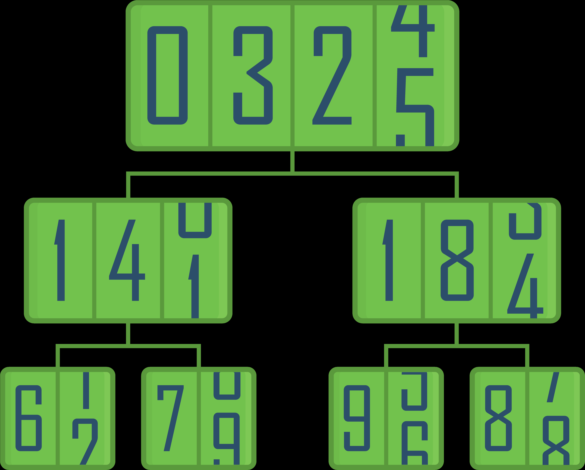
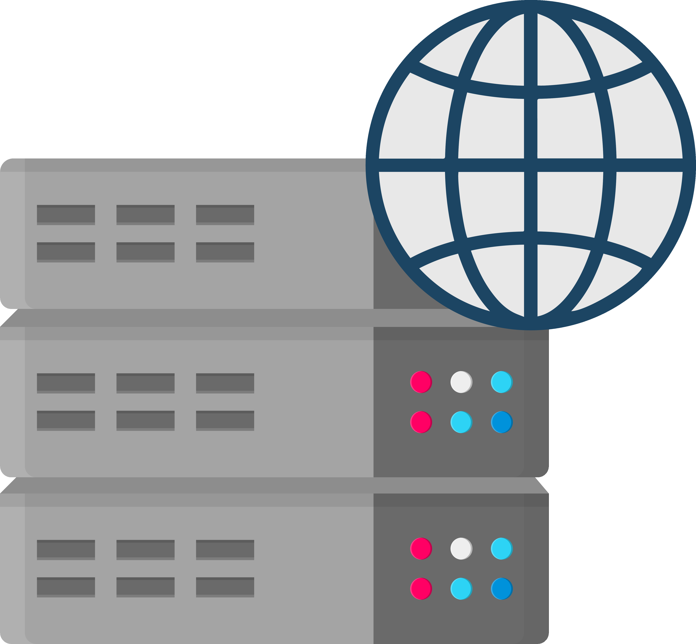
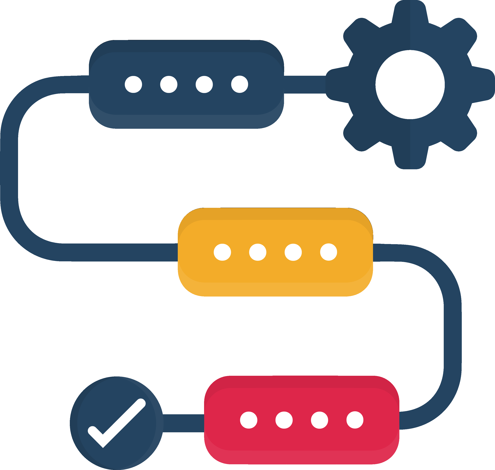

# 031 - Thiết Kế Twitter (Mạng Xã Hội Microblogging)

[← Bài trước](030-thiet-ke-uber.md) | [Mục lục](README.md) | [Bài tiếp theo →](032-thiet-ke-newsfeed-system.md)

---


# Thiết Kế Hệ Thống: Twitter (System Design: Twitter)

Nhận cái nhìn tổng quan về Twitter và bản tóm tắt ngắn gọn về những gì chúng ta sẽ tìm hiểu trong chương này.

### Nội Dung Bao Gồm:
* Twitter
* Chúng ta sẽ thiết kế Twitter như thế nào?

---

## Twitter

**Twitter** là một mạng xã hội tiểu blog (microblogging) miễn phí, nơi những người dùng đã đăng ký có thể đăng tải các thông điệp ngắn gọi là **"Tweets"**. Người dùng cũng có thể thích (**Like**), trả lời (**Reply**), và đăng lại (**Retweet**) các tweet công khai. Twitter có khoảng 397 triệu người dùng tính đến năm 2021 và con số này đang tăng lên nhanh chóng theo thời gian. Một trong những lý do chính cho sự phổ biến của nó là sự lan truyền mạnh mẽ của các tin tức nóng hổi (breaking news) trên nền tảng. Một lý do quan trọng khác là Twitter cho phép chúng ta tương tác và học hỏi từ những người thuộc các cộng đồng và nền văn hóa khác nhau.


Một người dùng thực hiện nhiều thao tác khác nhau trên Twitter:
* Thích Tweet (**Like Tweet**)
* Trả lời Tweet (**Reply to Tweet**)
* Đăng Tweet (**Post Tweet**)
* Xóa Tweet (**Delete Tweet**)
* Tìm kiếm Tweet (**Search Tweet**)

Hình minh họa dưới đây thể hiện cơ sở người dùng của Twitter theo từng quốc gia tính đến tháng 1 năm 2022 (nguồn: Statista), trong đó Hoa Kỳ đang dẫn đầu. Những số liệu thống kê như vậy rất quan trọng khi chúng ta thiết kế cơ sở hạ tầng (infrastructure), bởi vì nó cho phép chúng ta phân bổ nhiều dung lượng/tài nguyên (capacity) hơn cho người dùng của một khu vực cụ thể, và lưu lượng truy cập (traffic) sẽ được phục vụ từ vị trí gần với những người dùng cụ thể đó.


*Cơ sở người dùng theo quốc gia trên Twitter (Country wise userbase on Twitter)*

---

## Chúng Ta Sẽ Thiết Kế Twitter Như Thế Nào? (How Will We Design Twitter?)

Chúng ta sẽ chia thiết kế của Twitter thành bốn phần:

1. **Yêu cầu (Requirements):** Bài học này mô tả các yêu cầu chức năng (**Functional Requirements**) và yêu cầu phi chức năng (**Non-Functional Requirements**) của Twitter. Chúng ta cũng sẽ ước tính nhiều khía cạnh của Twitter, chẳng hạn như dung lượng lưu trữ (**Storage**), băng thông (**Bandwidth**), và tài nguyên tính toán (**Computational Resources**).
2. **Thiết kế (Design):** Chúng ta sẽ thảo luận về thiết kế kiến trúc mức cao (**High-Level Design**) của Twitter trong bài học này. Chúng ta cũng giải thích ngắn gọn về thiết kế **API** và xác định các thành phần quan trọng của kiến trúc Twitter. Hơn nữa, chúng ta sẽ thảo luận về cách quản lý bài toán **Top-k** (Top-k problem), chẳng hạn như các Tweet được hàng triệu người dùng trên Twitter thích hoặc xem.
3. **Bộ cân bằng tải phía máy khách (Client-Side Load Balancers):** Bài học này thảo luận về cách Twitter thực hiện cân bằng tải (**Load Balancing**) cho hệ thống microservices của mình nhằm quản lý hàng tỷ yêu cầu (requests) giữa các thực thể dịch vụ (service instances) khác nhau. Hơn nữa, chúng ta cũng sẽ thấy lý do tại sao Twitter sử dụng kỹ thuật cân bằng tải tùy chỉnh thay vì các phương pháp tiếp cận phổ biến khác.
4. **Câu hỏi kiểm tra (Quiz):** Cuối cùng, chúng ta sẽ củng cố các khái niệm chính trong thiết kế Twitter bằng một bài trắc nghiệm (quiz).

Hãy bắt đầu với việc định nghĩa các yêu cầu của Twitter.

---

> **Quay lại (Back)**: *Quiz on Uber's Design*  
> **Đánh dấu hoàn thành (Mark As Completed)**  
> **Tiếp theo (Next)**: *Requirements of Twitter’s Design*

---

# Các Yêu Cầu Trong Thiết Kế Twitter (Requirements of Twitter’s Design)

Hiểu rõ các yêu cầu và ước tính cho thiết kế của Twitter.

### Nội Dung Bao Gồm:
* Yêu cầu (**Requirements**)
* Yêu cầu chức năng (**Functional requirements**)
* Yêu cầu phi chức năng (**Non-functional requirements**)
* Các khối xây dựng chúng ta sẽ sử dụng (**Building blocks we will use**)

---

## Yêu Cầu (Requirements)

Hãy cùng tìm hiểu các yêu cầu chức năng và phi chức năng dưới đây:

### Yêu Cầu Chức Năng (Functional Requirements)

Sau đây là các yêu cầu chức năng của Twitter:

* **Đăng Tweets (Post Tweets):** Người dùng đã đăng ký có thể đăng một hoặc nhiều Tweets trên Twitter.
* **Xóa Tweets (Delete Tweets):** Người dùng đã đăng ký có thể xóa một hoặc nhiều Tweets của chính họ trên Twitter.
* **Thích hoặc không thích Tweets (Like or dislike Tweets):** Người dùng đã đăng ký có thể thích và không thích các Tweet công khai cũng như các Tweet của chính họ trên Twitter.
* **Trả lời Tweets (Reply to Tweets):** Người dùng đã đăng ký có thể trả lời các Tweet công khai trên Twitter.
* **Tìm kiếm Tweets (Search Tweets):** Người dùng đã đăng ký có thể tìm kiếm Tweets bằng cách nhập từ khóa (**keywords**), thẻ bắt đầu bằng dấu thăng (**hashtags**), hoặc tên người dùng (**usernames**) vào thanh tìm kiếm trên Twitter.
* **Xem dòng thời gian của người dùng hoặc trang chủ (View user or home timeline):** Người dùng đã đăng ký có thể xem dòng thời gian của người dùng (**user timeline**), chứa các Tweet của chính họ. Họ cũng có thể xem dòng thời gian trang chủ (**home timeline**), chứa các Tweet của những người mà họ theo dõi trên Twitter.
* **Theo dõi hoặc bỏ theo dõi tài khoản (Follow or unfollow the account):** Người dùng đã đăng ký có thể theo dõi hoặc bỏ theo dõi những người dùng khác trên Twitter.
* **Đăng lại một Tweet (Retweet a Tweet):** Người dùng đã đăng ký có thể Retweet các Tweet công khai của những người dùng khác trên Twitter.

---

### Yêu Cầu Phi Chức Năng (Non-Functional Requirements)

* **Tính sẵn sàng cao (Availability):** Rất nhiều người và tổ chức sử dụng Twitter để truyền đạt các thông tin nhạy cảm về thời gian (chẳng hạn như thông báo sự cố dịch vụ - service outage messages). Do đó, dịch vụ của chúng ta phải có tính sẵn sàng cao (**High Availability**) và tỷ lệ thời gian hoạt động tốt (**good uptime percentage**).
* **Độ trễ (Latency):** Độ trễ để hiển thị các Tweet hàng đầu gần đây nhất trong dòng thời gian trang chủ (**home timeline**) có thể hơi cao một chút. Tuy nhiên, các dịch vụ gần với thời gian thực (**near real-time services**), chẳng hạn như phân phối Tweet tới những người theo dõi (Tweet distribution to followers), bắt buộc phải có độ trễ thấp (**Low Latency**).
* **Khả năng mở rộng (Scalability):** Khối lượng công việc (workload) trên Twitter thiên về đọc rất lớn (**read-heavy**), nơi chúng ta có rất nhiều người đọc và tương đối ít người viết, điều này cuối cùng đòi hỏi khả năng mở rộng (**Scalability**) của các tài nguyên tính toán. Một số ước tính chỉ ra tỷ lệ ghi-trên-đọc (**write-to-read ratio**) của Twitter là **1:1000**. Mặc dù Tweet bị giới hạn ở 280 ký tự và video clip mặc định bị giới hạn ở 140 giây, chúng ta vẫn cần dung lượng lưu trữ cao (**high storage capacity**) để lưu trữ và phân phối các Tweet được đăng bởi những nhân vật của công chúng tới hàng triệu người theo dõi của họ.
* **Độ tin cậy (Reliability):** Tất cả các Tweet vẫn còn trên Twitter. Điều này có nghĩa là Twitter không bao giờ tự ý xóa nội dung của người dùng. Vì vậy, cần phải có một chiến lược rõ ràng và chắc chắn để ngăn chặn việc mất mát hoặc hư hỏng nội dung đã tải lên (**prevent loss or damage of uploaded content**).
* **Tính nhất quán (Consistency):** Có khả năng một người dùng ở bờ biển phía Đông của Hoa Kỳ không nhận được bản cập nhật trạng thái ngay lập tức (lượt thích, trả lời, v.v.) đối với Tweet được thích hoặc Retweet bởi một người dùng ở bờ biển phía Tây của Hoa Kỳ. Tuy nhiên, người dùng ở bờ biển phía Tây Hoa Kỳ lại cần nhận bản cập nhật trạng thái ngay lập tức đối với lượt thích hoặc trả lời của chính họ. Cần có một kỹ thuật hiệu quả để cung cấp phản hồi nhanh chóng cho người dùng (người vừa thích bài đăng của ai đó), sau đó đến những người dùng được chỉ định khác trong cùng khu vực, và cuối cùng là tới tất cả người dùng trên toàn thế giới có liên kết với Tweet đó.

---


*Các yêu cầu phi chức năng của Twitter (Non-functional requirements of Twitter)*

* Độ trễ thấp (**Low latency**)
* Khả năng mở rộng (**Scalability**)
* Độ tin cậy (**Reliability**)
* Tính sẵn sàng cao (**Availability**)
* Tính nhất quán (**Consistency**)

Hơn nữa, chúng ta phải xác định những tài nguyên thiết yếu nào cần được ước tính trong thiết kế của Twitter. Chúng ta đã sử dụng Twitter làm ví dụ trong chương Ước tính nhanh (**Back-of-the-Envelope**), vì vậy chúng ta sẽ không lặp lại bài tập đó ở đây.

---

## Các Khối Xây Dựng Chúng Ta Sẽ Sử Dụng (Building Blocks We Will Use)

Thiết kế của Twitter sử dụng các khối xây dựng nền tảng sau đây mà chúng ta đã thảo luận trong các chương đầu:







*Các khối xây dựng được sử dụng trong thiết kế Twitter (Building blocks used in Twitter design):*
* **DNS (Hệ thống phân giải tên miền)**
* **Load balancer (Bộ cân bằng tải)**
* **Sequencer (Bộ tạo định danh tuần tự / duy nhất)**
* **Databases (Cơ sở dữ liệu)**
* **Blob store (Kho lưu trữ đối tượng nhị phân lớn)**
* **Cache (Bộ nhớ đệm)**
* **CDN (Mạng phân phối nội dung - Content Delivery Network)**
* **Monitoring (Hệ thống giám sát)**
* **Sharded counters (Bộ đếm phân mảnh)**
* **Key-value store (Kho lưu trữ khóa - giá trị)**
* **Pub-sub (Mô hình xuất bản - đăng ký)**

> [!NOTE]
> * **DNS** là dịch vụ ánh xạ tên miền Twitter thân thiện với con người thành các địa chỉ IP mà máy tính có thể đọc được.
> * **Load balancers (Bộ cân bằng tải)** phân phối các yêu cầu đọc/ghi (**read/write requests**) giữa các dịch vụ tương ứng.
> * **Sequencers** tạo các định danh duy nhất (**unique IDs**) cho các Tweets.

---

# Thiết Kế Hệ Thống: Twitter (System Design: Twitter)

---

## 1. Thiết Kế Tổng Quan Twitter (High-Level Design of Twitter)

* **Cơ sở dữ liệu (Databases):** Lưu trữ siêu dữ liệu (metadata) của các Tweet và người dùng (users).
* **Kho lưu trữ Blob (Blob stores):** Lưu trữ các hình ảnh và video clip đính kèm trong Tweet.
* **Kho lưu trữ Key-Value (Key-value stores):** Được sử dụng cho nhiều mục đích khác nhau như đánh chỉ mục (indexing), xác định bộ đếm (counter) cụ thể để cập nhật giá trị, xác định các Tweet của một người dùng cụ thể và nhiều tác vụ khác.
* **Mô hình Xuất bản - Đăng ký (Pub-sub):** Được sử dụng để xử lý theo thời gian thực (real-time processing) như loại bỏ dữ liệu dư thừa (elimination of redundant data), sắp xếp/tổ chức dữ liệu (organizing data), và nhiều chức năng khác.
* **Bộ đếm phân mảnh (Sharded counters):** Giúp xử lý việc đếm cho nhiều tính năng khác nhau như lượt xem (views), lượt thích (likes), lượt Retweet, v.v., của các tài khoản có hàng triệu người theo dõi (followers).
* **Bộ nhớ đệm (Cache):** Được sử dụng để lưu trữ dữ liệu gần đây và được yêu cầu nhiều nhất vào RAM nhằm mang lại phản hồi nhanh chóng (low latency response) cho người dùng.
* **CDN (Content Delivery Network - Mạng phân phối nội dung):** Giúp người dùng cuối (end users) truy cập dữ liệu với độ trễ thấp (low latency).
* **Hệ thống giám sát (Monitoring):** Phân tích toàn bộ lưu lượng truy cập đi và đến (incoming & outgoing traffic), phát hiện sự dư thừa trong hệ thống lưu trữ, xác định các node gặp sự cố (failed nodes), v.v.

Trong phần tiếp theo, chúng ta sẽ thảo luận chi tiết về thiết kế của hệ thống Twitter.

---

## 2. Tìm Hiểu Thiết Kế Tổng Quan Dịch Vụ Twitter (High-Level Design of the Twitter Service)

Hiểu rõ kiến trúc mức cao (high-level design) của dịch vụ Twitter.

**Chúng ta sẽ bao quát các nội dung sau:**
* Tương tác giữa người dùng và hệ thống (User-system interaction)
* Thiết kế API (API design)
  * Đăng Tweet (Post Tweet)
  * Thích hoặc bỏ thích Tweet (Like or dislike Tweet)
  * Trả lời Tweet (Reply to Tweet)
  * Tìm kiếm Tweet (Search Tweet)
  * Phản hồi (Response)
  * Xem dòng thời gian trang chủ (View home_timeline)
  * Theo dõi tài khoản (Follow the account)
  * Retweet lại một Tweet (Retweet a Tweet)

### Tương Tác Giữa Người Dùng Và Hệ Thống (User-system interaction)

Hãy bắt đầu với thiết kế tổng quan của hệ thống Twitter. Ban đầu, chúng ta sẽ điểm qua và thảo luận ngắn gọn về các khối xây dựng nền tảng (building blocks) cũng như các thành phần khác trong ngữ cảnh của bài toán Twitter. Sau đó, chúng ta sẽ đi sâu vào chi tiết một số thành phần quan trọng trong chương này.

---

## 3. Các Thành Phần Của Twitter (Twitter Components)


* **Người dùng (Users):** Người dùng đăng các Tweet, các Tweet này được chuyển đến máy chủ thông qua bộ cân bằng tải (Load Balancer). Sau đó, hệ thống sẽ lưu trữ chúng vào hệ thống lưu trữ bền vững (persistent storage).
* **Hệ thống phân giải tên miền (DNS - Domain Name System):** Cung cấp địa chỉ IP cụ thể cho người dùng cuối để bắt đầu quá trình giao tiếp với dịch vụ được yêu cầu.
* **CDN (Content Delivery Network):** Được bố trí gần người dùng để cung cấp dữ liệu được yêu cầu với độ trễ thấp (low latency). Khi người dùng tìm kiếm một thuật ngữ hoặc thẻ (tag) cụ thể, hệ thống trước tiên sẽ tìm kiếm trong các máy chủ proxy CDN chứa nội dung được yêu cầu thường xuyên nhất.
* **Bộ cân bằng tải (Load Balancer):** Lựa chọn máy chủ ứng dụng (Application Server) đang hoạt động dựa trên tải lượng lưu lượng truy cập (traffic load) trên các máy chủ khả dụng và các yêu cầu từ phía người dùng.
* **Hệ thống lưu trữ (Storage System):** Đại diện cho nhiều loại lưu trữ khác nhau (dựa trên SQL và NoSQL) trong sơ đồ minh họa ở trên. Chúng ta sẽ thảo luận chi tiết về các hệ thống lưu trữ quan trọng ở phần sau của chương này.
* **Máy chủ ứng dụng (Application Servers):** Cung cấp nhiều dịch vụ khác nhau và chứa logic nghiệp vụ (business logic) để điều phối giữa các thành phần khác nhau nhằm đáp ứng các yêu cầu chức năng (functional requirements) của hệ thống.

> [!NOTE]
> Chúng ta đã có các chương chi tiết về **DNS**, **CDN**, các **Hệ thống lưu trữ chuyên biệt** (Databases, Key-value store, Blob store), và **Load Balancers** trong phần các khối xây dựng nền tảng (building blocks). Trong các bài học tiếp theo, chúng ta sẽ tập trung vào các chi tiết cụ thể hơn dành riêng cho dịch vụ Twitter. Trước hết, hãy cùng tìm hiểu về API của dịch vụ.

---

## 4. Thiết Kế API (API Design)

Phần này sẽ tập trung vào việc thiết kế các API khác nhau liên quan đến các chức năng mà chúng ta cung cấp. Chúng ta sẽ tìm hiểu cách người dùng yêu cầu các dịch vụ khác nhau thông qua các API.

Chúng ta sẽ chỉ tập trung vào các tham số quan trọng của API có liên quan trực tiếp đến thiết kế của chúng ta. Mặc dù máy chủ giao diện người dùng (front-end server) có thể gọi một API khác hoặc bổ sung thêm tham số vào API nhận được từ người dùng cuối để hoàn thành yêu cầu, nhưng ở đây chúng ta sẽ gom tất cả các đối số có liên quan được chỉ định cho yêu cầu cụ thể đó vào trong một API duy nhất.

Hãy cùng xây dựng các API cho từng tính năng sau:
* Đăng Tweet (Post Tweet)
* Thích hoặc bỏ thích Tweet (Like or dislike Tweet)
* Trả lời Tweet (Reply to Tweet)
* Tìm kiếm Tweet (Search Tweet)
* Xem dòng thời gian người dùng hoặc trang chủ (View user or home timeline)
* Theo dõi hoặc hủy theo dõi tài khoản (Follow or unfollow the account)
* Retweet lại một Tweet (Retweet a Tweet)

---

### Đăng Tweet (Post Tweet)

Phương thức `POST` được sử dụng để gửi Tweet từ người dùng lên máy chủ thông qua API `/postTweet`.

```http
postTweet(user_id, access_type, tweet_type, content, tweet_length, media_field, post_time, tweet_location, list_of_used_hashtags, list_of_tagged_people)
```

Hãy cùng thảo luận về một vài tham số:

| Tham số (Parameter) | Mô tả (Description) |
| :--- | :--- |
| `user_id` | Chỉ định ID duy nhất của người dùng đã đăng Tweet. |
| `access_type` | Cho biết liệu Tweet có ở chế độ bảo vệ hay không (nghĩa là chỉ người theo dõi / followers mới nhìn thấy). |
| `tweet_type` | Cho biết Tweet là dạng văn bản (text-based), dạng video-clip, dạng hình ảnh hay kết hợp nhiều loại khác nhau. |
| `content` | Chỉ định nội dung thực tế của Tweet (văn bản). |
| `tweet_length` | Đại diện cho độ dài văn bản trong Tweet. Trong trường hợp là video, nó biểu thị kích thước của video. |
| `media_field` | Chỉ định loại phương tiện truyền thông (hình ảnh, video, GIF, v.v.) được đính kèm. |

Các tham số còn lại đều mang ý nghĩa rõ ràng theo tên gọi (self-explanatory).

> [!NOTE]
> Twitter sử dụng dịch vụ **Snowflake** để tạo các ID duy nhất (unique IDs) cho các Tweet. Chúng ta có một chương riêng chi tiết (Sequencer - Bộ tạo chuỗi) giải thích cụ thể về dịch vụ này.

---

#### Điểm Cần Suy Ngẫm (Points to Ponder)

> **Câu hỏi 1:** Một Tweet có thể chứa tối đa bao nhiêu hashtag?
>
> > [!TIP]
> > **Câu trả lời:**
> > Giới hạn văn bản là 280 ký tự trong một Tweet. Do đó, người dùng có thể sử dụng (các) hashtag sao cho tổng độ dài văn bản (bao gồm văn bản thuần túy, bất kỳ liên kết/links nào và các hashtag) không vượt quá giới hạn 280 ký tự.

---

### Thích Hoặc Bỏ Thích Tweet (Like or dislike Tweet)

API `/likeTweet` được sử dụng khi người dùng thích các Tweet công khai.

```http
likeTweet(user_id, tweet_id, tweeted_user_id, user_location)
```

| Tham số (Parameter) | Mô tả (Description) |
| :--- | :--- |
| `user_id` | Chỉ định ID duy nhất của người dùng đã thích Tweet. |
| `tweet_id` | Chỉ định ID duy nhất của Tweet. |
| `tweeted_user_id` | Đây là ID duy nhất của người dùng đã đăng Tweet đó. |
| `user_location` | Biểu thị vị trí của người dùng đã thích Tweet. |

Các tham số ở trên cũng được sử dụng trong API `/dislikeTweet` khi người dùng không thích (dislike/bỏ thích) Tweet của người khác.

---

### Trả Lời Tweet (Reply to Tweet)

API `/replyTweet` được sử dụng khi người dùng trả lời các Tweet công khai.

```http
replyTweet(user_id, tweet_id, tweeted_user_id, reply_type, reply_length)
```

---

### Trang 13

Các tham số `reply_type` và `reply_length` tương ứng tương tự như `tweet_type` và `tweet_length`.

#### Tìm kiếm Tweet (Search Tweet)
Khi người dùng tìm kiếm bất kỳ từ khóa nào trên dòng thời gian trang chủ (Home Timeline), phương thức `GET` sẽ được sử dụng. Dưới đây là định nghĩa API `/searchTweet`:

```http
searchTweet(user_id, search_term, max_result, exclude, media_field, expansions, sort_order, next_token, user_location)
```

Một số tham số mới được giới thiệu trong trường hợp này gồm:

| Tham số (Parameter) | Mô tả (Description) |
| :--- | :--- |
| `search_term` | Chuỗi ký tự (String) chứa từ khóa hoặc cụm từ tìm kiếm. |
| `max_result` | Số lượng Tweet được trả về trên mỗi trang phản hồi (Response page). Giá trị mặc định là 10. |
| `exclude` | Xác định các thành phần cần loại trừ khỏi danh sách Tweet trả về, ví dụ như loại trừ các câu trả lời (replies). Giới hạn tối đa đối với các Tweet trả về là 3200, nhưng khi loại trừ replies, giới hạn này giảm xuống còn 800 Tweet. |
| `media_field` | Chỉ định các tệp đa phương tiện (Media: hình ảnh, video, GIF) được phân phối trong mỗi Tweet trả về. |
| `expansions` | Cho phép yêu cầu thêm các đối tượng dữ liệu (Data objects) bổ sung trong Tweet trả về, chẳng hạn như người dùng được nhắc đến (mentioned user), Tweet được tham chiếu (referenced Tweet), media đính kèm, địa điểm đính kèm. |
| `sort_order` | Xác định thứ tự trả về của các Tweet. Theo mặc định, API sẽ ưu tiên trả về các Tweet phù hợp nhất trước. |
| `next_token` | Được sử dụng để lấy trang kết quả tiếp theo (Phân trang - Pagination). Ví dụ: nếu `max_result` là 100 và tập kết quả chứa 200 Tweet, giá trị `next_token` sẽ được cung cấp trong phản hồi để gọi trang tiếp theo chứa 100 Tweet kế tiếp. Trang cuối cùng sẽ không có `next_token`. |

---

### Trang 14

#### Phản hồi (Response)
Hãy xem xét một cấu trúc phản hồi mẫu dưới định dạng JSON. Trường `id` là mã định danh duy nhất (Unique ID) của người dùng đã đăng Tweet và `text` là nội dung của Tweet. Trường `result_count` là số lượng Tweet thực tế được trả về, tương ứng với thiết lập `max_result` trong yêu cầu. Ở ví dụ này, chúng ta chỉ hiển thị các trường mặc định.

```json
{
  "data": [
    {
      "id": "7300333948034441183",
      "text": "This is a most matched Tweet"
    },
    {
      "id": "6498431343154916376",
      "text": "This is next to most matched Tweet"
    },
    // ...
    {
      "id": "6427456107642019844",
      "text": "This is the last matched Tweet in the current page of the result."
    }
  ],
  "meta": {
    "newest_id": "7300333948034441183",
    "oldest_id": "6427456107642019844",
    "result_count": 10
  }
}
```

> [!NOTE]
> Twitter thực hiện nhiều loại hình tìm kiếm khác nhau, tiêu biểu là hai dạng sau:
> 1. Dạng tìm kiếm trả về kết quả trong vòng 7 ngày gần nhất, đây là loại mà đa số người dùng đã đăng ký thông thường sử dụng.

---

### Trang 15

> 2. Dạng thứ hai trả về toàn bộ kết quả phù hợp trên toàn bộ các Tweet từng được đăng tải từ trước đến nay (lưu ý rằng dịch vụ không xóa bỏ Tweet đã đăng). Thực tế, kết quả khớp có thể bao gồm cả Tweet đầu tiên xuất hiện trên Twitter. Dạng tìm kiếm này thường được ứng dụng cho mục đích nghiên cứu học thuật.

#### Xem dòng thời gian trang chủ (View home_timeline)
Phương thức `GET` phù hợp khi người dùng xem dòng thời gian trang chủ thông qua API `/viewHome_timeline`:

```http
viewHome_timeline(user_id, tweets_count, max_result, exclude, next_token, user_location)
```

Đối với API `/viewUser_timeline`, chúng ta sẽ loại trừ tham số `user_location` để lấy dòng thời gian của riêng người dùng đó.

Tham số `max_result` quyết định số lượng Tweet mà ứng dụng phía client có thể hiển thị cho người dùng. Server sẽ gửi về số lượng Tweet tương ứng với `max_result` trong mỗi phản hồi. Ngoài ra, server cũng sẽ gửi kèm danh sách người theo dõi được phân trang (`list_of_followers`) nhằm giảm độ trễ phía client (Client Latency).

#### Câu hỏi tư duy (Point to Ponder)
> **Câu hỏi:**
> Tham số nào trong phương thức `viewHome_timeline` có mức độ liên quan cao nhất khi hệ thống đưa ra quyết định hiển thị các quảng cáo được tài trợ (Promoted Tweets) trong phản hồi?

---

### Trang 16

> [!TIP]
> **Giải đáp:**
> Quyết định phân phối các quảng cáo được tài trợ cụ thể được xác định dựa trên tham số `user_location`. Ví dụ: nếu người dùng sinh sống tại thành phố New York, nhiều khả năng họ sẽ nhận được các quảng cáo tài trợ liên quan hoặc có nguồn gốc từ khu vực địa lý đó.

#### Theo dõi tài khoản (Follow the account)
API `/followAccount` được gọi khi người dùng thực hiện theo dõi tài khoản của ai đó trên Twitter:

```http
followAccount(account_id, followed_account_id)
```

| Tham số (Parameter) | Mô tả (Description) |
| :--- | :--- |
| `account_id` | Định danh duy nhất (Unique ID) của người dùng thực hiện thao tác theo dõi trên Twitter. |
| `followed_account_id` | Định danh duy nhất (Unique ID) của tài khoản được người dùng theo dõi. |

API `/unfollowAccount` sẽ sử dụng cùng các tham số trên khi người dùng hủy theo dõi tài khoản của ai đó trên Twitter.

#### Đăng lại Tweet (Retweet a Tweet)
Khi một người dùng đã đăng ký thực hiện Retweet (đăng lại) Tweet của người khác trên Twitter, API `/retweet` sau đây sẽ được gọi:

```http
retweet(user_id, tweet_id, retweet_user_id)
```

Các tham số tương tự cũng sẽ được yêu cầu trong API `/undoRetweet` khi người dùng muốn hủy thao tác Retweet một Tweet của người khác.

---

### Trang 17

- **Quay lại:** Yêu cầu thiết kế của Twitter (Requirements of Twitter’s Design)
- **Đánh dấu hoàn thành:** Mark As Completed
- **Tiếp theo:** Thiết kế chi tiết Twitter (Detailed Design of Twitter)

---

### Trang 18

## Thiết kế chi tiết Twitter (Detailed Design of Twitter)
Đi sâu vào thiết kế chi tiết của hệ thống Twitter.

Chúng ta sẽ bao quát các nội dung sau:
- **Hệ thống lưu trữ (Storage system)**
- **Bộ nhớ đệm (Cache)**
- **Khả năng quan sát hệ thống (Observability)**
- **Các bài toán phức tạp trong thực tế (Real-world complex problems)**
- **Tổng quan thiết kế hoàn chỉnh (The complete design overview)**

### Hệ thống lưu trữ (Storage system)
Lưu trữ là một trong những thành phần cốt lõi trong mọi hệ thống thời gian thực (Real-time System). Mặc dù chúng ta có một chương riêng biệt đi sâu về các hệ thống lưu trữ, tại đây chúng ta sẽ tập trung cụ thể vào kiến trúc lưu trữ được Twitter sử dụng. 

Twitter ứng dụng nhiều mô hình lưu trữ khác nhau cho các dịch vụ riêng biệt để khai thác triệt để ưu thế của từng mô hình. Chúng ta sẽ phân tích từng mô hình lưu trữ và theo dõi hành trình Twitter chuyển đổi qua lại giữa các hệ cơ sở dữ liệu, nền tảng và công cụ khác nhau, cũng như những lợi ích kiến trúc mà Twitter thu được từ quá trình này.

> [!NOTE]
> Nội dung bài học này chủ yếu được tổng hợp từ các bài viết kỹ thuật (Technical Blogs) chính thức của Twitter, kết hợp với các phân tích chuyên sâu của chúng tôi.

#### Google Cloud:
Tại Twitter, cụm HDFS (Hadoop Distributed File System) bao gồm hàng chục nghìn máy chủ chịu trách nhiệm lưu trữ hơn 300PB dữ liệu. Dữ liệu được lưu trữ trong HDFS phần lớn được nén bằng thuật toán nén dữ liệu **LZO**, bởi vì LZO hoạt động đặc biệt hiệu quả trong môi trường Hadoop. 

Khối dữ liệu này bao gồm:
- Dữ liệu nhật ký hệ thống / Logs (Client events, Tweet events, và Timeline events)
- Các bản sao lưu dự phòng (Backups) của MySQL và Manhattan (sẽ thảo luận chi tiết sau)
- Dữ liệu định hướng quảng cáo và phân tích dữ liệu (Ad targeting and analytics)
- Các mô hình dự đoán mức độ tương tác của người dùng (User engagement predictions)
- Phân tích đồ thị mạng xã hội (Social graph analysis), v.v.

Vào năm 2018, Twitter đã đưa ra quyết định chiến lược chuyển đổi dữ liệu từ các cụm Hadoop nội bộ lên nền tảng **Google Cloud** nhằm nâng cao hiệu quả phân tích và quản trị dữ liệu. Chiến lược di chuyển hạ tầng này được gọi là **chiến lược đám mây một phần (Partly Cloudy Strategy)**. Ban đầu, họ...

---

...đã di chuyển các cụm Ad-hoc (phân tích đột xuất, không thường xuyên) và cụm lưu trữ lạnh (*cold storage clusters* - chứa dữ liệu ít được truy cập và ít dùng), trong khi các cụm Hadoop phục vụ thời gian thực (*real-time*) và môi trường vận hành sản xuất (*production*) vẫn được giữ lại tại chỗ (*on-premise*). Dữ liệu lớn (*big data*) được lưu trữ trên **BigQuery** (dịch vụ đám mây của Google Cloud), một kho dữ liệu không máy chủ (*serverless data warehouse*) được quản lý hoàn toàn (*fully managed*) và có khả năng mở rộng quy mô cao (*highly scalable*). Twitter sử dụng **Presto** (công cụ truy vấn SQL phân tán - *distributed SQL query engine*) để truy cập dữ liệu từ Google Cloud (BigQuery, cụm Ad-hoc, Google Cloud Storage, v.v.).

### Manhattan (Hệ thống lưu trữ Key-Value phân tán)

Tại Twitter, lượng người dùng tăng trưởng với tốc độ chóng mặt, đòi hỏi một giải pháp có khả năng mở rộng (*scalable*) để gia tăng thông lượng giải quyết (*throughput*). Khoảng năm 2010, Twitter từng sử dụng **Cassandra** (hệ thống lưu trữ cột rộng phân tán - *distributed wide-column store*) để thay thế MySQL, nhưng không thể thay thế hoàn toàn do một số thiếu sót và giới hạn nội tại trong hệ thống lưu trữ của Cassandra. 

Vào tháng 4 năm 2014, Twitter đã triển khai hệ thống lưu trữ khóa - giá trị phân tán phục vụ thời gian thực (*general-purpose real-time distributed key-value store*) do chính họ tự phát triển mang tên **Manhattan**, đồng thời chính thức ngừng sử dụng (*deprecated*) Cassandra. 

- Manhattan đóng vai trò lưu trữ tầng backend cho Tweets, tài khoản Twitter, tin nhắn trực tiếp (Direct Messages), v.v.
- Twitter vận hành nhiều cụm (clusters) khác nhau tùy thuộc vào từng ca sử dụng (*use cases*), chẳng hạn như:
  - Các cụm nhỏ hơn phục vụ cho dữ liệu ít phổ biến hoặc chỉ đọc (*read-only*).
  - Các cụm lớn hơn phục vụ cho lưu lượng đọc/ghi khổng lồ (*heavy read/write traffic*) với hàng triệu truy vấn mỗi giây (millions of QPS).
- Ban đầu, Manhattan cũng cung cấp dịch vụ bộ đếm chuỗi thời gian (*time-series counters* cho lượt xem - view, lượt thích - like, v.v.), dịch vụ mà hiện nay do **MetricsDB** đảm nhiệm.
- Manhattan sử dụng **RocksDB** làm công cụ lưu trữ nền tảng (*storage engine*), chịu trách nhiệm lưu trữ và truy xuất dữ liệu cục bộ bên trong một node cụ thể.

> [!NOTE]
> **Quá trình di chuyển dữ liệu của Twitter sang cơ sở dữ liệu Manhattan:**
>
> 1. Người dùng gửi các yêu cầu liên quan đến Tweets, direct messages, tài khoản Twitter.
> 2. Bộ cân bằng tải (*Load Balancer*) chuyển tiếp tất cả yêu cầu tới Application Server được chọn.
> 3. Application Server gửi yêu cầu xử lý đến RocksDB / Manhattan database.
> 4. Lưu trữ dữ liệu nhận được vào cơ sở dữ liệu Manhattan.


---

### Blobstore (Lưu trữ đối tượng nhị phân)

Khoảng năm 2012, Twitter xây dựng hệ thống lưu trữ **Blobstore** nhằm lưu trữ các hình ảnh đính kèm trong Tweet. Hiện nay, Blobstore còn lưu trữ video, các tệp nhị phân (*binary files*) và các đối tượng khác. Sau một khoảng thời gian nhất định, máy chủ sẽ thực hiện ghi nhận điểm kiểm tra (*checkpoint*) dữ liệu từ bộ nhớ trong (*in-memory*) xuống Blobstore để đảm bảo độ bền vững (*durable storage*). 

> [!TIP]
> Bạn có thể tham khảo chương chi tiết về *Blob Store* để hiểu sâu hơn về kiến trúc và cơ chế hoạt động của loại lưu trữ này.

---

### Cơ sở dữ liệu quan hệ (SQL-based databases)

Twitter sử dụng **MySQL** và **PostgreSQL** tại các phân hệ yêu cầu tính nhất quán mạnh (*strong consistency*), sàn giao dịch quảng cáo (*ads exchange*) và quản lý các chiến dịch quảng cáo (*managing ads campaigns*).

- Twitter cũng sử dụng **Vertica** để truy vấn các tập dữ liệu tổng hợp thường dùng và cấp dữ liệu cho bảng điều khiển Tableau (*Tableau dashboards*).
- Khoảng năm 2012, Twitter phát triển framework **Gizzard** chạy trên nền tảng MySQL để phục vụ việc phân mảnh dữ liệu (*sharding*), được thực thi thông qua kỹ thuật phân vùng (*partitioning*) và nhân bản (*replication*). 
- Chi tiết về kho lưu trữ quan hệ được thảo luận sâu hơn trong chương *Databases*.

---

### Kafka và Cloud Dataflow

Twitter đánh giá và xử lý khoảng **400 tỷ sự kiện thời gian thực** (*real-time events*) và tạo ra hàng petabyte dữ liệu mỗi ngày. 

Để giải quyết bài toán này:
1. Twitter xử lý sự kiện bằng cách sử dụng **Kafka** triển khai on-premise.
2. Dùng các tác vụ **Google Dataflow** để xử lý việc loại bỏ trùng lặp (*deduping*) và tổng hợp dữ liệu thời gian thực (*real-time aggregation*) trên Google Cloud.
3. Sau khi tổng hợp:
   - Kết quả phục vụ phân tích đột xuất (*ad-hoc analysis*) được lưu trữ vào **BigQuery** (data warehouse).
   - Dữ liệu phục vụ tầng truy vấn trực tiếp (*serving system*) được chuyển tới **Bigtable** (cơ sở dữ liệu NoSQL).
4. Twitter chuyển đổi các Kafka topics thành Cloud Pub-sub topics thông qua một bộ xử lý sự kiện (*event processor*), giúp ngăn ngừa mất mát dữ liệu (*data loss*) và tăng cường khả năng mở rộng (*scalability*).

> [!IMPORTANT]
> **Quy trình xử lý thời gian thực hàng tỷ yêu cầu:**
>
> - **Application Server** nhận các yêu cầu thời gian thực → ghi vào **Kafka topics**.
> - **Event Processor** chuyển đổi các Kafka topics thành các **Cloud Pub-sub topics**.
> - **Google Cloud Dataflow** nhận dữ liệu từ Pub-sub topic, thực hiện:
>   - Loại bỏ dữ liệu trùng lặp (*deduping*) và tổng hợp thời gian thực (*real-time aggregation*).
>   - Ghi dữ liệu phân tích vào **BigQuery**.
>   - Ghi các số liệu tổng hợp kèm khóa truy vấn (*query keys*) vào **Bigtable**.


---

### FlockDB (Lưu trữ đồ thị quan hệ)

Mối quan hệ mạng xã hội đề cập đến danh sách người theo dõi của một người dùng (*followers*), người mà người dùng đó đang theo dõi (*following*), danh sách nhận thông báo, v.v. Twitter lưu trữ các mối quan hệ này dưới dạng một đồ thị (*graph*).

Twitter sử dụng **FlockDB**, một cơ sở dữ liệu đồ thị (*graph database*) được tinh chỉnh tối ưu cho các danh sách kề khổng lồ (*huge adjacency lists*), tốc độ đọc/ghi cực nhanh (*rapid reads and writes*), cùng với các thao tác duyệt đồ thị (*graph-traversal operations*).

---

### Apache Lucene (Dịch vụ tìm kiếm phân tán)

Twitter đã xây dựng một dịch vụ tìm kiếm lập chỉ mục khoảng **1 nghìn tỷ bản ghi** và phản hồi các truy vấn trong vòng **100 mili-giây** (milliseconds). 

- Vào khoảng năm 2019, công cụ tìm kiếm của Twitter có độ trễ lập chỉ mục (*indexing latency* - thời gian để lập chỉ mục các tweet mới) rơi vào khoảng 15 giây.
- Twitter sử dụng **Apache Lucene** cho tính năng tìm kiếm thời gian thực, vận hành dựa trên cơ chế chỉ mục đảo ngược (*inverted index*).
- **Phân tầng chỉ mục:**
  - **Chỉ mục thời gian thực (Real-time index):** Lưu trữ các Tweet gần đây trong vòng 1 tuần qua trên bộ nhớ RAM để đạt độ trễ thấp nhất (*low latency*) và cập nhật nhanh chóng (*quick updates*).
  - **Chỉ mục toàn phần (Full index):** Có dung lượng lớn gấp hàng trăm lần so với chỉ mục thời gian thực. Đối với toàn bộ chỉ mục này, Twitter áp dụng kỹ thuật xử lý theo lô (*batch processing*).

> [!NOTE]
> **Quy trình xử lý yêu cầu tìm kiếm (Search Request):**
> 1. Người dùng gửi yêu cầu tìm kiếm (*Search request*).
> 2. Bộ cân bằng tải (*Load Balancer*) chuyển tiếp yêu cầu đến Application Server được chỉ định.
> 3. Tìm kiếm các Tweet yêu cầu thông qua Apache Lucene.
> 4. Nếu Tweet không được tìm thấy ở bộ chỉ mục tức thời, hệ thống sẽ tìm kiếm sâu hơn vào máy chủ chỉ mục tầng backend (*backend index server*).


> Một giải pháp theo hướng "một kích cỡ cho tất cả" (*one size fits all*) hiếm khi mang lại hiệu quả cao trong các hệ thống lớn. Các ứng dụng thời gian thực luôn tập trung vào việc chọn đúng công cụ cho từng bài toán cụ thể, đòi hỏi sự thấu hiểu tường tận mọi ca sử dụng thực tế. Mọi thiết kế đều có ưu và nhược điểm (*trade-offs*) và cần được áp dụng dựa trên tính thực tế cao.

---

### Bộ nhớ đệm (Cache)

Như đã biết, bộ nhớ đệm giúp giảm thiểu độ trễ (*latency*) và tăng thông lượng (*throughput*). Caching chủ yếu được tận dụng cho:
- **Lưu trữ** (giải quyết lưu lượng đọc cực lớn - *heavy read traffic*).
- **Tính toán** (xử lý luồng thời gian thực - *real-time stream processing* và học máy - *machine learning*).
- **Dữ liệu tạm thời** (hệ thống giới hạn tốc độ - *rate limiters*).

Twitter từng sử dụng các cụm **Twitter Memcached (Twemcache)** và **Redis (Nighthawk)** theo mô hình đa người thuê (*multi-tenant* - nhiều thực thể ứng dụng chia sẻ chung một môi trường hạ tầng). 

Do phát sinh các vấn đề như hiệu năng không ổn định ngoài dự tính, khó khăn trong việc gỡ lỗi (*debugging*) và các rắc rối vận hành khác trên hệ thống cache cũ (Twemcache và Nighthawk), Twitter đã chuyển sang sử dụng bộ nhớ đệm **Pelikan cache**.

Hệ thống cache này mang lại thông lượng cao (*high-throughput*) và độ trễ thấp (*low latency*). Pelikan sử dụng nhiều loại máy chủ backend chuyên biệt:
- `pelikan_twemcache`: Thay thế cho máy chủ Twemcache cũ của Twitter.
- `pelikan_slimcache`: Thay thế cho máy chủ Memcached/Redis của Twitter.


> [!NOTE]
> **Kiến trúc Pelikan Cache phân tán:**
>
> Các Application Servers kết nối tới tầng Distributed Pelikan cache, tầng cache này nằm trước và giảm tải trực tiếp cho tầng Databases phía dưới.

> [!TIP]
> **Đột phá với Segcache:**
> Pelikan cũng giới thiệu một máy chủ backend khác có tên là **Segcache**, cực kỳ tối ưu về khả năng mở rộng (*scalable*) và tiết kiệm bộ nhớ cho các đối tượng nhỏ (*small objects*).
> 
> Thông thường, kích thước trung vị (*median size*) của các đối tượng nhỏ trong bộ nhớ đệm ứng dụng quy mô lớn dao động từ **200 đến 300 bytes**. Đa số các giải pháp phổ biến (Memcached và Redis) gắn kèm lượng metadata khá lớn (lên tới **56 bytes**) trên từng đối tượng. Điều này đồng nghĩa với việc metadata chiếm hơn 1/3 dung lượng bộ nhớ RAM! 
> 
> Pelikan đã tối ưu hóa và giảm kích thước metadata trên mỗi đối tượng xuống chỉ còn **38 bytes**. Segcache đã vinh dự nhận giải thưởng *NSDI Community Award* và được đưa vào sử dụng dưới dạng máy chủ thử nghiệm tính đến năm 2021.

---

### Khả năng quan sát hệ thống (Observability)

Các ứng dụng quy mô thời gian thực sử dụng hàng nghìn máy chủ cung cấp vô số dịch vụ khác nhau. Việc giám sát tài nguyên và hoạt động giao tiếp bên trong cũng như bên ngoài hệ thống là một bài toán vô cùng phức tạp. 

Chúng ta có thể sử dụng nhiều công cụ để theo dõi sức khỏe dịch vụ (*service health*), hỗ trợ phát hiện và xử lý sự cố:
- **Hệ thống cảnh báo (Alert system):** Phát cảnh báo khi dịch vụ bị lỗi hoặc suy giảm hiệu năng (*degraded*) dựa trên các ngưỡng số liệu (*metrics*) được thiết lập trước.
- **Thư viện cấu hình động (Dynamic configuration library):** Cho phép triển khai và cập nhật cấu hình cho nhiều dịch vụ cùng lúc mà không cần khởi động lại dịch vụ (*zero downtime restart*). Thư viện này tận dụng **ZooKeeper** làm nguồn chân lý duy nhất (*single source of truth*) cho việc lưu trữ cấu hình.
- **Hệ thống ghi nhật ký (Logging):** Ban đầu Twitter sử dụng dịch vụ **LogLens** để trực quan hóa và phân tích log dịch vụ. Sau đó, LogLens được thay thế bằng **Splunk Enterprise** để làm hệ thống ghi log tập trung (*central logging system*).

#### Phân tán dấu vết (Distributed Tracing)

Truy vết hàng tỷ yêu cầu là một thách thức cực lớn trong các hệ thống thời gian thực quy mô khổng lồ. 

Twitter sử dụng **Zipkin** (hệ thống distributed tracing) để lần theo từng yêu cầu (đo lường thời gian xử lý và số lượng yêu cầu) xuyên suốt qua nhiều dịch vụ:
- Zipkin áp dụng cơ chế **lấy mẫu** (*sampling*): Chỉ chọn một phần trong tổng số các yêu cầu và gắn vào đó một định danh dấu vết gọn nhẹ (*lightweight trace identifier*). Việc lấy mẫu này giúp giảm thiểu chi phí tải phụ trội (*overhead*) do quá trình tracing gây ra.
- Zipkin nhận dữ liệu thông qua máy chủ **Scribe** (hệ thống thu thập và tổng hợp dữ liệu log theo thời gian thực) và lưu trữ chúng vào các kho lưu trữ key-value có hỗ trợ một số chỉ mục tra cứu.


#### Vai trò của ZooKeeper

Hầu hết các hệ thống thời gian thực đều sử dụng **ZooKeeper** để lưu trữ các dữ liệu trọng yếu. ZooKeeper cung cấp các dịch vụ đồng thuận cốt lõi như khóa phân tán (*distributed locking*) và bầu chọn trưởng nhóm (*leader election*) trong hệ thống phân tán. 

Twitter dùng ZooKeeper cho các mục đích:
- Lưu trữ danh bạ dịch vụ (*service registry*).
- Lưu thông tin topo của các cụm Manhattan (*Manhattan clusters' topology information*).
- Quản lý siêu dữ liệu (*metadata*).
- Thực thi cơ chế bầu chọn leader trên nhiều hệ thống con khác nhau.

---

### Các bài toán phức tạp trong thực tế (Real-world Complex Problems)

Twitter sở hữu hàng trăm triệu tài khoản, trong đó có những tài khoản của người nổi tiếng (*public figures / celebrities*) sở hữu hàng chục triệu người theo dõi. 

Khi các tài khoản này đăng Tweet, hàng triệu người theo dõi của họ sẽ đồng loạt tương tác với Tweet đó trong một khoảng thời gian cực ngắn. Bài toán trở nên vô cùng hóc búa khi hệ thống phải xử lý **hàng tỷ lượt tương tác** (như lượt xem - view, lượt thích - like) dồn dập vào các Tweet này. 

Vấn đề này trong kỹ thuật hệ thống phân tán được gọi là bài toán phần tử chiếm tải trọng lớn (**Heavy Hitter Problem**). Để giải quyết, hệ thống cần hàng triệu bộ đếm để ghi nhận các loại thao tác khác nhau trên Tweet.

#### Bộ đếm phân mảnh (Sharded Counters)

Một bộ đếm đơn lẻ (*single counter*) cho mỗi thao tác cụ thể trên một Tweet là hoàn toàn không đủ. Một bộ đếm duy nhất không thể nào chịu nổi hàng triệu yêu cầu tăng (*increments*) hoặc giảm (*decrements*) ập đến cùng một thời điểm. 

Do đó, chúng ta cần triển khai **nhiều bộ đếm phân tán** (*multiple distributed counters*) để điều tiết lưu lượng ghi bùng nổ (*burst write requests*) sinh ra từ các tương tác dồn dập trên Tweet của người nổi tiếng:
- Mỗi bộ đếm được chia thành nhiều mảnh (*shards*) hoạt động độc lập trên các đơn vị tính toán (*computational units*) khác nhau.
- Mô hình này được gọi là **Bộ đếm phân mảnh** (*sharded counters*). 
- Các bộ đếm này cũng hỗ trợ giải quyết một bài toán thời gian thực kinh điển khác là **Bài toán Top-K** (*Top-k Problem*).

#### Ví dụ về bài toán Top-k tại Twitter: Xu hướng (Trends) và Dòng thời gian (Timeline)

- **Xu hướng (Trends):** Twitter hiển thị danh sách Top-k xu hướng (gồm các hashtags hoặc từ khóa nổi bật) theo phạm vi địa phương (*locally*) và phạm vi toàn cầu (*globally*).
  - *Locally:* Đề cập đến trường hợp một chủ đề hoặc hashtag được sử dụng tập trung tại chính vị trí địa lý nơi người dùng đang hoạt động.
  - *Globally:* Đề cập đến trường hợp hashtag đó được thảo luận trên toàn thế giới.
  - Hoàn toàn có khả năng người dùng ở một khu vực không sử dụng hashtag đó trong Tweet của họ nhưng vẫn thấy nó xuất hiện trên dòng xu hướng do độ lan tỏa toàn cầu.
  - Các hashtags có tần suất xuất hiện (số lượt đếm) cao nhất trong một khoảng thời gian sẽ trở thành xu hướng cả ở quy mô địa phương và toàn cầu.
  - Ngoài ra, Twitter còn hiển thị các xu hướng được tài trợ (gọi là *paid trends* hoặc *promoted trends*) tại các khu vực được chỉ định.

Dưới đây là chuỗi sơ đồ mô phỏng các hashtags trong một cửa sổ trượt (*sliding window*) được hệ thống chọn lọc để xác định Top-k xu hướng theo thời gian:





---

# Thiết Kế Hệ Thống Twitter (Twitter System Design)

---

### Xác Định Xu Hướng Hàng Đầu (Top-k Trends) Trong Khung Thời Gian Chỉ Định

#### Minh Họa Quá Trình Trượt Và Loại Bỏ Hashtag (Sliding Window & Dropping Tags)

##### Bước 1/5: Top-k xu hướng trong một khung thời gian chỉ định
* **Thời gian (Time)**:
* **Hashtags**:
  * `#life`
  * `#food`
  * `#summer`
  * `#science`
  * `#art`

*Top-k trends in a specified time frame (1 of 5)*

---

##### Bước 2/5: Loại bỏ hashtag `#life` và hiển thị các xu hướng top-k tiếp theo
* **Thời gian (Time)**:
* **Hashtags qua các chu kỳ**:
  * Chu kỳ 1: `#life`, `#food`, `#summer`, `#science`, `#art`
  * Chu kỳ 2: `#life`, `#music`, `#food`, `#summer`, `#science`, `#art`

*Dropped `#life` hashtag and showing next top-k trends in a specified time frame (2 of 5)*

---

##### Bước 3/5: Loại bỏ các hashtag `#life` và `#art`, hiển thị các xu hướng top-k tiếp theo
* **Thời gian (Time)**:
* **Hashtags qua các chu kỳ**:
  * Chu kỳ 1: `#life`, `#food`, `#summer`, `#science`, `#art`
  * Chu kỳ 2: `#life`, `#music`, `#food`, `#summer`, `#science`, `#art`
  * Chu kỳ 3: `#life`, `#music`, `#food`, `#summer`, `#science`, `#art`, `#gaming`

*Dropped `#life` and `#art` hashtags and showing next top-k trends in a specified time frame (3 of 5)*

---

##### Bước 4/5: Loại bỏ các hashtag `#life`, `#art`, và `#food`, hiển thị các xu hướng top-k tiếp theo
* **Thời gian (Time)**:
* **Hashtags qua các chu kỳ**:
  * Chu kỳ 1: `#life`, `#food`, `#summer`, `#science`, `#art`
  * Chu kỳ 2: `#life`, `#music`, `#food`, `#summer`, `#science`, `#art`
  * Chu kỳ 3: `#life`, `#music`, `#food`, `#summer`, `#science`, `#art`, `#gaming`
  * Chu kỳ 4: `#life`, `#music`, `#summer`, `#science`, `#food`, `#art`, `#travel`, `#gaming`

*Dropped `#life`, `#art`, and `#food` hashtags and showing next top-k trends in a specified time frame (4 of 5)*

---

##### Bước 5/5: Loại bỏ các hashtag `#life`, `#art`, `#food`, và `#science`, hiển thị các xu hướng top-k tiếp theo
* **Thời gian (Time)**:
* **Hashtags qua các chu kỳ**:
  * Chu kỳ 1: `#life`, `#food`, `#summer`, `#science`, `#art`
  * Chu kỳ 2: `#life`, `#music`, `#food`, `#summer`, `#science`, `#art`
  * Chu kỳ 3: `#life`, `#music`, `#food`, `#summer`, `#science`, `#art`, `#gaming`
  * Chu kỳ 4: `#life`, `#music`, `#summer`, `#science`, `#food`, `#art`, `#travel`, `#gaming`
  * Chu kỳ 5: `#life`, `#music`, `#summer`, `#science`, `#food`, `#art`, `#competition`, `#travel`, `#gaming`

*Dropped `#life`, `#art`, `#food`, and `#science` hashtags and showing next top-k trends in a specified time frame (5 of 5)*

---

### Dòng Thời Gian (Timeline)

Twitter hiển thị hai loại dòng thời gian: **Home Timeline** (Dòng thời gian trang chủ) và **User Timeline** (Dòng thời gian người dùng). Tại đây, chúng ta sẽ thảo luận về **Home Timeline**, nơi hiển thị luồng các Tweet được đăng bởi các tài khoản đang theo dõi (followed accounts). 

Quyết định hiển thị **Top-k Tweets** trên dòng thời gian bao gồm:
* Các Tweet từ các tài khoản được theo dõi.
* Các Tweet được thích (liked) hoặc Retweet bởi các tài khoản được theo dõi.
* Ngoài ra, còn có một danh mục khác là các **Promoted Tweets** (Tweet quảng cáo/được tài trợ) hiển thị trên Home Timeline.

---

### Bộ Đếm Phân Mảnh (Sharded Counters)

**Sharded counters** giải quyết các vấn đề đã thảo luận một cách hiệu quả:
* Chúng ta có thể đặt các phân mảnh (**shards**) của bộ đếm cụ thể ở gần người dùng để giảm độ trễ (**Latency**) và tăng hiệu năng tổng thể tương tự như mạng phân phối nội dung (**CDN - Content Delivery Network**).
* Một lợi ích khác là mang lại phản hồi thường xuyên cho người dùng khi họ tương tác (thích - like hoặc xem - view) với một Tweet. Các máy chủ gần nhất quản lý các shard khác nhau của bộ đếm tương ứng sẽ liên tục cập nhật số lượt thích hoặc lượt xem với khoảng thời gian làm mới ngắn (**short refresh intervals**).
* Tuy nhiên, chúng ta cần lưu ý rằng số lượng đếm gần thời gian thực (**near real-time counts**) sẽ cập nhật trên các Tweet với khoảng thời gian làm mới dài hơn (**long refresh interval**). Lý do là vì máy chủ ứng dụng (**application server**) phải chờ nhiều lượt đếm được gửi từ các máy chủ khác nhau đặt tại các khu vực địa lý khác nhau. Chúng ta có một chương chi tiết về **Sharded Counters**, giải thích cách cơ chế này hoạt động trong các ứng dụng thời gian thực.

---

## Tổng Quan Toàn Bộ Thiết Kế (The Complete Design Overview)

Phần này sẽ thảo luận về những gì diễn ra trong hệ thống **Back-end** khi người dùng cuối (**end users**) tạo ra nhiều yêu cầu (**requests**). Dưới đây là các bước:

1. Đầu tiên, người dùng cuối lấy địa chỉ của bộ cân bằng tải (**Load Balancer**) gần nhất từ **Local DNS**.
2. **Load Balancer** định tuyến các yêu cầu của người dùng cuối đến các máy chủ thích hợp tùy theo các dịch vụ được yêu cầu. Ở đây, chúng ta sẽ thảo luận về **Tweet Service**, **Timeline Service**, và **Search Service**.

```
                         [ End Users ]
                               |
                        [ Local DNS ]
                               |
                     [ Load Balancer (LB) ]
                    /          |           \
                   /           |            \
                  v            v             v
          [ Tweet Service ] [ Timeline Service ] [ Search Service ]
```

---

### 1. Dịch Vụ Tweet (Tweet Service)

Khi người dùng cuối thực hiện bất kỳ thao tác nào, chẳng hạn như đăng một Tweet hoặc thích các Tweet khác, các bộ cân bằng tải sẽ chuyển tiếp các yêu cầu này đến máy chủ xử lý **Tweet Service**.

* **Quy trình xử lý**:
  * Xét ví dụ người dùng đăng Tweet trên Twitter thông qua API `/postTweet`. Máy chủ (**Tweet Service**) nhận các yêu cầu và thực hiện nhiều thao tác.
  * Nhận diện các tệp đính kèm (hình ảnh, video) trong Tweet và lưu trữ chúng vào **Blobstore**.
  * Văn bản trong Tweet, thông tin người dùng và tất cả siêu dữ liệu (**metadata**) được lưu trữ trong các cơ sở dữ liệu khác nhau (**Manhattan**, **MySQL**, **PostgreSQL**, **Vertica**).
  * Trong khi đó, việc xử lý thời gian thực (**real-time processing**) — chẳng hạn như kéo Tweet, dữ liệu tương tác của người dùng và nhiều chỉ số khác từ các luồng thời gian thực (**real-time streams**) và nhật ký ứng dụng khách (**client logs**) — được thực hiện thông qua **Apache Kafka**.


* **Luồng xử lý và lưu trữ dữ liệu phân tích**:
  * Sau đó, dữ liệu được chuyển đến **Cloud Pub/Sub** thông qua một bộ xử lý sự kiện (**Event Processor**).
  * Tiếp theo, dữ liệu được truyền đến **BigQuery** thông qua **Cloud Dataflow** để khử trùng lặp (**deduping**) và tổng hợp dữ liệu (**aggregation**).
  * Cuối cùng, dữ liệu được lưu trữ trong **Google Cloud Bigtable** — một dịch vụ được quản lý toàn diện (**fully managed**), dễ dàng mở rộng quy mô (**easily scalable**), và lưu trữ theo các khóa đã được sắp xếp (**sorted keys**).

---

### 2. Dịch Vụ Dòng Thời Gian (Timeline Service)

Giả sử người dùng gửi một yêu cầu xem **Home Timeline** thông qua API `/viewHome_timeline`:
* Yêu cầu trước tiên được chuyển tiếp đến **CDN** gần nhất chứa dữ liệu tĩnh (**static data**).
* Nếu không tìm thấy dữ liệu được yêu cầu trên CDN, yêu cầu sẽ được gửi đến máy chủ cung cấp **Timeline Service**.
* Dịch vụ này truy xuất dữ liệu từ các cơ sở dữ liệu hoặc kho lưu trữ khác nhau và trả về danh sách **Top-k Tweets**.
* Dịch vụ này thu thập số lượng các tương tác khác nhau của Tweets từ các **Sharded Counters** khác nhau để quyết định danh sách Top-k Tweets.
* Theo cách tương tự, hệ thống sẽ lấy ra **Top-k Trends** (xu hướng hàng đầu) và đính kèm vào gói phản hồi của yêu cầu dòng thời gian.

---

### 3. Dịch Vụ Tìm Kiếm (Search Service)

Khi người dùng nhập bất kỳ từ khóa nào vào thanh tìm kiếm trên Twitter:
* Yêu cầu tìm kiếm được chuyển tiếp đến máy chủ tương ứng thông qua API `/searchTweet`.
* Trước tiên, hệ thống tra cứu trong bộ nhớ **RAM** tại **Apache Lucene** để lấy các Tweet thời gian thực (những Tweet vừa mới được xuất bản gần đây).
* Sau đó, máy chủ này tra cứu trong **Index Server** (máy chủ chỉ mục) và tìm tất cả các Tweet có chứa (các) từ khóa được yêu cầu.
* Tiếp theo, hệ thống xem xét nhiều yếu tố, chẳng hạn như thời gian hoặc vị trí địa lý, để xếp hạng (**rank**) các Tweet được tìm thấy.
* Cuối cùng, hệ thống trả về danh sách các Tweet hàng đầu (**top Tweets**).

> [!NOTE]
> Chúng ta có thể sử dụng hệ thống truy vết phân tán **Zipkin** (**Zipkin tracing system**) để thực hiện lấy mẫu (**sampling**) trên các yêu cầu. Hơn nữa, chúng ta có thể sử dụng **ZooKeeper** để duy trì các loại dữ liệu khác nhau, bao gồm thông tin cấu hình (**configuration information**), đồng bộ hóa phân tán (**distributed synchronization**), đăng ký định danh (**naming registry**), v.v.

---

### Sơ Đồ Thiết Kế Cấp Cao Của Twitter (High-level Design of Twitter)

* **Thành phần hạ tầng & xử lý**:
  * **Tweet service**
  * **Event processor**
  * **Cloud pub-sub**
  * **BigQuery**
  * **Dataflow**
  * **PostgreSQL**
  * **Google Cloud**
  * **KAFKA**
  * **ZooKeeper**


* **Tổng quan thiết kế Twitter (Twitter Design Overview)**:
  * **Users** (Người dùng)
  * **DNS**
  * **Load balancer** (Bộ cân bằng tải)
  * **CDN**
  * **Timeline service** (Dịch vụ dòng thời gian)
  * **Search service** (Dịch vụ tìm kiếm)
  * **Index server** (Máy chủ lập chỉ mục)
  * **Apache Lucene**
  * **Bigtable**
  * **Manhattan database**
  * **FlockDB**
  * **RocksDB**
  * **Blob store**

---

## Cân Bằng Tải Phía Client Cho Twitter (Client-side Load Balancer for Twitter)

Hãy cùng tìm hiểu cách Twitter thực hiện cân bằng tải phía máy khách (**Client-side Load Balancing**).

### Nội dung bao gồm:
* Giới thiệu (Introduction)
* Lịch sử thiết kế của Twitter (Twitter’s design history)
* Cân bằng tải phía client (Client-side load balancing)
* Cân bằng tải phía client tại Twitter (Client-side load balancing in Twitter)
* Phân phối yêu cầu bằng thuật toán P2C (Request distribution using P2C)
* Phân phối phiên làm việc (Session distribution)
* Kết luận (Conclusion)

---

### Giới Thiệu (Introduction)

Trong bài học trước, chúng ta đã hình thành thiết kế của Twitter bằng cách sử dụng một bộ cân bằng tải chuyên dụng (**dedicated load balancer**). Mặc dù phương pháp này hoạt động và chúng ta đã áp dụng nó trong các thiết kế khác, nhưng nó có thể không phải là lựa chọn tối ưu cho Twitter. 

Điều này là do Twitter cung cấp rất nhiều dịch vụ đa dạng trên quy mô cực lớn, sử dụng vô số phiên bản thực thi (**instances**), và các bộ cân bằng tải chuyên dụng không phải là lựa chọn phù hợp cho các hệ thống như vậy. Để hiểu rõ hơn về khái niệm này, chúng ta hãy cùng tìm hiểu lịch sử thiết kế của Twitter.

---

### Lịch Sử Thiết Kế Của Twitter (Twitter’s Design History)

Thiết kế ban đầu của Twitter bao gồm một ứng dụng nguyên khối (**monolithic application**) viết bằng Ruby on Rails kết hợp với cơ sở dữ liệu MySQL. Khi Twitter mở rộng quy mô (**scale**), số lượng dịch vụ tăng lên và cơ sở dữ liệu MySQL đã được phân mảnh (**sharded**). 

> [!WARNING]
> Thiết kế ứng dụng nguyên khối (**monolithic application**) ở quy mô lớn như thế này là một thảm họa vì các lý do sau:
> * **Xung đột mã nguồn**: Một số lượng lớn các kỹ sư phần mềm làm việc trên cùng một cơ sở mã nguồn (**codebase**), khiến việc cập nhật từng dịch vụ riêng lẻ trở nên vô cùng khó khăn.
> * **Ảnh hưởng chéo (Cascading Failures)**: Quy trình nâng cấp một dịch vụ có thể dẫn đến việc phá vỡ hoặc làm gián đoạn dịch vụ khác.

---

# Thiết Kế Twitter: Kỹ Thuật Client-Side Load Balancing & Aperture

Chi phí phần cứng gia tăng nhanh chóng do một máy đơn lẻ phải đảm nhiệm và thực thi rất nhiều dịch vụ (services) khác nhau. Quá trình phục hồi sau sự cố (recovery from failures) vừa tốn thời gian lại vừa phức tạp. 

Với con đường phát triển và mở rộng của Twitter, lối thoát duy nhất là phân tách thành hàng loạt các dịch vụ nhỏ (**microservices**), trong đó mỗi service có thể được vận hành bởi hàng trăm hoặc hàng nghìn thực thể (instances).

---

## 1. Cân Bằng Tải Phía Client (Client-Side Load Balancing)

Trong kỹ thuật **Client-Side Load Balancing** (cân bằng tải phía máy khách/phía gọi), không hề tồn tại một hạ tầng cân bằng tải trung gian chuyên dụng (dedicated intermediate load-balancing infrastructure) nào đặt giữa hai dịch vụ có số lượng lớn các instances. Một node khi muốn gửi yêu cầu đến một tập hợp các nodes của một dịch vụ khác sẽ được tích hợp sẵn một bộ cân bằng tải nội tại (**built-in load balancer**).

Chúng ta gọi node hoặc dịch vụ gửi yêu cầu là **Client**. Client có thể áp dụng nhiều kỹ thuật khác nhau để chọn ra một instance phù hợp nhất nhằm gửi request dịch vụ.

Sơ đồ minh họa dưới đây mô tả khái niệm về **Client-Side Load Balancing**. Bất kỳ dịch vụ hoặc instance mới xuất hiện nào cũng sẽ tự đăng ký với một sổ đăng ký dịch vụ (**Service Registry**) để các dịch vụ khác nhận biết được sự hiện diện của nó:


*Hình: Nguyên lý hoạt động của Client-side load balancing*


Trong sơ đồ trên:
- **Service A** cần phải chọn một instance chịu tải tương đối thấp hơn của **Service B**. Do đó, nó sẽ sử dụng thành phần load balancer tích hợp bên trong chính nó để chọn ra instance phù hợp nhất của Service B.
- Bằng phương thức client-side load balancing tương tự, **Service B** sẽ giao tiếp với các dịch vụ khác (**Service C**, **Service D**).
- Rõ ràng rằng: **Service A đóng vai trò là Client khi gọi Service B**, trong khi **Service B lại đóng vai trò là Client khi giao tiếp với Service C và Service D**.

> [!NOTE]  
> Kết quả là: Hệ thống sẽ **không có một thực thể trung tâm nào (no central entity) chịu trách nhiệm cân bằng tải**. Thay vào đó, **mỗi node sẽ tự thực hiện cân bằng tải cho chính nó**.

---

### Ưu Điểm của Client-Side Load Balancing
Việc ứng dụng cân bằng tải phía client mang lại các lợi ích vượt trội sau:
- **Giảm thiểu hạ tầng phần cứng:** Cần ít tài nguyên hạ tầng/các tầng mạng trung gian hơn để thực hiện cân bằng tải.
- **Giảm độ trễ mạng (Network Latency):** Độ trễ mạng được giảm đáng kể do loại bỏ hoàn toàn các chặng chuyển tiếp trung gian (no intermediate hop).
- **Triệt tiêu nút thắt cổ chai băng thông (Bandwidth Bottlenecks):** Các bộ client-side load balancer xóa bỏ hoàn toàn tình trạng tắc nghẽn băng thông. Ngược lại, ở mô hình tầng cân bằng tải chuyên dụng truyền thống, toàn bộ request đều phải đi qua một máy chủ duy nhất – nơi có thể bị nghẽn (choke) nghiêm trọng nếu lưu lượng truy cập (traffic) tăng đột biến.
- **Giảm thiểu điểm lỗi đơn lẻ (Fewer Single Points of Failure):** Giảm số điểm gây lỗi cục bộ trong toàn bộ kiến trúc hệ thống.
- **Không có hàng đợi người dùng cuối (No End Users Queue):** Không xảy ra tình trạng người dùng cuối phải chờ xếp hàng để nhận tài nguyên (server) cho các dịch vụ cụ thể, vì lưu lượng đã được phân luồng bởi rất nhiều bộ load balancer phân tán.
- **Nâng cao chất lượng trải nghiệm (QoE - Quality of Experience):** Tăng cường đáng kể trải nghiệm dịch vụ của người dùng cuối.

Nhiều ứng dụng thực tế quy mô lớn như **Twitter, Yelp, Netflix**, và các hệ thống khác đều triển khai kỹ thuật client-side load balancing. Chúng ta sẽ cùng phân tích các kỹ thuật client-side load balancing được Twitter áp dụng trong phần tiếp theo.

---

## 2. Cơ Chế Client-Side Load Balancing Tại Twitter

Twitter sử dụng một bộ cân bằng tải phía client có tên gọi là **Deterministic Aperture**, vốn là một phần của framework RPC lớn hơn mang tên **Finagle**. **Finagle** là một thư viện RPC mã nguồn mở, bất đồng bộ (asynchronous) và không phụ thuộc vào giao thức (protocol-agnostic).

> [!NOTE]  
> **Câu hỏi tư duy kiến trúc:** Bộ cân bằng tải phía client của Twitter thực hiện cân bằng dựa trên yếu tố gì? Nói cách khác, những tham số nào được sử dụng để phân bổ tải một cách công bằng (fairly balance) giữa các server khác nhau?

Twitter chủ yếu sử dụng **hai phân phối (two distributions)** để đo lường hiệu quả của một bộ cân bằng tải:
1. **Phân phối yêu cầu - Request Distribution (Tầng 7 mô hình OSI - Application Layer)**
2. **Phân phối phiên - Session Distribution (Tầng 5 mô hình OSI - Session Layer)**

Mặc dù số lượng request là chỉ số cốt lõi, nhưng session lại là một thuộc tính mang tính quyết định để đạt được sự phân phối tải công bằng. Do đó, chúng ta sẽ phát triển các kỹ thuật nhằm phân phối công bằng cho cả **Request** lẫn **Session**. 

Đầu tiên, hãy bắt đầu với kỹ thuật đơn giản mang tên **Power of Two Random Choices (P2C)** dành cho việc phân phối request.

---

### Phân Phối Request Sử Dụng P2C (Power of Two Random Choices)

Kỹ thuật **P2C** dùng cho phân phối request sẽ mang lại một sự phân bổ request đồng đều (uniform request distribution) miễn là **các phiên làm việc (sessions) được phân bổ đồng đều**.

Trong P2C:
- Với mỗi request gửi đến, hệ thống sẽ **chọn ngẫu nhiên 2 instances (servers) khác nhau**.
- Sau đó, hệ thống sẽ **chọn instance có mức tải thấp nhất (least amount of load)** trong hai instance đó để xử lý request.

Sơ đồ dưới đây minh họa thuật toán P2C:


*Hình: Nguyên lý Power of Two Random Choices (P2C)*


> [!TIP]  
> **P2C** dựa trên một nguyên lý toán học đơn giản nhưng mạnh mẽ: Việc **so sánh giữa hai node được chọn ngẫu nhiên** sẽ mang lại khả năng phân phối tải **tốt hơn theo cấp số nhân (exponentially better)** so với việc chỉ chọn ngẫu nhiên thuần túy một node duy nhất.

Khi đã thiết lập được phương pháp phân bổ request công bằng, hãy tiếp tục khám phá các kỹ thuật phân phối session (**Session Distribution**).

---

## 3. Các Giải Pháp Phân Phối Phiên (Session Distribution)

### Giải Pháp 1: Topo Lưới Toàn Phần (Mesh Topology)

Với cách tiếp cận này, mỗi client (load balancer) sẽ khởi tạo và duy trì một session kết nối đến **toàn bộ các instance hiện có** của một dịch vụ. 

Sơ đồ dưới đây thể hiện khái niệm **Mesh Topology**:


*Hình: Topo Lưới Toàn Phần (Mesh Topology)*


- **Ưu điểm:** Phương pháp này đảm bảo tính công bằng tuyệt đối do các session được phân bổ hoàn toàn đồng đều giữa các node.
- **Nhược điểm:** Sự phân bổ session đồng đều này phải trả một **cái giá cực kỳ đắt**, đặc biệt là khi hệ thống mở rộng quy mô lên tới **hàng nghìn server** (bùng nổ số lượng kết nối dạng $O(M \times N)$). Ngoài ra, các session không khỏe mạnh (unhealthy) hoặc kết nối bị treo/cũ (stale sessions) có thể dẫn tới sự cố sụp đổ dây chuyền.

---

### Giải Pháp 2: Aperture Ngẫu Nhiên (Random Aperture)

Để giải quyết bài toán về khả năng mở rộng (**Scalability**) của Giải pháp 1, Twitter đã thiết kế một giải pháp khác mang tên **Random Aperture**. Kỹ thuật này sẽ **chọn ngẫu nhiên một tập con (subset) các server** để thiết lập session.


*Hình: Aperture Ngẫu Nhiên (Random Aperture)*


Rõ ràng, việc lựa chọn ngẫu nhiên một tập con sẽ giảm mạnh số lượng session được thiết lập như thể hiện trong sơ đồ trên. Tuy nhiên, bài toán đặt ra là: **Nên chọn ngẫu nhiên bao nhiêu server?** 

Đây không phải là một câu hỏi dễ trả lời, và con số này luôn biến động phụ thuộc vào mức độ đồng thời của yêu cầu (**Request Concurrency**) tại mỗi client.

Để giải quyết vấn đề trên, Twitter đã tích hợp một **bộ điều khiển phản hồi (Feedback Controller)** bên trong Random Aperture nhằm quyết định kích thước tập con (subset size) dựa trên tải thực tế của client. Nhờ đó, hệ thống giảm được tải session và đảm bảo khả năng mở rộng.

> [!WARNING]  
> **Vấn đề mất cân bằng:** Giải pháp này **không đảm bảo tính công bằng (not fair)**. Như trên sơ đồ minh họa, tình trạng mất cân đối xuất hiện rõ rệt: **Server 4 không có session nào**, trong khi **Server 0 phải gánh tới 3 sessions**.

Sự mất cân bằng này tạo ra các vấn đề nghiêm trọng: một số server rơi vào trạng thái rảnh rỗi lãng phí (**idle servers**), trong khi một số ít server khác lại chịu tải quá mức (**high load**). Do đó, hệ thống bắt buộc phải có một giải pháp vừa đảm bảo tính công bằng, vừa có khả năng mở rộng cao.

---

### Giải Pháp 3: Aperture Xác Định (Deterministic Aperture)

Từ Giải pháp 2, chúng ta đã biết rằng việc giới hạn tập con (subsetting) các session thiết lập giúp hệ thống có thể mở rộng (scale). Tuy nhiên, cách làm đó thất bại trong việc phân phối session một cách công bằng. 

Để khắc phục triệt để bài toán này, Twitter đã đưa ra giải pháp **Deterministic Aperture** (khẩu độ xác định). Các lợi ích cốt lõi của phương pháp này bao gồm:
- **Ít yêu cầu phối hợp (Little coordination):** Cần rất ít sự phối hợp đồng bộ giữa clients và servers để hội tụ về một trạng thái tối ưu.
- **Giảm thiểu tối đa xáo trộn (Minimal disruption):** Giảm thiểu tối đa tác động xáo trộn kết nối khi có bất kỳ sự thay đổi nào về số lượng client hoặc instance server vì bất kỳ lý do gì.

#### Nguyên Lý Vòng Tọa Độ Rời Rạc (Discrete Ring Coordinates)
Đối với giải pháp này, chúng ta biểu diễn các client và server trên một vòng tròn (ring) với các khoảng cách đều nhau, trong đó mỗi đối tượng trên vòng tròn đại diện cho một node hoặc server được đánh số nhãn. 

Khái niệm này được Twitter gọi là **Tọa độ vòng rời rạc (Discrete Ring Coordinates)** — tức là một điểm tọa độ xác định trên vòng tròn:

```
      Ring coordinates
            5
         0     1
         2     3
            4
       
       Client ring (0, 1, 2)
       Server ring (0, 1, 2, 3, 4, 5)
```

Giờ đây, chúng ta kết hợp (compose) vòng Client và vòng Server lại với nhau để thiết lập mối quan hệ phân bổ giữa chúng:
- Giả sử chúng ta định nghĩa **kích thước khẩu độ (Aperture Size) là 3**.
- Mỗi Client sẽ tạo session với **đúng 3 server** trên vòng.
- Các Client lựa chọn server bằng cách **duyệt theo chiều kim đồng hồ (clockwise)** trên vòng tọa độ.

> [!IMPORTANT]  
> Cách tiếp cận này tương tự như băm nhất quán (**Consistent Hashing**), ngoại trừ việc ở đây chúng ta **đảm bảo sự phân phối đồng đều tuyệt đối (equal distribution)** của các server trải dài trên toàn bộ vòng tọa độ. Mỗi client sẽ sở hữu các session kết nối đến các server tương ứng được chỉ định từ danh sách server có sẵn.

---

### --- Trang 37 ---

#### Hợp nhất tọa độ vòng tròn (ring coordinates) giữa Client và Server

```
Client Ring: 0, 1, 2
Server Ring: 0, 1, 2, 3, 4, 5

0: 4, 5, 0, 1, 2, 3
1: 0, 1, 2, 3, 4, 5
2: 2, 3, 4, 5, 0, 1
Kích thước khẩu độ (Aperture size) = 3
```


Trong sơ đồ trên, client 0 thiết lập phiên kết nối (sessions) với các server 4, 5 và 0. Client 1 thiết lập session với các server 0, 1 và 2, trong khi Client 2 thiết lập session với các server 2, 3 và 4. Khi khẩu độ (aperture) xoay hoặc di chuyển trong tập con các mảng (subset of arrays) có cùng kích thước đã cho, dịch vụ của mỗi client sẽ có các server mới sẵn sàng để khởi tạo session. Số lượng session được thiết lập trên mỗi server được thể hiện trong hình bên dưới.

---

### --- Trang 38 ---

#### Số lượng session được thiết lập trên mỗi server (Number of sessions established per server)

```
Số lượng session (Number of sessions):
2 |  █  █  █  █  █  █
1 |  █  █  █  █  █  █
0 +-------------------
     0  1  2  3  4  5
     ID của Server (Server's ID)
```

Chúng ta có thể thấy rằng không có server nào bị nhàn rỗi (idle server) hoặc server nào bị quá tải (high load) trong biểu đồ phân bố tần suất (histogram) ở trên. Do đó, chúng ta đã đạt được sự phân phối công bằng (fair distribution) cho các client thuộc về cùng một dịch vụ (service). Rõ ràng là chúng ta đã giải quyết được một nửa vấn đề bằng cách cải thiện sự phân phối session giữa các server so với giải pháp khẩu độ ngẫu nhiên (random aperture - giải pháp 02). 

Tuy nhiên, bài toán phân phối không đồng đều (unfair distribution) có thể leo thang nghiêm trọng khi số lượng client tăng lên. Trong trường hợp đó, một số server sẽ trở nên quá tải/tập trung đông đúc (crowded) khi có nhiều hơn một client (service) cùng giao tiếp với các server back-end. Hãy xem hình minh họa dưới đây để hiểu rõ vấn đề này.

#### Hai client khác nhau tạo session với các backend server (Two different clients creating session with backend servers)

```
Client (service A): 0, 1, 2
Server: 0, 1, 2, 3, 4, 5
Client (service B): 0, 1, 2

Dịch vụ A:
0: 4, 5, 0, 1, 2, 3
1: 0, 1, 2, 3, 4, 5
2: 2, 3, 4, 5, 0, 1

Dịch vụ B:
0: 2, 3, 4, 5, 0, 1
1: 0, 1, 2, 3, 4, 5
2: 4, 5, 0, 1, 2, 3

Aperture size = 3

Số lượng session phân bổ trên mỗi Server ID:
4 |        █  █
3 |        █  █
2 |  █  █  █  █  █  █
1 |  █  █  █  █  █  █
0 +-------------------
     0  1  2  3  4  5
     Server's ID
```


---

### --- Trang 39 ---

Hình minh họa ở trên mô tả rằng vấn đề ngày càng trở nên trầm trọng hơn khi chúng ta tăng số lượng client (services). Giải pháp ở đây là sử dụng **tọa độ vòng tròn liên tục (continuous ring coordinates)**, nơi chúng ta suy ra mối quan hệ giữa các client và server bằng cách sử dụng các lát cắt vòng tròn chồng lấn lên nhau (**overlapping ring slices**), thay vì các điểm rời rạc cụ thể trên vòng tròn. 

Điều quan trọng ở đây là sự chồng lấn của các vòng tròn có thể là một phần (partial), vì các server trên vòng tròn có thể không có đủ số lượng thực thể (instances) để chia đều cho các client. Hãy xem hình minh họa bên dưới.

#### Sự chồng lấn giữa các dịch vụ của client và server (Overlapping among clients' services and servers)

```
Server:    |--- 0 ---|--- 1 ---|--- 2 ---|--- 3 ---|--- 4 ---|--- 5 ---|
Client:              |--0--|--1--|--2--|
                        1/2x  1x   1/2x
                     [offset, offset + width]
```

Hình minh họa phía trên cho thấy client 0 và client 1 chia sẻ cùng một server (server 1) một cách đối xứng (symmetrically). Điều này có nghĩa là có sự chồng lấn theo tỷ lệ phân số (fractional overlapping) xét theo tọa độ vòng tròn. Tuy nhiên, sự chồng lấn này cũng có thể dẫn đến việc chia sẻ bất đối xứng (asymmetric sharing). 

Dù đối xứng hay bất đối xứng, việc cân bằng tải (**Load Balancing**) vẫn có thể được thực hiện thông qua **P2C (Power of Two Random Choices)**. Ví dụ, trong sơ đồ trên, server 1 và server 3 sẽ nhận một nửa tải trọng mà server 2 nhận được. Điều này có nghĩa là một server có thể nhận nhiều tải hơn hoặc ít tải hơn, tùy thuộc vào kích thước lát cắt chồng lấn (overlapped slice size) của nó với một client.

Bây giờ, chúng ta đã biết cách ánh xạ (map) các client vào tập con (subset) của các server. Chúng ta sẽ sử dụng P2C kết hợp với tọa độ vòng tròn liên tục (**continuous ring coordinates**). Client sẽ chọn các điểm (tọa độ) trong phạm vi của nó thay vì chọn trực tiếp instance của server. Quá trình lựa chọn của

---

### --- Trang 40 ---

client để thiết lập các session với backend server diễn ra như sau:

1. Chọn hai tọa độ `[offset, offset + width]` nằm trong phạm vi của nó và ánh xạ các tọa độ này vào các thực thể rời rạc (discrete instances / servers).
2. Chọn ra một thực thể có tải không đáng kể nhất (tải thấp nhất - most negligible load) trong số hai thực thể đã chọn (**P2C**) dựa trên mức độ giao thoa (degree of intersection) của nó.

> [!NOTE]
> **Khẩu độ liên tục (Continuous aperture)** có khả năng mở rộng cao (**Scalable**) và đảm bảo tính công bằng (**Fair**), với chi phí là phải chấp nhận thêm một session phụ trên node ranh giới (boundary node) do hiện tượng chồng lấn một phần (partial overlapping). Giải pháp này cũng đạt được khả năng điều phối tối thiểu (little coordination) và giảm thiểu tối đa sự gián đoạn (minimal disruption).

Hãy xem bảng bên dưới để có cái nhìn tổng quan về các phương pháp tiếp cận đã được thảo luận.

#### Bảng tóm tắt các giải pháp phân phối session (Summary of Solutions for Session Distribution)

| Phương pháp tiếp cận (Approach) | Khả năng mở rộng (Scalability) | Phân phối công bằng (Fair distribution) |
| :--- | :--- | :--- |
| **Cấu trúc liên kết lưới (Mesh topology)** | Yếu (Poor / None) | Cao (Tối ưu) |
| **Khẩu độ ngẫu nhiên (Random aperture)** | Tốt (High) | Yếu (Poor) |
| **Khẩu độ xác định - Vòng tròn rời rạc (Deterministic aperture - discrete ring)** | Tốt (High) | Yếu (Weak) |
| **Khẩu độ xác định - Vòng tròn liên tục (Deterministic aperture - continuous ring)** | Rất tốt (High / Scalable) | Tốt / Công bằng (Fair) |

#### Kết luận (Conclusion)
Vấn đề thiết kế này nhấn mạnh rằng việc tinh chỉnh hiệu năng của các khối kiến trúc phổ biến (common building blocks) và kết hợp chúng một cách chuẩn xác, linh hoạt là điều tối quan trọng đối với các dịch vụ thực tế. Các yêu cầu nghiệp vụ từ dịch vụ này sang dịch vụ khác sẽ quyết định điểm thiết kế (design point) nào chúng ta sẽ chọn trong không gian giải pháp của mình. Trong chương này, chúng ta đã thấy các ví dụ

---

### --- Trang 41 ---

```
[Quay lại] Thiết Kế Chi Tiết của Twitter (Detailed Design of Twitter)
[Đánh dấu đã hoàn thành]
[Tiếp theo] Bài kiểm tra về Thiết kế Twitter (Quiz on Twitter's Design)
```

về cách Twitter kết hợp các kho lưu trữ dữ liệu (**Data Stores**) và các thuật toán tùy chỉnh chuyên biệt để thực hiện cân bằng tải (**Load-balancing**).

---

### --- Trang 42 ---

## Thiết Kế Hệ Thống: Hệ Thống Newsfeed (System Design: Newsfeed System)

Tìm hiểu các kiến thức cơ bản về thiết kế hệ thống bảng tin (newsfeed system).

**Chúng ta sẽ bao gồm các nội dung sau:**
- Newsfeed là gì?
- Chúng ta sẽ thiết kế hệ thống newsfeed như thế nào?

### Newsfeed là gì? (What is a newsfeed?)
Newsfeed (Bảng tin) của bất kỳ nền tảng mạng xã hội nào (Twitter, Facebook, Instagram) là một danh sách tập hợp các mẩu tin/câu chuyện (stories) được tạo ra bởi các thực thể (entities) mà người dùng theo dõi (follow). Nó bao gồm văn bản (text), hình ảnh (images), video và các hoạt động tương tác khác như lượt thích (likes), bình luận (comments), chia sẻ (shares), quảng cáo (advertisements) cùng nhiều nội dung khác. 

Danh sách này liên tục được cập nhật và hiển thị đến những người dùng liên quan ngay trên trang chủ (home page) của họ. Tương tự, một hệ thống newsfeed cũng hiển thị bảng tin cho người dùng từ bạn bè, người theo dõi, các nhóm (groups) và các trang (pages) khác, bao gồm cả các bài viết do chính người dùng đó đăng tải.

---

# Thiết Kế Hệ Thống Bảng Tin (Newsfeed System)

---

## Tổng Quan Về Newsfeed

Bảng tin (newsfeed) là thành phần thiết yếu đối với người dùng các nền tảng mạng xã hội (social media platforms) vì nó giúp họ liên tục cập nhật những bước phát triển mới nhất trong ngành, các vấn đề thời sự và những thông tin liên quan mật thiết. Bảng tin cũng mang lại lý do để người dùng quay trở lại và kết nối với nền tảng một cách thường xuyên. Hàng tỷ người dùng đang sử dụng các nền tảng như vậy mỗi ngày. 

Thách thức cốt lõi đặt ra là: **Làm thế nào để cung cấp một bảng tin cá nhân hóa (personalized newsfeed) theo thời gian thực (real-time), trong khi vẫn đảm bảo hệ thống có khả năng mở rộng (Scalability) và đạt độ sẵn sàng cao (High Availability)?**

Chương này sẽ phân tích chi tiết thiết kế mức cao (high-level design) và thiết kế chi tiết (detailed design) của một hệ thống newsfeed dành cho mạng xã hội quy mô tương tự như Facebook, Twitter, Instagram, v.v.

### Bảng Tin Trên Ứng Dụng Di Động (Newsfeeds on a mobile application)


---

## Chúng Ta Sẽ Thiết Kế Hệ Thống Newsfeed Như Thế Nào?

Chúng ta chia quy trình thiết kế hệ thống newsfeed thành 3 bài học sau:

1. **Yêu cầu (Requirements):** Xác định các yêu cầu chức năng (Functional Requirements) và yêu cầu phi chức năng (Non-functional Requirements). Đồng thời tính toán, ước lượng tài nguyên (Resource Estimation) cần thiết để phục vụ bảng tin cá nhân hóa cho hàng tỷ người dùng mỗi ngày.
2. **Thiết kế (Design):** Thảo luận về thiết kế kiến trúc mức cao và thiết kế chi tiết của hệ thống newsfeed. Mô tả thiết kế API và lược đồ cơ sở dữ liệu (Database Schema) cho giải pháp đề xuất. Ngoài ra, nội dung này cũng làm rõ cơ chế xếp hạng bảng tin (Feed Ranking) để tối ưu trải nghiệm người dùng.
3. **Đánh giá (Evaluation):** Đánh giá thiết kế hệ thống dựa trên các yêu cầu phi chức năng đã đề ra, đồng thời thực hiện bài kiểm tra (Quiz) để củng cố mức độ hiểu sâu về kiến trúc hệ thống newsfeed.

Hãy bắt đầu liệt kê các yêu cầu cụ thể cho phiên bản thiết kế hệ thống newsfeed của chúng ta.

---

## Yêu Cầu Của Hệ Thống Newsfeed (Requirements of a Newsfeed System’s Design)

> Giới thiệu các yêu cầu và bước ước lượng tài nguyên để thiết kế một hệ thống newsfeed.
> 
> **Nội dung bao gồm:**
> - Yêu cầu (Requirements)
>   - Yêu cầu chức năng (Functional requirements)
>   - Yêu cầu phi chức năng (Non-functional requirements)
> - Ước lượng tài nguyên (Resource estimation)
>   - Ước lượng lưu lượng (Traffic estimation)
>   - Ước lượng dung lượng lưu trữ (Storage estimation)
>   - Ước lượng số lượng máy chủ (Number of servers estimation)
> - Các khối kiến trúc nền tảng sẽ sử dụng (Building blocks we will use)

---

### Yêu Cầu (Requirements)

Để giới hạn phạm vi bài toán (scope of the problem), chúng ta tập trung vào các yêu cầu chức năng và phi chức năng sau:

#### Yêu Cầu Chức Năng (Functional Requirements)

* **Tạo bảng tin (Newsfeed generation):** Hệ thống sẽ tạo bảng tin dựa trên các Trang (Pages), Nhóm (Groups) và Người theo dõi (Followers/Friends) mà một người dùng đang theo dõi. Một người dùng có thể có rất nhiều bạn bè và người theo dõi; do đó hệ thống phải có khả năng tổng hợp bài viết từ toàn bộ bạn bè và người theo dõi này. Thách thức lớn ở đây là lượng nội dung tiềm năng khổng lồ: hệ thống phải quyết định chọn lọc nội dung nào cho người dùng và xếp hạng (rank) chúng để xác định nội dung nào cần hiển thị trước.
* **Nội dung bảng tin (Newsfeed contents):** Bảng tin có thể chứa văn bản thuần (text), hình ảnh (images) và video.
* **Hiển thị bảng tin (Newsfeed display):** Hệ thống phải gắn kèm (affix) các bài viết mới được đăng tải vào bảng tin cho tất cả người dùng đang hoạt động (active users) dựa trên một cơ chế xếp hạng (ranking mechanism). Sau khi được xếp hạng, hệ thống sẽ ưu tiên hiển thị nội dung có thứ hạng cao hơn lên trước cho người dùng.

#### Yêu Cầu Phi Chức Năng (Non-Functional Requirements)

* **Khả năng mở rộng (Scalability):** Hệ thống đề xuất phải có khả năng mở rộng cao để đáp ứng lượng người dùng tăng trưởng liên tục trên các nền tảng như Twitter, Facebook và Instagram.
* **Khả năng chịu lỗi (Fault Tolerance):** Vì hệ thống xử lý một khối lượng dữ liệu khổng lồ, khả năng chịu lỗi phân vùng mạng (Partition Tolerance - hệ thống vẫn duy trì tính sẵn sàng ngay cả khi xảy ra sự cố gián đoạn mạng giữa các thành phần) là bắt buộc.
* **Độ sẵn sàng cao (High Availability):** Dịch vụ phải đạt độ sẵn sàng cao để duy trì sự tương tác liên tục của người dùng với nền tảng. Theo định lý PACELC (PACELC Theorem), hệ thống sẵn sàng đánh đổi tính nhất quán mạnh (Strong Consistency) để ưu tiên độ sẵn sàng (Availability) và khả năng chịu lỗi phân vùng (Partition Tolerance).
* **Độ trễ thấp (Low Latency):** Hệ thống phải cung cấp bảng tin theo thời gian thực (real-time). Do đó, độ trễ tối đa (maximum latency) không được vượt quá 2 giây.

---

### Ước Lượng Tài Nguyên (Resource Estimation)

Giả sử nền tảng được thiết kế có:
- **1 tỷ người dùng** tổng cộng mỗi ngày.
- Trung bình có **500 triệu người dùng hoạt động mỗi ngày (DAU - Daily Active Users)**.
- Trung bình mỗi người dùng có **300 bạn bè** và theo dõi **250 trang (pages)**.

Dựa trên các số liệu giả định trên, chúng ta tiến hành ước lượng lưu lượng mạng (Traffic), dung lượng lưu trữ (Storage) và số lượng máy chủ (Servers).

---

#### 1. Ước Lượng Lưu Lượng (Traffic Estimation)

Giả sử mỗi người dùng hoạt động hàng ngày mở ứng dụng (hoặc trang mạng xã hội) trung bình **10 lần mỗi ngày**.

Tổng số lượng yêu cầu (requests) mỗi ngày sẽ là:

$$\text{Tổng request/ngày} = 500\text{ triệu (DAU)} \times 10 = 5\text{ tỷ request/ngày}$$

Lưu lượng yêu cầu mỗi giây (**RPS - Requests Per Second**):

$$\text{RPS} = \frac{5\text{ tỷ}}{86.400\text{ giây}} \approx 58.000\text{ requests/giây (58K RPS)}$$


*Hình minh họa: Ước lượng lưu lượng (Traffic estimation) cho hệ thống newsfeed (58K Requests / Second).*

---

#### 2. Ước Lượng Dung Lượng Lưu Trữ (Storage Estimation)

Giả sử bảng tin sẽ được tính toán ngoại tuyến trước (precomputed / generated offline) và kết xuất (render) ngay khi có yêu cầu. Đồng thời, hệ thống sẽ tính toán sẵn **Top 200 bài viết** cho mỗi người dùng.

Dưới đây là ước lượng dung lượng lưu trữ cho siêu dữ liệu người dùng (Users' Metadata), bài viết văn bản (Textual Posts) và nội dung đa phương tiện (Media Content):

##### a. Ước tính lưu trữ siêu dữ liệu người dùng (Users' Metadata Storage Estimation)
* Giả sử dung lượng lưu trữ siêu dữ liệu cho 1 người dùng là **50 KB**.
* Với 1 tỷ người dùng, tổng dung lượng cần thiết là:

$$1\text{ tỷ} \times 50\text{ KB} = 50\text{ TB}$$

| Thông số | Giá trị |
| :--- | :--- |
| **Số lượng người dùng (tỷ)** | 1 |
| **Dung lượng siêu dữ liệu cho 1 người dùng (KB)** | 50 |
| **Tổng dung lượng cần thiết cho tất cả người dùng (TB)** | **50 TB** |

##### b. Ước tính lưu trữ bài viết văn bản (Textual Post's Storage Estimation)
Tất cả các bài viết đều có thể chứa văn bản, giả định kích thước trung bình là **50 KB**.
Dung lượng lưu trữ ước tính cho **Top 200 bài viết** của **500 triệu người dùng hoạt động** là:

$$200 \times 500\text{ triệu} \times 50\text{ KB} = 5\text{ PB}$$

##### c. Ước tính lưu trữ nội dung đa phương tiện (Media Content Storage Estimate)
Bên cạnh văn bản, bài viết có thể chứa nội dung đa phương tiện. Ta giả định rằng:
* $\frac{1}{5}$ số bài viết có chứa **video** (kích thước trung bình giả định: **2 MB**).
* $\frac{4}{5}$ số bài viết có chứa **hình ảnh** (kích thước trung bình giả định: **200 KB**).

Ước tính dung lượng lưu trữ cho 200 bài viết của 1 người dùng:

$$\left(200 \times 2\text{ MB} \times \frac{1}{5}\right) + \left(200 \times 200\text{ KB} \times \frac{4}{5}\right) = 80\text{ MB} + 32\text{ MB} = 112\text{ MB}$$

Tổng dung lượng lưu trữ cần thiết cho các bài viết của 500 triệu người dùng:

$$112\text{ MB} \times 500\text{ triệu} = 56\text{ PB}$$

> [!IMPORTANT]
> Hệ thống cần tối thiểu **56 PB** dung lượng lưu trữ đối tượng dạng nhị phân lớn (**Blob Storage / Object Storage**) để lưu trữ nội dung media (hình ảnh, video).

---


*Hình minh họa: Dung lượng lưu trữ yêu cầu cho 500 triệu người dùng hoạt động mỗi ngày (mỗi người khoảng 200 bài viết) trong hệ thống newsfeed:*
- *Users' metadata: **50 TB***
- *Textual posts: **5 PB***
- *Media content posts: **56 PB***

| Thông số ước lượng lưu trữ | Giá trị |
| :--- | :--- |
| **Số lượng người dùng hoạt động (triệu DAU)** | 500 |
| **Dung lượng văn bản tối đa cho mỗi bài viết (KB)** | 50 |
| **Số lượng bài viết tính toán trước cho mỗi người dùng (Top N)** | 200 |
| **Tổng dung lượng cần cho bài viết văn bản (PB)** | **5 PB** |
| **Tổng dung lượng nội dung media cho người dùng hoạt động (PB)** | **56 PB** |

---

#### 3. Ước Lượng Số Lượng Máy Chủ (Number of Servers Estimation)

Xem xét các con số ước lượng về lưu lượng mạng (Traffic) và dung lượng lưu trữ (Storage) ở trên, chúng ta tiến hành ước tính số lượng máy chủ cần thiết để đảm bảo hệ thống vận hành mượt mà. 

Cần nhớ rằng một máy chủ tiêu chuẩn thông thường có thể xử lý khoảng **8.000 yêu cầu mỗi giây (8.000 RPS)**. Vì hệ thống của chúng ta sẽ tiếp nhận khoảng... *(xấp xỉ 58.000 RPS, do đó sẽ cần tối thiểu khoảng $\lceil 58.000 / 8.000 \rceil \approx 8$ máy chủ ứng dụng chỉ tính riêng cho việc xử lý tải cơ bản, chưa kể đến hệ số dự phòng mở rộng và chuyển vùng dự phòng High Availability / Redundancy)*.

---

# Thiết Kế Hệ Thống Bảng Tin (Newsfeed System)

---

## 1. Ước Tính Tài Nguyên Máy Chủ (Servers Estimation)

Giả sử hệ thống có **500 triệu người dùng hoạt động hàng ngày (500 million Daily Active Users - DAU)**. Theo công thức ước tính trong chương *Back-of-the-Envelope Calculations*, số lượng máy chủ (servers) chúng ta cần trang bị là:

$$\text{Số lượng máy chủ} = \frac{\text{DAU}}{\text{Server RPS}} = \frac{500\text{M}}{8000} = 62.500\text{ máy chủ}$$

> [!IMPORTANT]
> **Số lượng máy chủ cần thiết cho hệ thống bảng tin (Newsfeed System): 62.500 máy chủ (servers).**

### Bảng Ước Tính Máy Chủ (Servers Estimation)

| Đại lượng (Metric) | Giá trị (Value) |
| :--- | :--- |
| Số lượng người dùng hoạt động (Active users) | **500 triệu (million)** |
| RPS của một máy chủ (Server RPS) | **8.000 RPS** |
| **Số lượng máy chủ yêu cầu (Number of servers required)** | **62.500 máy chủ** |


---

## 2. Các Khối Xây Dựng Cốt Lõi (Building Blocks We Will Use)

Thiết kế của hệ thống bảng tin (Newsfeed System) tận dụng các khối thành phần phân tán cốt lõi sau:


* **Cơ sở dữ liệu (Database):** Cần thiết để lưu trữ các bài đăng (posts) từ nhiều thực thể khác nhau và bảng tin cá nhân hóa đã tạo (personalized newsfeed). Hệ thống cũng dùng cơ sở dữ liệu để lưu siêu dữ liệu người dùng (users' metadata) cùng mối quan hệ giữa họ với các thực thể khác như bạn bè (friends) và người theo dõi (followers).
* **Bộ nhớ đệm (Cache):** Khối thành phần đặc biệt quan trọng để lưu giữ dữ liệu được truy cập thường xuyên (frequently accessed data), cho dù đó là bài đăng (posts), bảng tin (newsfeeds) hay siêu dữ liệu người dùng (users' metadata).
* **Lưu trữ Blob (Blob Storage):** Thiết yếu để lưu trữ nội dung truyền thông đa phương tiện (media content), ví dụ như hình ảnh và video.
* **Mạng phân phối nội dung (Content Delivery Network - CDN):** Phân phối nội dung đến người dùng cuối một cách hiệu quả, giảm thiểu đáng kể độ trễ (latency/delay) và giảm tải gánh nặng cho các cụm máy chủ phụ trợ (back-end servers).
* **Bộ cân bằng tải (Load Balancer):** Cần thiết để điều phối và phân phối hàng triệu yêu cầu truy xuất bảng tin từ máy khách (clients) tới cụm máy chủ sẵn sàng phục vụ (pool of available servers).

---

## 3. Thiết Kế Hệ Thống Bảng Tin (Design of a Newsfeed System)

### Nội dung bao gồm:
* Thiết kế mức tổng quan (High-level design of a newsfeed system)
* Thiết kế API (API design):
  * Tạo bảng tin cho người dùng (`generateNewsfeed`)
  * Lấy bảng tin của người dùng (`getNewsfeed`)
* Lược đồ lưu trữ (Storage schema)
* Thiết kế chi tiết (Detailed design):
  * Dịch vụ tạo bảng tin (The newsfeed generation service)
  * Dịch vụ xuất bản bảng tin (The newsfeed publishing service)
  * Dịch vụ xếp hạng bảng tin (The newsfeed ranking service)
  * Xếp hạng bài đăng và xây dựng bảng tin (Posts ranking and newsfeed construction)
* Tổng hợp kiến trúc toàn diện (Putting everything together)

---

### Thiết Kế Mức Tổng Quan (High-Level Design of a Newsfeed System)

Về cơ bản, hệ thống bảng tin chịu trách nhiệm thực thi 2 tác vụ cốt lõi sau:

1. **Khởi tạo bảng tin (Feed generation):** Bảng tin được tổng hợp từ các bài đăng (hoặc các mục tin - feed items) của bạn bè và người theo dõi dựa trên một cơ chế xếp hạng (ranking mechanism) nhất định.
2. **Xuất bản bảng tin (Feed publishing):** Khi một bảng tin/bài viết được xuất bản, dữ liệu liên quan sẽ được ghi đồng thời vào Cache và Database. Dữ liệu này có thể là văn bản thuần túy hoặc bất kỳ nội dung đa phương tiện (media) nào. Bài đăng chứa dữ liệu từ bạn bè và người theo dõi sẽ được nạp/phân phối (populated) vào bảng tin của người dùng.


#### Các Thành Phần Chính Trong Thiết Kế Tổng Quan (High-Level Design Components):

1. **Người dùng (Users):** Người dùng có thể tạo bài đăng (post) kèm nội dung hoặc gửi yêu cầu lấy bảng tin cá nhân (request newsfeed).
2. **Bộ cân bằng tải (Load Balancer):** Chuyển hướng lưu lượng truy cập (traffic) đến một trong các máy chủ Web (Web servers).
3. **Máy chủ Web (Web Servers):** Đóng gói các dịch vụ phụ trợ (back-end services) và hoạt động như một tầng trung gian (intermediate layer) giữa người dùng và các dịch vụ nội bộ. Ngoài việc thực thi xác thực (Authentication) và giới hạn tần suất (Rate Limiting), máy chủ Web chịu trách nhiệm định tuyến lưu lượng tới các dịch vụ phụ trợ tương ứng.
4. **Dịch vụ thông báo (Notification Service):** Thông báo cho dịch vụ tạo bảng tin (Newsfeed Generation Service) bất cứ khi nào có bài đăng mới từ bạn bè hoặc người theo dõi của một người dùng, đồng thời kích hoạt gửi thông báo đẩy (Push Notification).
5. **Dịch vụ tạo bảng tin (Newsfeed Generation Service):** Tạo bảng tin tổng hợp từ các bài đăng của bạn bè/người theo dõi của người dùng và lưu trữ sẵn chúng vào bộ nhớ đệm bảng tin (Newsfeed Cache).
6. **Dịch vụ xuất bản bảng tin (Newsfeed Publishing Service):** Chịu trách nhiệm xuất bản bảng tin lên dòng thời gian (timeline) của người dùng từ `Newsfeed Cache`. Dịch vụ này cũng gắn kèm ảnh thu nhỏ (thumbnail) của nội dung media từ `Blob Storage` cùng đường dẫn liên kết (link) vào bảng tin dành riêng cho người dùng.
7. **Dịch vụ bài đăng (Post Service):** Bất cứ khi nào người dùng tạo bài viết mới, `Post Service` sẽ được gọi; bài đăng tạo thành công được lưu trữ vào Cơ sở dữ liệu bài đăng (`Post Database`) và bộ nhớ đệm tương ứng (`Post Cache`). Các tệp đa phương tiện (media) đính kèm trong bài viết được lưu trữ trực tiếp vào `Blob Storage`.

---

## 4. Thiết Kế Giao Diện Lập Trình Ứng Dụng (API Design)

APIs là phương thức giao tiếp chính yếu giữa máy khách (clients) và máy chủ (servers). Thông thường, các API bảng tin được xây dựng trên giao thức HTTP, cho phép máy khách thực thi các tác vụ: đăng trạng thái, truy xuất bảng tin, kết bạn,... Nhằm phục vụ mục tiêu tạo và lấy bảng tin người dùng, hai API sau là bắt buộc:

### 1. Tạo bảng tin người dùng (Generate user's newsfeed)

```http
generateNewsfeed(user_id)
```

> [!NOTE]
> API này nhận vào định danh người dùng (`user_id`), xác định danh sách bạn bè và người theo dõi liên quan, sau đó tổng hợp tạo thành bảng tin gồm nhiều bài đăng. Vì API này được sử dụng bởi các thành phần hệ thống nội bộ, nó có thể được kích hoạt xử lý ngoại tuyến (offline batch processing / asynchronous call) nhằm **tạo sẵn bảng tin (pre-generate newsfeeds)** cho người dùng. Bảng tin tạo sẵn được lưu trữ trên hệ thống lưu trữ bền vững (persistent storage) và bộ nhớ đệm liên kết (associated cache).

#### Danh sách tham số (Parameters):

| Tham số (Parameter) | Mô tả (Description) |
| :--- | :--- |
| `user_id` | Định danh duy nhất (Unique identification) của người dùng cần được tạo bảng tin. |

---

### 2. Lấy bảng tin của người dùng (Get user's newsfeed)

```http
getNewsfeed(user_id, count)
```

Cuộc gọi API `getNewsfeed(...)` trả về một đối tượng JSON (JSON object) chứa danh sách các bài đăng (posts).

#### Danh sách tham số (Parameters):

| Tham số (Parameter) | Mô tả (Description) |
| :--- | :--- |
| `user_id` | Định danh duy nhất của người dùng mà hệ thống cần nạp/truy xuất bảng tin. |
| `count` | Số lượng mục tin / bài đăng (feed items / posts) được truy xuất trên mỗi yêu cầu (request). |

---

## 5. Lược Đồ Lưu Trữ (Storage Schema)

Các quan hệ cơ sở dữ liệu (Database relations) cho hệ thống bảng tin được định nghĩa như sau:

* **User (Người dùng):** Quan hệ này chứa thông tin tài khoản người dùng. Một người dùng cũng có thể đóng vai trò là người theo dõi (follower) hoặc bạn bè (friend) của những người dùng khác.
* **Entity (Thực thể - Trang hoặc Nhóm):** Quan hệ này lưu trữ dữ liệu liên quan đến bất kỳ thực thể nào như Trang (Pages), Nhóm (Groups), v.v.
* **Feed_item (Bài đăng bảng tin):** Dữ liệu về các bài đăng do người dùng tạo ra được lưu trữ trong quan hệ này.
* **Media (Đa phương tiện):** Thông tin siêu dữ liệu về các tệp nội dung truyền thông đa phương tiện được lưu trữ trong quan hệ này.

### Chi Tiết Cấu Trúc Bảng Dữ Liệu (Database Schema)

```sql
User
------------------------------------------------------------
User_ID:        varchar(32) (PK)
Name:           varchar(32)
Email:          varchar(32)
CreationDate:   datetime
Mobile:         varchar(32)
LastLogin:      datetime

Entity (Page or Group)
------------------------------------------------------------
Entity_ID:      varchar (PK)
Name:           varchar(32)
Description:    varchar(512)
CreationDate:   datetime
Creator:        User_ID (FK)

Feed_Item
------------------------------------------------------------
Feed_Item_ID:   varchar (PK)
Creator:        User_ID (FK)
Content:        varchar(512)
Entity_ID:      Entity_ID (FK)
CreationDate:   datetime
Likes_count:    int
Media_ID:       int

Media
------------------------------------------------------------
Media_ID:       int (PK)
Description:    varchar(256)
Path:           varchar(256)
Views_count:    int
CreationDate:   datetime
```

> [!TIP]
> **Graph Database:** Chúng ta sử dụng cơ sở dữ liệu đồ thị (Graph Database) chuyên dụng để lưu trữ và truy vấn hiệu năng cao các mối quan hệ phức tạp giữa người dùng, bạn bè và các thực thể theo dõi (followers/following graph).

---

# Thiết Kế Chi Tiết Hệ Thống Newsfeed (Mạng Xã Hội Microblogging)

...người theo dõi (**followers**). Đối với mục đích này, chúng ta sử dụng mô hình đồ thị thuộc tính (**property graph model**). Chúng ta có thể hình dung một cơ sở dữ liệu đồ thị (**graph database**) bao gồm hai bảng quan hệ (**relational tables**):

1. **Bảng dành cho các đỉnh (vertices)** đại diện cho người dùng (**users**).
2. **Bảng dành cho các cạnh (edges)** biểu thị mối quan hệ giữa các người dùng (**relationships among them**).

Do đó, chúng ta áp dụng một lược đồ quan hệ (**relational schema**) cho kho lưu trữ đồ thị (**graph store**), như được mô tả trong hình bên dưới. Lược đồ này sử dụng kiểu dữ liệu JSON của PostgreSQL để lưu trữ các thuộc tính của từng đỉnh (người dùng) hoặc cạnh (mối quan hệ).

Một biểu diễn thay thế của đối tượng `User` có thể được thể hiện trong cơ sở dữ liệu đồ thị bên dưới, trong đó `Users_ID` vẫn giữ nguyên và các thuộc tính được lưu trữ dưới định dạng tệp JSON.

### Lược đồ cơ sở dữ liệu đồ thị lưu trữ mối quan hệ giữa người dùng (Schema of the graph database to hold relationships between users)

```sql
User
-------------------------
Users_ID: int (PK)
properties: JSON

Relationship
-------------------------
Relation_ID: int (PK)
Relation_from: int REFERENCES User(User_ID)
Relation_towards: int REFERENCES User(Users_ID)
Label: varchar(32)
properties: JSON
```

Hình minh họa dưới đây mô tả cách đồ thị có thể được biểu diễn bằng lược đồ quan hệ (**relational schema**):

- `782` (User's ID)
- `399` (User's ID)
- `Relation_ID`: 111
- `Label`: Following

Đối với đồ thị đơn giản ở trên, với `Users_ID` 782 và 399, bảng `Relationship` sẽ chứa các bản ghi sau:
- `User_ID: 782`
- `User_ID: 399`

---

### Một đồ thị giữa hai người dùng bao gồm hai đỉnh và một cạnh (A graph between two users consisting of two vertices and an edge)

| Relation_ID | Relation_from | Relation_towards | Label | Properties |
| :--- | :--- | :--- | :--- | :--- |
| **111** | 782 | 399 | Following | Một số mô tả dưới dạng kiểu dữ liệu JSON (*Some description as a JSON data type*) |

**Relationship**

---

## Thiết Kế Chi Tiết (Detailed Design)

Hãy cùng khám phá chi tiết thiết kế của hệ thống bảng tin (**newsfeed system**).

Như đã thảo luận ở phần trước, hệ thống newsfeed gồm hai phần: 
- Xuất bản bảng tin (**newsfeed publishing**)
- Khởi tạo bảng tin (**newsfeed generation**)

Do đó, chúng ta sẽ thảo luận cả hai phần, bắt đầu với dịch vụ khởi tạo bảng tin (**newsfeed generation service**).

---

### Dịch Vụ Khởi Tạo Bảng Tin (The Newsfeed Generation Service)

Bảng tin (**newsfeed**) được tạo ra bằng cách tổng hợp các bài đăng (hoặc các mục cấp tin - **feed items**) từ bạn bè, người theo dõi (**followers**) của người dùng và các thực thể khác (trang - **pages** và nhóm - **groups**).

Trong thiết kế đề xuất của chúng ta, dịch vụ khởi tạo bảng tin (**newsfeed generation service**) chịu trách nhiệm tạo bảng tin. Khi nhận được yêu cầu truy xuất newsfeed từ một người dùng (ví dụ: Alice) tại các máy chủ web (**web servers**), máy chủ web sẽ thực hiện một trong hai hành động:

- **Gọi dịch vụ khởi tạo bảng tin để tạo luồng tin tức theo yêu cầu (on-demand generation):** Áp dụng cho những người dùng không thường xuyên truy cập nền tảng, do đó bảng tin của họ được tạo ngay khi có yêu cầu.
- **Truy xuất bảng tin đã được tạo sẵn (pre-generated newsfeed):** Áp dụng cho những người dùng tích cực (**active users**) thường xuyên truy cập nền tảng.

Các bước sau đây được thực hiện theo tuần tự để tạo newsfeed cho Alice:

1. Dịch vụ khởi tạo bảng tin truy xuất ID của tất cả người dùng và thực thể mà Alice đang theo dõi từ cơ sở dữ liệu đồ thị (**graph database**).
2. Khi các ID được truy xuất từ cơ sở dữ liệu đồ thị, bước tiếp theo là lấy thông tin bạn bè của họ (những người theo dõi và thực thể) từ bộ nhớ đệm người dùng (**user cache**) – nơi được cập nhật thường xuyên mỗi khi cơ sở dữ liệu người dùng (**user database**) có thay đổi/cập nhật.
3. Ở bước này, dịch vụ sẽ truy xuất các bài đăng mới nhất, phổ biến nhất và phù hợp nhất cho các ID đó từ bộ nhớ đệm bài đăng (**post cache**). Đây là những bài đăng tiềm năng có thể hiển thị trên newsfeed của Alice.
4. Dịch vụ xếp hạng (**ranking service**) xếp hạng các bài đăng dựa trên mức độ liên quan đối với Alice. Kết quả này đại diện cho newsfeed hiện tại của Alice.
5. Newsfeed được lưu trữ trong bộ nhớ đệm newsfeed (**newsfeed cache**), từ đó $N$ bài đăng hàng đầu (**top $N$ posts**) sẽ được xuất bản lên dòng thời gian (**timeline**) của Alice. (Quy trình xuất bản sẽ được thảo luận chi tiết trong phần tiếp theo).
6. Cuối cùng, bất cứ khi nào Alice cuộn đến cuối dòng thời gian của mình, $N$ bài đăng hàng đầu tiếp theo sẽ được nạp về màn hình của cô ấy từ bộ nhớ đệm newsfeed.

Quy trình được minh họa trong hình ảnh sau:


### Cơ chế hoạt động của dịch vụ khởi tạo bảng tin (Working of the newsfeed generation service)
- **Clients** (Khách hàng)
- **Load balancer** (Bộ cân bằng tải)
- **Web servers** (Máy chủ web)
- **Newsfeed generation service** (Dịch vụ tạo bảng tin)
- **User cache** (Bộ nhớ đệm người dùng)
- **Graph database** (Cơ sở dữ liệu đồ thị)
- **User database** (Cơ sở dữ liệu người dùng)
- **Post cache** (Bộ nhớ đệm bài đăng)
- **Post database** (Cơ sở dữ liệu bài đăng)
- **Newsfeed cache servers holding constructed feeds and ranked feeds** (Các máy chủ đệm newsfeed chứa luồng tin đã cấu trúc và đã xếp hạng)
- **Ranking service** (Dịch vụ xếp hạng)
- **CDN**
- Các luồng xử lý: `1`, `2`, `3`, `4`, `5`

---

> [!IMPORTANT]
> ### Vấn Đề Cần Suy Ngẫm (Point to Ponder)
> **Câu hỏi:** Việc khởi tạo và lưu trữ newsfeed cho từng người dùng trong bộ nhớ đệm (**cache**) đòi hỏi một dung lượng bộ nhớ khổng lồ (bước 5 ở phần trên). Có cách nào để giảm thiểu mức tiêu thụ bộ nhớ này không?
>
> **Ẩn/Hiện câu trả lời:**
> Một phương pháp tối ưu bộ nhớ (**memory-efficient**) là chỉ lưu trữ ánh xạ (**mapping**) giữa người dùng và các bài đăng tương ứng của họ trong một bảng tại bộ nhớ đệm, cụ thể là cặp `<Post_ID, User_ID>`. Trong giai đoạn xuất bản bảng tin (**feed publishing phase**), hệ thống sẽ truy xuất các bài đăng từ cơ sở dữ liệu bài đăng (**post database**) và tạo newsfeed cho người dùng theo dõi người dùng có `User_ID` đó.

---

### Dịch Vụ Xuất Bản Bảng Tin (The Newsfeed Publishing Service)

Tại giai đoạn này, newsfeed đã được khởi tạo cho người dùng từ bạn bè, người theo dõi và các thực thể tương ứng của họ, đồng thời được lưu trữ dưới dạng `<Post_ID, User_ID>` trong bộ nhớ đệm newsfeed (**newsfeed cache**).

Bây giờ câu hỏi đặt ra là: newsfeed được tạo cho Alice sẽ được xuất bản lên dòng thời gian (**timeline**) của cô ấy như thế nào?

Dịch vụ xuất bản newsfeed (**newsfeed publishing service**) nạp danh sách các ID bài đăng từ bộ nhớ đệm newsfeed. Dữ liệu được lấy từ bộ nhớ đệm newsfeed là một bộ nhị phân (**tuple**) gồm ID bài đăng và ID người dùng, tức là `<Post_ID, User_ID>`. Do đó, dữ liệu đầy đủ về bài đăng và người dùng sẽ được truy xuất từ bộ nhớ đệm người dùng (**users cache**) và bài đăng (**posts cache**) để tạo ra một newsfeed hoàn chỉnh cấu trúc (**fully constructed newsfeed**).

Ở bước cuối cùng, newsfeed đã được dựng hoàn chỉnh sẽ được gửi tới client (Alice) bằng cách sử dụng một trong các phương pháp lan tỏa (**fan-out approaches**). Nội dung newsfeed phổ biến và dữ liệu phương tiện truyền thông (**media content**) cũng được lưu trữ trong **CDN** để phục vụ truy xuất nhanh với độ trễ thấp.

Vấn đề của việc tạo newsfeed theo yêu cầu của người dùng (còn gọi là cập nhật trực tiếp - **live updates**) là gì?

### Dịch vụ xuất bản bảng tin đang hoạt động (The newsfeed publishing service in action)


- **Clients**
- **Load balancer**
- **Web servers**
- **Newsfeed publishing service** (Dịch vụ xuất bản bảng tin)
- **User cache**
- **Newsfeed cache**
- **User database**
- **Blob storage** (Kho lưu trữ dữ liệu lớn/nhị phân)
- **Post database**
- **Post cache**
- **CDN**

---

> [!NOTE]
> ### Vấn Đề Cần Suy Ngẫm (Point to Ponder)
> **Câu hỏi:** Bảng tin của bạn bè và người theo dõi được cập nhật như thế nào khi một người dùng tạo một bài đăng mới?
>
> **Ẩn/Hiện câu trả lời:**
> Khi một người dùng, ví dụ Bob, tạo một bài đăng mới, bài đăng đó sẽ được lưu vào cơ sở dữ liệu bài đăng (**post database**) và bộ nhớ đệm (**post cache**). Ở bước tiếp theo, dịch vụ tạo newsfeed (**newsfeed generation service**) sẽ tạo bảng tin cho bạn bè và người theo dõi của Bob, và bộ nhớ đệm newsfeed (**newsfeed cache**) sẽ được cập nhật. Newsfeed đã cập nhật sẽ được gửi đến những người dùng tương ứng vào sự kiện làm mới trang/màn hình tiếp theo (**page/screen refresh event**).

---

### Dịch Vụ Xếp Hạng Bảng Tin (The Newsfeed Ranking Service)

Chúng ta thường thấy các bài đăng quan trọng và có liên quan nhất ở đầu bảng tin mỗi khi đăng nhập vào tài khoản mạng xã hội. Thứ hạng này liên quan đến nhiều thuật toán xếp hạng và gợi ý nâng cao (**advanced ranking and recommendation algorithms**).

Trong thiết kế của chúng ta, dịch vụ xếp hạng newsfeed (**newsfeed ranking service**) bao gồm các thuật toán xử lý dựa trên nhiều đặc trưng (**features**) khác nhau, chẳng hạn như: lịch sử hoạt động của người dùng, lượt thích (**likes**), không thích (**dislikes**), bình luận (**comments**), số lượt nhấp chuột (**clicks**), và nhiều yếu tố khác. Các thuật toán này cũng thực hiện các chức năng sau:

- Lựa chọn các bài đăng "ứng viên" (**candidate posts**) để hiển thị trong newsfeed.
- Loại bỏ các bài đăng chứa thông tin sai lệch (**misinformation**) hoặc mồi nhử nhấp chuột (**clickbait**) khỏi danh sách bài đăng ứng viên.
- Tạo danh sách bạn bè mà người dùng thường xuyên tương tác.
- Lựa chọn các chủ đề mà người dùng dành nhiều thời gian xem hơn.

Hệ thống xếp hạng tổng hợp tất cả các điểm nêu trên để dự đoán các bài đăng quan trọng và có liên quan nhất cho người dùng.


- **Cache servers holding constructed feeds and ranked feeds** (Các máy chủ đệm chứa luồng tin đã cấu trúc và đã xếp hạng)
- **Ranking service** (Dịch vụ xếp hạng)
- **CDN**

---

# Thiết Kế Hệ Thống Newsfeed (Newsfeed System Design)

---

## Trang 61

Các bảng tin tin tức (newsfeed) đã được xếp hạng (ranked newsfeeds) được lưu trữ trong các máy chủ bộ đệm (cache servers).


- **Bộ cân bằng tải (Load Balancer)**
- **Máy khách (Clients)**
- **Máy chủ Web (Web Servers)**
- **Dịch vụ xuất bản bảng tin (Newsfeed Publishing Service)**
- **Bộ đệm người dùng (User Cache)**
- **Cơ sở dữ liệu người dùng (User Database)**
- **Lưu trữ đối tượng nhị phân lớn (Blob Storage)**
- **Cơ sở dữ liệu bài đăng (Post Database)**
- **Bộ đệm bài đăng (Post Cache)**

### Xếp Hạng Bài Đăng Và Xây Dựng Bảng Tin (Posts Ranking and Newsfeed Construction)

Cơ sở dữ liệu bài đăng chứa các bài đăng được xuất bản bởi các người dùng khác nhau. Giả sử có 10 bài đăng trong cơ sở dữ liệu được đăng bởi 5 người dùng khác nhau. Mục tiêu của chúng ta là chỉ xếp hạng lấy 4 bài đăng trong tổng số 10 bài đăng cho một người dùng (ví dụ là Bob) - người theo dõi (follow) 5 người dùng khác nhau đó. Chúng ta thực hiện các bước sau để xếp hạng từng bài đăng và khởi tạo newsfeed cho Bob:

1. **Trích xuất đặc trưng (Feature Extraction):** Nhiều đặc trưng (features) khác nhau như lượt thích (likes), bình luận (comments), chia sẻ (shares), danh mục (category), thời lượng/khoảng thời gian (duration), v.v. được trích xuất từ mỗi bài đăng.
2. **Tính toán độ liên quan (Relevance Calculation):** Dựa trên lịch sử hoạt động trước đó của Bob được lưu trữ trong cơ sở dữ liệu người dùng (`User Database`), độ liên quan (relevance) được tính toán cho từng bài đăng thông qua các thuật toán xếp hạng (ranking algorithms) và thuật toán học máy (Machine Learning algorithms) khác nhau.
3. **Gán điểm liên quan (Relevance Scoring):** Một điểm số liên quan (relevance score) được chỉ định, chẳng hạn từ 1 đến 5, trong đó 1 biểu thị bài đăng ít liên quan nhất và 5 đại diện cho bài đăng có độ liên quan cao nhất.
4. **Lựa chọn top bài đăng:** 4 bài đăng hàng đầu (top 4 posts) được chọn ra từ 10 bài đăng dựa trên các điểm số đã được gán.
5. **Tổng hợp và hiển thị (Aggregation & Presentation):** Top 4 bài đăng được tổng hợp lại và hiển thị trên dòng thời gian (timeline) của Bob theo thứ tự giảm dần của điểm số liên quan được chỉ định.

Hình ảnh sau đây minh họa top 4 bài đăng được xuất bản trên dòng thời gian (timeline) của Bob:

---

## Trang 62

Một bảng tin (newsfeed) bao gồm top 4 bài đăng dựa trên các điểm số liên quan (relevance scores):


- **Điểm số liên quan (Relevance score) = 5**
- **Điểm số liên quan (Relevance score) = 4**
- **Điểm số liên quan (Relevance score) = 3**
- **Điểm số liên quan (Relevance score) = 2**

Xếp hạng bảng tin (newsfeed ranking) với nhiều thuật toán học máy và thuật toán xếp hạng khác nhau là một tác vụ tiêu tốn cực kỳ nhiều tài nguyên tính toán (computationally intensive task). Trong thiết kế của chúng ta, **Dịch vụ xếp hạng (Ranking Service)** thực hiện xếp hạng các bài đăng và xây dựng các bảng tin (constructs newsfeeds). Dịch vụ này bao gồm các hệ thống xử lý dữ liệu lớn (big-data processing systems) có thể tận dụng phần cứng chuyên dụng như các bộ xử lý đồ họa (**GPU - Graphics Processing Units**) và các bộ xử lý tensor (**TPU - Tensor Processing Units**).

> [!NOTE]
> **Theo Facebook chia sẻ:**
> *"Đối với mỗi người dùng trên Facebook, chúng tôi cần đánh giá hàng nghìn đặc trưng (features) để xác định những gì người đó có thể cảm thấy phù hợp nhất, nhằm dự đoán những gì mỗi người trong số họ muốn xem trên bảng tin của mình."*
>
> Điều này hàm ý rằng chúng ta cần một năng lực tính toán khổng lồ (enormous computational power) cùng các thuật toán học máy phức tạp (sophisticated learning algorithms) để kết hợp toàn bộ các đặc trưng lại với nhau, nhằm tạo ra bảng tin có chất lượng tốt trong một khoảng thời gian ngắn hợp lý (reasonably short time / Low Latency).

---

## Trang 63

[Quay lại (Back): Yêu Cầu Của Một Hệ Thống Newsfeed (Requirements of a Newsfeed System)] | [Đánh Dấu Đã Hoàn Thành (Mark As Completed)] | [Tiếp Theo (Next): Đánh Giá Thiết Kế Hệ Thống Newsfeed (Evaluation of a Newsfeed System’s Design)]

### Tổng Hợp Toàn Bộ Hệ Thống (Putting Everything Together)

Sơ đồ sau đây kết hợp toàn bộ các dịch vụ liên quan đến thiết kế chi tiết của hệ thống bảng tin (newsfeed system):


#### Thiết Kế Chi Tiết Của Hệ Thống Newsfeed (The Detailed Design of Newsfeed System)
- **Bộ cân bằng tải (Load Balancer)**
- **Máy khách (Clients)**
- **Máy chủ Web (Web Servers)**
- **Dịch vụ bảng tin (Newsfeed Service)**
- **Dịch vụ thông báo (Notification Service)**
- **Dịch vụ xuất bản bảng tin (Newsfeed Publishing Service)**
- **Dịch vụ bài đăng (Post Service)**
- **Lưu trữ đối tượng nhị phân lớn (Blob Storage)**
- **Bộ đệm người dùng (User Cache)**
- **Bộ đệm bài đăng (Post Cache)**
- **Cơ sở dữ liệu đồ thị (Graph Database)**
- **Cơ sở dữ liệu người dùng (User Database)**
- **Cơ sở dữ liệu bài đăng (Post Database)**
- **Các máy chủ bộ đệm bảng tin (Newsfeed Cache Servers)**: Lưu trữ các feed đã được khởi tạo (constructed feeds) và các feed đã được xếp hạng (ranked feeds).
- **Dịch vụ xếp hạng (Ranking Service)**
- **Mạng phân phối nội dung (CDN - Content Delivery Network)**
- **Cơ sở dữ liệu bảng tin (Newsfeed Database)**

Trong bài học này, chúng ta đã thảo luận về thiết kế chi tiết của hệ thống bảng tin (newsfeed system), lược đồ cơ sở dữ liệu (database schema), và hệ thống xếp hạng bảng tin (newsfeed ranking system). Trong bài học tiếp theo, chúng ta sẽ đánh giá các yêu cầu của hệ thống (system's requirements).

---

## Trang 64

# Đánh Giá Thiết Kế Của Một Hệ Thống Newsfeed (Evaluation of a Newsfeed System’s Design)

Đánh giá thiết kế hệ thống bảng tin (newsfeed design) dựa trên các yêu cầu phi chức năng (non-functional requirements).

### Nội dung bao gồm:
- **Đáp ứng các yêu cầu (Fulfill Requirements)**
- **Trắc nghiệm về thiết kế hệ thống newsfeed (Quiz on the newsfeed system’s design)**
- **Tóm tắt (Summary)**

---

### Đáp Ứng Các Yêu Cầu (Fulfill Requirements)

Các yêu cầu phi chức năng (non-functional requirements) được đặt ra cho thiết kế hệ thống newsfeed đề xuất bao gồm: **Khả năng mở rộng (Scalability)**, **Khả năng chịu lỗi (Fault Tolerance)**, **Tính sẵn sàng cao (High Availability)**, và **Độ trễ thấp (Low Latency)**. Hãy cùng phân tích cách hệ thống được đề xuất đáp ứng các yêu cầu này:

1. **Khả năng mở rộng (Scalability):** Hệ thống đề xuất có khả năng mở rộng quy mô linh hoạt để xử lý số lượng người dùng ngày càng tăng lên liên tục. Các tài nguyên cần thiết, bao gồm bộ cân bằng tải (load balancers), máy chủ web (web servers), và các máy chủ liên quan khác, đều có thể được bổ sung hoặc loại bỏ theo nhu cầu thực tế (on demand / Auto-scaling).
2. **Khả năng chịu lỗi (Fault Tolerance):** Cơ chế nhân bản dữ liệu (Data Replication) bao gồm siêu dữ liệu người dùng (users’ metadata), bài đăng (posts), và bảng tin (newsfeed) giúp hệ thống đạt khả năng chịu lỗi cao. Hơn nữa, các tài nguyên dự phòng (redundant resources) luôn sẵn sàng tại chỗ để xử lý sự cố khi một máy chủ hoặc bất kỳ thành phần phần cứng/phần mềm nào gặp lỗi (failover).
3. **Tính sẵn sàng cao (Availability):** Hệ thống đạt tính sẵn sàng cao bằng cách cung cấp các cụm máy chủ dự phòng (redundant servers) và liên tục nhân bản dữ liệu (replicating data) trên các cụm này. Khi một người dùng bị mất kết nối do lỗi phát sinh tại máy chủ hiện tại, phiên làm việc (session) sẽ được tái tạo thông qua bộ cân bằng tải (load balancer) chuyển hướng sang một máy chủ khác còn hoạt động. Ngoài ra, dữ liệu (metadata người dùng, bài đăng, và bảng tin) được phân tán và lưu trữ trên các cụm cơ sở dữ liệu độc lập và dư thừa (redundant database clusters), mang lại độ sẵn sàng cao (high availability) và độ bền vững dữ liệu (durability).
4. **Độ trễ thấp (Low Latency):** Chúng ta có thể tối thiểu hóa độ trễ của hệ thống ở nhiều tầng kiến trúc khác nhau bằng cách:
   - Sử dụng các cụm máy chủ phân tán theo vị trí địa lý (geographically distributed servers) kết hợp với các bộ đệm cục bộ (local cache) đi kèm. Bằng cách này, chúng ta đưa dịch vụ tới gần người dùng cuối nhất có thể (bring the service close to users).

---

## Trang 65

- **Sử dụng CDN (Content Delivery Networks)** cho các bảng tin và nội dung đa phương tiện (media content: hình ảnh, video) được truy cập thường xuyên.

---

### Trắc Nghiệm Thiết Kế Hệ Thống Newsfeed (Quiz on the newsfeed system’s design)

Kiểm tra mức độ thấu hiểu của bạn về các khái niệm liên quan đến thiết kế hệ thống bảng tin thông qua bài trắc nghiệm dưới đây.

> **Câu hỏi 1 / 4 (Question 1 of 4):**  
> **Thành phần nào chịu trách nhiệm lưu trữ các mối quan hệ giữa người dùng, bạn bè và những người theo dõi (followers) của họ?**  
> *(Which component is responsible for storing relationships between users, their friends, and followers?)*
>
> `[Đặt lại bài kiểm tra (Reset Quiz)]`  
> *Đã làm: 0 (0 attempted)*  
> `[Gửi câu trả lời (Submit Answer)]`

---

### Tóm Tắt (Summary)

Trong chương này, chúng ta đã nắm bắt được phương pháp thiết kế một hệ thống bảng tin (newsfeed system) ở quy mô lớn (at scale). Thiết kế của chúng ta có khả năng xếp hạng lượng dữ liệu khổng lồ của người dùng để hiển thị các nội dung được tuyển chọn kỹ lưỡng, gia tăng trải nghiệm người dùng (user experience) cũng như mức độ gắn kết (user engagement). 

Thiết kế hệ thống bảng tin của chúng ta mang tính tổng quát cao, có thể ứng dụng trực tiếp vào nhiều nền tảng và bài toán thực tế tương tự như:
- Bảng tin Twitter (**Twitter feeds**)
- Bài đăng Facebook (**Facebook posts**)
- Hệ thống đề xuất trên YouTube và Instagram (**YouTube and Instagram recommendations**)
- Các ứng dụng tin tức báo chí (**News applications**), v.v.

---

## Trang 66

[Quay lại (Back): Thiết Kế Hệ Thống Newsfeed (Design of a Newsfeed System)] | [Đánh Dấu Đã Hoàn Thành (Mark As Completed)] | [Tiếp Theo (Next): Thiết Kế Hệ Thống: Instagram (System Design: Instagram)]


---

[← Bài trước](030-thiet-ke-uber.md) | [Mục lục](README.md) | [Bài tiếp theo →](032-thiet-ke-newsfeed-system.md)
