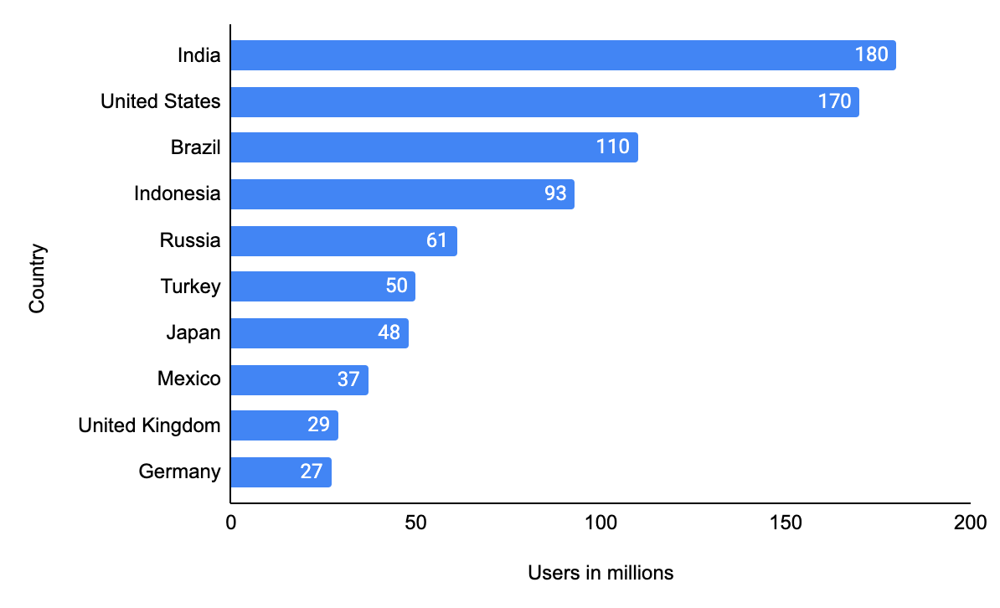
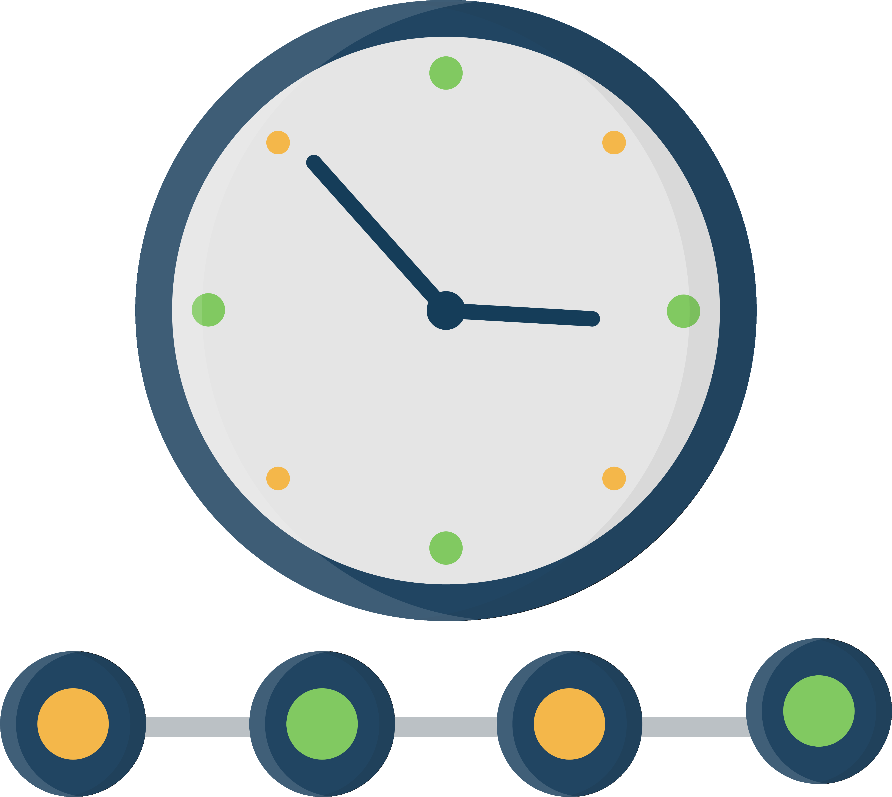

# 033 - Thiết Kế Instagram (Nền Tảng Chia Sẻ Ảnh & Video)

[← Bài trước](032-thiet-ke-newsfeed-system.md) | [Mục lục](README.md) | [Bài tiếp theo →](034-thiet-ke-dich-vu-rut-gon-tinyurl.md)

---


# Thiết Kế Hệ Thống: Instagram (System Design: Instagram)

> [!NOTE]
> Làm quen và nhập môn kiến trúc của Instagram để bắt đầu quá trình thiết kế hệ thống.

---

### Chúng ta sẽ tìm hiểu các nội dung sau:
* **Instagram là gì?** (*What is Instagram?*)
* **Chúng ta sẽ thiết kế Instagram như thế nào?** (*How will we design Instagram?*)

---

## Instagram là gì? (What is Instagram?)

**Instagram** là một ứng dụng mạng xã hội miễn phí cho phép người dùng đăng tải hình ảnh và video ngắn. Người dùng có thể thêm chú thích (*caption*) cho mỗi bài đăng và tận dụng các thẻ hashtag hoặc gắn thẻ vị trí địa lý (*geotags*) để lập chỉ mục (*index*), giúp tìm kiếm nội dung thuận tiện hơn trong phạm vi ứng dụng.

Bài đăng của một người dùng trên Instagram sẽ hiển thị trên bảng tin (*news feed*) của những người theo dõi (*followers*) họ, đồng thời hiển thị công khai cho tất cả mọi người nếu bài đăng đó có gắn thẻ hashtag hoặc vị trí địa lý. Ngoài ra, người dùng có thể tùy chọn thiết lập tài khoản của mình về chế độ riêng tư (*private profile*), giới hạn quyền truy cập chỉ cho những ai đã được phê duyệt theo dõi.

Sự bùng nổ về số lượng người dùng đòi hỏi hệ thống phải bổ sung thêm tài nguyên theo thời gian (máy chủ / *servers*, cơ sở dữ liệu / *databases*, v.v.). Việc nắm bắt chính xác tốc độ tăng trưởng người dùng (*growth rate*) giúp chúng ta dự đoán trước nhu cầu tài nguyên để mở rộng hệ thống một cách chủ động và phù hợp.

Hình minh họa dưới đây thống kê cơ sở người dùng (*user base*) của Instagram tại các quốc gia khác nhau tính đến tháng 1 năm 2022 *(Nguồn: Statista)*:


---



*Các quốc gia sở hữu lượng người dùng Instagram đông đảo nhất (Countries with the most Instagram users)*

---

## Chúng ta sẽ thiết kế Instagram như thế nào? (How will we design Instagram?)

Quy trình thiết kế hệ thống Instagram được phân chia thành 4 bài học chính:

1. **Yêu cầu hệ thống (Requirements):** Đưa ra các yêu cầu chức năng (*functional requirements*) và yêu cầu phi chức năng (*non-functional requirements*) của Instagram. Đồng thời tính toán, ước lượng tài nguyên (*resource estimations*) cần thiết để đáp ứng các yêu cầu đó.
2. **Thiết kế tổng quan (Design):** Trình bày chi tiết luồng xử lý (*workflow*) và vai trò của từng thành phần (*components*), thiết kế giao diện lập trình ứng dụng (*API design*) và lược đồ cơ sở dữ liệu (*database schema*).
3. **Thiết kế chi tiết (Detailed design):** Đi sâu vào chi tiết các thành phần trong kiến trúc Instagram, thảo luận các phương pháp tiếp cận khác nhau để khởi tạo dòng thời gian (*timeline generation*). Ngoài ra, chúng ta cũng sẽ tiến hành đánh giá hệ thống thiết kế đề xuất.
4. **Câu hỏi trắc nghiệm (Quiz):** Kiểm tra mức độ hiểu sâu về toàn bộ thiết kế kiến trúc hệ thống Instagram.

Hãy bắt đầu bằng việc nắm vững các yêu cầu cốt lõi khi thiết kế hệ thống Instagram và tính toán ước lượng tài nguyên trong phần tiếp theo.

---

```
[← Quay lại: Đánh giá hệ thống Bảng tin (Evaluation of a Newsfeed System's …)] 
[Đánh dấu hoàn thành] 
[Tiếp theo: Các yêu cầu thiết kế của Instagram (Requirements of Instagram's Design) →]
```

---

# Các Yêu Cầu Thiết Kế Của Instagram (Requirements of Instagram's Design)

Tìm hiểu chi tiết các yêu cầu cùng với nhu cầu tính toán (*computational needs*) cho dịch vụ Instagram.

### Chúng ta sẽ tìm hiểu các nội dung sau:
* **Các yêu cầu (Requirements)**
  * Yêu cầu chức năng (*Functional requirements*)
  * Yêu cầu phi chức năng (*Non-functional requirements*)
* **Ước tính tài nguyên (Resource estimation)**
  * Ước tính dung lượng lưu trữ (*Storage estimation*)
  * Ước tính băng thông (*Bandwidth estimation*)
  * Ước tính số lượng máy chủ (*Number of servers estimation*)
* **Tự thực hành (Try it yourself)**
* **Các khối kiến trúc xây dựng sẽ sử dụng (Building blocks we will use)**

---

## Các yêu cầu (Requirements)

Chúng ta sẽ tập trung vào một số tính năng quan trọng nhất của Instagram nhằm giữ cho bản thiết kế vừa trực quan vừa giải quyết đúng bài toán cốt lõi. Hãy liệt kê các yêu cầu cụ thể của hệ thống:

### Yêu cầu chức năng (Functional requirements)
* **Đăng tải hình ảnh và video (Post photos and videos):** Người dùng có thể tải lên ảnh và video lên Instagram.
* **Theo dõi và hủy theo dõi người dùng (Follow and unfollow users):** Người dùng có thể theo dõi (*follow*) hoặc bỏ theo dõi (*unfollow*) người dùng khác trên nền tảng.
* **Thích hoặc bỏ thích bài đăng (Like or dislike posts):** Người dùng có thể tương tác thích (*like*) hoặc bỏ thích bài đăng từ các tài khoản mà họ đang theo dõi.
* **Tìm kiếm ảnh và video (Search photos and videos):** Người dùng có thể tìm kiếm hình ảnh và video dựa trên chú thích (*caption*) và vị trí địa lý (*location*).
* **Khởi tạo bảng tin (Generate news feed):** Người dùng có thể xem bảng tin bao gồm ảnh và video (sắp xếp theo thứ tự thời gian - *chronological order*) từ tất cả những người dùng mà họ đang theo dõi. Người dùng cũng có thể xem ảnh gợi ý (*suggested photos*) và ảnh quảng cáo (*promoted photos*) trên bảng tin của họ.

---

### Yêu cầu phi chức năng (Non-functional requirements)
* **Khả năng mở rộng (Scalability):** Hệ thống phải có khả năng mở rộng quy mô linh hoạt để đáp ứng hàng triệu người dùng cả về mặt tài nguyên tính toán (*computational resources*) lẫn dung lượng lưu trữ (*storage*).
* **Độ trễ (Latency):** Độ trễ để tổng hợp và hiển thị bảng tin (*news feed generation latency*) phải ở mức cực kỳ thấp.
* **Tính sẵn sàng cao (Availability / High Availability):** Hệ thống bắt buộc phải duy trì tính sẵn sàng cao.
* **Độ bền dữ liệu (Durability):** Mọi nội dung đã tải lên (ảnh và video) tuyệt đối không bao giờ được phép mất mát hay thất lạc.
* **Tính nhất quán (Consistency):** Chúng ta có thể chấp nhận thỏa hiệp đôi chút về tính nhất quán. Việc một nội dung (ảnh hoặc video) mất một khoảng thời gian nhất định mới hiển thị trên bảng tin của những người theo dõi ở vùng địa lý xa xôi (*distant region*) là hoàn toàn chấp nhận được.
* **Độ tin cậy và Khả năng chịu lỗi (Reliability & Fault Tolerance):** Hệ thống bắt buộc phải có khả năng chịu đựng được các sự cố lỗi phần cứng cũng như lỗi phần mềm (*hardware and software failures*).

---

## Ước tính tài nguyên (Resource estimation)

Hệ thống của chúng ta thuộc mô hình **thiên về đọc dữ liệu (Read-Heavy)** bởi vì người dùng dành phần lớn thời gian để lướt xem bảng tin của người khác hơn là tự sáng tạo và đăng tải nội dung mới. 

Mục tiêu trọng tâm của chúng ta là thiết kế một hệ sinh thái có thể truy xuất ảnh và video kịp thời, đúng hạn (*on time*). Không có giới hạn cứng về số lượng ảnh hay video mà một người dùng có thể tải lên, đồng nghĩa với việc **quản lý lưu trữ hiệu quả (efficient storage management)** phải là mối quan tâm hàng đầu và tiên quyết trong thiết kế hệ thống này. 

Instagram hiện hỗ trợ khoảng **1 tỷ người dùng trên toàn cầu**, chia sẻ **95 triệu hình ảnh và video** mỗi ngày. Chúng ta sẽ tiến hành tính toán tài nguyên và xây dựng hệ thống dựa trên các số liệu và yêu cầu này.

> [!IMPORTANT]
> **Các giả định ban đầu phục vụ tính toán:**
> * Tổng số người dùng: **1 tỷ người dùng**, trong đó có **500 triệu người dùng hoạt động hàng ngày (Daily Active Users - DAU)**.
> * Nội dung đăng tải mỗi ngày: Ước tính có **60 triệu hình ảnh** và **35 triệu video** được chia sẻ mỗi ngày trên Instagram.
> * Giới hạn dung lượng tệp: Quy định **3 MB** là kích thước tối đa cho mỗi ảnh và **150 MB** là kích thước tối đa cho mỗi video được tải lên.
> * Tần suất sử dụng: Trung bình mỗi người dùng gửi **20 yêu cầu (Requests)** thuộc bất kỳ loại nào mỗi ngày đến dịch vụ.

---

### Ước tính dung lượng lưu trữ (Storage estimation)

Chúng ta cần ước tính dung lượng lưu trữ (*storage capacity*), băng thông (*bandwidth*) và số lượng máy chủ (*number of servers*) cần thiết để đáp ứng lượng người dùng và nội dung khổng lồ nói trên.

**Dung lượng lưu trữ phát sinh mỗi ngày sẽ là:**
* Đối với ảnh: $60\text{ triệu ảnh/ngày} \times 3\text{ MB} = 180\text{ TeraBytes / ngày}$
* Đối với video: $35\text{ triệu video/ngày} \times 150\text{ MB} = 5.250\text{ TB / ngày}$
* **Tổng dung lượng nội dung mỗi ngày:** $180\text{ TB} + 5.250\text{ TB} = 5.430\text{ TB/ngày}$

**Tổng không gian lưu trữ yêu cầu cho một năm:**
$$5.430\text{ TB/ngày} \times 365\text{ (ngày/năm)} = 1.981.950\text{ TB} \approx 1.981,95\text{ PetaBytes}$$

---


*Tổng dung lượng lưu trữ mà hệ thống lưu trữ của Instagram yêu cầu trong vòng một năm:*
$$\text{Tổng lưu trữ/năm} = \left[(3\text{ MB/ảnh} \times 60\text{ triệu ảnh}) + (150\text{ MB/video} \times 35\text{ triệu video})\right] \times 365\text{ ngày} = 1.981,95\text{ PB}$$

---

> [!NOTE]
> Bên cạnh dữ liệu ảnh và video, chúng ta đang tạm thời bỏ qua dữ liệu bình luận (*comments*), trạng thái chia sẻ (*status sharing data*), v.v. 
> 
> Hơn nữa, chúng ta còn phải lưu trữ thông tin hồ sơ người dùng (*user profile information*) và siêu dữ liệu của bài đăng (*post metadata*) như `userID`, `photoID`, v.v. 
> 
> Do đó, xét về mặt chính xác tuyệt đối, chúng ta sẽ cần nhiều hơn con số **$5.430\text{ TB/ngày}$**. Tuy nhiên, để giữ cho bản thiết kế mạch lạc và dễ tiếp cận, chúng ta sẽ thống nhất sử dụng mức tải chuẩn là **$5.430\text{ TB/ngày}$**.

---

### Ước tính băng thông (Bandwidth estimation)

Dựa theo ước tính dung lượng lưu trữ, dịch vụ của chúng ta sẽ tiếp nhận một lượng dữ liệu ghi vào là **$5.430\text{ TB}$** mỗi ngày, tương ứng với:

$$\frac{5.430\text{ TB}}{24 \times 60 \times 60} = \frac{5.430\text{ TB}}{86.400\text{ giây}} \approx 62,84\text{ GB/giây} \approx 502,8\text{ Gbps}$$

Vì mỗi bức ảnh và video tải lên đều cần phải được phân phối đến bảng tin của tất cả những người theo dõi người dùng đó, giả định tỉ lệ giữa người đọc và người ghi (**Ratio of Readers to Writers**) là **100:1**. Do đó, chúng ta sẽ cần mức băng thông đọc lớn gấp 100 lần...

---

# Thiết Kế Hệ Thống: Instagram (System Design: Instagram)

---

## 1. Ước Tính Tài Nguyên Hệ Thống (Tiếp theo)

Băng thông chiều ra (outgoing bandwidth) lớn hơn đáng kể so với băng thông chiều vào (incoming bandwidth). Hãy cùng giả định các thông số sau:

- **Băng thông chiều vào (Incoming bandwidth):** $\approx 502.8 \text{ Gbps}$
- **Băng thông chiều ra yêu cầu (Required outgoing bandwidth):** $\approx 100 \times 502.8 \text{ Gbps} \approx 50.28 \text{ Tbps}$

### Tổng băng thông yêu cầu (Total bandwidth required)

$$\begin{aligned}
\text{Outgoing bandwidth} &= 50.28 \text{ Tbps} \\
\text{Incoming bandwidth} &= 502.8 \text{ Gbps} \\
\hline
\mathbf{Total} &= \mathbf{50.78 \text{ Tbps}}
\end{aligned}$$

> [!NOTE]
> Băng thông chiều ra (Outgoing bandwidth) ở mức rất cao. Chúng ta có thể áp dụng các kỹ thuật nén dữ liệu (compression) để giảm đáng kể kích thước tệp phương tiện truyền thông (media). Hơn nữa, chúng ta sẽ đặt nội dung ở vị trí gần với người dùng thông qua mạng phân phối nội dung CDN (Content Delivery Network) cùng các bộ nhớ đệm (caches) khác đặt tại các điểm trung chuyển Internet (IXP - Internet Exchange Points) và các nhà cung cấp dịch vụ mạng (ISPs - Internet Service Providers) nhằm phân phối nội dung với tốc độ cao và độ trễ thấp (low latency).

---

### Ước tính số lượng máy chủ (Number of servers estimation)

Hệ thống cần xử lý các yêu cầu đồng thời (concurrent requests) đến từ 500 triệu người dùng hoạt động hàng ngày (DAU - Daily Active Users). Giả định rằng một máy chủ Instagram điển hình có thể xử lý 100 yêu cầu mỗi giây (requests per second):

- **Số lượng yêu cầu từ mỗi người dùng mỗi ngày (Requests by each user per day):** $20$
- **Số truy vấn một máy chủ xử lý mỗi giây (Queries handled by a server per second):** $100$
- **Số truy vấn một máy chủ xử lý mỗi ngày (Queries handled by a server per day):** 
  $$100 \times 60 \times 60 \times 24 = 8,640,000 \text{ truy vấn/ngày}$$

$$\text{Số lượng máy chủ} = \frac{\text{Số người dùng hoạt động} \times \text{Số yêu cầu từ mỗi người dùng mỗi ngày}}{\text{Số truy vấn một máy chủ xử lý mỗi ngày}}$$

$$\text{Số lượng máy chủ} = \frac{500,000,000 \times 20}{8,640,000} \approx 1157 \text{ máy chủ}$$

Phép tính này chỉ ra rằng chúng ta cần khoảng **1157 máy chủ** để xử lý toàn bộ truy vấn trong hệ thống Instagram.

| Thông số | Giá trị |
| :--- | :--- |
| **Số lượng máy chủ yêu cầu cho hệ thống Instagram (Number of servers required)** | **1157 máy chủ (servers)** |


---

## 2. Tự Thử Nghiệm Phân Tích (Try It Yourself)

Hãy phân tích mức độ ảnh hưởng của số lượng ảnh tải lên mỗi ngày đối với các yêu cầu về dung lượng lưu trữ (storage) và băng thông (bandwidth). Nhằm mục đích này, hãy thử thay đổi các giá trị trong bảng dưới đây để tính toán các ước lượng. Chúng tôi đã thiết lập mặc định 20 yêu cầu trên mỗi người dùng mỗi ngày trong phép tính sau:

| Yêu cầu (Requirements) | Tính toán (Calculations) |
| :--- | :--- |
| **Số lượng ảnh mỗi ngày (tính theo triệu) - Number of photos per day (in millions)** | 60 |
| **Kích thước mỗi ảnh (tính theo MB) - Size of each photo (in MB)** | 3 |
| **Số lượng video mỗi ngày (tính theo triệu) - Number of videos per day (in millions)** | 35 |
| **Kích thước mỗi video (tính theo MB) - Size of each video (in MB)** | 150 |
| **Số người dùng hoạt động hàng ngày (tính theo triệu) - Number of daily active users (in millions)** | 500 |
| **Số yêu cầu một máy chủ có thể xử lý mỗi ngày - Number of requests a server can handle per day** | 8640000 |
| **Ước tính dung lượng lưu trữ mỗi ngày (tính theo TB) - Storage estimation per day (in TB)** | 5430 |
| **Băng thông chiều vào (Incoming bandwidth - Gb/s)** | 502.8 |
| **Số lượng máy chủ cần thiết (Number of servers needed)** | 1157 |

---

## 3. Các Khối Xây Dựng Hệ Thống Sẽ Sử Dụng (Building Blocks We Will Use)

Trong bài học tiếp theo, chúng ta sẽ tập trung vào thiết kế mức cao (High-Level Design) của Instagram. Thiết kế này sẽ tận dụng nhiều khối kiến trúc nền tảng (building blocks) đã được thảo luận trong các chương mở đầu. Chúng ta sẽ sử dụng các khối sau trong bản thiết kế:


### Các khối nền tảng sử dụng trong thiết kế Instagram:
- **Bộ cân bằng tải (Load Balancer):** Bộ cân bằng tải tại các tầng khác nhau sẽ đảm bảo phân phối yêu cầu đồng đều và thông suốt giữa các máy chủ sẵn sàng hoạt động.
- **Cơ sở dữ liệu (Databases):** Cơ sở dữ liệu được dùng để lưu trữ siêu dữ liệu (metadata) của người dùng, tài khoản và mối quan hệ giữa chúng.
- **Kho lưu trữ nhị phân lớn (Blob Store):** Lưu trữ Blob (Blob storage) là thành phần cần thiết để lưu trữ các loại nội dung đa phương tiện đa dạng như hình ảnh, video, v.v.
- **Bộ điều phối tác vụ (Task Scheduler):** Bộ điều phối tác vụ lên lịch thực thi các sự kiện trên cơ sở dữ liệu, chẳng hạn như dọn dẹp và xóa các bản ghi có thời gian tồn tại (TTL - Time To Live) vượt quá giới hạn.
- **Bộ nhớ đệm (Cache):** Cache lưu trữ các yêu cầu nội dung được truy cập thường xuyên nhất.
- **Mạng phân phối nội dung (CDN - Content Delivery Network):** CDN được sử dụng để phân phối nội dung hiệu quả tới người dùng cuối, giúp giảm độ trễ (latency/delay) và giảm tải cho các cụm máy chủ gốc (origin servers).

Trong bài học tiếp theo, chúng ta sẽ đi sâu vào thiết kế mức cao của hệ thống Instagram.

---

## 4. Thiết Kế Instagram (Design of Instagram)

Tìm hiểu thiết kế mức cao (High-Level Design) của Instagram và nắm vững mô hình dữ liệu (data model) của hệ thống.

### Nội dung bao gồm:
- **Thiết kế mức cao (High-level design)**
- **Thiết kế API (API design)**
  - Đăng tải ảnh hoặc video (Post photos or videos)
  - Theo dõi và hủy theo dõi người dùng (Follow and unfollow users)
  - Thích hoặc bỏ thích bài viết (Like or dislike posts)
  - Tìm kiếm ảnh hoặc video (Search photos or videos)
  - Khởi tạo bảng tin (Generate news feed)
- **Lược đồ lưu trữ (Storage schema)**
  - Cơ sở dữ liệu quan hệ hay phi quan hệ (Relational or non-relational database)
  - Định nghĩa các bảng dữ liệu (Define tables)
- **Ước tính dữ liệu (Data estimation)**

---

### Thiết kế mức cao (High-Level Design)

Ở mức độ tổng quan, hệ thống của chúng ta phải cho phép người dùng tải lên (upload), xem (view) và tìm kiếm (search) hình ảnh cũng như video. Để tải ảnh và video lên, chúng ta cần lưu trữ chúng vào hệ thống lưu trữ, và khi có yêu cầu truy xuất, chúng ta cần lấy dữ liệu từ tầng lưu trữ này ra. Ngoài ra, người dùng cũng phải được phép theo dõi (follow) lẫn nhau.


#### Luồng tương tác mức cao của Instagram:
- **Người dùng A (User A), Người dùng B (User B), Người dùng C (User C)**
- User B gửi yêu cầu theo dõi User A (`Follow User A`)
- User C gửi yêu cầu theo dõi User B (`Follow User B`)
- Người dùng thực hiện các thao tác:
  - Tải lên ảnh/video (`Upload photo/video`)
  - Xem/tìm kiếm ảnh/video (`View/search image/video`)
  - Tạo phản hồi (`Generate feedback`)
- Tất cả dữ liệu ảnh, video và tương tác liên kết chặt chẽ với tầng lưu trữ trung tâm (`Storage`).

---

### Thiết kế API (API Design)

Phần này mô tả các API được người dùng gọi để thực hiện các tác vụ khác nhau (tải lên, thích và xem ảnh/video) trên Instagram. Chúng ta sẽ triển khai các REST API cho các tác vụ này. Hãy cùng xây dựng API cho từng tính năng sau:

1. Đăng tải hình ảnh và video (Post photos and videos)
2. Theo dõi và hủy theo dõi người dùng (Follow and unfollow users)
3. Thích hoặc hủy thích bài viết (Like or dislike posts)
4. Tìm kiếm hình ảnh và video (Search photos and videos)
5. Tạo bảng tin (Generate a news feed)

> [!IMPORTANT]
> Tất cả các lệnh gọi API dưới đây đều sẽ truyền kèm tham số `userID`, định danh duy nhất cho người dùng đang thực hiện hành động. Chúng ta sẽ chỉ thảo luận chi tiết về các tham số mới xuất hiện trong từng lệnh gọi.

#### 1. Đăng tải ảnh hoặc video (Post photos or videos)

Phương thức `POST` được sử dụng để gửi ảnh/video từ phía người dùng lên máy chủ thông qua API `/postMedia`. Cấu trúc API `/postMedia` như sau:

```http
POST /postMedia
```

```text
postMedia(userID, media_type, list_of_hashtags, caption)
```

| Tham số (Parameter) | Mô tả (Description) |
| :--- | :--- |
| `media_type` | Chỉ định loại nội dung đa phương tiện (ảnh hoặc video) trong bài viết. |
| `list_of_hashtags` | Đại diện cho danh sách tất cả các hashtag trong một bài viết (giới hạn tối đa là 30 hashtag). |
| `caption` | Đoạn văn bản chú thích trong bài viết của người dùng (giới hạn tối đa là 2.200 ký tự). |

---

#### 2. Theo dõi và hủy theo dõi người dùng (Follow and unfollow users)

API `/followUser` được sử dụng khi một người dùng theo dõi một người dùng khác trên Instagram. Cấu trúc API `/followUser` như sau:

```http
POST /followUser
```

```text
followUser(userID, target_userID)
```

| Tham số (Parameter) | Mô tả (Description) |
| :--- | :--- |
| `target_userID` | Định danh người dùng mục tiêu cần được theo dõi (`userID` của tài khoản được theo dõi). |

> [!NOTE]
> API `/unfollowUser` sử dụng cùng tập tham số tương tự khi một người dùng hủy theo dõi một tài khoản khác trên Instagram:
> ```text
> unfollowUser(userID, target_userID)
> ```

---

#### 3. Thích hoặc bỏ thích bài viết (Like or dislike posts)

API `/likePost` được sử dụng khi người dùng nhấn thích một bài viết của ai đó trên Instagram:

```http
POST /likePost
```

```text
likePost(userID, post_id)
```

| Tham số (Parameter) | Mô tả (Description) |
| :--- | :--- |
| `userID` | Định danh người dùng thực hiện hành động thích bài viết. |
| `post_id` | Định danh duy nhất của bài viết được thích. |

---

### Tiếp tục API Bày tỏ cảm xúc (Like / Dislike)

| Tham số (*Parameter*) | Mô tả (*Description*) |
| :--- | :--- |
| `post_id` | Chỉ định định danh duy nhất (ID) của bài đăng. |

API `/dislikePost` sử dụng các tham số tương tự khi người dùng bỏ thích (dislike/unlike) một bài đăng của ai đó trên Instagram.

---

### Tìm kiếm hình ảnh hoặc video (*Search photos or videos*)

Phương thức HTTP `GET` được sử dụng khi người dùng tìm kiếm bất kỳ hình ảnh hoặc video nào bằng từ khóa (*keyword*) hoặc hashtag. API `/searchPhotos` có định dạng như sau:

```http
searchPhotos(userID, keyword)
```

| Tham số (*Parameter*) | Mô tả (*Description*) |
| :--- | :--- |
| `keyword` | Biểu thị chuỗi ký tự (tên người dùng - *username*, *hashtag*, và địa điểm - *places*) được người dùng nhập vào thanh tìm kiếm. |

> [!NOTE]  
> **Lưu ý:** Instagram hiển thị các bài đăng có mức độ tiếp cận (*reach*) cao nhất (những bài có nhiều lượt thích và lượt xem hơn) khi tìm kiếm một từ khóa cụ thể. Ví dụ: nếu người dùng thực hiện tìm kiếm dựa trên vị trí bằng cách sử dụng từ khóa *"London, United Kingdom"*, Instagram sẽ hiển thị các bài đăng theo thứ tự từ mức độ tiếp cận tối đa đến tối thiểu. Thay vì hiển thị toàn bộ bài đăng cùng một lúc, dữ liệu sẽ được tải dần dần khi cuộn trang (*infinite scrolling / lazy loading*).

---

### Khởi tạo bảng tin (*Generate news feed*)

Phương thức HTTP `GET` được sử dụng khi người dùng xem bảng tin (*news feed*) của họ thông qua API `/viewNewsfeed`. API `/viewNewsfeed` có định dạng như sau:

```http
viewNewsfeed(userID, generate_timeline)
```

| Tham số (*Parameter*) | Mô tả (*Description*) |
| :--- | :--- |
| `generate_timeline` | Biểu thị thời điểm mà người dùng gửi yêu cầu khởi tạo bảng tin (*news feed generation*). Instagram hiển thị các bài đăng mà người dùng chưa xem trong khoảng thời gian giữa lần yêu cầu bảng tin trước đó và lần yêu cầu bảng tin hiện tại. |

---

## Lược đồ lưu trữ (*Storage schema*)

Bây giờ, hãy cùng định nghĩa mô hình dữ liệu (*data model*) của chúng ta:

### Cơ sở dữ liệu quan hệ hay phi quan hệ (*Relational or non-relational database*)

Việc lựa chọn đúng loại cơ sở dữ liệu cho hệ thống Instagram là vô cùng thiết yếu, nhưng đâu mới là sự lựa chọn chuẩn xác — SQL hay NoSQL? 

Dữ liệu của chúng ta vốn dĩ có bản chất quan hệ (*inherently relational*), và chúng ta cần thứ tự cho dữ liệu (các bài đăng phải xuất hiện theo thứ tự thời gian - *chronological order*) cùng với yêu cầu không mất mát dữ liệu ngay cả khi có sự cố xảy ra (tính bền vững của dữ liệu - *Data Durability*). Hơn nữa, trong trường hợp của chúng ta, hệ thống sẽ hưởng lợi rất lớn từ các truy vấn quan hệ (*relational queries*) như truy xuất danh sách người theo dõi (*followers*) hoặc hình ảnh dựa trên `userID`. Do đó, các cơ sở dữ liệu dựa trên SQL đáp ứng trọn vẹn các yêu cầu này.

Vì vậy, chúng ta sẽ lựa chọn một cơ sở dữ liệu quan hệ (*relational database*) và lưu trữ dữ liệu liên quan của mình trong cơ sở dữ liệu đó.

### Định nghĩa các bảng (*Define tables*)

Ở mức độ cơ bản, chúng ta cần các bảng sau:

- **Users**: Bảng này lưu trữ toàn bộ dữ liệu liên quan đến người dùng như `ID`, tên (`name`), `email`, tiểu sử (`bio`), vị trí địa lý (`location`), ngày tạo tài khoản (`date of account creation`), thời gian đăng nhập lần cuối (`time of the last login`), v.v.
- **Followers**: Bảng này lưu trữ các mối quan hệ giữa những người dùng. Trong Instagram, chúng ta có mối quan hệ một chiều (*unidirectional relationship*), ví dụ: nếu người dùng A chấp nhận yêu cầu theo dõi từ người dùng B, người dùng B có thể xem bài đăng của người dùng A, nhưng điều ngược lại thì không hợp lệ (không tự động xảy ra).
- **Photos**: Bảng này lưu trữ toàn bộ thông tin liên quan đến hình ảnh như `ID`, vị trí địa lý (`location`), chú thích (`caption`), thời gian tạo (`time of creation`), v.v. Chúng ta cũng cần giữ `userID` để xác định bức ảnh nào thuộc về người dùng nào. `userID` là một khóa ngoại (*foreign key*) tham chiếu từ bảng `Users`.
- **Videos**: Bảng này lưu trữ toàn bộ thông tin liên quan đến video như `ID`, vị trí địa lý (`location`), chú thích (`caption`), thời gian tạo (`time of creation`), v.v. Chúng ta cũng cần giữ `userID` để xác định video nào thuộc về người dùng nào. `userID` là một khóa ngoại (*foreign key*) tham chiếu từ bảng `Users`.

---

> [!IMPORTANT]  
> **Điểm cần suy ngẫm (*Point to Ponder*)**  
> **Câu hỏi (*Question*):** Chúng ta nên lưu trữ hình ảnh và video ở đâu?  
>  
> **Giải đáp (*Answer*):**  
> Chúng ta sẽ lưu trữ hình ảnh và video trong một kho lưu trữ đối tượng nhị phân lớn (*Blob Store*, chẳng hạn như Amazon S3) và chỉ lưu đường dẫn (*path*) của ảnh hoặc video đó vào trong bảng cơ sở dữ liệu, vì việc lưu trữ dữ liệu dung lượng lớn trong một hệ thống lưu trữ phân tán (*distributed storage*) là phương án tối ưu và hiệu quả hơn rất nhiều.

---

### Mô hình dữ liệu của Instagram (*The Data model of Instagram*)

Hình minh họa dưới đây trực quan hóa mô hình dữ liệu:

```
               MÔ HÌNH DỮ LIỆU CỦA INSTAGRAM (DATA MODEL)
┌─────────────────────────────────┐       ┌─────────────────────────────────┐
│              Users              │       │            Followers            │
├─────────────────────────────────┤       ├─────────────────────────────────┤
│ userID: INT                     │◄──┐   │ toUserID: INT                   │
│ firstName: VARCHAR(15)          │   └───┤ fromUserID: INT                 │
│ lastName: VARCHAR(15)           │       └─────────────────────────────────┘
│ Email: VARCHAR(15)              │
│ Bio: VARCHAR(150)               │◄──┐   ┌─────────────────────────────────┐
│ Location: VARCHAR(15)           │   │   │              Photo              │
│ AccountCreationDate: DATE       │   │   ├─────────────────────────────────┤
│ LastLogin: DATE                 │   │   │ photoID: INT                    │
└─────────────────────────────────┘   └───┤ userID: INT                     │
                                      │   │ location: VARCHAR(15)           │
                                      │   │ caption: VARCHAR(100)           │
                                      │   │ creationTime: VARCHAR(15)       │
                                      │   │ photoPath: VARCHAR(256)         │
                                      │   └─────────────────────────────────┘
                                      │   ┌─────────────────────────────────┐
                                      │   │              Video              │
                                      │   ├─────────────────────────────────┤
                                      │   │ videoID: INT                    │
                                      └───┤ userID: INT                     │
                                          │ location: VARCHAR(15)           │
                                          │ caption: VARCHAR(100)           │
                                          │ creationTime: VARCHAR(15)       │
                                          │ videoPath: VARCHAR(256)         │
                                          └─────────────────────────────────┘
```

---

## Ước tính dữ liệu (*Data estimation*)

Hãy cùng tính toán lượng dữ liệu mà mỗi bảng sẽ lưu trữ. Cột kích thước mỗi hàng tính bằng byte (*Per row size in bytes*) trong bảng tính sau hiển thị dung lượng dữ liệu trên mỗi hàng của từng bảng. Nó cũng tính toán dung lượng lưu trữ cần thiết cho các số lượng bản ghi cụ thể. 

Ví dụ: dung lượng lưu trữ cần thiết cho 500 triệu người dùng là 111.000 MB, 2.000 MB cho 250 người theo dõi của một người dùng đơn lẻ, 23.640 MB cho 60 triệu bức ảnh, và 13.790 MB cho 35 triệu video. Bạn có thể thay đổi các giá trị trong công cụ tính toán để quan sát sự thay đổi về dung lượng lưu trữ cần thiết. Điều này cung cấp cho chúng ta một ước tính về tốc độ tăng trưởng dữ liệu trong các bảng.

| Tên bảng (*Table Name*) | Kích thước mỗi hàng tính bằng byte (*Per row size in bytes*) | Số lượng tính theo triệu (*Count in Millions*) | Dung lượng lưu trữ cần thiết tính bằng MB (*Storage Needed in MBs*) |
| :--- | :--- | :--- | :--- |
| **Users** | 222 | 500 | 111.000 |
| **Followers** | 8 | 250 | 2.000 |
| **Photos** | 394 | 60 | 23.640 |
| **Videos** | 394 | 35 | 13.790 |

> [!NOTE]  
> **Lưu ý:** Hầu hết các dịch vụ hiện đại đều sử dụng kết hợp cả hai kho lưu trữ SQL và NoSQL. Instagram trên thực tế sử dụng chính thức sự kết hợp giữa cơ sở dữ liệu SQL (PostgreSQL) và NoSQL (Cassandra). Dữ liệu có cấu trúc lỏng lẻo (*loosely structured data*) như việc khởi tạo dòng thời gian (*timeline generation*) thường được lưu trữ trong NoSQL, trong khi dữ liệu có tính quan hệ (*relational data*) được lưu trong kho lưu trữ dựa trên SQL.

Trong bài học tiếp theo, chúng ta sẽ xác định thêm các thành phần khác để tinh chỉnh thiết kế của mình.

---

# Thiết kế chi tiết Instagram (*Detailed Design of Instagram*)

Khám phá thiết kế của Instagram một cách chi tiết và tìm hiểu sự tương tác qua lại giữa các thành phần khác nhau.

Chúng ta sẽ bao gồm các nội dung sau:
- Thêm các thành phần khác (*Add more components*)
- Tải lên, xem và tìm kiếm một bức ảnh (*Upload, view, and search a photo*)
- Khởi tạo dòng thời gian (*Generate a timeline*)
- Phương pháp Kéo (*The pull approach*)
- Phương pháp Đẩy (*The push approach*)
- Phương pháp Tiếp cận lai (*Hybrid approach*)
- Thiết kế hoàn thiện (*Finalized design*)
- Đảm bảo các yêu cầu phi chức năng (*Ensure non-functional requirements*)
- Kết luận (*Conclusion*)

---

## Thêm các thành phần khác (*Add more components*)

Hãy thêm một vài thành phần nữa vào thiết kế của chúng ta:

- **Bộ cân bằng tải (*Load Balancer*):** Để cân bằng tải các yêu cầu (*requests*) đến từ người dùng cuối (*end users*).
- **Máy chủ ứng dụng (*Application Servers*):** Để lưu trữ và phục vụ dịch vụ (*host our service*) cho người dùng cuối.
- **Cơ sở dữ liệu quan hệ (*Relational Database*):** Để lưu trữ dữ liệu của chúng ta.
- **Kho lưu trữ nhị phân lớn (*Blob Storage*):** Để lưu trữ các tệp ảnh và video do người dùng tải lên.

Dưới đây là các sơ đồ kiến trúc thể hiện quá trình tích hợp các thành phần:

- Người dùng cuối (*End users*)
- Bộ cân bằng tải (*Load balancer*)
- Máy chủ ứng dụng (*Application server*)
- Cơ sở dữ liệu quan hệ (*Relational database*)


---

# Bổ sung các thành phần vào thiết kế (Adding components to design)


* **Người dùng cuối (End users)**
* **Bộ cân bằng tải (Load balancer)**
* **Máy chủ ứng dụng (Application server)**
* **Kho lưu trữ nhị phân (Blob storage)**

---

## Tải lên, xem và tìm kiếm ảnh (Upload, view, and search a photo)

Máy khách (Client) gửi yêu cầu tải lên ảnh, **Bộ cân bằng tải (Load balancer)** chuyển yêu cầu tới bất kỳ **Máy chủ ứng dụng (Application server)** nào, máy chủ này sẽ thêm một bản ghi vào cơ sở dữ liệu (Database). Thông báo cập nhật xác nhận bức ảnh đã được lưu trữ thành công được gửi trả về cho người dùng. Nếu gặp lỗi, người dùng cũng sẽ nhận được thông báo tương ứng.

Quy trình xem ảnh cũng diễn ra tương tự như luồng đã đề cập ở trên. Client gửi yêu cầu xem ảnh, và bức ảnh phù hợp khớp với yêu cầu sẽ được truy xuất từ cơ sở dữ liệu và hiển thị cho người dùng. Client cũng có thể cung cấp từ khóa để tìm kiếm một hình ảnh cụ thể.

Lượng yêu cầu đọc (**Read requests**) luôn lớn hơn nhiều so với yêu cầu ghi (**Write requests**) và hệ thống cũng cần thời gian để tải nội dung lên. Sẽ tối ưu và hiệu quả hơn rất nhiều nếu chúng ta tách riêng các dịch vụ ghi/tải lên (**Write/Upload services**) và dịch vụ đọc (**Read services**). Nhiều dịch vụ được vận hành bởi nhiều cụm máy chủ sẽ xử lý các yêu cầu tương ứng:
* **Dịch vụ đọc (Read service):** Đảm nhiệm các tác vụ truy xuất nội dung theo yêu cầu cho người dùng.
* **Dịch vụ ghi (Write service):** Hỗ trợ việc tải nội dung lên hệ thống.

Chúng ta cũng cần sử dụng **Bộ nhớ đệm (Cache)** dữ liệu để xử lý hàng triệu lượt đọc. Kỹ thuật này giúp cải thiện trải nghiệm người dùng bằng cách tăng tốc quá trình truy xuất dữ liệu. Chúng ta cũng sẽ lựa chọn giải pháp **Tải lười (Lazy loading)**, giúp giảm thiểu tối đa thời gian chờ đợi của client. Nó cho phép tải nội dung dần khi người dùng cuộn màn hình (scroll), nhờ đó tiết kiệm băng thông (**Bandwidth**) và tập trung tải nội dung mà người dùng hiện đang xem trực tiếp. Điều này giúp cải thiện độ trễ (**Latency**) khi xem hoặc tìm kiếm một bức ảnh/video cụ thể trên Instagram.

Thiết kế cập nhật được mô tả như sau:

---

### Các thao tác khác nhau trên ảnh (Various operations on photos)


* **Bộ cân bằng tải (Load balancer)**
* **Máy chủ ứng dụng - Ghi (Application server - Write)**
* **Cơ sở dữ liệu quan hệ (Relational database)**
* **Kho lưu trữ nhị phân (Blob storage)**
* ...
* **Người dùng ghi (Write users)**
* **Người dùng đọc (Read users)**
* ...
* **Bộ cân bằng tải (Load balancer)**
* **Máy chủ ứng dụng - Ghi (Application server - Write)**
* **Máy chủ ứng dụng - Đọc (Application server - Read)**
* ...
* **Máy chủ ứng dụng - Đọc (Application server - Read)**
* **Bộ nhớ đệm (Cache)**

---

## Khởi tạo dòng thời gian (Generate a timeline)

Nhiệm vụ tiếp theo của chúng ta là khởi tạo dòng thời gian (Timeline/News Feed) dành riêng cho từng người dùng. Hãy cùng phân tích các hướng tiếp cận khác nhau cùng với ưu, nhược điểm của chúng để lựa chọn chiến lược phù hợp.

### Hướng tiếp cận Kéo (The pull approach)

Khi một người dùng mở ứng dụng Instagram, hệ thống sẽ gửi một yêu cầu để khởi tạo timeline. Trước tiên, chúng ta truy xuất danh sách những người mà người dùng đó đang theo dõi (**Followees/Following list**), lấy các bức ảnh họ mới đăng gần đây, lưu trữ chúng vào các hàng đợi (**Queues**), và hiển thị chúng cho người dùng. 

Tuy nhiên, hướng tiếp cận này phản hồi rất chậm vì chúng ta phải tạo mới timeline mỗi lần người dùng mở Instagram. 

> [!TIP]
> Chúng ta có thể giảm đáng kể độ trễ cảm nhận bởi người dùng (**User-perceived latency**) bằng cách tạo timeline ở chế độ ngoại tuyến (**Generate timeline offline / Pre-computation**). Ví dụ: chúng ta thiết lập một dịch vụ chuyên biệt thực hiện việc nạp trước dữ liệu liên quan cho người dùng từ sớm; ngay khi người đó mở Instagram, hệ thống chỉ việc hiển thị timeline đã chuẩn bị sẵn. Điều này giúp hạ thấp tỷ lệ độ trễ (**Latency rate**) hiển thị dòng thời gian.

Hãy cùng xem qua các slide dưới đây để hiểu rõ vấn đề và giải pháp của nó:

---


* **Người dùng mở Instagram (User Opens Instagram)**  
*(1 of 5)*

---


* **Người dùng mở Instagram (User Opens Instagram)**
* **Dịch vụ dòng thời gian (Timeline service)**
* **Gửi yêu cầu (Send request)**  
*Một yêu cầu khởi tạo timeline được gửi đến dịch vụ dòng thời gian (A request to generate a timeline is sent to the timeline service).*  
*(2 of 5)*

---


* **Người dùng mở Instagram (User Opens Instagram)**
* **Dịch vụ dòng thời gian (Timeline service)**
* **Gửi yêu cầu (Send request)**
* **Lấy danh sách người theo dõi / người được theo dõi (Fetch the followers list)**
* **Lưu trữ (Storage)**  
*Dịch vụ dòng thời gian truy xuất danh sách những người theo dõi/được theo dõi của người dùng đó từ bộ lưu trữ (The timeline service fetches the list of followers for that user from the storage).*  
*(3 of 5)*

---


* **Người dùng mở Instagram (User Opens Instagram)**
* **Dịch vụ dòng thời gian (Timeline service)**
* **Gửi yêu cầu (Send request)**
* **Các bài đăng gần đây (Recent posts):** `A1`, `B1`, `C1`, `D1`, `C2`
* **Kéo ảnh về (Pull photos)**  
*Dịch vụ dòng thời gian truy xuất các bài đăng gần đây của những người được theo dõi (The timeline service fetches the recent posts of the followers).*  
*(4 of 5)*

---


* **Người dùng mở Instagram (User Opens Instagram)**
* **Dịch vụ dòng thời gian (Timeline service)**
* **Gửi yêu cầu (Send request)**
* **Các bài đăng gần đây (Recent posts):** `A1`, `B1`, `C1`, `D1`, `C2`
* **Kéo ảnh về (Pull photos)**
* **Tạo timeline (Generate timeline):** `A1`, `D1`, `. . .`, `. . .`
* **Gửi cho người dùng (Send to user)**  
*Hiển thị các ảnh đã truy xuất lên timeline của người dùng (Display the fetched photos on the user's timeline).*  
*(5 of 5)*

---

### Điểm cần suy ngẫm (Point to Ponder)

> [!NOTE]
> **Câu hỏi (Question):**  
> Nhược điểm của hướng tiếp cận kéo (**Pull approach**) là gì?

<details>
<summary><b>Xem câu trả lời (Answer)</b></summary>

Instagram là một hệ thống thiên về đọc (**Read-heavy system**). Rất nhiều người dùng không bao giờ đăng tải bức ảnh nào mà chỉ xem bài đăng của người khác. Do đó, các lệnh gọi mà chúng ta thực hiện để truy xuất bài đăng gần đây từ mỗi người họ theo dõi thường sẽ trả về kết quả rỗng. Vì vậy, chúng ta phải luôn ghi nhớ rằng đây không phải là một hệ thống thiên về ghi (**Write-heavy system**) và cần phát triển một giải pháp khả thi để giải quyết bài toán này.
</details>

---

### Hướng tiếp cận Đẩy (The push approach)

Trong mô hình tiếp cận đẩy (**Push approach / Fan-out on write**), mỗi người dùng chịu trách nhiệm chủ động đẩy (**Push**) nội dung họ đã đăng vào dòng thời gian của những người đang theo dõi họ. 
* Trong hướng tiếp cận trước, chúng ta kéo bài đăng từ từng người được theo dõi (**Pull on read**).
* Trong hướng tiếp cận hiện tại, chúng ta chủ động đẩy bài đăng tới từng người theo dõi (**Push on write**).

Bây giờ, chúng ta chỉ cần lấy đúng dữ liệu đã được đẩy sẵn về cho người dùng cụ thể đó để hiển thị timeline. Hướng tiếp cận đẩy đã triệt tiêu được rất nhiều yêu cầu trả về kết quả rỗng khi những người được theo dõi không có bài đăng mới nào trong một khoảng thời gian nhất định.

---

### Hướng tiếp cận dựa trên đẩy (Push-based approach)




* **Danh sách bài viết:** `A1`, `B1`, `C1`, `D1`, `B2`, `C2`
* **Hàng đợi dòng thời gian (Timeline queue)**
* **Dịch vụ dòng thời gian (Timeline service)**
* **Người dùng (User):**
  * Mở Instagram (**Opens Instagram**)
  * Gửi yêu cầu (**Send request**)
* **Đẩy ảnh (Push photos)**
* **Tạo dòng thời gian (Generate timeline):** `A1`, `D1`, `. . .`, `. . .`
* **Gửi tới người dùng (Send to user)**

---

### Điểm Cần Suy Ngẫm (Point to Ponder)

> [!NOTE]
> **Câu hỏi (Question):**
> Nhược điểm của phương pháp Đẩy (Push approach) là gì?

<details>
<summary><strong>Ẩn câu trả lời (Hide Answer)</strong></summary>

Hãy xem xét một tài khoản thuộc về một người nổi tiếng (celebrity), chẳng hạn như Cristiano Ronaldo, người có hơn 400 triệu người theo dõi (followers). Vì vậy, nếu anh ấy đăng một bức ảnh hoặc video, chúng ta sẽ phải đẩy (push) các liên kết của bức ảnh/video đó tới hơn 400 triệu người dùng, điều này là cực kỳ kém hiệu quả (*inefficient* - gây hiện tượng *fan-out write bottleneck*).
</details>

---

### Phương Pháp Tiếp Cận Lai (Hybrid Approach)

Hãy chia người dùng của chúng ta thành hai nhóm đối tượng:
- **Người dùng theo cơ chế Đẩy (Push-based users):** Những người dùng có số lượng người theo dõi ở mức hàng trăm hoặc hàng nghìn.
- **Người dùng theo cơ chế Kéo (Pull-based users):** Những người dùng là người nổi tiếng (celebrities) và có số lượng người theo dõi lên tới hàng trăm nghìn hoặc hàng triệu.

Dịch vụ tạo dòng thời gian (**Timeline Service**) sẽ kéo (*pull*) dữ liệu từ những người theo dõi thuộc nhóm *pull-based* và thêm nó vào dòng thời gian (*timeline*) của người dùng. Ngược lại, những người dùng thuộc nhóm *push-based* sẽ chủ động đẩy (*push*) bài đăng của họ tới dịch vụ dòng thời gian của những người theo dõi họ để dịch vụ dòng thời gian có thể cập nhật vào dòng thời gian của người dùng.


Chúng ta đã có phương pháp tạo dòng thời gian, nhưng chúng ta sẽ lưu trữ dòng thời gian ở đâu? Chúng ta lưu trữ dòng thời gian của người dùng tương ứng với một mã định danh người dùng (**userID**) trong một kho lưu trữ Khóa - Giá trị (**Key-Value Store**). 

Khi có yêu cầu từ client, chúng ta sẽ nạp (*fetch*) dữ liệu từ kho lưu trữ Key-Value và hiển thị cho người dùng. Khóa (*Key*) là `userID`, trong khi giá trị (*Value*) là nội dung của dòng thời gian (các liên kết trỏ đến hình ảnh và video). Do dung lượng lưu trữ của giá trị thường bị giới hạn trong vài MegaByte, chúng ta có thể lưu trữ dữ liệu dòng thời gian trong một đối tượng nhị phân lớn (**Blob Storage**) và đặt liên kết trỏ tới Blob đó vào giá trị của Key khi đạt tới giới hạn kích thước lưu trữ.

Chúng ta có thể bổ sung thêm một tính năng mới mang tên **Story** vào Instagram. Trong tính năng Story, người dùng có thể thêm một bức ảnh và ảnh này chỉ hiển thị cho người khác xem trong vòng **24 giờ**. Chúng ta có thể thực hiện điều này bằng cách duy trì một thuộc tính cấu hình trong bảng cơ sở dữ liệu để lưu thời lượng tồn tại của story (*story's duration*). Chúng ta có thể đặt thời gian này là 24 giờ, và một bộ lập lịch tác vụ (**Task Scheduler**) sẽ quét và xóa các bản ghi có thời gian vượt quá giới hạn 24 giờ.

---

### Thiết Kế Hoàn Thiện (Finalized Design)

Chúng ta cũng sẽ tích hợp mạng phân phối nội dung **CDN (Content Delivery Network)** vào thiết kế của mình. Chúng ta có thể lưu trữ hình ảnh và video của những người nổi tiếng trong CDN, giúp những người theo dõi dễ dàng tải chúng về hơn. Bộ cân bằng tải (**Load Balancer**) trước tiên sẽ định tuyến yêu cầu đọc (**Read Request**) đến CDN gần nhất; nếu nội dung được yêu cầu không có sẵn ở đó (*cache miss*), nó sẽ chuyển tiếp yêu cầu đến máy chủ ứng dụng đọc (**Read Application Server**) cụ thể (xem chương *"Cân bằng tải - Load Balancing"* để biết thêm chi tiết). CDN giúp hệ thống của chúng ta duy trì tính sẵn sàng cao (**High Availability**) phục vụ cho hàng triệu người dùng đồng thời (**concurrent users**) và giảm thiểu độ trễ (**minimize Latency**).

Thiết kế kiến trúc hoàn thiện được mô tả dưới đây:


---

### Điểm Cần Suy Ngẫm (Point to Ponder)

> [!NOTE]
> **Câu hỏi (Question):**
> Làm thế nào chúng ta có thể đếm hàng triệu lượt tương tác (thích hoặc xem - Like or View) trên một bài đăng của người nổi tiếng?

<details>
<summary><strong>Ẩn câu trả lời (Hide Answer)</strong></summary>

Chúng ta có thể sử dụng các bộ đếm phân mảnh (**Sharded Counters**) để đếm số lượng nhiều tương tác cho một người dùng cụ thể. Mỗi bộ đếm bao gồm một số lượng phân mảnh (*shards*) được phân tán trên nhiều máy chủ biên (**Edge Servers**) khác nhau nhằm giảm tải cho máy chủ ứng dụng (**Application Server**) và giảm độ trễ (**Latency**). Những người dùng ở gần máy chủ biên nhất sẽ nhận được số lượng đếm cập nhật thường xuyên hơn trên một bài đăng cụ thể so với những người dùng ở các khu vực xa xôi.
</details>

---

### Đảm Bảo Các Yêu Cầu Phi Chức Năng (Ensure Non-Functional Requirements)

Chúng ta đánh giá thiết kế hệ thống Instagram dựa trên các yêu cầu phi chức năng (**Non-Functional Requirements**) đã đề ra:

| Tiêu chuẩn kỹ thuật | Cơ chế triển khai và hiện thực hóa |
| :--- | :--- |
| **Khả năng mở rộng (Scalability)** | Chúng ta có thể bổ sung thêm nhiều máy chủ vào các tầng dịch vụ ứng dụng (*Application Service Layers*) để tăng cường khả năng mở rộng quy mô và xử lý khối lượng lớn các yêu cầu từ phía client. Chúng ta cũng có thể tăng số lượng cơ sở dữ liệu để lưu trữ lượng dữ liệu người dùng ngày càng gia tăng. |
| **Độ trễ (Latency)** | Việc áp dụng bộ nhớ đệm (**Cache**) và mạng phân phối nội dung (**CDN**) đã giúp giảm thiểu đáng kể thời gian nạp (*fetching time*) nội dung media. |
| **Tính sẵn sàng (Availability)** | Chúng ta đảm bảo hệ thống luôn sẵn sàng phục vụ người dùng bằng cách sử dụng các hệ thống lưu trữ và cơ sở dữ liệu được sao chép phân tán trên toàn cầu (**replicated across the globe**). |
| **Độ bền vững dữ liệu (Durability)** | Chúng ta sử dụng hệ thống lưu trữ bền bỉ (**Persistent Storage**) có cơ chế sao lưu dự phòng dữ liệu định kỳ, đảm bảo mọi nội dung tải lên (hình ảnh và video) sẽ không bao giờ bị mất mát. |
| **Tính nhất quán (Consistency)** | Chúng ta sử dụng các hệ thống lưu trữ như kho lưu trữ blob (**Blob Stores**) và cơ sở dữ liệu quan hệ/phi quan hệ để duy trì tính nhất quán của dữ liệu trên quy mô toàn cầu. |
| **Độ tin cậy (Reliability)** | Cơ sở dữ liệu của chúng ta quản lý việc sao chép (**Replication**) và dự phòng (**Redundancy**), nhờ đó hệ thống luôn duy trì độ tin cậy và dữ liệu không bị thất lạc. Tầng cân bằng tải (**Load Balancing layer**) có nhiệm vụ điều hướng các yêu cầu vòng qua các máy chủ bị lỗi (*failover*). |

---

### Kết Luận (Conclusion)

Bài toán thiết kế hệ thống này nhấn mạnh rằng chúng ta hoàn toàn có thể cung cấp các dịch vụ cốt lõi quy mô lớn bằng cách kết nối các khối kiến trúc nền tảng (**Building Blocks**) một cách chuẩn xác và hợp lý. Các khối kiến trúc có khả năng mở rộng (**Scalable**) và chịu lỗi cao (**Fault-Tolerant**) này cho phép chúng ta tập trung giải quyết các vấn đề đặc thù theo từng trường hợp sử dụng cụ thể (chẳng hạn như việc cấu thành và hiển thị dòng thời gian - *formation of timelines* - một cách tối ưu và hiệu quả nhất).


---

[← Bài trước](032-thiet-ke-newsfeed-system.md) | [Mục lục](README.md) | [Bài tiếp theo →](034-thiet-ke-dich-vu-rut-gon-tinyurl.md)
