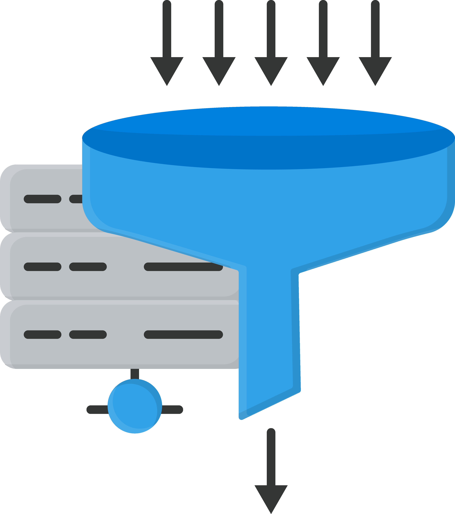

# 034 - Thiết Kế Dịch Vụ Rút Gọn Đường Dẫn (TinyURL)

[← Bài trước](033-thiet-ke-instagram.md) | [Mục lục](README.md) | [Bài tiếp theo →](035-thiet-ke-web-crawler.md)

---


# Thiết Kế Hệ Thống: TinyURL (System Design: TinyURL)

Hãy cùng thiết kế một dịch vụ tương tự như **TinyURL** để rút gọn định danh tài nguyên thống nhất (Uniform Resource Locator - **URL**).

Chúng ta sẽ bao quát các nội dung sau:
- **Giới thiệu (Introduction)**
- **Ưu điểm (Advantages)**
- **Nhược điểm (Disadvantages)**
- **Chúng ta sẽ thiết kế một dịch vụ rút gọn URL như thế nào? (How will we design a URL shortening service?)**

---

## Giới thiệu (Introduction)

Rút gọn URL (**URL shortening**) là một dịch vụ tạo ra các bí danh ngắn (**short aliases**) cho các URL dài, thường được gọi là các liên kết ngắn (**short links**). Khi người dùng nhấp vào, các liên kết ngắn này sẽ chuyển hướng (**redirect**) đến các URL gốc ban đầu. 

Sơ đồ minh họa sau đây mô tả quy trình hoạt động của hệ thống:

### Cách dịch vụ rút gọn URL hoạt động (How URL shortening service works)


```
+---------------------------------------------------------------------------------------------+
| URL Gốc (Original URL)                                          | Short URL                 |
| http://www.educative.io/service/subservice/a-uselessly-long-link | https://tinyurl.com/5yms49nf |
| ...                                                             | ...                       |
+---------------------------------------------------------------------------------------------+
```

**Quy trình từng bước:**
1. **Yêu cầu rút gọn (Shortening request):** Người dùng gửi URL dài ban đầu (**Original long URL**) tới Dịch vụ rút gọn URL (**URL shortening service**). Hệ thống lưu ánh xạ giữa URL gốc và URL ngắn (**Mapping of original-short URL**).
2. Dịch vụ trả về liên kết ngắn (**Short URL**): `https://tinyurl.com/5yms49nf`.
3. **Yêu cầu chuyển hướng (Redirection request):** Người dùng/Trình duyệt truy cập `https://tinyurl.com/5yms49nf` tới Dịch vụ rút gọn URL.
4. **Chuyển hướng người dùng (User redirected):** Dịch vụ tra cứu ánh xạ và chuyển hướng Trình duyệt (**Browser**) tới URL dài ban đầu.

---

## Ưu điểm (Advantages)

Các ưu điểm cốt lõi của một dịch vụ rút gọn URL bao gồm:
- **Tiện lợi khi sử dụng:** Các URL rút gọn tối ưu hóa việc sử dụng liên kết trên nhiều định dạng thiết bị khác nhau nhờ khả năng truy cập nâng cao và không bị ngắt dòng / gãy link (**non-breakability**).
- **Tính thẩm mỹ và tương tác cao:** Trông chuyên nghiệp hơn về mặt thị giác, hấp dẫn hơn và gia tăng đáng kể khả năng chia sẻ (**sharing possibilities**).
- **Ít xảy ra sai sót khi gõ tay (Less error-prone while typing).**
- **Tiết kiệm dung lượng lưu trữ ở phía người dùng (User’s end).**

---

## Nhược điểm (Disadvantages)

Dịch vụ rút gọn URL cũng đi kèm với một số hạn chế nhất định:
- **Mất tính nhận diện thương hiệu:** Chúng ta mất đi tính nguyên bản của thương hiệu khi sử dụng một URL ngắn được tạo ra bởi dịch vụ của bên thứ ba (**third-party service**). Nhiều thương hiệu khác nhau cùng sử dụng một dịch vụ sẽ sở hữu các URL ngắn có chung tên miền (**domain**).
- **Phụ thuộc vào nhà cung cấp:** Do sử dụng dịch vụ của bên thứ ba để rút gọn URL, nguy cơ dịch vụ này bị đóng cửa (**shut down**) và xóa sổ toàn bộ các URL rút gọn của chúng ta luôn luôn tồn tại.
- **Rủi ro hình ảnh thương hiệu:** Hình ảnh thương hiệu doanh nghiệp bị phụ thuộc vào độ tin cậy (**trustworthiness**) của dịch vụ rút gọn URL. Một bước đi kinh doanh sai lầm từ phía họ có thể tác động tiêu cực đến doanh nghiệp của chúng ta. 
- **Cạnh tranh URL tùy biến:** Mức độ cạnh tranh để sở hữu các URL ngắn tùy chỉnh (**custom short URLs**) theo ý muốn là vô cùng lớn; do đó rất có thể các URL tùy biến đẹp nhất đã bị bên khác chiếm mất tại thời điểm chúng ta bắt đầu tạo.

---

## Chúng ta sẽ thiết kế một dịch vụ rút gọn URL như thế nào? (How will we design a URL shortening service?)

Chúng ta chia thiết kế dịch vụ rút gọn URL thành 5 bài học sau:

1. **Yêu cầu (Requirements):** Bài học này thảo luận về các yêu cầu chức năng (**Functional Requirements**) và phi chức năng (**Non-functional Requirements**) của dịch vụ rút gọn URL, cùng với việc ước tính tài nguyên (**Resource Estimation**) cần thiết để đáp ứng các yêu cầu này. Ngoài ra, bài học cũng liệt kê các khối thành phần cơ bản (**Building Blocks**) cần thiết để xây dựng một dịch vụ như vậy.
2. **Thiết kế và Triển khai (Design and Deployment):** Phần này giải thích nguyên lý hoạt động và cách sử dụng của từng thành phần, mối liên kết giữa chúng, cũng như cơ chế vận hành tổng thể của toàn bộ hệ thống như một thể thống nhất.
3. **Bộ mã hóa (Encoder):** Bài học này bóc tách cơ chế bên trong của bộ mã hóa được sử dụng trong thiết kế, nêu rõ lý do tại sao chúng ta sử dụng nó kèm theo giải thích toán học chi tiết.
4. **Đánh giá (Evaluation):** Cuối cùng, chúng ta kiểm thử thiết kế bằng cách xem xét các khía cạnh khác nhau của các yêu cầu thiết kế và cân nhắc khả năng cải tiến hệ thống.
5. **Câu hỏi kiểm tra (Quiz):** Bài học này sẽ kiểm tra mức độ hiểu biết của chúng ta về thiết kế TinyURL.

Hãy bắt đầu bằng việc xác định các yêu cầu cho một dịch vụ rút gọn URL tương tự TinyURL.

---

# Yêu Cầu Thiết Kế TinyURL (Requirements of TinyURL's Design)

Nắm bắt các yêu cầu và các ước tính toán học để thiết kế một dịch vụ rút gọn URL.

Chúng ta sẽ bao quát các nội dung sau:
- **Yêu cầu đối với Thiết kế Rút gọn URL (Requirements for URL Shortening Design)**
  - Yêu cầu chức năng (Functional requirements)
  - Yêu cầu phi chức năng (Non-functional requirements)
- **Ước tính tài nguyên (Resource estimation)**
  - Ước tính dung lượng lưu trữ (Storage estimation)
  - Ước tính tốc độ truy vấn (Query rate estimation)
  - Ước tính băng thông (Bandwidth estimation)
  - Ước tính bộ nhớ RAM (Memory estimation)
  - Ước tính số lượng máy chủ (Number of servers estimation)
  - Bảng tổng kết các ước tính (Summarizing estimation)
- **Các khối xây dựng cơ bản sẽ sử dụng (Building blocks we will use)**

---

## Yêu cầu đối với Thiết kế Rút gọn URL (Requirements for URL Shortening Design)

Hãy cùng xem xét các yêu cầu chức năng và phi chức năng đối với dịch vụ mà chúng ta chuẩn bị thiết kế:

### Yêu cầu chức năng (Functional requirements)

- **Tạo URL ngắn (Short URL generation):** Hệ thống của chúng ta phải có khả năng sinh ra một bí danh ngắn hơn và duy nhất (**unique shorter alias**) từ URL được cung cấp.
- **Chuyển hướng (Redirection):** Khi nhận được một liên kết ngắn, hệ thống phải chuyển hướng người dùng về đúng URL gốc ban đầu.
- **Tùy biến liên kết ngắn (Custom short links):** Người dùng có thể tạo các liên kết ngắn tùy chỉnh cho URL của họ thông qua hệ thống của chúng ta.
- **Xóa liên kết (Deletion):** Người dùng có thể xóa một liên kết ngắn do hệ thống tạo ra, với điều kiện họ có quyền hạn thích hợp.
- **Cập nhật liên kết (Update):** Người dùng có thể cập nhật URL dài tương ứng với liên kết ngắn, với điều kiện có quyền hợp lệ.
- **Thời gian hết hạn (Expiry time):** Phải có thời gian hết hạn mặc định (**default expiration time**) cho các liên kết ngắn, nhưng người dùng cũng có thể tự thiết lập thời gian hết hạn dựa trên nhu cầu của họ.

> [!NOTE]
> **Quiz - Câu hỏi:**  
> Như một quyết định thiết kế, chúng ta không tái sử dụng các short URL đã hết hạn. Nếu đã không tái sử dụng, tại sao chúng ta vẫn cần phải xóa chúng khỏi hệ thống?  
> 
> **Lời giải:**  
> Hiện tại, chúng ta đặt thời gian hết hạn mặc định là 5 năm. Nếu chúng ta nới lỏng giới hạn đó và lưu trữ các bản ghi mãi mãi, chỉ mục tìm kiếm (**search index**) của kho dữ liệu (**datastore**) sẽ phình to vô hạn, và thời gian truy vấn từ chỉ mục đó có thể gây ra độ trễ (**latency**) đáng kể.

---

### Yêu cầu phi chức năng (Non-functional requirements)

- **Tính sẵn sàng cao (Availability):** Hệ thống phải có tính sẵn sàng cao (**High Availability**), bởi vì chỉ cần một phần nhỏ của một giây ngừng hoạt động (**downtime**) cũng sẽ dẫn đến các lỗi chuyển hướng URL. Do bản chất domain hoạt động của hệ thống là URL, chúng ta hoàn toàn không được phép có thời gian chết, và thiết kế bắt buộc phải tích hợp sẵn các cơ chế chịu lỗi (**Fault Tolerance**).
- **Khả năng mở rộng (Scalability):** Hệ thống phải có khả năng mở rộng quy mô theo chiều ngang (**Horizontally Scalable**) khi nhu cầu truy cập gia tăng.
- **Khả năng đọc hiểu (Readability):** Các liên kết ngắn do hệ thống tạo ra phải dễ đọc, dễ phân biệt và dễ nhập thủ công bằng bàn phím.
- **Độ trễ thấp (Latency):** Hệ thống phải hoạt động với độ trễ thấp (**Low Latency**) để mang lại trải nghiệm mượt mà cho người dùng.
- **Tính bất khả đoán (Unpredictability):** Dưới góc độ bảo mật (**Security**), các liên kết ngắn được tạo ra phải có tính bất khả đoán cao. Yêu cầu này nhằm đảm bảo URL ngắn kế tiếp không bị tạo ra theo chuỗi tuần tự (**serially produced**), loại bỏ hoàn toàn khả năng kẻ xấu có thể đoán trước được tất cả các URL ngắn mà hệ thống đã từng tạo ra hoặc sẽ tạo ra.

> [!IMPORTANT]
> **Quiz - Câu hỏi:**  
> Tại sao việc tạo ra các short URL mang tính bất khả đoán lại là yêu cầu bắt buộc đối với hệ thống của chúng ta?  
> 
> **Lời giải:**  
> Hai vấn đề sau đây làm nổi bật tính cấp thiết của việc tạo ra các short URL không tuần tự và không thể đoán trước:
> 
> 1. **Rò rỉ thông tin nội bộ:** Kẻ tấn công có thể thu thập thông tin ở cấp độ hệ thống về tổng số lượng URL ngắn, từ đó xác định được phạm vi cụ thể để lên kế hoạch tấn công. Những thông tin nội bộ này tuyệt đối không được phép rò rỉ ra bên ngoài hệ thống.
> 2. **Nguy cơ lộ dữ liệu riêng tư:** Người dùng có thể sử dụng dịch vụ của chúng ta để tạo URL ngắn cho các URL bí mật (**secret URLs**). Với thông tin suy luận từ tính tuần tự, kẻ tấn công có thể cố gắng liệt kê toàn bộ các short URL, truy cập chúng và nắm được thông tin chi tiết về các URL dài tương ứng, đe dọa trực tiếp tính bảo mật của các URL riêng tư. Điều này sẽ làm tổn hại đến quyền riêng tư của dữ liệu người dùng, khiến hệ thống mất an toàn.
> 
> Do đó, việc gán ngẫu nhiên các định danh duy nhất (**randomly assigning unique IDs**) sẽ triệt tiêu khả năng kẻ tấn công thu thập các thông tin hệ thống nói trên — vốn là điều kiện cần để kẻ xấu có thể liệt kê và xâm phạm dữ liệu riêng tư của người dùng.

---

# Thiết Kế Dịch Vụ Rút Gọn Đường Dẫn (TinyURL)

---

## 1. Yêu Cầu Chức Năng và Phi Chức Năng (Functional and Non-Functional Requirements)


* **Dịch vụ rút gọn URL (URL shortening service)**
* **Khả năng mở rộng (Scalability)**
* **Độ sẵn sàng cao (Availability)**
* **Tính khó đoán / Ngẫu nhiên bảo mật (Unpredictability)**
* **Khả năng đọc hiểu (Readability)**
* **Độ trễ thấp (Latency)**
* **Các tính năng:** Rút gọn URL (URL shortening), Xóa (deletion), Chuyển hướng (redirection), Tạo URL tùy chỉnh (custom URLs).


---

## 2. Ước Tính Tài Nguyên (Resource Estimation)

Việc sở hữu các ước tính thực tế ngay từ ban đầu là rất quan trọng. Ví dụ, chúng ta có thể cần điều chỉnh lại chúng trong tương lai dựa trên các thay đổi về mặt thiết kế kiến trúc. Hãy đưa ra một số giả định cơ sở để hoàn thành phép tính ước lượng của hệ thống.

### Giả định ban đầu (Assumptions)


* Chúng ta giả định rằng **tỷ lệ giữa yêu cầu rút gọn và yêu cầu chuyển hướng (shortening:redirection request ratio)** là **$1 : 100$**.
* Có **200 triệu (200 Million)** yêu cầu rút gọn URL mới mỗi tháng.
* Mỗi bản ghi rút gọn URL tiêu tốn **500 Bytes** dung lượng lưu trữ trong cơ sở dữ liệu (Database Storage).
* Mỗi bản ghi sẽ có thời gian hết hạn tối đa (**expiry time**) là **5 năm**, trừ khi bị người dùng chủ động xóa trước đó.
* Có **100 triệu người dùng hoạt động hàng ngày (Daily Active Users - DAU)**.

---

### Ước tính dung lượng lưu trữ (Storage Estimation)

Do các bản ghi được lưu trữ trong khoảng thời gian 5 năm và có tổng cộng 200 triệu bản ghi mới mỗi tháng, tổng số bản ghi cần lưu trữ sẽ xấp xỉ khoảng **12 tỷ (12 Billion)**:

$$200\text{ Triệu/tháng} \times 12\text{ tháng/năm} \times 5\text{ năm} = 12\text{ Tỷ yêu cầu rút gọn URL}$$


Vì mỗi bản ghi chiếm 500 Bytes, tổng dung lượng lưu trữ ước tính cần thiết sẽ là **6 TB**:

$$12\text{ Tỷ} \times 500\text{ Bytes} = 6\text{ TB}$$


---

#### Bảng Tính Ước Tính Dung Lượng Lưu Trữ Dịch Vụ Rút Gọn URL (URL Shortening Service Storage Estimation Calculator)

| Thông Số (Parameter) | Giá Trị (Value) |
| :--- | :--- |
| **URL shortening per month** (Số lượng URL rút gọn mỗi tháng) | **200 Million** (Triệu) |
| **Expiration time** (Thời gian hết hạn) | **5 Years** (Năm) |
| **URL object size** (Kích thước mỗi đối tượng URL) | **500 Bytes** |
| **Total number of requests** (Tổng số lượng yêu cầu lưu trữ) | **12 Billion** (Tỷ) |
| **Total storage** (Tổng dung lượng lưu trữ) | **6 TB** |


**Tổng dung lượng lưu trữ yêu cầu bởi dịch vụ rút gọn URL trong 5 năm (Total storage required by the URL shortening service in 5 years):**

$$\text{Dung lượng / 5 năm} = (\text{Dung lượng / URL: } 500\text{ Bytes}) \times (\text{Số URL / Tháng: } 200\text{ Triệu}) \times (\text{Số tháng / Năm: } 12) \times (\text{Số năm: } 5) = 6\text{ TB}$$

---

### Ước tính tần suất truy vấn (Query Rate Estimation)

Dựa trên các ước tính ở trên, chúng ta có thể dự kiến sẽ có **20 tỷ (20 Billion)** yêu cầu chuyển hướng (redirection requests) mỗi tháng:

$$200\text{ Triệu} \times 100 = 20\text{ Tỷ}$$

Từ đường cơ sở (baseline) này, chúng ta có thể mở rộng các phép tính để xác định **Số lượng truy vấn mỗi giây (Queries Per Second - QPS)** cho hệ thống.

Số giây trong một tháng (lấy số ngày trung bình mỗi tháng là 30.42 ngày):

$$30.42\text{ ngày} \times 24\text{ giờ} \times 60\text{ phút} \times 60\text{ giây} = 2.628.288\text{ giây}$$

Từ phép tính trên, số lượng yêu cầu rút gọn URL mới mỗi giây sẽ là:

$$\text{QPS Rút gọn} = \frac{200\text{ Triệu}}{2.628.288\text{ giây}} \approx 76\text{ URLs/s}$$


Với tỷ lệ giữa yêu cầu rút gọn và chuyển hướng là **$1 : 100$**, tốc độ xử lý yêu cầu chuyển hướng URL mỗi giây sẽ là:

$$100 \times 76\text{ URLs/s} = 7.6\text{ K URLs/s}\ (7.600\text{ URLs/s})$$

---

### Ước tính băng thông mạng (Bandwidth Estimation)

* **Yêu cầu rút gọn (Shortening requests):** Tốc độ tiếp nhận dự kiến là 76 URL mới mỗi giây. Tổng lưu lượng dữ liệu đi vào (**Incoming data / Ingress bandwidth**) mỗi giây sẽ là **304 Kbps**:

$$76 \times 500\text{ Bytes} \times 8\text{ bits} = 304\text{ Kbps}$$

* **Yêu cầu chuyển hướng (Redirection requests):** Vì tốc độ tiếp nhận dự kiến là 20K (xấp xỉ $7.6\text{ K}$) lượt chuyển hướng URL mỗi giây, tổng lưu lượng dữ liệu đi ra (**Outgoing data / Egress bandwidth**) mỗi giây sẽ là **30.4 Mbps**:

$$7.6\text{ K} \times 500\text{ Bytes} \times 8\text{ bits} = 30.4\text{ Mbps}$$


**Tổng băng thông yêu cầu bởi dịch vụ rút gọn URL (The total bandwidth required by the URL shortening service):**

$$\text{Tổng băng thông} = \text{Outgoing bandwidth (30.4 Mbps)} + \text{Incoming bandwidth (304 Kbps)} = 30.7\text{ Mbps}$$

---

### Ước tính bộ nhớ đệm (Memory Estimation)

Chúng ta cần ước tính dung lượng bộ nhớ (RAM) trong trường hợp muốn lưu vào bộ nhớ đệm (Cache) cho các yêu cầu chuyển hướng URL được truy cập thường xuyên.

Giả định tỷ lệ phân bổ lưu lượng truy cập tuân theo quy tắc **80-20 (Pareto Principle)**: **20% số yêu cầu chuyển hướng tạo ra 80% lưu lượng truy cập (traffic)**.

Vì số lượng yêu cầu chuyển hướng mỗi giây là 7.6 K, tổng số yêu cầu trong một ngày sẽ là **0.66 tỷ (0.66 Billion)**:

$$7.6\text{ K} \times 3.600\text{ giây} \times 24\text{ giờ} = 0.66\text{ Tỷ}$$

Vì chúng ta chỉ cân nhắc việc đưa vào bộ nhớ đệm (Cache) cho 20% các yêu cầu chuyển hướng mỗi ngày này, ước tính tổng dung lượng bộ nhớ đệm cần thiết sẽ là **66 GB**:

$$0.2 \times 0.66\text{ Tỷ} \times 500\text{ Bytes} = 66\text{ GB}$$

---

#### Bảng Tính Tổng Hợp Các Ước Tính Cho Dịch Vụ Rút Gọn URL (URL Shortening Service Estimates Calculator)

| Chỉ Số Đánh Giá (Metric) | Giá Trị Ước Tính (Calculated Value) |
| :--- | :--- |
| **URL shortening per month** (Số URL rút gọn mỗi tháng) | **200 Million** |
| **URL redirection per month** (Số URL chuyển hướng mỗi tháng) | **20 Billion** |
| **Query rate for URL shortening** (Tần suất truy vấn rút gọn URL) | **76 URLs / s** |
| **Query rate for URL redirection** (Tần suất truy vấn chuyển hướng URL) | **7600 URLs / s** |
| **Single entry storage size** (Kích thước mỗi bản ghi đơn lẻ) | **500 Bytes** |
| **Incoming data** (Băng thông dữ liệu vào) | **304 Kbps** |
| **Outgoing data** (Băng thông dữ liệu ra) | **30.4 Mbps** |
| **Cache memory** (Dung lượng bộ nhớ đệm RAM) | **66 GB** |

---

### Ước tính số lượng máy chủ (Number of Servers Estimation)

Chúng ta áp dụng phương pháp tính gần đúng tương tự đã được thảo luận trong các phép tính thô phác thảo (**Back-of-the-envelope calculations**) để tính toán số lượng máy chủ cần thiết: 
* **Số lượng người dùng hoạt động hàng ngày (Daily Active Users - DAU)** và 
* **Giới hạn số lượng người dùng mà một máy chủ có thể phục vụ mỗi ngày (Daily user handling limit of a server)** 

là hai yếu tố chính phản ánh tổng số lượng máy chủ cần triển khai. 

Theo công thức ước tính gần đúng, chúng ta cần chia số lượng người dùng hoạt động hàng ngày (DAU) cho **8.000** để tính ra số lượng máy chủ xấp xỉ:

$$\text{Số lượng máy chủ (Number of servers)} = \frac{\text{DAU}}{8000} = \frac{100\text{M}}{8000} = 12.500\text{ máy chủ (servers)}$$


> **Số lượng máy chủ cần thiết cho dịch vụ rút gọn URL: 12.500 servers**

---

### Bảng tổng kết ước tính tài nguyên (Summarizing Estimation)

Dựa trên các giả định ở trên, bảng sau đây tổng hợp toàn bộ các kết quả ước tính của chúng ta:

| Loại Hoạt Động / Tài Nguyên (Type of operation) | Ước Tính Theo Thời Gian / Dung Lượng (Time estimates) |
| :--- | :--- |
| **URL mới (New URLs)** | **76 / s** |
| **Chuyển hướng URL (URL redirections)** | **7.6 K / s** |
| **Dữ liệu vào (Incoming data)** | **304 Kbps** |
| **Dữ liệu ra (Outgoing data)** | **30.4 Mbps** |
| **Lưu trữ trong 5 năm (Storage for 5 years)** | **6 TB** |
| **Bộ nhớ đệm (Memory for cache)** | **66 GB** |
| **Số lượng máy chủ (Servers)** | **12.500** |

---

## 3. Các Thành Phần Xây Dựng Hệ Thống Sẽ Sử Dụng (Building Blocks We Will Use)

Sau khi hoàn thành các phép tính ước lượng, chúng ta có thể xác định các khối xây dựng nền tảng then chốt (**Key Building Blocks**) trong bản thiết kế của mình. Danh sách các khối xây dựng được liệt kê bên dưới:


### Các khối xây dựng trong thiết kế mức cao (Building Blocks in High-Level Design)


* **Cơ sở dữ liệu (Database - DB):** Cần thiết để lưu trữ ánh xạ (mapping) giữa các URL dài gốc và các URL rút gọn tương ứng.
* **Bộ sinh định danh duy nhất (Sequencer):** Cung cấp các ID duy nhất (Unique IDs) đóng vai trò là điểm bắt đầu (giá trị đầu vào) cho quá trình sinh ra từng URL rút gọn.
* **Bộ cân bằng tải (Load Balancer - LB):** Được đặt tại nhiều tầng khác nhau nhằm đảm bảo phân phối mượt mà các yêu cầu (requests) giữa các máy chủ khả dụng.
* **Bộ nhớ đệm (Cache):** Được tận dụng để lưu trữ các yêu cầu liên quan đến các URL rút gọn được truy cập thường xuyên nhất.
* **Bộ giới hạn tốc độ (Rate Limiter):** Được sử dụng để ngăn chặn hành vi khai thác, lạm dụng hệ thống hoặc tấn công DoS/DDoS.

---

### Các thành phần bổ sung trong thiết kế mức cao (Components in High-Level Design)

Bên cạnh các khối xây dựng nền tảng nêu trên, chúng ta cũng sẽ cần thêm các thành phần bổ sung sau đây để đạt được dịch vụ mong muốn:


* **Máy chủ ứng dụng (Servers):** Xử lý và điều hướng các yêu cầu dịch vụ (Service Requests) cùng với việc thực thi logic ứng dụng (**Application Logic**).
* **Bộ mã hóa Base-58 (Base-58 Encoder):** Chuyển đổi đầu ra dạng số (numeric output) của bộ sinh định danh (Sequencer) thành dạng chuỗi ký tự chữ và số (alphanumeric form) dễ đọc, ngắn gọn và tiện sử dụng hơn.

---

# Thiết Kế và Triển Khai TinyURL (Design and Deployment of TinyURL)

Đi sâu vào thiết kế và triển khai dịch vụ rút gọn URL (URL shortening service).

**Chúng ta sẽ tìm hiểu các nội dung sau:**
* **Giao diện lập trình ứng dụng hệ thống (System APIs)**
  * Rút gọn một URL (Shortening a URL)
  * Chuyển hướng một URL rút gọn (Redirecting a short URL)
  * Xóa một URL rút gọn (Deleting a short URL)
* **Thiết kế (Design)**
  * Các thành phần (Components)
  * Sơ đồ thiết kế (Design diagram)
  * Luồng công việc (Workflow)

---

## Giao Diện Lập Trình Ứng Dụng Hệ Thống (System APIs)

Để cung cấp các chức năng của dịch vụ ra bên ngoài, chúng ta có thể sử dụng các REST API cho các tính năng sau:
* Rút gọn một URL (Shortening a URL)
* Chuyển hướng một URL rút gọn (Redirecting a short URL)
* Xóa một URL rút gọn (Deleting a short URL)

### Tổng quan thiết kế System API (System API design overview)


* **Client** $\rightarrow$ Tạo URL (Create url), Chuyển hướng URL (Redirect url), Xóa URL (Delete url) $\rightarrow$ **API servers** $\rightarrow$ Phản hồi (Reply) $\rightarrow$ **Client**.
* **API servers** $\rightarrow$ Rút gọn một URL (Shorten a URL), Chuyển hướng một URL rút gọn (Redirect a short URL), Xóa một URL rút gọn (Delete a short URL) $\rightarrow$ **Database**.

---

### Rút gọn một URL (Shortening a URL)

Chúng ta có thể tạo các URL rút gọn mới với định nghĩa hàm sau:

```python
shortURL(api_dev_key, original_url, custom_alias=None, expiry_date=None)
```

Lời gọi API ở trên có các tham số (parameters) như sau:

| Tham số (Parameter) | Mô tả (Description) |
| :--- | :--- |
| `api_dev_key` | Định danh duy nhất (unique identifier) của một tài khoản người dùng đã đăng ký. Giá trị này rất hữu ích trong việc theo dõi và cho phép hệ thống kiểm soát các dịch vụ liên kết tương ứng. |
| `original_url` | Đường dẫn URL dài gốc (original long URL) cần được rút gọn. |
| `custom_alias` | Khóa tùy chọn (optional key) mà người dùng tự định nghĩa làm URL rút gọn tùy chỉnh. |
| `expiry_date` | Ngày hết hạn tùy chọn (optional expiration date) cho URL đã được rút gọn. |

Một thao tác chèn bản ghi thành công sẽ trả về cho người dùng URL đã được rút gọn. Trong trường hợp ngược lại, hệ thống sẽ trả về mã lỗi (error code) thích hợp cho người dùng.

---

### Chuyển hướng một URL rút gọn (Redirecting a short URL)

Để chuyển hướng một URL rút gọn, định nghĩa của REST API sẽ là:

```python
redirectURL(api_dev_key, url_key)
```

Với các tham số sau:

| Tham số (Parameter) | Mô tả (Description) |
| :--- | :--- |
| `api_dev_key` | Định danh duy nhất (unique identifier) của tài khoản người dùng đã đăng ký. |
| `url_key` | Khóa URL rút gọn (shortened URL) được dùng để truy xuất URL dài gốc tương ứng từ hệ thống. |

Một thao tác chuyển hướng thành công sẽ đưa người dùng đến URL gốc liên kết với `url_key`.

---

### Xóa một URL rút gọn (Deleting a short URL)

Tương tự, để xóa một URL rút gọn, định nghĩa REST API sẽ là:

```python
deleteURL(api_dev_key, url_key)
```

Và các tham số liên quan sẽ là:

| Tham số (Parameter) | Mô tả (Description) |
| :--- | :--- |
| `api_dev_key` | Định danh duy nhất (unique identifier) của tài khoản người dùng đã đăng ký. |
| `url_key` | Khóa URL rút gọn (shortened URL) được dùng để truy xuất URL dài gốc từ hệ thống để xóa. |

Một thao tác xóa thành công sẽ trả về một thông báo hệ thống: `URL Removed` (Đã xóa URL), biểu thị việc gỡ bỏ URL thành công khỏi hệ thống.

---

## Thiết Kế (Design)

Hãy cùng thảo luận về các thành phần thiết kế chính cần thiết cho dịch vụ rút gọn URL của chúng ta. Thiết kế của chúng ta phụ thuộc vào chức năng của từng bộ phận và kết hợp chúng một cách lũy tiến để đạt được các luồng công việc (workflows) khác nhau đã được đề cập trong các yêu cầu chức năng (functional requirements).

### Các thành phần (Components)

Dưới đây, chúng ta sẽ giải thích cơ chế nội bộ của các thành phần khác nhau trong hệ thống, cũng như cách sử dụng chúng như một phần của toàn bộ hệ thống. Chúng ta cũng sẽ làm nổi bật các quyết định thiết kế (design choices) được đưa ra cho từng thành phần nhằm đạt được toàn bộ chức năng.

#### Cơ sở dữ liệu (Database)
Đối với các dịch vụ như rút gọn URL, lượng dữ liệu cần lưu trữ là không quá lớn. Tuy nhiên, tầng lưu trữ (storage) bắt buộc phải có khả năng mở rộng theo chiều ngang (horizontally scalable). Loại dữ liệu chúng ta cần lưu trữ bao gồm:
* Thông tin chi tiết của người dùng (User details).
* Các ánh xạ của URL (Mappings of the URLs), tức là các URL dài được ánh xạ tới các URL rút gọn.

Dịch vụ của chúng ta không bắt buộc người dùng phải đăng ký tài khoản để tạo URL rút gọn, vì vậy chúng ta có thể bỏ qua việc thêm một số dữ liệu nhất định vào cơ sở dữ liệu. Ngoài ra, các bản ghi được lưu trữ sẽ không có mối quan hệ ràng buộc nào giữa chúng ngoại trừ việc liên kết thông tin chi tiết của người dùng đã tạo URL, do đó chúng ta không cần bộ lưu trữ có cấu trúc (structured storage) để quản lý bản ghi.

Xem xét các lý do trên cùng với thực tế là hệ thống của chúng ta thiên về đọc (read-heavy), **NoSQL** là một lựa chọn phù hợp để lưu trữ dữ liệu. Cụ thể, **MongoDB** là một lựa chọn tốt vì các lý do sau:
1. Nó sử dụng giao thức leader-follower (leader-follower protocol), giúp có thể sử dụng các bản sao (replicas) để phục vụ việc đọc tải cao (heavy reading).
2. MongoDB đảm bảo tính nguyên tử (atomicity) trong các thao tác ghi đồng thời (concurrent write operations) và tránh xung đột (avoid collisions) bằng cách trả về lỗi trùng khóa (duplicate-key errors) cho các sự cố trùng lặp bản ghi.

---

### Câu hỏi ôn tập (Quiz)

> [!NOTE]
> **Câu hỏi (Question):**
> Tại sao các cơ sở dữ liệu NoSQL như Cassandra hoặc Riak lại không phải là những lựa chọn tốt để thay thế MongoDB?

> [!IMPORTANT]
> **Ẩn câu trả lời (Hide Answer):**
> 
> Vì dịch vụ của chúng ta thiên về đọc nhiều hơn (more read-intensive) và ít ghi hơn (less write-intensive), MongoDB phù hợp nhất với trường hợp sử dụng (use case) của chúng ta vì các lý do sau:
> * Các cơ sở dữ liệu NoSQL như Cassandra, Riak và DynamoDB cần cơ chế sửa chữa khi đọc (read-repair) trong giai đoạn đọc dữ liệu, do đó mang lại hiệu năng đọc trên ghi (reads to write performance) chậm hơn.
> * Chúng là các cơ sở dữ liệu NoSQL không có nút chủ (leader-less NoSQL databases), cung cấp các đảm bảo về tính nhất quán dữ liệu yếu hơn (weaker data consistency guarantees) khi có các thao tác ghi đồng thời (concurrent writes). Là một cơ sở dữ liệu có nút chủ duy nhất (single leader database), MongoDB cung cấp thông lượng đọc (read throughput) cao hơn vì chúng ta có thể đọc từ bản sao leader hoặc từ các bản sao follower.
> * Các thao tác ghi bắt buộc phải đi qua bản sao leader. Điều này đảm bảo tính khả dụng (availability) của hệ thống cho các tác vụ chuyên sâu về đọc ngay cả trong trường hợp leader gặp sự cố (dies).
> * Do Cassandra vốn dĩ đảm bảo tính khả dụng cao hơn MongoDB theo bản chất thiết kế, việc chọn MongoDB thay vì Cassandra có thể làm cho hệ thống của chúng ta có vẻ kém khả dụng hơn. Tuy nhiên, thời gian mà thuật toán bầu chọn leader (leader election algorithm) tiêu tốn là không đáng kể so với khoảng thời gian trôi qua giữa lúc URL rút gọn được tạo ra và lần sử dụng đầu tiên của nó, vì vậy nó không hề gây cản trở đến tính khả dụng (availability) của hệ thống.

---

#### Bộ tạo URL rút gọn (Short URL generator)
Bộ tạo URL rút gọn của chúng ta sẽ bao gồm một khối xây dựng cơ bản (building block) và một thành phần bổ sung:
* **Một bộ tạo chuỗi (Sequencer)** để tạo ra các ID duy nhất (unique IDs).
* **Một bộ mã hóa Base-58 (Base-58 encoder)** để nâng cao khả năng đọc (readability) của URL rút gọn.

Chúng ta đã xây dựng một sequencer trong phần các khối xây dựng (building blocks) để tạo ra các ID dạng số 64-bit duy nhất (64-bit unique numeric IDs). Tuy nhiên, thiết kế đề xuất của chúng ta yêu cầu các URL rút gọn dạng chữ và số (alphanumeric) 64-bit ở chuẩn base-58. Để chuyển đổi các ID dạng số (hệ cơ số 10 - base-10) sang dạng chữ và số (hệ cơ số 58 - base-58), chúng ta sẽ cần một bộ mã hóa từ base-10 sang base-58 (base-10 to base-58 encoder). Chúng ta sẽ tìm hiểu cơ sở lý luận đằng sau các quyết định này cùng với cơ chế hoạt động nội bộ của bộ mã hóa base-58 trong bài học tiếp theo.

Hãy xem sơ đồ bên dưới để hiểu cách thức hoạt động tổng thể của khối tạo URL rút gọn:

**Cơ chế hoạt động nội bộ của bộ tạo URL rút gọn (Internal working of a short URL generator)**


* **Long URL:** `http://www.educative.io/service/subservice/a-uselessly-long-link`
* **Short URL generator:**
  * **Sequencer** $\rightarrow$ Tạo **ID** duy nhất
  * **Base-58 encoder** $\rightarrow$ Mã hóa thành `5yms49nf = encoded Unique ID`
  * Ghép cùng **Service host** $\rightarrow$ Tạo thành **Short URL**
* **Short URL:** `https://tinyurl.com/5yms49nf`

---

#### Các khối xây dựng khác (Other building blocks)
Bên cạnh các phần tử nêu trên, chúng ta cũng sẽ tích hợp các khối xây dựng khác như bộ cân bằng tải (load balancers), bộ nhớ đệm (cache) và bộ giới hạn tốc độ (rate limiters):

* **Cân bằng tải (Load balancing):** Chúng ta có thể triển khai Cân bằng Tải Máy chủ Toàn cầu (**GSLB - Global Server Load Balancing**) bên cạnh cân bằng tải cục bộ (local load balancing) để cải thiện tính sẵn sàng (High Availability). Vì chúng ta có rất nhiều thời gian giữa lúc một URL rút gọn được tạo ra và thời điểm nó được truy cập sau đó, chúng ta có thể giả định an toàn rằng cơ sở dữ liệu của chúng ta đạt tính nhất quán theo mặt địa lý (geographically consistent) và việc phân phối các yêu cầu trên quy mô toàn cầu (globally) sẽ không gây ra bất kỳ vấn đề nào.
* **Bộ nhớ đệm (Cache):** Đối với bài toán thiết kế cụ thể thiên về đọc nhiều (read-intensive) này, **Memcached** là lựa chọn tốt nhất cho giải pháp bộ nhớ đệm. Chúng ta cần một hệ thống cache đơn giản, có khả năng mở rộng theo chiều ngang (horizontally scalable) với yêu cầu tối thiểu về cấu trúc dữ liệu. Hơn nữa, chúng ta sẽ có một tầng bộ nhớ đệm riêng cho từng trung tâm dữ liệu (data-center-specific caching layer) để xử lý các yêu cầu nội bộ bản địa (native requests). Việc sử dụng một tầng bộ nhớ đệm toàn cầu (global caching layer) sẽ dẫn đến độ trễ (latency) cao hơn.
* **Bộ giới hạn tốc độ (Rate limiter):** Việc giới hạn hạn mức (quota) của mỗi người dùng là điều cần thiết để thêm một lớp bảo mật cho hệ thống. Chúng ta có thể đạt được điều này bằng cách định danh duy nhất người dùng thông qua `api_dev_key` duy nhất của họ và áp dụng một trong các thuật toán giới hạn tốc độ đã được thảo luận (xem bài *Rate Limiter* trong phần *Building Blocks*). Xem xét sự đơn giản của hệ thống và các yêu cầu đặt ra, thuật toán bộ đếm cửa sổ cố định (**Fixed Window Counter algorithm**) sẽ đáp ứng tốt mục đích này, vì chúng ta có thể chỉ định một số lượng thao tác rút gọn và chuyển hướng nhất định cho mỗi `api_dev_key` trong một khung thời gian cụ thể.

---

### Câu hỏi trắc nghiệm (Quiz)

#### Câu hỏi 1 (Question 1)
Làm thế nào để chúng ta duy trì một ánh xạ duy nhất (unique mapping) nếu các yêu cầu chuyển hướng (redirection requests) có thể đi tới các trung tâm dữ liệu (data centers) khác nhau và cách xa nhau về mặt địa lý? Thiết kế của chúng ta có giả định rằng cơ sở dữ liệu (Database - DB) đạt tính nhất quán về mặt địa lý (geographically consistent) hay không?

> [!TIP]
> **Ẩn câu trả lời (Hide Answer)**
> 
> Ban đầu, chúng ta giả định rằng trung tâm dữ liệu của mình đạt tính nhất quán toàn cầu (globally consistent). Hãy nhìn nhận vấn đề theo một hướng khác và xem xét trường hợp ngược lại: chúng ta cần lọc các yêu cầu chuyển hướng (redirection requests) dựa trên các trung tâm dữ liệu.
> 
> **Giải pháp (Solution):** Một phương pháp đơn giản để đạt được chức năng này là đưa thêm một ký tự duy nhất (unique character) vào trong URL rút gọn (short URL). Ký tự đặc biệt này sẽ đóng vai trò là một định danh chỉ dẫn (indicator) cho chính xác trung tâm dữ liệu đó.
> 
> **Ví dụ (Example):** Giả sử rằng URL rút gọn cần chuyển hướng có dạng `service.com/x/short123/`, trong đó `x` biểu thị trung tâm dữ liệu (data center) đang chứa bản ghi dữ liệu này.
> 
> Trong giải pháp này, nếu URL rút gọn đi nhầm tới trung tâm dữ liệu khác, nó có thể được chuyển hướng (redirected) về đúng trung tâm dữ liệu đích. Tuy nhiên, nếu một trung tâm dữ liệu cụ thể không thể truy cập được (not reachable) đối với một URL rút gọn cụ thể (và URL đó chưa được lưu trong bộ nhớ đệm - cache), thì việc chuyển hướng sẽ thất bại (fail).

*(1 trên 3 - 1 of 3)*

---

### Sơ đồ thiết kế (Design diagram)

Dưới đây là sơ đồ thiết kế đơn giản của hệ thống rút gọn URL (URL shortening system).


#### Sơ đồ thiết kế của dịch vụ rút gọn URL (A design diagram of the URL shortening service)
- **Người dùng (User)**
- **Bộ cân bằng tải (Load balancer)**
- **Bộ giới hạn tốc độ (Rate limiter)**
- **Máy chủ Web (Web server)**
- **Dịch vụ ứng dụng (Application service)**
- **Bộ sinh URL rút gọn (Short URL generator)**
- **Dịch vụ bộ nhớ đệm (Cache service)**
- **Kho lưu trữ dữ liệu (Data store)**

---

### Luồng công việc (Workflow)

Hãy phân tích chuyên sâu hệ thống và cách các thành phần riêng lẻ phối hợp với nhau để cung cấp toàn bộ chức năng tổng thể.

Dựa trên các yêu cầu chức năng (functional requirements), luồng công việc (workflow) của thiết kế trừu tượng ở trên sẽ diễn ra như sau:

#### 1. Rút gọn đường dẫn (Shortening)
Mỗi yêu cầu mới về việc tính toán liên kết rút gọn sẽ được máy chủ ứng dụng (application server) chuyển tiếp tới **Bộ sinh URL rút gọn (Short URL Generator - SUG)**. Sau khi tạo thành công liên kết rút gọn, hệ thống gửi một bản sao phản hồi về cho người dùng và lưu trữ bản ghi vào cơ sở dữ liệu (database) để phục vụ cho các truy vấn trong tương lai.

---

### Câu hỏi trắc nghiệm (Quiz)

#### Câu hỏi 1 (Question 1)
Làm thế nào hệ thống của chúng ta tránh được việc tạo trùng lặp URL rút gọn (duplicate short URL generation)?

> [!NOTE]
> **Ẩn câu trả lời (Hide Answer)**
> 
> Việc tính toán tạo ra một URL rút gọn cho một URL dài (long URL) đã tồn tại là dư thừa (redundant), do đó hệ thống sẽ gửi URL dài đến máy chủ cơ sở dữ liệu để kiểm tra sự tồn tại của nó trong hệ thống. Hệ thống sẽ kiểm tra mục nhập tương ứng trong bộ nhớ đệm (cache) trước, sau đó mới thực hiện truy vấn cơ sở dữ liệu (database).
> 
> - Nếu URL rút gọn tương ứng với URL dài đó đã tồn tại, cơ sở dữ liệu sẽ trả về URL rút gọn đã lưu cho máy chủ ứng dụng (application server), sau đó máy chủ ứng dụng sẽ định tuyến lại (reroute) URL rút gọn được yêu cầu tới người dùng.
> - Nếu URL rút gọn được yêu cầu chưa có trong hệ thống, máy chủ ứng dụng sẽ yêu cầu bộ sinh URL rút gọn (SUG) tính toán và tạo URL rút gọn cho URL dài được yêu cầu. Sau khi tính toán xong, SUG gửi trả lại một bản sao của URL rút gọn được yêu cầu về máy chủ ứng dụng và một bản sao khác tới máy chủ cơ sở dữ liệu.

*(1 trên 2 - 1 of 2)*

---

#### 2. Chuyển hướng (Redirection)
Khi nhận được các yêu cầu chuyển hướng (redirection requests), các máy chủ ứng dụng (application servers) sẽ kiểm tra các đơn vị lưu trữ (hệ thống bộ nhớ đệm / caching system và cơ sở dữ liệu / database) để tìm bản ghi được yêu cầu. Nếu tìm thấy, máy chủ ứng dụng sẽ chuyển hướng (redirect) người dùng đến URL gốc dài (long URL) tương ứng.

---

### Câu hỏi trắc nghiệm (Quiz)

#### Câu hỏi (Question)
Làm thế nào hệ thống của chúng ta đảm bảo rằng kho lưu trữ dữ liệu (data store) sẽ không trở thành điểm nghẽn cổ chai (bottleneck)?

> [!IMPORTANT]
> **Ẩn câu trả lời (Hide Answer)**
> 
> Chúng ta có thể đảm bảo rằng kho lưu trữ dữ liệu (data store) không trở thành điểm nghẽn cổ chai (bottleneck) bằng cách sử dụng hai cách tiếp cận sau:
> 
> 1. **Sử dụng bộ tạo chuỗi dựa trên dải giá trị (range-based sequencer):** Chúng ta sử dụng một bộ tạo chuỗi dựa trên phạm vi trong thiết kế của mình, điều này đảm bảo việc ánh xạ ở cấp độ cơ bản giữa các máy chủ và các URL rút gọn. Chúng ta có thể chuyển hướng yêu cầu đến đúng cơ sở dữ liệu tương ứng để tìm kiếm nhanh chóng.
> 2. **Sử dụng định danh duy nhất (Unique IDs):** Như đã thảo luận ở trên, chúng ta cũng có thể gán các ID duy nhất cho các kho lưu trữ dữ liệu (data stores) khác nhau và tích hợp chúng trực tiếp vào các URL rút gọn. Sau đó, chúng ta có thể chuyển hướng các yêu cầu đến đúng kho lưu trữ dữ liệu tương ứng để xử lý yêu cầu một cách hiệu quả.
> 
> Cả hai phương pháp tiếp cận này đều đảm bảo lưu lượng truy cập (traffic) được xử lý mượt mà và giảm thiểu rủi ro kho lưu trữ dữ liệu trở thành điểm nghẽn cổ chai.

---

#### 3. Xóa đường dẫn (Deletion)
Một người dùng đã đăng nhập (logged-in user) có thể xóa một bản ghi bằng cách gửi yêu cầu tới máy chủ ứng dụng; máy chủ này sau đó sẽ chuyển tiếp thông tin chi tiết của người dùng cùng thông tin URL liên quan tới máy chủ cơ sở dữ liệu để thực hiện thao tác xóa. Việc xóa do hệ thống khởi tạo (system-initiated deletion) cũng có thể được kích hoạt dựa trên thời gian hết hạn (expiry time), như chúng ta sẽ tìm hiểu ở phần tiếp theo.

#### 4. Liên kết rút gọn tùy chỉnh (Custom short links)
Tác vụ này bắt đầu bằng việc kiểm tra tính hợp lệ (eligibility) của URL rút gọn được yêu cầu tùy chỉnh. Độ dài tối đa cho phép là **11 ký tự chữ và số (alphanumeric digits)**. Chúng ta có thể xem chi tiết về định dạng cho phép và các chữ số cụ thể trong bài học tiếp theo. Sau khi được xác minh, hệ thống sẽ kiểm tra tính khả dụng (availability - xem đã bị ai dùng chưa) của nó trong cơ sở dữ liệu:
- Nếu URL được yêu cầu hợp lệ và còn trống, người dùng sẽ nhận được thông báo tạo URL rút gọn thành công.
- Trong trường hợp ngược lại, người dùng sẽ nhận được một thông báo lỗi.

---

### Minh họa quy trình hoạt động (Illustrations)

Hình minh họa dưới đây mô tả cách thức hoạt động của các quy trình: rút gọn URL (URL shortening), chuyển hướng (redirection), và xóa (deletion).


> **Rút gọn URL: Người dùng khởi tạo yêu cầu (URL shortening: The user initiates the request)**  
> *Người dùng cung cấp một URL dài (User provides a long URL).*  
> *(1 trên 21 - 1 of 21)*

---


> **Rút gọn URL: Bộ cân bằng tải chuyển hướng yêu cầu (URL shortening: The load balancer redirects the request)**  
> *Chuyển hướng người dùng đến máy chủ khả dụng (Redirects the user to the available server).*  
> *(2 trên 21 - 2 of 21)*

---


> **Rút gọn URL: Kiểm tra tính hợp lệ của yêu cầu từ người dùng (URL shortening: The eligibility of the user’s request is checked)**  
> *Kiểm tra hạn mức phân bổ tài nguyên của người dùng qua Rate Limiter (Checks user's resource allocation limit).*  
> *(3 trên 21 - 3 of 21)*

---


> **Rút gọn URL: Yêu cầu được chuyển tiếp đến dịch vụ liên quan (URL shortening: The request is redirected to the concerned service)**  
> *Định tuyến dựa trên lời gọi API (Redirects based on the API call) từ API Server đến Dịch vụ rút gọn URL (URL shortening service).*  
> *(4 trên 21 - 4 of 21)*

---

# Thiết Kế Dịch Vụ Rút Gọn Đường Dẫn (Designing a URL Shortening Service - TinyURL)

## Luồng Hoạt Động Chi Tiết Của Hệ Thống (System Workflow)

---

### Phần 1: Quy Trình Rút Gọn URL (URL Shortening Workflow - Tiếp Theo)

#### Bước 5: Kiểm Tra Bản Ghi Trong Tầng Lưu Trữ (Data Store Entry Checkup)


*Hình 5/21: URL shortening: The data store entry checkup is performed (Rút gọn URL: Tiến hành kiểm tra bản ghi trong kho lưu trữ dữ liệu)*

* **Thành phần tham gia:**
  * **API Gateway**
  * **Application Server** (Máy chủ ứng dụng)
  * **Short URL Generator** (Bộ sinh URL ngắn)
  * **Storage** (Tầng lưu trữ dữ liệu):
    * **Cache Server** (Máy chủ bộ nhớ đệm)
    * **Database Server** (Máy chủ cơ sở dữ liệu)
* **Luồng xử lý (Workflow):**
  * Application Server thực hiện truy vấn kiểm tra sự tồn tại của URL gốc (`Checks the entry in the storage`) trong tầng lưu trữ (Storage) thông qua Cache Server trước, nếu Cache Miss thì truy vấn tiếp xuống Database Server.

> [!NOTE]
> Việc kiểm tra trong tầng lưu trữ nhằm phát hiện xem URL gốc (Long URL) này đã từng được rút gọn trước đó hay chưa, giúp tối ưu hóa không gian lưu trữ và tránh sinh trùng lặp bản ghi không cần thiết.

---

#### Bước 6: Trường Hợp 1 - URL Ngắn Đã Tồn Tại Trong Kho Lưu Trữ (Case 1: Short URL Found in Data Store)


*Hình 6/21: URL shortening: The short URL is found in the data store (Case 1) (Rút gọn URL: Tìm thấy URL ngắn trong kho lưu trữ - Trường hợp 1)*

* **Thành phần tham gia:**
  * **API Gateway**
  * **Application Server** (Máy chủ ứng dụng)
  * **Short URL Generator** (Bộ sinh URL ngắn)
  * **Storage** (Tầng lưu trữ dữ liệu: Cache Server & Database Server)
* **Luồng xử lý (Workflow):**
  * Bản ghi tương ứng được tìm thấy trong kho lưu trữ (`Found in the storage`).
  * Tầng lưu trữ trả về URL ngắn đã được lưu trữ liên kết với URL gốc đó (`Returns the associated stored short URL`) về cho Application Server mà không cần phải kích hoạt bộ sinh URL ngắn mới.

---

#### Bước 7: Trường Hợp 2 - URL Chưa Tồn Tại & Khởi Tạo URL Ngắn Mới (Case 2: Short URL Computed)


*Hình 7/21: URL shortening: The short URL is computed (Case 2) (Rút gọn URL: Tính toán và tạo URL ngắn mới - Trường hợp 2)*

* **Thành phần tham gia:**
  * **API Gateway**
  * **Application Server** (Máy chủ ứng dụng)
  * **Short URL Generator** (Bộ sinh URL ngắn)
  * **Storage** (Tầng lưu trữ dữ liệu: Cache Server & Database Server)
* **Luồng xử lý (Workflow):**
  * URL gốc không tồn tại trong kho lưu trữ (`Not found in the storage`).
  * Application Server chuyển tiếp yêu cầu đến **Short URL Generator** để tính toán thuật toán băm (hashing) hoặc cấp phát Key (KGS - Key Generation Service).
  * Bộ sinh URL ngắn tính toán và trả về chuỗi URL ngắn mới được tạo (`Computes and returns the generated short URL`), sau đó ghi lưu vào Storage và trả về cho client.

---

### Phần 2: Quy Trình Điều Hướng URL (URL Redirection Workflow)

#### Bước 8: Người Dùng Gửi Yêu Cầu Truy Cập URL Ngắn (User Initiates Redirection Request)


*Hình 8/21: URL redirection: The user clicks on a short URL (Điều hướng URL: Người dùng nhấp vào một URL ngắn)*

* **Thành phần tham gia:**
  * **User** (Người dùng / Client)
  * **Load Balancer** (Bộ cân bằng tải)
  * **API Server** (Máy chủ API)
  * **Rate Limiter** (Bộ giới hạn tần suất)
  * **URL Shortening Service** (Dịch vụ rút gọn URL)
  * **URL Redirection Service** (Dịch vụ điều hướng URL)
  * **URL Deletion Service** (Dịch vụ xóa URL)
* **Luồng xử lý (Workflow):**
  * Người dùng cung cấp hoặc nhấp vào một URL ngắn (`User provides a short URL`). Yêu cầu HTTP GET được gửi trực tiếp tới hệ thống.

---

#### Bước 9: Bộ Cân Bằng Tải Phân Phối Yêu Cầu (Load Balancer Redirects Request)


*Hình 9/21: URL redirection: The load balancer redirects the request (Điều hướng URL: Bộ cân bằng tải điều phối yêu cầu)*

* **Thành phần tham gia:**
  * **User**
  * **Load Balancer**
  * **API Server**
  * **Rate Limiter**
  * **URL Shortening Service**, **URL Redirection Service**, **URL Deletion Service**
* **Luồng xử lý (Workflow):**
  * **Load Balancer** tiếp nhận request từ User và phân phối / chuyển tiếp request đến máy chủ khả dụng (`Redirects the user to the available server`) trong cụm API Server để đảm bảo tính sẵn sàng cao (High Availability) và cân bằng tải trọng (Scalability).

---

#### Bước 10: Kiểm Tra Ngưỡng Phân Bổ Tài Nguyên (Rate Limiting & Quota Check)


*Hình 10/21: URL redirection: The eligibility of the request is checked (Điều hướng URL: Kiểm tra tính hợp lệ và hạn mức của yêu cầu)*

* **Thành phần tham gia:**
  * **User**, **Load Balancer**, **API Server**
  * **Rate Limiter** (Bộ giới hạn tần suất truy cập)
  * Các dịch vụ backend: **URL Shortening Service**, **URL Redirection Service**, **URL Deletion Service**
* **Luồng xử lý (Workflow):**
  * API Server phối hợp với **Rate Limiter** để kiểm tra giới hạn phân bổ tài nguyên của người dùng (`Checks user's resource allocation limit`).

> [!IMPORTANT]
> Bước này ngăn chặn các cuộc tấn công từ chối dịch vụ (DoS/DDoS), scraping hàng loạt hoặc lạm dụng tài nguyên vượt quá định mức (Rate Limit Exceeded - HTTP 429).

---

#### Bước 11: Định Tuyến Đến Dịch Vụ Điều Hướng (Routing to Concerned Service)


*Hình 11/21: URL redirection: The request is redirected to the concerned service (Điều hướng URL: Chuyển tiếp yêu cầu đến đúng dịch vụ phụ trách)*

* **Thành phần tham gia:**
  * **User**, **Load Balancer**, **API Server**, **Rate Limiter**
  * **URL Redirection Service** (Dịch vụ điều hướng)
* **Luồng xử lý (Workflow):**
  * Dựa vào phương thức và URI của lời gọi API (`Redirects based on the API call`), API Server phân luồng và chuyển tiếp request cụ thể đến **URL Redirection Service**.

---

#### Bước 12: Kiểm Tra Bản Ghi Trong Tầng Lưu Trữ (Data Store Query for Redirection)


*Hình 12/21: URL redirection: The data store is checked for the entry (Điều hướng URL: Kiểm tra bản ghi trong kho lưu trữ dữ liệu)*

* **Thành phần tham gia:**
  * **API Gateway**
  * **Application Server**
  * **Storage** (Cache Server & Database Server)
* **Luồng xử lý (Workflow):**
  * Application Server thực hiện tra cứu bản ghi của URL ngắn trong tầng lưu trữ (`Checks the entry in the storage`) để tìm URL gốc (Long URL) tương ứng.
  * Tầng đệm (Cache Server) được ưu tiên truy vấn trước nhằm giảm độ trễ (Latency).

---

#### Bước 13: Trường Hợp 1 - Điều Hướng Thành Công (Case 1: Successful Redirection)


*Hình 13/21: URL redirection: Successful redirection (Case 1) (Điều hướng URL: Điều hướng thành công - Trường hợp 1)*

* **Thành phần tham gia:**
  * **Browser** (Trình duyệt của người dùng)
  * **API Gateway**
  * **Application Server**
  * **Storage** (Cache Server & Database Server)
* **Luồng xử lý (Workflow):**
  * Tìm thấy bản ghi tương ứng trong kho lưu trữ (`Found in the storage`).
  * Tầng lưu trữ trả về URL gốc liên kết (`Returns the stored short URL` / Long URL mapping).
  * Application Server gửi phản hồi mã điều hướng HTTP (thường là `301 Moved Permanently` hoặc `302 Found`) để chuyển hướng trình duyệt của người dùng đến đúng URL dài thực tế (`Redirects the user to the actual long URL`).

---

#### Bước 14: Trường Hợp 2 - Điều Hướng Thất Bại (Case 2: Unsuccessful Redirection)


*Hình 14/21: URL redirection: Unsuccessful redirection (Case 2) (Điều hướng URL: Điều hướng thất bại - Trường hợp 2)*

* **Thành phần tham gia:**
  * **API Gateway**
  * **Application Server**
  * **Storage** (Cache Server & Database Server)
* **Luồng xử lý (Workflow):**
  * Khóa URL ngắn không tồn tại hoặc đã hết hạn trong kho lưu trữ (`Not found in the storage`).
  * Application Server tạo và gửi trả về thông báo lỗi cho client (`Return an error message` - ví dụ: mã lỗi `HTTP 404 Not Found`).

---

### Phần 3: Quy Trình Xóa URL (URL Deletion Workflow)

#### Bước 15: Người Dùng Khởi Tạo Yêu Cầu Xóa (User Initiates Deletion Request)


*Hình 15/21: URL deletion: The user initiates the deletion request (Xóa URL: Người dùng khởi tạo yêu cầu xóa)*

* **Thành phần tham gia:**
  * **User**
  * **Load Balancer**
  * **API Server**
  * **Rate Limiter**
  * **URL Shortening Service**, **URL Redirection Service**, **URL Deletion Service**
* **Luồng xử lý (Workflow):**
  * Người dùng gửi một yêu cầu chỉ định đường dẫn URL cần xóa (`User provides a URL to delete`) qua giao thức HTTP (thường dùng phương thức `HTTP DELETE`).

---

#### Bước 16: Phân Phối Yêu Cầu Xóa Qua Bộ Cân Bằng Tải (Load Balancer Redirects Deletion Request)


*Hình 16/21: URL deletion: The load balancer redirects the request (Xóa URL: Bộ cân bằng tải điều phối yêu cầu xóa)*

* **Thành phần tham gia:**
  * **User**
  * **Load Balancer**
  * **API Server**
  * **Rate Limiter**
  * **URL Shortening Service**, **URL Redirection Service**, **URL Deletion Service**
* **Luồng xử lý (Workflow):**
  * **Load Balancer** tiếp nhận yêu cầu xóa từ client và phân phối đến một máy chủ khả dụng (`Redirects the user to the available server`) thuộc tầng API Server để tiếp tục các quy trình xác thực quyền sở hữu, kiểm tra phân bổ tài nguyên và định tuyến tới **URL Deletion Service**.

---

# Thiết Kế Hệ Thống: Dịch Vụ Rút Gọn Đường Dẫn (TinyURL)

---

### Quy Trình Xóa URL (URL Deletion Flow)

#### Bước 17/21: Kiểm tra tính hợp lệ của yêu cầu xóa
Hệ thống tiến hành kiểm tra giới hạn phân bổ tài nguyên của người dùng (user's resource allocation limit) thông qua thành phần giới hạn tốc độ (Rate Limiter).



* **User (Người dùng)** gửi yêu cầu xóa URL.
* **Load Balancer (Bộ cân bằng tải)** tiếp nhận và phân phối lưu lượng truy cập.
* **API Server (Máy chủ API)** xử lý yêu cầu.
* **Rate Limiter (Bộ điều tiết / giới hạn tốc độ)**: *Kiểm tra giới hạn phân bổ tài nguyên của người dùng (Checks user's resource allocation limit).*
* Các dịch vụ liên quan:
  * URL Shortening Service (Dịch vụ rút gọn URL)
  * URL Redirection Service (Dịch vụ chuyển hướng URL)
  * URL Deletion Service (Dịch vụ xóa URL)

> **Xóa URL: Tính hợp lệ của yêu cầu được kiểm tra (URL deletion: The eligibility of the request is checked - 17 / 21)**

---

#### Bước 18/21: Điều hướng yêu cầu đến dịch vụ liên quan
Sau khi kiểm tra tính hợp lệ và vượt qua Rate Limiter, yêu cầu được điều hướng chính xác đến dịch vụ xóa URL dựa trên lệnh gọi API.


* **Load Balancer** $\rightarrow$ **API Server** $\rightarrow$ **Rate Limiter**.
* **API Server**: *Điều hướng dựa trên lệnh gọi API (Redirects based on the API call)* trực tiếp tới **URL Deletion Service (Dịch vụ xóa URL)**.

> **Xóa URL: Yêu cầu được điều hướng đến dịch vụ liên quan (URL deletion: The request is redirected to the concerned service - 18 / 21)**

---

#### Bước 19/21: Kiểm tra bản ghi trong bộ lưu trữ dữ liệu
Hệ thống kiểm tra xem mục dữ liệu (entry) tương ứng có tồn tại trong bộ nhớ đệm (Cache) hoặc cơ sở dữ liệu (Database) hay không.


* **API Gateway** tiếp nhận yêu cầu.
* **Application Server (Máy chủ ứng dụng)** thực hiện truy vấn.
* **Storage (Lớp lưu trữ dữ liệu)**:
  * **Cache Server (Máy chủ bộ nhớ đệm)**
  * **Database Server (Máy chủ cơ sở dữ liệu)**
* Tiến trình: *Kiểm tra bản ghi trong bộ lưu trữ (Checks the entry in the storage).*

> **Xóa URL: Bản ghi trong kho lưu trữ dữ liệu được kiểm tra (URL deletion: The data store entry is checked - 19 / 21)**

---

#### Bước 20/21: Xóa thành công (Trường hợp 1 - Case 1)
Nếu tìm thấy bản ghi trong kho lưu trữ, hệ thống tiến hành xóa dữ liệu và trả về thông báo thành công cho người dùng.


* **Storage (Bộ lưu trữ)**: *Đã tìm thấy trong bộ lưu trữ (Found in the storage).*
* **Application Server**: Xóa bản ghi khỏi Cache và Database.
* **API Gateway**: *Trả về thông báo xóa thành công (Returns the successful deletion message).*

> **Xóa URL: Xóa thành công - Trường hợp 1 (URL deletion: Successful deletion - Case 1 - 20 / 21)**

---

#### Bước 21/21: Xóa không thành công (Trường hợp 2 - Case 2)
Nếu không tìm thấy bản ghi trong kho lưu trữ, hệ thống trả về thông báo lỗi "Not Found".


* **Storage (Bộ lưu trữ)**: *Không tìm thấy trong bộ lưu trữ (Not found in the storage).*
* **Application Server**: Xác nhận bản ghi không tồn tại.
* **API Gateway**: *Trả về thông báo lỗi không tìm thấy (Return a not found error message).*

> **Xóa URL: Xóa không thành công - Trường hợp 2 (URL deletion: Unsuccessful deletion - Case 2 - 21 / 21)**

---

### Câu Hỏi Thiết Kế Hệ Thống (Question)

> **Câu hỏi:** Khi một URL ngắn tùy chỉnh (Custom Short URL) được phân bổ thành công, hệ thống sẽ sửa đổi các bản ghi của nó như thế nào?

#### Lời giải (Hide Answer / Solution)

Do URL ngắn tùy chỉnh là kết quả mã hóa **Base-58** của một định danh duy nhất khả dụng ở hệ cơ số 10 (**Base-10 Unique ID**), việc đánh dấu ID duy nhất đó là **không khả dụng (unavailable)** cho các lần sử dụng trong tương lai là điều bắt buộc để đảm bảo tính toàn vẹn của hệ thống (System's Integrity).

Ở phía backend, hệ thống truy cập vào máy chủ chứa ID duy nhất tương đương ở hệ cơ số 10 (Base-10) của chuỗi rút gọn Base-58 cụ thể đó. Hệ thống sẽ đánh dấu ID này là không khả dụng trong dải giá trị (range), triệt tiêu hoàn toàn khả năng cấp phát lại cùng một ID đó cho bất kỳ yêu cầu nào khác.


* **Chuỗi Base-58 (ví dụ: `abc`)** $\rightarrow$ Đi qua **Bộ giải mã (Decoder)** $\rightarrow$ Thu được **ID Base-10 (ví dụ: `123`)**.
* **DB of unique IDs (Cơ sở dữ liệu các ID duy nhất)**: Chuyển trạng thái ID `123` từ danh sách **Chưa dùng (Unused)** sang danh sách **Đã dùng (Used)**.

Kỹ thuật này cũng giúp cải thiện tính sẵn sàng (**High Availability**). Node đảm nhận việc sinh URL ngắn sẽ không còn cần phải duy trì danh sách các ID duy nhất đã dùng và chưa dùng trong bộ nhớ RAM (**In-Memory**). Thay vào đó, một cơ sở dữ liệu riêng biệt được duy trì cho từng danh sách này. Để đạt hiệu năng cao (**High Performance / Low Latency**), cơ sở dữ liệu này có thể sử dụng giải pháp **NoSQL**.

Phần trên giải thích cơ chế hậu xử lý (**post-processing**) khi liên kết một URL ngắn tùy chỉnh. Một số chi tiết kỹ thuật chuyên sâu bổ sung bao gồm:

1. Khi chúng ta khởi tạo các ID, hệ thống sẽ đưa chúng vào danh sách chưa dùng (**Unused list**). Ngay khi một ID từ danh sách chưa dùng được lấy ra sử dụng, hệ thống lập tức chuyển nó sang danh sách đã dùng (**Used list**). Điều này loại bỏ hoàn toàn khả năng gán trùng lặp (**Duplicate association**).
2. Do thuật toán mã hóa đảm bảo ánh xạ 1-1 duy nhất (**Unique mapping**) giữa Base-10 và Base-58, tuyệt đối không có trường hợp hai URL dài (Long URLs) khác nhau lại có cùng một URL ngắn (Short URL).

---

## Bộ Mã Hóa Cho TinyURL (Encoder for TinyURL)

Nắm vững các chi tiết nội tại của bộ mã hóa (Encoder) đóng vai trò quyết định đối với dịch vụ rút gọn URL.

### Nội dung sẽ bao gồm:
* Giới thiệu (Introduction)
* Lý do sử dụng mã hóa (Why to use encoding)
* Chuyển đổi từ Base-10 sang Base-58 (Converting base-10 to base-58)
* Chuyển đổi từ Base-58 sang Base-10 (Converting base-58 to base-10)
* Phạm vi của bộ tạo URL ngắn (The scope of the short URL generator)
* Vòng đời của bộ tạo chuỗi tuần tự (The sequencer's lifetime)

---

### Giới Thiệu (Introduction)

Chúng ta đã thảo luận chi tiết về thiết kế tổng thể của bộ tạo URL ngắn (**Short URL Generator - SUG**), tuy nhiên có hai khía cạnh kỹ thuật cần được làm rõ hơn:
1. Cơ chế mã hóa giúp cải thiện khả năng đọc (**Readability**) của URL ngắn như thế nào?
2. Bộ tạo chuỗi tuần tự (**Sequencer**) và bộ mã hóa **Base-58** trong tiến trình sinh URL ngắn có mối quan hệ với nhau như thế nào?

---

### Lý Do Sử Dụng Mã Hóa (Why to use encoding)

Bộ tạo chuỗi tuần tự (**Sequencer**) của chúng ta sinh ra một ID 64-bit ở hệ cơ số 10 (Base-10), ID này có thể được chuyển đổi thành một URL ngắn dạng **Base-64**. Base-64 là chuẩn mã hóa phổ biến nhất để sinh các chuỗi ký tự chữ và số (alphanumeric strings). 

Tuy nhiên, có một số vấn đề cố hữu nếu giữ nguyên chuẩn Base-64 cho bài toán thiết kế này: URL ngắn được tạo ra có thể gặp vấn đề về khả năng nhận diện/đọc do các ký tự nhìn tương tự nhau (**Look-alike characters**). Các ký tự như chữ cái **`O`** (chữ O in hoa) và số **`0`** (số không), chữ cái **`I`** (chữ I in hoa) và chữ cái **`l`** (chữ L in thường) rất dễ bị nhầm lẫn; trong khi các ký tự đặc biệt như **`+`** và **`/`** nên tránh sử dụng do xung đột với các chuẩn mã hóa phụ thuộc hệ thống khác (ví dụ: URL encoding / path separators).

Vì vậy, chúng ta loại bỏ 6 ký tự này và sử dụng **Base-58** thay vì **Base-64** (vốn bao gồm `A-Z`, `a-z`, `0-9`, `+` và `/`) nhằm mục đích tăng cường khả năng đọc rõ ràng cho người dùng. 

Dưới đây là bảng định nghĩa bảng mã **Base-58** của hệ thống:

### Bảng Mã Base-58 (Base-58 Definition)

| Giá trị (Value) | Ký tự (Character) | Giá trị (Value) | Ký tự (Character) | Giá trị (Value) | Ký tự (Character) |
| :---: | :---: | :---: | :---: | :---: | :---: |
| 0 | **1** | 15 | **G** | 30 | **X** |
| 1 | **2** | 16 | **H** | 31 | **Y** |
| 2 | **3** | 17 | **J** | 32 | **Z** |
| 3 | **4** | 18 | **K** | 33 | **a** |
| 4 | **5** | 19 | **L** | 34 | **b** |
| 5 | **6** | 20 | **M** | 35 | **c** |
| 6 | **7** | 21 | **N** | 36 | **d** |
| 7 | **8** | 22 | **P** | 37 | **e** |
| 8 | **9** | 23 | **Q** | 38 | **f** |
| 9 | **A** | 24 | **R** | 39 | **g** |
| 10 | **B** | 25 | **S** | 40 | **h** |
| 11 | **C** | 26 | **T** | 41 | **i** |
| 12 | **D** | 27 | **U** | 42 | **j** |
| 13 | **E** | 28 | **V** | 43 | **k** |
| 14 | **F** | 29 | **W** | 44 | **m** |

> [!NOTE]
> Bảng mã trên cố tình loại bỏ hoàn toàn 4 ký tự dễ gây nhầm lẫn thị giác: **`0`** (số 0), **`O`** (O in hoa), **`I`** (I in hoa), và **`l`** (L in thường), cùng 2 ký tự biểu tượng URL không an toàn là **`+`** và **`/`**. Do đó, sau ký tự số `9` (giá trị 8) là ký tự `A` (giá trị 9), sau ký tự `H` (giá trị 16) nhảy trực tiếp sang `J` (bỏ qua `I`), sau ký tự `N` (giá trị 21) nhảy trực tiếp sang `P` (bỏ qua `O`), và trong tập ký tự thường bỏ qua ký tự `l`.

---

# Thiết Kế Dịch Vụ Rút Gọn Đường Dẫn (TinyURL)

---

### Chuyển đổi Cơ số 10 sang Cơ số 58 (Converting base-10 to base-58)

Vì chúng ta đang chuyển đổi các định danh số ở hệ thập phân (base-10 numeric IDs) sang các định danh ký tự chữ và số ở hệ cơ số 58 (base-58 alphanumeric IDs), việc giải thích quy trình chuyển đổi sẽ rất hữu ích trong việc nắm bắt cơ chế nền tảng cũng như phạm vi tổng thể của bộ tạo URL ngắn (SUG - Short URL Generator). Để hiện thực hóa chức năng trên, chúng ta sử dụng hàm lấy số dư (modulus function / phép toán chia lấy dư `%`).

**Quy trình (Process):** Chúng ta liên tục chia số nguyên hệ cơ số 10 cho 58, ghi lại số dư (remainder) ở từng bước. Chúng ta dừng lại khi không còn số dư nào (thương số bằng 0). Sau đó, chúng ta ánh xạ các chỉ số ký tự (character indexes) tương ứng với các số dư, bắt đầu bằng việc gán số dư mới nhất (recent-most remainder) vào vị trí ngoài cùng bên trái (left-most place) và số dư xuất hiện đầu tiên nhất (oldest remainder) vào vị trí ngoài cùng bên phải (right-most place).

**Ví dụ (Example):** Giả sử định danh duy nhất (unique ID) được chọn là `2468135791013`. Các bước sau đây minh họa quá trình tính toán số dư:

**Hệ cơ số 10 (Base-10):** `2468135791013`

1. $2468135791013 \pmod{58} = 17$ (Thương số: $42554065362$)
2. $42554065362 \pmod{58} = 6$ (Thương số: $733690782$)
3. $733690782 \pmod{58} = 4$ (Thương số: $12649841$)
4. $12649841 \pmod{58} = 41$ (Thương số: $218100$)
5. $218100 \pmod{58} = 20$ (Thương số: $3760$)
6. $3760 \pmod{58} = 48$ (Thương số: $64$)
7. $64 \pmod{58} = 6$ (Thương số: $1$)
8. $1 \pmod{58} = 1$ (Thương số: $0$)

Bây giờ, chúng ta cần viết các số dư theo thứ tự từ mới nhất đến cũ nhất:
**Base-58 =** `[1] [6] [48] [20] [41] [4] [6] [17]`

Sử dụng bảng ánh xạ ký tự Base-58, chúng ta có thể viết các ký tự liên kết tương ứng với các số dư ở trên:
**Base-58 =** `27qMi57J`

---

> [!NOTE]
> Cả định danh số ở hệ thập phân (base-10 numeric IDs) và định danh ký tự chữ và số ở hệ cơ số 64 (base-64 alphanumeric IDs) đều có độ dài 64-bit, theo đúng thiết kế bộ sinh chuỗi tuần tự (sequencer) của chúng ta.

Hãy cùng xem ví dụ trên thông qua sơ đồ minh họa sau:


*Hình: Cách một số ở hệ cơ số 10 được chuyển đổi thành URL ngắn dạng ký tự chữ và số ở hệ cơ số 58.*

#### Bộ mã hóa Base-58 (Base-58 Encoder)

| Số chia (Divider) | Số hệ cơ số 10 (Base-10 number) | Số dư (Remainder) | Ký tự Base-58 tương ứng |
| :---: | :---: | :---: | :---: |
| 58 | 2468135791013 | 17 | J |
| 58 | 42554065362 | 6 | 7 |
| 58 | 733690782 | 4 | 5 |
| 58 | 12649841 | 41 | i |
| 58 | 218100 | 20 | M |
| 58 | 3760 | 48 | q |
| 58 | 64 | 6 | 7 |
| 58 | 1 | 1 | 2 |

**Chuỗi số hệ Base-58 tạo thành:** `27qMi57J`

---

### Chuyển đổi Cơ số 58 sang Cơ số 10 (Converting base-58 to base-10)

Quy trình giải mã (decoding process) có tầm quan trọng tương đương quy trình mã hóa (encoding process), vì chúng ta sử dụng một bộ giải mã (decoder) trong trường hợp tạo URL ngắn tùy chỉnh (custom short URLs), như đã được giải thích trong bài học thiết kế.

**Quy trình (Process):** Quá trình chuyển đổi một số ở hệ cơ số 58 thành một số ở hệ cơ số 10 cũng rất trực quan. Chúng ta chỉ cần nhân từng chỉ số ký tự (giá trị lấy từ cột giá trị của bảng ánh xạ) với lũy thừa của 58 tương ứng với vị trí đó, sau đó cộng tất cả các kết quả phép nhân riêng lẻ lại với nhau.

**Ví dụ (Example):** Hãy dịch ngược lại (reverse engineer) ví dụ trên để xem cách quá trình giải mã hoạt động.

**Base-58:** `27qMi57J`

- Ký tự `2`: Giá trị $1 \times 58^7 = 2207984167552$
- Ký tự `7`: Giá trị $6 \times 58^6 = 228412155264$
- Ký tự `q`: Giá trị $48 \times 58^5 = 31505124864$
- Ký tự `M`: Giá trị $20 \times 58^4 = 226329920$
- Ký tự `i`: Giá trị $41 \times 58^3 = 7999592$
- Ký tự `5`: Giá trị $4 \times 58^2 = 13456$
- Ký tự `7`: Giá trị $6 \times 58^1 = 348$
- Ký tự `J`: Giá trị $17 \times 58^0 = 17$

$$\begin{aligned}
\text{Base-10} &= 17 + 348 + 13456 + 7999592 + 226329920 + 31505124864 + 228412155264 + 2207984167552 \\
&= 2468135791013
\end{aligned}$$

Đây chính là định danh duy nhất ở hệ cơ số 10 (unique ID of base-10) ban đầu từ ví dụ trước.

Hãy cùng xem lại ví dụ trên thông qua bảng minh họa chi tiết của bộ giải mã:

#### Bộ giải mã Base-58 (Base-58 Decoder)

**Số hệ cơ số 10 kết quả (Base-10 number):** `2468135791013`

| Ký tự Base-58 (Base-58 characters) | Giá trị (Value) | Phép nhân với lũy thừa của 58 (Multiplication with powers of 58) | Giá trị tích số (Product value) |
| :---: | :---: | :---: | :---: |
| **2** | 1 | $1 \times 58^7$ | 2,207,984,167,552 |
| **7** | 6 | $6 \times 58^6$ | 228,412,155,264 |
| **q** | 48 | $48 \times 58^5$ | 31,505,124,864 |
| **M** | 20 | $20 \times 58^4$ | 226,329,920 |
| **i** | 41 | $41 \times 58^3$ | 7,999,592 |
| **5** | 4 | $4 \times 58^2$ | 13,456 |
| **7** | 6 | $6 \times 58^1$ | 348 |
| **J** | 17 | $17 \times 58^0$ | 17 |

*Hình: Cách một số ở hệ cơ số 58 được chuyển đổi thành định danh số ở hệ thập phân (base-10 numeric ID).*

---

### Phạm vi của Bộ tạo URL Ngắn (The scope of the short URL generator)

Bộ tạo URL ngắn (short URL generator) là xương sống (backbone) của dịch vụ rút gọn URL của chúng ta. Đầu ra của bộ tạo URL ngắn này phụ thuộc vào các giới hạn do thiết kế áp đặt (design-imposed limitations), được nêu dưới đây:

- URL ngắn được tạo ra phải chứa các ký tự chữ và số (alphanumeric characters).
- Không có ký tự nào được phép trông giống nhau (tránh các cặp ký tự dễ nhầm lẫn thị giác như `0`/`O`, `I`/`l`).
- Độ dài mặc định tối thiểu của URL ngắn được tạo ra phải là **sáu ký tự**.

Những giới hạn này xác định phạm vi hoạt động của bộ tạo URL ngắn. Chúng ta có thể xác định phạm vi như sau:

- **Dải bắt đầu (Starting range):** Bộ sinh chuỗi tuần tự (sequencer) của chúng ta có thể tạo ra một số nhị phân 64-bit có giá trị trong khoảng từ $1 \to (2^{64} - 1)$. Để đáp ứng yêu cầu về độ dài tối thiểu của một URL ngắn (tối thiểu 6 ký tự Base-58, tương ứng $58^5 \approx 656$ triệu), chúng ta có thể chọn các ID từ sequencer bắt đầu từ **ít nhất 10 chữ số thập phân**, tức là từ **1 Tỷ (1 Billion)**.
- **Điểm kết thúc (Ending point):** Số lượng chữ số tối đa trong các ID của sequencer ánh xạ vào đầu ra của bộ tạo URL ngắn phụ thuộc vào việc tận dụng tối đa 64 bit, nghĩa là số hệ thập phân lớn nhất biểu diễn được trong 64-bit. Chúng ta có thể ước tính tổng số chữ số trong bất kỳ hệ cơ số nào bằng cách tính hai đại lượng sau:
  1. Số lượng bit cần thiết để biểu diễn một chữ số trong hệ cơ số $n$ (base-$n$). Giá trị này được xác định bởi công thức: $\log_2(n)$.
  2. Số lượng chữ số biểu diễn được:
     $$\text{Số lượng chữ số} = \frac{\text{Tổng số bit khả dụng}}{\text{Số lượng bit để biểu diễn một chữ số}}$$

Hãy cùng xem các phép tính toán trên cho cả hệ cơ số 10 (base-10) và hệ cơ số 58 (base-58) theo góc độ toán học:

#### Hệ cơ số 10 (Base-10):
- Số lượng bit cần thiết để biểu diễn một chữ số thập phân = $\log_2(10) \approx 3.13$ bit.
- Tổng số chữ số thập phân trong định danh số 64-bit = $\frac{64}{3.13} \approx 20$ chữ số.

#### Hệ cơ số 58 (Base-58):
- Số lượng bit cần thiết để biểu diễn một chữ số Base-58 = $\log_2(58) \approx 5.85$ bit.
- Tổng số chữ số Base-58 trong định danh số 64-bit = $\frac{64}{5.85} \approx 11$ chữ số.

> [!IMPORTANT]
> **Số chữ số tối đa (Maximum digits):** Các tính toán ở trên chỉ ra rằng số chữ số tối đa trong ID do sequencer tạo ra sẽ là **20 chữ số** (ở hệ thập phân), và do đó, số lượng ký tự tối đa trong URL ngắn sau khi mã hóa sẽ là **11 ký tự** (ở hệ Base-58).

---

### Câu hỏi ôn tập (Quiz)

#### Câu hỏi 1 (Question 1)
> Vì chúng ta đang sử dụng các ID từ sequencer từ 10 chữ số trở lên, liệu có cách nào để chúng ta tận dụng các ID của sequencer ngắn hơn 10 chữ số hay không?

<details>
<summary><b>Ẩn/Hiện Câu trả lời (Hide Answer)</b></summary>

Chúng ta có thể sử dụng dải ID dưới 10 chữ số của sequencer cho **các liên kết ngắn tùy chỉnh (custom short links)** dành cho người dùng có gói thành viên cao cấp (premium memberships). Giải pháp này mang lại hai lợi ích rõ rệt:

1. **Tận dụng dải ID đã bị khóa/chặn (Utilization of the blocked range of IDs):** Không lãng phí không gian số từ 1 đến dưới 1 Tỷ.
2. **URL ngắn có độ dài dưới sáu ký tự (Less than six characters short URLs):** Cung cấp các đường dẫn cực ngắn, dễ nhớ cho khách hàng trả phí.

**Ví dụ (Example):** Giả sử người dùng yêu cầu đường dẫn ngắn tùy chỉnh là `abc`, và đường dẫn này hiện khả dụng trong hệ thống của chúng ta (không có bản ghi nào trong kho dữ liệu / datastore trùng khớp với URL ngắn này). Chúng ta cần thực hiện hai thao tác sau:

1. Gán URL ngắn này cho URL gốc dài được yêu cầu và lưu bản ghi này vào kho dữ liệu (datastore).
2. **Đánh dấu định danh duy nhất (unique ID) liên kết tương ứng là không thể sử dụng nữa.** Để tìm ID duy nhất liên kết này, chúng ta cần giải mã chuỗi `abc` về hệ cơ số 10. Bằng cách sử dụng phương pháp giải mã ở trên, chúng ta tính ra giá trị định danh duy nhất ở hệ cơ số 10 là `113019`. Định danh duy nhất này nhỏ hơn 1 Tỷ (1 Billion), do URL ngắn tùy chỉnh có độ dài nhỏ hơn 6 ký tự, hoàn toàn thỏa mãn hai lợi ích đã nêu ở trên.

> [!WARNING]
> Hệ thống của chúng ta **không cam kết đảm bảo 100% việc tạo thành công liên kết ngắn tùy chỉnh**, vì một thành viên cao cấp khác có thể đã nhanh tay đăng ký và chiếm quyền sở hữu URL ngắn tùy chỉnh được yêu cầu trước đó.

*(Trang 1 / 2)*

---

### Vòng đời của bộ sinh chuỗi tuần tự (The sequencer's lifetime)

Số năm mà sequencer của chúng ta có thể liên tục cung cấp các định danh duy nhất phụ thuộc vào hai yếu tố:
*(còn tiếp...)*

---

# Đánh Giá Thiết Kế Dịch Vụ Rút Gọn Đường Dẫn (Evaluation of TinyURL's Design)

## 1. Tuổi Thọ Kỳ Vọng Của Bộ Tạo Số Thứ Tự (Sequencer Life Expectancy)

* **Tổng số ID khả dụng trong bộ tạo số thứ tự (Total numbers available in the sequencer):**  
  $$2^{64} - 10^9$$  
  *(Bắt đầu từ 1 tỷ như đã thảo luận ở phần trước)*
* **Số lượng yêu cầu mỗi năm (Number of requests per year):**  
  $$200 \text{ triệu/tháng} \times 12 = 2.4 \text{ tỷ}$$  
  *(Theo giả định trong phần Yêu cầu - Requirements)*

Dựa trên hai yếu tố trên, chúng ta có thể tính toán tuổi thọ kỳ vọng của bộ tạo số thứ tự (sequencer):

$$\text{Tuổi thọ của sequencer (Lifetime of the sequencer)} = \frac{\text{Tổng số lượng khả dụng (total numbers available)}}{\text{Số lượng yêu cầu hàng năm (yearly requests)}} = \frac{2^{64} - 10^9}{2.4 \text{ tỷ}} \approx 7,686,143,363.63 \text{ năm}$$

### Bảng tóm tắt tuổi thọ kỳ vọng (Life expectancy for sequencer)

| Thông số (Metric) | Giá trị (Value) |
| :--- | :--- |
| **Số lượng yêu cầu mỗi tháng (Number of requests per month)** | 200 Triệu (Million) |
| **Số lượng yêu cầu mỗi năm (Number of requests per year)** | 2.4 Tỷ (Billion) |
| **Tuổi thọ của bộ tạo số thứ tự (Lifetime of sequencer)** | 7,686,143,363.63 Năm (years) |

> [!NOTE]  
> Do đó, dịch vụ của chúng ta có thể vận hành trong một thời gian cực kỳ dài trước khi dải số nhận dạng (ID range) bị cạn kiệt.

---

## 2. Tổng Quan Đánh Giá Thiết Kế TinyURL

Hãy cùng đánh giá thiết kế dịch vụ rút gọn URL dựa trên các yêu cầu phi chức năng (**Non-functional Requirements**).

Nội dung bao gồm:
* Xem xét lại các yêu cầu (**Reviewing the requirements**)
* Tính sẵn sàng cao (**Availability**)
* Khả năng mở rộng (**Scalability**)
* Khả năng đọc / Độ rõ nét (**Readability**)
* Độ trễ (**Latency**)
* Tính bất khả đoán (**Unpredictability**)
* Kết luận (**Conclusion**)


---

## 3. Xem Xét Lại Các Yêu Cầu (Reviewing the Requirements)

Giai đoạn cuối cùng của một bản thiết kế hệ thống (**System Design**) là đánh giá đối chiếu với các yêu cầu phi chức năng (**non-functional requirements**) đã được đề ra ban đầu. Hãy cùng phân tích từng chỉ số chi tiết.

### 3.1. Tính Sẵn Sàng (Availability)

Hệ thống đòi hỏi tính sẵn sàng cao (**High Availability**) đối với người dùng tạo URL rút gọn mới và người dùng truy cập chuyển hướng (**redirecting**) dựa trên các URL rút gọn hiện có.

* Hầu hết các khối thành phần cốt lõi (**building blocks**) như cơ sở dữ liệu (**databases**), bộ nhớ đệm (**caches**) và máy chủ ứng dụng (**application servers**) đều được tích hợp cơ chế nhân bản (**built-in replication**) nhằm đảm bảo tính sẵn sàng (**availability**) và khả năng chịu lỗi (**fault tolerance**).
* Hệ thống tạo URL rút gọn cũng không làm ảnh hưởng đến tính sẵn sàng, vì nó phụ thuộc vào một cơ sở dữ liệu lưu trữ các ID duy nhất khả dụng và đã sử dụng vốn có thể nhân bản dễ dàng.
* Để ứng phó với thảm họa (**disaster recovery**), chúng ta có thể thực hiện sao lưu định kỳ (**frequent backups**) cho các máy chủ lưu trữ và máy chủ ứng dụng, ưu tiên là hai lần một ngày, do chúng ta tuyệt đối không thể chịu rủi ro mất dữ liệu URLs. Dịch vụ lưu trữ **Amazon S3** có thể được sử dụng để sao lưu vì hỗ trợ cơ chế nhân bản liên vùng (**cross-zonal replication**) cũng như phục hồi dữ liệu tối ưu.
* Trong kịch bản xấu nhất, chúng ta có thể mất khoảng **3.3 triệu** URL rút gọn mới tạo chưa kịp sao lưu trong ngày cụ thể đó (dựa trên giả định 6.6 triệu yêu cầu mỗi ngày).
* Thiết kế của chúng ta sử dụng cơ chế cân bằng tải máy chủ toàn cầu (**Global Server Load Balancing - GSLB**) để điều phối lưu lượng truy cập (**traffic**). Cơ chế này đảm bảo phân phối yêu cầu thông minh giữa các cụm máy chủ toàn cầu, đặc biệt hữu ích trong trường hợp xảy ra sự cố sập trung tâm dữ liệu tại chỗ (**on-site failures**).
* Chúng ta cũng áp dụng giới hạn lưu lượng yêu cầu từ phía client (**Rate Limiting**) để bảo vệ các điểm lỗi tiềm ẩn bên trong hệ thống. Để chống lại các cuộc tấn công từ chối dịch vụ (**DoS attacks**), các bộ giới hạn tốc độ (**rate limiters**) được đặt giữa client và web server nhằm hạn chế mức phân bổ tài nguyên cho từng người dùng. Điều này đảm bảo lưu lượng truy cập vào hệ thống ổn định, mượt mà và giảm thiểu việc tài nguyên hệ thống bị khai thác trái phép.


---

### 3.2. Khả Năng Mở Rộng (Scalability)

Hệ thống có khả năng mở rộng cao (**Scalability**) vì dữ liệu có thể dễ dàng được phân phối trên các cơ sở dữ liệu được phân mảnh theo chiều ngang (**horizontally sharded databases**). Chúng ta có thể áp dụng sơ đồ băm nhất quán (**Consistent Hashing**) để cân bằng tải giữa tầng ứng dụng (**application layer**) và tầng cơ sở dữ liệu (**database layer**).

> [!TIP]  
> **Gợi ý ẩn (Hide Hint):**  
> Chúng ta cũng có thể sử dụng phân mảnh dựa trên phạm vi (**Range-based Sharding**) khi mở rộng quy mô máy chủ cơ sở dữ liệu. Tuy nhiên, nếu phân vùng cơ sở dữ liệu dựa trên một dải định sẵn, nó có thể dẫn đến hiện tượng mất cân bằng phân vùng (**imbalanced partitions**) do sự phân bổ URL không đồng đều trong từng dải (ví dụ: phân phối dựa trên chữ cái đầu tiên của URL).

Việc lựa chọn cơ sở dữ liệu **MongoDB** để ánh xạ URLs cũng hỗ trợ rất tốt cho việc mở rộng theo chiều ngang (**horizontal scaling**). Những lý do chính để chọn cơ sở dữ liệu **NoSQL** bao gồm:
1. Khi người dùng truy cập hệ thống mà không đăng nhập, hệ thống sẽ không lưu `UserID`. Vì chúng ta linh hoạt trong việc lưu trữ các giá trị dữ liệu và điều này hoàn toàn phù hợp với tính mềm dẻo về lược đồ dữ liệu (**schematic flexibility**) của cơ sở dữ liệu NoSQL, nên việc dùng NoSQL cho thiết kế là lựa chọn ưu tiên.
2. Mở rộng theo chiều ngang một cơ sở dữ liệu quan hệ truyền thống (**relational database**) là một quy trình vô cùng phức tạp và đặt ra nhiều thách thức lớn để đáp ứng các yêu cầu mở rộng quy mô. Chúng ta muốn mở rộng và tự động phân phối dữ liệu hệ thống trên nhiều máy chủ. Đối với yêu cầu này, cơ sở dữ liệu NoSQL phục vụ mục đích tốt nhất.

Bên cạnh đó, số lượng ID duy nhất khổng lồ khả dụng trong thiết kế của bộ tạo số thứ tự (**sequencer**) cũng đảm bảo khả năng mở rộng lâu dài của toàn hệ thống.

---

### 3.3. Khả Năng Đọc / Độ Rõ Nét (Readability)

Việc sử dụng bộ mã hóa **Base-58** thay vì **Base-64** giúp tăng cường khả năng đọc và độ rõ ràng (**readability**) của hệ thống. Khả năng đọc được phân bổ theo 2 khía cạnh:

1. **Loại bỏ các ký tự dễ nhầm lẫn:** Các ký tự như `0` (số không), `O` (chữ O in hoa), `I` (chữ I in hoa), và `l` (chữ L in thường) bị loại bỏ hoàn toàn, triệt tiêu khả năng người dùng nhìn nhầm giữa các ký tự có hình dạng tương tự nhau (**look-alike characters**).
2. **Loại bỏ các ký tự phi chữ số (Non-alphanumeric characters):** Các ký tự như `+` (dấu cộng) và `/` (dấu gạch chéo) bị loại bỏ để URL rút gọn chỉ chứa các ký tự chữ và số (**alphanumeric characters**). Điều này giúp tránh xung đột với các chuẩn mã hóa phụ thuộc hệ thống khác và giúp URLs tương thích hoàn toàn, sẵn sàng sử dụng trên mọi hệ thống tệp tin (**file systems**) và các lược đồ URL (**URL schemes**) hiện đại. Các ký tự này nếu xuất hiện có thể gây ra hành vi không mong muốn và lỗi trong quá trình phân tích cú pháp (**parsing**).

> [!IMPORTANT]  
> Yêu cầu phi chức năng này cải thiện trải nghiệm tương tác của người dùng, giúp việc nhập và sử dụng URL rút gọn ít gặp lỗi hơn.


---

### 3.4. Bảng Đối Chiếu Việc Đáp Ứng Các Yêu Cầu Phi Chức Năng (Fulfilling Non-functional Requirements)

| Yêu Cầu (Requirements) | Kỹ Thuật Áp Dụng (Techniques) |
| :--- | :--- |
| **Tính sẵn sàng (Availability)** | • Dịch vụ **Amazon S3** sao lưu bộ lưu trữ và có thể phục hồi dữ liệu khi xảy ra sự cố.<br>• Cân bằng tải máy chủ toàn cầu (**GSLB**) để xử lý lưu lượng toàn hệ thống.<br>• Bộ giới hạn tốc độ (**Rate limiters**) để giới hạn phân bổ tài nguyên cho từng người dùng. |
| **Khả năng mở rộng (Scalability)** | • Phân mảnh cơ sở dữ liệu theo chiều ngang (**Horizontal sharding**).<br>• Phân phối dữ liệu dựa trên băm nhất quán (**Consistent Hashing**).<br>• Lựa chọn **MongoDB** làm cơ sở dữ liệu NoSQL. |
| **Khả năng đọc (Readability)** | • Đưa vào bộ mã hóa **Base-58** để tạo URL ngắn.<br>• Loại bỏ các ký tự không phải chữ số và chữ cái (**non-alphanumeric**).<br>• Loại bỏ các ký tự nhìn giống nhau (**look-alike characters**). |
| **Độ trễ (Latency)** | • Độ trễ không đáng kể trong toàn bộ tiến trình hoạt động.<br>• Sử dụng **MongoDB** nhờ độ trễ thấp (**low latency**) và thông lượng cao (**high throughput**).<br>• Bộ nhớ đệm phân tán (**Distributed cache**) để giảm thiểu tối đa độ trễ dịch vụ. |
| **Tính bất khả đoán (Unpredictability)** | • Lựa chọn và liên kết ngẫu nhiên một ID cho mỗi URL dài từ kho ID duy nhất chưa sử dụng và luôn khả dụng. |

---

### 3.5. Độ Trễ (Latency)

Hệ thống của chúng ta đảm bảo độ trễ thấp (**Low Latency**) thông qua các đặc điểm kiến trúc sau:

* Ngay cả bước tốn nhiều thời gian nhất trong toàn bộ quy trình tạo URL ngắn là mã hóa (**encoding**) cũng chỉ mất vài mili-giây. Tổng thời gian để tạo một URL rút gọn là tương đối thấp, đảm bảo không có bất kỳ sự chậm trễ đáng kể nào trong tiến trình này.
* Hệ thống thiên về tác vụ chuyển hướng (**redirection-heavy**). Khối lượng ghi vào cơ sở dữ liệu là rất nhỏ so với khối lượng đọc, và hiệu năng hệ thống phụ thuộc vào việc nó xử lý tốt như thế nào đối với tất cả các yêu cầu chuyển hướng so với các yêu cầu rút gọn link. Chúng ta chủ đích chọn **MongoDB** nhờ độ trễ thấp và thông lượng cao (**high throughput**) trong các tác vụ thiên về đọc (**read-intensive tasks**).
* Hơn nữa, xác suất người dùng sử dụng URL rút gọn vừa mới tạo trong vài giây tiếp theo là tương đối thấp. Trong khoảng thời gian này, quá trình nhân bản đồng bộ (**synchronous replication**) sang các vị trí khác là hoàn toàn khả thi, do đó góp phần duy trì độ trễ tổng thể ở mức thấp cho trải nghiệm người dùng.
* Việc triển khai bộ nhớ đệm phân tán (**Distributed Cache**) trong thiết kế cũng đảm bảo hệ thống chuyển hướng người dùng với độ trễ tối thiểu nhất có thể.

Nhờ những cải tiến thiết kế trên, hệ thống đạt được độ trễ thấp và thông lượng cao, mang lại hiệu năng vận hành vượt trội.

---

### 3.6. Tính Bất Khả Đoán (Unpredictability)

Một trong các yêu cầu then chốt là làm cho các URL rút gọn của hệ thống mang tính bất khả đoán (**unpredictable**), từ đó tăng cường tính bảo mật cho hệ thống.

Do bộ tạo số thứ tự (**sequencer**) tạo các ID duy nhất theo chuỗi tuần tự và phân phối các dải ID cho các máy chủ, mỗi máy chủ sẽ sở hữu một dải ID duy nhất được gán trước. Nếu máy chủ gán các ID này tuần tự cho các yêu cầu đến, kẻ xấu sẽ rất dễ dàng đoán trước được URL rút gọn tiếp theo. 

Để giải quyết vấn đề này, chúng ta có thể chọn ngẫu nhiên một ID duy nhất từ dải khả dụng trên máy chủ và liên kết nó với URL dài, đáp ứng trọn vẹn yêu cầu về tính bất khả đoán của hệ thống.


---

## 4. Kết Luận (Conclusion)

Hệ thống rút gọn URL là một dịch vụ hiệu quả với nhiều ưu điểm vượt trội. Thiết kế của chúng ta cho dịch vụ rút gọn URL tuy đơn giản nhưng đáp ứng đầy đủ mọi yêu cầu của một hệ thống có hiệu năng cao (**performant design**).

Các tính năng then chốt mà thiết kế mang lại:
1. **Dải URL rút gọn động (A dynamic short URL range)**
2. **Cải thiện tối đa khả năng đọc và nhận diện (Improved readability)**

> [!TIP]  
> Một cải tiến tiềm năng trong tương lai có thể là tích hợp thêm giá trị muối cục bộ (**local salt**) để gia tăng hơn nữa tính bất khả đoán và mức độ bảo mật cho toàn bộ thiết kế hệ thống.

---

### Trang 49

* **Quay lại** (*Back*)
* **Bộ mã hóa cho TinyURL** (*Encoder for TinyURL*)
* **Đánh dấu là đã hoàn thành** (*Mark As Completed*)
* **Tiếp theo** (*Next*)
* **Bài kiểm tra về Thiết kế TinyURL** (*Quiz on TinyURL's Design*)

---


---

[← Bài trước](033-thiet-ke-instagram.md) | [Mục lục](README.md) | [Bài tiếp theo →](035-thiet-ke-web-crawler.md)
