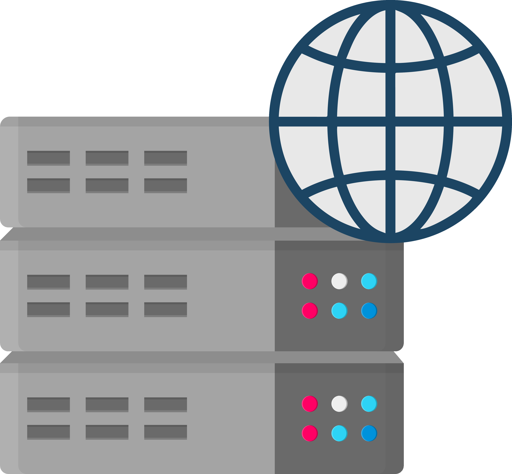
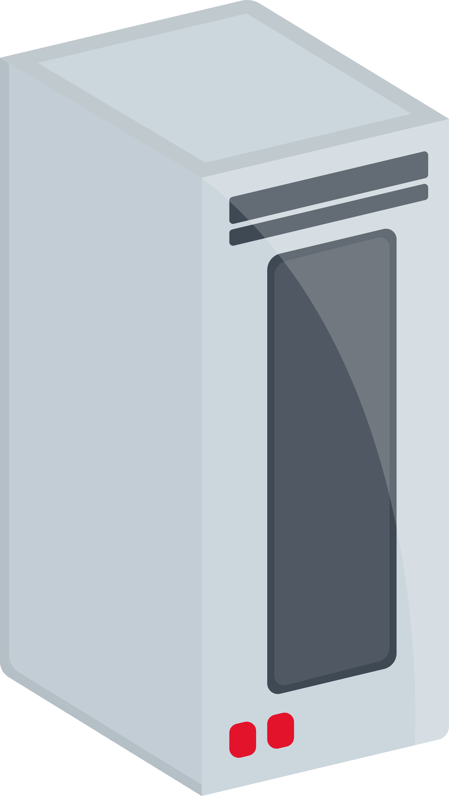
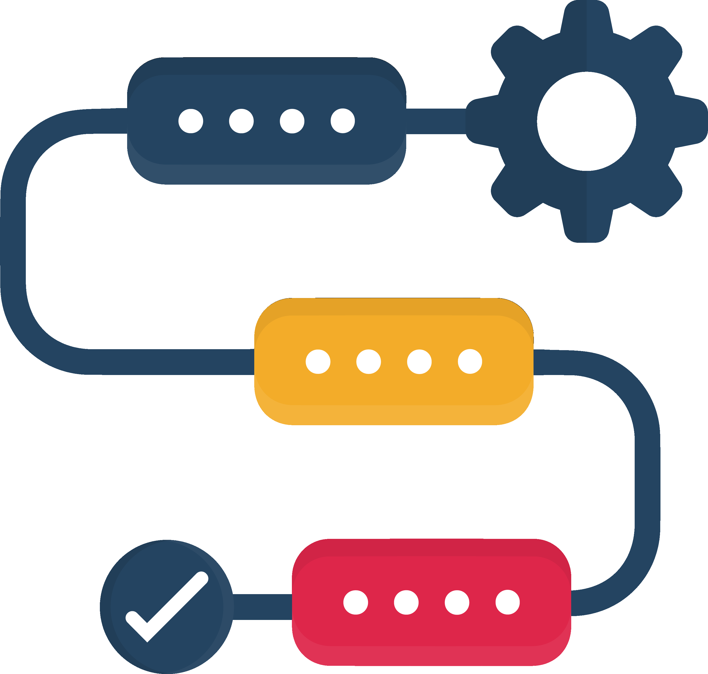
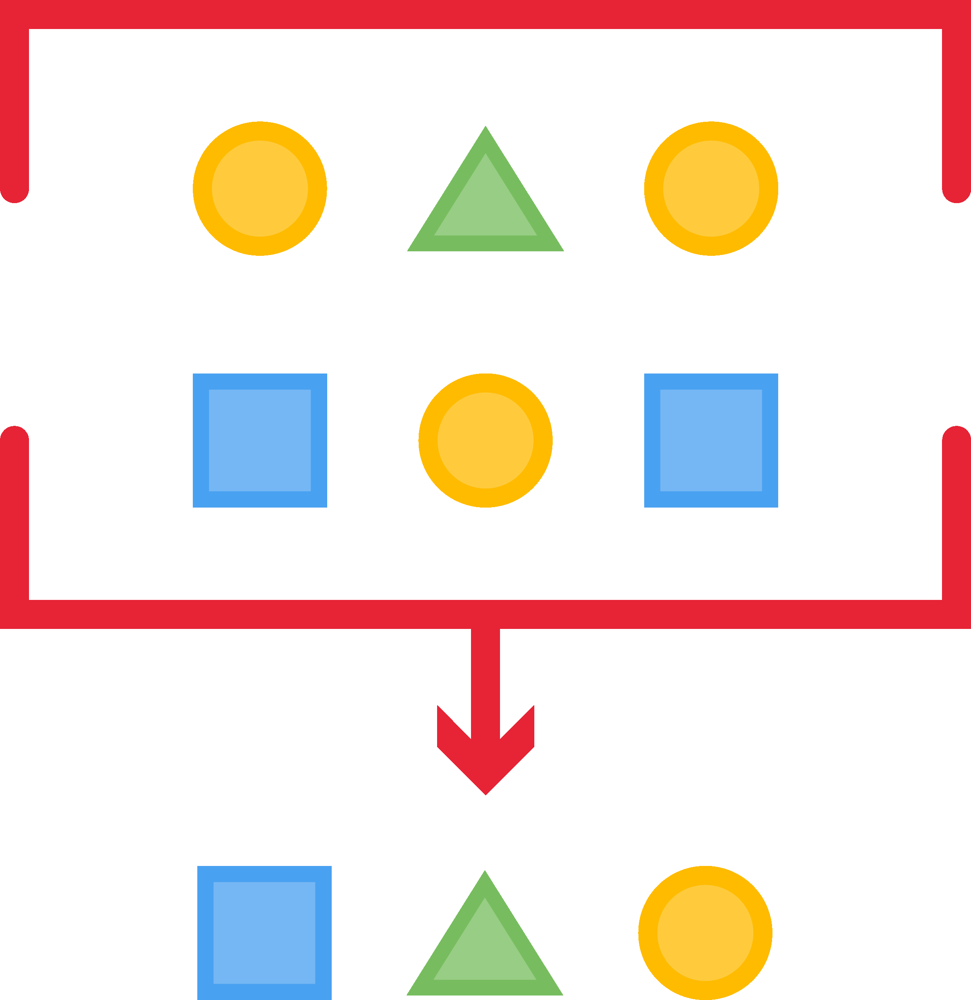

# 035 - Thiết Kế Bộ Thu Thập Dữ Liệu Web (Web Crawler)

[← Bài trước](034-thiet-ke-dich-vu-rut-gon-tinyurl.md) | [Mục lục](README.md) | [Bài tiếp theo →](036-thiet-ke-whatsapp.md)

---


# Thiết Kế Hệ Thống: Bộ Thu Thập Dữ Liệu Web (System Design: Web Crawler)

Tìm hiểu về dịch vụ bộ thu thập dữ liệu web (web crawler service).

**Chúng ta sẽ tìm hiểu các nội dung sau:**
* Giới thiệu (Introduction)
* Các lợi ích bổ sung (Additional benefits)
* Chúng ta sẽ thiết kế một Web crawler như thế nào? (How will we design a Web crawler?)

---

## Giới thiệu (Introduction)

Một **bộ thu thập dữ liệu web (web crawler)** là một bot Internet lướt qua toàn bộ mạng lưới World Wide Web (WWW) một cách có hệ thống để tìm kiếm nội dung, bắt đầu quá trình vận hành từ một tập hợp các URL hạt giống (seed URLs). Quá trình thu thập nội dung từ WWW này được gọi là **thu thập dữ liệu (crawling)**. Tiếp theo, hệ thống sẽ lưu trữ nội dung đã thu thập được vào các kho lưu trữ dữ liệu (data stores). Quá trình lưu trữ dữ liệu một cách hiệu quả để phục vụ cho việc sử dụng sau này được gọi là **lưu trữ (storing)**.

Đây là bước đầu tiên được thực hiện bởi các công cụ tìm kiếm (search engines); dữ liệu được lưu trữ sẽ được dùng cho mục đích đánh chỉ mục (indexing) và xếp hạng (ranking). Bài toán thiết kế cụ thể này chỉ giới hạn trong phạm vi của bộ thu thập dữ liệu web (web crawler) và không bao gồm phần giải thích về các giai đoạn sau như đánh chỉ mục (indexing) và xếp hạng (ranking) trong các công cụ tìm kiếm.

---

## Tổng quan về hệ thống thu thập dữ liệu web (An overview of the web crawler system)


```
+-----------------------------------------------------------+
|                          WWW                              |
+-----------------------------+-----------------------------+
                              |
                              v
+-----------------------------------------------------------+
|               Web crawler (Bộ thu thập web)               |
+-----------------------------+-----------------------------+
                              |
                              v
+-----------------------------------------------------------+
|            Stored content (Nội dung đã lưu trữ)           |
+-----------------------------------------------------------+
```

---

## Các lợi ích bổ sung (Additional benefits)

Các tiện ích bổ sung của một bộ thu thập dữ liệu web (web crawler) bao gồm:

* **Kiểm thử trang web (Web pages testing):** Chúng ta sử dụng web crawler để kiểm tra tính hợp lệ của các liên kết và cấu trúc của các trang web.
* **Giám sát trang web (Web page monitoring):** Chúng ta sử dụng web crawler để theo dõi các cập nhật về nội dung hoặc cấu trúc trên các trang web.
* **Tạo bản sao trang web (Site mirroring):** Web crawler là một phương pháp hiệu quả để tạo bản sao (mirror) các trang web phổ biến.
* **Kiểm tra vi phạm bản quyền (Copyright infringement check):** Web crawler tải nội dung về và kiểm tra các vấn đề liên quan đến vi phạm bản quyền.

Trong chương này, chúng ta sẽ thiết kế một bộ thu thập dữ liệu web (web crawler) và đánh giá cách nó đáp ứng các yêu cầu chức năng (functional requirements) và yêu cầu phi chức năng (non-functional requirements).

> [!NOTE]
> Đầu ra của quá trình thu thập dữ liệu (crawling) chính là dữ liệu đầu vào cho các giai đoạn xử lý tiếp theo — làm sạch dữ liệu (data cleaning), đánh chỉ mục (indexing), tính toán độ liên quan của trang bằng các thuật toán như PageRank, và phân tích dữ liệu (analytics). Để tìm hiểu về một số giai đoạn tiếp theo này, vui lòng tham khảo chương về tìm kiếm phân tán (distributed search).

---

## Chúng ta sẽ thiết kế một Web crawler như thế nào? (How will we design a Web crawler?)

Chương này bao gồm bốn bài học bao quát toàn bộ thiết kế của hệ thống bộ thu thập dữ liệu web (web crawler system):

1. **Yêu cầu (Requirements):** Bài học này liệt kê các yêu cầu chức năng (functional requirements) và yêu cầu phi chức năng (non-functional requirements) của hệ thống, đồng thời ước tính tính toán cho các tham số khác nhau của hệ thống.
2. **Thiết kế (Design):** Bài học này phân tích phương pháp tiếp cận từ dưới lên (bottom-up approach) cho một dịch vụ thu thập dữ liệu web (web-crawling service). Chúng ta sẽ có cái nhìn tổng quan chi tiết về tất cả các thành phần riêng lẻ dẫn đến một cơ chế vận hành kết hợp hoàn chỉnh nhằm đáp ứng các yêu cầu đặt ra.
3. **Cải tiến (Improvements):** Bài học này cung cấp tất cả các cải tiến thiết kế cần thiết để khắc phục các nhược điểm, đặc biệt là các bẫy thu thập dữ liệu (crawler traps). Những bẫy crawler này bao gồm: các liên kết có chứa tham số truy vấn (query parameters), chuyển hướng liên kết nội bộ (internal links redirection), các liên kết chứa các trang lịch vô tận (infinite calendar pages), các liên kết sinh nội dung động (dynamic content generation), và các liên kết chứa các thư mục vòng lặp (cyclic directories).
4. **Đánh giá (Evaluation):** Bài học này cung cấp một đánh giá chuyên sâu về các lựa chọn thiết kế của chúng ta để kiểm tra xem chúng có đáp ứng tất cả các tiêu chuẩn và yêu cầu mà chúng ta kỳ vọng từ thiết kế hay không.

Hãy bắt đầu với việc xác định các yêu cầu của một bộ thu thập dữ liệu web.

---

# Yêu cầu Thiết kế của một Bộ Thu Thập Dữ Liệu Web (Requirements of a Web Crawler's Design)

Tìm hiểu về các yêu cầu thiết kế của một bộ thu thập dữ liệu web.

**Chúng ta sẽ tìm hiểu các nội dung sau:**
* Các yêu cầu (Requirements)
  * Yêu cầu chức năng (Functional requirements)
  * Yêu cầu phi chức năng (Non-functional requirements)
* Ước tính tài nguyên (Resource estimation)
  * Ước tính lưu trữ (Storage estimation)
  * Thời gian duyệt (Traversal time)
  * Ước tính số lượng máy chủ cho kiến trúc đa worker (Number of servers estimation for multi-worker architecture)
  * Ước tính băng thông (Bandwidth estimation)
* Các khối xây dựng hệ thống mà chúng ta sẽ sử dụng (Building blocks we will use)

---

## Các yêu cầu (Requirements)

Hãy cùng làm rõ các yêu cầu chức năng (functional requirements) và phi chức năng (non-functional requirements) của một bộ thu thập dữ liệu web.

### Yêu cầu chức năng (Functional requirements)

Đây là những chức năng mà người dùng/hệ thống phải có khả năng thực hiện:

* **Thu thập dữ liệu (Crawling):** Hệ thống phải lướt qua toàn bộ WWW, mở rộng phạm vi từ một hàng đợi chứa các URL hạt giống (seed URLs) được cung cấp ban đầu bởi quản trị viên hệ thống (system administrator).

> [!IMPORTANT]
> **Điểm cần suy ngẫm (Points to Ponder) - Câu hỏi 1:**  
> **Chúng ta lấy các URL hạt giống (seed URLs) này từ đâu?**  
> 
> *Trả lời:* Có hai cách khả thi để tạo hoặc thu thập các URL hạt giống:
> 1. Chúng ta có thể tạo chúng một cách thủ công.
> 2. Chúng ta có thể quét (scan) các dải địa chỉ IP để tìm sự hiện diện của các máy chủ web (web servers).  
> 
> Các URL hạt giống này bắt buộc phải có chất lượng tốt.

* **Lưu trữ (Storing):** Hệ thống phải có khả năng trích xuất và lưu trữ nội dung của một URL vào một kho lưu trữ đối tượng nhị phân lớn (blob store). Điều này giúp cho URL đó cùng nội dung của nó có thể được xử lý bởi các công cụ tìm kiếm cho mục đích đánh chỉ mục (indexing) và xếp hạng (ranking).
* **Lập lịch (Scheduling):** Do việc thu thập dữ liệu là một quá trình lặp đi lặp lại, hệ thống cần phải có cơ chế lập lịch định kỳ để cập nhật các bản ghi trong các kho lưu trữ blob store của mình.

---

### Yêu cầu phi chức năng (Non-functional requirements)

* **Khả năng mở rộng (Scalability):** Về bản chất, hệ thống phải mang tính phân tán (distributed) và đa luồng (multithreaded), bởi vì nó phải nạp và xử lý hàng trăm triệu tài liệu web.
* **Khả năng mở rộng tính năng (Extensibility):** Hiện tại, thiết kế của chúng ta hỗ trợ giao thức truyền thông HTTP(S) và các tiện ích lưu trữ tệp văn bản. Để mở rộng chức năng, hệ thống cũng phải có khả năng mở rộng để hỗ trợ các giao thức truyền thông mạng khác nhau, có khả năng bổ sung nhiều module xử lý và lưu trữ các định dạng tệp đa dạng.
* **Tính nhất quán (Consistency):** Do hệ thống của chúng ta bao gồm nhiều tiến trình thu thập dữ liệu (crawling workers), việc đảm bảo tính nhất quán dữ liệu (data consistency) giữa tất cả các worker này là hết sức cần thiết.  
  *Trong ngữ cảnh tổng quát, tính nhất quán dữ liệu có nghĩa là độ tin cậy và độ chính xác của dữ liệu trên toàn bộ hệ thống hoặc tập dữ liệu. Trong ngữ cảnh của bộ thu thập dữ liệu web, nó đề cập đến việc tất cả các worker phải tuân thủ một bộ quy tắc cụ thể trong nỗ lực tạo ra dữ liệu thu thập nhất quán.*
* **Hiệu năng (Performance):** Hệ thống phải đủ thông minh để giới hạn việc thu thập dữ liệu trong phạm vi một tên miền (domain), dựa trên thời gian đã dành ra hoặc số lượng URL đã truy cập của tên miền đó. Quá trình này được gọi là **tự điều tiết (self-throttling)**. Số lượng URL được thu thập mỗi giây (URLs crawled per second) và thông lượng (throughput) của nội dung được thu thập phải đạt mức tối ưu.

> [!TIP]
> Các trang web thường lưu trữ một tệp `robots.txt`, tệp này truyền đạt các giới hạn đặc thù của tên miền tới crawler. Bộ thu thập dữ liệu phải tuân thủ nghiêm ngặt các giới hạn này bằng mọi giá.

* **Giao diện người dùng cải tiến — Lập lịch tùy chỉnh (Improved user interface — customized scheduling):** Bên cạnh việc thu thập lại mặc định (default recrawling) vốn là một yêu cầu chức năng, hệ thống cũng nên hỗ trợ chức năng thực hiện thu thập dữ liệu tùy chỉnh ngoài quy trình định kỳ theo yêu cầu của quản trị viên hệ thống.

---

### Các yêu cầu phi chức năng của hệ thống thu thập dữ liệu web (The non-functional requirements of the web crawler system)


```
                    +-----------------------------+
                    |         Web crawler         |
                    +--------------+--------------+
                                   |
    +------------------+-----------+-----------+------------------+
    |                  |                       |                  |
    v                  v                       v                  v
+--------------+ +---------------+       +-------------+  +---------------+
| Customized   | | Extensibility |       | Scalability |  |  Consistency  |
|  scheduling  | | (Khả năng     |       | (Khả năng   |  | (Tính nhất    |
| (Lập lịch    | |  mở rộng      |       |  mở rộng)   |  |  quán)        |
|  tùy chỉnh)  | |  tính năng)   |       +-------------+  +---------------+
+--------------+ +---------------+              |
                                                v
                                         +-------------+
                                         | Performance |
                                         | (Hiệu năng) |
                                         +-------------+
```

---

## Ước tính tài nguyên (Resource estimation)

---

# Ước Tính Tài Nguyên và Thiết Kế Bộ Thu Thập Dữ Liệu Web (Web Crawler)

Chúng ta cần ước tính các yêu cầu tài nguyên khác nhau cho thiết kế hệ thống của mình.

---

## 1. Các Giả Định Ban Đầu (Assumptions)

Dưới đây là các giả định chúng ta sẽ sử dụng khi tính toán ước lượng tài nguyên hệ thống:

* **Tổng số lượng trang web (Web pages):** 5 tỷ (5 Billion) trang web.
* **Kích thước nội dung văn bản (Text content) trên mỗi trang web:** 2070 KB.
* **Dữ liệu siêu dữ liệu (Metadata) cho mỗi trang web:** 500 Bytes.

---

## 2. Ước Tính Dung Lượng Lưu Trữ (Storage Estimation)

Tổng dung lượng lưu trữ cần thiết để lưu trữ nội dung văn bản của 5 tỷ trang web được tính như sau:

$$\text{Tổng dung lượng lưu trữ trên mỗi lượt crawl (Total storage per crawl)} = 5 \text{ tỷ} \times (2070\text{ KB} + 500\text{ B}) = 10.35\text{ PB}$$


> **Tổng dung lượng lưu trữ theo yêu cầu của hệ thống Web Crawler:**
> * **Lưu trữ / Trang web (Storage/Web page):** $2070\text{ KB} + 500\text{ Bytes}$
> * **Số lượng trang web (Web pages):** $5\text{ Billion}$
> * **Tổng dung lượng lưu trữ / Lượt crawl (Total storage/Crawl):** $10.35\text{ PB}$

---

## 3. Thời Gian Duyệt Trang (Traversal Time)

Bởi vì thời gian duyệt trang (Traversal time) cũng quan trọng không kém gì yêu cầu về lưu trữ, chúng ta hãy tính toán thời gian xấp xỉ cho một lần thu thập dữ liệu (One-time crawling). Giả định rằng thời gian duyệt qua giao thức HTTP trung bình (Average HTTP traversal) trên mỗi trang web là **60 ms**, thời gian để duyệt toàn bộ 5 tỷ trang web sẽ là:

$$\text{Tổng thời gian duyệt (Total traversal time)} = 5 \text{ tỷ} \times 60\text{ ms} = 0.3 \text{ tỷ giây} = 9.5\text{ năm}$$

Sẽ mất khoảng **9.5 năm** để duyệt qua toàn bộ Internet nếu chỉ sử dụng một phiên bản (Single instance) crawler duy nhất. Tuy nhiên, mục tiêu của chúng ta là hoàn thành quá trình này trong vòng **1 ngày**. Chúng ta có thể đạt được mục tiêu này bằng cách thiết kế hệ thống hỗ trợ kiến trúc đa worker (**Multi-worker architecture**), chia nhỏ các tác vụ cho nhiều worker chạy trên các máy chủ (Servers) khác nhau.

---

## 4. Ước Tính Số Lượng Máy Chủ Cho Kiến Trúc Đa Worker (Number of Servers Estimation for Multi-Worker Architecture)

Hãy tính toán số lượng máy chủ cần thiết để hoàn tất việc crawl trong vòng 1 ngày. Giả định rằng mỗi máy chủ chỉ chạy một worker duy nhất.

* Một máy chủ mất **3,468 ngày** để hoàn thành tác vụ.
* Chúng ta cần bao nhiêu máy chủ để hoàn thành cùng tác vụ đó trong vòng 1 ngày?
* Chúng ta sẽ cần **3,468 máy chủ** để hoàn tất tác vụ đó chỉ trong đúng 1 ngày.

$$\text{Số ngày cần thiết của 1 máy chủ để hoàn thành tác vụ} = 9.5\text{ năm} \times 365\text{ ngày} \approx 3,468\text{ ngày}$$


> **Số lượng máy chủ yêu cầu cho hệ thống Web Crawler:** $3,468\text{ servers}$

> [!TIP]
> **Gợi ý (Hint):**
> Nếu có $n$ luồng (Threads) trên mỗi máy chủ, chúng ta sẽ chia $3,468$ cho $n$. Ví dụ: nếu một máy chủ có khả năng thực thi đồng thời 10 luồng tại một thời điểm ($n = 10$), thì số lượng máy chủ cần thiết sẽ giảm xuống chỉ còn:
> 
> $$\frac{3468}{10} \approx 347\text{ servers}$$

---

## 5. Ước Tính Băng Thông (Bandwidth Estimation)

Vì chúng ta cần xử lý $10.35\text{ PB}$ dữ liệu mỗi ngày, tổng băng thông yêu cầu (**Total Bandwidth**) sẽ là:

$$\text{Băng thông tổng} \approx \frac{10.35\text{ PB}}{86400\text{ sec}} \approx 120\text{ GB/sec} \approx 960\text{ Gb/sec}$$

**$960\text{ Gb/sec}$** là tổng băng thông cần thiết. Bây giờ, giả định tác vụ được phân bổ đều cho **3,468 máy chủ** để hoàn thành trong một ngày. Khi đó, băng thông yêu cầu trên mỗi máy chủ (**Per-server bandwidth**) sẽ là:

$$\text{Băng thông mỗi máy chủ} \approx \frac{960\text{ Gb/sec}}{3468\text{ servers}} \approx 277\text{ Mb/sec per server}$$


> **Tổng băng thông cần thiết cho hệ thống Web Crawler:**
> * **Tổng băng thông trên mỗi máy chủ (Total bandwidth per server):** $277\text{ Mbps}$
> * **Tổng băng thông toàn hệ thống (Total bandwidth):** $960\text{ Gbps}$

Hãy thử nghiệm thay đổi các giả định ban đầu và theo dõi sự thay đổi của các chỉ số ước lượng trong bộ công cụ tính toán dưới đây:

---

## 6. Bảng Tính Ước Tính Cho Web Crawler (Estimates Calculator for the Web Crawler)




| Thông Số (Parameter) | Giá Trị (Value) | Đơn Vị (Unit) |
| :--- | :--- | :--- |
| **Số lượng trang web (Number of Webpages)** | 5 | Tỷ (Billion) |
| **Nội dung văn bản mỗi trang (Text Content per Webpage)** | 2070 | KB |
| **Dữ liệu siêu dữ liệu mỗi trang (Metadata per Webpage)** | 500 | Bytes |
| **Tổng dung lượng lưu trữ (Total Storage)** | 10.35 | PB |
| **Tổng thời gian duyệt trên 1 máy chủ (Total Traversal Time on One Server)** | 9.5 | Năm (Years) |
| **Số máy chủ cần để duyệt trong 1 ngày (Servers Required to Perform Traversal in One Day)** | 3,468 | Máy chủ (Servers) |
| **Ước tính băng thông (Bandwidth Estimate)** | 958.33 | Gb/giây (Gb/sec) |

---

## 7. Các Khối Xây Dựng Hệ Thống Sẽ Sử Dụng (Building Blocks We Will Use)

Dưới đây là danh sách các khối xây dựng cốt lõi (**Main Building Blocks**) sẽ được sử dụng trong thiết kế của chúng ta:


### Các Khối Xây Dựng Trong Thiết Kế Mức Cao (Building Blocks in High-Level Design):
* **Bộ Lập Lịch (Scheduler):** Được sử dụng để lên lịch trình các sự kiện thu thập dữ liệu (crawling events) đối với các URL được lưu trữ trong cơ sở dữ liệu của nó.
* **Trình Phân Giải Tên Miền (DNS Resolver):** Cần thiết để thực hiện phân giải địa chỉ IP (IP address resolution) của các trang web.
* **Bộ Nhớ Đệm (Cache):** Được tận dụng để lưu trữ các tài liệu đã tải về, phục vụ truy xuất nhanh chóng từ tất cả các module xử lý.
* **Kho Lưu Trữ Đối Tượng Lớn (Blob Store):** Ứng dụng chính dùng để lưu trữ toàn bộ nội dung dữ liệu đã crawl được.

Bên cạnh các khối nền tảng cơ bản này, thiết kế của chúng ta còn bao gồm thêm một số thành phần phụ trợ:


### Các Thành Phần Bổ Sung Trong Thiết Kế Mức Cao (Components in High-Level Design):
* **Bộ Tải HTML (HTML Fetcher):** Thiết lập kết nối truyền thông mạng giữa bộ thu thập dữ liệu (crawler) và máy chủ web đích (web hosts).
* **Máy Chủ Dịch Vụ (Service Host):** Quản lý và điều phối hoạt động thu thập dữ liệu giữa các worker.
* **Bộ Trích Xuất (Extractor):** Trích xuất các URL nhúng bên trong và nội dung tài liệu từ trang web.
* **Bộ Loại Bỏ Trùng Lặp (Duplicate Eliminator):** Thực hiện kiểm tra khử trùng lặp (deduplication testing) đối với các URL và tài liệu mới tiếp nhận.

Trong bài học tiếp theo, chúng ta sẽ tập trung vào thiết kế mức cao (**High-Level Design**) và thiết kế chi tiết (**Detailed Design**) của hệ thống Web Crawler.

---

## 8. Thiết Kế Bộ Thu Thập Dữ Liệu Web (Design of a Web Crawler)

Cung cấp cái nhìn tổng quan về các khối xây dựng và các thành phần của hệ thống web crawler, đồng thời tìm hiểu về tương tác diễn ra giữa chúng trong quá trình thiết kế một web crawler.

**Nội dung sẽ bao gồm:**
* **Thiết kế (Design)**
* **Các thành phần (Components)**
* **Quy trình làm việc (Workflow)**

### Thiết Kế (Design)
Bài học này mô tả các khối xây dựng và các thành phần bổ sung tham gia vào thiết kế cũng như luồng công việc (workflow) của tiến trình crawl web dựa trên các yêu cầu đặt ra.

### Các Thành Phần (Components)
Dưới đây là chi tiết về các khối xây dựng và các thành phần cần thiết cho thiết kế của chúng ta:

#### Bộ Lập Lịch (Scheduler):
Đây là một trong những khối xây dựng then chốt dùng để lập lịch trình các URL cần crawl. Nó bao gồm hai đơn vị cấu thành:
1. **Hàng đợi ưu tiên (Priority Queue - URL Frontier):** Hàng đợi lưu trữ các URL đã sẵn sàng để crawl dựa trên hai thuộc tính gắn liền với từng mục: **Mức độ ưu tiên (Priority)** và **Tần suất cập nhật (Updates Frequency)**.
2. **Cơ sở dữ liệu quan hệ (Relational Database):** Lưu trữ toàn bộ các URL cùng với hai tham số liên quan nêu trên. Cơ sở dữ liệu được cập nhật bởi các yêu cầu mới từ hai luồng đầu vào (Input streams) sau:
   * Các URL do người dùng thêm vào, bao gồm các URL hạt giống (**Seed URLs**) và các URL được bổ sung trong quá trình thực thi (**Runtime added URLs**).

---

# Thiết Kế Bộ Thu Thập Dữ Liệu Web (Web Crawler) - Phần Thiết Kế Chi Tiết & Tối Ưu Hóa

Các URL được trích xuất bởi crawler.

---

### Những điểm cần cân nhắc (Points to Ponder)

#### Câu hỏi 1 (Question 1)
> **Liệu chúng ta có thể ước tính kích thước của hàng đợi ưu tiên (priority queue)? Ưu và nhược điểm của hàng đợi ưu tiên tập trung (centralized) so với phân tán (distributed) là gì?**

**Ẩn câu trả lời (Hide Answer)**

**Giả định (Assumption):** Hãy giả định rằng tại bất kỳ thời điểm nào, chúng ta có xấp xỉ 1 triệu URLs trong **URL frontier** cần được thu thập.

Hãy cùng tính toán dung lượng hàng đợi ưu tiên cần thiết để lưu trữ tất cả các URLs này:

$$\text{Kích thước hàng đợi ưu tiên} = 1\text{ triệu URLs} \times 2048\text{ Bytes} = 2.048\text{ GB}$$

> [!NOTE]
> **2.048 GB** là một dung lượng bộ nhớ rất hợp lý cho một hàng đợi (queue), điều này chỉ ra rằng chúng ta có thể chưa cần triển khai cơ chế phân tán (distributed mechanism) cho URL frontier ngay từ đầu.

---


*Mô hình Hàng đợi Ưu tiên Tập trung (Centralized Priority Queue):*
- **Web crawler**: Worker 1, Worker 2, ..., Worker n
- **URL frontier [Priority queue]**: [E, B, D, C, A]
- Các thao tác: Đưa vào hàng đợi (**Enqueuing**) và Lấy ra khỏi hàng đợi (**Dequeuing**)

Tuy nhiên, một hàng đợi tập trung (centralized queue) sẽ bị giới hạn về băng thông đọc/ghi (**read/write bandwidth**) và là một điểm nghẽn chịu lỗi đơn lẻ (**Single Point of Failure - SPOF**). Do đó, việc có một hàng đợi con (sub-queue) riêng cho từng worker sẽ là cách tiếp cận tối ưu nhất.


*Mô hình Hàng đợi Phân tán độc lập cho từng Worker:*
- **Web crawler**:
  - Worker 1 $\rightarrow$ URL frontier [priority queue]
  - Worker 2 $\rightarrow$ URL frontier [priority queue]
  - Worker n $\rightarrow$ URL frontier [priority queue]
- Các thao tác: **Enqueuing** và **Dequeuing** diễn ra song song và độc lập.

Nếu chúng ta sử dụng hàng đợi phân tán (**distributed queue**), tất cả các worker đều có thể lấy dữ liệu ra từ cùng một hàng đợi nếu muốn. Tuy nhiên, việc sở hữu các hàng đợi độc lập có thể tối ưu hóa quy trình thu thập dữ liệu sâu hơn nữa, đặc biệt trong trường hợp các tác vụ thu thập có độ ưu tiên cao và tần suất thường xuyên hơn — chẳng hạn như các trang web tin tức cần nhiều hơn số lượng worker thông thường để thực hiện việc thu thập liên tục. Cách tiếp cận này về bản chất sẽ tạo điều kiện thuận lợi cho việc mở rộng quy mô kích thước hàng đợi (**queue size scaling**).

Ngược lại, việc duy trì một hàng đợi đơn lẻ (single queue) lại có lợi cho việc khử trùng lặp (**deduplication**) các liên kết dư thừa và tiết kiệm tài nguyên tổng thể của crawler hơn. Chúng ta sẽ xử lý mức độ ưu tiên và tần suất thu thập lại (**recrawling priority and frequency**) theo một phương pháp khác như được giải thích ở các phần tiếp theo, nơi mà cơ chế phân tán thực sự cần thiết.

---

### Bộ phân giải tên miền (DNS Resolver)
Bộ thu thập dữ liệu web cần một bộ phân giải tên miền (**DNS resolver**) để ánh xạ tên máy chủ (**hostnames**) sang địa chỉ IP phục vụ cho việc tải về nội dung HTML. Vì quá trình tra cứu DNS (**DNS lookup**) là một tiến trình tiêu tốn nhiều thời gian (**high latency**), một giải pháp tốt hơn là xây dựng một bộ phân giải DNS tùy chỉnh (**customized DNS resolver**) và lưu bộ nhớ đệm (**cache**) các địa chỉ IP thường dùng trong khoảng thời gian sống (**Time-To-Live - TTL**) của chúng, vì các địa chỉ này chắc chắn sẽ thay đổi sau khi thời gian TTL hết hạn.

---

### Bộ tải HTML (HTML Fetcher)
**HTML fetcher** khởi tạo giao tiếp với máy chủ đang lưu trữ (hosting) các URL. Nó tải về nội dung tệp dựa trên giao thức truyền thông bên dưới. Chúng ta tập trung chủ yếu vào giao thức HTTP cho nội dung dạng văn bản, nhưng HTML fetcher có thể dễ dàng mở rộng sang các giao thức truyền thông khác, như đã được đề cập trong phần yêu cầu phi chức năng (**non-functional requirements**) của bộ thu thập dữ liệu web.

---

#### Câu hỏi (Question)
> **Bộ thu thập dữ liệu (crawler) xử lý các URL có mức độ ưu tiên biến thiên (variable priorities) như thế nào?**

**Ẩn câu trả lời (Hide Answer)**

Crawler phải đủ linh hoạt và cảnh giác ở từng giai đoạn để phân biệt giữa các cấp độ ưu tiên khác nhau của các URL. 

Hãy xem cách thiết kế crawler xử lý các trường hợp này theo từng giai đoạn:

1. **Ở cấp độ Hàng đợi:** Do chúng ta triển khai URL frontier dưới dạng một hàng đợi ưu tiên (**priority queue**) của một bộ lập lịch (**scheduler**), nó sẽ tự động xử lý việc sắp xếp vị trí dựa trên các giá trị tham số. Chúng ta đã chọn các tham số về khả năng chịu lỗi (**fault tolerance**) và tính chu kỳ (**periodicity**) làm chỉ số đo lường độ ưu tiên cho các URL.
   - Việc gán các tham số này phụ thuộc vào bản chất nội dung của trang web. Nếu đó là một trang báo tin tức, việc thu thập dữ liệu nhiều lần trong ngày là phù hợp và cần thiết để giữ cho chỉ mục (**index**) luôn được cập nhật. Một trang web thông thường với các bản cập nhật không thường xuyên có thể có tần suất ghé thăm chuẩn là, ví dụ, hai tuần một lần.
2. **Ở cấp độ HTML Fetcher:** Tương tự, tại tầng HTML-fetcher nơi crawler giao tiếp với máy chủ lưu trữ dựa trên các nguyên tắc của `robots.txt`, nó có thể truyền giá trị của tham số liên quan đối với các URL đã nạp ngược trở lại cho bộ lập lịch (**scheduler**) trong giai đoạn lưu trữ.

> [!TIP]
> Thay vì gắn các chỉ số ưu tiên trực tiếp vào URL, một giải pháp khác là **thiết lập các hàng đợi riêng biệt cho từng mức độ ưu tiên khác nhau**. Sau đó, chúng ta có thể lấy dữ liệu ra (**dequeue**) từ các hàng đợi này dựa trên mức độ ưu tiên đã gán cho từng hàng đợi. Cách tiếp cận này chỉ yêu cầu việc đặt URL vào đúng hàng đợi tương ứng và không cần đến các đoạn mã kịch bản (scripts) để lập lịch dựa trên các tham số bổ sung. Tất cả phụ thuộc vào quy mô (**scale**) của ứng dụng thu thập dữ liệu.

---

### Máy chủ Dịch vụ (Service Host)
Thành phần này đóng vai trò như bộ não của crawler và được cấu thành từ các thực thi worker (**worker instances**). Để đơn giản, chúng ta sẽ gọi toàn bộ thành phần này hoặc một worker đơn lẻ là một **crawler**.

Có ba nhiệm vụ chính mà service host/crawler này thực hiện:
1. **Quản lý kiến trúc đa worker (Multi-worker architecture):** Xử lý kiến trúc đa tiến trình của hoạt động thu thập. Dựa trên tính sẵn sàng (**availability**), mỗi worker sẽ giao tiếp với URL frontier để lấy ra (**dequeue**) URL khả dụng tiếp theo cho việc thu thập.
2. **Tra cứu DNS:** Mỗi worker chịu trách nhiệm nhận kết quả phân giải DNS của các URL đầu vào từ DNS resolver.
3. **Cầu nối điều phối (Gateway):** Mỗi worker đóng vai trò như một gateway trung gian giữa bộ lập lịch (**scheduler**) và **HTML fetcher** bằng cách gửi thông tin phân giải DNS cần thiết tới HTML fetcher để khởi tạo giao tiếp mạng.

---

#### Tương tác giữa Service Host với các thành phần khác





- **Các thành phần tương tác:**
  - **Service host**: Worker 1, Worker 2, Worker n
  - **URL frontier**
  - **DNS resolver**
  - **HTML fetcher**
- **Luồng dữ liệu và trách nhiệm:**
  - Các worker thực hiện lấy URL ra khỏi hàng đợi (**Workers dequeuing the URLs**) từ URL frontier.
  - Các worker thực hiện lấy thông tin phân giải DNS cho các URL đã nạp (**Workers acquiring the DNS resolution of fetched URLs**) từ DNS resolver.
  - Các worker chuyển tiếp thông tin phân giải DNS đã thu nhận (**Workers forwarding the acquired DNS resolution**) sang cho HTML fetcher.

---

### Bộ trích xuất (Extractor)
Một khi HTML fetcher lấy được trang web về, bước tiếp theo là trích xuất hai thành phần từ trang web đó: **các liên kết URL** và **nội dung trang (content)**. 

Bộ trích xuất (**Extractor**) gửi trực tiếp các URL đã trích xuất và chuyển nội dung cùng với luồng nhập tài liệu (**Document Input Stream - DIS**) đến bộ loại bỏ trùng lặp (**Duplicate Eliminator**). 

> [!NOTE]
> **DIS (Document Input Stream)** là một bộ nhớ đệm (**cache**) được sử dụng để lưu trữ tài liệu đã được trích xuất, nhờ đó các thành phần khác có thể truy cập và xử lý tài liệu này. Ở đây, chúng ta có thể chọn **Redis** làm giải pháp bộ nhớ đệm nhờ vào chức năng cấu trúc dữ liệu nâng cao (**advanced data structures**) của nó.

Sau khi đã xác minh rằng nội dung và liên kết không bị trùng lặp trong các kho lưu trữ dữ liệu:
- Extractor sẽ gửi các URL đến **bộ lập lịch tác vụ (task scheduler)** chứa URL frontier.
- Lưu trữ nội dung tài liệu vào **kho lưu trữ đối tượng nhị phân lớn (Blob storage)** phục vụ cho mục đích lập chỉ mục (**indexing**).

---

### Bộ loại bỏ trùng lặp (Duplicate Eliminator)
Vì môi trường Web là một mạng lưới liên kết chặt chẽ với nhau, xác suất hai URL khác nhau cùng trỏ về một trang web hoặc các URL khác nhau trỏ về các trang web có nội dung giống hệt nhau là rất rõ ràng. Crawler cần một thành phần chuyên biệt để thực hiện kiểm tra khử trùng lặp (**dedup test**) nhằm triệt tiêu rủi ro lãng phí tài nguyên do lưu trữ và xử lý cùng một nội dung hai lần.

Bộ loại bỏ trùng lặp tính toán giá trị mã kiểm tra (**checksum value**) của từng URL được trích xuất và so sánh nó với kho dữ liệu mã kiểm tra URL (**URLs checksum data store**):
- Nếu tìm thấy (**đã tồn tại**): Nó loại bỏ (**discard**) URL vừa trích xuất.
- Nếu không tìm thấy: Nó thêm một bản ghi mới vào cơ sở dữ liệu với giá trị checksum vừa tính toán.

---

#### Cơ chế khử trùng lặp trong thực tế (Dedup Testing in Action)




*Quy trình khử trùng lặp và lưu trữ nội dung:*
- **Các thành phần:**
  - **Extractor**: Đưa luồng tài liệu vào `Document input stream`, chuyển URL và nội dung đi xử lý.
  - **Duplicate eliminator**:
    - Tính toán checksum URL (**URL checksum calculation**) đối chiếu với **URL checksum data store**.
    - Tính toán checksum tài liệu (**Document checksum calculation**) đối chiếu với **Document checksum data store**.
  - **Đích đến:**
    - Bước 1: Kiểm tra trùng lặp (**Dedup testing**).
    - Bước 2: Lưu trữ nội dung (**Content storing**) vào **Blob store**, đưa URL mới hợp lệ vào **URL frontier**.

Bộ loại bỏ trùng lặp lặp lại chính xác quy trình này đối với nội dung được trích xuất và thêm giá trị checksum của trang web mới vào kho lưu trữ mã kiểm tra tài liệu (**document checksum data store**) cho các lần đối khớp trong tương lai.

> [!IMPORTANT]
> Thiết kế đề xuất của chúng ta cho bộ loại bỏ trùng lặp có khả năng chống chịu vững vàng (**robust**) trước hai vấn đề kỹ thuật sau:
> 1. **Chuyển hướng URL (URL redirection):** Bằng cách sử dụng URL redirection, một URL mới có thể vượt qua bước kiểm tra khử trùng URL (*URL dedup test*). Tuy nhiên, giai đoạn thứ hai là khử trùng lặp tài liệu (*Document dedup test*) sẽ ngăn chặn việc trùng lặp nội dung được ghi vào Blob storage.
> 2. **Biến đổi nội dung nhỏ:** Chỉ cần thay đổi một Byte duy nhất trong tài liệu, mã kiểm tra (checksum) của tài liệu bị sửa đổi sẽ thay đổi... *(tiếp tục ở phần sau)*

---

tài liệu sẽ cho ra kết quả khác với tài liệu gốc ban đầu.

### Blob Store (Kho Lưu Trữ Nhị Phân Lớn)

Vì bộ thu thập dữ liệu web (web crawler) là xương sống (*backbone*) của một công cụ tìm kiếm (*search engine*), nên việc lưu trữ và lập chỉ mục (*indexing*) nội dung đã thu thập cùng các siêu dữ liệu (*metadata*) liên quan là vô cùng quan trọng. Thiết kế cần có một hệ thống lưu trữ phân tán (*distributed storage*), chẳng hạn như một **Blob Store**, bởi vì chúng ta cần lưu trữ các khối lượng dữ liệu phi cấu trúc (*unstructured data*) khổng lồ.

Hình minh họa dưới đây biểu diễn tổng quan kiến trúc thiết kế của bộ thu thập dữ liệu web:

#### Thiết Kế Tổng Thể Của Web Crawler (The Overall Web Crawler Design)


* **Service host (Máy chủ dịch vụ)**
  * ...
  * **HTML fetcher (Bộ nạp HTML)**
  * ...
  * **Extractor (Bộ trích xuất)**
  * ...
  * **Duplicate eliminator (Bộ loại trừ trùng lặp)**
* **DNS resolver (Bộ phân giải DNS)**
* **Scheduler (Bộ lập lịch)**
* **Extracted documents (Các tài liệu đã trích xuất)**
* **Blob store (Kho lưu trữ blob)**
* **Priority queue (Hàng đợi ưu tiên)**
* **RDB (Cơ sở dữ liệu quan hệ - Relational Database)**
* **Extracted URL (URL đã trích xuất)**
* **Document input stream - DIS (Luồng dữ liệu tài liệu đầu vào)**
* **User (Người dùng)**

---

### Quy Trình Hoạt Động (Workflow)

1. **Gán tác vụ cho một worker (Assignment to a worker):**  
   Bộ thu thập dữ liệu (*crawler / service host*) khởi tạo tiến trình bằng cách nạp một URL từ hàng đợi ưu tiên (*priority queue*) của tập biên giới URL (*URL frontier*) và gán nó cho một worker đang rảnh (*available worker*).

2. **Phân giải tên miền (DNS resolution):**  
   Worker gửi URL tiếp nhận đến bộ phân giải DNS (*DNS resolver*). Trước khi phân giải URL, bộ phân giải DNS sẽ kiểm tra bộ nhớ đệm (*cache*) và trả về địa chỉ IP được yêu cầu nếu tìm thấy. Nếu không, nó sẽ thực hiện phân giải để xác định địa chỉ IP, gửi trả lại cho phiên bản worker (*worker instance*) của crawler, đồng thời lưu trữ kết quả này vào cache.

---

> [!TIP]
> **Ẩn gợi ý (Hide Hint)**  
> Việc triển khai URL frontier — lấy các URL ra khỏi hàng đợi (*dequeuing*) từ một hàng đợi ưu tiên FIFO (*First-In-First-Out*) và đưa toàn bộ các URL đã trích xuất vào lại hàng đợi (*enqueuing*) thay vì crawl chúng một cách tuần tự nối tiếp nhau — đảm bảo rằng chúng ta đang crawl web theo cơ chế **tìm kiếm theo chiều rộng (Breadth-First Search - BFS)** thay vì **tìm kiếm theo chiều sâu (Depth-First Search - DFS)**.

> [!NOTE]
> **Điểm cần suy ngẫm (Point to Ponder)**  
> **Câu hỏi:** Chúng ta có thể sử dụng DFS thay vì BFS không?  
> *(Show Answer / Xem câu trả lời)*

3. **Khởi tạo giao tiếp bằng bộ nạp HTML (Communication initiation by the HTML fetcher):**  
   Worker chuyển tiếp URL cùng địa chỉ IP tương ứng tới bộ nạp HTML (*HTML fetcher*). Thành phần này sẽ khởi tạo kết nối truyền thông giữa crawler và máy chủ lưu trữ (*host server*).

4. **Trích xuất nội dung (Content extraction):**  
   Khi worker đã thiết lập được kênh truyền thông, nó tiến hành trích xuất các URL và tài liệu HTML từ trang web, sau đó đặt tài liệu vào bộ nhớ đệm (*cache*) để các thành phần khác tiếp tục xử lý.

5. **Kiểm tra trùng lặp (Dedup testing):**  
   Worker gửi các URL đã trích xuất và tài liệu tới bộ loại trừ trùng lặp (*duplicate eliminator*) để kiểm tra tính duy nhất. Bộ loại trừ trùng lặp sẽ tính toán và so sánh mã kiểm tra (*checksum*) của cả URL lẫn tài liệu với các giá trị checksum đã được lưu trữ trước đó.  
   Bộ loại trừ trùng lặp sẽ hủy bỏ yêu cầu gửi đến nếu phát hiện trùng khớp (*match*). Nếu không có sự trùng khớp, nó sẽ ghi các giá trị checksum mới tính toán vào các kho dữ liệu tương ứng và cấp quyền cho bộ trích xuất (*extractor*) lưu trữ nội dung.

6. **Lưu trữ nội dung (Content storing):**  
   Bộ trích xuất (*extractor*) gửi các URL mới được phát hiện tới bộ lập lịch (*scheduler*). Scheduler sẽ lưu trữ chúng vào cơ sở dữ liệu (*database*), đồng thời thiết lập các biến số về độ ưu tiên (*priority*) và tần suất crawl lại (*recrawl frequency*).  
   Bộ trích xuất cũng ghi các phần bắt buộc của tài liệu mới phát hiện — hiện đang nằm trong DIS (*Document Input Stream*) — vào cơ sở dữ liệu.

7. **Thu thập lại (Recrawling):**  
   Khi một chu kỳ hoàn tất, crawler quay trở lại bước đầu tiên và lặp lại quy trình này cho đến khi hàng đợi URL frontier trống.  
   Các URL được lưu trữ trong cơ sở dữ liệu của scheduler đều được gán độ ưu tiên và chu kỳ định kỳ (*periodicity*). Việc đưa các URL mới vào hàng đợi (*enqueuing*) của URL frontier phụ thuộc chặt chẽ vào hai yếu tố này.

> [!NOTE]
> **Lưu ý:** Do có nhiều phiên bản (*multiple instances*) của từng dịch vụ và kiến trúc dựa trên Microservices, thiết kế của chúng ta có thể áp dụng cơ chế cân bằng tải phía máy khách (**Client-side Load Balancing**) (tham khảo mục *Client-side Load Balancer for Twitter*).

---

Bộ trình chiếu (*slideshow*) sau đây cung cấp cái nhìn chi tiết về quy trình làm việc (*workflow*) của bộ thu thập dữ liệu web:

#### 1. Gán tác vụ cho một worker (Assignment to a worker)



* **Trạng thái:** 1 of 7
* **Chi tiết bước:** Service host nạp một URL từ hàng đợi ưu tiên (*priority queue*) cho worker đang sẵn sàng (*available worker*).
* **Các thành phần tương tác:**
  * Service host $\rightarrow$ HTML fetcher / Extractor / Duplicate eliminator
  * Priority queue $\rightarrow$ Service host
  * Scheduler, RDB, Blob store, Document input stream (DIS), DNS resolver, User.

---

#### 2. Phân giải DNS (DNS resolution)


* **Trạng thái:** 2 of 7
* **Chi tiết bước:** Thực hiện phân giải DNS (*DNS Resolution*) cho URL đã nạp.
* **Các thành phần tương tác:**
  * Service host gửi URL tới DNS resolver để lấy địa chỉ IP.

---

#### 3. Khởi tạo kết nối HTTP để nạp HTML (HTTP connection initiation for HTML fetching)


* **Trạng thái:** 3 of 7
* **Chi tiết bước:** Khởi tạo kết nối HTTP (*HTTP connection initiation*) để phục vụ cho việc nạp mã HTML (*HTML fetching*).
* **Các thành phần tương tác:**
  * HTML fetcher kết nối ra máy chủ web để tải nội dung HTML về dựa trên IP đã phân giải.

---

#### 4. Trích xuất nội dung (Content extraction)


* **Trạng thái:** 4 of 7
* **Chi tiết bước:** Trích xuất nội dung (*Content extraction*); Bộ trích xuất (*extractor*) đưa tài liệu vào luồng dữ liệu đầu vào (*Document Input Stream - DIS*).
* **Các thành phần tương tác:**
  * Extractor bóc tách URL và tài liệu HTML, đẩy tài liệu vào DIS để sẵn sàng cho các công đoạn kiểm tra và lưu trữ tiếp theo.

---

#### 5. Kiểm tra trùng lặp (Dedup testing)


* **Trạng thái:** 5 of 7
* **Chi tiết bước:**
  * Kiểm tra trùng lặp các URL đã trích xuất (*Dedup testing of the extracted URLs*).
  * Kiểm tra trùng lặp tài liệu đã trích xuất (*Dedup testing of the extracted document*).
  * Thông báo cho bộ trích xuất (*extractor*) biết kết quả kiểm tra trùng lặp (*Informs the extractor about the dedup results*).
* **Các thành phần tương tác:**
  * Duplicate eliminator tính checksum, đối chiếu với dữ liệu lịch sử để loại trừ dữ liệu dư thừa.

---

#### 6. Lưu trữ nội dung (Content storing)


* **Trạng thái:** 6 of 7
* **Chi tiết bước:**
  * Gửi URL mới khám phá tới bộ lập lịch (*Sends the newly explored URL to the scheduler*).
  * Lưu tài liệu mới khám phá vào kho lưu trữ blob (*Saves the newly explored document to the blob store*).
* **Các thành phần tương tác:**
  * Scheduler tiếp nhận URL mới và lưu vào cơ sở dữ liệu quan hệ (RDB).
  * Tài liệu từ DIS được lưu trữ lâu dài vào Blob store.

---

#### 7. Thu thập lại (Recrawling)


* **Trạng thái:** 7 of 7
* **Chi tiết bước:** Đưa các URL mới vào hàng đợi (*Enqueuing of the new URLs*) và quá trình thu thập lại (*recrawling*) tiếp tục diễn ra.
* **Các thành phần tương tác:**
  * Scheduler đẩy URL đủ điều kiện vào Priority queue của URL frontier để tiếp tục vòng lặp crawl.

---

> [!NOTE]
> **Điểm cần suy ngẫm (Point to Ponder)**

---

### **--- Trang 25 ---**

**Quay lại (Back)**  
*Yêu cầu Thiết Kế của một Bộ Thu Thập Dữ Liệu Web (Requirements of a Web Crawler's Design...)*  
**Đánh dấu đã hoàn thành (Mark As Completed)**  
**Tiếp theo (Next)**  
*Các Cải Tiến Thiết Kế của một Bộ Thu Thập Dữ Liệu Web (Design Improvements of a Web Crawler...)*

#### **Câu hỏi (Question)**
**Bộ thu thập dữ liệu (crawler) cần thu thập lại (re-crawl) với tần suất như thế nào?**

#### **Ẩn câu trả lời (Hide Answer)**
Vì thu thập dữ liệu không phải là một hoạt động diễn ra một lần duy nhất, bộ thu thập dữ liệu cần lập kế hoạch cho các lần tái thu thập mặc định với tần suất phù hợp. Hãy xác định tần suất tái thu thập này là **hai tuần (two weeks)**. Bộ thu thập dữ liệu sẽ ghé thăm lại tất cả các URL có mức độ ưu tiên tiêu chuẩn (standard priority) sau mỗi hai tuần. Một khi crawler đã truy cập một URL, nó sẽ đưa lại chính URL đó vào hàng đợi biên giới (URL Frontier) với thời gian cho lần ghé thăm tiếp theo mặc định bằng hai tuần.

Thời gian tái thu thập mặc định phụ thuộc vào ứng dụng (application-dependent) hơn là phụ thuộc vào hệ thống (system-dependent), do đó chúng ta có thể thay đổi biến số này để đáp ứng các nhu cầu cụ thể của mình. Đây là một trường hợp bắt buộc phải gán bộ so sánh độ ưu tiên (priority comparator) cho các URL. Hệ thống của chúng ta có thể dự đoán sự thay đổi nội dung trên một trang web bằng cách sử dụng phân tích dự đoán (predictive analysis) dựa trên các lần thay đổi nội dung trước đó. Bằng cách này, chúng ta có thể tự tin gán mức độ ưu tiên và thời gian tái thu thập cho từng URL. Ví dụ, phân tích của chúng ta có thể cho thấy các thay đổi diễn ra liên tục trên các website tin tức và crawler của chúng ta có thể đề xuất truy cập lại chúng với mức độ ưu tiên cao sau mỗi năm phút.

Trong bài học tiếp theo, chúng ta sẽ khám phá một số thiếu sót trong thiết kế của mình cùng các giải pháp khắc phục tiềm năng.

---

### **--- Trang 26 ---**

*(Trang trống trong tài liệu gốc)*

---

### **--- Trang 27 ---**

# Các Cải Tiến Thiết Kế của một Bộ Thu Thập Dữ Liệu Web (Design Improvements of a Web Crawler)

> Xác định các thiếu sót cùng thách thức trong thiết kế của bộ thu thập dữ liệu web, và thực hiện các cải tiến tương ứng.

**Nội dung sẽ đề cập bao gồm:**
- Giới thiệu (Introduction)
- Các cải tiến thiết kế (Design improvements)
- Bẫy thu thập dữ liệu (Crawler traps)
  - Phân loại (Classification)
  - Nhận diện (Identification)
  - Giải pháp (Solution)

---

### **Giới thiệu (Introduction)**
Bài học này cung cấp cho chúng ta một bản tóm lược chi tiết về các cải tiến cần thiết nhằm nâng cao chức năng, hiệu năng (performance), và tính bảo mật (security) cho thiết kế bộ thu thập dữ liệu web của chúng ta. Chúng tôi chia bài học này thành hai phần:

1. **Các cải tiến thiết kế nhằm nâng cao chức năng và hiệu năng (Functionality and performance enhancement):** Tính mở rộng (extensibility) và kiến trúc đa worker (multi-worker architecture).
2. **Các cải tiến thiết kế nhằm nâng cao bảo mật (Security-enhancement):** Bẫy thu thập dữ liệu (crawler traps).

Hãy cùng đi sâu vào các phần này.

---

### **Các cải tiến thiết kế (Design improvements)**
Thiết kế hiện tại của chúng ta còn mang tính giản đơn và tồn tại một số thiếu sót cũng như thách thức cố hữu. Hãy cùng điểm qua từng thiếu sót và thực hiện một số điều chỉnh cho thiết kế của chúng ta trong quá trình này.

**Thiếu sót (Shortcoming):** Hiện tại, thiết kế của chúng ta chỉ hỗ trợ giao thức HTTP và chỉ trích xuất nội dung văn bản. Điều này dẫn đến câu hỏi: làm thế nào chúng ta có thể mở rộng

---

### **--- Trang 28 ---**

crawler của mình để hỗ trợ nhiều giao thức truyền thông khác nhau và trích xuất các loại tệp tin đa dạng.

**Điều chỉnh (Adjustment):** Vì chúng ta có hai thành phần riêng biệt đảm nhiệm việc xử lý giao tiếp truyền thông và trích xuất là **HTML Fetcher** (Bộ lấy HTML) và **Extractor** (Bộ trích xuất), hãy cùng thảo luận về các sửa đổi của chúng lần lượt:

1. **HTML Fetcher:** Cho đến nay, chúng ta mới chỉ thảo luận về mô-đun HTTP trong thành phần này do sơ đồ định danh URL HTTP (HTTP URLs scheme) được sử dụng rộng rãi. Chúng ta hoàn toàn có thể dễ dàng mở rộng thiết kế để tích hợp các giao thức truyền thông khác như Giao thức truyền tệp FTP (File Transfer Protocol). Khi đó, luồng công việc (workflow) sẽ có thêm một bước trung gian, nơi crawler gọi mô-đun truyền thông tương ứng dựa trên giao thức định danh (scheme) của URL. Các bước tiếp theo sau đó vẫn sẽ được giữ nguyên.
2. **Extractor:** Hiện tại, chúng ta chỉ trích xuất nội dung văn bản (textual content) từ tài liệu đã tải về được đặt trong Luồng dữ liệu đầu vào của tài liệu (Document Input Stream - DIS). Tài liệu này cũng chứa các loại tệp khác, ví dụ như hình ảnh và video. Nếu muốn trích xuất các nội dung khác từ tài liệu đã lưu trữ, chúng ta cần bổ sung thêm các mô-đun mới với các chức năng xử lý các loại phương tiện truyền thông đó. Do chúng ta sử dụng một kho lưu trữ đối tượng nhị phân lớn (Blob Store) để lưu trữ nội dung, việc lưu trữ các nội dung mới trích xuất bao gồm văn bản, hình ảnh và video sẽ không gặp bất kỳ trở ngại nào.

---

#### **Khả năng mở rộng của HTML Fetcher và Extractor (The extensibility of the HTML fetcher and extractor)**


*Sơ đồ luồng mở rộng mô tả các thành phần:*
- **Máy chủ dịch vụ (Service host)**
- **HTML fetcher**
  - Bổ sung các mô-đun giao thức truyền thông mới (*New communication protocol modules added*)
- **Extractor**
  - Bổ sung các mô-đun xử lý định dạng tệp mới (*New file formats processing modules added*)
  - Hỗ trợ các định dạng MIME (*MIME Type 1, MIME Type 2, MIME Type n*)
- **Bộ loại bỏ trùng lặp (Duplicate eliminator)**
- **Bộ phân giải DNS (DNS resolver)**
- **Bộ lập lịch (Scheduler)**
- **Tài liệu đã trích xuất (Extracted documents)**
- **Kho lưu trữ Blob (Blob store)**
- **Hàng đợi ưu tiên (Priority queue)**
- **Cơ sở dữ liệu quan hệ (RDB)**
- **URL đã trích xuất (Extracted URL)**
- **Luồng dữ liệu đầu vào tài liệu (Document input stream - DIS)**
- **Người dùng (User)**

---

**Thiếu sót (Shortcoming):** Thiết kế hiện tại chưa giải thích rõ khái niệm đa worker (multi-worker) được tích hợp vào hệ thống này như thế nào.

**Điều chỉnh (Adjustment):** Mỗi worker cần một URL để làm việc lấy ra từ hàng đợi

---

### **--- Trang 29 ---**

ưu tiên (priority queue). Các trang web khác nhau đòi hỏi khoảng thời gian khác nhau để các worker hoàn thành việc thu thập dữ liệu, do đó mỗi worker sẽ lấy ra (dequeue) một URL mới ngay khi nó sẵn sàng.

Có một số phương pháp để hiện thực hóa kiến trúc đa worker (multi-worker architecture) này cho hệ thống của chúng ta. Một vài phương pháp cụ thể như sau:

1. **Phân chia theo cấp độ tên miền (Domain level log):** Crawler gán toàn bộ một tên miền (domain) cho một worker duy nhất. Tất cả các URL phân nhánh ra từ URL ban đầu đều thuộc trách nhiệm xử lý của chính worker đó. Chúng ta đảm bảo điều này bằng cách lưu vào bộ nhớ đệm (caching) giá trị băm (hash) của hostname tương ứng với Worker ID nhằm đảm bảo việc gán chính xác cho cùng một worker đó trong tương lai. Điều này cũng giúp chúng ta tránh được bất kỳ sự thu thập dư thừa (redundant crawling) nào đối với các trang web thuộc tên miền đó bởi bất kỳ worker nào khác.  
   Phương pháp này phù hợp nhất để hiện thực hóa việc **đánh chỉ mục URL đảo ngược (reverse URL indexing)**, một kỹ thuật bao gồm việc duyệt qua các thư mục của địa chỉ web theo thứ tự đảo ngược. Nó đảm bảo hiệu quả lưu trữ của quy trình lưu URL để sử dụng về sau và ngăn chặn các quy trình so khớp chuỗi lặp đi lặp lại tốn kém tài nguyên phục vụ cho việc kiểm tra trùng lặp.

2. **Phân chia dải URL (Range division):** Một dải các URL được giao cho từng crawler; crawler sẽ phân phối một dải các URL từ hàng đợi ưu tiên giữa các worker với nhau nhằm tránh xung đột. Tương tự như phương pháp trước, crawler phải băm dải URL liên kết với từng worker.

3. **Thu thập dữ liệu theo từng URL (Per URL crawling):** Xếp tất cả các URL vào hàng đợi; một worker lấy một URL và đưa các URL tìm thấy tiếp theo vào hàng đợi ưu tiên (priority queue). Những URL mới này sẽ ngay lập tức sẵn sàng để các worker khác tiến hành thu thập. Để tránh việc đưa vào hàng đợi nhiều liên kết tương tự nhau nhưng cùng trỏ tới một trang web, chúng ta tính toán mã kiểm tra tính toàn vẹn (checksum) của URL đã được chuẩn hóa (canonicalized URL).

---

### **Bẫy thu thập dữ liệu (Crawler traps)**
Bẫy thu thập dữ liệu (crawler trap) là một URL hoặc một tập hợp các URL dẫn đến việc làm cạn kiệt tài nguyên của crawler một cách vô tận (indefinite crawler resource exhaustion). Phần này tập trung vào việc phân loại, nhận diện và phòng ngừa các bẫy thu thập dữ liệu.

#### **Phân loại (Classification)**
Có thể có nhiều phương pháp phân loại bẫy thu thập dữ liệu khác nhau, nhưng chúng ta hãy phân loại chúng dựa trên lược đồ URL (URL scheme).

---

### **--- Trang 30 ---**

Hầu hết các bẫy thu thập dữ liệu web đều là kết quả của cấu trúc website kém cỏi, chẳng hạn như:

- **Các URL có chứa tham số truy vấn (URLs with query parameters):** Các tham số truy vấn này có thể chứa một lượng giá trị khổng lồ, đồng thời sinh ra một số lượng lớn các trang web vô ích cho cùng một tên miền duy nhất: `HTTP://www.abc.com?query`.
- **Các URL có liên kết nội bộ (URLs with internal links):** Những liên kết này chuyển hướng trong cùng một tên miền và có thể tạo ra một chu trình chuyển hướng vô hạn giữa các trang web của một tên miền, khiến crawler thu thập cùng một nội dung lặp đi lặp lại nhiều lần.
- **Các URL có trang lịch vô tận (URLs with infinite calendar pages):** Những trang này có sự kết hợp vô tận giữa các trang web dựa trên các giá trị ngày tháng biến đổi, và có thể tạo ra một lượng lớn các trang web vô nghĩa cho một tên miền duy nhất.
- **Các URL dùng để tạo nội dung động (URLs for dynamic content generation):** Các URL này dựa trên truy vấn và có thể sinh ra số lượng trang web khổng lồ dựa trên nội dung động thu được từ các truy vấn đó. Những URL như vậy có thể biến thành một chu trình thu thập không bao giờ kết thúc trên một tên miền.
- **Các URL có thư mục lặp lại/chu kỳ (URLs with repeated/cyclic directories):** Chúng tạo ra một vòng lặp chuyển hướng vô hạn. Ví dụ:  
  `HTTP://www.abc.com/first/second/first/second/...`

---

#### **Phân loại các bẫy thu thập dữ liệu web (Classification of web crawler traps)**


*Sơ đồ phân tích lược đồ URL (Analyze a URL scheme):*
- **Trang lịch (Calendar pages)**
- **Nội dung động (Dynamic content)**
- **Chuyển hướng theo chu kỳ (Cyclic redirection)**
- **Liên kết nội bộ (Internal links)**
- **Truy vấn (Query)**

---

Phần lớn các bẫy thu thập dữ liệu là không chủ ý do cấu trúc website kém chất lượng. Tuy nhiên, điều thú vị là các bẫy crawler cũng có thể được đặt ra một cách có chủ đích nhằm tạo ra liên tục một chuỗi vô tận các trang web với mục đích duy nhất là làm cạn kiệt băng thông của bộ thu thập dữ liệu. Những cái bẫy này gây ảnh hưởng nghiêm trọng đến thông lượng (throughput) của crawler và làm cản trở hiệu năng của nó.

Các bẫy thu thập dữ liệu này không chỉ gây tổn hại trực tiếp cho crawler, mà chúng còn nghiêm trọng...

---

# Thiết Kế Bộ Thu Thập Dữ Liệu Web (Web Crawler)

...ảnh hưởng đến thứ hạng SEO của trang web.

---

## 1. Nhận Diện Bẫy Thu Thập (Crawler Trap Identification)

Việc phân loại các bẫy thu thập dữ liệu (crawler traps) là điều cốt yếu để nhận diện chúng một cách chính xác và đưa ra các điều chỉnh thiết kế phù hợp tương ứng.

Quá trình nhận diện một bẫy thu thập (crawler trap) chủ yếu gồm hai tầng (layers):

1. **Phân tích lược đồ URL (Analyzing the URL scheme):** Các URL có cấu trúc kém, ví dụ như những URL chứa các thư mục tuần hoàn lặp vô tận (cyclic directories):  
   `HTTP://www.abc.com/first/second/first/second/...` sẽ tạo ra các bẫy crawler. Do đó, việc lọc trước các URL như vậy sẽ giải cứu và bảo toàn tài nguyên của hệ thống thu thập dữ liệu.
2. **Phân tích tổng số lượng trang web tương ứng với một tên miền (Analyzing the total number of web pages against a domain):** Một số lượng trang web lớn bất thường đối với một tên miền bên trong hàng đợi URL (URL Frontier) là một dấu hiệu cảnh báo mạnh mẽ về một bẫy thu thập. Vì vậy, việc giới hạn thu thập tại một tên miền như vậy là điều tối quan trọng.


| Cơ chế phân tích | Quy tắc kiểm tra | Hành động thực thi |
| :--- | :--- | :--- |
| **Phân tích lược đồ URL (URL scheme analysis)** | **Nếu được lọc hợp lệ (If filtered)** | Tiếp tục quá trình thu thập (continue the crawling). |
| | **Nếu không qua bộ lọc / bất thường (If unfiltered)** | Hủy bỏ URL (discard the URL). |
| **Phân tích số trang trên tên miền (Number of pages against a domain analysis)** | **Dưới ngưỡng giới hạn (If under the threshold count)** | Tiếp tục quá trình thu thập (continue the crawling). |
| | **Vượt quá ngưỡng giới hạn (If above the threshold count)** | Dừng thu thập tên miền cụ thể đó, đánh dấu là vùng cấm truy cập cho tương lai (mark it as a no-go for future use) và chuyển sang URL tiếp theo. |

---

## 2. Giải Pháp (Solution)

Thiết kế hiện tại của chúng ta còn thiếu chi tiết về cơ chế thu thập có trách nhiệm (responsible crawling mechanism) nhằm tránh các bẫy thu thập (crawler traps) đối với các phương thức nhận diện đã nêu ở trên.

Thu thập dữ liệu web là một tác vụ tiêu tốn tài nguyên và thời gian, do đó việc tránh các bẫy crawler một cách hiệu quả là cực kỳ quan trọng để đạt được quá trình thu thập kịp thời và hữu ích.

Một khi crawler bắt đầu giao tiếp với máy chủ để tải nội dung trang web về, có nhiều yếu tố cần phải được xem xét, chủ yếu ở cấp độ bộ nạp HTML (HTML-fetcher level). Hãy cùng điểm qua từng yếu tố này:

### 1. Triển khai logic tầng ứng dụng (Application-layer logic)
Crawler phải triển khai logic ở tầng ứng dụng (application-layer logic) để chống lại các bẫy crawler. Logic này có thể dựa trên việc phát hiện số lượng trang web được quan sát vượt quá một ngưỡng (threshold) quy định trước.

> [!IMPORTANT]
> Crawler phải đủ thông minh để giới hạn phạm vi thu thập tại một tên miền cụ thể sau một khoảng thời gian hữu hạn hoặc sau một số lần truy cập trang web nhất định. Crawler cần thoát khỏi trang web một cách thông minh và lưu URL đó dưới dạng **vùng cấm truy cập (no-go area)** cho các lần duyệt sau này nhằm đảm bảo tính hiệu quả về mặt hiệu năng.

### 2. Tuân thủ tệp robots.txt và Giao thức Loại trừ Robots (Robots Exclusion Protocol)
Khi khởi tạo giao tiếp với máy chủ web, crawler cần nạp một tệp có tên là `robots.txt`. Tệp này chứa các điều nên làm và không nên làm dành cho crawler do các quản trị viên web (webmasters) quy định. Tuân thủ tài liệu này là một phần không thể thiếu của quy trình thu thập dữ liệu. Nó cũng cho phép crawler truy cập một số trang web được chỉ định theo tên miền với mức độ ưu tiên thu thập cao, mà không giới hạn quyền truy cập vào các trang web cụ thể khác.

Một thành phần thiết yếu khác của tài liệu này là các hướng dẫn về **tần suất truy cập lại (revisit frequency instructions)** dành cho crawler. Một trang web phổ biến có thể yêu cầu tần suất truy cập lại thường xuyên, trái ngược với một trang web hiếm khi cập nhật nội dung. Tiêu chuẩn giao tiếp này giữa các trang web và bộ thu thập dữ liệu web được gọi là **Giao thức Loại trừ Robots (Robots Exclusion Protocol)**. Giao thức này ngăn crawler lãng phí tài nguyên thu thập vào các trang web không cho phép thu thập (uncrawlable web pages).

> [!WARNING]
> Tệp `robots.txt` không thể bảo vệ crawler khỏi các bẫy thu thập độc hại hoặc có chủ ý (malicious or intended crawler traps). Các cơ chế xử lý khác đã trình bày ở trên bắt buộc phải chịu trách nhiệm xử lý các loại bẫy này.


### 3. Điều chỉnh tốc độ thu thập dựa trên băng thông và độ trễ (Polite Crawling & TTFB)
Vì mỗi tên miền có một hạn mức phân bổ băng thông vào và ra (incoming/outgoing bandwidth allocation) hữu hạn, crawler cần phải đủ lịch sự (polite) để giới hạn tốc độ thu thập của mình tại một tên miền cụ thể. 

> [!TIP]
> Thay vì áp dụng một tốc độ thu thập tĩnh (static crawl speed) cho mọi tên miền, một cách tiếp cận tối ưu hơn là điều chỉnh tốc độ thu thập dựa trên giá trị **Thời Gian Nhận Byte Đầu Tiên (Time to First Byte - TTFB)** của tên miền đó. Giá trị TTFB càng cao, máy chủ phản hồi càng chậm. Do đó, việc thu thập tên miền đó quá nhanh có thể dẫn đến việc tăng các yêu cầu bị quá thời gian chờ (time-out requests) và làm quá trình thu thập bị dở dang (incomplete crawling).

Những cải tiến này trong thiết kế sẽ đảm bảo bộ thu thập dữ liệu có khả năng tránh được các bẫy thu thập (crawler traps), từ đó tối ưu hóa việc sử dụng tài nguyên hệ thống.

---

## 3. Đánh Giá Thiết Kế Của Bộ Thu Thập Dữ Liệu Web (Evaluation of Web Crawler's Design)

Đánh giá thiết kế đề xuất của hệ thống thu thập dữ liệu web dựa trên mức độ đáp ứng các yêu cầu phi chức năng (non-functional requirements) của nó.

Chúng ta sẽ bao quát các nội dung sau:
* Xem xét lại các yêu cầu thiết kế (Reviewing design requirements)
* Khả năng mở rộng (Scalability)
* Tính mở rộng và tính mô-đun hóa (Extensibility and modularity)
* Tính nhất quán (Consistency)
* Hiệu năng (Performance)
* Điều phối lịch trình (Scheduling)
* Kết luận (Conclusion)

---

### Xem Xét Lại Các Yêu Cầu Thiết Kế (Reviewing design requirements)
Hãy đánh giá cách mà thiết kế của chúng ta đáp ứng các yêu cầu phi chức năng của hệ thống đề xuất.

---

### Khả Năng Mở Rộng (Scalability)

Thiết kế của chúng ta khẳng định rằng việc mở rộng hệ thống theo chiều ngang (scaling horizontally) là điều sống còn. Do đó, thiết kế đề xuất tích hợp các lựa chọn kiến trúc sau để đáp ứng các yêu cầu về khả năng mở rộng (scalability requirements):

* Hệ thống có khả năng mở rộng để xử lý số lượng URL không ngừng gia tăng. Nó bao gồm toàn bộ các tài nguyên cần thiết như: bộ điều phối lịch (schedulers), worker thu thập web (web crawler workers), bộ nạp HTML (HTML fetchers), bộ trích xuất (extractors), và kho lưu trữ nhị phân (blob stores) — tất cả đều có thể được bổ sung hoặc loại bỏ theo nhu cầu (on demand).
* Trong trường hợp hàng đợi URL được phân tán (distributed URL frontier), hệ thống sử dụng thuật toán **Băm Nhất Quán (Consistent Hashing)** để phân phối các tên máy chủ (hostnames) đồng đều giữa các worker thu thập dữ liệu khác nhau, trong đó mỗi worker đang chạy trên một máy chủ riêng biệt. Nhờ đó, việc thêm hoặc bớt một máy chủ crawler không còn là vấn đề nan giải.

---

### Tính Mở Rộng và Tính Mô-đun Hóa (Extensibility and modularity)

Cho đến thời điểm này, thiết kế của chúng ta chỉ mới tập trung vào một loại giao thức truyền thông cụ thể: **HTTP**. Tuy nhiên, theo các yêu cầu phi chức năng, thiết kế của hệ thống phải hỗ trợ tích hợp thêm các giao thức truyền thông mạng khác như **FTP**.

* Để đạt được tính mở rộng (extensibility) này, chúng ta chỉ cần bổ sung thêm các mô-đun mới dành cho các giao thức truyền thông mới được yêu cầu vào bên trong **bộ nạp HTML (HTML fetcher)**. Các mô-đun tương ứng sau đó sẽ chịu trách nhiệm thiết lập và duy trì các kết nối giao tiếp cần thiết với các máy chủ đích (host servers).
* Tương tự, chúng ta cũng kỳ vọng thiết kế có thể mở rộng tính năng để hỗ trợ các loại định dạng đa phương tiện khác nhau (**MIME types**). Cách tiếp cận dạng mô-đun (modular approach) cho các định dạng MIME khác nhau sẽ đáp ứng yêu cầu này. Worker sẽ gọi mô-đun xử lý MIME tương ứng để trích xuất nội dung từ tài liệu được lưu trữ trong Hệ Thống Lưu Trữ Tài Liệu (Document Storage - DIS).


**Các yêu cầu được đáp ứng bởi hệ thống Web Crawler của chúng ta:**
* Khả năng mở rộng (Scalability)
* Điều phối lịch trình (Scheduling)
* Tính mở rộng (Extensibility)
* Hiệu năng (Performance)
* Tính nhất quán (Consistency)

---

### Tính Nhất Quán (Consistency)

Hệ thống của chúng ta bao gồm nhiều worker thu thập dữ liệu chạy đồng thời. Tính nhất quán của dữ liệu (Data consistency) giữa các nội dung đã được thu thập là vô cùng quan trọng. Vì vậy, để tránh tình trạng bất nhất quán dữ liệu (data inconsistency) và thu thập trùng lặp (crawl duplication),...

---

### **--- Trang 37 ---**

Hệ thống của chúng ta tính toán mã kiểm tra (**checksums**) của các URL và tài liệu (documents), sau đó so sánh chúng với các **checksum** hiện có của URL và tài liệu lần lượt trong kho lưu trữ dữ liệu mã kiểm tra URL (**URL checksum data store**) và mã kiểm tra tài liệu (**document checksum data store**).

Ngoài việc loại bỏ dữ liệu trùng lặp (**deduplication**), để đảm bảo tính nhất quán dữ liệu (**data consistency**) dưới các điều kiện chịu lỗi (**fault-tolerance**), tất cả các máy chủ có thể lưu điểm kiểm tra trạng thái (**checkpoint their states**) định kỳ vào một dịch vụ sao lưu (backup service), chẳng hạn như **Amazon S3** hoặc một ổ đĩa ngoại tuyến (**offline disk**).

---

### **Hiệu năng (Performance)**

Hiệu năng của trình thu thập dữ liệu web (**web crawler**) phụ thuộc vào các yếu tố sau:

*   **Số lượng URL thu thập được mỗi giây (URLs crawled per second):** Chúng ta có thể cải thiện yếu tố này bằng cách bổ sung thêm các worker mới vào hệ thống.
*   **Tận dụng kho lưu trữ đối tượng nhị phân lớn (Blob storage) để lưu trữ nội dung:** Điều này đảm bảo thông lượng cao hơn (**higher throughput**) đối với khối lượng khổng lồ dữ liệu phi cấu trúc (**unstructured data**). Nó cũng mang lại khả năng truy xuất nhanh nội dung đã lưu trữ, bởi vì một blob đơn lẻ có thể hỗ trợ lên đến **500 yêu cầu mỗi giây (500 requests per second)**.
*   **Thực thi hiệu quả chỉ dẫn tệp `robots.txt` (Efficient implementation of the robots.txt file guideline):** Chúng ta có thể hiện thực hóa yếu tố hiệu năng này bằng logic ở tầng ứng dụng (**application-layer logic**) nhằm thiết lập quyền ưu tiên cao nhất cho các chỉ dẫn của tệp `robots.txt` trong quá trình thu thập dữ liệu (**crawling**).
*   **Cơ chế tự điều tiết / giới hạn tốc độ (Self-throttling):** Chúng ta có thể áp dụng nhiều bước kiểm tra ở cấp độ ứng dụng (**application-level checks**) để đảm bảo rằng crawler không làm suy giảm hiệu năng của các máy chủ lưu trữ trang web (**website host servers**) do làm cạn kiệt tài nguyên của chúng.

---

### **--- Trang 38 ---**

### **Đáp ứng các yêu cầu phi chức năng (Fulfilling Non-functional requirements)**

| Yêu cầu (Requirement) | Kỹ thuật triển khai (Techniques) |
| :--- | :--- |
| **Khả năng mở rộng (Scalability)** | • Bổ sung / loại bỏ các máy chủ khác nhau dựa trên [tải/nhu cầu]<br>• Băm nhất quán (**Consistent hashing**) để quản lý việc bổ sung và loại bỏ máy chủ<br>• Sao lưu định kỳ các máy chủ vào dịch vụ sao lưu **Amazon S3** |
| **Tính mở rộng và Tính mô-đun (Extensibility and Modularity)** | • Bổ sung mô-đun giao thức truyền thông mới hơn<br>• Bổ sung các lược đồ MIME mới trong quá trình xử lý [dữ liệu/tài liệu] |
| **Tính nhất quán (Consistency)** | • Tính toán và so sánh **checksum** của các URL [và tài liệu với] các kho dữ liệu |
| **Hiệu năng (Performance)** | • Tăng số lượng worker thực hiện [công việc thu thập]<br>• Kho lưu trữ Blob (**Blob stores**) để lưu trữ nội dung<br>• Ưu tiên cao cho các chỉ dẫn của tệp `robots.txt` trong quá trình thu thập dữ liệu<br>• Tự điều tiết (**Self-throttle**) tại một tên miền (domain) trong khi thu thập dữ liệu |
| **Lập lịch (Scheduling)** | • Tần suất thu thập lại mặc định được xác định trước, hoặc<br>• Các hàng đợi riêng biệt cùng các tần suất liên kết tương ứng cho [các mức ưu tiên] |

---

### **Lập lịch (Scheduling)**

Như đã được xác lập từ trước, chúng ta có thể cần thu thập lại (**recrawl**) các URL theo các tần suất khác nhau. Các tần suất này được xác định bởi ứng dụng/mục đích sử dụng của URL. Chúng ta có thể xác định tần suất thu thập lại theo hai cách khác nhau:

1.  **Gán tần suất thu thập lại mặc định hoặc cụ thể cho từng URL:** 
    Việc gán này phụ thuộc vào ứng dụng của URL vốn dùng để định nghĩa mức độ ưu tiên (**priority**). Một tần suất mặc định được gán cho các URL có mức ưu tiên chuẩn/tiêu chuẩn (**standard-priority URLs**) và một tần suất thu thập lại cao hơn được dành cho các URL có mức ưu tiên cao hơn (**higher-priority URLs**).
    
    Dựa trên tần suất thu thập lại liên kết của từng URL, chúng ta có thể quyết định đưa các URL vào hàng đợi ưu tiên (**enqueue URLs in the priority queue**) từ cơ sở dữ liệu của bộ lập lịch (**scheduler's database**). Mức độ ưu tiên sẽ quyết định vị trí của một URL trong hàng đợi.

2.  **Sử dụng các hàng đợi riêng biệt cho các URL có mức độ ưu tiên khác nhau:**
    Phương pháp thứ hai là duy trì các hàng đợi riêng biệt cho các URL có mức độ ưu tiên khác nhau, lấy các URL từ hàng đợi có mức ưu tiên cao trước, và sau đó mới chuyển sang xử lý các URL có mức ưu tiên thấp hơn.

---

### **--- Trang 39 ---**

*Quay lại (Back)*  
*Cải tiến thiết kế của một Web Cra… (Design Improvements of a Web Cra…)*  
*Đánh dấu hoàn thành (Mark As Completed)*  
*Tiếp theo (Next)*  
*Thiết kế hệ thống: WhatsApp (System Design: WhatsApp)*  

---

### **Kết luận (Conclusion)**

Hệ thống web crawler đòi hỏi một thiết kế đa tiến trình xử lý (**multi-worker design**) sử dụng kiến trúc vi dịch vụ (**microservices architecture**). Bên cạnh việc đạt được chức năng thu thập dữ liệu cơ bản, thiết kế của chúng ta còn cung cấp góc nhìn sâu sắc về những thiếu sót và thách thức tiềm ẩn gắn liền với cấu trúc thiết kế, đồng thời khắc phục triệt để chúng bằng các điều chỉnh thiết kế phù hợp. 

Các đặc tính đáng chú ý trong thiết kế của chúng ta bao gồm:

1.  **Nhận diện và điều chỉnh thiết kế đối với các bẫy thu thập dữ liệu (crawler traps).**
2.  **Khả năng mở rộng (Extensibility) của các mô-đun tìm nạp HTML (HTML fetching) và trích xuất nội dung (content extraction).**


---

[← Bài trước](034-thiet-ke-dich-vu-rut-gon-tinyurl.md) | [Mục lục](README.md) | [Bài tiếp theo →](036-thiet-ke-whatsapp.md)
