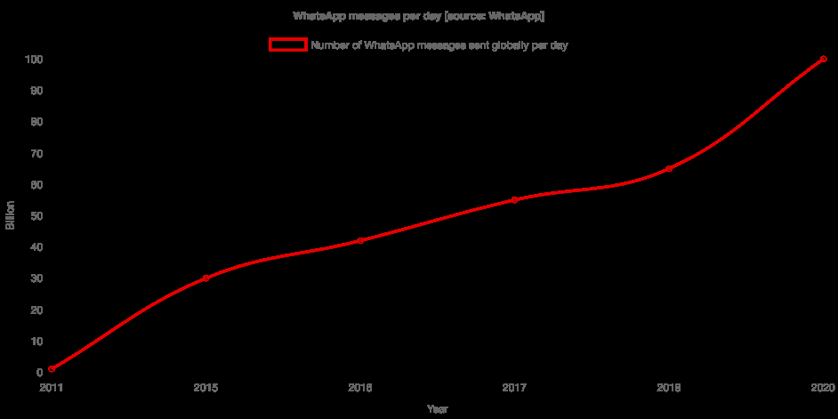
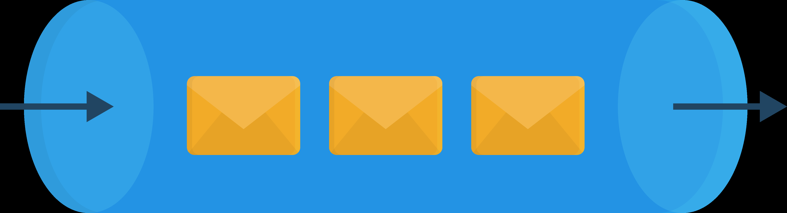
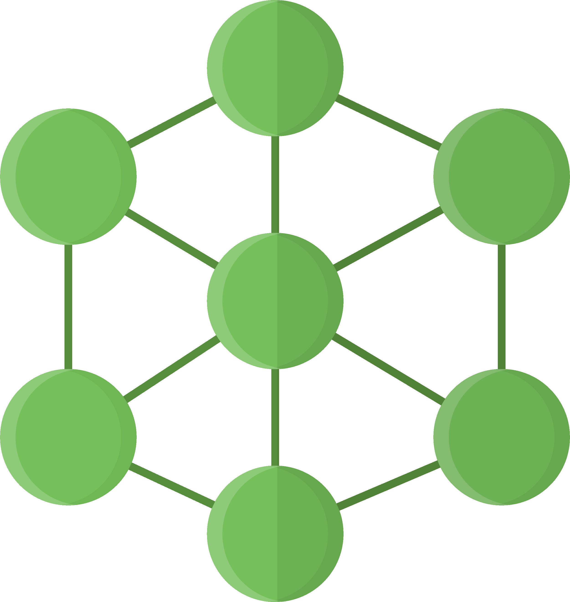

# 036 - Thiết Kế WhatsApp (Ứng Dụng Nhắn Tin Trực Tuyến Đa Nền Tảng)

[← Bài trước](035-thiet-ke-web-crawler.md) | [Mục lục](README.md) | [Bài tiếp theo →](037-thiet-ke-typeahead-suggestion.md)

---


# Thiết Kế Hệ Thống: WhatsApp (System Design: WhatsApp)

Học cách thiết kế một ứng dụng nhắn tin tương tự WhatsApp (WhatsApp messenger).

**Chúng ta sẽ bao quát các nội dung sau:**
* WhatsApp
* Bài toán thiết kế (Design problem)
* Chúng ta sẽ thiết kế WhatsApp như thế nào? (How will we design WhatsApp?)

---

## WhatsApp

Trong thế giới công nghệ ngày nay, WhatsApp là một ứng dụng nhắn tin quan trọng kết nối hàng tỷ người trên toàn cầu. Rất nhiều người dùng bắt đầu ngày mới bằng việc đọc hoặc gửi tin nhắn WhatsApp cho bạn bè và gia đình. Theo các ước tính vào tháng 7 năm 2021, WhatsApp có **2 tỷ người dùng hoạt động** (active users) trên toàn thế giới. Hơn nữa, một người dùng WhatsApp trung bình dành khoảng **19,4 giờ mỗi tháng** trên ứng dụng này.

Vào tháng 12 năm 2020, CEO của WhatsApp đã đăng tải thông tin rằng người dùng WhatsApp chia sẻ **hơn 100 tỷ tin nhắn mỗi ngày**, tăng khoảng 54% so với năm 2018.

Sự gia tăng số lượng tin nhắn được gửi trên toàn cầu mỗi ngày được mô tả trong biểu đồ sau:



*Sự gia tăng số lượng tin nhắn được trao đổi mỗi ngày qua từng năm (The increase in messages communicated per day each year)*

---

## Bài Toán Thiết Kế (Design Problem)

Với tư cách là những kiến trúc sư thiết kế hệ thống (system designers), chúng ta cần phải nhận thức rõ tốc độ tăng trưởng của người dùng. Có rất nhiều câu hỏi thú vị xoay quanh WhatsApp:
* Ứng dụng này được thiết kế như thế nào?
* Cách thức hoạt động của nó ra sao?
* Có những loại thành phần (components) nào tham gia vào hệ thống?
* WhatsApp làm thế nào để cho phép hàng tỷ người dùng giao tiếp với nhau?
* WhatsApp giữ cho toàn bộ dữ liệu đó an toàn và bảo mật như thế nào?

Trong chương này, chúng ta sẽ tập trung vào **thiết kế mức cao (high-level design)** và **thiết kế chi tiết (detailed design)** của ứng dụng WhatsApp để giải đáp các câu hỏi nêu trên.

---

> [!NOTE]
> **Điều hướng nội dung:**  
> * **Trước đó (Back):** Đánh Giá Thiết Kế Web Crawler (Evaluation of Web Crawler's Design) — *Đánh dấu hoàn thành (Mark As Completed)*  
> * **Tiếp theo (Next):** Yêu Cầu Thiết Kế Của WhatsApp (Requirements of WhatsApp’s Design)

---

## Chúng Ta Sẽ Thiết Kế WhatsApp Như Thế Nào? (How Will We Design WhatsApp?)

Chúng ta chia thiết kế ứng dụng nhắn tin WhatsApp thành **5 bài học** sau:

1. **Yêu cầu (Requirements):** Trong bài học này, chúng ta sẽ xác định các yêu cầu chức năng (functional requirements) và yêu cầu phi chức năng (non-functional requirements). Chúng ta cũng sẽ thảo luận về ước tính tài nguyên (resource estimations) cần thiết để hệ thống WhatsApp đề xuất vận hành mượt mà và hiệu quả hơn.
2. **Thiết kế mức cao (High-level Design):** Chúng ta sẽ tập trung vào kiến trúc mức cao của phiên bản WhatsApp này. Chúng ta cũng sẽ thảo luận về các API thiết yếu phục vụ cho thiết kế WhatsApp.
3. **Thiết kế chi tiết (Detailed Design):** Trong bài học này, chúng ta sẽ mô tả chi tiết thiết kế của WhatsApp messenger. Ban đầu, chúng ta giải thích thiết kế của từng microservice, bao gồm kết nối với máy chủ (connection with servers), gửi và nhận tin nhắn cùng nội dung đa phương tiện (send and receive messages and media content), và tin nhắn nhóm (group messages). Cuối cùng, thiết kế của từng microservice sẽ được hợp nhất vào bản thiết kế chi tiết hoàn chỉnh của WhatsApp.
4. **Đánh giá (Evaluation):** Bài học này sẽ giải thích cách phiên bản WhatsApp của chúng ta đáp ứng các yêu cầu phi chức năng. Chúng ta cũng sẽ đánh giá một số đánh đổi kiến trúc (trade-offs) trong thiết kế.
5. **Câu hỏi kiểm tra (Quiz):** Tại đây, chúng ta sẽ đánh giá lại những gì đã học trong chương này thông qua một bài trắc nghiệm.

Hãy bắt đầu bằng việc thảo luận về các yêu cầu kỹ thuật cho phiên bản WhatsApp của chúng ta.

---

## Yêu Cầu Thiết Kế Của WhatsApp (Requirements of WhatsApp’s Design)

Tìm hiểu về các yêu cầu chức năng (functional requirements) và yêu cầu phi chức năng (non-functional requirements) cho một ứng dụng trò chuyện như WhatsApp.

**Chúng ta sẽ bao quát các nội dung sau:**
* Yêu cầu (Requirements)
  * Yêu cầu chức năng (Functional requirements)
  * Yêu cầu phi chức năng (Non-functional requirements)
* Ước tính tài nguyên (Resource estimation)
  * Ước tính lưu trữ (Storage estimation)
  * Ước tính băng thông (Bandwidth estimation)
  * Ước tính số lượng máy chủ (Number of servers estimation)
* Thực hành thử nghiệm (Try it out)
* Các khối thành phần xây dựng sẽ sử dụng (Building blocks we will use)

---

### Yêu Cầu (Requirements)

Thiết kế của chúng ta cho ứng dụng nhắn tin WhatsApp cần đáp ứng các yêu cầu sau:

#### Yêu Cầu Chức Năng (Functional Requirements)

* **Trò chuyện (Conversation):** Hệ thống phải hỗ trợ các cuộc trò chuyện trực tiếp 1-1 (one-on-one) và trò chuyện nhóm (group conversations) giữa người dùng với nhau.
* **Xác nhận trạng thái tin nhắn (Acknowledgment):** Hệ thống phải hỗ trợ xác nhận việc phân phát tin nhắn, bao gồm: đã gửi (sent), đã nhận (delivered), và đã đọc (read).
* **Chia sẻ tệp (Sharing):** Hệ thống phải hỗ trợ việc chia sẻ các tệp đa phương tiện (media files), chẳng hạn như hình ảnh, video và âm thanh.
* **Lưu trữ tin nhắn (Chat storage):** Hệ thống phải hỗ trợ lưu trữ bền vững (persistent storage) các tin nhắn trò chuyện khi người dùng ngoại tuyến (offline) cho đến khi tin nhắn được phân phát thành công.
* **Thông báo đẩy (Push notifications):** Hệ thống phải có khả năng thông báo cho người dùng ngoại tuyến về các tin nhắn mới ngay khi trạng thái của họ chuyển sang trực tuyến (online).

---

#### Yêu Cầu Phi Chức Năng (Non-functional Requirements)

* **Độ trễ thấp (Low Latency):** Người dùng phải có thể nhận tin nhắn với độ trễ cực thấp.
* **Tính nhất quán (Consistency):** Các tin nhắn phải được phân phát theo đúng thứ tự mà chúng được gửi đi. Hơn nữa, người dùng phải nhìn thấy cùng một lịch sử trò chuyện (chat history) đồng nhất trên tất cả các thiết bị của họ.
* **Tính sẵn sàng cao (High Availability):** Hệ thống phải có tính sẵn sàng cao. Tuy nhiên, tính sẵn sàng có thể được đánh đổi hoặc nhân nhượng phần nào để ưu tiên cho tính nhất quán (Consistency).
* **Bảo mật (Security):** Hệ thống phải được bảo mật tuyệt đối thông qua mã hóa đầu cuối (End-to-End Encryption - E2EE). Mã hóa đầu cuối đảm bảo rằng chỉ có hai bên tham gia giao tiếp mới có thể đọc được nội dung tin nhắn. Không ai ở giữa, kể cả chính WhatsApp, có quyền truy cập.
* **Khả năng mở rộng (Scalability):** Hệ thống phải có khả năng mở rộng cao để hỗ trợ số lượng người dùng và số lượng tin nhắn mỗi ngày ngày càng gia tăng không ngừng.


*Các yêu cầu phi chức năng của hệ thống WhatsApp (The non-functional requirements of the WhatsApp system)*

| Yêu Cầu Phi Chức Năng (Non-functional Requirements) | Đặc Tả Kỹ Thuật (Specification) |
| :--- | :--- |
| **Độ trễ thấp (Low Latency)** | Nhận tin nhắn trong thời gian thực gần như tức thì. |
| **Tính khả dụng (High Availability)** | Hệ thống luôn hoạt động, có thể hy sinh để đảm bảo Consistency. |
| **Tính nhất quán (Consistency)** | Bảo toàn đúng thứ tự tin nhắn (message ordering) và đồng bộ đa thiết bị. |
| **Bảo mật (Security)** | Mã hóa đầu cuối (End-to-End Encryption - E2EE). |
| **Khả năng mở rộng (Scalability)** | Hỗ trợ mở rộng quy mô khi lượng người dùng và lưu lượng tin nhắn tăng vọt. |

---

### Ước Tính Tài Nguyên (Resource Estimation)

WhatsApp là ứng dụng nhắn tin được sử dụng nhiều nhất trên toàn cầu. Theo WhatsApp, nền tảng này hỗ trợ hơn 2 tỷ người dùng trên toàn thế giới, chia sẻ hơn 100 tỷ tin nhắn mỗi ngày. Chúng ta cần ước tính dung lượng lưu trữ (storage capacity), băng thông (bandwidth), và số lượng máy chủ (number of servers) cần thiết để hỗ trợ một khối lượng người dùng và tin nhắn khổng lồ như vậy.

#### Ước Tính Lưu Trữ (Storage Estimation)

Vì có hơn 100 tỷ tin nhắn được chia sẻ mỗi ngày qua WhatsApp, chúng ta hãy ước tính dung lượng lưu trữ dựa trên con số này:
* Giả định mỗi tin nhắn chiếm trung bình **100 Bytes**.
* Hơn nữa, các máy chủ của WhatsApp chỉ giữ tin nhắn trong vòng **30 ngày**. Do đó, nếu người dùng không kết nối vào máy chủ trong khoảng thời gian này, các tin nhắn sẽ bị xóa vĩnh viễn khỏi máy chủ.

Dung lượng lưu trữ yêu cầu mỗi ngày:
$$\text{Dung lượng lưu trữ / ngày} = 100\text{ tỷ tin nhắn/ngày} \times 100\text{ Bytes} = 10\text{ TB/ngày}$$

Đối với chu kỳ 30 ngày, dung lượng lưu trữ cần thiết sẽ là:
$$\text{Dung lượng lưu trữ / tháng} = 30 \times 10\text{ TB/ngày} = 300\text{ TB/tháng}$$

*Tổng dung lượng lưu trữ WhatsApp cần trong một tháng (The total storage required by WhatsApp in a month):*
* **Lưu trữ/ngày (Storage/day):** 10 TB
* **Số ngày trong một tháng (Days in a month):** 30
* **Lưu trữ/tháng (Storage/month):** $10\text{ TB} \times 30 = 300\text{ TB}$

Bên cạnh các tin nhắn văn bản (chat messages), chúng ta còn có các tệp đa phương tiện (media files) vốn chiếm nhiều hơn 100 Bytes cho mỗi tin nhắn. Ngoài ra, chúng ta cũng phải lưu trữ thông tin người dùng và siêu dữ liệu (metadata) của tin nhắn — ví dụ: dấu thời gian (timestamp), ID tin nhắn, v.v. 

Song song đó, chúng ta cần quá trình mã hóa (encryption) và giải mã (decryption) để bảo mật luồng giao tiếp. Vì vậy, chúng ta cũng sẽ cần lưu trữ các khóa mã hóa (encryption keys) cùng siêu dữ liệu liên quan. 

Do đó, để thật chuẩn xác, chúng ta cần nhiều hơn 300 TB mỗi tháng, nhưng nhằm mục đích đơn giản hóa việc tính toán, chúng ta sẽ giữ nguyên con số **300 TB/tháng**.

---

#### Ước Tính Băng Thông (Bandwidth Estimation)

Dựa theo ước tính dung lượng lưu trữ, dịch vụ của chúng ta sẽ tiếp nhận 10 TB dữ liệu mỗi ngày, tương ứng với băng thông tính toán được là **926 Mb/s**:

$$\frac{10\text{ TB}}{86400\text{ giây}} \approx 926\text{ Mb/s}$$

> [!NOTE]
> **Lưu ý:** Để giữ cho thiết kế ở mức đơn giản, chúng ta đã tạm thời bỏ qua nội dung đa phương tiện (media content bao gồm: hình ảnh, video, tài liệu, v.v.). Vì vậy, con số 926 Mb/s có thể trông nhỏ hơn so với lưu lượng thực tế nếu tính cả media files.

---

# Thiết Kế Hệ Thống: WhatsApp (System Design: WhatsApp)

Chúng ta cũng cần một lượng băng thông đi (outgoing bandwidth) tương đương, do cùng một tin nhắn từ phía người gửi (sender) sẽ cần phải được chuyển phát tới người nhận (receiver).

**Tổng băng thông cần thiết cho WhatsApp:**
- Băng thông đi (Outgoing bandwidth) = $926\text{ Mbps}$
- Băng thông đến (Incoming bandwidth) = $926\text{ Mbps}$
- **Tổng cộng:** $926\text{ Mbps} + 926\text{ Mbps} = 1.852\text{ Gbps}$


### Ước Tính Cấp Cao (High-level Estimates)

| Loại chỉ số (Type) | Ước tính (Estimates) |
| :--- | :--- |
| **Tổng số tin nhắn mỗi ngày (Total messages per day)** | 100 tỷ (100 billion) |
| **Dung lượng lưu trữ yêu cầu mỗi ngày (Storage required per day)** | 10 TB |
| **Dung lượng lưu trữ cho 30 ngày (Storage for 30 days)** | 300 TB |
| **Dữ liệu đến mỗi giây (Incoming data per second)** | 926 Mb/s |
| **Dữ liệu đi mỗi giây (Outgoing data per second)** | 926 Mb/s |


---

### Ước Tính Số Lượng Máy Chủ (Number of servers estimation)

WhatsApp xử lý khoảng 10 triệu kết nối (10 million connections) trên một máy chủ đơn lẻ, con số này có vẻ khá cao đối với một máy chủ. Tuy nhiên, điều này hoàn toàn khả thi thông qua quá trình kỹ nghệ hiệu năng chuyên sâu (extensive performance engineering). Chúng ta sẽ cần phải nắm rõ toàn bộ các chi tiết chuyên sâu của hệ thống, chẳng hạn như nhân hệ điều hành (server's kernel), thư viện mạng (networking library), cấu hình hạ tầng (infrastructure configuration), v.v.

> [!NOTE]
> Chúng ta thường có thể tối ưu hóa một máy chủ đa dụng (general-purpose server) cho các tác vụ chuyên biệt thông qua việc kỹ nghệ hiệu năng (performance engineering) cẩn trọng trên toàn bộ ngăn xếp phần mềm (full software stack).

Hãy chuyển sang phần ước tính số lượng máy chủ:

$$\text{Số lượng máy chủ (No. of servers)} = \frac{\text{Tổng kết nối mỗi ngày (Total connections per day)}}{\text{Số kết nối trên mỗi máy chủ (No. of connections per server)}} = \frac{2\text{ tỷ}}{10\text{ triệu}} = 200\text{ máy chủ}$$

Vì vậy, theo các ước tính ở trên, chúng ta yêu cầu **200 máy chủ chat (chat servers)**.

**Số lượng máy chủ chat cần thiết cho WhatsApp:**
- 200 máy chủ chat (200 chat servers)


---

### Tự Trải Nghiệm & Tính Toán (Try it out)

Hãy cùng phân tích xem số lượng tin nhắn mỗi ngày ảnh hưởng như thế nào đến các yêu cầu về lưu trữ (storage) và băng thông (bandwidth). Nhằm mục đích này, chúng ta có thể thay đổi các giá trị trong bảng dưới đây để tính toán các ước tính:

| Tham số | Giá trị |
| :--- | :--- |
| **Số lượng người dùng mỗi ngày (Number of users per day - tính bằng tỷ)** | 2 |
| **Số lượng tin nhắn mỗi ngày (Number of messages per day - tính bằng tỷ)** | 100 |
| **Kích thước mỗi tin nhắn (Size of each message - tính bằng byte)** | 100 |
| **Số lượng kết nối một máy chủ có thể xử lý (Number of connections a server can handle - tính bằng triệu)** | 10 |
| **Ước tính dung lượng lưu trữ mỗi ngày (Storage estimation per day - tính bằng TB)** | 10 |
| **Băng thông đến và đi (Incoming and Outgoing bandwidth - tính bằng Mb/s)** | 926.4 |
| **Số lượng máy chủ chat yêu cầu (Number of chat servers required)** | 200 |

---

### Các Thành Phần Khối Dựng Sẽ Sử Dụng (Building blocks we will use)

Thiết kế của WhatsApp tận dụng các thành phần khối dựng (building blocks) sau đây vốn cũng đã được thảo luận trong các chương mở đầu:

**Các khối dựng cần thiết để thiết kế WhatsApp:**
- **Cơ sở dữ liệu (Database)**
- **Mạng phân phối nội dung (CDN - Content Delivery Network)**
- **Lưu trữ Blob (Blob storage)**
- **Bộ cân bằng tải (Load balancer)**
- **Bộ nhớ đệm (Cache)**
- **Hàng đợi thông điệp (Messaging queue)**





- **Cơ sở dữ liệu (Databases)** là cần thiết để lưu trữ siêu dữ liệu (metadata) của người dùng và các nhóm.
- **Lưu trữ Blob (Blob storage)** được sử dụng để lưu trữ nội dung đa phương tiện (multimedia content) được chia sẻ trong các tin nhắn.
- **CDN** được sử dụng để phân phối hiệu quả nội dung đa phương tiện được chia sẻ thường xuyên.
- **Bộ cân bằng tải (Load balancer)** phân phối các yêu cầu gửi đến giữa nhóm các máy chủ khả dụng (pool of available servers).
- **Bộ nhớ đệm (Caches)** là cần thiết để lưu giữ dữ liệu được truy cập thường xuyên được sử dụng bởi các dịch vụ khác nhau.
- **Hàng đợi thông điệp (Messaging queue)** được sử dụng để tạm thời giữ các tin nhắn trong một hàng đợi trên cơ sở dữ liệu khi người dùng đang ngoại tuyến (offline).

Trong bài học tiếp theo, chúng ta sẽ tập trung vào thiết kế cấp cao (high-level design) của ứng dụng nhắn tin WhatsApp.

---

# Thiết Kế Cấp Cao Của WhatsApp (High-level Design of WhatsApp)

Làm quen với thiết kế cấp cao của hệ thống WhatsApp.

**Chúng ta sẽ bao gồm các nội dung sau:**
- Thiết kế cấp cao (High-level design)
- Thiết kế API (API design)
  - Gửi tin nhắn (Send message)
  - Lấy tin nhắn (Get message)
  - Tải lên tệp đa phương tiện hoặc tài liệu (Upload media or document file)
  - Tải xuống tệp tài liệu hoặc đa phương tiện (Download a document or media file)

---

### Thiết Kế Cấp Cao (High-level design)

Ở mức độ trừu tượng, thiết kế cấp cao bao gồm một máy chủ chat (chat server) chịu trách nhiệm giao tiếp giữa người gửi (sender) và người nhận (receiver). Khi một người dùng muốn gửi một tin nhắn tới một người dùng khác, cả hai đều kết nối tới máy chủ chat. Cả hai người dùng gửi các tin nhắn của họ tới máy chủ chat. Máy chủ chat sau đó gửi tin nhắn tới người dùng mục tiêu khác và đồng thời lưu trữ tin nhắn trong cơ sở dữ liệu.

- **Giao thức truyền thông do máy khách khởi tạo (Client-initiated communication protocol)**
- **Giao thức truyền thông do máy chủ khởi tạo (Server-initiated communication protocol)**
- Giữ tin nhắn trên máy chủ trong một bộ lưu trữ tạm thời (transient storage) cho đến khi người nhận trực tuyến trở lại.
- **Người dùng A (User A)**: trực tuyến (online)
- Lưu trữ tin nhắn nếu trạng thái người nhận là ngoại tuyến (offline)
- **Người dùng B (User B)**
- **Máy chủ Chat (Chat server)**
- **Giao thức WebSocket (WebSocket protocol)**
- **Cơ sở dữ liệu (Database)**


---

### Luồng Giao Tiếp Trong Thiết Kế Cấp Cao (The high-level design of WhatsApp messenger)

Các bước sau đây mô tả sự giao tiếp giữa cả hai máy khách (clients):

1. **Người dùng A và người dùng B tạo một kênh truyền thông** với máy chủ chat.
2. **Người dùng A gửi một tin nhắn** tới máy chủ chat.
3. Khi nhận được tin nhắn, **máy chủ chat phản hồi xác nhận (acknowledges back)** cho người dùng A.
4. **Máy chủ chat gửi tin nhắn tới người dùng B** và lưu trữ tin nhắn vào cơ sở dữ liệu nếu trạng thái của người nhận là ngoại tuyến (offline).
5. **Người dùng B gửi phản hồi xác nhận (acknowledgment)** tới máy chủ chat.
6. **Máy chủ chat thông báo cho người dùng A** rằng tin nhắn đã được chuyển phát thành công (successfully delivered).
7. Khi người dùng B đọc tin nhắn, **ứng dụng sẽ thông báo cho máy chủ chat**.
8. **Máy chủ chat thông báo cho người dùng A** rằng người dùng B đã đọc tin nhắn.

Quy trình được thể hiện trong các hình minh họa sau:

- **Giao thức truyền thông do máy khách khởi tạo (Client-initiated communication protocol)**
- **Giao thức truyền thông do máy chủ khởi tạo (Server-initiated communication protocol)**
- **Người dùng A (User A)**
- **Người dùng B (User B)**
- **Máy chủ Chat (Chat server)**
- **Giao thức WebSocket (WebSocket protocol)**
- **Cơ sở dữ liệu (Database)**
- Trạng thái: Trực tuyến (online)
- *Người dùng A và người dùng B tạo kết nối với máy chủ chat (User A and user B create connections with the chat server - 1 of 8)*


---

# Thiết Kế WhatsApp (Ứng Dụng Nhắn Tin Trực Tuyến Đa Nền Tảng)

---

## Luồng Truyền Nhận Tin Nhắn Chi Tiết (Message Flow Progression)

### Bước 1: Khởi Tạo Kết Nối & Trạng Thái Hệ Thống
* Giao thức truyền thông do Client khởi tạo (*Client-initiated communication protocol*)
* Giao thức truyền thông do Server khởi tạo (*Server-initiated communication protocol*)
* Người dùng A (*User A*)
* Trực tuyến (*online*)
* Người dùng B (*User B*)
* Máy chủ trò chuyện (*Chat server*)
* Cơ sở dữ liệu (*Database*)
* Giao thức kết nối song công: Giao thức WebSocket (*WebSocket protocol*)


---

### Bước 2: Người Dùng A Gửi Tin Nhắn
* Giao thức truyền thông do Client khởi tạo (*Client-initiated communication protocol*)
* Giao thức truyền thông do Server khởi tạo (*Server-initiated communication protocol*)
* Người dùng A (*User A*)
* Trực tuyến (*online*)
* Người dùng B (*User B*)
* Máy chủ trò chuyện (*Chat server*)
* Cơ sở dữ liệu (*Database*)
* Giao thức WebSocket (*WebSocket protocol*)
* **Người dùng A gửi một tin nhắn đến máy chủ trò chuyện (*User A sends a message to the chat server*)**
* **(2 trên 8 - 2 of 8)**


---

### Bước 3: Máy Chủ Xác Nhận Đã Nhận Tin Nhắn Từ Người Dùng A
* Giao thức truyền thông do Client khởi tạo (*Client-initiated communication protocol*)
* Giao thức truyền thông do Server khởi tạo (*Server-initiated communication protocol*)
* Người dùng A (*User A*)
* Trực tuyến (*online*)
* Người dùng B (*User B*)
* Máy chủ trò chuyện (*Chat server*)
* Cơ sở dữ liệu (*Database*)
* Xác nhận (*Acknowledgment - ACK*)
* Giao thức WebSocket (*WebSocket protocol*)
* **Sau khi nhận được tin nhắn, máy chủ trò chuyện gửi xác nhận (ACK) phản hồi lại cho người dùng A (*Upon receiving the message, the chat server acknowledges back to user A*)**
* **(3 trên 8 - 3 of 8)**


---

### Bước 4: Máy Chủ Chuyển Tiếp Tin Nhắn & Lưu Trữ Dự Phòng
* Giao thức truyền thông do Client khởi tạo (*Client-initiated communication protocol*)
* Giao thức truyền thông do Server khởi tạo (*Server-initiated communication protocol*)
* Người dùng A (*User A*)
* **Lưu trữ tin nhắn nếu trạng thái của người nhận là ngoại tuyến (*Store messages if receiver status is offline*)**
* Trực tuyến (*online*)
* Người dùng B (*User B*)
* Máy chủ trò chuyện (*Chat server*)
* Cơ sở dữ liệu (*Database*)
* Giao thức WebSocket (*WebSocket protocol*)
* **Máy chủ trò chuyện gửi tin nhắn đến người dùng B và lưu trữ tin nhắn vào cơ sở dữ liệu (*The chat server sends the message to user B and stores the message in the database*)**
* **(4 trên 8 - 4 of 8)**


---

### Bước 5: Người Dùng B Gửi Xác Nhận Đã Nhận Tin (Delivered ACK)
* Xác nhận (*Acknowledgment - ACK*)
* Giao thức truyền thông do Client khởi tạo (*Client-initiated communication protocol*)
* Giao thức truyền thông do Server khởi tạo (*Server-initiated communication protocol*)
* Người dùng A (*User A*)
* Lưu trữ tin nhắn nếu trạng thái của người nhận là ngoại tuyến (*Store messages if receiver status is offline*)
* Trực tuyến (*online*)
* Người dùng B (*User B*)
* Máy chủ trò chuyện (*Chat server*)
* Cơ sở dữ liệu (*Database*)
* Giao thức WebSocket (*WebSocket protocol*)
* **Người dùng B gửi một gói tin xác nhận (ACK) đến máy chủ trò chuyện (*User B sends an acknowledgment to the chat server*)**
* **(5 trên 8 - 5 of 8)**


---

### Bước 6: Máy Chủ Thông Báo Tin Nhắn Đã Được Phát Tới Người Dùng A
* Thông báo (*Notify*)
* Giao thức truyền thông do Client khởi tạo (*Client-initiated communication protocol*)
* Giao thức truyền thông do Server khởi tạo (*Server-initiated communication protocol*)
* Người dùng A (*User A*)
* Lưu trữ tin nhắn nếu trạng thái của người nhận là ngoại tuyến (*Store messages if receiver status is offline*)
* Trực tuyến (*online*)
* Người dùng B (*User B*)
* Máy chủ trò chuyện (*Chat server*)
* Cơ sở dữ liệu (*Database*)
* Giao thức WebSocket (*WebSocket protocol*)
* **Máy chủ trò chuyện thông báo cho người dùng A rằng tin nhắn đã được chuyển phát thành công (*The chat server notifies user A that the message has been successfully delivered*)**
* **(6 trên 8 - 6 of 8)**


---

### Bước 7: Người Dùng B Đọc Tin Nhắn & Báo Về Máy Chủ
* Thông báo (*Notify*)
* Giao thức truyền thông do Client khởi tạo (*Client-initiated communication protocol*)
* Giao thức truyền thông do Server khởi tạo (*Server-initiated communication protocol*)
* **Giữ tin nhắn trên máy chủ trong bộ lưu trữ tạm thời cho đến khi người nhận trực tuyến trở lại (*Hold the message on the server in a transient storage until receiver gets back online*)**
* Người dùng A (*User A*)
* Lưu trữ tin nhắn nếu trạng thái của người nhận là ngoại tuyến (*Store messages if receiver status is offline*)
* Trực tuyến (*online*)
* Người dùng B (*User B*)
* Máy chủ trò chuyện (*Chat server*)
* Cơ sở dữ liệu (*Database*)
* Giao thức WebSocket (*WebSocket protocol*)
* **Khi người dùng B đọc tin nhắn, ứng dụng sẽ thông báo cho máy chủ trò chuyện (*When user B reads the message, the application notifies the chat server*)**
* **(7 trên 8 - 7 of 8)**


---

### Bước 8: Thông Báo Trạng Thái Đã Đọc Cho Người Dùng A & Dọn Dẹp Dữ Liệu
* Giao thức truyền thông do Client khởi tạo (*Client-initiated communication protocol*)
* Giao thức truyền thông do Server khởi tạo (*Server-initiated communication protocol*)
* Giữ tin nhắn trên máy chủ trong bộ lưu trữ tạm thời cho đến khi người nhận trực tuyến trở lại (*Hold the message on the server in a transient storage until receiver gets back online*)
* Người dùng A (*User A*)
* Lưu trữ tin nhắn nếu trạng thái của người nhận là ngoại tuyến (*Store messages if receiver status is offline*)
* Trực tuyến (*online*)
* Người dùng B (*User B*)
* Máy chủ trò chuyện (*Chat server*)
* Cơ sở dữ liệu (*Database*)
* Thông báo (*Notify*)
* **Tin nhắn sẽ bị xóa khỏi cơ sở dữ liệu sau khi đã được chuyển phát thành công (*Messages are deleted from the database once delivered*)**
* Giao thức WebSocket (*WebSocket protocol*)
* **Máy chủ trò chuyện thông báo cho người dùng A rằng người dùng B đã đọc tin nhắn (*The chat server notifies user A that user B has read the message*)**
* **(8 trên 8 - 8 of 8)**


---

## Thiết Kế Giao Diện Lập Trình Ứng Dụng (API Design)

WhatsApp cung cấp một lượng lớn các tính năng cho người dùng thông qua các API khác nhau. Một số tính năng được liệt kê dưới đây:
* Gửi tin nhắn (*Send message*)
* Lấy tin nhắn hoặc nhận tin nhắn (*Get message or receive message*)
* Tải lên tệp đa phương tiện hoặc tài liệu (*Upload a media file or document*)
* Tải xuống tài liệu hoặc tệp đa phương tiện (*Download document or media file*)
* Gửi vị trí (*Send a location*)
* Gửi danh bạ (*Send a contact*)
* Tạo trạng thái / tin ngắn (*Create a status*)

Tuy nhiên, chúng ta sẽ thảo luận về các API thiết yếu liên quan đến 4 tính năng đầu tiên.

---

### 1. Gửi Tin Nhắn (Send Message)

Chữ ký hàm của API `sendMessage` như sau:

```python
sendMessage(sender_ID, receiver_ID, type, text=none, media_object=none, document=none)
```

API này được sử dụng để gửi một tin nhắn văn bản từ người gửi đến người nhận bằng cách thực hiện lệnh gọi API theo phương thức `POST` tới điểm cuối (*API endpoint*) `/messages`. Thông thường, định danh (*ID*) của người gửi và người nhận chính là số điện thoại của họ. 

Các tham số được sử dụng trong lệnh gọi API này được mô tả trong bảng sau:

| Tham số (*Parameter*) | Mô tả (*Description*) |
| :--- | :--- |
| `sender_ID` | Đây là định danh duy nhất (*unique identifier*) của người dùng gửi tin nhắn. |
| `receiver_ID` | Đây là định danh duy nhất (*unique identifier*) của người dùng nhận tin nhắn. |
| `type` | Loại tin nhắn mặc định là văn bản (`text`). Tham số này biểu diễn xem liệu người gửi có gửi tệp đa phương tiện (*media file*) hay tài liệu (*document*) hay không. |
| `text` | Trường này chứa nội dung văn bản cần gửi dưới dạng tin nhắn. |
| `media_object` | Tham số này được xác định dựa trên tham số `type`. Nó đại diện cho tệp đa phương tiện cần gửi. |
| `document` | Tham số này đại diện cho tệp tài liệu cần gửi. |

---

### 2. Lấy Tin Nhắn (Get Message)

Chữ ký hàm của API `getMessage` như sau:

```python
getMessage(user_Id)
```

Thông qua lệnh gọi API này, người dùng có thể truy xuất tất cả các tin nhắn chưa đọc khi họ chuyển sang trạng thái trực tuyến (*online*) sau một khoảng thời gian ngoại tuyến (*offline*).

| Tham số (*Parameter*) | Mô tả (*Description*) |
| :--- | :--- |
| `user_Id` | Đây là định danh duy nhất (*unique identifier*) đại diện cho người dùng cần truy xuất toàn bộ tin nhắn chưa đọc. |

---

### 3. Tải Lên Tệp Đa Phương Tiện Hoặc Tài Liệu (Upload Media or Document File)

Chữ ký hàm của API `uploadFile` như sau:

```python
uploadFile(file_type, file)
```

Chúng ta có thể tải lên các tệp phương tiện thông qua API `uploadFile` bằng cách gửi một yêu cầu `POST` tới điểm cuối `/v1/media`. 

Phản hồi thành công sẽ trả về một `ID` tệp; mã này sau đó sẽ được chuyển tiếp tới người nhận. 

> [!IMPORTANT]
> **Giới hạn kích thước tệp (File Size Limits):**
> * Kích thước tệp tối đa cho dữ liệu đa phương tiện (*media*) có thể tải lên là **16 MB**.
> * Giới hạn kích thước đối với tệp tài liệu (*document*) là **100 MB**.

| Tham số (*Parameter*) | Mô tả (*Description*) |
| :--- | :--- |
| `file_type` | Tham số này biểu diễn loại tệp được tải lên thông qua lệnh gọi API. |
| `file` | Tham số này chứa nội dung nhị phân/dữ liệu của tệp đang được tải lên qua lệnh gọi API. |

---

### 4. Tải Xuống Tài Liệu Hoặc Tệp Đa Phương Tiện (Download a Document or Media File)

Chữ ký hàm của API `downloadFile` như sau:

```python
downloadFile(user_id, file_id)
```

Các tham số của lệnh gọi API này được giải thích chi tiết trong bảng sau:

| Tham số (*Parameter*) | Mô tả (*Description*) |
| :--- | :--- |
| `user_id` | Đây là định danh duy nhất (*unique identifier*) của người dùng sẽ thực hiện tải tệp xuống. |
| `file_id` | Đây là định danh duy nhất của một tệp. Nó được sinh ra trong quá trình tải tệp lên qua lệnh gọi API `uploadFile()`. Lệnh gọi API `downloadFile()` sẽ tải tệp phương tiện về thông qua định danh này. Client có thể tìm thấy `file_id` bằng cách cung cấp tên tệp cho máy chủ. Lệnh gọi API truy vấn đó không được hiển thị ở đây. |

---

> [!NOTE]
> Trong bài học tiếp theo, chúng ta sẽ tập trung vào **Thiết Kế Chi Tiết của Hệ Thống WhatsApp (Detailed Design of WhatsApp)**.

---

# Thiết Kế Chi Tiết của WhatsApp (Detailed Design of WhatsApp)

Tìm hiểu chi tiết về thiết kế của hệ thống WhatsApp và nắm bắt sự tương tác giữa các vi dịch vụ (microservices) khác nhau.

Chúng ta sẽ bao quát các nội dung sau:
- Thiết kế chi tiết (**Detailed design**)
- Kết nối với máy chủ WebSocket (**Connection with a WebSocket server**)
- Gửi hoặc nhận tin nhắn (**Send or receive messages**)
- Gửi hoặc nhận tệp đa phương tiện (**Send or receive media files**)
- Hỗ trợ tin nhắn nhóm (**Support for group messages**)
- Tổng hợp toàn bộ hệ thống (**Put everything together**)

---

## Thiết kế chi tiết (Detailed design)

Thiết kế mức cao (high-level design) đã thảo luận trong bài học trước chưa trả lời được các câu hỏi sau:

1. Kênh truyền thông giữa máy khách (clients) và máy chủ (servers) được khởi tạo như thế nào?
2. Thiết kế mức cao có thể mở rộng quy mô (**scale**) ra sao để hỗ trợ hàng tỷ người dùng?
3. Dữ liệu của người dùng được lưu trữ như thế nào?
4. Người nhận được xác định danh tính như thế nào để tin nhắn được chuyển phát chính xác?

Để trả lời tất cả các câu hỏi này, hãy đi sâu vào thiết kế mức cao và khám phá từng thành phần một cách chi tiết. Hãy bắt đầu với cách người dùng thiết lập kết nối tới các máy chủ trò chuyện (**chat servers**).

---

## Kết nối với máy chủ WebSocket (Connection with a WebSocket server)

Trong WhatsApp, mỗi thiết bị đang hoạt động (**active device**) đều được kết nối với một máy chủ WebSocket (**WebSocket server**) thông qua giao thức WebSocket (**WebSocket protocol**). Máy chủ WebSocket duy trì kết nối mở liên tục với tất cả người dùng đang hoạt động (**online users**). Vì một máy chủ đơn lẻ không đủ khả năng xử lý hàng tỷ thiết bị, hệ thống cần có đủ số lượng máy chủ để phục vụ hàng tỷ người dùng.

Trách nhiệm của mỗi máy chủ này là cung cấp một cổng (**port**) cho từng người dùng đang trực tuyến. Ánh xạ giữa máy chủ, cổng và người dùng (**mapping between servers, ports, and users**) được lưu trữ trong bộ quản lý WebSocket (**WebSocket manager**) nằm trên đỉnh của một cụm kho dữ liệu (**cluster of the data store**). Trong trường hợp này, đó là **Redis**.

Hai người dùng được kết nối thông qua các bộ xử lý WebSocket (**WebSocket handlers**):


> [!NOTE]
> **Điểm Cần Suy Ngẫm (Point to Ponder)**
> 
> **Câu hỏi:**
> Tại sao WebSocket lại được ưu tiên hơn giao thức HTTP(S) cho việc giao tiếp giữa client và server?
> 
> **Giải đáp:**
> HTTP(S) không duy trì kết nối mở liên tục để máy chủ có thể gửi dữ liệu thường xuyên tới máy khách. Với giao thức HTTP(S), máy khách liên tục gửi yêu cầu cập nhật từ máy chủ — thường được gọi là cơ chế thăm dò định kỳ (**polling**) — điều này rất tốn tài nguyên (**resource intensive**) và gây ra độ trễ cao (**latency**). 
> 
> Ngược lại, WebSocket duy trì một kết nối bền bỉ (**persistent connection**) giữa client và server. Giao thức này truyền dữ liệu đến client ngay lập tức bất cứ khi nào có dữ liệu mới. Nó cung cấp một kết nối hai chiều (**bidirectional connection**), đóng vai trò như một giải pháp chuẩn mực để gửi các cập nhật bất đồng bộ (**asynchronous updates**) từ máy chủ tới máy khách.

---

## Gửi hoặc nhận tin nhắn (Send or receive messages)

Bộ quản lý WebSocket (**WebSocket manager**) chịu trách nhiệm duy trì ánh xạ giữa một người dùng đang hoạt động và cổng được gán cho người dùng đó. Bất cứ khi nào người dùng kết nối tới một máy chủ WebSocket khác, thông tin này sẽ được cập nhật trong kho dữ liệu (**data store**).

Máy chủ WebSocket cũng giao tiếp với một dịch vụ khác gọi là dịch vụ tin nhắn (**message service**). Dịch vụ tin nhắn là một kho lưu trữ tin nhắn nằm trên đỉnh cụm cơ sở dữ liệu **Mnesia** (**Mnesia database cluster**). Nó đóng vai trò là một giao diện (**interface**) đối với cơ sở dữ liệu Mnesia cho các dịch vụ khác tương tác với cơ sở dữ liệu. Nó chịu trách nhiệm lưu trữ và truy xuất tin nhắn từ cơ sở dữ liệu Mnesia. Nó cũng xóa các tin nhắn khỏi cơ sở dữ liệu Mnesia sau một khoảng thời gian có thể cấu hình được (**configurable amount of time**). Đồng thời, nó cung cấp các API để truy xuất tin nhắn theo nhiều bộ lọc khác nhau, chẳng hạn như ID người dùng (**user ID**), ID tin nhắn (**message ID**), v.v.

WebSocket giao tiếp với dịch vụ tin nhắn trên đỉnh cụm cơ sở dữ liệu Mnesia:


Bây giờ, hãy giả định rằng **User A** muốn gửi một tin nhắn cho **User B**. Như được minh họa trong hình trên, cả hai người dùng đều đang kết nối tới các máy chủ WebSocket khác nhau. Hệ thống thực hiện các bước sau để chuyển phát tin nhắn từ User A tới User B:

1. **User A** giao tiếp với máy chủ WebSocket tương ứng mà thiết bị đang kết nối tới.
2. Máy chủ WebSocket liên kết với User A xác định máy chủ WebSocket mà **User B** đang kết nối thông qua **WebSocket manager**. Nếu User B đang trực tuyến (**online**), WebSocket manager sẽ phản hồi lại cho máy chủ WebSocket của User A rằng User B đang kết nối với máy chủ WebSocket của chính họ.
3. Đồng thời, máy chủ WebSocket gửi tin nhắn tới **dịch vụ tin nhắn (message service)** và tin nhắn được lưu trữ trong cơ sở dữ liệu **Mnesia**, nơi nó được xử lý theo thứ tự vào trước - ra trước (**FIFO - first-in-first-out**). Ngay khi các tin nhắn này được chuyển phát thành công đến người nhận, chúng sẽ bị xóa khỏi cơ sở dữ liệu.
4. Lúc này, máy chủ WebSocket của User A đã nắm được thông tin User B đang kết nối với máy chủ WebSocket nào. Quá trình truyền thông giữa User A và User B bắt đầu được thực hiện thông qua các máy chủ WebSocket của họ.
5. Nếu **User B đang ngoại tuyến (offline)**, các tin nhắn sẽ được giữ lại trong cơ sở dữ liệu Mnesia. Bất cứ khi nào họ trực tuyến trở lại, tất cả tin nhắn gửi cho User B sẽ được chuyển phát thông qua thông báo đẩy (**push notification**). Nếu không, các tin nhắn này sẽ bị xóa vĩnh viễn sau 30 ngày.

> [!IMPORTANT]
> Cả hai người dùng (người gửi và người nhận) đều giao tiếp với bộ quản lý WebSocket để tìm ra máy chủ WebSocket của nhau. Hãy xem xét trường hợp có một cuộc trò chuyện liên tục diễn ra giữa hai người dùng. Khi đó, rất nhiều lệnh gọi (**calls**) sẽ được thực hiện tới WebSocket manager. Để giảm thiểu độ trễ (**minimize latency**) và giảm số lượng các lệnh gọi tới WebSocket manager, mỗi máy chủ WebSocket sẽ thực hiện lưu vào bộ nhớ đệm (**cache**) các thông tin sau:
> - Nếu cả hai người dùng đều kết nối tới cùng một máy chủ, lệnh gọi đến WebSocket manager sẽ được bỏ qua.
> - Nó lưu vào bộ nhớ đệm thông tin về các cuộc trò chuyện gần đây xem người dùng nào đang kết nối với máy chủ WebSocket nào.

> [!NOTE]
> **Điểm Cần Suy Ngẫm (Point to Ponder)**
> 
> **Câu hỏi:**
> Dữ liệu trong bộ nhớ đệm (cache) sẽ bị lỗi thời (**outdated/stale**) nếu một người dùng bị mất kết nối và kết nối lại với một máy chủ khác. Lưu ý điều này, máy chủ WebSocket nên lưu trữ thông tin trong bộ nhớ đệm trong bao lâu?
> 
> **Giải đáp:**
> Thông tin sẽ được cập nhật trong bộ quản lý WebSocket khi người dùng ngắt kết nối do sự cố kết nối và kết nối lại với một máy chủ WebSocket khác. Đến lượt mình, bộ quản lý WebSocket sẽ thực hiện vô hiệu hóa dữ liệu trong bộ nhớ đệm (**invalidate the data in the cache**) mà các máy chủ WebSocket đang sử dụng, và dữ liệu mới cập nhật sẽ được gửi tới bộ nhớ đệm tương ứng. Vì vậy, thông tin trong cache sẽ tồn tại ở đó cho đến khi nó nhận được tín hiệu vô hiệu hóa (**invalidate signal**) từ bộ quản lý WebSocket.

---

## Gửi hoặc nhận tệp đa phương tiện (Send or receive media files)

Cho đến thời điểm này, chúng ta đã thảo luận về việc truyền thông tin nhắn văn bản (**text messages**). Nhưng điều gì sẽ xảy ra khi người dùng gửi các tệp đa phương tiện (**media files**)? Thông thường, các máy chủ WebSocket có tải trọng nhẹ (**lightweight**) và không hỗ trợ xử lý các nghiệp vụ nặng (**heavy logic**) như quản lý việc gửi và nhận các tệp đa phương tiện. Chúng ta có một dịch vụ riêng biệt gọi là dịch vụ tài nguyên (**asset service**), chịu trách nhiệm cho việc gửi và nhận các tệp phương tiện này.

Hơn nữa, quy trình gửi tệp đa phương tiện bao gồm các bước sau:

1. Tệp đa phương tiện được nén (**compressed**) và mã hóa (**encrypted**) ngay tại phía thiết bị của người dùng (**device side**).
2. Tệp đã được nén và mã hóa sẽ được gửi tới **dịch vụ tài nguyên (asset service)** để lưu trữ tệp trên kho lưu trữ đối tượng nhị phân lớn (**blob storage**). Dịch vụ tài nguyên gán một định danh (**ID**) cho tệp và gửi lại ID này cho người gửi. Dịch vụ tài nguyên cũng duy trì một mã băm (**hash**) cho mỗi tệp để tránh việc trùng lặp nội dung (**avoid duplication of content / deduplication**) trên blob storage. Ví dụ: nếu một người dùng muốn tải lên một hình ảnh đã tồn tại sẵn trong blob storage, hình ảnh đó sẽ không bị tải lên lại. Thay vào đó, chính ID cũ sẽ được chuyển tiếp cho người nhận.
3. Dịch vụ tài nguyên gửi ID của tệp đa phương tiện tới người nhận thông qua **dịch vụ tin nhắn (message service)**. Người nhận tải xuống tệp phương tiện từ blob storage bằng cách sử dụng ID này.
4. Nội dung sẽ được nạp lên mạng phân phối nội dung (**CDN - Content Delivery Network**) nếu dịch vụ tài nguyên tiếp nhận một lượng lớn các yêu cầu truy cập đối với một nội dung cụ thể nào đó.

Hình vẽ tiếp theo minh họa các thành phần tham gia vào quá trình chia sẻ dữ liệu đa phương tiện...

---

# Thiết Kế WhatsApp (Ứng Dụng Nhắn Tin Trực Tuyến Đa Nền Tảng) — Phần Tiếp Theo

---

## Truyền Tệp Đa Phương Tiện Qua WhatsApp Messenger (Files Over WhatsApp Messenger)

### Gửi Tệp Đa Phương Tiện Qua Dịch Vụ Tài Nguyên (Sending Media Files via the Asset Service)


---

## Hỗ Trợ Tin Nhắn Nhóm (Support for Group Messages)

Các máy chủ WebSocket (`WebSocket servers`) không theo dõi các nhóm vì chúng chỉ theo dõi các người dùng đang hoạt động (`active users`). Tuy nhiên, trong một nhóm, một số người dùng có thể đang trực tuyến (`online`) và những người khác có thể đang ngoại tuyến (`offline`). Đối với tin nhắn nhóm, ba thành phần chính sau đây chịu trách nhiệm phân phối tin nhắn đến từng người dùng trong nhóm:

1. **Bộ xử lý tin nhắn nhóm (Group message handler)**
2. **Dịch vụ tin nhắn nhóm / Dịch vụ nhóm (Group service / Group message service)**
3. **Kafka**

Giả sử người dùng A (`User A`) muốn gửi một tin nhắn đến một nhóm có một mã định danh duy nhất (`unique ID`) — ví dụ: `Group/A`. Các bước sau đây giải thích luồng của một tin nhắn được gửi đến một nhóm:

1. Vì người dùng A đã kết nối với một máy chủ WebSocket (`WebSocket server`), người dùng A sẽ gửi một tin nhắn đến dịch vụ tin nhắn (`message service`) với đích đến dự kiến là `Group/A`.
2. Dịch vụ tin nhắn (`message service`) gửi tin nhắn đến **Kafka** cùng với các thông tin cụ thể khác về nhóm. Tin nhắn được lưu tại đó để xử lý tiếp theo. Theo thuật ngữ của Kafka, một nhóm có thể là một **Topic**, và người gửi cùng người nhận có thể lần lượt đóng vai trò là nhà sản xuất (**Producers**) và người tiêu thụ (**Consumers**).

---

3. Bây giờ, đến lượt trách nhiệm của dịch vụ nhóm (**Group service**). Dịch vụ nhóm lưu giữ toàn bộ thông tin về người dùng trong từng nhóm thuộc hệ thống. Nó nắm giữ tất cả thông tin về mỗi nhóm, bao gồm ID người dùng (`user IDs`), ID nhóm (`group ID`), trạng thái (`status`), biểu tượng nhóm (`group icon`), số lượng người dùng (`number of users`), v.v. Dịch vụ này nằm trên cụm cơ sở dữ liệu **MySQL** (`MySQL database cluster`), với nhiều bản sao thứ cấp (**Secondary replicas**) được phân tán theo vùng địa lý (**Geographically distributed**). Một máy chủ bộ đệm **Redis** (`Redis cache server`) cũng tồn tại để lưu trữ tạm thời (`cache`) dữ liệu từ các máy chủ MySQL. Cả các bản sao phân tán theo vùng địa lý và bộ đệm Redis đều hỗ trợ đắc lực trong việc giảm độ trễ (**Latency**).
4. Bộ xử lý tin nhắn nhóm (**Group message handler**) giao tiếp với dịch vụ nhóm (`group service`) để truy xuất dữ liệu của các người dùng trong `Group/A`.
5. Ở bước cuối cùng, bộ xử lý tin nhắn nhóm tuân theo quy trình tương tự như một máy chủ WebSocket và phân phối tin nhắn đến từng người dùng.

### Các Thành Phần Chịu Trách Nhiệm Gửi Tin Nhắn Nhóm (Components Responsible for Sending Group Messages)




---

## Mã Hóa Đầu Cuối (End-to-End Encryption)

Tương tự như dịch vụ tin nhắn nhóm, có một dịch vụ khác được gọi là **dịch vụ người dùng (User service)** chuyên theo dõi từng người dùng. Dịch vụ này chứa dữ liệu liên quan đến người dùng, chẳng hạn như tên, ảnh hồ sơ (`profile picture`), trạng thái (`status`), v.v. Dịch vụ này nằm trên cơ sở dữ liệu **MySQL** và tận dụng bộ nhớ đệm (`cache`) cho các dữ liệu được sử dụng thường xuyên.

Tại thời điểm đăng ký (`registration time`), một ứng dụng client WhatsApp sẽ tạo ra một số cặp khóa công khai - riêng tư (**Public-Private key pairs**) bao gồm các cặp khóa định danh (**Identity key pairs**), một khóa tiền ký (**Signed prekey**), và một lô các khóa tiền tạo một lần (**Batch of one-time prekeys**). Các khóa này được sử dụng cho các mục đích khác nhau. 

* Các **khóa công khai (Public keys)** được lưu trữ trong cơ sở dữ liệu liên kết với dịch vụ người dùng (`user service`) cùng với mã định danh của người dùng. Bất cứ khi nào người gửi muốn thiết lập kết nối với người nhận, người gửi cũng sẽ yêu cầu máy chủ cung cấp các khóa liên kết với ID của người nhận.
* Các **khóa riêng tư (Private keys)** chỉ được lưu trữ duy nhất trên các thiết bị đầu cuối (`end devices`) của client.

---

### Giao Tiếp Một - Một (One-to-One Communication)

Để giao tiếp an toàn, các ứng dụng client WhatsApp ở cả phía người gửi và người nhận sẽ thiết lập một phiên mã hóa theo cặp (**Pairwise encrypted session**) với nhau. Phiên này được tạo bằng các bước sau:

1. **Người gửi** yêu cầu khóa định danh công khai (`public identity key`), khóa tiền ký (`signed prekey`), và một khóa tiền tạo công khai dùng một lần duy nhất (`single public one-time prekey`) từ thiết bị của người nhận. Khóa tiền tạo dùng một lần chỉ được sử dụng đúng một lần.
2. **Máy chủ WhatsApp** trả về các khóa công khai được yêu cầu của người nhận.
3. **Người gửi** tạo ra một cặp khóa tạm thời Curve25519 (**Ephemeral Curve25519 key pair**).
4. **Người gửi** tạo một khóa bí mật chủ (**Master secret key**) bằng cách sử dụng khóa định danh của chính mình, cặp khóa tạm thời, và các khóa công khai của người nhận.
5. **Người gửi** sử dụng hàm dẫn xuất khóa dựa trên HMAC (**HMAC-based key-derivation function - HKDF**) để tạo ra hai khóa khác được gọi là khóa gốc (**Root key**) và khóa chuỗi (**Chain key**) từ khóa bí mật chủ. Người gửi bắt đầu gửi tin nhắn cho người nhận sau khi thiết lập phiên mã hóa theo cặp. Người nhận sẽ tạo phiên tương tự dựa trên thông tin có trong phần tiêu đề (`header`) của tin nhắn nhận được đầu tiên.
6. Sau khi thiết lập phiên, một **Khóa Tin Nhắn (Message Key)** dài 80 byte được tạo ra dựa trên Khóa gốc (`Root key`) và Khóa chuỗi (`Chain key`). Khóa Tin Nhắn này được sử dụng để mã hóa và xác thực các tin nhắn.

---

### Giao Tiếp Nhóm (Group Communication)

Quá trình giao tiếp trong một nhóm WhatsApp được xử lý bằng cùng một quy trình đã được thảo luận trong phần giao tiếp một - một trước đó. 

Một khóa người gửi (**Sender key**), được sử dụng bởi giao thức nhắn tin báo hiệu (`signaling messaging protocol`), được tạo ra và chia sẻ với thiết bị của từng thành viên trong nhóm bằng cách sử dụng phiên mã hóa theo cặp (**Pairwise encrypted session**). Các tin nhắn được gửi đến một nhóm sẽ được mã hóa bằng khóa người gửi này.

Giao tiếp trong một nhóm được điều hướng bởi **Kafka**, nơi mỗi người dùng trong một nhóm đăng ký nhận tin (`subscribe`) vào chủ đề liên quan (**Topic** — một nhóm với một hàng đợi tin nhắn liên kết). Các tin nhắn sau đó được phân phối theo mô hình nhắn tin lan tỏa (**Fanout messaging pattern**), trong đó các tin nhắn được phân phối từ một người gửi duy nhất tới nhiều người nhận.

---

### Duy Trì Đồng Thời Các Phiên WhatsApp Trên Nhiều Thiết Bị (Simultaneous Maintenance of WhatsApp Sessions on Multiple Devices)

Mỗi thiết bị trên WhatsApp được xác định bằng một khóa định danh thiết bị (**Device identity key**). Nếu một người dùng sử dụng nhiều thiết bị (một thiết bị chính và nhiều thiết bị đồng hành khác), khóa định danh của mỗi thiết bị sẽ được lưu trữ tương ứng với tài khoản của người dùng trên máy chủ WhatsApp. Khi máy chủ WhatsApp nhận được tin nhắn từ một người dùng, nó sẽ truyền tin nhắn nhiều lần đến từng thiết bị được liên kết với tài khoản của người dùng đó.

Tương tự, mỗi thiết bị được người dùng sử dụng đều có bộ khóa mã hóa riêng. Nếu một bộ khóa của một thiết bị đồng hành bị lộ (`compromised`), kẻ tấn công sẽ không thể xem được các tin nhắn được truyền nhận với thiết bị khác.

> [!NOTE]
> Chúng ta mới chỉ đề cập đến những phần kiến thức cơ bản ở đây vì bảo mật là một chủ đề rất sâu rộng. Xem thêm sách trắng về bảo mật của WhatsApp (*WhatsApp security whitepaper*) để biết thêm chi tiết.

---

## Ghép Nối Tất Cả Các Thành Phần Lại Với Nhau (Put Everything Together)

Chúng ta đã thảo luận riêng lẻ về từng tính năng trong thiết kế hệ thống WhatsApp. Thiết kế bao gồm: kết nối của người dùng với máy chủ, gửi tin nhắn và tệp đa phương tiện, tin nhắn nhóm, và mã hóa đầu cuối. 

Thiết kế cuối cùng của ứng dụng nhắn tin WhatsApp như sau:

---

### Thiết Kế Mức Cao Của WhatsApp (High-level Design of WhatsApp)

*Thiết kế chi tiết của WhatsApp. Tương tác của từng thành phần với các thành phần khác được thể hiện bằng các mũi tên:*


Trong bài học tiếp theo, chúng ta sẽ đánh giá thiết kế của mình và xem xét kỹ hơn các yêu cầu phi chức năng (**Non-functional requirements**).

---

## Đánh Giá Thiết Kế Của WhatsApp (Evaluation of WhatsApp’s Design)

Đánh giá thiết kế WhatsApp và các yêu cầu phi chức năng liên quan.

Chúng ta sẽ đề cập đến các nội dung sau:
* Đáp ứng các yêu cầu (**Fulfill the requirements**)
* Sự đánh đổi (**Trade-offs**)
* Sự đánh đổi giữa tính nhất quán và tính khả dụng (**The trade-off between consistency and availability**)
* Sự đánh đổi giữa độ trễ và tính bảo mật (**The trade-off between latency and security**)
* Tóm tắt (**Summary**)

---

### Đáp Ứng Các Yêu Cầu (Fulfill the Requirements)

Các yêu cầu phi chức năng của chúng ta đối với thiết kế WhatsApp được đề xuất là: **Độ trễ thấp (Low Latency)**, **Tính nhất quán (Consistency)**, **Tính sẵn sàng / Tính khả dụng cao (Availability)**, và **Bảo mật (Security)**. Hãy thảo luận về cách chúng ta đạt được các yêu cầu này trong hệ thống:

* **Độ trễ thấp (Low latency):** Chúng ta có thể tối thiểu hóa độ trễ của hệ thống ở nhiều cấp độ khác nhau:
  * Chúng ta có thể thực hiện điều này thông qua các máy chủ WebSocket được phân tán theo vùng địa lý (**Geographically distributed WebSocket servers**) và bộ nhớ đệm (`cache`) liên kết với chúng.
  * Chúng ta có thể sử dụng các cụm bộ đệm **Redis** (`Redis cache clusters`) nằm trên đỉnh các cụm cơ sở dữ liệu **MySQL** (`MySQL database clusters`).
  * Chúng ta có thể sử dụng các mạng phân phối nội dung **CDN** (`Content Delivery Networks`) để chia sẻ thường xuyên các tài liệu và nội dung đa phương tiện.
* **Tính nhất quán (Consistency):** Hệ thống cũng cung cấp tính nhất quán cao trong các tin nhắn với sự trợ giúp của hàng đợi tin nhắn **FIFO** với cơ chế sắp xếp thứ tự nghiêm ngặt (**Strict ordering**). Tuy nhiên, việc sắp xếp thứ tự tin nhắn sẽ yêu cầu Bộ tạo chuỗi tuần tự (**Sequencer**) cung cấp ID kèm các cơ chế suy luận quan hệ nhân quả (**Causality inference mechanisms**) phù hợp cho từng tin nhắn. Đối với người dùng ngoại tuyến (`offline users`), cơ sở dữ liệu **Mnesia** lưu trữ tin nhắn trong một hàng đợi. Các tin nhắn sẽ được gửi sau theo đúng trình tự sau khi người dùng trực tuyến trở lại (`goes online`).
* **Tính khả dụng cao (Availability):** Hệ thống có thể đạt được tính khả dụng cao (**High Availability**) nếu chúng ta có đủ...

---

# Thiết Kế WhatsApp (Phần Tiếp Theo)

...các máy chủ WebSocket (WebSocket servers) và sao chép dữ liệu (replicate data) trên nhiều máy chủ. Khi một người dùng bị ngắt kết nối do lỗi phát sinh tại máy chủ WebSocket, phiên làm việc (session) sẽ được tái tạo lại thông qua bộ cân bằng tải (load balancer) với một máy chủ khác. Hơn nữa, các tin nhắn được lưu trữ trên cụm Mnesia (Mnesia cluster) theo mô hình sao chép sơ cấp - thứ cấp (primary-secondary replication model), mang lại tính sẵn sàng cao (High Availability) và độ bền vững dữ liệu (Durability).

*   **Bảo mật (Security):** Hệ thống cũng cung cấp cơ chế mã hóa đầu cuối (end-to-end encryption) nhằm bảo vệ an toàn cho các cuộc trò chuyện giữa những người dùng.
*   **Khả năng mở rộng (Scalability):** Nhờ vào kỹ thuật tối ưu hóa hiệu năng cao (high-performance engineering), khả năng mở rộng có thể không phải là một vấn đề quá lớn, vì WhatsApp có khả năng xử lý khoảng 10 triệu kết nối đồng thời trên mỗi máy chủ. Tuy nhiên, hệ thống đề xuất của chúng tôi vẫn rất linh hoạt, các máy chủ có thể được bổ sung thêm hoặc gỡ bỏ bớt khi tải hệ thống tăng lên hoặc giảm xuống.

---

### Điểm Cần Suy Ngẫm (Point to Ponder)

> [!IMPORTANT]
> **Câu hỏi:** Trong trường hợp xảy ra phân mảnh mạng (network partition), hệ thống nên lựa chọn đánh đổi như thế nào giữa tính nhất quán (Consistency) và tính sẵn sàng (Availability)?

<details>
<summary><strong>Ẩn / Hiện câu trả lời (Hide Answer)</strong></summary>

Theo định lý CAP (CAP theorem), hệ thống sẽ chỉ có thể cung cấp hoặc tính nhất quán (Consistency) hoặc tính sẵn sàng (Availability) khi xảy ra sự cố phân mảnh mạng (network partition). Trong hệ thống ứng dụng nhắn tin WhatsApp của chúng ta, thứ tự chính xác của các tin nhắn là yếu tố sống còn (essential). Nếu không, ngữ cảnh thông tin được truyền đạt giữa những người dùng có thể bị thay đổi đáng kể. Do đó, tính sẵn sàng (Availability) trong hệ thống của chúng ta có thể bị suy giảm/chấp nhận đánh đổi nếu xảy ra sự cố phân mảnh mạng.

</details>

---

## Các Phương Pháp Tiếp Cận Để Đạt Được Các Yêu Cầu Phi Chức Năng (Approaches to Achieve the Non-functional Requirements)

| Yêu cầu phi chức năng (Non-functional Requirements) | Phương pháp tiếp cận (Approaches) |
| :--- | :--- |
| **Giảm thiểu độ trễ (Minimizing latency)** | • Các hệ thống quản lý bộ nhớ đệm phân tán theo vị trí địa lý (Geographically distributed cache management systems)<br>• Mạng phân phối nội dung (CDNs - Content Delivery Networks) |
| **Tính nhất quán (Consistency)** | • Cung cấp định danh duy nhất (unique IDs) cho các tin nhắn bằng cách sử dụng bộ tạo chuỗi định danh (Sequencer) hoặc các phương pháp khác<br>• Sử dụng hàng đợi thông điệp FIFO (FIFO messaging queue) với cơ chế bảo đảm thứ tự nghiêm ngặt (strict ordering) |
| **Tính sẵn sàng (Availability)** | • Cung cấp nhiều máy chủ WebSocket (WebSocket servers) và trình quản lý (managers) để thiết lập kết nối giữa những người dùng<br>• Sao chép (Replication) tin nhắn và dữ liệu liên kết với người dùng qua các máy chủ khác nhau<br>• Tuân thủ các quy trình khắc phục thảm họa (disaster recovery protocols) |
| **Bảo mật (Security)** | • Thông qua mã hóa đầu cuối (end-to-end encryption) |
| **Khả năng mở rộng (Scalability)** | • Tinh chỉnh hiệu năng chuyên sâu cho máy chủ (Performance tuning of servers)<br>• Khả năng mở rộng theo chiều ngang cho các dịch vụ (Horizontal scalability of services) |

---

## Các Đánh Đổi Trong Thiết Kế (Trade-offs)

Chúng ta đã thấy rằng hệ thống WhatsApp được đề xuất đáp ứng tốt cả các yêu cầu chức năng (functional requirements) và yêu cầu phi chức năng (non-functional requirements). Tuy nhiên, tồn tại **hai sự đánh đổi lớn (major trade-offs)** trong thiết kế WhatsApp được đề xuất:

1. **Sự đánh đổi giữa tính nhất quán và tính sẵn sàng (Trade-off between consistency and availability).**
2. **Sự đánh đổi giữa độ trễ và bảo mật (Trade-off between latency and security).**

### 1. Sự đánh đổi giữa tính nhất quán và tính sẵn sàng (The trade-off between consistency and availability)

Theo định lý CAP (CAP theorem), khi xảy ra lỗi mạng hoặc phân mảnh mạng (network partition), hệ thống chỉ có thể đảm bảo hoặc tính nhất quán (Consistency) hoặc tính sẵn sàng (Availability). Do đó, đối với thiết kế WhatsApp của chúng ta, chúng ta buộc phải chọn một trong hai yếu tố: tính nhất quán hoặc tính sẵn sàng. 

Trong WhatsApp, thứ tự của các tin nhắn được gửi hoặc nhận bởi một người dùng là yếu tố cốt lõi (essential). Vì vậy, chúng ta nên ưu tiên **tính nhất quán (Consistency)** hơn là **tính sẵn sàng (Availability)**.

---

### 2. Sự đánh đổi giữa độ trễ và bảo mật (The trade-off between latency and security)

Độ trễ thấp (Low latency) là một yếu tố thiết yếu trong thiết kế hệ thống nhằm mang lại trải nghiệm thời gian thực (real-time experience) mượt mà cho người dùng. Tuy nhiên, ở chiều ngược lại, việc chia sẻ thông tin hoặc dữ liệu qua WhatsApp có thể không an toàn nếu thiếu đi mã hóa. Việc vắng bóng một cơ chế bảo mật phù hợp sẽ khiến dữ liệu dễ bị tổn thương trước các truy cập trái phép. Vì vậy, chúng ta có thể chấp nhận một sự đánh đổi: **ưu tiên việc truyền tải tin nhắn an toàn hơn là độ trễ thấp**.

Chúng ta có thể tự hỏi sự đánh đổi này nằm ở đâu? Thông thường, giao tiếp không chỉ có văn bản mà còn bao gồm cả đa phương tiện (multimedia). Việc mã hóa chúng gần như theo thời gian thực (near real-time) trên thiết bị của người gửi và giải mã trên thiết bị của người nhận có thể gây áp lực tính toán rất lớn cho phần cứng của thiết bị, từ đó gây ra độ trễ (latency). 

Quy trình này được minh họa chi tiết trong các hình ảnh dưới đây:


> **Mô tả sơ đồ:** Mã hóa đầu cuối (End-to-end encryption) tạo ra sự chậm trễ trong quá trình xử lý, điều này tác động trực tiếp đến độ trễ hệ thống (latency).
> *   **Phía người gửi (Sender's end):** Văn bản gốc (Plain text: *"Love You Granny"*) $\rightarrow$ Thuật toán mã hóa (Encryption Algorithm) kết hợp Khóa chia sẻ (Shared key) $\rightarrow$ Đòi hỏi tài nguyên xử lý tại phía gửi (Involve processing at sender's end) $\rightarrow$ Bản mã (Cipher text: *"nyve ron uyg"*).
> *   **Phía người nhận (Receiver's end):** Bản mã (Cipher text) $\rightarrow$ Thuật toán giải mã (Decryption Algorithm) kết hợp Khóa chia sẻ (Shared key) $\rightarrow$ Đòi hỏi tài nguyên xử lý tại phía nhận (Involve processing at receiver's end) $\rightarrow$ Văn bản gốc được phục hồi (Plain text: *"Love You Granny"*).

---

## Tóm Tắt (Summary)

Trong chương này, chúng ta đã thiết kế một hệ thống nhắn tin WhatsApp hoàn chỉnh:
*   **Thứ nhất:** Chúng ta đã xác định các yêu cầu chức năng (functional requirements) và yêu cầu phi chức năng (non-functional requirements) cùng với việc ước lượng tài nguyên (resource estimations) đóng vai trò quyết định cho thiết kế.
*   **Thứ hai:** Chúng ta tập trung vào thiết kế kiến trúc mức cao (high-level design) và thiết kế chi tiết (detailed design) của hệ thống WhatsApp, trong đó mô tả rõ ràng các thành phần chuyên trách cho những dịch vụ khác nhau.
*   **Cuối cùng:** Chúng ta đã đánh giá các yêu cầu phi chức năng và làm nổi bật các điểm đánh đổi quan trọng (trade-offs) trong thiết kế.

Bài toán thiết kế này nhấn mạnh một nguyên lý: chúng ta hoàn toàn có thể tối ưu hóa các tài nguyên tính toán đa dụng (general-purpose computational resources) cho các ca sử dụng đặc thù (specific use cases). WhatsApp đã tối ưu hóa ngăn xếp phần mềm (software stack) của mình để xử lý một lượng kết nối khổng lồ trên các máy chủ phần cứng phổ thông (commodity servers).

---

```
[Quay lại]                                                  [Đánh dấu Đã hoàn thành]
Thiết kế chi tiết WhatsApp (Detailed Design of WhatsApp)

                                                            [Tiếp theo]
                                                            Bài trắc nghiệm về Thiết kế WhatsApp (Quiz on WhatsApp’s Design)
```


---

[← Bài trước](035-thiet-ke-web-crawler.md) | [Mục lục](README.md) | [Bài tiếp theo →](037-thiet-ke-typeahead-suggestion.md)
