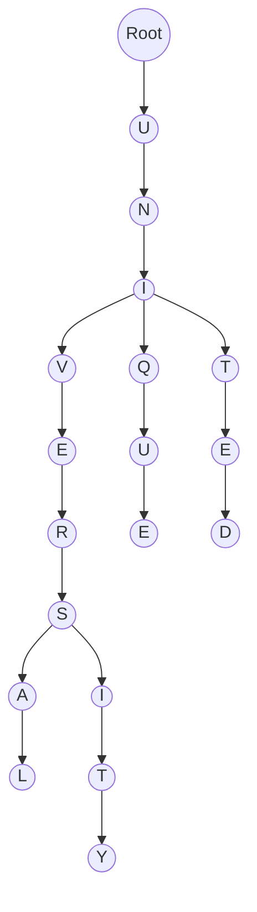
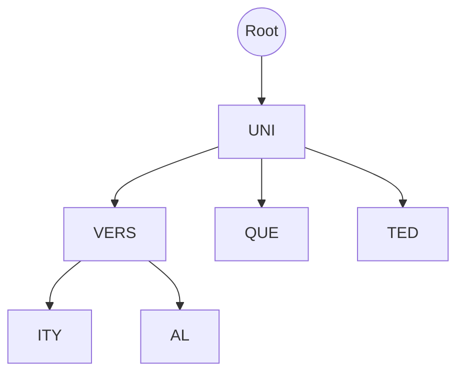
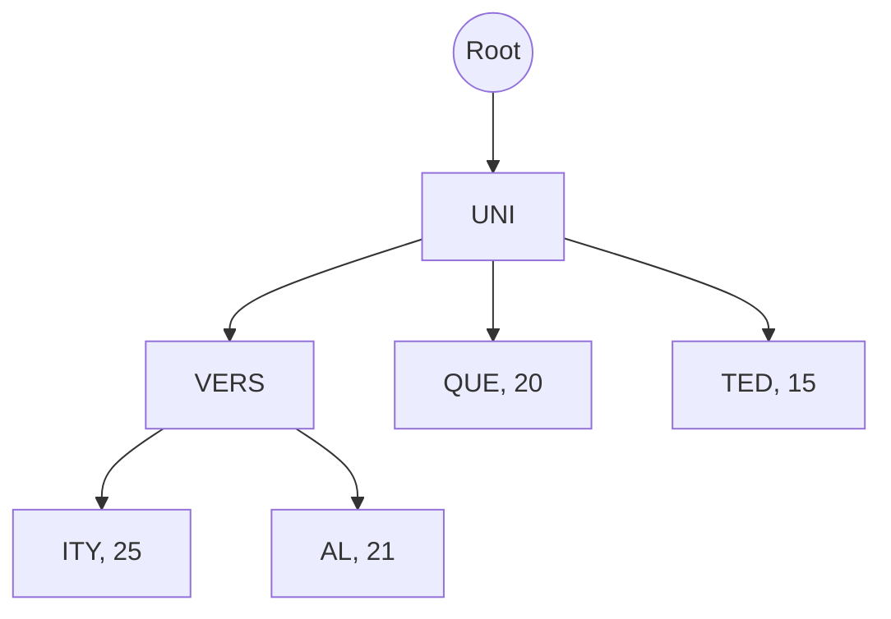

# 037 - Thiết Kế Tính Năng Gợi Ý Tìm Kiếm (Typeahead Suggestion)

[← Bài trước](036-thiet-ke-whatsapp.md) | [Mục lục](README.md) | [Bài tiếp theo →](038-thiet-ke-google-docs.md)

---


# Thiết Kế Hệ Thống: Hệ Thống Gợi Ý Tìm Kiếm (The Typeahead Suggestion System)

Tìm hiểu về hệ thống gợi ý tìm kiếm (typeahead suggestion system) và nắm bắt các chi tiết quan trọng liên quan đến quy trình thiết kế hệ thống này.

**Nội dung sẽ bao gồm:**
* Giới thiệu (Introduction)
* Chúng ta sẽ thiết kế một hệ thống gợi ý tìm kiếm như thế nào? (How will we design a typeahead suggestion system?)

---

## Giới thiệu (Introduction)

Gợi ý tìm kiếm (Typeahead suggestion), còn được gọi là tính năng tự động hoàn thành (autocomplete feature), cho phép người dùng tìm kiếm một truy vấn đã biết và thường xuyên được tra cứu. Tính năng này bắt đầu hoạt động ngay khi người dùng nhập truy vấn vào ô tìm kiếm. Hệ thống typeahead cung cấp một danh sách các gợi ý để hoàn thành truy vấn dựa trên lịch sử tìm kiếm của người dùng, ngữ cảnh hiện tại của phiên tìm kiếm, cũng như các nội dung đang thịnh hành (trending content) trên nhiều người dùng và khu vực địa lý khác nhau. 

Các truy vấn được tìm kiếm thường xuyên sẽ luôn xuất hiện ở đầu danh sách gợi ý. Hệ thống typeahead không làm cho quá trình tìm kiếm diễn ra nhanh hơn; tuy nhiên, nó giúp người dùng định hình câu hoặc từ khóa nhanh chóng hơn. Đây là một thành phần thiết yếu của tất cả các công cụ tìm kiếm nhằm nâng cao trải nghiệm người dùng (user experience - UX).


*Hệ thống gợi ý tìm kiếm trong thực tế (The typeahead suggestion system in action)*


```text
Search
Typeah
├── Typeahead
├── Typeahead design
├── Typeahead search
├── Typeahead flutter
├── Typeahead bootstrap
├── Typeahead jquery
├── Typeahead angular
└── Typeahead npm
```

---

## Chúng ta sẽ thiết kế một hệ thống gợi ý tìm kiếm như thế nào? (How will we design a typeahead suggestion system?)

Chúng tôi đã chia chương thiết kế hệ thống gợi ý tìm kiếm thành 6 bài học:

1. **Yêu cầu (Requirements):** Trong bài học này, chúng ta tập trung vào các yêu cầu chức năng (functional requirements) và yêu cầu phi chức năng (non-functional requirements) khi thiết kế hệ thống gợi ý tìm kiếm. Chúng ta cũng sẽ thảo luận về ước tính tài nguyên (resource estimations) để hệ thống vận hành trơn tru.
2. **Thiết kế tổng quan (High-level design):** Trong bài học này, chúng ta thảo luận về kiến trúc tổng quan của phiên bản hệ thống gợi ý tìm kiếm. Chúng ta cũng sẽ xem xét một số API thiết yếu được sử dụng trong thiết kế.
3. **Cấu trúc dữ liệu để lưu trữ tiền tố (Data Structure for Storing Prefixes):** Trong bài học này, chúng ta tìm hiểu về một cấu trúc dữ liệu dạng cây hiệu quả gọi là **Trie**, được dùng để lưu trữ các tiền tố tìm kiếm (search prefixes). Chúng ta cũng sẽ thảo luận cách tối ưu hóa cây hơn nữa nhằm giảm thời gian duyệt cây (tree traversal time).
4. **Thiết kế chi tiết (Detailed design):** Trong bài học này, chúng ta giải thích hai thành phần chính: dịch vụ gợi ý (suggestions service) và bộ tổng hợp (assembler) – những thành phần cấu thành nên thiết kế chi tiết của hệ thống typeahead suggestion.
5. **Đánh giá hệ thống (Evaluation):** Bài học này đánh giá thiết kế đề xuất dựa trên các yêu cầu phi chức năng của hệ thống. Đồng thời trình bày một số kỹ thuật tối ưu hóa phía client (client-side optimization) và cá nhân hóa (personalization) có thể tác động đáng kể đến kiến trúc hệ thống.
6. **Câu hỏi ôn tập (Quiz):** Trong bài học này, chúng ta đánh giá mức độ hiểu biết về thiết kế thông qua một bài trắc nghiệm.

Hãy bắt đầu bằng việc xác định các yêu cầu thiết kế cho hệ thống gợi ý tìm kiếm.

---

# Yêu cầu Thiết Kế của Hệ Thống Gợi Ý Tìm Kiếm (Requirements of the Typeahead Suggestion System's Design)

Tìm hiểu về các yêu cầu và ước tính tài nguyên phục vụ cho việc thiết kế hệ thống gợi ý tìm kiếm.

**Nội dung sẽ bao gồm:**
* Các yêu cầu (Requirements)
  * Yêu cầu chức năng (Functional requirements)
  * Yêu cầu phi chức năng (Non-functional requirements)
* Ước tính tài nguyên (Resource estimation)
  * Ước tính dung lượng lưu trữ (Storage estimation)
  * Ước tính băng thông (Bandwidth estimation)
  * Ước tính số lượng máy chủ (Number of servers estimation)
* Các khối xây dựng hệ thống sẽ sử dụng (Building blocks we will use)

---

## Các yêu cầu (Requirements)

Trong bài học này, chúng ta xem xét các yêu cầu và tài nguyên ước tính cần thiết cho việc thiết kế hệ thống gợi ý tìm kiếm. Thiết kế đề xuất của chúng ta phải đáp ứng các yêu cầu sau:

### Yêu cầu chức năng (Functional requirements)
* Hệ thống phải gợi ý top $N$ (giả sử là top 10) cụm từ tìm kiếm phổ biến và phù hợp nhất cho người dùng dựa trên chuỗi văn bản mà người dùng nhập vào ô tìm kiếm.

### Yêu cầu phi chức năng (Non-functional requirements)
* **Độ trễ thấp (Low latency):** Hệ thống phải hiển thị tất cả các truy vấn gợi ý theo thời gian thực (real-time) ngay khi người dùng gõ phím. Độ trễ không được vượt quá 200 ms. 
  
  > [!NOTE]
  > Một nghiên cứu chỉ ra rằng khoảng thời gian trung bình giữa hai lần nhấn phím (keystrokes) là **160 ms**. Do đó, quỹ thời gian (time-budget) phản hồi gợi ý của chúng ta nên lớn hơn 160 ms để mang lại phản hồi theo thời gian thực. Lý do là nếu người dùng gõ phím rất nhanh, họ đã biết rõ mình muốn tìm kiếm điều gì và có thể không cần đến gợi ý. Đồng thời, thời gian phản hồi của hệ thống nên lớn hơn 160 ms, nhưng không được quá cao vì khi đó gợi ý sẽ bị trễ (stale) và giảm giá trị hữu ích.

* **Khả năng chịu lỗi (Fault tolerance):** Hệ thống phải đủ tin cậy (reliable) để tiếp tục cung cấp các gợi ý ngay cả khi một hoặc nhiều thành phần của nó gặp sự cố hư hỏng (failure).
* **Khả năng mở rộng (Scalability):** Hệ thống phải hỗ trợ được lượng người dùng ngày càng gia tăng theo thời gian.

---

## Ước tính tài nguyên (Resource estimation)

Như đã đề cập trước đó, tính năng typeahead được sử dụng để nâng cao trải nghiệm người dùng trong quá trình nhập truy vấn. Chúng ta cần thiết kế một hệ thống hoạt động ở quy mô tương đương với Google Search. Google tiếp nhận hơn **3,5 tỷ lượt tìm kiếm** mỗi ngày. Thiết kế một hệ thống khổng lồ như vậy là một nhiệm vụ đầy thách thức và đòi hỏi nhiều loại tài nguyên khác nhau. Hãy cùng ước tính nhu cầu về dung lượng lưu trữ và băng thông cho hệ thống đề xuất.

### 1. Ước tính dung lượng lưu trữ (Storage estimation)

Giả định rằng trong số 3,5 tỷ truy vấn mỗi ngày, có **2 tỷ truy vấn là duy nhất (unique queries)** và cần được lưu trữ. Giả định thêm rằng mỗi truy vấn có độ dài trung bình là **15 ký tự**, và mỗi ký tự chiếm **2 Bytes** bộ nhớ lưu trữ. 

Theo công thức tính toán này, chúng ta sẽ cần:

$$\text{Dung lượng lưu trữ mỗi ngày} = 2\text{ tỷ} \times 15 \times 2\text{ Bytes} = 60\text{ GB/ngày}$$

Dung lượng lưu trữ yêu cầu mỗi năm:

$$\text{Dung lượng lưu trữ mỗi năm} = 60\text{ GB/ngày} \times 365 = 21{,}9\text{ TB/năm}$$


```text
Dung lượng/ngày (Storage/day): 60 GB
                   x
Số ngày trong năm (Days in a year): 365
                   =
Dung lượng/năm (Storage/year): 21.9 TB
```


*Yêu cầu dung lượng lưu trữ cho hệ thống gợi ý tìm kiếm (Storage requirements for the typeahead suggestion system)*

---

### 2. Ước tính băng thông (Bandwidth estimation)

Có 3,5 tỷ truy vấn sẽ gửi đến hệ thống của chúng ta mỗi ngày. Giả sử mỗi truy vấn người dùng nhập có độ dài trung bình là 15 ký tự.

Với giả định này, tổng số yêu cầu đọc (read requests) ký tự mỗi ngày sẽ là:

$$15 \times 3{,}5\text{ tỷ} = 52{,}5\text{ tỷ ký tự/ngày}$$

Tổng số yêu cầu đọc mỗi giây (Read requests per second):

$$\frac{52{,}5\text{ tỷ}}{86.400\text{ giây}} \approx 0{,}607\text{ triệu ký tự/giây (0.607M characters/sec)}$$

*(Trong đó 86.400 là số giây trong một ngày).*

Vì mỗi ký tự chiếm 2 Bytes (tương đương $2 \times 8 = 16$ bits), băng thông đầu vào (incoming bandwidth) mà hệ thống cần là:

$$0{,}607\text{M} \times 2 \times 8 = 9{,}7\text{ Mb/giây (9.7 Mbps)}$$

> **9,7 Mb/giây** là yêu cầu băng thông đầu vào cho các truy vấn có độ dài tối đa là 15 ký tự.

Hệ thống của chúng ta sẽ gợi ý **top 10 truy vấn** có độ dài xấp xỉ với độ dài truy vấn sau mỗi ký tự mà người dùng nhập vào. Do đó, yêu cầu băng thông đầu ra (outgoing bandwidth) sẽ trở thành:

$$15 \times 10 \times 9{,}7\text{ Mb/giây} = 1{,}46\text{ Gb/giây (1.46 Gbps)}$$


**Tổng băng thông yêu cầu bởi hệ thống gợi ý tìm kiếm (The total bandwidth required by the typeahead suggestion system):**
* Băng thông đầu vào (Incoming bandwidth) = **9,7 Mbps**
* Băng thông đầu ra (Outgoing bandwidth) = **1,46 Gbps**
* **Tổng cộng (Total) $\approx$ 1,47 Gbps**

---

### 3. Ước tính số lượng máy chủ (Number of servers estimation)

Hệ thống của chúng ta sẽ tiếp nhận **607.000 yêu cầu mỗi giây đồng thời (concurrent requests per second)**. Do đó, chúng ta cần triển khai nhiều cụm máy chủ để tránh gây quá tải cho một máy chủ đơn lẻ. Hãy cùng xem xét cách tính toán chi tiết số lượng máy chủ cần thiết...

---

Giả sử rằng một máy chủ đơn lẻ (single server) có thể xử lý 8.000 truy vấn mỗi giây (Queries Per Second - QPS). Do đó, chúng ta cần khoảng 76 máy chủ để xử lý 607.000 truy vấn.

$$\frac{607\text{K}}{8.000} \approx 76 \text{ máy chủ}$$

Ở đây, chúng ta chỉ mới đề cập đến số lượng máy chủ ứng dụng (Application Servers). Để đơn giản hóa, chúng ta đã bỏ qua số lượng máy chủ bộ nhớ đệm (Cache Servers) và máy chủ cơ sở dữ liệu (Database Servers). Con số thực tế sẽ cao hơn 76 bởi vì chúng ta cũng cần các máy chủ dự phòng (redundant servers) để đạt được độ sẵn sàng cao (High Availability).


*Số lượng máy chủ cần thiết cho hệ thống gợi ý tìm kiếm (typeahead suggestion system): 76 máy chủ*

Trong bảng dưới đây, bạn có thể điều chỉnh các giá trị để xem ước tính tài nguyên (resource estimations) thay đổi như thế nào.

---

### Ước Tính Tài Nguyên Cho Hệ Thống Gợi Ý Tìm Kiếm (Resource Estimation for the Typeahead Suggestion System)

| Thông Số (Parameter) | Giá Trị (Value) | Đơn Vị (Unit) |
| :--- | :--- | :--- |
| **Tổng số truy vấn mỗi ngày (Total Queries per Day)** | 3.5 | tỷ (billion) |
| **Số truy vấn duy nhất mỗi ngày (Unique Queries per Day)** | 2 | tỷ (billion) |
| **Số ký tự tối thiểu trong một truy vấn (Minimum Characters in a Query)** | 15 | Ký tự (Characters) |
| **QPS của máy chủ (Server's QPS)** | 8000 | Truy vấn mỗi giây (Queries per second) |
| **Dung lượng lưu trữ (Storage)** | 60 | GB/ngày (GB/day) |
| **Băng thông mạng đi vào (Incoming Bandwidth)** | 9.7 | Mb/giây (Mb/sec) |
| **Băng thông mạng đi ra (Outgoing Bandwidth)** | 1.455 | Gb/giây (Gb/sec) |
| **Số lượng máy chủ (Number of Servers)** | 76 | Máy chủ (Servers) |


### Các Khối Xây Dựng Sẽ Sử Dụng (Building Blocks We Will Use)

Thiết kế của hệ thống gợi ý tìm kiếm (typeahead suggestion system) bao gồm các khối xây dựng (building blocks) sau đây đã được thảo luận trong các chương mở đầu của khóa học:


*Các khối xây dựng cần thiết trong thiết kế hệ thống gợi ý tìm kiếm*

* **Cơ sở dữ liệu (Database)**
* **Bộ cân bằng tải (Load Balancer)**
* **Bộ nhớ đệm (Cache)**

* **Cơ sở dữ liệu (Databases):** Cần thiết để lưu trữ dữ liệu liên quan đến các tiền tố truy vấn (queries' prefixes).
* **Bộ cân bằng tải (Load Balancers):** Cần thiết để phân phối (disseminate) các truy vấn gửi đến giữa một số lượng các máy chủ đang hoạt động (active servers).
* **Bộ nhớ đệm (Caches):** Được sử dụng để lưu giữ $N$ gợi ý hàng đầu (top $N$ suggestions) nhằm phục vụ truy xuất nhanh chóng (fast retrieval).

Trong bài học tiếp theo, chúng ta sẽ tập trung vào thiết kế mức cao (High-Level Design) và các giao diện lập trình ứng dụng (APIs) của hệ thống gợi ý tìm kiếm (typeahead suggestion system).

---

# Thiết Kế Mức Cao Của Hệ Thống Gợi Ý Tìm Kiếm (High-Level Design of the Typeahead Suggestion System)

Nắm tổng quan về thiết kế mức cao của hệ thống gợi ý tìm kiếm.

**Chúng ta sẽ đề cập đến các nội dung sau:**
* Thiết kế mức cao (High-level design)
* Thiết kế API (API design)
  * Lấy gợi ý (`Get suggestion`)
  * Thêm các truy vấn thịnh hành vào cơ sở dữ liệu (`Add trending queries to the database`)

---

### Thiết Kế Mức Cao (High-Level Design)

Theo các yêu cầu của chúng ta, hệ thống không chỉ cần gợi ý các truy vấn theo thời gian thực (real-time) với độ trễ tối thiểu (minimum latency) mà còn phải lưu trữ các truy vấn tìm kiếm mới vào cơ sở dữ liệu. Bằng cách này, người dùng sẽ nhận được các gợi ý dựa trên những tìm kiếm phổ biến và gần đây.

Hệ thống đề xuất của chúng ta phải thực hiện được các công việc sau:
1. **Cung cấp các gợi ý** dựa trên lịch sử tìm kiếm của người dùng.
2. **Lưu trữ tất cả các truy vấn mới và thịnh hành (trending queries)** vào cơ sở dữ liệu để đưa chúng vào danh sách gợi ý.

Khi người dùng bắt đầu gõ một truy vấn, mỗi ký tự được nhập vào sẽ gửi một yêu cầu (hit) đến một trong các máy chủ ứng dụng (application servers). Hãy giả định rằng chúng ta có một **dịch vụ gợi ý (Suggestions Service)** chuyên lấy ra 10 gợi ý hàng đầu (top 10 suggestions) từ bộ nhớ đệm (cache), cụ thể là Redis, và trả về kết quả dưới dạng phản hồi (response) cho máy khách (client). 

Bên cạnh đó, giả sử chúng ta có một dịch vụ khác được gọi là **bộ thu thập & xử lý (Assembler)**. Một Assembler sẽ thu thập các tìm kiếm của người dùng, áp dụng một số giải thuật phân tích dữ liệu (analytics) để xếp hạng (rank) các lượt tìm kiếm, và lưu trữ chúng vào một cơ sở dữ liệu NoSQL (NoSQL Database) được phân tán trên nhiều nút (distributed across several nodes).

---


*Thiết kế mức cao của hệ thống gợi ý tìm kiếm (The high-level design of the typeahead suggestion system)*


Hơn nữa, chúng ta cũng cần các **bộ cân bằng tải (Load Balancers)** để phân phối đều các yêu cầu gửi đến (incoming requests). Chúng ta cũng bổ sung các **máy chủ ứng dụng / máy chủ web (Web Servers / Application Servers)** làm các điểm tiếp nhận đầu vào (entry points) cho clients để chúng có thể chuyển tiếp (forward) các yêu cầu đến các vi dịch vụ (microservices) phù hợp. Các web server này đóng gói (encapsulate) cấu trúc kiến trúc bên trong của hệ thống và cung cấp các dịch vụ khác như xác thực (authentication), giám sát (monitoring), định hình lưu lượng yêu cầu (request shaping), quản trị (management), và nhiều tác vụ khác.

---

### Thiết Kế API (API Design)

Vì hệ thống vừa cung cấp gợi ý cho người dùng, vừa thêm các truy vấn thịnh hành vào cơ sở dữ liệu, chúng ta cần các API sau:

#### 1. Lấy Gợi Ý (Get Suggestion)

```http
getSuggestions(prefix)
```

Lệnh gọi API này có nhiệm vụ truy xuất các gợi ý từ các máy chủ. Lệnh gọi được thực hiện thông qua **dịch vụ gợi ý (Suggestion Service)** và trả về phản hồi cho client.

Bảng dưới đây giải thích tham số được truyền vào lời gọi API:

| Tham số (Parameter) | Mô tả (Description) |
| :--- | :--- |
| `prefix` | Đại diện cho bất kỳ nội dung/ký tự nào mà người dùng đã gõ vào thanh tìm kiếm. |

---

#### 2. Thêm Các Truy Vấn Thịnh Hành Vào Cơ Sở Dữ Liệu (Add Trending Queries to the Database)

```http
addToDatabase(query)
```

Lệnh gọi API này thêm một truy vấn thịnh hành vào cơ sở dữ liệu thông qua một **Assembler** nếu truy vấn đó đã được tìm kiếm nhiều lần và vượt qua một ngưỡng (threshold) nhất định.

| Tham số (Parameter) | Mô tả (Description) |
| :--- | :--- |
| `query` | Đại diện cho một truy vấn được tìm kiếm thường xuyên và đã vượt qua giới hạn được xác định trước (predefined limit). |

---

> [!NOTE]
> ### Vấn Đề Cần Suy Ngẫm (Point to Ponder)
> **Câu hỏi:** Thay vì cập nhật lại toàn bộ trang web (page), chúng ta chỉ cần cập nhật danh sách truy vấn gợi ý ngay bên dưới hộp tìm kiếm (search box) theo thời gian thực (real-time). Chúng ta có thể sử dụng kỹ thuật nào cho mục đích này?

---

# Cấu Trúc Dữ Liệu Lưu Trữ Tiền Tố (Data Structure for Storing Prefixes)

*Học phần trước: Các yêu cầu của Hệ thống Gợi ý Typeahead (Requirements of the Typeahead Suggestion System)*

### Câu trả lời (Answer):
Chúng ta nên cập nhật truy vấn theo phương thức bất đồng bộ (**asynchronous**) sử dụng **AJAX**. AJAX là một tập hợp các kỹ thuật phát triển web. Nó cho phép các trang web trao đổi một lượng nhỏ dữ liệu với máy chủ (**server**) — tương tự như trong hệ thống gợi ý tự động hoàn thành (**typeahead suggestion system**) — mà không can thiệp hay làm gián đoạn đến việc hiển thị cũng như hành vi của trang web hiện tại.

Trong bài học tiếp theo, chúng ta sẽ tìm hiểu về một cấu trúc dữ liệu hiệu quả được sử dụng để lưu trữ các gợi ý hoặc các tiền tố (**prefixes**).

---

## Cấu trúc dữ liệu để lưu trữ tiền tố (Data Structure for Storing Prefixes)

Tìm hiểu về cấu trúc dữ liệu hiệu quả được sử dụng để lưu trữ các gợi ý tìm kiếm.

### Nội dung bao gồm:
* Cấu trúc dữ liệu Trie (**The trie data structure**)
* Theo dõi các lượt tìm kiếm hàng đầu (**Track the top searches**)
* Phân vùng Trie (**Trie partitioning**)
* Xử lý truy vấn sau khi phân vùng (**Process a query after partitioning**)
* Cập nhật Trie (**Update the trie**)

---

### Cấu trúc dữ liệu Trie (The trie data structure)

Trước khi đi sâu vào chi tiết thiết kế cụ thể của hệ thống gợi ý **typeahead**, chúng ta cần phải lựa chọn một cấu trúc dữ liệu hiệu quả để lưu trữ các tiền tố (**prefixes**). Tiền tố là các nhóm ký tự mà người dùng nhập vào. 

Vấn đề chúng ta đang cố gắng giải quyết là: chúng ta có rất nhiều chuỗi ký tự (**strings**) cần lưu trữ theo cách cho phép người dùng có thể tìm kiếm chúng bằng bất kỳ tiền tố nào. Dịch vụ của chúng ta sẽ đề xuất các từ tiếp theo khớp với tiền tố được cung cấp. 

> [!NOTE]
> **Ví dụ giả định:** Giả sử cơ sở dữ liệu của chúng ta chứa các cụm từ: `UNITED`, `UNIQUE`, `UNIVERSAL`, và `UNIVERSITY`. Hệ thống của chúng ta phải gợi ý ra `"UNIVERSAL"` và `"UNIVERSITY"` khi người dùng nhập vào `"UNIV"`.

Cần phải có một phương pháp có khả năng lưu trữ dữ liệu hiệu quả và hỗ trợ thực hiện tìm kiếm nhanh chóng, bởi vì chúng ta phải xử lý một khối lượng lớn yêu cầu (**requests**) với độ trễ tối thiểu (**minimal latency**). Chúng ta không thể phụ thuộc vào cơ sở dữ liệu (**database**) cho tác vụ này, vì việc cung cấp gợi ý từ cơ sở dữ liệu sẽ tốn nhiều thời gian hơn so với việc đọc trực tiếp dữ liệu gợi ý từ bộ nhớ RAM (**in-memory**). Do đó, chúng ta cần lưu trữ chỉ mục (**index**) của mình trên bộ nhớ trong một cấu trúc dữ liệu hiệu quả. Tuy nhiên, để đảm bảo tính bền vững (**durability**) và độ sẵn sàng cao (**High Availability**), dữ liệu này vẫn được lưu trữ trong cơ sở dữ liệu.

**Trie** (phát âm là "try") là một trong những cấu trúc dữ liệu phù hợp nhất với các yêu cầu của chúng ta. Trie là một cấu trúc dữ liệu dạng cây (**tree-like data structure**) dùng để lưu trữ các cụm từ, trong đó mỗi nút trên cây (**tree node**) lưu trữ một ký tự trong cụm từ theo thứ tự tuần tự. Nếu chúng ta cần lưu trữ `UNITED`, `UNIQUE`, `UNIVERSAL`, và `UNIVERSITY` trong cây Trie, cấu trúc sẽ có dạng như sau:

#### Sơ đồ cấu trúc cây Trie đầy đủ (Full Trie Structure):



*Hình: Cây Trie cho các từ UNITED, UNIQUE, UNIVERSAL, và UNIVERSITY*

Nếu người dùng nhập `"UNIV"`, dịch vụ của chúng ta có thể duyệt qua cây Trie (**traverse the trie**) để đi đến nút **V**, từ đó tìm tất cả các thuật ngữ bắt đầu bằng tiền tố này — ví dụ như `UNIVERSAL`, `UNIVERSITY`, v.v.

---

### Tối ưu hóa Trie: Nén các nút đơn nhánh (Radix Tree / Compressed Trie)

Cây Trie có thể gộp các nút lại thành một nút duy nhất tại các vị trí chỉ tồn tại một nhánh rẽ đơn lẻ, từ đó làm giảm độ sâu của cây (**tree depth**). Điều này cũng giúp giảm thời gian duyệt cây (**traversal time**), qua đó tăng hiệu suất hoạt động (**efficiency**). 

Ví dụ, một mô hình tối ưu hóa cả về không gian lưu trữ và thời gian (**space- and time-efficient model**) của cây Trie nói trên sẽ có cấu trúc như sau:



*Hình: Cây Trie thu gọn (Reduced/Compressed Trie) cho các từ UNITED, UNIQUE, UNIVERSAL, và UNIVERSITY*

---

### Theo dõi các lượt tìm kiếm hàng đầu (Track the top searches)

Vì hệ thống của chúng ta theo dõi các lượt tìm kiếm hàng đầu và trả về kết quả gợi ý phổ biến nhất, chúng ta sẽ lưu số lần mỗi thuật ngữ được tìm kiếm (tần suất tìm kiếm) ngay bên trong nút Trie. 

Giả sử người dùng tìm kiếm:
* `UNITED`: 15 lần
* `UNIQUE`: 20 lần
* `UNIVERSAL`: 21 lần
* `UNIVERSITY`: 25 lần

Để cung cấp các gợi ý hàng đầu cho người dùng, các giá trị đếm này (**frequency counts**) được lưu trữ tại mỗi nút nơi các thuật ngữ này kết thúc (**terminal nodes**). Cây Trie kết quả sẽ có cấu trúc như sau:



*Hình: Cây Trie hiển thị tần suất tìm kiếm cho UNITED, UNIQUE, UNIVERSAL, và UNIVERSITY*

Nếu người dùng gõ `"UNI"`, hệ thống bắt đầu duyệt cây từ bên dưới nút gốc cho chuỗi `UNI`. Sau khi so sánh tất cả các thuật ngữ bắt nguồn từ nút gốc này, hệ thống sẽ đưa ra gợi ý cho tất cả các từ khả dĩ:
1. Do tần suất của từ `UNIVERSITY` là cao nhất (25), nó xuất hiện ở vị trí đầu tiên.
2. Tương tự, tần suất của từ `UNITED` tương đối thấp (15), nên nó xuất hiện ở vị trí cuối cùng.
3. Nếu người dùng chọn `UNIQUE` từ danh sách gợi ý, con số đếm cạnh `UNIQUE` sẽ tăng lên thành 21.

---

> [!IMPORTANT]
> ### Điểm Cần Suy Ngẫm (Point to Ponder)
> **Câu hỏi:** Chúng ta đã giảm thời gian duyệt cây Trie bằng cách gộp các nút có nhánh đơn và giảm số lượng cấp độ của cây. Liệu có phương pháp nào khác để tối thiểu hóa thời gian duyệt cây Trie (**trie traversal time**) hơn nữa hay không?

---

### Ẩn Câu Trả Lời (Hide Answer)

Một phương pháp để giảm thiểu thời gian duyệt cây tiền tố (**trie traversal time**) là tính toán trước (**pre-compute**) và lưu trữ top 10 (hoặc bất kỳ số lượng nào tùy chọn) các gợi ý cho mỗi tiền tố ngay tại node đó. Điều này đồng nghĩa với việc thay vì phải duyệt toàn bộ cây Trie mỗi khi người dùng gõ cụm từ `"UNIVERS"` vào hộp tìm kiếm, hệ thống đã tính toán trước, sắp xếp (**sorted**) và lưu trữ sẵn tập kết quả cho tiền tố `UNIVERS` — ví dụ: `UNIVERSITY`, `UNIVERSAL`, v.v. — ngay bên trong node chứa tiền tố `UNIVERS`. Tuy nhiên, cách tiếp cận này đòi hỏi thêm dung lượng bộ nhớ (**extra space overhead**) để lưu trữ các kết quả đã được tính toán trước.

```
                  Root
                   |
                  UNI [ UNIVERSITY, UNIVERSAL, UNIQUE, UNITED ]
                 /   \
           TED, 15   QUE, 20
             |
           VERS [ UNIVERSITY, UNIVERSAL ]
          /    \
       AL, 21   ITY, 25
```

---

## Phân Vùng Cây Trie (Trie Partitioning)

Mục tiêu của chúng ta là thiết kế một hệ thống tương tự như Google, có khả năng xử lý hàng tỷ truy vấn mỗi giây (**billions of queries per second**). Một máy chủ đơn lẻ hoàn toàn không đủ năng lực để gánh một khối lượng request khổng lồ như vậy. Thêm vào đó, việc lưu trữ toàn bộ các tiền tố trên một cây Trie duy nhất không phải là một giải pháp khả thi xét trên các khía cạnh: Tính sẵn sàng (**High Availability**), Khả năng mở rộng (**Scalability**), và Tính bền vững dữ liệu (**Durability**). Một giải pháp tối ưu là phân tách (**split / partition**) cây Trie thành nhiều cây Trie nhỏ hơn nhằm mang lại trải nghiệm người dùng tốt hơn.

Giả sử cây Trie được chia thành 2 phần, và mỗi phần đều có một bản sao (**replica**) để đảm bảo tính bền vững dữ liệu (**durability**):
- Toàn bộ các tiền tố bắt đầu từ **"A" đến "M"** được lưu trữ trên **Server/01**, và bản sao của nó được lưu trên **Server/02**.
- Tương tự, toàn bộ các tiền tố bắt đầu từ **"N" đến "Z"** được lưu trữ trên **Server/03**, và bản sao của nó được lưu trên **Server/04**.

> [!NOTE]
> Cần lưu ý rằng kỹ thuật phân vùng cơ bản này không phải lúc nào cũng cân bằng tải (**load balance**) đồng đều giữa các node, bởi vì một số tiền tố sẽ có lượng từ vựng áp đảo trong khi các tiền tố khác lại chứa rất ít từ. Chúng ta sử dụng kỹ thuật đơn giản này nhằm mục đích minh họa và hiểu rõ nguyên lý phân vùng (**partitioning**).

Chúng ta có thể chia cây Trie thành bao nhiêu phần tùy ý để phân tán tải trọng lên các máy chủ khác nhau, từ đó đạt được hiệu năng (**performance**) mong muốn.

### Bảng Phân Vùng Cây Trie (Partitioned Trie)

| Tiền tố (Prefixes) | Bản chính (Primary) | Bản sao (Secondary) |
| :--- | :--- | :--- |
| **A đến M** | Server/01 | Server/02 |
| **N đến Z** | Server/03 | Server/04 |

---

### Vấn Đề Cần Suy Ngẫm (Point to Ponder)

> [!IMPORTANT]
> **Câu hỏi:**
> Bảng ánh xạ (**mapping**) giữa các tiền tố và các máy chủ lưu trữ chính/phụ (**primary and secondary storage**) sẽ được lưu ở đâu? Thành phần nào sẽ quản lý và điều phối các yêu cầu (**requests**) đến các máy chủ này?

#### Ẩn Câu Trả Lời (Hide Answer)
Trong một hệ thống phân tán (**distributed system**), nơi mà nhiều cụm máy chủ (**clusters**) bao gồm nhiều server được sử dụng cho một dịch vụ cụ thể, chúng ta sử dụng một trình quản lý cụm (**cluster manager**) như **ZooKeeper** để lưu trữ và quản lý bảng ánh xạ giữa các cụm.

---

## Xử Lý Truy Vấn Sau Khi Phân Vùng (Process a Query After Partitioning)

Khi người dùng nhập một truy vấn, truy vấn đó sẽ chạm tới bộ cân bằng tải (**Load Balancer**) và được chuyển tiếp (**forwarded**) đến một trong các máy chủ ứng dụng (**Application Servers**). Máy chủ ứng dụng sẽ tìm kiếm trên cây Trie thích hợp tùy thuộc vào tiền tố mà người dùng đã nhập:
- **Ví dụ:** Nếu người dùng nhập một ký tự bắt đầu bằng **"U"**, máy chủ ứng dụng sẽ truy cập vào **Server/03** hoặc **Server/04**, vì cả hai máy chủ này đều lưu trữ cây Trie chứa các tiền tố bắt đầu bằng chữ "U".

---

## Cập Nhật Cây Trie (Update the Trie)

Hàng tỷ lượt tìm kiếm mỗi ngày tạo ra hàng trăm nghìn truy vấn mỗi giây (**hundreds of thousands of queries per second - QPS**). Do đó, quy trình cập nhật cây Trie theo thời gian thực cho từng truy vấn đơn lẻ là cực kỳ tốn tài nguyên (**resource-intensive**), mất thời gian (**time-consuming**) và có thể làm tắc nghẽn, suy giảm hiệu năng của các yêu cầu đọc (**hamper read requests**).

Vấn đề này có thể được giải quyết triệt để bằng cách **cập nhật cây Trie ngoại tuyến (offline update) theo các chu kỳ định kỳ nhất định**. Để thực hiện cập nhật ngoại tuyến:
1. Hệ thống ghi nhận (**log**) các truy vấn kèm theo tần suất (**frequency**) của chúng vào một bảng băm (**hash table**).
2. Tổng hợp dữ liệu (**aggregate data**) theo các khoảng thời gian đều đặn.
3. Sau một khoảng thời gian xác định, cây Trie sẽ được cập nhật đồng loạt với thông tin đã được tổng hợp.
4. Sau khi quá trình cập nhật cây Trie hoàn tất, toàn bộ các bản ghi cũ sẽ bị xóa khỏi bảng băm.

### Bảng Tiền Tố và Tần Suất Được Cập Nhật Định Kỳ

| Tiền tố (Prefix) | Khoảng thời gian (Một giờ) | Tần suất (Freq) |
| :--- | :--- | :--- |
| **UNIVERSITY** | Giờ thứ 1 (1st hour) | 10 |
| **UNIVERSITY** | Giờ thứ 2 (2nd hour) | 25 |
| **UNIVERSITY** | Giờ thứ 3 (3rd hour) | 1 |

Chúng ta có thể thiết lập một tiến trình **MapReduce (MR)** để xử lý toàn bộ dữ liệu nhật ký (**logging data**) một cách định kỳ, chẳng hạn như mỗi 15 phút một lần:
- Các dịch vụ MR này sẽ tính toán tần suất xuất hiện của tất cả các cụm từ tìm kiếm trong vòng 15 phút vừa qua.
- Đẩy kết quả (**dump results**) vào một bảng băm lưu trên cơ sở dữ liệu phân tán như **Cassandra**.
- Sau đó, chúng ta tiến hành cập nhật cây Trie với dữ liệu mới. Bản sao hiện tại của cây Trie sẽ được cập nhật toàn bộ các từ mới cùng tần suất tương ứng. 

> [!TIP]
> Toàn bộ quy trình này bắt buộc phải thực hiện **ngoại tuyến (offline)**, bởi vì ưu tiên tối thượng của hệ thống là cung cấp gợi ý tìm kiếm tức thì cho người dùng với độ trễ cực thấp (**ultra-low latency**) thay vì bắt họ phải chờ đợi.

---

### Hai Chiến Lược Cập Nhật Cây Trie Ngoại Tuyến

Về cơ bản, chúng ta có thể cập nhật cây Trie thông qua hai hướng tiếp cận sau:

1. **Replication & Swap:** Chúng ta có thể tạo bản sao cây Trie trên từng máy chủ để cập nhật ngoại tuyến. Sau khi quá trình cập nhật hoàn tất, chuyển hướng lưu lượng sang sử dụng cây Trie mới cho các gợi ý và giải phóng/hủy bỏ (**throw away**) các cây Trie cũ.
2. **Primary-Secondary Failover/Swap:** Một cách khác là duy trì một bản sao chính (**primary copy**) và nhiều bản sao phụ (**secondary copies**) của cây Trie. 
   - Trong khi bản sao chính đang phục vụ trả lời các truy vấn của người dùng, chúng ta tiến hành cập nhật trên bản sao phụ.
   - Khi tiến trình nâng cấp hoàn thành, bản sao phụ sẽ được thăng cấp lên thành bản sao chính (**make the secondary our main copy**).
   - Sau đó, chúng ta tiến hành nâng cấp bản sao chính cũ, đưa nó trở lại trạng thái sẵn sàng để cùng phục vụ lưu lượng truy cập.

---

### Vấn Đề Cần Suy Ngẫm (Point to Ponder)

> [!IMPORTANT]
> **Câu hỏi:**
> Nếu tần suất của các tiền tố tiếp tục gia tăng liên tục theo thời gian, các biến số nguyên (**integers**) dùng để lưu trữ chúng có thể bị tràn số (**integer overflow**). Làm thế nào để kiểm soát và xử lý vấn đề này?

#### Ẩn Câu Trả Lời (Hide Answer)
Chúng ta có thể thực hiện **chuẩn hóa tần suất (normalize frequencies)** bằng cách ánh xạ chúng vào một dải giá trị cố định, ví dụ trong khoảng từ `0` đến `1,000`. Ngoài ra, chúng ta có thể **ngừng tăng giá trị (stop further additions)** khi đạt tới một ngưỡng trần (**threshold**) nhất định, với giả định rằng bất kỳ tiền tố nào chạm tới ngưỡng đó đều đã nằm trong top đầu của bảng xếp hạng độ phổ biến.

---

Trong bài học tiếp theo, chúng ta sẽ đi sâu vào thiết kế chi tiết (**Detailed Design**) của hệ thống gợi ý tìm kiếm Typeahead.

---

## Thiết Kế Chi Tiết Hệ Thống Gợi Ý Tìm Kiếm (Detailed Design of the Typeahead Suggestion System)

Tìm hiểu về kiến trúc chi tiết của hệ thống gợi ý tìm kiếm Typeahead.

### Nội dung bao gồm:
- Thiết kế chi tiết (**Detailed design**)
- Dịch vụ gợi ý (**Suggestion service**)
- Bộ lắp ráp (**Assembler**)

---

### Thiết Kế Chi Tiết (Detailed Design)

Hãy cùng phân tích luồng dữ liệu (**flow**) và sự tương tác giữa các thành phần được thể hiện trong các sơ đồ kiến trúc dưới đây. Thiết kế tổng thể của chúng ta được chia thành hai phân vùng chính:
1. **Dịch vụ gợi ý (Suggestion Service)**
2. **Bộ lắp ráp (Assembler)**

#### Kiến Trúc Chi Tiết Của Hệ Thống Gợi Ý Tìm Kiếm (Typeahead Suggestion System)


---

### Các Thành Phần Kiến Trúc Cốt Lõi:

- **Clients (Khách hàng / Ứng dụng người dùng)**
- **Load Balancer (Bộ cân bằng tải):** Điều phối lưu lượng truy cập ban đầu từ clients.
- **Distributed Web Servers (Hệ thống Web Server phân tán):** Tiếp nhận các kết nối HTTP/WebSocket từ người dùng.
- **Load Balancer:** Phân phối tải từ web servers vào tầng nghiệp vụ bên dưới.
- **Phân hệ Suggestion Service (Dịch vụ gợi ý):**
  - **Suggestion Service:** Xử lý logic truy vấn gợi ý theo thời gian thực.
  - **Trie Cache (Redis):** Cache in-memory tốc độ cao lưu trữ các cây Trie phục vụ đọc tức thì.
  - **NoSQL Database:** Lưu trữ dữ liệu tiền tố bền vững.
  - **ZooKeeper:** Quản lý cấu hình cụm, ánh xạ phân vùng (**partition mapping**) và điều phối trạng thái cluster.
- **Phân hệ Assembler (Bộ lắp ráp dữ liệu ngoại tuyến):**
  - **Collection Service (Dịch vụ thu thập):** Tiếp nhận log tìm kiếm từ web servers.
  - **Aggregator (Bộ tổng hợp):** Gom nhóm và tính toán tần suất truy vấn.
  - **HDFS File System:** Lưu trữ phân tán lượng lớn dữ liệu log lịch sử.
  - **Trie Builder (Bộ dựng Trie):** Xây dựng cây Trie mới từ dữ liệu đã tổng hợp.
  - **NoSQL:** Lưu trữ trạng thái trung gian của Trie trước khi nạp vào Cache.

---

### Dịch Vụ Gợi Ý (Suggestion Service)

Ngay tại thời điểm người dùng bắt đầu nhập một ký tự/truy vấn vào hộp tìm kiếm, luồng xử lý của Suggestion Service sẽ...

---

### Trang 25

Các lệnh gọi API `getSuggestions(prefix)` sẽ gửi tới các dịch vụ gợi ý (suggestions services). Top 10 truy vấn phổ biến nhất sẽ được trả về từ bộ nhớ đệm phân tán (distributed cache), Redis.

#### Bộ ghép nối (Assembler)

Trong bài học trước, chúng ta đã thảo luận về cách các cây tiền tố (tries) được xây dựng, phân vùng (partitioned) và lưu trữ trong cơ sở dữ liệu. Tuy nhiên, việc tạo mới và cập nhật một trie không được nằm trên luồng xử lý quan trọng (critical path) đối với truy vấn của người dùng. Chúng ta không nên cập nhật trie theo thời gian thực (real-time) vì những lý do sau:

- Có thể có hàng triệu người dùng nhập truy vấn mỗi giây. Trong các giai đoạn có lưu lượng truy cập (traffic) lớn đổ về như vậy, việc cập nhật trie theo thời gian thực trên mỗi truy vấn có thể làm chậm dịch vụ gợi ý của chúng ta.
- Chúng ta cần cung cấp các gợi ý hàng đầu (top suggestions) mà chúng thường không thay đổi thường xuyên sau khi tạo hoặc cập nhật trie. Do đó, việc cập nhật trie liên tục là ít quan trọng hơn.

Dựa trên các lý do nêu trên, chúng ta có một dịch vụ riêng biệt gọi là **Assembler** chịu trách nhiệm tạo mới và cập nhật các trie sau một khoảng thời gian có thể cấu hình (configurable amount of time). Assembler bao gồm các dịch vụ khác nhau sau đây:

- **Dịch vụ thu thập (Collection service):** Bất cứ khi nào người dùng gõ phím, dịch vụ này sẽ thu thập nhật ký (log) bao gồm các cụm từ (phrases), thời gian và các siêu dữ liệu (metadata) khác rồi đổ vào cơ sở dữ liệu để xử lý sau. Vì kích thước của dữ liệu này là rất lớn, Hệ thống Tệp Phân tán Hadoop (Hadoop Distributed File System - HDFS) được coi là hệ thống lưu trữ phù hợp để lưu trữ dữ liệu thô (raw data) này.
  
  Một ví dụ về dữ liệu thô từ dịch vụ thu thập được thể hiện trong bảng dưới đây. Chúng ta ghi lại thời gian để hệ thống biết khi nào cần cập nhật tần suất của một cụm từ nhất định.

---

### Trang 26

#### Bảng: Dữ liệu thô được thu thập bởi Dịch vụ thu thập (Raw Data Collected by the Collection Service)

| Cụm từ (Phrases) | Ngày và Giờ (Date and Time: DD-MM-YYYY HH:MM:SS) |
| :--- | :--- |
| UNIVERSAL | 23-03-2022 10:16:18 |
| UNIVERSITY | 23-03-2022 10:20:11 |
| UNIQUE | 23-03-2022 10:21:10 |
| UNIQUE | 23-03-2022 10:22:24 |
| UNIVERSITY | 23-03-2022 10:25:09 |

- **Bộ tổng hợp (Aggregator):** Dữ liệu thô do dịch vụ thu thập gom về thường chưa ở dạng hợp nhất (consolidated shape). Chúng ta cần hợp nhất dữ liệu thô để xử lý sâu hơn và tạo hoặc cập nhật các trie. Bộ tổng hợp sẽ lấy dữ liệu từ HDFS và phân phối tới các worker khác nhau. Thông thường, MapReduce chịu trách nhiệm tổng hợp tần suất của các tiền tố trong một khoảng thời gian nhất định, và tần suất này được cập nhật định kỳ vào cơ sở dữ liệu Cassandra liên kết. Cassandra rất phù hợp cho mục đích này vì nó có thể lưu trữ một lượng lớn dữ liệu dưới dạng bảng (tabular format).

  Bảng dưới đây hiển thị dữ liệu đã được xử lý và hợp nhất trong một khoảng thời gian cụ thể. Bảng này được cập nhật thường xuyên bởi bộ tổng hợp và được lưu trữ trong một bảng băm (hash table) trong một cơ sở dữ liệu như Cassandra. Để đơn giản hóa, chúng ta giả định rằng dữ liệu không phân biệt chữ hoa chữ thường (case-insensitive).

---

### Trang 27

#### Bảng: Thông tin hữu ích được trích xuất từ dữ liệu thô (Useful Information Extracted from the Raw Data)

| Cụm từ (Phrases) | Tần suất (Frequency) | Thời gian (Time) |
| :--- | :--- | :--- |
| UNIVERSAL | 1400 | 1st 1 |
| UNIVERSITY | 1340 | 1st 1 |
| UNIQUE | 1200 | 1st 1 |

- **Bộ xây dựng trie (Trie builder):** Dịch vụ này chịu trách nhiệm tạo mới hoặc cập nhật các trie. Nó lưu trữ các trie mới và đã được cập nhật này lên các phân mảnh (shards) tương ứng của chúng trong cơ sở dữ liệu trie thông qua ZooKeeper. Các trie được lưu trữ trong bộ nhớ bền vững (persistent storage) dưới dạng một tệp để chúng ta có thể dễ dàng tái tạo lại trie khi cần thiết. Cơ sở dữ liệu tài liệu NoSQL (NoSQL document databases) như MongoDB rất phù hợp để lưu trữ các trie này. Việc lưu trữ trie như vậy là cần thiết khi một máy chủ khởi động lại (restarts).

  Trie được cập nhật từ dữ liệu đã tổng hợp trong cơ sở dữ liệu Cassandra. Bản chụp nhanh (snapshot) hiện có của một trie được cập nhật với tất cả các thuật ngữ mới cùng tần suất tương ứng của chúng. Nếu không, một trie mới sẽ được tạo bằng cách sử dụng dữ liệu trong cơ sở dữ liệu Cassandra.

  Khi một trie được tạo hoặc cập nhật xong, hệ thống sẽ đưa nó vào trạng thái sẵn sàng phục vụ cho dịch vụ gợi ý (suggestion service).

> [!NOTE]
> **Điểm cần suy ngẫm (Point to Ponder)**
> 
> **Câu hỏi:** Chúng ta nên thu thập dữ liệu và xây dựng một trie cho từng người dùng riêng biệt (per user), hay trie nên được chia sẻ chung giữa tất cả người dùng?

---

### Trang 28

*Quay lại: Cấu trúc dữ liệu để lưu trữ tiền tố (Data Structure for Storing Prefixes)*  
*Đánh dấu hoàn thành (Mark As Completed)*  
*Tiếp theo: Đánh giá gợi ý dạng Typeahead… (Evaluation of the Typeahead Sugges…)*

**Ẩn câu trả lời (Hide Answer)**

Vì chúng ta đặt mục tiêu thiết kế một hệ thống ở quy mô tương tự như Google Search, hàng tỷ người dùng sẽ sử dụng dịch vụ của chúng ta. Do số lượng người dùng là khổng lồ, việc duy trì một cây cho mỗi người dùng sẽ trở nên phức tạp và tốn thời gian. Ngoài ra còn có khả năng xuất hiện các cây trùng lặp nếu nhiều người dùng cùng gõ một số tìm kiếm phổ biến, dẫn đến lãng phí tài nguyên.

Do đó, thiết kế của chúng ta giả định một **trie dùng chung (common trie)** được chia sẻ giữa các người dùng, trong đó việc xếp hạng (ranking) sẽ dựa trên các cụm từ đơn lẻ trong trie và tần suất của các thuật ngữ.

---

### Trang 29

## Đánh giá thiết kế Hệ thống gợi ý Typeahead (Evaluation of the Typeahead Suggestion System’s Design)

Đánh giá thiết kế của hệ thống gợi ý gõ trước (typeahead suggestion system) dựa trên các yêu cầu phi chức năng (non-functional requirements) của hệ thống.

Chúng ta sẽ đề cập đến các nội dung sau:
- Đáp ứng các yêu cầu (Fulfill requirements)
- Tối ưu hóa phía máy khách (Client-side optimisation)
- Cá nhân hóa (Personalization)
- Tóm tắt (Summary)

### Đáp ứng các yêu cầu (Fulfill requirements)

Các yêu cầu phi chức năng của hệ thống gợi ý typeahead được đề xuất bao gồm: độ trễ thấp (low latency), khả năng chịu lỗi (fault tolerance), và khả năng mở rộng (scalability).

#### Độ trễ thấp (Low latency)
Có nhiều cấp độ khác nhau mà chúng ta có thể giảm thiểu độ trễ của hệ thống. Chúng ta có thể tối thiểu hóa độ trễ thông qua các lựa chọn sau:
- **Giảm độ sâu của cây (tree depth):** giúp giảm tổng thời gian duyệt cây (traversal time).
- **Cập nhật trie ngoại tuyến (offline update):** đồng nghĩa với việc thời gian thực hiện thao tác cập nhật không nằm trên luồng xử lý quan trọng (critical path) của máy khách (client).
- **Sử dụng các máy chủ ứng dụng và cơ sở dữ liệu phân tán theo địa lý (geographically distributed):** Bằng cách này, dịch vụ được cung cấp ở vị trí gần người dùng, giúp giảm độ trễ truyền thông và hỗ trợ giảm thiểu độ trễ (latency).
- **Sử dụng các cụm bộ nhớ đệm (cache clusters) Redis và Cassandra** đặt trên các cụm cơ sở dữ liệu NoSQL.
- **Phân vùng trie (partitioning tries) một cách thích hợp:** dẫn đến việc phân phối tải hợp lý và mang lại hiệu năng (performance) tốt hơn.

#### Khả năng chịu lỗi (Fault tolerance)
Vì việc nhân bản (replication) và phân vùng (partitioning) các cây đã được cung cấp, hệ thống vận hành với khả năng phục hồi cao (high resilience). Nếu một máy chủ bị lỗi (fails),

---

### Trang 30

các máy chủ khác luôn ở trạng thái dự phòng (standby) để tiếp tục cung cấp dịch vụ.

#### Khả năng mở rộng (Scalability)
Vì hệ thống đề xuất của chúng ta có tính linh hoạt cao, nhiều máy chủ hơn có thể được thêm vào hoặc loại bỏ bớt khi tải tăng hoặc giảm. Ví dụ: nếu số lượng truy vấn tăng lên, số lượng phân vùng hoặc phân mảnh (shards) của các cây sẽ được tăng lên tương ứng.

#### Bảng: Các phương pháp tiếp cận để đáp ứng yêu cầu phi chức năng (Approaches to Fulfill Non-functional Requirements)

| Yêu cầu phi chức năng (Non-functional Requirements) | Phương pháp tiếp cận (Approaches) |
| :--- | :--- |
| **Độ trễ thấp (Low latency)** | • Giảm độ sâu của các trie giúp quá trình duyệt nhanh hơn<br>• Cập nhật các trie ngoại tuyến (offline) và không theo thời gian thực (not in real time)<br>• Phân vùng các trie (Partitioning of the tries)<br>• Các máy chủ lưu bộ nhớ đệm (Caching servers) |
| **Khả năng chịu lỗi (Fault tolerance)** | • Nhân bản (Replicating) các trie và các cơ sở dữ liệu NoSQL |
| **Khả năng mở rộng (Scalability)** | • Bổ sung hoặc giảm bớt máy chủ ứng dụng dựa trên lưu lượng truy cập (incoming traffic)<br>• Tăng số lượng phân vùng của trie (trie partitions) |

### Tối ưu hóa phía máy khách (Client-side optimisation)

Để cải thiện trải nghiệm người dùng, chúng ta có thể triển khai các phương pháp tối ưu hóa phía máy khách (client-side optimizations) sau:

- **Chờ khoảng trễ giữa các lần nhấn phím:** Máy khách chỉ nên cố gắng liên hệ với máy chủ nếu người dùng không nhấn phím nào trong một khoảng thời gian nhất định — ví dụ: bất kỳ độ trễ nào lớn hơn 160 ms, đây là khoảng trễ trung bình giữa hai lần nhấn phím. Bằng cách này, chúng ta cũng có thể tránh tiêu tốn băng thông không cần thiết. Gợi ý này có thể không hữu ích khi người dùng đang gõ phím rất nhanh.
- **Chờ gõ đủ ký tự ban đầu:** Máy khách có thể tạm thời chờ cho đến khi người dùng gõ được một vài ký tự đầu tiên.
- **Lưu bộ nhớ đệm cục bộ (Local cache):** Máy khách có thể lưu một bản sao cục bộ về lịch sử gợi ý gần đây. Tỷ lệ tái sử dụng lịch sử gần đây trong danh sách gợi ý là tương đối cao.

---

# Thiết kế chi tiết Hệ thống Gợi ý Tìm kiếm (Detailed Design of the Typeahead Suggestion System)

[Quay lại (Back)]  
**Thiết kế chi tiết của Hệ thống Gợi ý Tìm kiếm… (Detailed Design of the Typeahead S…)**  
[Đánh dấu đã hoàn thành (Mark As Completed)]  
[Tiếp theo (Next)]  
**Câu hỏi trắc nghiệm về Hệ thống Gợi ý Tìm kiếm… (Quiz on the Typeahead Suggestion S…)**

---

### Tối ưu hóa Kết nối và Mạng biên (Connection & Edge Caching Optimization)

Một trong những yếu tố quan trọng nhất (crucial elements) là thiết lập kết nối với máy chủ (server) càng sớm càng tốt. Client có thể chủ động thiết lập kết nối tới server ngay khi người dùng vừa truy cập vào trang tìm kiếm. Nhờ đó, client sẽ không bị lãng phí thời gian (overhead) để khởi tạo kết nối khi người dùng bắt đầu nhập ký tự đầu tiên. Thông thường, kết nối này được thiết lập với server thông qua giao thức **WebSocket** (*WebSocket protocol*).

Để tối ưu hóa hiệu năng và độ trễ (*efficiency & low latency*), server có thể chủ động đẩy (*push*) một phần bộ nhớ đệm (*cache*) của mình đến các mạng phân phối nội dung (**CDN - Content Delivery Networks**) và các bộ nhớ đệm tại biên khác (*edge caches*) đặt tại các điểm trung chuyển Internet (**IXP - Internet Exchange Points**) hoặc thậm chí nằm bên trong nhà cung cấp dịch vụ Internet của client (**ISP - Internet Service Provider**).

---

### Cá nhân hóa (Personalization)

Người dùng nhận được các gợi ý tìm kiếm theo thời gian thực (*typeahead suggestions*) dựa trên:
* Lịch sử tìm kiếm trước đây của chính họ (*previous searches*)
* Vị trí địa lý (*location*)
* Ngôn ngữ (*language*)
* Và các yếu tố ngữ cảnh khác (*other factors*)

Chúng ta có thể lưu trữ lịch sử cá nhân của từng người dùng trên server một cách riêng biệt và lưu cache (*cache it*) ngay tại phía client. Trước khi truyền tải tập hợp kết quả gợi ý cuối cùng tới người dùng, server có thể kết hợp thêm các cụm từ tìm kiếm đã được tùy biến riêng này. 

> [!IMPORTANT]  
> **Quy tắc ưu tiên (Precedence Rule):**  
> Các gợi ý tìm kiếm mang tính cá nhân hóa (*personalized searches*) **phải luôn được ưu tiên hàng đầu** (*always take precedence*) so với các loại tìm kiếm hoặc gợi ý thông thường khác.

---

### Tóm tắt (Summary)

Trong bài toán thiết kế hệ thống này, chúng ta đã nắm được cách đẩy các tác vụ xử lý tốn nhiều tài nguyên (*resource-intensive processing*) sang cơ sở hạ tầng ngoại tuyến (**offline infrastructure**) và kết hợp sử dụng các cấu trúc dữ liệu phù hợp (*appropriate data structures*) để phục vụ người dùng cuối với độ trễ cực thấp (**Low Latency**). 

Rất nhiều kỹ thuật tối ưu hóa có thể được áp dụng linh hoạt cho từng trường hợp sử dụng cụ thể (*use cases*). Chúng ta đã thấy nhiều phương pháp tối ưu hóa trên cấu trúc dữ liệu cây tiền tố (**Trie data structures**) nhằm mục đích nén dung lượng lưu trữ dữ liệu (*condensed data storage*) và tối đa hóa tốc độ phản hồi truy vấn (*quick serving / High Throughput*).


---

[← Bài trước](036-thiet-ke-whatsapp.md) | [Mục lục](README.md) | [Bài tiếp theo →](038-thiet-ke-google-docs.md)
