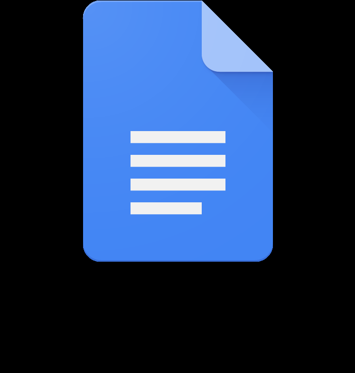
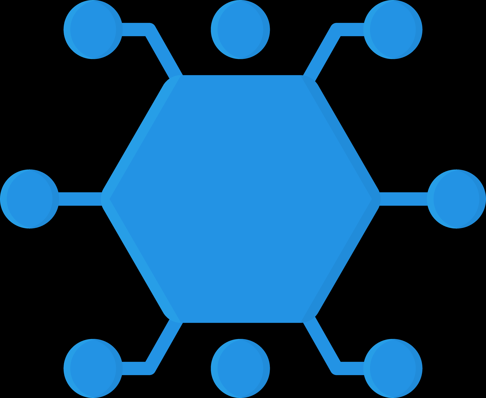
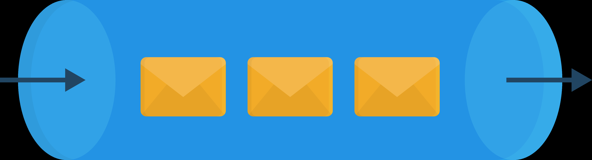
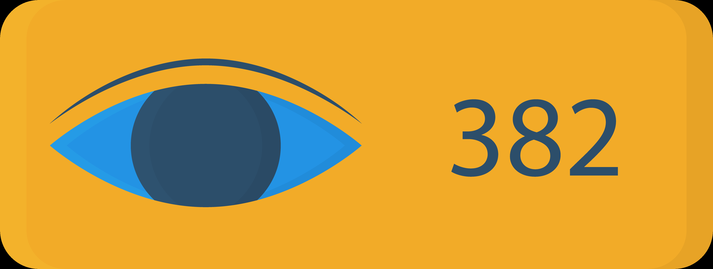
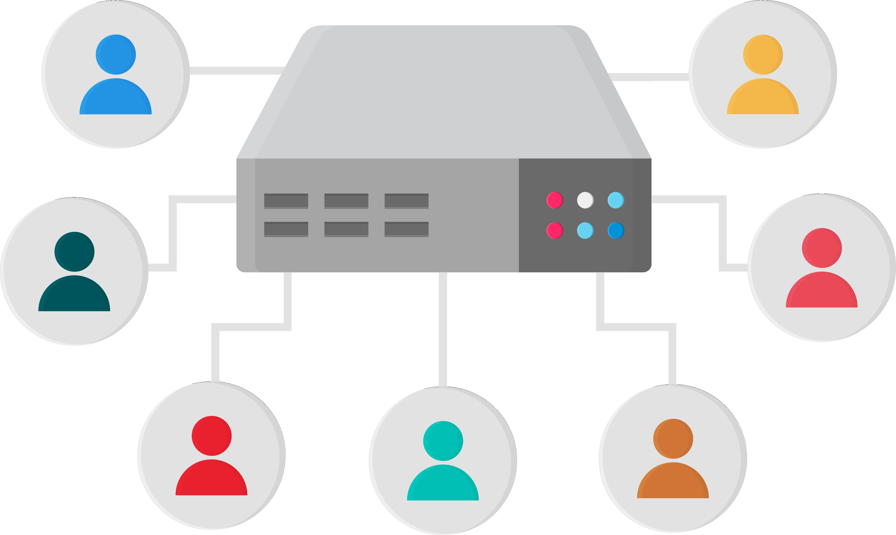

# 038 - Thiết Kế Trình Soạn Thảo Văn Bản Cộng Tác (Google Docs)

[← Bài trước](037-thiet-ke-typeahead-suggestion.md) | [Mục lục](README.md) | [Bài tiếp theo →](039-that-bai-kinh-dien.md)

---


# Thiết Kế Hệ Thống: Google Docs (System Design: Google Docs)

Tìm hiểu thế nào là chỉnh sửa tài liệu cộng tác (**collaborative document editing**) và lộ trình chi tiết để thiết kế một dịch vụ như vậy.

---

### Nội dung bao gồm:
* **Đặt vấn đề (Problem statement)**
* **Google Docs**
* **Thiết kế Google Docs (Designing Google Docs)**
* **Chúng ta sẽ thiết kế Google Docs như thế nào? (How will we design Google Docs?)**

---

## Đặt Vấn Đề (Problem statement)

Hãy tưởng tượng hai bạn sinh viên đang chuẩn bị một bản báo cáo cho một dự án họ vừa hoàn thành. Vì hai sinh viên sống cách xa nhau, sinh viên thứ nhất yêu cầu sinh viên thứ hai bắt đầu viết bản thảo báo cáo, và sau đó sinh viên thứ nhất sẽ chỉnh sửa, cải thiện bản sao nhận được. Mặc dù rất có động lực, các sinh viên nhanh chóng nhận ra rằng cách thức cộng tác này vô cùng lộn xộn và thiếu tổ chức. 

Hình minh họa dưới đây cho thấy quy trình này có thể trở nên tẻ nhạt và phiền toái đến mức nào:


### Những vấn đề phát sinh khi không có dịch vụ chỉnh sửa tài liệu cộng tác:


* **Bản thảo báo cáo 1 (Report draft-1)**
* **Bản thảo báo cáo 1 (Report draft-1)**
* **Báo cáo cập nhật bản thảo 1 (Report updated draft-1)**
* **Báo cáo cập nhật bản thảo 1 (Report updated draft-1)**
* **Báo cáo cập nhật bản thảo 1 (Report updated draft-1)**
* **Báo cáo cập nhật bản thảo 2 (Report updated draft-2)**
* **Báo cáo cập nhật bản thảo 2 (Report updated draft-2)**
* **Báo cáo cập nhật bản thảo 2 (Report updated draft-2)**
* **Báo cáo cập nhật bản thảo 2 (Report updated draft-2)**
* **Báo cáo cập nhật bản thảo 2 (Report updated draft-2)**
* **Báo cáo cập nhật bản thảo 2 (Report updated draft-2)**
* **Thời gian (Time)**
* **Thời gian (Time)**
* **Người dùng 1 (User 1)**
* **Người dùng 2 (User 2)**

Kịch bản trên là một ví dụ điển hình dẫn đến sự lãng phí thời gian và gây ức chế, nản lòng khi người dùng phải cộng tác trên một tài liệu bằng cách gửi qua gửi lại các tệp tin với nhau.

---

## Google Docs

Để giải quyết triệt để vấn đề trên, chúng ta có thể sử dụng một dịch vụ chỉnh sửa tài liệu cộng tác trực tuyến (**online collaborative document editing service**) như Google Docs. 

Một số ưu điểm vượt trội của việc sử dụng dịch vụ chỉnh sửa tài liệu trực tuyến thay vì ứng dụng trên máy tính để bàn (**desktop application**) bao gồm:
* Người dùng có thể **đánh giá (review)** và **bình luận (comment)** trên một tài liệu ngay trong lúc tài liệu đó đang được chỉnh sửa.
* **Không yêu cầu cấu hình phần cứng đặc biệt** để trải nghiệm các tính năng mới nhất. Chỉ cần một thiết bị có khả năng chạy trình duyệt web là đủ.
* Cho phép làm việc linh hoạt từ **bất kỳ vị trí nào**.
* Không giống như các trình soạn thảo cục bộ trên máy tính để bàn, người dùng có thể **xem lại toàn bộ lịch sử tài liệu trong thời gian dài** và khôi phục về phiên bản cũ hơn nếu cần thiết.
* Dịch vụ này **hoàn toàn miễn phí**.

Ngoài Google Docs, một số dịch vụ chỉnh sửa trực tuyến phổ biến khác bao gồm **Etherpad, Microsoft Office 365, Slite**, và nhiều nền tảng khác.

---

## Thiết Kế Google Docs (Designing Google Docs)

Một dịch vụ chỉnh sửa tài liệu cộng tác có thể được thiết kế theo hai hướng tiếp cận:
1. **Kiến trúc Client-Server tập trung (Centralized Client-Server Architecture):** Thiết kế như một hệ thống tập trung sử dụng kiến trúc máy khách - máy chủ để cung cấp dịch vụ chỉnh sửa tài liệu cho tất cả người dùng.
2. **Kiến trúc Mạng ngang hàng (Peer-to-Peer - P2P Architecture):** Thiết kế bằng công nghệ mạng ngang hàng để cộng tác trên cùng một tài liệu đơn lẻ.



Hầu hết các giải pháp thương mại đều tập trung vào kiến trúc **Client-Server** để có được khả năng kiểm soát chặt chẽ, chi tiết hơn (**finer control**). Do đó, chúng ta sẽ tập trung vào việc thiết kế một dịch vụ sử dụng kiến trúc máy khách - máy chủ (**client-server architecture**). 

Hãy cùng xem lộ trình chúng ta sẽ triển khai trong chương này.

> [!NOTE]
> Theo một khảo sát, có tới **64%** người dùng sử dụng Google Docs để chỉnh sửa tài liệu ít nhất một lần mỗi tuần.

---

## Chúng Ta Sẽ Thiết Kế Google Docs Như Thế Nào? (How will we design Google Docs?)

Chúng tôi chia bài toán thiết kế này thành **bốn giai đoạn**:

1. **Yêu cầu đối với thiết kế của Google Docs (Requirements for Google Docs’ Design):** Bài học này sẽ tập trung vào việc thiết lập các yêu cầu đối với việc thiết kế một dịch vụ chỉnh sửa tài liệu cộng tác. Chúng ta cũng sẽ định lượng các yêu cầu về mặt hạ tầng (**infrastructure requirements**) trong giai đoạn này.
2. **Thiết kế của Google Docs (Google Docs’ Design):** Mục tiêu của bài học này là đưa ra một thiết kế đáp ứng đầy đủ các yêu cầu của dịch vụ. Bài học sẽ giải thích tại sao một thành phần (**component**) lại được sử dụng và cách nó tích hợp với các thành phần khác nhằm thỏa mãn các yêu cầu chức năng (**functional requirements**).
3. **Xử lý đồng thời trong chỉnh sửa cộng tác (Concurrency in Collaborative Editing):** Các dịch vụ chỉnh sửa tài liệu trực tuyến phải giải quyết xung đột (**conflict resolution**) giữa những người dùng cùng chỉnh sửa vào một phần của tài liệu. Bài học này sẽ đề cập đến các dạng vấn đề có thể phát sinh và các kỹ thuật được sử dụng để giải quyết các xung đột đó.
4. **Đánh giá thiết kế của Google Docs (Evaluating Google Docs’ Design):** Mục tiêu chính của bài học này là đánh giá thiết kế của chúng ta dựa trên các yêu cầu phi chức năng (**non-functional requirements**). Cụ thể, chúng ta sẽ xem xét liệu thiết kế có đạt hiệu năng cao (**performant**), tính nhất quán (**consistent**), tính sẵn sàng cao (**available**) và khả năng mở rộng (**scalable**) hay không.

Hãy bắt đầu bằng việc xem xét các yêu cầu của hệ thống.

---

# Yêu Cầu Thiết Kế Của Google Docs (Requirements of Google Docs’ Design)

Tìm hiểu về các yêu cầu để thiết kế một dịch vụ chỉnh sửa cộng tác.

### Nội dung bao gồm:
* **Các yêu cầu (Requirements)**
  * **Yêu cầu chức năng (Functional requirements)**
  * **Yêu cầu phi chức năng (Non-functional Requirements)**
* **Ước tính tài nguyên (Resource estimation)**
  * **Ước tính lưu trữ (Storage estimation)**
  * **Ước tính băng thông (Bandwidth estimation)**
  * **Ước tính số lượng máy chủ (Number of servers estimation)**
* **Các khối thành phần xây dựng hệ thống sẽ sử dụng (Building blocks we will use)**

---

## Các Yêu Cầu (Requirements)

Hãy cùng xem xét các yêu cầu chức năng và yêu cầu phi chức năng để thiết kế dịch vụ chỉnh sửa cộng tác.

### 1. Yêu Cầu Chức Năng (Functional Requirements)

Các hoạt động mà người dùng có thể thực hiện khi sử dụng dịch vụ chỉnh sửa tài liệu cộng tác của chúng ta được liệt kê dưới đây:

* **Cộng tác trên tài liệu (Document collaboration):** Nhiều người dùng có thể chỉnh sửa cùng một tài liệu đồng thời (**simultaneously**). Đồng thời, một số lượng lớn người dùng có thể xem (**view**) tài liệu cùng lúc.
* **Giải quyết xung đột (Conflict resolution):** Hệ thống phải đẩy các thao tác chỉnh sửa do một người dùng thực hiện tới tất cả các cộng tác viên khác. Hệ thống cũng phải giải quyết các xung đột giữa những người dùng nếu họ cùng chỉnh sửa vào cùng một phần của tài liệu.
* **Gợi ý (Suggestions):** Người dùng sẽ nhận được các gợi ý để tự động hoàn thành các từ, cụm từ và từ khóa thường dùng trong tài liệu, cũng như các gợi ý sửa lỗi ngữ pháp.
* **Số lượt xem (View count):** Những người chỉnh sửa tài liệu có thể nhìn thấy số lượt xem của tài liệu đó.
* **Lịch sử chỉnh sửa (History):** Người dùng có thể xem lại lịch sử cộng tác trên tài liệu.

> [!NOTE]
> Một trình soạn thảo tài liệu trong thực tế còn cần có các chức năng khác như tạo tài liệu, xóa tài liệu và quản lý quyền truy cập của người dùng (**user access management**). Chúng ta sẽ tập trung vào các chức năng cốt lõi được liệt kê ở trên, nhưng cũng sẽ thảo luận về khả năng mở rộng các chức năng khác trong các bài học tiếp theo.

---

### Sơ Đồ Yêu Cầu Chức Năng & Phi Chức Năng Của Dịch Vụ Chỉnh Sửa Cộng Tác:


* **Người dùng (User)**
* **Cộng tác - luồng các thao tác (Collaboration - stream of operations)**
* **Giải quyết xung đột (Conflict resolution)**
* **Gợi ý (Suggestions)**
* **Số lượt xem (View count)**
* **Lịch sử (History)**
* **Dịch vụ cộng tác (Collaboration service)**
* **Tính nhất quán (Consistency)**
* **Khả năng mở rộng (Scalability)**
* **Tính sẵn sàng (Availability)**
* **Độ trễ (Latency)**

---

### 2. Yêu Cầu Phi Chức Năng (Non-functional Requirements)

* **Độ trễ (Latency):** Nhiều người dùng khác nhau có thể cùng kết nối để cộng tác trên cùng một tài liệu. Việc duy trì độ trễ thấp (**low latency**) là một thách thức rất lớn đối với những người dùng kết nối từ các khu vực địa lý khác nhau (**different regions**).
* **Tính nhất quán (Consistency):** Hệ thống phải có khả năng giải quyết các xung đột giữa những người dùng đang chỉnh sửa tài liệu đồng thời, từ đó mang lại một góc nhìn tài liệu đồng nhất (**consistent view**). Đồng thời, người dùng ở các khu vực địa lý khác nhau phải nhìn thấy trạng thái tài liệu đã được cập nhật. Việc duy trì tính nhất quán là tối quan trọng đối với cả những người dùng kết nối trong cùng một vùng cũng như khác vùng (**same and different zones**).
* **Tính sẵn sàng (Availability):** Dịch vụ phải luôn luôn sẵn sàng hoạt động ở mọi thời điểm (**available at all times**) và thể hiện khả năng chịu lỗi, bền bỉ trước các sự cố (**robustness against failures / Fault Tolerance**).
* **Khả năng mở rộng (Scalability):** Một số lượng lớn người dùng có thể sử dụng dịch vụ cùng một lúc. Họ có thể cùng xem một tài liệu hoặc tạo ra các tài liệu mới mà không làm suy giảm hiệu năng hệ thống.

---

# Ước tính Tài nguyên (Resource Estimation)

Hãy cùng thực hiện một số tính toán ước tính tài nguyên dựa trên các giả định sau:

- Chúng ta giả định rằng có **80 triệu người dùng hoạt động hàng ngày (Daily Active Users - DAU)**.
- Số lượng người dùng tối đa có thể chỉnh sửa đồng thời trên một tài liệu là **20**.
- Kích thước của một tài liệu dạng văn bản thuần (textual document) là **100 KB**.
- **30%** tổng số tài liệu có chứa hình ảnh, trong khi chỉ có **2%** tài liệu có chứa video.
- Dung lượng lưu trữ tổng hợp theo yêu cầu của hình ảnh trong một tài liệu là **800 KB**, trong khi mỗi video có dung lượng là **3 MB**.
- Một người dùng tạo ra **1 tài liệu trong một ngày**.

Dựa trên các giả định này, chúng ta sẽ thực hiện các ước tính dưới đây.

---

## Ước tính Lưu trữ (Storage Estimation)

Xem xét việc mỗi người dùng có thể tạo 1 tài liệu mỗi ngày, sẽ có tổng cộng **80 triệu tài liệu** được tạo ra mỗi ngày. Dưới đây, chúng ta ước tính dung lượng lưu trữ cần thiết cho một ngày:

> [!NOTE]
> Chúng ta có thể điều chỉnh các giá trị trong bảng dưới đây để xem ước tính yêu cầu lưu trữ thay đổi như thế nào.

### Ước tính Yêu cầu Dung lượng Lưu trữ (Estimation for Storage Requirements)

| Tiêu chí | Giá trị | Đơn vị |
| :--- | :--- | :--- |
| Số lượng tài liệu được tạo bởi mỗi người dùng (*Number of documents created by each user*) | **1** | mỗi ngày (*per day*) |
| Số lượng người dùng hoạt động (*Number of active users*) | **80** | Triệu (*Million*) |
| Số lượng tài liệu trong một ngày (*Number of documents in a day*) | **80** ❗ | Triệu (*Million*) |
| Dung lượng lưu trữ yêu cầu cho nội dung văn bản mỗi ngày (*Storage required for textual content per day*) | **8** ❗ | TB |
| Dung lượng lưu trữ yêu cầu cho hình ảnh mỗi ngày (*Storage required for images per day*) | **19.2** ❗ | TB |
| Dung lượng lưu trữ yêu cầu cho nội dung video mỗi ngày (*Storage required for video content per day*) | **4.8** ❗ | TB |
| **Tổng dung lượng lưu trữ yêu cầu mỗi ngày (*Total storage required per day*)** | **32** ❗ | **TB** |

---

### Chi tiết các phép tính (Hide Calculations)

- **Tổng số lượng tài liệu trong một ngày (*Total number of documents in a day*):**
  $$\text{80M} \times 1\text{ document} = \text{80M documents in a day}$$

- **Dung lượng lưu trữ cho các tài liệu văn bản (*Storage for each textual document*):**
  $$\text{80M} \times 100\text{ KB} = 8\text{ TB}$$

- **Dung lượng lưu trữ yêu cầu cho hình ảnh trong một ngày (*Storage required for images for one day*):**
  *(30% tài liệu có chứa hình ảnh)*
  $$\frac{\text{80M} \times 30}{100} \times 800\text{ KB} = 19.2\text{ TB}$$

- **Dung lượng lưu trữ yêu cầu cho nội dung video trong một ngày (*Storage required for video content for one day*):**
  *(2% tài liệu có chứa video)*
  $$\frac{\text{80M} \times 2}{100} \times 3\text{ MB} = 4.8\text{ TB}$$


**Tổng dung lượng lưu trữ cần thiết cho một ngày như sau:**

$$\text{Tổng dung lượng lưu trữ/ngày} = 8\text{ TB (Văn bản)} + 19.2\text{ TB (Hình ảnh)} + 4.8\text{ TB (Video)} = 32\text{ TB/ngày}$$

> [!NOTE]
> Mặc dù các yêu cầu chức năng (functional requirements) của chúng ta đã nêu rằng hệ thống phải lưu giữ lịch sử tài liệu, nhưng để ngắn gọn và súc tích, chúng tôi chưa tính toán yêu cầu lưu trữ cho dữ liệu lịch sử (historical data) ở phần này.

---

## Ước tính Băng thông (Bandwidth Estimation)

### Lưu lượng mạng vào (Incoming Traffic / Ingress)
Giả định rằng có **32 TB** dữ liệu được tải lên mạng lưới của dịch vụ chỉnh sửa cộng tác mỗi ngày, yêu cầu băng thông mạng cho lưu lượng vào sẽ xấp xỉ như sau:

$$\frac{32\text{ TB}}{86,400\text{ giây}} \times 8 = 3\text{ Gbps} \quad (\text{xấp xỉ})$$

### Lưu lượng mạng ra (Outgoing Traffic / Egress)
Để ước tính băng thông lưu lượng ra, chúng ta sẽ giả định số lượng tài liệu được xem bởi một người dùng mỗi ngày. Hãy xem xét trường hợp một người dùng thông thường xem **5 tài liệu mỗi ngày**. Khi đó, các phép tính sau đây sẽ được áp dụng:

> [!NOTE]
> Chúng ta có thể điều chỉnh các giá trị trong bảng dưới đây để xem các phép tính thay đổi như thế nào.

| Tiêu chí | Giá trị | Đơn vị |
| :--- | :--- | :--- |
| Số lượng tài liệu được xem bởi người dùng (*Number of documents viewed by users*) | **5** | mỗi ngày (*per day*) |
| Số lượng người dùng hoạt động (*Number of active users*) | **80** | Triệu (*Million*) |
| Số lượng tài liệu được xem trong một ngày (*Number of documents viewed in a day*) | **400** ❗ | Triệu (*Million*) |
| Số lượng tài liệu được xem trong một giây (*Number of documents viewed in a second*) | **4,630** ❗ | mỗi giây (*per second*) |
| Băng thông yêu cầu cho nội dung văn bản mỗi giây (*Bandwidth required for textual content per second*) | **3.704** ❗ | Gigabits trên giây (Gbps) |
| Băng thông cho nội dung hình ảnh mỗi giây (*Bandwidth for image-based content per second*) | **8.89** ❗ | Gbps |
| Băng thông cho nội dung video mỗi giây (*Bandwidth for video content per second*) | **2.22** ❗ | Gbps |
| **Tổng băng thông chiều ra yêu cầu (*Total outgoing bandwidth required*)** | **14.81** ❗ | **Gbps** |

---

### Chi tiết các phép tính (Hide Calculations)

- **Tổng số tài liệu được xem mỗi ngày bởi tất cả người dùng (*Total documents viewed per day by all users*):**
  $$\text{80M} \times 5 = 400\text{M documents viewed per day}$$

- **Số tài liệu được xem mỗi giây (*Documents viewed per second*):**
  $$\frac{400\text{M}}{86,400} = 4.6 \times 10^3\text{ documents viewed per second}$$

- **Tính toán băng thông cần thiết cho nội dung văn bản (*Calculating the bandwidth required for textual content*):**
  $$4.6 \times 10^3 \times 100\text{ KB} \times 8 = 3.7\text{ Gbps}$$

- **Tính toán băng thông cần thiết cho nội dung dạng hình ảnh (*Calculating the bandwidth required for image-based content*):**
  $$\frac{4.6 \times 10^3 \times 30}{100} \times 800\text{ KB} \times 8 = 8.8\text{ Gbps}$$

- **Tính toán băng thông cần thiết cho nội dung video (*Calculating the bandwidth required for video content*):**
  $$\frac{4.6 \times 10^3 \times 2}{100} \times 3\text{ MB} \times 8 = 2.2\text{ Gbps}$$

- **Tổng băng thông chiều ra (*Total outgoing bandwidth*):**
  $$3.7 + 8.8 + 2.2 = 14.7\text{ Gbps}$$


> [!NOTE]
> Tổng băng thông yêu cầu bằng tổng của lưu lượng vào và lưu lượng ra:
> $$\text{Tổng băng thông} = 3\text{ Gbps (Vào)} + 14.7\text{ Gbps (Ra)} \approx 18\text{ Gbps} \quad (\text{xấp xỉ})$$

---

## Ước tính Số lượng Máy chủ (Number of Servers Estimation)

Hãy giả định rằng một người dùng có thể tạo ra **100 requests mỗi ngày**. Căn cứ vào số lượng người dùng hoạt động hàng ngày (DAU), số lượng yêu cầu trên mỗi giây (**Requests Per Second - RPS**) sẽ là:

$$\text{RPS} = \frac{100 \times \text{80M}}{86,400} = \frac{\text{8000M}}{86,400} = 92.6\text{ nghìn yêu cầu/giây (92.6 thousand/sec)}$$


### Số lượng RPS (Number of RPS)

| Tiêu chí | Giá trị | Đơn vị |
| :--- | :--- | :--- |
| Số lượng yêu cầu từ một người dùng (*Requests by a user*) | **100** | mỗi ngày (*per day*) |
| Số lượng người dùng hoạt động hàng ngày (*Number of DAU*) | **80** | Triệu (*Million*) |
| **Số lượng yêu cầu mỗi giây (*RPS*)** | **92.6** ❗ | **Nghìn trên giây (*Thousands per second*)** |

Chúng ta đã thảo luận trong bài học "Ước tính Nhanh" (*Back of the Envelope*) rằng chỉ số RPS là chưa đủ thông tin để tính toán chính xác số lượng máy chủ. Chúng ta sẽ sử dụng phương pháp xấp xỉ sau đây cho số lượng máy chủ:

Để ước tính số lượng máy chủ cần thiết nhằm đáp ứng các yêu cầu của 80 triệu người dùng, chúng ta chỉ cần lấy số lượng người dùng chia cho số lượng yêu cầu mà một máy chủ có thể xử lý. Trong bài học "Ước tính Nhanh" (*Back of the Envelope*), chúng ta đã thống nhất rằng máy chủ tham chiếu (reference server) của chúng ta có thể xử lý **8,000 requests per second**. Vì vậy, chúng ta có công thức sau:

> [!NOTE]
> Theo cách diễn đạt phi hình thức, phương trình dưới đây giả định rằng một máy chủ có thể phục vụ được 8,000 người dùng.

$$\text{Số lượng máy chủ yêu cầu} = \frac{\text{Số lượng người dùng hoạt động hàng ngày (DAU)}}{\text{Số truy vấn xử lý mỗi giây trên một máy chủ (Queries handled per second)}} = \frac{\text{80M}}{8,000} = 10,000$$


---

## Các Khối Thành phần Kiến trúc Chúng ta sẽ Sử dụng (Building Blocks We Will Use)

Chúng ta sẽ sử dụng các khối thành phần kiến trúc (Building Blocks) sau đây trong việc thiết kế dịch vụ chỉnh sửa tài liệu cộng tác trực tuyến.

---

# Thiết Kế Hệ Thống: Google Docs (System Design: Google Docs)

---

## 1. Thiết Kế Google Docs (Design of Google Docs)

### Các Khối Xây Dựng Cần Tích Hợp Vào Thiết Kế (Building blocks required to be integrated in the design)

* **Cơ sở dữ liệu (Database)**
* **Mạng phân phối nội dung (CDN - Content Delivery Network)**
* **Bộ lưu trữ Blob (Blob storage)**
* **Bộ cân bằng tải (Load balancer)**
* **Hệ thống Pub-sub (Pub-sub system)**
* **Bộ nhớ đệm (Cache)**
* **Hàng đợi thông điệp (Messaging queue)**

---


* **Bộ cân bằng tải (Load balancers)**: Sẽ là điểm tiếp xúc đầu tiên (first point of contact) cho người dùng.

---


* **Cơ sở dữ liệu (Databases)**: Sẽ cần thiết để lưu trữ nhiều thành phần khác nhau, bao gồm nội dung văn bản (textual content), lịch sử tài liệu (history of documents), dữ liệu người dùng (user data), v.v. Cho mục đích này, chúng ta có thể cần các loại cơ sở dữ liệu khác nhau.

---


* **Hệ thống Xuất bản - Đăng ký (Pub-sub systems)**: Có thể hoàn thành các tác vụ không thể thực hiện ngay lập tức. Chúng ta sẽ hoàn thành một số lượng lớn tác vụ theo phương thức bất đồng bộ (asynchronously) trong thiết kế của mình. Do đó, chúng ta sẽ sử dụng một hệ thống pub-sub.

---


* **Bộ nhớ đệm (Caching)**: Sẽ giúp chúng ta cải thiện hiệu năng (performance) của thiết kế.

---



* **Bộ lưu trữ Blob (Blob storage)**: Sẽ lưu trữ các tệp tin có kích thước lớn, chẳng hạn như hình ảnh và video.

---



* **Hệ thống hàng đợi (Queueing system)**: Sẽ xếp hàng các thao tác chỉnh sửa (editing operations) được yêu cầu bởi những người dùng khác nhau. Bởi vì nhiều yêu cầu chỉnh sửa không thể thực hiện đồng thời, chúng ta phải tạm thời đưa chúng vào một hàng đợi.

---


* **Mạng phân phối nội dung (CDN)**: Có thể lưu trữ các tệp phương tiện (media) được truy cập thường xuyên trong một tài liệu. Chúng ta cũng có thể đưa các tài liệu chỉ đọc (read-only documents) được yêu cầu thường xuyên vào một CDN.

---

## 2. Kiến Trúc Chi Tiết của Google Docs (Design of Google Docs)

Hãy cùng tìm hiểu cách chúng ta có thể thiết kế dịch vụ chỉnh sửa tài liệu cộng tác (collaborative document editing service) bằng cách sử dụng các thành phần khác nhau.

**Chúng ta sẽ bao quát các nội dung sau:**
* **Thiết kế (Design)**
* **Các thành phần (Components)**
* **Luồng công việc (Workflow)**

---

### Thiết Kế (Design)

Chúng ta sẽ hoàn thành thiết kế của mình qua hai bước:
1. **Bước 1**: Giải thích các thành phần (components) và khối xây dựng (building blocks) khác nhau cùng với lý do lựa chọn chúng trong thiết kế của chúng ta.
2. **Bước 2**: Mô tả cách chúng ta đáp ứng các yêu cầu chức năng (functional requirements) khác nhau bằng cách minh họa một luồng công việc (workflow).

---

### Các Thành Phần (Components)

Chúng ta đã sử dụng tập hợp các thành phần sau để hoàn thiện thiết kế của mình:

* **Cổng API (API Gateway)**: Các yêu cầu khác nhau từ máy khách (client requests) sẽ được can thiệp/chặn bắt (intercepted) thông qua API Gateway. Tùy thuộc vào loại yêu cầu, API Gateway có thể chuyển tiếp một yêu cầu đơn lẻ tới nhiều thành phần, từ chối một yêu cầu, hoặc phản hồi ngay lập tức bằng phản hồi đã được lưu trong bộ nhớ đệm (cached response). Các yêu cầu chỉnh sửa (edit requests), bình luận trên tài liệu, thông báo (notifications), xác thực (authentication), và các yêu cầu lưu trữ dữ liệu đều sẽ đi qua API Gateway.
* **Máy chủ ứng dụng (Application Servers)**: Các máy chủ ứng dụng sẽ thực thi logic nghiệp vụ (business logic) và các tác vụ thường đòi hỏi năng lực tính toán (computational power). Ví dụ, một số tài liệu có thể được chuyển đổi từ loại tệp này sang loại tệp khác (chẳng hạn từ PDF sang tài liệu Word) hoặc hỗ trợ các tính năng như nhập (import) và xuất (export). Nó cũng đóng vai trò trung tâm trong việc thu thập thuộc tính (attribute collection) cho công cụ gợi ý (recommendation engine).
* **Các kho dữ liệu (Data Stores)**: Nhiều kho dữ liệu khác nhau sẽ được sử dụng để đáp ứng các yêu cầu của chúng ta:
  * **Cơ sở dữ liệu quan hệ (RDBMS - Relational Database)**: Dùng để lưu thông tin người dùng và thông tin liên quan đến tài liệu nhằm áp đặt các ràng buộc về quyền hạn (privilege restrictions).
  * **NoSQL Database**: Dùng để lưu trữ bình luận của người dùng (user comments) nhằm truy cập nhanh hơn.
  * **Cơ sở dữ liệu chuỗi thời gian (Time Series Database)**: Dùng để lưu lịch sử chỉnh sửa (edit history) của tài liệu.
  * **Bộ lưu trữ Blob (Blob Storage)**: Dùng để lưu trữ video và hình ảnh bên trong một tài liệu.
  * **Bộ nhớ đệm phân tán (Distributed Cache - Redis) & CDN**: Dùng để mang lại hiệu năng cao cho người dùng cuối. Chúng ta sử dụng Redis chuyên biệt để lưu trữ các cấu trúc dữ liệu khác nhau, bao gồm phiên người dùng (user sessions), các đặc trưng cho dịch vụ gõ phím gợi ý trước (typeahead service), và các tài liệu được truy cập thường xuyên. CDN lưu trữ các tài liệu được truy cập thường xuyên và các đối tượng nặng (heavy objects) như hình ảnh và video.
* **Hàng đợi xử lý (Processing Queue)**: Vì việc chỉnh sửa tài liệu đòi hỏi phải gửi dữ liệu kích thước nhỏ (thường là các ký tự) liên tục về máy chủ, việc xếp hàng dữ liệu này để xử lý hàng loạt theo định kỳ (periodic batch processing) là một giải pháp tối ưu. Chúng ta sẽ thêm các ký tự, hình ảnh, video và bình luận vào hàng đợi xử lý. Việc sử dụng lệnh gọi HTTP cho mỗi ký tự nhỏ là không hiệu quả. Do đó, chúng ta sẽ sử dụng **WebSockets** để giảm thiểu chi phí tải phụ (overhead) và quan sát các thay đổi trực tiếp (live changes) đối với tài liệu từ các người dùng khác nhau.
* **Các thành phần khác (Other Components)**: Các thành phần khác bao gồm:
  * **Máy chủ phiên (Session servers)**: Duy trì thông tin phiên (session information) của người dùng. Chúng ta sẽ quản lý các đặc quyền truy cập tài liệu thông qua các máy chủ phiên.
  * Về cơ bản, cũng sẽ có các dịch vụ **cấu hình (configuration)**, **giám sát (monitoring)**, **xuất bản - đăng ký (pub-sub)**, và **ghi nhật ký (logging)** đảm nhiệm các tác vụ như giám sát và bầu chọn nút điều phối/trưởng nhóm (electing leaders) trong trường hợp máy chủ gặp sự cố (server failures), xếp hàng các tác vụ như thông báo người dùng, và ghi nhật ký thông tin gỡ lỗi (debugging information).

---

### Sơ Đồ Thiết Kế Chi Tiết (A detailed design of the collaborative document editing service)

Hình minh họa dưới đây cung cấp mô tả về cách các thành phần và khối xây dựng khác nhau phối hợp để cung cấp dịch vụ:


```
[Client 1, Client 2, Client 3] 
       │
       ▼
 [Load Balancer] ──► [API Gateway]
                           │
       ┌───────────────────┼──────────────────────────────┐
       ▼                   ▼                              ▼
[Application Server] [Pub-sub System]           [Session Server] ◄──► [RDBMS]
 (Typeahead,          (Email, Notification,            │
  Translate,           View Counter)                   ├──► [NoSQL]
  Import/Export)                                       ├──► [Redis]
                                                       ├──► [Time Series DB]
                                                       ├──► [Blob Store] ◄──► [CDN]
                                                       └──► [Operations Queue]
```

---

#### Chi Tiết Từng Khối Trong Sơ Đồ Kiến Trúc:

* **Phía máy khách và Điều hướng tải:**
  * Khách hàng kết nối: `Client 1`, `Client 2`, `Client 3`
  *  **Load balancer**: Cân bằng tải lưu lượng mạng.
  *  **API Gateway**: Cổng giao tiếp điều phối luồng request.

* **Các phân hệ xử lý nghiệp vụ:**
  *  **Application server**: Máy chủ xử lý logic tính toán nặng (Typing, Typeahead, Translate).
  *  **Pub-sub system**: Hệ thống xử lý thông điệp bất đồng bộ (Email, Notification, View counter).
  *  **Operations queue**: Hàng đợi các thao tác chỉnh sửa văn bản.
  *  **Session server**: Máy chủ quản lý phiên làm việc và điều phối dữ liệu chỉnh sửa.
  *  **Typeahead service**: Dịch vụ gợi ý từ tự động.

---

### Câu Hỏi Ôn Tập 1 (Quiz - Question 1)

> **Câu hỏi 1:** Tại sao chúng ta nên sử dụng WebSockets thay vì các phương thức HTTP? Tại sao WebSockets lại tối ưu cho loại hình giao tiếp này?

> [!NOTE]
> **Câu trả lời:**
> WebSockets cung cấp cho chúng ta các đặc tính sau:
> 1. **Kết nối lâu dài (Long-lasting connection)**: Duy trì kết nối bền vững giữa máy khách (client) và máy chủ (server).
> 2. **Giao tiếp song công toàn phần (Full-duplex communication)**: Cho phép truyền dữ liệu đồng thời hai chiều: từ client lên server và ngược lại.
> 3. **Không chịu chi phí tiêu đề (Zero HTTP header overhead)**: Loại bỏ hoàn toàn overhead lặp đi lặp lại của các tiêu đề HTTP request/response.
> 4. **Trọng lượng nhẹ và độ trễ thấp (Lightweight & Low Latency)**: Bản chất gọn nhẹ của WebSockets giúp giảm thiểu tối đa độ trễ (latency), cho phép máy chủ chủ động đẩy các thay đổi (push changes) tới các client ngay khi có sẵn.
>
> *(1 trên 3)*

---

## 3. Luồng Công Việc (Workflow)

Trong các bước dưới đây, chúng ta sẽ giải thích cách các yêu cầu khác nhau được xử lý sau khi đến Cổng API (API Gateway):

### Chỉnh Sửa Cộng Tác và Giải Quyết Xung Đột (Collaborative editing and conflict resolution)
Mỗi yêu cầu chỉnh sửa được chuyển tiếp đến **hàng đợi thao tác (operations queue)**. Đây là nơi các xung đột chỉnh sửa (conflicts) được giải quyết giữa các cộng tác viên khác nhau trên cùng một tài liệu. 
* Nếu không có xung đột, dữ liệu được gom thành từng lô (batched) và lưu trữ vào **cơ sở dữ liệu chuỗi thời gian (time series database)** thông qua các máy chủ phiên (session servers).
* Các dữ liệu media như video và hình ảnh sẽ được nén (compressed) để tối ưu hóa không gian lưu trữ, trong khi các ký tự văn bản được xử lý ngay lập tức.

### Lịch Sử Phiên Bản (History)
Chúng ta hoàn toàn có thể khôi phục các phiên bản khác nhau của tài liệu nhờ sự hỗ trợ của **cơ sở dữ liệu chuỗi thời gian (time series database)**. Các phiên bản khác nhau có thể được so sánh bằng các thao tác tính độ lệch (**DIFF operations**) nhằm đối chiếu giữa các phiên bản và xác định các điểm khác biệt, từ đó khôi phục lại các phiên bản cũ hơn của cùng một tài liệu.

### Các Tác Vụ Bất Đồng Bộ (Asynchronous operations)
Các thông báo (notifications), email, bộ đếm lượt xem (view counts), và bình luận (comments) là các tác vụ bất đồng bộ có thể được xếp vào hàng đợi thông qua một thành phần pub-sub như **Kafka**. 
* API Gateway sẽ sinh ra các yêu cầu này và chuyển tiếp chúng đến module pub-sub.
* Khi người dùng chia sẻ tài liệu, các thông báo cũng sẽ được tạo ra thông qua quy trình xử lý này.

### Gợi Ý Tự Động (Suggestions)
Các gợi ý được cung cấp dưới dạng **dịch vụ gõ phím gợi ý trước (typeahead service)**, mang lại các đề xuất tự động hoàn thành từ (autocomplete suggestions) cho các từ và cụm từ thường dùng. 
* Dịch vụ typeahead cũng có thể trích xuất các thuộc tính và từ khóa từ ngay bên trong tài liệu để đưa ra các gợi ý phù hợp cho người dùng.
* Vì số lượng từ vựng có thể rất lớn, chúng ta sẽ sử dụng một cơ sở dữ liệu **NoSQL** cho mục đích này.
* Ngoài ra, các từ và cụm từ được sử dụng thường xuyên nhất sẽ được lưu trữ trong một hệ thống bộ nhớ đệm (caching system) như **Redis**.

### Nhập và Xuất Tài Liệu (Import and export documents)
Các máy chủ ứng dụng (application servers) thực hiện nhiều tác vụ quan trọng, bao gồm việc nhập (importing) và xuất (exporting) tài liệu:
* Máy chủ ứng dụng chuyển đổi tài liệu từ định dạng này sang định dạng khác (ví dụ: chuyển đổi từ tệp `.doc` hoặc `.docx` sang `.pdf` hoặc ngược lại).
* Máy chủ ứng dụng cũng chịu trách nhiệm trích xuất đặc trưng (feature extraction) phục vụ cho dịch vụ typeahead.

> [!TIP]
> **Lưu ý kỹ thuật:** Việc sử dụng WebSockets giúp tăng tốc hiệu năng tổng thể và cho phép chúng ta hỗ trợ tính năng trò chuyện (chatting) trực tiếp giữa những người dùng đang cùng cộng tác trên một tài liệu. Nếu chúng ta kết hợp **WebSockets** với một bộ nhớ đệm như **Redis**, chúng ta hoàn toàn có thể phát triển một tính năng chat thời gian thực (real-time chat) vô cùng hiệu quả.

---

### Câu Hỏi Ôn Tập 2 (Quiz - Question 1)

> **Câu hỏi 1:** Chúng ta đang triển khai bộ đếm lượt xem (view counters) thông qua phương thức bất đồng bộ (asynchronous method), điều này có nghĩa là số lượt xem của tài liệu có thể bị trễ hoặc chưa cập nhật mới nhất (outdated). Liệu chúng ta có thể sử dụng bộ đếm phân mảnh (sharded counters) hoặc bộ đếm Redis (Redis counters) để đạt được kết quả hiệu quả hơn hay không?

---

# Thiết Kế Trình Soạn Thảo Văn Bản Cộng Tác (Google Docs)

[Quay lại (Back)]  
**Yêu Cầu Thiết Kế Của Google Docs (Requirements of Google Docs’ Design)**  
[Đánh dấu đã hoàn thành (Mark As Completed)]  
[Tiếp theo (Next)]  
**Xử Lý Đồng Thời Trong Chỉnh Sửa Cộng Tác (Concurrency in Collaborative Editing)**  
[Ẩn câu trả lời (Hide Answer)]  
*1 trên 2*

Cả hai giải pháp (bộ đếm phân mảnh - *sharded counters* hoặc bộ đếm Redis - *Redis counters*) đều sẽ hoạt động hiệu quả, mặc dù chúng có vẻ hơi quá mức cần thiết (*excessive*) cho việc chỉ đếm số lượt xem trên tài liệu.

Để cung cấp tính năng đếm lượt xem gần với thời gian thực (*near real-time view counting*), chúng ta có thể sử dụng một hệ thống xuất bản - đăng ký dạng luồng (*streaming pub-sub system*), chẳng hạn như Kafka, trong đó một topic có thể được xác định dựa trên định danh tài liệu (*document identifier*).

---

# Xử Lý Đồng Thời Trong Chỉnh Sửa Cộng Tác (Concurrency in Collaborative Editing)

Hãy cùng khám phá các phương pháp giải quyết xung đột (*conflict resolution*) khác nhau trong quá trình cộng tác đồng thời (*concurrent collaboration*) trên cùng một tài liệu.

Chúng ta sẽ bao gồm các nội dung sau:
- Giới thiệu (Introduction)
- Trình biên tập tài liệu là gì? (What is a document editor?)
- Các vấn đề về xử lý đồng thời (Concurrency issues)
  - Ví dụ 1 (Example 1)
  - Ví dụ 2 (Example 2)
- Các kỹ thuật giải quyết xung đột (Techniques for conflict resolution)
  - Biến đổi hoạt động (Operational Transformation - OT)
  - Kiểu dữ liệu sao chép không xung đột (Conflict-free Replicated Data Type - CRDT)

---

## Giới Thiệu (Introduction)

Chúng ta đã thảo luận về thiết kế cho dịch vụ chỉnh sửa tài liệu cộng tác (*collaborative document editing service*), nhưng chúng ta vẫn chưa giải quyết cách thức xử lý các thay đổi đồng thời (*concurrent changes*) trên tài liệu do các người dùng khác nhau thực hiện. Tuy nhiên, trước khi đi sâu vào các vấn đề đồng thời, chúng ta cần hiểu rõ bản chất của một trình biên tập văn bản cộng tác (*collaborative text editor*).

---

## Trình Biên Tập Tài Liệu Là Gì? (What is a document editor?)

Một tài liệu là sự hợp thành của các ký tự theo một thứ tự cụ thể. Mỗi ký tự đều có một giá trị (*value*) và một chỉ số vị trí (*positional index*). Ký tự có thể là một chữ cái, một chữ số, ký tự xuống dòng (`↵` / enter), hoặc một dấu cách (*space*). Một chỉ số (*index*) đại diện cho vị trí của ký tự đó bên trong danh sách ký tự có thứ tự (*ordered list of characters*).

Nhiệm vụ của trình biên tập văn bản hoặc tài liệu là thực thi các thao tác (*operations*) như `insert()`, `delete()`, `edit()`, và nhiều thao tác khác trên các ký tự bên trong tài liệu. Dưới đây là mô tả trực quan về một tài liệu và cách trình biên tập thực hiện các thao tác này:

### Cách Trình Biên Tập Tài Liệu Thực Hiện Các Thao Tác Khác Nhau (How a document editor performs different operations)

```
        BOT
   +---+---+---+
   | B | O | T |
   +---+---+---+
     0   1   2   <-- Chỉ số vị trí (Positional index)
```

1. **Thao tác `Insert("A", 2)`**: Chèn ký tự "A" vào chỉ số vị trí 2:
   ```
           BOAT
      +---+---+---+---+
      | B | O | A | T |
      +---+---+---+---+
        0   1   2   3
   ```

2. **Thao tác `Replace("C", 0)`**: Thay thế ký tự tại chỉ số vị trí 0 bằng "C":
   ```
           COAT
      +---+---+---+---+
      | C | O | A | T |
      +---+---+---+---+
        0   1   2   3
   ```

3. **Thao tác `Delete(1)`**: Xóa ký tự tại chỉ số vị trí 1:
   ```
           CAT
      +---+---+---+
      | C | A | T |
      +---+---+---+
        0   1   2
   ```

*Trong đó:*
- **Giá trị (Value):** Các ký tự hiển thị (`B`, `O`, `A`, `T`, `C`).
- **Chỉ số vị trí (Positional index):** Vị trí chỉ mục dạng số (`0`, `1`, `2`, `3`).

---

## Các Vấn Đề Về Xử Lý Đồng Thời (Concurrency Issues)

Việc nhiều người dùng cùng cộng tác trên một tài liệu có thể dẫn đến các vấn đề xung đột đồng thời (*concurrency issues*). Xung đột (*conflicts*) có thể phát sinh bất cứ khi nào nhiều người dùng cùng chỉnh sửa một phần của tài liệu. Vì người dùng thao tác trên một bản sao cục bộ (*local copy*) của tài liệu, trạng thái cuối cùng của tài liệu tại máy chủ (*server*) có thể khác hoàn toàn so với những gì người dùng nhìn thấy ở phía máy trạm (*client end*). Sau khi máy chủ đẩy phiên bản cập nhật (*updated version*) về, người dùng sẽ nhận phải kết quả ngoài dự kiến.

---

### Ví Dụ 1 (Example 1)

Hãy xem xét kịch bản trong đó hai người dùng muốn thêm một số ký tự tại cùng một chỉ số vị trí (*positional index*). Dưới đây mô tả việc hai người dùng chỉnh sửa cùng một câu có thể dẫn đến kết quả xung đột như thế nào:


#### Phân Tích Chi Tiết Quá Trình Phát Sinh Xung Đột:

- **Câu gốc ban đầu (Original sentence):**
  - `"Educative by developers"`
  - Vị trí chỉ số: `0: "Educative"`, `10: "by"`, `12: "developers"`.
- **Người dùng 1 (User 1):** Thực hiện thao tác `insert("for developers", 10)`
  - Mong muốn tạo thành: `"Educative for developers by developers"` (độ dài tăng lên thành index `25` cho `"by"`, `28` cho `"developers"`).
- **Người dùng 2 (User 2):** Thực hiện thao tác `insert("platform", 10)`
  - Mong muốn tạo thành: `"Educative platform by developers"` (độ dài tăng lên thành index `19` cho `"by"`, `22` cho `"developers"`).
- Cả hai người dùng đều gửi chuyển tiếp yêu cầu (*forwarding request*) lên **Máy chủ (Server)**.

Tại Máy chủ, có hai khả năng sai lệch xảy ra khi không có cơ chế phân giải xung đột:
1. **Thao tác của Người dùng 1 đè lên Người dùng 2 (User 1 operation overlaps User 2 operation):** Cụm từ `"for developers"` ghi đè lên `"platform"`. Điều này dẫn đến kết quả chỉ còn lại `"for developers"`.
2. **Thao tác của Người dùng 2 chèn lấn lên Người dùng 1 (User 2 operation overlaps User 1 operation):** Cụm từ `"platform"` chèn lấn vào giữa cụm `"for developers"`. Điều này dẫn đến kết quả biến dạng ngữ nghĩa: `"Educative platformlopers by developers"`.

> [!WARNING]
> Ví dụ này chỉ ra rằng: các thao tác khi được áp dụng theo các thứ tự khác nhau sẽ **không bảo toàn tính giao hoán** (*commutative property* - tức $A \circ B \neq B \circ A$).

---

### Ví Dụ 2 (Example 2)

Hãy xem xét một ví dụ đơn giản khác khi hai người dùng cùng cố gắng xóa một ký tự giống nhau trong cùng một từ. Giả sử từ ban đầu là `"EEDUCATIVE"`. Vì từ này thừa một chữ cái `"E"`, cả hai người dùng đều muốn xóa ký tự thừa này đi.

Dưới đây, chúng ta sẽ thấy kết quả ngoài mong đợi có thể xảy ra:


#### Phân Tích Diễn Biến Thao Tác:

- **Từ gốc ban đầu (Original word):** `"EEDUCATIVE"` (với hai ký tự `E` ở đầu).
- **Người dùng 1 (User 1):** Thực thi thao tác `delete(0)` để xóa chữ `E` đầu tiên.
- **Người dùng 2 (User 2):** Cũng thực thi thao tác `delete(0)` trên bản sao cục bộ của mình để xóa chữ `E` đầu tiên.
- Cả hai người dùng cùng chuyển tiếp yêu cầu (*forwarding request*) lên **Máy chủ (Server)**.
- **Kết quả cuối cùng tại máy chủ (Final result):**
  - Máy chủ nhận yêu cầu đầu tiên từ User 1: xóa ký tự tại index 0 $\rightarrow$ từ trở thành `"EDUCATIVE"`.
  - Máy chủ tiếp tục nhận yêu cầu thứ hai từ User 2: lại xóa tiếp ký tự tại index 0 $\rightarrow$ từ biến thành `"DUCATIVE"`.

> [!WARNING]
> Ví dụ thứ hai này cho thấy: việc những người dùng khác nhau áp dụng cùng một thao tác sẽ **không có tính lũy kế/khả nghịch đồng nhất** (*idempotent* - tức $f(f(x)) \neq f(x)$). Do đó, giải quyết xung đột (*conflict resolution*) là bắt buộc khi nhiều cộng tác viên cùng chỉnh sửa một phần của tài liệu tại cùng một thời điểm.

---

### Hai Quy Tắc Cốt Lõi Để Giải Quyết Vấn Đề Đồng Thời

Từ các ví dụ trên, chúng ta hiểu rằng một giải pháp xử lý các vấn đề đồng thời trong chỉnh sửa cộng tác bắt buộc phải tuân thủ hai quy tắc nền tảng sau:

1. **Tính Giao Hoán (Commutativity):** Thứ tự áp dụng các thao tác không được làm ảnh hưởng đến kết quả cuối cùng ($Op_1 \circ Op_2 \equiv Op_2 \circ Op_1$).
2. **Tính Bất Biến Lũy Đẳng (Idempotency):** Các thao tác giống nhau bị lặp lại chỉ được áp dụng duy nhất một lần.

Dưới đây, chúng ta xác định hai kỹ thuật nổi tiếng nhất để giải quyết xung đột.

---

## Các Kỹ Thuật Giải Quyết Xung Đột (Techniques for conflict resolution)

Hãy thảo luận về hai công nghệ hàng đầu được sử dụng để giải quyết xung đột trong chỉnh sửa cộng tác:
1. **Biến Đổi Hoạt Động (Operational Transformation - OT)**
2. **Kiểu Dữ Liệu Sao Chép Không Xung Đột (Conflict-free Replicated Data Type - CRDT)**

---

### Biến Đổi Hoạt Động (Operational Transformation - OT)

**Biến đổi hoạt động (Operational Transformation - OT)** là một kỹ thuật được sử dụng rộng rãi để giải quyết xung đột trong các hệ thống chỉnh sửa cộng tác. OT xuất hiện lần đầu vào năm 1989 và liên tục được cải tiến qua nhiều năm.

Đặc tính kỹ thuật của OT:
- Là một phương pháp giải quyết xung đột **không dùng khóa (lock-free)** và **không chặn (non-blocking)**.
- Nếu các thao tác giữa những người cộng tác phát sinh xung đột, OT sẽ tiến hành chuyển đổi (biến đổi) các thao tác đó để giải quyết xung đột và đẩy trạng thái hội tụ chính xác (*correct converged state*) về cho người dùng cuối.
- Nhờ đó, OT đảm bảo tính nhất quán dữ liệu (*consistency*) tuyệt đối cho người dùng.

OT thực hiện các thao tác bằng phương pháp chỉ số vị trí (*positional index method*) để giải quyết các xung đột, điển hình như các xung đột mà chúng ta đã phân tích ở trên. OT giải quyết triệt để các vấn đề nêu trên bằng cách duy trì cả **tính giao hoán (commutativity)** và **tính lũy đẳng (idempotency)**.




#### Cơ Chế Hội Tụ Của OT Trong Việc Bảo Đảm Tính Giao Hoán (Ensuring Commutativity):

1. **Câu gốc ban đầu:** `"Educative by developers"`
   - Index: `0: "Educative"`, `10: "by"`, `12: "developers"`.
2. **User 1 gửi:** `insert("for developers", 10)`
3. **User 2 gửi:** `insert("platform", 10)`
4. Cả hai yêu cầu được chuyển tiếp lên hệ thống OT.
5. **Bộ xử lý OT (Operational Transformation Engine):**
   - Nhận diện xung đột chỉ số vị trí tại index 10.
   - Tự động tính toán lại độ dài offset và biến đổi thao tác thứ hai: dời chỉ số của thao tác chèn sau để không ghi đè hoặc chèn lấn vào thao tác trước.
6. **Trạng thái hội tụ và nhất quán chính xác (Correct converged and consistent state):**
   - Kết quả thu được: `"Educative platform for developers by developers"`
   - Chỉ số cập nhật chuẩn hóa: `0: "Educative"`, `10: "platform for developers"`, `35: "by"`, `38: "developers"`.

*1 trên 2*

---

# Thiết Kế Trình Soạn Thảo Văn Bản Cộng Tác (Google Docs)

---

### Trang 25


* **User 1 (Người dùng 1)**
* **User 2 (Người dùng 2)**
* **User 1:** `delete(0)`
* **User 2:** `delete(0)`
* **Forwarding request (Chuyển tiếp yêu cầu)**
* **Forwarding request (Chuyển tiếp yêu cầu)**
* **OT (Biến đổi vận hành - Operational Transformation)**
* **Original word (Từ gốc ban đầu):** `EDUCATIVE`
* **Final result (Kết quả cuối cùng):**
  * `EDUCATIVE`
  * `EDUCATIVE`
  * `EDUCATIVE`

**Ensuring idempotency (Đảm bảo tính lũy quyền - Idempotency)**  
*2 of 2 (2 trên 2)*

Các trình soạn thảo cộng tác (collaborative editors) dựa trên OT sẽ đảm bảo tính nhất quán (consistent) nếu chúng thỏa mãn hai đặc tính sau:

* **Causality preservation (Bảo toàn quan hệ nhân quả):** Nếu thao tác $a$ xảy ra trước thao tác $b$ ($a$ happened before $b$), thì thao tác $a$ sẽ được thực thi trước thao tác $b$.
* **Convergence (Hội tụ):** Tất cả các bản sao tài liệu (document replicas) tại các client khác nhau cuối cùng rồi cũng sẽ giống hệt nhau (eventually identical).

Các đặc tính trên là một phần của mô hình nhất quán **CC (CC consistency model)**, một mô hình dùng để duy trì tính nhất quán trong chỉnh sửa tài liệu cộng tác.

---

### Trang 26

#### Hide Consistency Models (Ẩn các mô hình nhất quán)

Cộng đồng nghiên cứu đã đề xuất nhiều mô hình nhất quán (consistency models) khác nhau trong suốt nhiều năm qua. Một số mô hình dành riêng cho việc chỉnh sửa cộng tác, trong khi một số khác dành riêng cho các thuật toán OT. Các mô hình nhất quán then chốt bao gồm:

* **Mô hình CC (CC model):** Như chúng ta đã định nghĩa ở trên, mô hình này bao gồm **Causality preservation (Bảo toàn quan hệ nhân quả)** và **Convergence (Tính hội tụ)**.
* **Mô hình CCI (CCI model):** Mô hình này bao gồm **Causality preservation (Bảo toàn quan hệ nhân quả)**, **Convergence (Tính hội tụ)**, và **Intention preservation (Bảo toàn ý định thao tác)**.
* Các mô hình khác bao gồm mô hình **CSM** (*Causality, Single-operation effects, and Multi-operation effects* - quan hệ nhân quả, hiệu ứng thao tác đơn và hiệu ứng đa thao tác) và mô hình **CA** (*Causality and Admissibility* - quan hệ nhân quả và tính chấp nhận được).

Rất nhiều mô hình nhất quán đã được đề xuất, và thông thường, các mô hình ra đời sau là tập mẹ (supersets) của các mô hình trước đó. Do có quá nhiều thuật toán được đề xuất, việc thảo luận chi tiết toàn bộ nằm ngoài phạm vi bài học này. Độc giả quan tâm có thể tìm thêm thông tin chi tiết tại đây.

---

> [!WARNING]
> #### Hai nhược điểm lớn của OT (Operational Transformation):
> 1. Mỗi thao tác tác động lên các ký tự có thể đòi hỏi phải thay đổi chỉ số vị trí (**positional index**). Điều này có nghĩa là các thao tác bị **phụ thuộc vào thứ tự thực thi (order dependent)** lẫn nhau.
> 2. Cực kỳ thách thức trong việc phát triển và triển khai thực tế (**challenging to develop and implement**).

Biến đổi vận hành (Operational Transformation - OT) là một tập hợp các thuật toán rất phức tạp, và việc triển khai chuẩn xác nó đã được chứng minh là bài toán đầy thách thức đối với các ứng dụng thực tế. Ví dụ, đội ngũ kỹ thuật của Google Wave đã phải mất tới hai năm chỉ để triển khai hoàn chỉnh một thuật toán OT.

---

### Kiểu Dữ Liệu Nhân Bản Không Xung Đột (CRDT - Conflict-free Replicated Data Type)

**Conflict-free Replicated Data Type (CRDT)** được phát triển nhằm mục tiêu cải tiến và khắc phục các nhược điểm của OT. CRDT sở hữu một cấu trúc dữ liệu phức tạp hơn nhưng đổi lại có thuật toán xử lý đơn giản hơn rất nhiều.

---

### Trang 27

CRDT thỏa mãn cả hai tính chất: **tính giao hoán (commutativity)** và **tính lũy quyền (idempotency)** bằng cách gán hai thuộc tính cốt lõi cho từng ký tự:

1. Gán một định danh duy nhất trên toàn cục (**globally unique identity**) cho từng ký tự.
2. Thiết lập thứ tự toàn cục (**globally orders**) cho từng ký tự.

Mỗi thao tác giờ đây sẽ mang một cấu trúc dữ liệu được cập nhật mới:

#### Cấu trúc dữ liệu đơn giản hóa của một CRDT (Simplified data structure of a CRDT)

| Dữ liệu (Data) | Giải thích (Explanation) | Ví dụ (Example) |
| :--- | :--- | :--- |
| **SiteID** | Mã định danh duy nhất của Client/Site dưới dạng UUID (*Unique Site identifier in the form of a UUID*) | `123e4567-e89b-12d3` |
| **SiteCounter** | Chuỗi số thứ tự thao tác xuất phát từ một site (*The sequence of operations from a site*) | `87` |
| **Value** | Giá trị của ký tự (*Value of character*) | `"A"` |
| **PositionalIndex** | Vị trí duy nhất của từng ký tự (*Unique position of each character*) | `4.5` |

**SiteID** giúp định danh duy nhất site của người dùng đang gửi yêu cầu thao tác kèm theo một **Value** và một **PositionalIndex**. Giá trị của **PositionalIndex** có thể là số thập phân/phân số (fractions) vì hai lý do chính:

1. **PositionalIndex** của các ký tự khác sẽ không bị thay đổi do các thao tác chen ngang nhất định.
2. Tránh được sự phụ thuộc vào thứ tự thao tác (**order dependency**) giữa các người dùng khác nhau.

Ví dụ dưới đây mô tả trường hợp một người dùng từ site ID `123e4567-e89b-12d3` đang chèn một ký tự có giá trị là `A` tại **PositionalIndex** là `1.5`. Mặc dù một ký tự mới đã được thêm vào, chỉ số vị trí của các ký tự hiện có vẫn được bảo toàn nguyên vẹn nhờ sử dụng các chỉ số phân số (fractional indices). Do đó, sự phụ thuộc thứ tự giữa các thao tác đã bị loại bỏ. Như được minh họa bên dưới, thao tác `insert()` giữa `O` và `T` hoàn toàn không làm ảnh hưởng đến vị trí của `T`.

---

### Trang 28

#### Ngăn chặn sự phụ thuộc thứ tự giữa các thao tác (Preventing order dependency between operations)


```
Từ ban đầu: BOT
Value:            B     O     T
Positional index: 0     1     2

Thao tác: insert(123e4567-e89b-12d3, "A", 1.5)

Từ sau khi chèn: BOAT
Value:            B     O     A       T
Positional index: 0     1     1.5     2
```

CRDT đảm bảo tính nhất quán mạnh (**Strong Consistency**) giữa những người dùng. Ngay cả khi một số người dùng đang ngoại tuyến (**offline**), các bản sao cục bộ (**local replicas**) tại các client người dùng cuối vẫn sẽ hội tụ đồng nhất (**converge**) ngay khi họ kết nối trực tuyến trở lại.

Mặc dù các nền tảng soạn thảo trực tuyến nổi tiếng như Google Docs, Etherpad và Firepad sử dụng OT, nhưng CRDT đã giúp việc xử lý tương tranh (**concurrency**) và tính nhất quán (**consistency**) trong chỉnh sửa tài liệu cộng tác trở nên dễ dàng hơn nhiều. Trên thực tế, với CRDT, chúng ta hoàn toàn có thể xây dựng một dịch vụ chỉnh sửa tài liệu cộng tác ngang hàng không máy chủ (**serverless peer-to-peer collaborative document editing service**).

> [!NOTE]
> **Lưu ý:** OT và CRDT là những giải pháp tối ưu để giải quyết xung đột (**conflict resolution**) trong chỉnh sửa cộng tác, nhưng việc chúng ta sử dụng **WebSockets** cho phép hiển thị nổi bật con trỏ chuột (**cursor**) của người cộng tác theo thời gian thực. Những người dùng khác sẽ nhìn thấy trước vị trí thao tác tiếp theo của bạn bè mình và chủ động tránh xung đột một cách hoàn toàn tự nhiên.

---

### Câu hỏi ôn tập (Quiz)

**Question 1 (Câu hỏi 1):**  
**Why can’t we use locks to synchronize between users?**  
*(Tại sao chúng ta không thể sử dụng khóa - Lock để đồng bộ hóa giữa những người dùng?)*

---

### Trang 29

*Back (Quay lại)*  
*Design of Google Docs (Thiết kế của Google Docs)*  
*Mark As Completed (Đánh dấu đã hoàn thành)*  
*Next (Tiếp theo)*  
*Evaluation of Google Docs’ Design (Đánh giá thiết kế Google Docs)*  

#### Hide Answer (Ẩn câu trả lời)

> [!IMPORTANT]
> **Câu trả lời:**  
> Khóa (**Locks**) đòi hỏi chúng ta phải phân chia nhỏ tài liệu thành các phân đoạn nhỏ (**small sections**), nơi người dùng có thể khóa tạm thời một phần đó lại và tiến hành chỉnh sửa. Cách tiếp cận này giúp các lập trình viên đưa ra một giải pháp đơn giản và né tránh được sự phức tạp của OT hay CRDT.
> 
> Tuy nhiên, điều này lại dẫn đến **trải nghiệm người dùng rất kém (poor user experience)**. Ví dụ, hai người dùng có thể cùng muốn thêm các ký tự vào cùng một đoạn văn bản, nhưng các thao tác của họ chưa chắc đã thực sự xung đột với nhau.
> 
> Khóa là một lựa chọn tốt cho các dịch vụ dạng bảng tính như **Google Sheets**. Lý do là vì tài liệu bảng tính đã được chia sẵn thành các ô nhỏ có kích thước đồng đều (**equal sizes of small cells**), và tại một thời điểm chỉ cần duy nhất một người dùng được phép thêm hoặc chỉnh sửa nội dung của một ô cụ thể.

*1 of 2 (1 trên 2)*

---

### Trang 30


## Đánh Giá Thiết Kế Google Docs (Evaluation of Google Docs’ Design)

Hãy cùng xem xét cách chúng ta đáp ứng các yêu cầu phi chức năng (**non-functional requirements**) trong một hệ thống chỉnh sửa tài liệu cộng tác.

**Nội dung chúng ta sẽ bao quát gồm:**
* **Tính nhất quán (Consistency)**
* **Độ trễ (Latency)**
* **Tính sẵn sàng (Availability)**
* **Khả năng mở rộng (Scalability)**
* **Kết luận (Conclusion)**

Đến đây, chúng ta đã giải thích xong toàn bộ kiến trúc thiết kế cũng như cách hệ thống đáp ứng các yêu cầu chức năng (**functional requirements**) cho một dịch vụ chỉnh sửa tài liệu cộng tác. Bài học này sẽ tập trung phân tích sâu vào cách thiết kế của chúng ta đáp ứng các yêu cầu phi chức năng. Cụ thể, chúng ta sẽ tập trung vào **Tính nhất quán (Consistency)**, **Độ trễ (Latency)**, **Khả năng mở rộng (Scalability)**, và **Tính sẵn sàng (Availability)**.

---

### Tính Nhất Quán (Consistency)

Chúng ta đã nghiên cứu cách đạt được tính nhất quán mạnh (**Strong Consistency**) để giải quyết xung đột (**conflict resolution**) trong một tài liệu thông qua hai công nghệ cốt lõi: 
1. **Operational Transformation (OT - Biến đổi vận hành)**
2. **Conflict-free Replicated Data Types (CRDTs - Kiểu dữ liệu nhân bản không xung đột)**

Ngoài ra, một cơ sở dữ liệu chuỗi thời gian (**Time Series Database**) cho phép chúng ta bảo toàn nguyên vẹn thứ tự của các sự kiện (**order of events**). Một khi OT hoặc CRDT đã giải quyết xong mọi xung đột, kết quả cuối cùng sẽ được lưu trữ vào cơ sở dữ liệu. Điều này giúp chúng ta đạt được tính nhất quán xét trên từng thao tác đơn lẻ.

Chúng ta cũng đặc biệt quan tâm đến việc giữ cho trạng thái tài liệu (**document state**) luôn nhất quán trên các máy chủ khác nhau trong cùng một trung tâm dữ liệu (**Data Center**). Để nhân bản (**replicate**) trạng thái cập nhật mới nhất của một tài liệu trong cùng một trung tâm dữ liệu tại cùng một thời điểm, chúng ta có thể sử dụng các giao thức mạng ngang hàng như **Gossip Protocol**. Chiến lược này không chỉ giúp nâng cao **Tính nhất quán (Consistency)** mà còn cải thiện đáng kể **Tính sẵn sàng (Availability)** của toàn hệ thống.

---

# Thiết kế Hệ thống Biên soạn Tài liệu Trực tuyến Cộng tác (Collaborative Document Editing Service)

---

### --- Trang 31 ---

#### Câu hỏi Trắc nghiệm & Thảo luận (Quiz)

##### Câu hỏi (Question)
**Tại sao chúng ta nên sử dụng tính nhất quán mạnh (Strong Consistency) thay vì tính nhất quán sau cùng (Eventual Consistency) cho việc giải quyết xung đột (Conflict Resolution) trong một dịch vụ biên soạn tài liệu cộng tác?**

##### Ẩn Câu trả lời (Hide Answer)
Từ hệ thống Dynamo của Amazon, chúng ta rút ra bài học rằng nếu sử dụng **tính nhất quán sau cùng (Eventual Consistency)** để giải quyết xung đột, chúng ta có thể gặp tình huống tồn tại nhiều phiên bản khác nhau của cùng một tài liệu mà sau đó mới được hòa giải/dung hợp (reconciled), bằng hình thức tự động hoặc thủ công:

- **Trường hợp tự động hòa giải (Automatic Reconciliation):** Tài liệu có thể bị cập nhật đột ngột và bất ngờ, điều này làm mất đi bản chất và mục đích cốt lõi của tính năng cộng tác theo thời gian thực.
- **Trường hợp giải quyết thủ công (Manual Resolution):** Đây là công việc tẻ nhạt, tốn công sức mà chúng ta luôn muốn tránh cho người dùng.

Vì vậy, chúng ta sử dụng **tính nhất quán mạnh (Strong Consistency)** cho việc giải quyết xung đột, và một máy chủ tập trung về mặt logic (**Logically Centralized Server**) sẽ cung cấp thứ tự sắp xếp sự kiện cuối cùng (**Final Order of Events**) cho tất cả các máy khách (Clients). 

Chúng ta sử dụng một hàng đợi các thao tác được sao chép dự phòng (**Replicated Operations Queue**), do đó ngay cả khi dịch vụ định thứ tự (**Ordering Service**) gặp sự cố và bị tắt (dies), nó có thể dễ dàng khởi động lại trên một máy chủ mới và tiếp tục xử lý chính xác tại điểm nó đã dừng lại. Các máy khách có thể gặp phải tình trạng dịch vụ tạm thời không khả dụng trong một khoảng thời gian ngắn (**Short Service Unavailability**) trong khi thành phần bị lỗi đang được tái sinh (respawned).

---

#### Độ trễ (Latency)

Độ trễ (**Latency**) có thể tạo cảm giác như một thách thức lớn, đặc biệt khi hai người dùng ở khoảng cách địa lý xa nhau hoặc cách xa máy chủ. Tuy nhiên, người dùng luôn duy trì một bản sao nội bộ (**Replica**) của tài liệu ngay tại phía máy khách (Client side) trong khi dữ liệu đang được lan truyền qua kết nối **WebSockets** tới các máy chủ đầu cuối (**End-servers**). 

Nhờ vậy, **độ trễ theo cảm nhận của người dùng (User-perceived Latency)** sẽ ở mức rất thấp. Bên cạnh đó, người dùng phần lớn có xu hướng ghi dữ liệu dạng văn bản (textual data) vào tài liệu với kích thước rất nhỏ. Do đó, việc phổ biến/phân tán dữ liệu (**Dissemination of Data**) giữa các máy chủ khác nhau trong cùng một hạ tầng (facility) cũng như giữa các trung tâm dữ liệu (**Data Centers**) hoặc các vùng (**Zones**) khác nhau sẽ được thực hiện với độ trễ thấp. 

Ngoài ra, các tệp dung lượng lớn như video và hình ảnh có thể được lưu trữ tại các mạng phân phối nội dung (**CDNs - Content Delivery Networks**) để phục vụ nhanh chóng, bởi vì loại nội dung này không thay đổi thường xuyên.

---

### --- Trang 32 ---

Xét trên thực tế, số lượng người đọc (**Readers**) và người viết (**Writers**) trên cùng một tài liệu trực tuyến sẽ ở mức giới hạn. 

- **Đối với người đọc (Readers):** Độ trễ cụ thể sẽ không phải là vấn đề vì tài liệu chỉ cần tải một lần duy nhất. Do đó, hầu hết người đọc có thể được phục vụ từ cùng một trung tâm dữ liệu (**Data Center**).
- **Đối với người viết (Writers):** Cần lựa chọn một vùng tối ưu (**Optimal Zone**) làm vị trí trung tâm tập trung giữa các cộng tác viên trên cùng một tài liệu. 

Tuy nhiên, đối với các tài liệu phổ biến (popular documents) có lượng truy cập lớn, **sao chép bất đồng bộ (Asynchronous Replication)** sẽ là một phương pháp hiệu quả để đạt được hiệu năng cao (**Performance**) và độ trễ thấp (**Low Latency**) cho một lượng lớn người dùng. 

> [!NOTE]  
> Nhìn chung, việc đạt được **tính nhất quán mạnh (Strong Consistency)** sẽ trở thành một thách thức lớn khi cơ chế sao chép dữ liệu là **bất đồng bộ (Asynchronous Replication)**.

---

#### Tính sẵn sàng (Availability)

Thiết kế của chúng tôi đảm bảo **tính sẵn sàng (Availability)** bằng cách sử dụng các bản sao (**Replicas**) kết hợp giám sát các máy chủ chính (**Primary Servers**) và máy chủ bản sao (**Replica Servers**) thông qua các dịch vụ giám sát (**Monitoring Services**). Các thành phần trọng yếu như hàng đợi thao tác (**Operations Queue**) và các kho lưu trữ dữ liệu (**Data Stores**) sẽ tự quản lý cơ chế nhân bản nội bộ của chính chúng.

Vì chúng ta sử dụng **WebSockets**, các máy chủ WebSocket (**WebSocket Servers**) có thể kết nối người dùng tới các máy chủ duy trì phiên làm việc (**Session Maintenance Servers**) – nơi xác định xem người dùng hiện đang chủ động xem hay đang tích cực cộng tác trên tài liệu. Do đó, việc duy trì nhiều máy chủ WebSocket sẽ làm tăng tính sẵn sàng (**Availability**) của toàn bộ thiết kế. 

Cuối cùng, chúng tôi áp dụng các dịch vụ bộ nhớ đệm (**Caching Services**) và **CDNs** để cải thiện tính sẵn sàng trong các tình huống xảy ra sự cố (failures).

> [!WARNING]  
> Tuy nhiên, ở thời điểm hiện tại, chúng ta chưa thiết kế một kịch bản/cơ chế quản trị khắc phục thảm họa (**Disaster Recovery Management Scheme**).

---

### --- Trang 33 ---

#### Đáp ứng các Yêu cầu Phi chức năng (Fulfilling Non-functional Requirements)

| Yêu cầu (Requirements) | Kỹ thuật áp dụng (Techniques) |
| :--- | :--- |
| **Tính nhất quán (Consistency)** | • **Giao thức Gossip (Gossip Protocol)** để sao chép các thao tác của một tài liệu trong phạm vi hệ thống.<br>• Các kỹ thuật xử lý đồng thời (**Concurrency Techniques**) như **OT (Operational Transformation)** và **CRDTs (Conflict-free Replicated Data Types)**.<br>• Sử dụng cơ sở dữ liệu chuỗi thời gian (**Time Series Database**) để duy trì thứ tự tuần tự của các thao tác.<br>• Sao chép dữ liệu giữa các trung tâm dữ liệu (**Replication between Data Centers**). |
| **Độ trễ (Latency)** | • Ứng dụng kết nối hai chiều thời gian thực **WebSockets**.<br>• **Sao chép dữ liệu bất đồng bộ (Asynchronous Replication)**.<br>• Lựa chọn vị trí tối ưu (**Optimal Location**) cho việc khởi tạo và phục vụ tài liệu.<br>• Sử dụng **CDNs** để phân phối video và hình ảnh.<br>• Sử dụng **Redis** để lưu trữ các cấu trúc dữ liệu khác nhau, bao gồm cả CRDTs.<br>• Sử dụng các cơ sở dữ liệu **NoSQL** phù hợp cho từng chức năng yêu cầu cụ thể. |
| **Tính sẵn sàng (Availability)** | • Nhân bản các thành phần hệ thống (**Replication of Components**) để loại bỏ điểm lỗi đơn lẻ (**SPOFs - Single Points of Failure**).<br>• Sử dụng nhiều máy chủ WebSocket (**Multiple WebSocket Servers**) cho những người dùng thỉnh thoảng mới truy cập.<br>• **Cô lập thành phần (Component Isolation)** để nâng cao tính sẵn sàng tổng thể.<br>• Triển khai các giao thức khắc phục thảm họa (**Disaster Recovery Protocols**) như sao lưu (backup), sao chép dự phòng (replication), và cân bằng tải máy chủ toàn cầu (**GSLB - Global Server Load Balancing**).<br>• Sử dụng các dịch vụ giám sát (**Monitoring**) và quản lý cấu hình (**Configuration Services**). |
| **Khả năng mở rộng (Scalability)** | • Phân tách các kho lưu trữ dữ liệu khác nhau cho các mục đích chuyên biệt khác nhau giúp tăng cường khả năng mở rộng.<br>• **Phân mảnh ngang (Horizontal Sharding)** cho hệ quản trị cơ sở dữ liệu quan hệ (RDBMS).<br>• Hệ thống **CDNs** có khả năng xử lý số lượng lớn yêu cầu đối với các tệp tin có kích thước lớn. |

---

#### Khả năng mở rộng (Scalability)

Vì chúng ta sử dụng kiến trúc vi dịch vụ (**Microservice Architecture**), chúng ta có thể dễ dàng mở rộng quy mô (**Scale**) từng thành phần riêng lẻ một cách độc lập trong trường hợp số lượng yêu cầu gửi tới hàng đợi thao tác (**Operations Queue**) vượt quá dung lượng xử lý của nó. 

Chúng ta có thể sử dụng nhiều hàng đợi thao tác:
- Trong trường hợp đó, mỗi hàng đợi thao tác sẽ chịu trách nhiệm cho duy nhất một tài liệu cụ thể.
- Chúng ta có thể chuyển tiếp các thao tác được yêu cầu bởi những người dùng khác nhau nhưng cùng gắn liền với một tài liệu duy nhất tới một hàng đợi xác định. 
- Số lượng hàng đợi được sinh ra (**Spawned Queues**) sẽ tương ứng với số lượng tài liệu đang hoạt động (**Active Documents**). 

> [!IMPORTANT]  
> Kết quả là, chúng ta có thể đạt được **khả năng mở rộng theo chiều ngang (Horizontal Scalability)** một cách tối ưu.

---

#### Kết luận (Conclusion)

Trong chương này, chúng ta đã thiết kế một dịch vụ biên soạn tài liệu trực tuyến cộng tác (**Online Collaborative Document Editing Service**). Trong thiết kế này, chúng ta đã cung cấp các tính năng như:
- Biên soạn cộng tác (**Collaborative Editing**).
- Lưu giữ lịch sử phiên bản (**Version History**) để hoàn tác về các phiên bản cũ hơn.

---

### --- Trang 34 ---

*(Điều hướng giao diện: [Quay lại (Back)] - Đồng thời trong Biên soạn Cộng tác (Concurrency in Collaborative Editing) | [Đánh dấu Hoàn thành (Mark As Completed)] | [Tiếp theo (Next)] - Giới thiệu về Các lỗi trong Hệ thống Phân tán (Introduction to Distributed System F…))*

- Đưa ra các gợi ý cho người dùng về các thuật ngữ và cụm từ thường dùng.
- Theo dõi số lượt xem của tài liệu (**View Counts**).
- Đánh giá khả năng bổ sung tính năng trò chuyện trực tiếp (chatting) giữa các người dùng đang cùng cộng tác trên một tài liệu. 

Một khía cạnh độc đáo và cốt lõi của thiết kế là việc **giải quyết xung đột (Conflict Resolution)** giữa các thao tác chỉnh sửa đồng thời (**Concurrent Editing Operations**) từ các người dùng khác nhau. Chúng ta đã giải quyết triệt để các vấn đề xung đột đồng thời này thông qua hai thuật toán: **OT (Operational Transformation)** và **CRDT (Conflict-free Replicated Data Types)**.


---

[← Bài trước](037-thiet-ke-typeahead-suggestion.md) | [Mục lục](README.md) | [Bài tiếp theo →](039-that-bai-kinh-dien.md)
