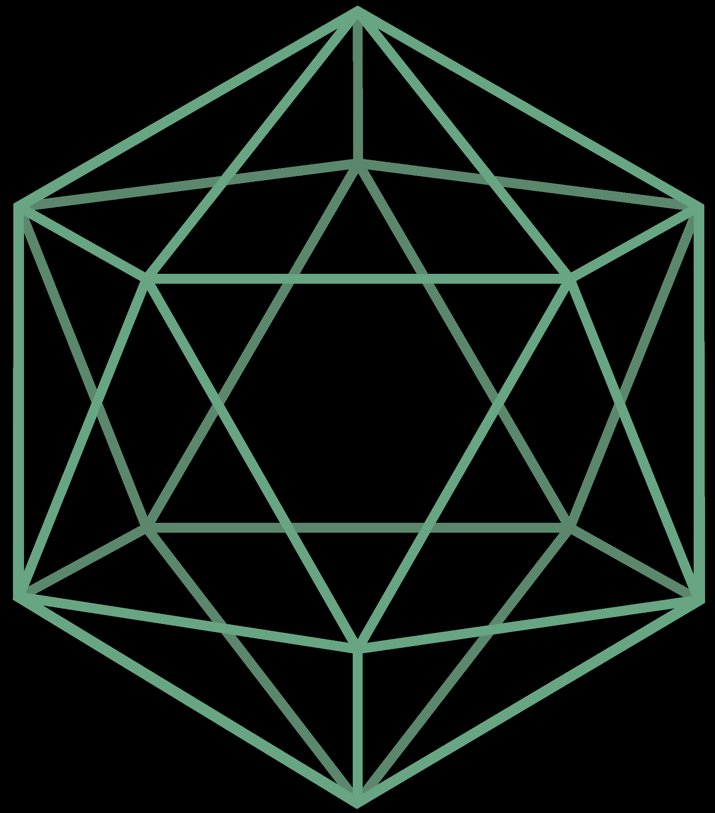
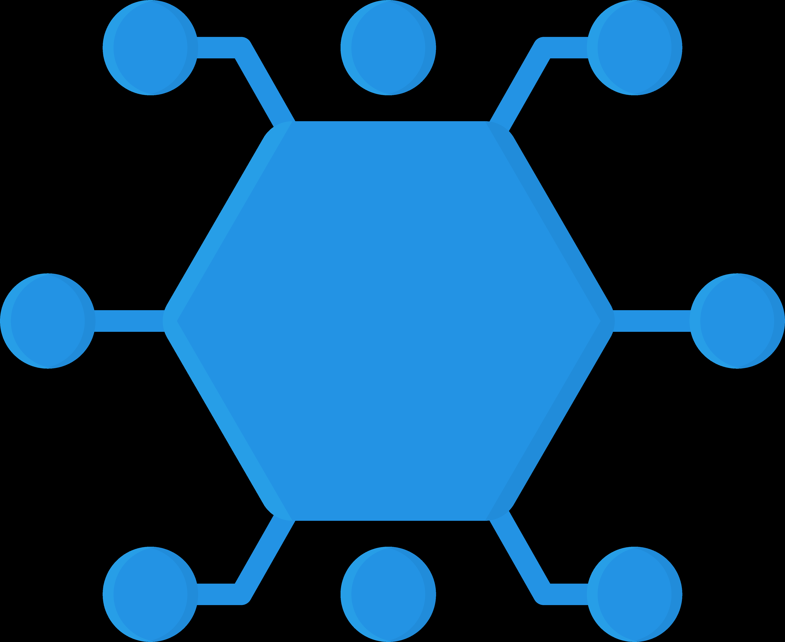
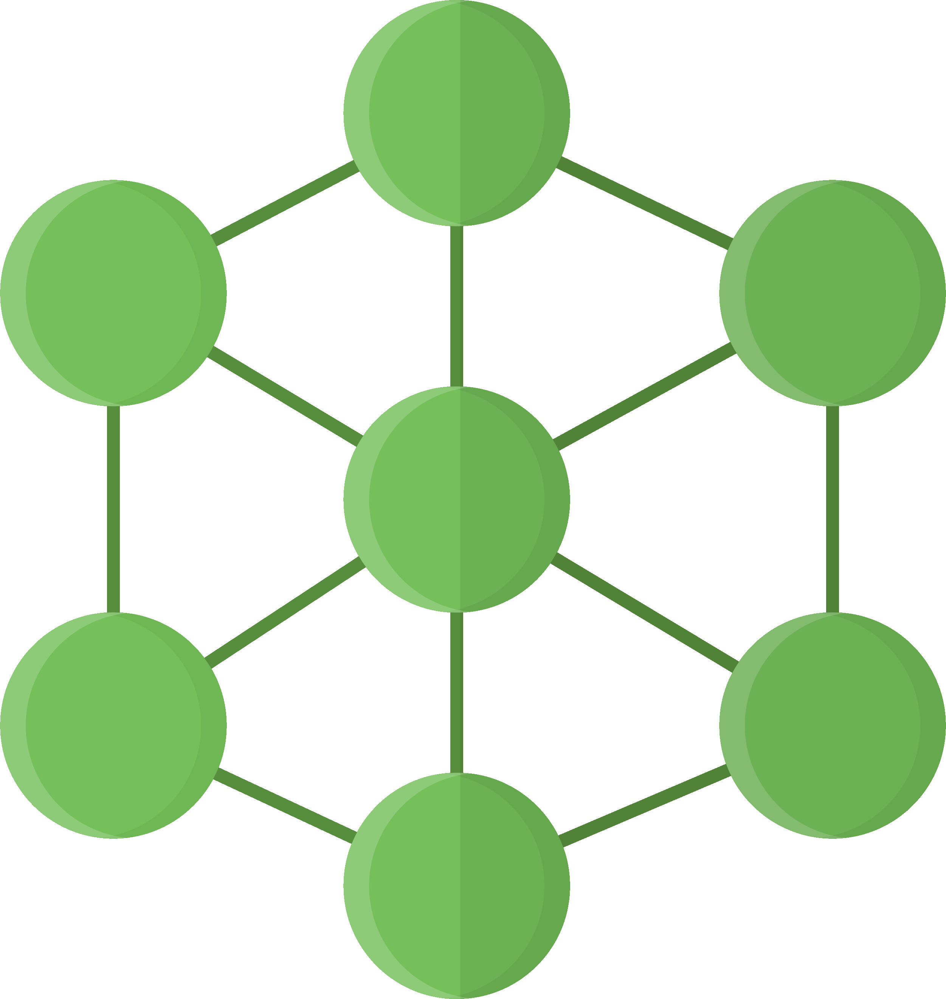
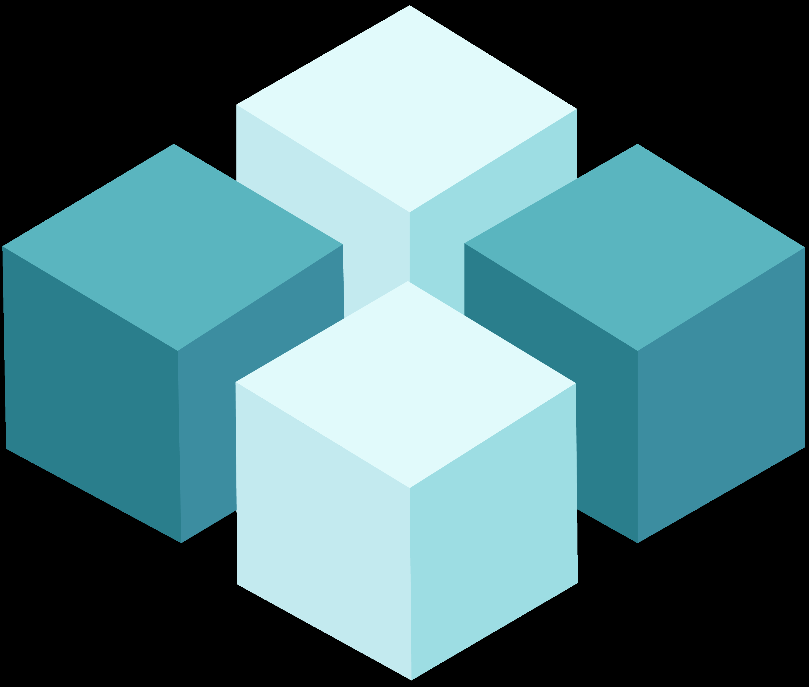

# 039 - Những Thất Bại Kinh Điển Trong Thiết Kế Hệ Thống (Spectacular Failures)

[← Bài trước](038-thiet-ke-google-docs.md) | [Mục lục](README.md) | [Bài tiếp theo →](040-loi-ket.md)

---


# Giới thiệu về các sự cố trong hệ thống phân tán (Introduction to Distributed System Failures)

Tìm hiểu về các sự cố hỏng hóc trong các hệ thống phân tán và tầm quan trọng của các điểm quan sát độc lập (independent vantage points).

### Nội dung bao gồm:
* Giới thiệu (Introduction)
* Các loại sự cố trong hệ thống phân tán (Types of failure in distributed systems)
* Các điểm quan sát (Vantage points)
* Tầm quan trọng của các nhà cung cấp dịch vụ độc lập (Importance of independent service providers)

---

## Giới thiệu (Introduction)

Thỉnh thoảng, chúng ta lại chứng kiến sự cố ngừng hoạt động của một dịch vụ đã quá quen thuộc với mọi gia đình, kéo theo phản ứng từ cả người dùng cá nhân lẫn các doanh nghiệp. Với tư cách là những nhà thiết kế hệ thống (system designers), chúng ta có thể tự hỏi làm thế nào mà những dịch vụ được thiết kế vô cùng cẩn trọng, được hoàn thiện qua nhiều năm bởi những đội ngũ kỹ sư dày dạn kinh nghiệm, lại vẫn có thể sụp đổ.

Chương này sẽ mổ xẻ một số sự cố gián đoạn dịch vụ lớn của các nền tảng nổi tiếng toàn cầu và các biện pháp có thể áp dụng để giảm thiểu những rủi ro đó.

Hai yếu tố chính sau đây thường góp phần dẫn đến sự cố:

1. **Người dùng đa dạng (Diverse users):** Hầu hết các dịch vụ đều sở hữu một cộng đồng người dùng phát triển sôi động, và khi nhu cầu của họ liên tục biến đổi, các sản phẩm phần mềm cũng buộc phải thay đổi theo. Nếu một phần mềm không cập nhật liên tục để cung cấp các tính năng và dịch vụ mới, nó sẽ trở nên ổn định theo thời gian. Tuy nhiên, nó lại có nguy cơ không còn đáp ứng được những tính năng mà khách hàng mong muốn.
2. **Hệ thống phức tạp (Complex systems):** Các hệ thống có quy mô rất phức tạp, và chúng thường mang các đặc tính phát sinh tổng thể (emergent properties) — nơi mà sự tương tác tổng hòa của các thành phần bên trong phức tạp hơn nhiều so với từng mảnh ghép riêng lẻ.


*Hình minh họa: Người dùng đa dạng tương tác với một hệ thống phức tạp.*

---

## Các loại sự cố trong hệ thống phân tán (Types of failure in distributed systems)

Hầu hết các dịch vụ hiện đại đều được thiết kế theo hướng cô lập lỗi (fault containment), khoanh vùng sự cố để chỉ ảnh hưởng cục bộ tới một nhóm người dùng nhất định. Hãy cùng phân tích các loại sự cố thường gặp trong các hệ thống phân tán:


*Hình minh họa: Các thành phần phân tán.*

* **Sự cố hệ thống (System failure):** Hỏng hóc phần mềm hoặc sự cố phần cứng là nguyên nhân phổ biến nhất gây ra lỗi hệ thống. Toàn bộ dữ liệu tạm thời trên bộ nhớ chính (primary memory / RAM) sẽ bị mất khi hệ thống sụp đổ. Tuy nhiên, dữ liệu nằm trên bộ lưu trữ thứ cấp (secondary storage) hoặc các bản sao dữ liệu (replicas) vẫn không bị ảnh hưởng. Hệ thống sẽ tiến hành khởi động lại (reboot) trong tình huống này.
* **Sự cố phương thức/luồng thực thi (Method failure):** Những sự cố dạng này làm đình trệ hoạt động của toàn bộ hệ thống phân tán. Nó cũng có thể khiến hệ thống thực thi các tiến trình sai lệch hoặc rơi vào trạng thái bế tắc (deadlock state).
* **Sự cố môi trường truyền thông (Communication medium failure):** Xảy ra khi một thành phần hoặc dịch vụ trong hệ thống không thể kết nối tới các thực thể nội bộ khác hoặc các thực thể bên ngoài mạng.
* **Sự cố bộ lưu trữ thứ cấp (Secondary storage failure):** Trong trường hợp này, các phân vùng lưu trữ thứ cấp hoặc các nút sao chép (replicas) bị sập. Dữ liệu trên các node này trở nên bất khả dụng; do đó, các node chính (primary nodes) bắt buộc phải sinh ra một bản sao (replica) khác để đảm bảo tính sẵn sàng cao (High Availability), độ tin cậy (reliability) và khả năng chịu lỗi (Fault Tolerance).


*Hình minh họa: Tác động của sự cố phần cứng/phần mềm.*


*Hình minh họa: Luồng xử lý khi gặp lỗi phương thức.*


*Hình minh họa: Lỗi đường truyền liên lạc giữa các node.*


*Hình minh họa: Quá trình tái tạo bản sao khi lỗi bộ lưu trữ thứ cấp.*

### Phân loại tổng quát các sự cố trong hệ thống phân tán:

| Loại sự cố (Failure Type) | Nguyên nhân & Bản chất | Trạng thái dữ liệu & Khắc phục |
| :--- | :--- | :--- |
| **System failure** (Lỗi hệ thống) | Lỗi phần mềm (crash, bug) hoặc phần cứng (cháy nổ, hỏng CPU). | Mất dữ liệu trên Primary Memory (RAM); Dữ liệu trên Secondary Storage an toàn; Hệ thống tự Reboot. |
| **Method failure** (Lỗi phương thức) | Lỗi logic thuật toán, deadlock, xử lý tiến trình sai lệch. | Hệ thống bị đóng băng hoặc chạy sai kết quả; Cần can thiệp sửa đổi luồng thực thi. |
| **Communication medium failure** (Lỗi môi trường truyền thông) | Đứt cáp, phân vùng mạng (network partition), lỗi định tuyến, DNS/BGP. | Các service không thể giao tiếp với nhau hoặc với bên ngoài; Network partition xảy ra. |
| **Secondary storage failure** (Lỗi bộ lưu trữ thứ cấp) | Ổ đĩa hỏng, node cơ sở dữ liệu/replica bị down. | Dữ liệu trên node bị mất tiếp cận; Primary node phải kích hoạt tạo replica mới để đảm bảo Quorum & Fault Tolerance. |


*Hình minh họa: Tổng quan 4 loại lỗi chính trong hệ thống phân tán.*

---

## Các điểm quan sát (Vantage points)

Đối với các hệ thống dịch vụ quy mô lớn, luôn có một thành phần nào đó đang gặp lỗi ở bất kỳ thời điểm nào. Mục tiêu thiết kế tối ưu là đạt được sự suy thoái mềm dẻo (graceful degradation) để chỉ một nhóm nhỏ người dùng bị ảnh hưởng trong một khoảng thời gian ngắn nhất định.

Vì vậy, chúng ta cần các **điểm quan sát độc lập phân tán toàn cầu (globally dispersed vantage points)** để theo dõi trạng thái dịch vụ một cách khách quan nhất.

> [!NOTE]
> Nhiều dịch vụ độc lập bên thứ ba (như Downdetector) tồn tại dựa trên cơ chế báo cáo sự cố từ cộng đồng người dùng (crowd-sourced problem reporting). Một sự thật thú vị là nếu chúng ta truy cập vào các nền tảng này và xem trạng thái của các ứng dụng yêu thích, ta sẽ luôn thấy vào bất kỳ thời điểm nào trên thế giới cũng có ai đó đang gặp sự cố kết nối hoặc trục trặc dịch vụ.

---

## Tầm quan trọng của các nhà cung cấp dịch vụ độc lập (Importance of independent service providers)

Một trong những mục tiêu thiết kế cốt lõi ban đầu của mạng Internet là đảm bảo tính bền bỉ và khả năng phục hồi (resilience): nếu một phần của mạng bị hỏng, các phần còn lại vẫn duy trì hoạt động bình thường.

Tuy nhiên, với sự trỗi dậy của một số ít các "ông lớn" cung cấp dịch vụ hạ tầng tập trung trong thập kỷ qua, giới chuyên gia đã gióng lên hồi chuông cảnh báo về rủi ro tập trung hóa (centralization) và những thảm họa tiềm ẩn khi xảy ra sự cố diện rộng. Hầu hết các công ty công nghệ đều xây dựng bảng điều khiển trạng thái (Status Dashboard) để người dùng theo dõi tình trạng dịch vụ. Tuy nhiên, nhiều sự cố hạ tầng nghiêm trọng có thể đánh sập luôn chính những trang dashboard nội bộ này. 

Khi đó, các công ty bị ảnh hưởng buộc phải chuyển sang giao tiếp với khách hàng qua các nền tảng mạng xã hội bên ngoài như Twitter/X để cập nhật tình hình. Các dịch vụ độc lập của bên thứ ba đóng vai trò cực kỳ quan trọng trong việc phát hiện sự cố khách quan và phân phối thông tin trạng thái.

> [!IMPORTANT]
> Khái niệm mở rộng mang tính cốt lõi ở đây là sử dụng các **miền sự cố độc lập (independent failure domains)**. Một miền sự cố (failure domain) được định nghĩa là một ranh giới cách ly: bất kỳ lỗi hay sự cố nào xảy ra bên trong phạm vi đó đều không được phép ảnh hưởng sang các thành phần và dịch vụ ở các miền khác. Ta nói hai miền là hoàn toàn độc lập khi và chỉ khi chúng nằm ngoài bán kính ảnh hưởng (blast radius) của nhau.


*Hình minh họa: Mô hình kiến trúc tầm quan trọng của các dịch vụ quan sát độc lập.*

* **Các dịch vụ liên kết nội bộ (Interconnected services):** Thu thập dữ liệu và hiển thị lên các bảng điều khiển (Dashboards).
* **Dịch vụ giám sát bên ngoài (External vantage point):** Ngay cả khi toàn bộ các dịch vụ liên kết nội bộ sụp đổ, hệ thống bên ngoài vẫn có thể phát hiện và cảnh báo chính xác. Điều này là bất khả thi nếu công cụ giám sát nằm chung hạ tầng với các dịch vụ nội bộ.

Trong các bài học tiếp theo, chúng ta sẽ phân tích chi tiết các vụ sập hệ thống chấn động từ các tập đoàn công nghệ hàng đầu thế giới, mổ xẻ nguyên nhân gốc rễ (root cause) và rút ra các kỹ thuật giảm thiểu rủi ro (mitigation techniques) nhằm ngăn chặn thảm kịch tái diễn.


*Hình minh họa: Liên kết bài học trước: Đánh giá thiết kế Google Docs.*


*Hình minh họa: Nút điều hướng quay lại bài trước.*


*Hình minh họa: Nút đánh dấu hoàn thành bài học.*


*Hình minh họa: Nút chuyển sang bài học tiếp theo.*


*Hình minh họa: Đề mục liên kết sự cố Facebook, WhatsApp, Instagram, Oculus.*


*Hình minh họa: Trạng thái điều hướng giao diện bài học.*


*Hình minh họa: Chuyển tiếp tiến trình học.*

---

# Sự cố sập hệ thống Facebook, WhatsApp, Instagram, Oculus (Facebook, WhatsApp, Instagram, Oculus Outage)

Tìm hiểu các nguyên nhân dẫn đến sự cố ngừng hoạt động trên quy mô lớn của Facebook và các phương pháp ngăn chặn.

### Nội dung bao gồm:
* Trình tự diễn biến các sự kiện (The sequence of events)
* Phân tích chuyên sâu (Analysis)
* Bài học kinh nghiệm (Lessons learned)

Vào tháng 10 năm 2021, Facebook đã trải qua một sự cố gián đoạn dịch vụ trên quy mô toàn cầu kéo dài khoảng 6 giờ đồng hồ, kéo sập toàn bộ các dịch vụ trực thuộc bao gồm Messenger, WhatsApp, Mapillary, Instagram và Oculus. Các phương tiện truyền thông quốc tế đã đồng loạt đưa tin đậm nét về thảm họa này. Tờ *The New York Times* đã giật dòng tít: *“Biến mất trong vài phút, sập suốt nhiều giờ: Cơn chấn động làm rung chuyển Facebook” (Gone in Minutes, Out for Hours: Outage Shakes Facebook).*

Theo một ước tính, sự cố gián đoạn này đã trực tiếp tiêu tốn của Facebook khoảng 100 triệu USD doanh thu bị bốc hơi và thổi bay hàng tỷ USD giá trị vốn hóa do giá cổ phiếu công ty lao dốc.

Hãy cùng phân tích chi tiết chuỗi diễn biến sự kiện đã châm ngòi cho sự cố toàn cầu này.

## Trình tự diễn biến sự kiện (The sequence of events)

Chuỗi sự kiện sau đây đã dẫn đến sự cố sập hoàn toàn của Facebook cùng các dịch vụ đi kèm:

1. Một hệ thống bảo trì định kỳ được kích hoạt nhằm đánh giá và tính toán dung lượng mạng còn trống (spare capacity) trên mạng trục truyền dẫn (backbone network) của Facebook.
2. Do một lỗi cấu hình nghiêm trọng (configuration error), hệ thống bảo trì này đã vô tình ngắt kết nối liên lạc giữa tất cả các trung tâm dữ liệu (data centers) với nhau trên toàn bộ mạng backbone. Trước đó, một công cụ đánh giá cấu hình tự động (automated configuration review tool) đã được triển khai để kiểm tra và phát hiện các lỗi cấu hình tiềm ẩn, tuy nhiên những công cụ như thế này không phải lúc nào cũng hoàn hảo tuyệt đối. Trong trường hợp cụ thể này,...

---

# 039 - Những Thất Bại Kinh Điển Trong Thiết Kế Hệ Thống (Spectacular Failures)

Công cụ rà soát (review tool) đã bỏ sót các lỗi tiềm ẩn hiện diện trong một cấu hình.

Hệ thống máy chủ tên miền có thẩm quyền (Authoritative Domain Name Systems - DNSs) của Facebook được cấu hình một quy tắc kiểm tra sức khỏe (health check rule): nếu nó không thể kết nối tới các trung tâm dữ liệu nội bộ (internal data centers) của Facebook, nó sẽ ngừng phản hồi các truy vấn DNS (DNS queries) từ máy khách bằng cách rút lại các tuyến đường mạng (withdrawing routes / BGP route withdrawal).

Khi các tuyến định tuyến mạng dẫn đến nơi lưu trữ hệ thống Authoritative DNS của Facebook bị rút lại, tất cả bản ánh xạ tên miền dạng con người đọc được sang địa chỉ IP (mapping of human-readable names to IPs) đã lưu trong bộ nhớ đệm (cache) trên toàn bộ các máy phân giải DNS công cộng (public DNS resolvers) đều nhanh chóng hết thời gian hiệu lực (timed out). Khi một máy khách phân giải tên miền `www.facebook.com`, trình phân giải DNS (DNS resolver) trước tiên sẽ truy vấn tới một trong các máy chủ DNS gốc (root DNS servers); máy chủ này sẽ cung cấp danh sách các máy chủ DNS có thẩm quyền cho tên miền `.com`. Bộ phân giải tiếp tục kết nối đến một trong số các máy chủ này, và chúng sẽ trả về danh sách các IP của các máy chủ DNS có thẩm quyền (authoritative DNS servers) cho Facebook. Tuy nhiên, sau khi các tuyến định tuyến bị rút lại, việc truy cập đến chúng là hoàn toàn bất khả thi.

Hệ quả là không một ai có thể truy cập vào Facebook cũng như các công ty con/dịch vụ phụ thuộc của nó.

Các slide trực quan dưới đây minh họa chuỗi sự kiện theo thứ tự diễn tiến:

---

### Diễn Biến Sự Cố Qua Các Slide




* **facebook.com**
* **Internet**
* **Yêu cầu (Request) / Phản hồi (Response)**
* **Trung tâm dữ liệu (Data center)**
* **Yêu cầu (Request) / Phản hồi (Response)**
* **Trình duyệt (Browser)**
* **Mạng đường trục (Backbone network)**
* **Kiến trúc mức cao của Facebook (Facebook’s high-level architecture)**
* *1 trên 5*

---


* **facebook.com**
* **Yêu cầu (Request) / Phản hồi (Response)**
* **Trung tâm dữ liệu (Data center)**
* **Lệnh kiểm tra/rà soát (Audit command)**
* **Gửi sai một câu lệnh (Sent a wrong command)**
* **Kỹ sư (Engineer)**
* **Internet**
* **Trình duyệt (Browser)**
* **Mạng đường trục (Backbone network)**
* **Một đội ngũ bảo trì đã gửi các câu lệnh sai tới mạng đường trục (A maintenance team sent the wrong commands to the backbone network)**
* *2 trên 5*

---


* **facebook.com**
* **Yêu cầu (Request) / Phản hồi (Response)**
* **Trung tâm dữ liệu (Data center)**
* **Lệnh kiểm tra/rà soát (Audit command)**
* **Gửi câu lệnh sai (Sends a wrong command)**
* **Chuyển tiếp câu lệnh sai (Sends wrong command forward)**
* **Kỹ sư (Engineer)**
* **Internet**
* **Bị lỗi (Bugged)**
* **Trình duyệt (Browser)**
* **Mạng đường trục (Backbone network)**
* **Công cụ rà soát (một lệnh kiểm tra tự động) đã không thể phát hiện ra vấn đề trong câu lệnh và tiếp tục chuyển tiếp câu lệnh đó tới mạng đường trục (The review tool (an audit command) couldn’t identify the problem with the command and sent the command forward to the backbone network)**
* *3 trên 5*

---


* **Trình duyệt (Browser)**
* **facebook.com**
* **Yêu cầu (Request) / Phản hồi (Response)**
* **Trung tâm dữ liệu (Data center)**
* **Lệnh kiểm tra/rà soát (Audit command)**
* **Gửi câu lệnh sai (Sends a wrong command)**
* **Bị lỗi (Bugged)**
* **Chuyển tiếp câu lệnh sai (Sends wrong command forward)**
* **Kỹ sư (Engineer)**
* **Internet**
* **Mạng đường trục (Backbone network)**
* **Do các câu lệnh bị lỗi, mạng đường trục gặp trục trặc/ngừng hoạt động (Due to faulty commands, the backbone network malfunctioned)**
* *4 trên 5*

---


* **facebook.com**
* **Yêu cầu (Request) / Phản hồi (Response)**
* **Trung tâm dữ liệu (Data center)**
* **Lệnh kiểm tra/rà soát (Audit command)**
* **Gửi câu lệnh sai (Sends a wrong command)**
* **Chuyển tiếp câu lệnh sai (Sends wrong command forward)**
* **Kỹ sư (Engineer)**
* **Bị lỗi (Bugged)**
* **Trình duyệt (Browser)**
* **Internet**
* **Mạng đường trục (Backbone network)**
* **Hệ quả của các câu lệnh sai sót là Facebook trở nên hoàn toàn không thể tiếp cận (As a result of the faulty commands, Facebook becomes unreachable)**
* *5 trên 5*

---

## Phân Tích (Analysis)

Một số kết luận và bài học then chốt rút ra từ chuỗi sự kiện nêu trên bao gồm:

* **Từ tác vụ thông thường biến thành thảm họa (From common activity to catastrophe):** Việc rút lại (withdrawal) hoặc thêm mới các tuyến định tuyến mạng (network routes) vốn là một hoạt động vận hành tương đối phổ biến. Sự hội tụ của các lỗi (đầu tiên là một cấu hình sai sót, và sau đó là lỗi phần mềm trong công cụ kiểm tra rà soát khiến nó không phát hiện ra sự cố) đã kích hoạt một chuỗi các sự kiện dây chuyền, dẫn đến **sự cố lan truyền (cascading failures)**. Một sự cố lan truyền xảy ra khi một lỗi đơn lẻ kích hoạt một lỗi khác, và cuối cùng đánh sập toàn bộ hệ thống.
* **Nguyên nhân dẫn đến quá trình khôi phục chậm chạp (Reasons for slow restoration):** Có vẻ kỳ lạ khi phải mất tới sáu giờ đồng hồ để khôi phục dịch vụ. Liệu việc tái quảng bá (reannounce) lại các tuyến định tuyến đã bị rút có phải là điều dễ dàng? Ở quy mô hoạt động khổng lồ của Facebook, hiếm khi có tác vụ nào được thực hiện bằng tay (manually), mà luôn có các hệ thống tự động để thực hiện các thay đổi. Các công cụ nội bộ này rất có thể đã dựa vào chính hạ tầng DNS; và khi toàn bộ các trung tâm dữ liệu bị ngắt kết nối vật lý/logic khỏi mạng đường trục (backbone), việc sử dụng các công cụ tự động đó trên thực tế là bất khả thi. Sự can thiệp thủ công là bắt buộc. Việc khởi động nguội lại bằng tay (manually bootstrapping) một hệ thống ở quy mô tầm cỡ này hoàn toàn không đơn giản. Các cơ chế an ninh vật lý và an ninh số thông thường vốn được thiết lập chặt chẽ đã vô tình làm chậm tiến trình can thiệp thủ công này.
* **Những sự kiện xác suất cực thấp vẫn có thể xảy ra (Low probability events can occur):** Nhìn lại quá khứ, việc các hệ thống Authoritative DNS tự động ngắt kết nối chính nó khi không thể tiếp cận các trung tâm dữ liệu nội bộ dường như là điều kỳ quặc. Đây là một minh chứng khác cho thấy một biến cố cực kỳ hiếm gặp (chẳng hạn như việc toàn bộ các trung tâm dữ liệu đều không thể tiếp cận được) đã xảy ra trên thực tế, kéo theo hàng loạt biến cố tiếp sau.
* **Cạm bẫy của tự động hóa (Pitfalls of automation):** Facebook là một trong những đơn vị tiên phong ủng hộ việc tự động hóa các thay đổi cấu hình mạng, với quan điểm rằng phần mềm có thể quản lý và vận hành mạng lưới tốt hơn con người – đối tượng vốn dễ mắc sai sót hơn. Tuy nhiên, bản thân phần mềm cũng có thể chứa lỗi (bugs), điển hình như sự cố lần này.

---

## Bài Học Kinh Nghiệm (Lessons Learned)

* **Đội ngũ vận hành luôn trong trạng thái sẵn sàng (Ready operations team):** Các điểm nghẽn đơn lẻ tiềm ẩn (hidden Single Point of Failure - SPOF) luôn có thể tồn tại trong các hệ thống phức tạp. Phòng tuyến tốt nhất trước các lỗi dạng này là duy trì một đội ngũ vận hành luôn sẵn sàng ứng phó thông qua các chương trình đào tạo/diễn tập định kỳ. Khả năng tư duy mạch lạc, sáng suốt dưới các tình huống áp lực cao là điều bắt buộc để xử lý những sự cố thảm họa như vậy.
* **Thiết kế hệ thống đơn giản (Simple system design):** Khi các hệ thống ngày càng lớn hơn, chúng trở nên phức tạp hơn rất nhiều và bắt đầu xuất hiện **các hành vi phát sinh đột biến (emergent behaviors)**. Để nắm bắt được hành vi tổng thể của hệ thống, chỉ hiểu riêng rẽ hành vi của từng thành phần cấu tử là chưa đủ. Các sự cố lan truyền (cascading failures) có thể bùng phát bất cứ lúc nào. Đây chính là lý do cốt lõi để giữ cho thiết kế hệ thống luôn đơn giản nhất có thể nhằm phục vụ nhu cầu hiện tại, và tiến hóa kiến trúc một cách thận trọng, từ tốn. Đáng tiếc là không có giải pháp hoàn hảo tuyệt đối nào để loại bỏ triệt để vấn đề này. Chúng ta buộc phải chấp nhận khả năng xảy ra của các sự cố như vậy, thực hiện giám sát liên tục (continuous monitoring), rèn luyện năng lực giải quyết sự cố ngay khi chúng phát sinh, và đúc rút kinh nghiệm từ các thất bại để không ngừng cải tiến hệ thống.
* **Kế hoạch dự phòng (Contingency plan):** Rất nhiều dịch vụ của bên thứ ba phụ thuộc vào Facebook để triển khai tính năng Đăng nhập một lần (Single Sign-On - SSO). Khi sự cố mất kết nối xảy ra, các dịch vụ bên thứ ba này vẫn hoạt động bình thường, nhưng người dùng của họ hoàn toàn không thể sử dụng dịch vụ vì cổng đăng nhập qua Facebook đã tê liệt. Đây là một ví dụ kinh điển khác của việc ngầm định định kiến rằng một dịch vụ ngoại vi sẽ luôn luôn sẵn sàng (High Availability 100%), từ đó tạo ra một điểm nghẽn đơn lẻ tiềm ẩn (hidden single point of failure).
* **Ủy thác lưu trữ DNS cho các nhà cung cấp độc lập thứ ba (Hosting DNS to independent third-party providers):** Có một số ít dịch vụ được thiết kế quá vững chắc và được hoàn thiện tinh vi qua thời gian dài đến mức các khách hàng mặc định cho rằng dịch vụ đó đã và sẽ luôn luôn sẵn sàng 100%. Hệ thống DNS chính là một dịch vụ như vậy, nó đã được xây dựng và tối ưu cực kỳ cẩn trọng. Các kỹ sư thiết kế hệ thống thường ngầm định rằng nó sẽ không bao giờ sập. Việc phân bổ lưu trữ DNS sang các nhà cung cấp dịch vụ độc lập thứ ba có thể là một giải pháp phòng vệ trước các sự cố tương tự. Giao thức DNS cho phép cấu hình nhiều máy chủ có thẩm quyền (authoritative servers), và một tổ chức có thể phân tán nhiều máy chủ tại các vị trí địa lý khác nhau. Mặc dù vậy, chúng ta cần lưu ý rằng hệ thống DNS ở quy mô khổng lồ của Facebook không hề đơn giản; nó liên kết chặt chẽ với hạ tầng mạng đường trục (backbone) của họ và liên tục biến đổi tần suất cao. Việc ủy thác một thành phần cốt lõi như vậy cho bên thứ ba độc lập vừa vô cùng tốn kém, vừa tiềm ẩn nguy cơ làm lộ các chi tiết vận hành dịch vụ nội bộ. Do đó, đây là một bài toán đánh đổi (trade-off) kinh điển giữa yêu cầu bảo mật/kinh doanh và độ vững chắc (robustness) của hệ thống.
* **Các bài toán đánh đổi (Trade-offs):** Luôn tồn tại những bài toán đánh đổi đầy bất ngờ. Một ví dụ trực quan ở đây là sự xung đột giữa **nhu cầu bảo mật dữ liệu** và **nhu cầu sửa chữa thủ công nhanh chóng khi có biến cố**. Do có quá nhiều rào chắn an ninh vật lý lẫn bảo mật số được thiết lập nghiêm ngặt, việc can thiệp thủ công từ các kỹ sư đã bị chậm trễ nghiêm trọng. Đây là một tình thế tiến thoái lưỡng nan (catch-22 situation) — hạ thấp tiêu chuẩn bảo mật có thể gây ra những hiểm họa khôn lường, nhưng việc kéo dài thời gian sửa chữa trong các tình huống khẩn cấp cũng đẩy doanh nghiệp vào thế ngàn cân treo sợi tóc. Hy vọng duy nhất là nhu cầu can thiệp sửa chữa khẩn cấp như thế này chỉ là những biến cố cực kỳ hy hữu.
* **Sự gia tăng đột biến về tải (Surge in load):** Sự sụp đổ của các "gã khổng lồ" công nghệ sẽ làm gián đoạn toàn bộ mạng Internet. Các hệ thống máy phân giải công cộng của bên thứ ba, chẳng hạn như Google DNS (`8.8.8.8`) và Cloudflare DNS (`1.1.1.1`), đã phải hứng chịu một đợt tăng vọt tải trọng chưa từng thấy xuất phát từ hàng tỷ yêu cầu thử lại DNS (DNS retries) liên tục thất bại từ phía người dùng và ứng dụng.
* **Tái khởi động dịch vụ (Resuming the service):** Việc khôi phục một dịch vụ quy mô siêu lớn hoàn toàn không đơn giản như việc bật một công tắc điện. Khi toàn bộ tải đột ngột rơi về mức gần như bằng 0, việc kích hoạt đồng loạt tất cả hệ thống cùng lúc có thể dẫn đến việc mức tiêu thụ điện năng tăng vọt hàng megawatt chỉ trong tích tắc. Cú sốc này thậm chí có thể gây nguy hiểm và làm sập lưới điện cục bộ. Các hệ thống phân tán phức tạp luôn sở hữu một **trạng thái ổn định tĩnh (steady state)**; và một khi chúng bị văng ra khỏi trạng thái ổn định đó, các kỹ sư phải cực kỳ cẩn trọng và đưa tải trở lại từng bước một cách có kiểm soát.

---

## Điểm Cần Suy Ngẫm (Point to Ponder)

### Câu hỏi
> **Chúng ta có thể làm gì để bảo vệ hệ thống trước những dạng sự cố tương tự như Facebook đã từng trải qua?**

<details>
<summary><b>Hiển thị câu trả lời (Show Answer)</b></summary>

Một số giải pháp khả thi có thể bao gồm:

1. **Xác thực mạng tự động (Network verification):** Lĩnh vực này gần đây đang phát triển rất mạnh mẽ và cho thấy nhiều triển vọng trong việc phát hiện sớm các lỗi cấu hình. Các công cụ này vận hành dựa trên một mô hình trừu tượng hóa toán học của toàn bộ cơ sở hạ tầng mạng.
2. **Thiết lập nhiều lớp kiểm tra/rà soát (Multi-layer auditing):** Cần triển khai nhiều hơn một tầng kiểm thử tự động. Các lớp kiểm tra thứ cấp có thể sử dụng một môi trường giả lập (network simulator) để bảo đảm chắc chắn rằng sau khi áp dụng các thay đổi cấu hình, các hạ tầng mạng trọng yếu vẫn duy trì trạng thái sẵn sàng (High Availability) khi được kiểm tra từ nhiều điểm quan sát độc lập trên toàn cầu (multiple global vantage points).
3. **Thu hẹp bán kính ảnh hưởng (Blast Radius):** Phải tận dụng mọi nỗ lực kỹ thuật để thu hẹp phạm vi ảnh hưởng của một lần thay đổi cấu hình (reduce the scope of a configuration change) nhằm ngăn chặn triệt để các phản ứng dây chuyền gây sự cố lan truyền (cascading effects).
4. **Cơ chế tự động hoàn nguyên trạng thái tốt gần nhất (Automatic rollback to last known good state):** Cơ sở hạ tầng trọng yếu cần được lập trình sao cho nếu có bất kỳ dấu hiệu bất thường nào xảy ra, nó có khả năng tự động khôi phục về trạng thái hoạt động tốt gần nhất đã được ghi nhận. Dĩ nhiên, điều này nói thì dễ hơn làm rất nhiều do số lượng khổng lồ và tính chất phức tạp của các thành phần trong hệ thống.

</details>

---

# Sự Cố Ngừng Dịch Vụ AWS Kinesis Ảnh Hưởng Đến Hàng Loạt Tổ Chức (AWS Kinesis Outage Affecting Many Organizations)

Tìm hiểu nguyên nhân và phân tích chuyên sâu về sự cố ngừng hoạt động nghiêm trọng của AWS Kinesis.

**Nội dung bao gồm:**
* Trình tự diễn biến sự kiện (*Sequence of events*)
* Phân tích chuyên sâu (*Analysis*)
* Bài học kinh nghiệm (*Lessons learned*)

Amazon Kinesis cho phép chúng ta tổng hợp (*aggregate*), xử lý (*process*) và phân tích (*analyze*) dữ liệu luồng theo thời gian thực (*real-time streaming data*) nhằm đưa ra các phân tích kịp thời và phản ứng nhanh chóng với thông tin mà nó cung cấp. Hệ thống liên tục thu nạp hàng gigabyte dữ liệu từ hàng trăm nghìn nguồn dữ liệu mỗi giây. Phân hệ giao diện tiếp nhận (*frontend*) của dịch vụ Kinesis đảm nhiệm việc xác thực (*authentication*), điều tiết lưu lượng (*throttling*) và phân phối tải công việc (*distribute workloads*) đến cụm máy chủ phụ trách xử lý chính ở phía sau (back-end "workhorse" cluster) thông qua cơ chế phân mảnh cơ sở dữ liệu (*database sharding*). 

Vào ngày 25 tháng 11 năm 2020, dịch vụ Amazon Kinesis đã bị gián đoạn hoạt động tại khu vực **US-East-1 (Bắc Virginia)**, gây ảnh hưởng đến hàng nghìn dịch vụ bên thứ ba khác. Sự cố này đủ nghiêm trọng để làm tê liệt một phần lớn các dịch vụ Internet trên toàn cầu.

---

## Trình Tự Diễn Biến Sự Kiện (Sequence of Events)

Theo công bố từ Amazon, sự cố được kích hoạt bởi việc bổ sung thêm một lượng nhỏ năng lực xử lý (*capacity*) vào cụm máy chủ tiếp nhận (*front-end fleet of servers*) của AWS, được lên lịch thực hiện từ 2:44 sáng PST đến 3:47 sáng PST.

Việc bổ sung thêm năng lực mới này đã khiến toàn bộ các máy chủ trong cụm (*fleet*) vượt quá số lượng luồng thực thi tối đa (*maximum number of threads*) được cấu hình và cho phép bởi hệ điều hành (*operating system configuration*).

Do vượt quá giới hạn về số lượng luồng (*threads limit*), quá trình kiến tạo bộ nhớ đệm (*cache construction*) đã không thể hoàn thành, dẫn đến việc các máy chủ front-end kết thúc với các bản đồ phân mảnh (*shard maps*) hoàn toàn vô dụng, khiến chúng không thể định tuyến các yêu cầu (*route requests*) đến các cụm máy chủ back-end xử lý phía sau.

> [!CAUTION]
> **Hiệu Ứng Domino Lây Lan:**
> Các dịch vụ cốt lõi khác của Amazon cũng ngừng hoạt động theo dây chuyền, bao gồm cả **Amazon Cognito** và **Amazon CloudWatch**.

* **Amazon Cognito:** Kinesis Data Streams được Amazon Cognito sử dụng để thu thập và phân tích các mẫu hình sử dụng API (*API usage patterns*). Do sự cố kéo dài trên Kinesis Data Streams, một lỗi tiềm ẩn (*latent bug*) trong mã nguồn đệm (*buffering code*) — thành phần bắt buộc cho các dịch vụ Cognito — đã khiến các máy chủ web Cognito bắt đầu bị nghẽn/chặn (*blocking*) do bộ đệm Kinesis Data Stream bị tồn đọng quá tải (*backlogged*). Kết quả là, người dùng Cognito ghi nhận sự gia tăng đột biến về tỷ lệ lỗi API (*API failures*) và độ trễ (*latencies*) đối với các nhóm người dùng (*Cognito user pools*) và nhóm định danh (*identity pools*), khiến người dùng bên ngoài hoàn toàn không thể xác thực (*authenticate*) hoặc nhận thông tin xác thực AWS tạm thời (*temporary AWS credentials*).
* **Amazon CloudWatch:** CloudWatch sử dụng Kinesis Data Streams để xử lý dữ liệu đo lường (*metrics*) và dữ liệu nhật ký (*log data*). Các API `PutMetricData` và `PutLogEvents` trong CloudWatch đối mặt với tỷ lệ lỗi gia tăng cùng độ trễ nghiêm trọng, đồng thời các cảnh báo (*alerts*) bị chuyển sang trạng thái `INSUFFICIENT DATA` (Không đủ dữ liệu). Phần lớn các chỉ số đo lường không thể xử lý được do tỷ lệ lỗi và độ trễ quá cao. Khi CloudWatch gặp sự cố lớn này, cả các máy khách nội bộ (*internal clients*) lẫn bên ngoài (*external clients*) đều không thể lưu trữ bền vững (*persist*) toàn bộ dữ liệu chỉ số đo lường vào dịch vụ CloudWatch.

---

### Trình Tự Diễn Biến Sự Kiện (Sequence of Events Flow)


1. **Sự kiện được kích hoạt do việc bổ sung thêm năng lực xử lý** (*Event triggered due to addition to the capacity*)
2. **Số lượng luồng vượt quá giới hạn được xác định trước** (*No. of threads crossed pre-defined limit*)
3. **Quá trình dựng bộ nhớ đệm và phân mảnh thất bại** (*Cache construction and shards failure*)
4. **Amazon Cognito và CloudWatch bị sập** (*Amazon Cognito and CloudWatch failed*)
5. **AutoScaling và Lambda cũng bị tác động** (*AutoScaling and Lambda were also impacted*)
6. **Một dịch vụ trọng yếu khác là EventBridge cũng bị tê liệt** (*Another major service EventBridge was also plagued*)
7. **Bảng điều khiển trạng thái dịch vụ (Service Health Dashboard) bị sập** (*Service health dashboard was down*)
8. **Sự cố tác động dây chuyền đến các dịch vụ bên thứ ba khác** (*It also affected other third party services*)

---

Do các vấn đề liên quan đến số liệu đo lường của CloudWatch, hai dịch vụ tiếp theo cũng bị tác động nghiêm trọng:
1. **AutoScaling:** Các chính sách tự động co giãn (*AutoScaling policies*) dựa trên các phép đo của CloudWatch bị trễ nghiêm trọng (*suffered delays*).
2. **AWS Lambda:** Phải chịu tác động liên đới trực tiếp.

Hiện tại, việc đẩy dữ liệu chỉ số đo lường (*metric data*) lên CloudWatch là một bước bắt buộc trong quy trình kích hoạt/thực thi hàm Lambda (*Lambda function invocation*). Nếu CloudWatch không khả dụng, các tác tử thu thập chỉ số của Lambda (*Lambda metric agents*) được thiết kế để đệm dữ liệu chỉ số cục bộ (*buffer locally*) trong một khoảng thời gian nhất định. Tuy nhiên, lượng dữ liệu chỉ số bị đệm lại trở nên quá lớn đến mức gây ra tình trạng tắc nghẽn bộ nhớ (*memory congestion*) trên các máy chủ dịch vụ nền tảng dùng để thực thi hàm Lambda, trực tiếp dẫn đến tỷ lệ lỗi tăng vọt.

Tỷ lệ lỗi API gia tăng cùng sự chậm trễ trong xử lý sự kiện đã tàn phá nặng nề **CloudWatch Events** và **EventBridge**. EventBridge vốn được **Elastic Container Service (ECS)** và **Elastic Kubernetes Service (EKS)** sử dụng để vận hành các tiến trình nội bộ nhằm quản lý các cụm máy chủ và tác vụ (*tasks/jobs*) của khách hàng. Tình trạng này đã làm tê liệt việc cấp phát cụm máy chủ mới (*new cluster provisioning*), điều chỉnh quy mô các cụm hiện có (*existing cluster scaling*) và thu hồi tác vụ (*task deprovisioning*).

Bên cạnh các sự cố kỹ thuật về dịch vụ, Amazon còn gặp phải tình trạng chậm trễ trong việc thông báo trạng thái dịch vụ tới khách hàng. Amazon sử dụng hai bảng điều khiển để liên lạc với khách hàng: **Bảng điều khiển Sức khỏe Dịch vụ (Service Health Dashboard)** và **Bảng điều khiển Sức khỏe Cá nhân (Personal Health Dashboard)**. Service Health Dashboard có nhiệm vụ thông báo cho tất cả khách hàng về các sự cố diện rộng, chẳng hạn như sự cố này. Tuy nhiên, nó đã bị sập do có sự phụ thuộc (*dependency*) vào Cognito — dịch vụ vốn đang bị tê liệt bởi chính sự cố Kinesis.

Ngoài sự gián đoạn trong hệ sinh thái dịch vụ nội bộ của Amazon, sự cố này còn gây ra hiệu ứng gợn sóng lan tỏa (*ripple effect*) tới hàng nghìn dịch vụ trực tuyến, ứng dụng và trang web của bên thứ ba. Trong số đó bao gồm cả **Adobe Spark, Acorns, Coinbase, The Washington Post**, cùng hàng trăm dịch vụ quy mô lớn khác.

---

## Phân Tích Chuyên Sâu (Analysis)

### 1. Tính Phức Tạp Của Việc Mở Rộng Quy Mô (Complexity of Enhancing Scalability)
Chúng ta luôn nhấn mạnh tầm quan trọng của việc mở rộng theo chiều ngang (*horizontal scalability*) trong tất cả các bài toán thiết kế hệ thống. Tuy nhiên, sự cố ngừng hoạt động này cho thấy trong thực tế, việc bổ sung thêm năng lực vào một cụm máy chủ đang phục vụ (*serving cluster*) — nhằm tránh từ chối yêu cầu của máy khách — có thể là một thách thức cực lớn và dễ gây ra những tác dụng phụ không lường trước được (*unintended side effects*).

### 2. Sự Cần Thiết Của Một Đội Ngũ Vận Hành Được Đào Tạo Bài Bản (The Need for a Trained Team)
Việc đào tạo đội ngũ vận hành hệ thống thực tế (*production team*) để sẵn sàng ứng phó với những tình huống không lường trước là một nhiệm vụ đầy thách thức, nhưng hoàn toàn xứng đáng và có thể giúp đẩy nhanh tiến độ phục hồi hệ thống (*expedited recovery*). Thêm vào đó, việc khởi động lại ngẫu nhiên các máy chủ front-end và phỏng đoán rằng áp lực bộ nhớ (*memory pressure*) là nguyên nhân gây ra sự cố đã phản ánh rõ rệt những khó khăn, bế tắc trong việc xác định nguyên nhân gốc rễ (*root causes*) dưới áp lực nặng nề của thời gian.

### 3. Đọc Dữ Liệu Từ Máy Chủ Nguồn Đáng Tin Cậy Trong Quá Trình Bootstrap (Reading from Authoritative Servers During Bootstrap)
Trong quá trình khởi động hệ thống (*bootstrap process*), giải pháp tối ưu là nên lấy dữ liệu từ kho lưu trữ siêu dữ liệu nguồn đáng tin cậy (*authoritative metadata store*) thay vì đọc trực tiếp từ các máy chủ front-end khác, nhằm hạn chế tối đa phạm vi ảnh hưởng của các sự cố hỏng hóc tương tự.

### 4. Nhận Diện Lỗi Sớm Ngay Từ Các Giai Đoạn Đầu (Identification of Faults in Initial Stages)
Hệ thống cần phải có các quy trình tự động hóa (*automated processes*) để chẩn đoán và xác định chính xác nguyên nhân lỗi ngay từ các giai đoạn đầu khi nó vừa mới phát sinh.

### 5. Cơ Chế Kiểm Thử Chuẩn Xác Giúp Giảm Thiểu Mức Độ Nghiêm Trọng Của Lỗi (Proper Testing Mechanisms Can Reduce the Severity of the Fault)
Năng lực bổ sung mới khiến các máy chủ trong cụm vượt quá số lượng luồng tối đa thực chất là một lỗi tiềm ẩn (*potential bug*) đáng lẽ phải được phát hiện và khắc phục từ trước, chứ không phải đợi đến sau khi khởi động lại các máy chủ. Điều này phản ánh sự thiếu sót trong việc kiểm thử hệ thống (*proper testing*). Cần phải có một môi trường mô phỏng (*simulator*) chuyên dụng để kiểm thử toàn diện mọi kịch bản góc cạnh (*edge cases*) trước khi triển khai thêm năng lực tính toán vào cụm máy chủ sản xuất.

### 6. Tìm Kiếm Lỗi Tiềm Ẩn Trước Các Sự Kiện Đã Được Lên Kế Hoạch (Finding Potential Bugs Before Planned Events)
Sự cố của Kinesis Data Streams đã kích hoạt một lỗi tiềm ẩn trong đoạn mã đệm (*buffering code*), khiến các máy chủ web Cognito bắt đầu bị chặn/treo do bộ đệm Kinesis Data Stream bị quá tải. Các lỗi tiềm ẩn này bắt buộc phải được nhận diện và xử lý triệt để trước khi triển khai các sự kiện quan trọng theo kế hoạch, chẳng hạn như nâng cấp dung lượng hạ tầng hoặc bảo trì định kỳ phần mềm và phần cứng.

### 7. Áp Dụng Quy Trình Tự Động Hóa Trong Phân Bổ Tài Nguyên (Adopting Automated Processes for Resource Allocation)
Đội ngũ phát triển Cognito đã tìm cách giảm thiểu ảnh hưởng của lỗi Kinesis trong các giai đoạn đầu của sự kiện bằng cách bổ sung thêm dung lượng thủ công, qua đó tăng cường khả năng đệm các lệnh gọi tới Kinesis. Thay vì can thiệp gán tài nguyên thủ công, hệ thống cần có cơ chế tự động hóa hoàn toàn (*automated system*) để gia tăng hoặc tái phân bổ tài nguyên (*reallocate capacity*) tức thì khi xảy ra những biến cố như vậy.

---

## Bài Học Kinh Nghiệm (Lessons Learned)

* **Kiểm Thử (Testing):** Việc kiểm thử đúng quy chuẩn và chủ động phát hiện sớm các lỗi tiềm ẩn là điều tối quan trọng. Trong trường hợp này, việc số lượng luồng vượt quá giới hạn tối đa do hệ điều hành quy định chính là một lỗi hệ thống nguy hiểm.
* **Đội Ngũ Vận Hành Luôn Sẵn Sàng (Ready Operations Team):** Một lỗi phần mềm có thể làm tê liệt toàn bộ hệ thống đóng vai trò như một điểm lỗi đơn lẻ (*Single Point of Failure - SPOF*), điều hoàn toàn có thể xảy ra trong các hệ thống phân tán phức tạp. Đội ngũ sản xuất (*production team*) phải luôn được đào tạo chuyên sâu và sẵn sàng cho các tình huống thảm họa như vậy.
* **Giảm Số Lượng Máy Chủ (Reducing Number of Servers):** Để có thêm biên độ an toàn đáng kể (*significant headroom*) cho tổng số lượng luồng sử dụng, hệ thống cần chuyển đổi sang các máy chủ có cấu hình CPU và bộ nhớ (RAM) mạnh mẽ hơn. Điều này sẽ giúp giảm tổng số lượng máy chủ vật lý/ảo hóa cần thiết, từ đó giảm số lượng luồng mà mỗi máy chủ phải duy trì để giao tiếp chéo trên toàn cụm (*across the fleet*). Việc có ít máy chủ hơn đồng nghĩa với việc mỗi máy chủ chỉ cần quản lý ít luồng hơn. Song song đó, Amazon đang bổ sung thêm hệ thống cảnh báo chi tiết (*fine-grained alarming*) để giám sát mức độ tiêu thụ luồng trong dịch vụ.
* **Tái Cấu Trúc Cụm Máy Chủ Tiếp Nhận (Front-end Fleet Changes):** Cần tiến hành hàng loạt thay đổi cốt lõi nhằm cải thiện triệt để thời gian khởi động nguội (*cold start time*) cho cụm front-end. Hơn nữa, bộ nhớ đệm (*cache*) của các máy chủ front-end cần phải được tách riêng và chuyển sang một cụm chuyên dụng (*dedicated fleet*).
* **Tránh Các Sự Cố Lặp Lại Trong Tương Lai (Avoiding Recurrent Failures):** Để triệt tiêu nguy cơ tái diễn các lỗi tương tự trong tương lai, các dịch vụ AWS có quy mô mở rộng lớn như CloudWatch và các dịch vụ phụ thuộc khác bắt buộc phải được tách biệt và chuyển sang một cụm front-end độc lập, được phân vùng riêng biệt (*separate, partitioned front-end fleet*).

---

### Tóm Tắt Bài Học Rút Ra Trong Sự Cố Kinesis (Lessons Learned During the Kinesis Outage)


| Trụ Cột Bài Học | Chi Tiết Trọng Tâm |
| :--- | :--- |
| **Kiểm Thử (*Testing*)** | Kiểm thử áp lực, mô phỏng quy mô thực tế để phát hiện sớm các giới hạn luồng/tài nguyên hệ điều hành (*OS thread limits*). |
| **Đội Ngũ Vận Hành Luôn Sẵn Sàng (*Ready Operations Team*)** | Huấn luyện kịch bản ứng phó sự cố khẩn cấp, rút ngắn thời gian chuẩn đoán nguyên nhân gốc rễ (*RCA*). |
| **Thay Đổi Cụm Front-end (*Front-end Fleet Changes*)** | Tối ưu hóa thời gian khởi động nguội (*cold start*) và tách lớp đệm (*cache*) sang cụm chuyên biệt (*dedicated fleet*). |
| **Tránh Lỗi Tái Diễn (*Avoiding Recurrent Failures*)** | Phân vùng cách ly (*bulkheading/partitioning*) cụm máy chủ tiếp nhận cho các dịch vụ trọng yếu như CloudWatch. |
| **Giảm Số Lượng Máy Chủ (*Reducing Number of Servers*)** | Nâng cấp cấu hình máy chủ mạnh hơn (Scale-Up) để giảm kích thước cụm (Scale-Out), từ đó giảm số lượng kết nối mạng lưới luồng (*mesh thread communication*). |

---

# SỰ CỐ GIÁN ĐOẠN DỊCH VỤ TRÊN DIỆN RỘNG CỦA AWS (AWS WIDE SPREAD OUTAGE)

---

### --- Trang 19 ---

**Quay lại (Back)**  
**Facebook, WhatsApp, Instagram, Oc…**  
**Đánh dấu đã hoàn thành (Mark As Completed)**  
**Tiếp theo (Next)**  

## Sự Cố Gián Đoạn Dịch Vụ Trên Diện Rộng Của AWS (AWS Wide Spread Outage)

### Điểm Cần Suy Ngẫm (Point to Ponder)

#### Câu hỏi (Question):
> **Amazon đáng lẽ nên áp dụng những biện pháp khả thi nào để phòng vệ trước dạng sự cố (failures) mà họ từng gặp phải trong Kinesis Data Streams?**

*(Ẩn câu trả lời - Hide Answer)*

#### Các giải pháp khả thi (Possible solutions):
* **Phân chia Region thành các Vùng chịu lỗi độc lập (Independent Failure Domains)**: Giải pháp này sẽ giúp thu hẹp phạm vi ảnh hưởng (Blast Radius) của sự kiện và tạo điều kiện cho đội ngũ vận hành hệ thống thực tế (production team) nhanh chóng phục hồi sau sự cố.
* **Xây dựng hệ thống dự phòng tài nguyên**: Đáng lẽ họ nên sở hữu một hệ thống tương tự như **Hệ thống cấp phát tài nguyên của Facebook (Resource Allowance System)** để bảo lưu dung lượng (Capacity Reservation) vào thời điểm diễn ra các sự kiện theo kế hoạch (Planned Events) cũng như ngoài kế hoạch (Unplanned Events).
* **Kiến trúc Đa Đám mây hoặc Đa Vùng (Multi-Cloud hoặc Multi-Region)**: Việc xây dựng ứng dụng trải dài qua nhiều nhà cung cấp đám mây (Multi-Cloud) hoặc nhiều AWS Regions sẽ giúp các khách hàng bị ảnh hưởng dễ dàng khôi phục dịch vụ nhanh chóng hơn.
* **Triệt tiêu phụ thuộc chéo (Eliminate Cross-Dependencies)**: Cần phải phi ghép nối các dịch vụ đến mức tối đa (Uncouple services to an extreme extent) nhằm loại bỏ hoàn toàn các vấn đề phụ thuộc lẫn nhau.
* **Tách biệt hạ tầng giám sát trọng yếu**: Các sự cố (failures) trong một hệ thống phân tán phức tạp là điều không thể tránh khỏi. Tuy nhiên, một số dịch vụ trọng yếu như **Bảng thông tin trạng thái dịch vụ (Status Dashboard)** cần phải được lưu trữ (host) trên các máy chủ tách biệt, có thể nằm nội bộ trong dịch vụ hoặc trên hạ tầng của bên thứ ba (Third-party Infrastructure).

---

### --- Trang 20 ---
*(Trang trống theo tài liệu gốc)*

---

### --- Trang 21 ---

## Sự Cố Gián Đoạn Dịch Vụ Trên Diện Rộng Của AWS (AWS Wide Spread Outage)

Tìm hiểu cách một sự cố ngừng hoạt động (Outage) của AWS đã làm đình trệ các dịch vụ dành cho người dùng cá nhân lẫn doanh nghiệp trên toàn cầu.

### Chúng ta sẽ tìm hiểu các nội dung sau:
* **Giới thiệu (Introduction)**
* **Trình tự diễn biến sự kiện (Sequence of events)**
* **Phân tích (Analysis)**
* **Bài học kinh nghiệm (Lessons learned)**

---

### Giới Thiệu (Introduction)

Hàng loạt dịch vụ của chính Amazon cũng như các dịch vụ khác phụ thuộc vào AWS đã bị gián đoạn do một sự cố sập hệ thống (Outage Incident) kéo dài hơn 8 giờ đồng hồ vào Thứ Ba, ngày 7 tháng 12 năm 2021, bắt đầu từ khoảng 7:35 sáng theo giờ PST. Sự cố đã tác động đến toàn bộ hệ sinh thái, từ các thiết bị gia dụng của người tiêu dùng đến vô số dịch vụ thương mại doanh nghiệp.

Sự cố kéo dài nhiều giờ này đã xuất hiện dày đặc trên các trang nhất của truyền thông đại chúng, điển hình như bài báo trên tờ *Financial Times*: *"Từ những người hâm mộ Adele phẫn nộ cho đến những chiếc máy hút bụi robot bị tê liệt: Cơn chấn động ngừng hoạt động của AWS lan rộng khắp nước Mỹ."* Đợt gián đoạn này đã ảnh hưởng đến hàng triệu người dùng trên toàn thế giới, bao gồm cả các cá nhân đang sử dụng các cửa hàng trực tuyến của AWS lẫn các doanh nghiệp phụ thuộc phần lớn vào AWS để cung cấp dịch vụ của họ.

Sự cố gián đoạn do AWS gây ra đã nhấn mạnh tính cấp thiết của một **Internet phi tập trung (Decentralized Internet)** – nơi các dịch vụ không còn bị lệ thuộc vào một số lượng nhỏ các công ty công nghệ khổng lồ. Theo thống kê của Gartner, 80% thị phần điện toán đám mây toàn cầu hiện do vỏn vẹn 5 công ty chi phối. Trong đó, Amazon là nhà cung cấp lớn nhất, nắm giữ 41% thị phần thị trường điện toán đám mây.

Những sự cố ngừng hoạt động như trên một lần nữa gợi nhớ cho chúng ta câu nói châm biếm nổi tiếng của nhà khoa học máy tính Leslie Lamport: 

> [!IMPORTANT]
> *"Một hệ thống phân tán (Distributed System) là hệ thống mà trong đó sự cố của một chiếc máy tính mà bạn thậm chí còn không biết tới sự tồn tại của nó lại có thể khiến cho chính chiếc máy tính của bạn trở nên hoàn toàn vô dụng."*  
> — **Leslie Lamport**

---

### --- Trang 22 ---

### Trình Tự Diễn Biến Sự Kiện (Sequence of Events)

1. Một hành động tự động nhằm mở rộng dung lượng (**Capacity Expansion**) của một trong các dịch vụ AWS nằm gần mạng AWS chính (**Main AWS Network**) đã kích hoạt hành vi bất thường từ một lượng lớn máy khách (**Clients/Customers**) bên trong mạng nội bộ (**Internal Network**).
2. Hệ quả là, lưu lượng kết nối (**Connection Activity**) gia tăng đột biến, làm quá tải hoàn toàn (**swamped**) các thiết bị mạng (**Networking Equipment**) chịu trách nhiệm kết nối giữa mạng nội bộ và mạng AWS chính.
3. Giao tiếp liên lạc giữa các mạng này bị đình trệ và trễ mạng. Tình trạng tắc nghẽn này làm gia tăng độ trễ (**Latency**) và dẫn đến hàng loạt sự cố thất bại (**Failures**) đối với các dịch vụ đang tương tác qua lại giữa hai mạng, dẫn đến sự gia tăng bùng nổ của các yêu cầu thử lại (**Retries**) và các gói tin kiểm tra kết nối (**Ping requests**).
4. Do đó, các thiết bị kết nối hai mạng phải chịu đựng tình trạng quá tải liên tục (**Constant Overload**) và suy giảm hiệu năng nghiêm trọng.
5. Tình trạng quá tải này ngay lập tức làm tê liệt tính sẵn sàng (**Availability**) của dữ liệu giám sát thời gian thực (**Real-time Monitoring Data**) dành cho các đội ngũ vận hành nội bộ của AWS, làm cản trở nghiêm trọng khả năng định danh và khắc phục nguyên nhân gốc rễ gây tắc nghẽn của họ.
6. Các kỹ sư vận hành (**Operators**) buộc phải dựa vào các tệp nhật ký ghi nhận (**Logs**) để lần mò diễn biến thực tế, và bước đầu ghi nhận tình trạng gia tăng các lỗi DNS nội bộ (**Internal DNS Failures**).

Chuỗi hình minh họa dưới đây mô tả chuỗi sự kiện dẫn đến sự cố ngừng hoạt động:

```
+-----------------------------------+
|         Main AWS network          |
+-----------------------------------+
                  |
        [ Network devices ]
                  |
+-----------------------------------+
|         Internal network          |
+-----------------------------------+
```
* **Mạng AWS chính (Main AWS network)**
* **Mạng nội bộ (Internal network)**
* **Thiết bị mạng (Network devices)**
* **Chú thích**: *Kiến trúc hạ tầng cấp cao (High-level Infrastructure) của Amazon. Mạng AWS chính kết nối với mạng nội bộ thông qua các thiết bị mạng.*  
*(1 / 7)*

---

### --- Trang 23 ---

```
+-----------------------------------+
|         Main AWS network          |
+-----------------------------------+
                  |
         Scaling request
                  ↓
        [ Network devices ]
                  |
+-----------------------------------+
|         Internal network          |
+-----------------------------------+
```
* **Mạng AWS chính (Main AWS network)**
* **Mạng nội bộ (Internal network)**
* **Yêu cầu mở rộng quy mô (Scaling request)**
* **Thiết bị mạng (Network devices)**
* **Chú thích**: *Mạng AWS chính gửi một yêu cầu mở rộng quy mô (Scaling request) tới mạng nội bộ.*  
*(2 / 7)*

---

```
+-----------------------------------+
|         Main AWS network          |
+-----------------------------------+
                  |
         Scaling request
                  ↓
        [ Network devices ]
                  |
                  ↓
+-----------------------------------+
|      Unusual activity triggered   |
|         Internal network          |
+-----------------------------------+
```
* **Mạng AWS chính (Main AWS network)**
* **Mạng nội bộ (Internal network)**
* **Yêu cầu mở rộng quy mô (Scaling request)**
* **Thiết bị mạng (Network devices)**
* **Kích hoạt hoạt động bất thường (Unusual activity triggered)**
* **Chú thích**: *Yêu cầu mở rộng quy mô dẫn đến hành vi hoạt động bất thường bên trong mạng nội bộ.*  
*(3 / 7)*

---

### --- Trang 24 ---

```
+-----------------------------------+
|         Main AWS network          |
+-----------------------------------+
                  |
         Scaling request
                  ↓
      [ Overburdened network ]
        [ Network devices ]
                  |
                  ↓
+-----------------------------------+
|      Unusual activity triggered   |
|         Internal network          |
+-----------------------------------+
```
* **Mạng AWS chính (Main AWS network)**
* **Mạng nội bộ (Internal network)**
* **Yêu cầu mở rộng quy mô (Scaling request)**
* **Thiết bị mạng (Network devices)**
* **Kích hoạt hoạt động bất thường (Unusual activity triggered)**
* **Mạng bị quá tải nghiêm trọng (Overburdened network)**
* **Chú thích**: *Mạng nội bộ tiếp nhận một lượng khổng lồ các yêu cầu từ phía máy khách (Client Requests), làm mạng lưới rơi vào tình trạng quá tải nghiêm trọng.*  
*(4 / 7)*

---

```
+-----------------------------------+
|         Main AWS network          |
+-----------------------------------+
                  |
         Scaling request
        Large number of requests
                  ↓
      [ Overburdened network ]
        [ Network devices ]
                  |
                  ↓
+-----------------------------------+
|      Unusual activity triggered   |
|         Internal network          |
+-----------------------------------+
```
* **Mạng AWS chính (Main AWS network)**
* **Mạng nội bộ (Internal network)**
* **Yêu cầu mở rộng quy mô (Scaling request)**
* **Thiết bị mạng (Network devices)**
* **Kích hoạt hoạt động bất thường (Unusual activity triggered)**
* **Mạng bị quá tải nghiêm trọng (Overburdened network)**
* **Số lượng lớn các yêu cầu (Large number of requests)**
* **Chú thích**: *Mạng lưới tiếp tục nhận thêm hàng loạt yêu cầu bổ sung được gửi từ mạng AWS chính.*  
*(5 / 7)*

---

# BÁO CÁO PHÂN TÍCH SỰ CỐ VÀ BÀI HỌC KINH NGHIỆM TỪ HỆ THỐNG AWS

---

### [Trang 25]

#### Minh họa diễn tiến sự cố (Trình tự bước 6 & 7)

##### Bước 6 / 7
* **Mạng AWS chính (Main AWS network)**
* **Mạng nội bộ (Internal network)**
* **Yêu cầu mở rộng quy mô (Scaling request)**
* **Các thiết bị mạng (Network devices)**
* **Hoạt động bất thường được kích hoạt (Unusual activity triggered)**
* **Mạng bị quá tải (Overburdened network)**
* **Số lượng lớn các yêu cầu (Large number of requests)**

> **Mô tả bước 6:**  
> Các thiết bị mạng bị tắc nghẽn nghiêm trọng do nhận một lượng khổng lồ các yêu cầu kết nối (*connection requests*) từ mạng AWS chính (*main AWS network*).  
*(6 of 7)*

---

##### Bước 7 / 7
* **Mạng AWS chính (Main AWS network)**
* **Mạng nội bộ (Internal network)**
* **Yêu cầu mở rộng quy mô (Scaling request)**
* **Các thiết bị mạng (Network devices)**
* **Hoạt động bất thường được kích hoạt (Unusual activity triggered)**
* **Mạng bị quá tải (Overburdened network)**
* **Số lượng lớn các yêu cầu (Large number of requests)**
* **Thất bại (Failed)**
* **Kết nối bị đứt gãy / gián đoạn (Broken connection)**

> **Mô tả bước 7:**  
> Các thiết bị mạng gặp sự cố (*fail*), dẫn đến việc vô hiệu hóa hoàn toàn khả năng giao tiếp giữa mạng nội bộ (*internal network*) và mạng AWS chính (*main AWS network*).  
*(7 of 7)*

---

## Phân tích (Analysis)

---

### [Trang 26]

* **Các dịch vụ AWS bị cản trở (Hampered AWS services):**  
  Các sự cố mạng đã tác động tiêu cực đến hàng loạt dịch vụ AWS khác nhau, gây ảnh hưởng trực tiếp đến những khách hàng đang sử dụng các năng lực dịch vụ này. Do mạng AWS chính (*primary AWS network*) vẫn duy trì trạng thái không bị ảnh hưởng, một số ứng dụng máy khách (*client applications*) không phụ thuộc vào các năng lực dịch vụ này chỉ phải chịu những hậu quả tương đối nhỏ từ sự cố. Tuy nhiên, người dùng các dịch vụ AWS như **Amazon RDS**, **EMR**, và **WorkSpaces** đã không thể khởi tạo tài nguyên mới do hệ thống mất khả năng khởi chạy các phiên bản **EC2** mới (*launch new EC2 instances*).

* **Mặt phẳng điều khiển bị suy giảm năng lực (Impaired control plane):**  
  Bên cạnh các dịch vụ AWS, các mặt phẳng điều khiển AWS (*AWS control planes*) vốn dùng để thiết lập và quản trị các tài nguyên AWS cũng bị ảnh hưởng nặng nề. Các *control planes* này vận hành dựa trên các dịch vụ được lưu trữ trên mạng nội bộ (*internal network-hosted services*). Ví dụ: các phiên bản EC2 (*EC2 instances*) đang chạy không bị ảnh hưởng trực tiếp bởi sự kiện này, nhưng các API của EC2 (*EC2 APIs*) phải gánh chịu độ trễ tăng cao (*increased latency*) cùng tỷ lệ lỗi (*error rates*) tăng vọt.

* **Tiến độ khôi phục chậm (Slow restoration):**  
  Vì **DNS** là nền tảng cho mọi hoạt động giao tiếp trên môi trường web, các kỹ sư vận hành (*operators*) đã tập trung vào việc chuyển hướng lưu lượng DNS nội bộ (*internal DNS traffic*) ra khỏi các khu vực mạng đang bị tắc nghẽn nhằm nâng cao tính sẵn sàng cao (*High Availability*). Tuy nhiên, do các dịch vụ giám sát (*monitoring services*) đều không khả dụng tại thời điểm đó, đội ngũ vận hành buộc phải xác định và vô hiệu hóa các nguồn phát sinh lưu lượng lớn bằng phương pháp thủ công (*manually*). Điều này về sau đã giúp cải thiện thêm tính sẵn sàng của các dịch vụ.

* **Bộ cân bằng tải đàn hồi - Elastic Load Balancers (ELB):**  
  Các bộ cân bằng tải **Elastic Load Balancers (ELB)** hiện hữu không bị tác động bởi sự cố. Tuy nhiên, việc tỷ lệ lỗi API gia tăng cùng độ trễ (*latencies*) của các API ELB đã kéo dài thời gian cấp phát (*provisioning times*) cho các bộ cân bằng tải mới.

---

## Bài học kinh nghiệm (Lessons learned)

* **Hệ thống truyền thông độc lập (Independent communication system):**  
  Mặc dù định hướng thiết kế một mạng nội bộ tách biệt khỏi mạng chính là một ý tưởng đúng đắn, nhưng trên thực tế chúng lại không hoàn toàn độc lập (*truly independent*). Một chuỗi các sự kiện diễn ra đã bộc lộ rõ sự phụ thuộc lẫn nhau giữa chúng. Việc phát hiện và bóc tách các điểm phụ thuộc (*dependencies*) như vậy là tối quan trọng để thực sự hưởng lợi từ các mạng độc lập dành riêng cho dịch vụ nội bộ và dịch vụ phía khách hàng bên ngoài (*external clients*).

* **Kế hoạch dự phòng (Contingency plan):**  
  Mặc dù AWS luôn triển khai các biện pháp chuẩn bị hạ tầng sẵn sàng cho những đợt bùng nổ đột ngột về lưu lượng yêu cầu của khách hàng hoặc mức tiêu thụ điện năng, tổ chức này vẫn rơi vào tình thế vô cùng khó khăn do mức độ nghiêm trọng bất thường của sự cố. Việc đầu tư nhiều hơn vào công tác lập kế hoạch dự phòng dựa trên đánh giá rủi ro (*risk-based contingency planning*) sẽ mang lại giá trị to lớn cho các tổ chức trong các giai đoạn khủng hoảng.

* **Đội ngũ vận hành sẵn sàng ứng phó (Ready operations team):**  
  Một lỗi phần mềm (*bug*) làm tê liệt toàn bộ hệ thống là một điểm lỗi đơn lẻ (*Single Point of Failure - SPOF*), và điều này hoàn toàn có thể xảy ra trong một hệ thống phức tạp (*complex system*).

---

### [Trang 27]

  Đội ngũ vận hành môi trường sản xuất (*production team*) cần phải được đào tạo bài bản và luôn ở trạng thái sẵn sàng cho những kịch bản sự cố như vậy.

* **Nhiều nhà cung cấp điện toán đám mây (Multiple cloud computing providers):**  
  Các tổ chức có thể nhân bản (*replicate*) hoạt động vận hành của mình trên nhiều nhà cung cấp điện toán đám mây (*multi-cloud*) để không có bất kỳ điểm lỗi đơn lẻ nào có thể đánh sập toàn bộ hệ thống. Tuy nhiên, điều này nói thì dễ hơn làm. Một phương pháp tiếp cận thay thế khả thi hơn là sử dụng các vùng địa lý khác nhau (*multi-region*) của cùng một nhà cung cấp cho các mục đích vận hành đa dạng.

* **Kiểm thử (Testing):**  
  Thực hiện kiểm thử đúng quy chuẩn và nhận diện sớm các lỗi tiềm ẩn là những yêu cầu mang tính sống còn. Trong trường hợp cụ thể này, tình trạng quá tải các thiết bị mạng đã dẫn đến sự chậm trễ trong giao tiếp kết nối giữa các phân vùng mạng này.

---

## Điểm cần suy ngẫm (Point to Ponder)

### Câu hỏi (Question)
> **Chúng ta có thể làm gì để phòng ngừa chuỗi lỗi liên hoàn mà Amazon đã gặp phải?**

*(Ẩn câu trả lời / Hide Answer)*

Chúng tôi đề xuất các giải pháp kỹ thuật sau:

1. **Tính minh bạch từ đầu đến cuối (End-to-end transparency) tại từng tầng kiến trúc:** Cung cấp đầy đủ thông tin giám sát và đo kiểm cần thiết để vận hành các trang web cũng như dịch vụ một cách chuẩn xác.
2. **Xây dựng ứng dụng trải rộng trên nhiều nền tảng đám mây (Multi-cloud) hoặc nhiều vùng AWS (AWS Regions):** Kiến trúc này giúp các khách hàng bị ảnh hưởng có thể phục hồi hệ thống một cách nhanh chóng.
3. **Phân rã triệt để các dịch vụ (Uncouple services to an extreme extent):** Cần thiết phải tách rời các dịch vụ ở mức độ tối đa nhằm loại bỏ hoàn toàn các vấn đề phụ thuộc chéo (*cross-dependency issues*).

---

### [Trang 28]

* **[Quay lại (Back)]**  
* **Sự cố gián đoạn AWS Kinesis ảnh hưởng đến nhiều… (AWS Kinesis Outage Affecting Many…)**  
* **[Đánh dấu hoàn thành (Mark As Completed)]**  
* **[Tiếp theo (Next)]**  
* **Kết luận (Conclusions)**


---

[← Bài trước](038-thiet-ke-google-docs.md) | [Mục lục](README.md) | [Bài tiếp theo →](040-loi-ket.md)
